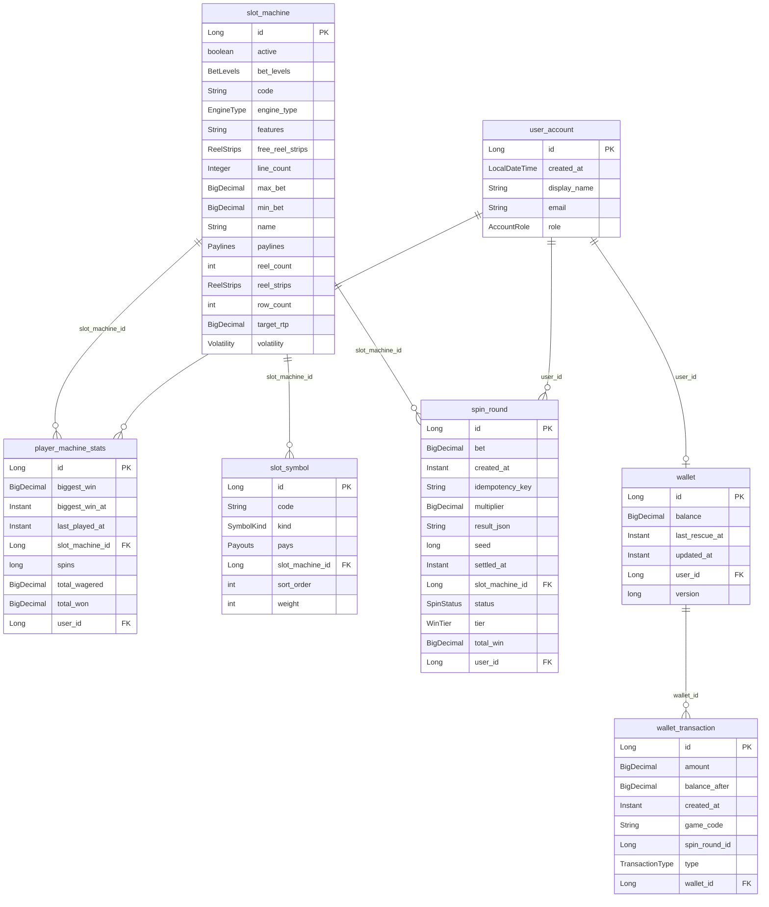

# Schemat bazy danych

Plik generują reguły projektu (panel Maven → Lifecycle → verify). Nie edytujcie go ręcznie.

Tabele: 7 · kolumny: 65 · relacje: 6 × @ManyToOne, 1 × @OneToMany, 1 × @OneToOne, 0 × @ManyToMany

| Tabela | Encja | Kolumny | Klucze obce |
|---|---|---|---|
| player_machine_stats | PlayerMachineStats | 9 | slot_machine_id, user_id |
| slot_machine | SlotMachine | 17 | — |
| slot_symbol | SlotSymbol | 7 | slot_machine_id |
| spin_round | SpinRound | 13 | slot_machine_id, user_id |
| user_account | UserAccount | 5 | — |
| wallet | Wallet | 6 | user_id |
| wallet_transaction | WalletTransaction | 8 | wallet_id |

