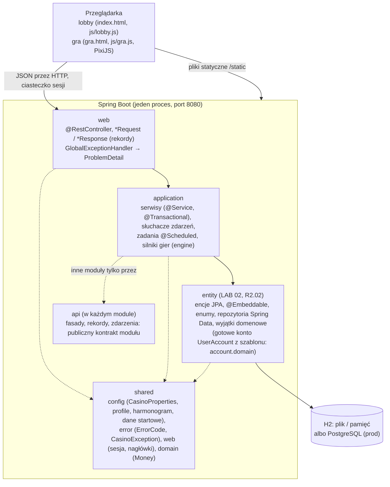
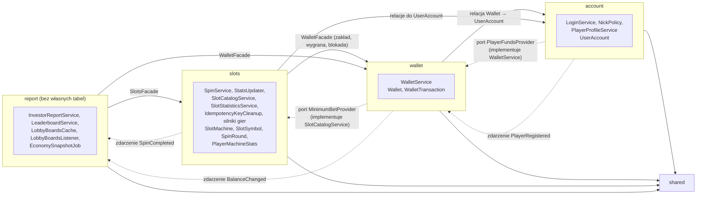
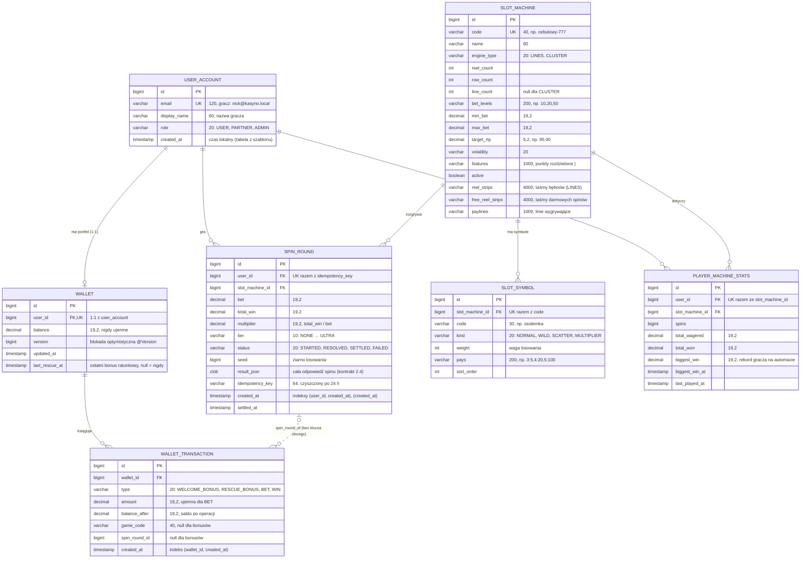
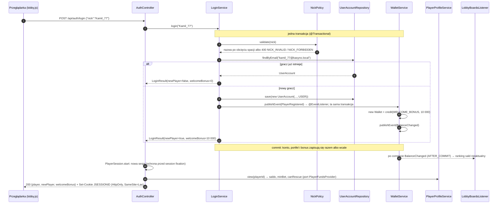
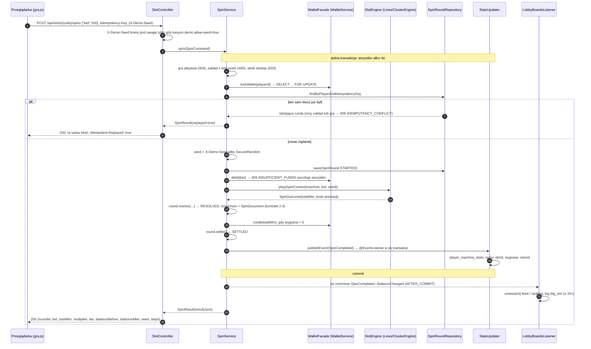
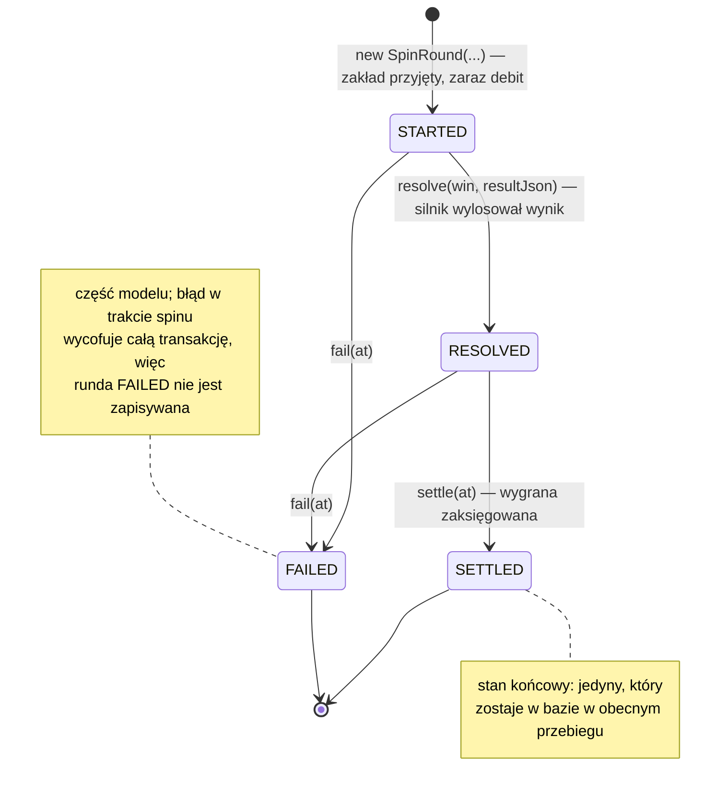
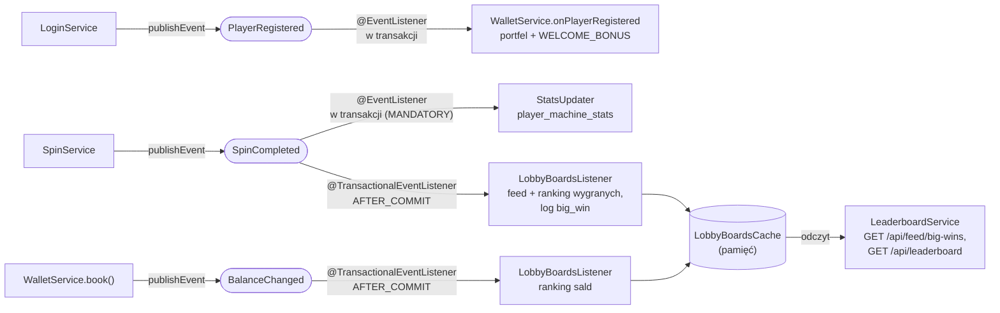

# 01. Architektura: warstwy, moduły, baza danych, przebiegi, zdarzenia

Opis budowy aplikacji Cebulion Casino zgodny z kodem w `src/main/java/pl/wsb/kasyno` (stan po LAB 06). Każdy diagram
ma pod spodem krótkie „dlaczego tak”, bo o to pytają na obronie. Nazwy klas, tabel i kolumn są dokładnie takie jak
w kodzie, więc z diagramu można od razu przejść do pliku (IntelliJ: `Ctrl+N` / `Cmd+O`, nazwa klasy).

## 1. Warstwy

| Warstwa | Pakiet | Zasada (pilnuje `ArchitectureTest`, ArchUnit) |
|---|---|---|
| web | `<moduł>.web` | kontrolery nie używają repozytoriów i nie zwracają encji, tylko DTO |
| application | `<moduł>.application` | nie zna HTTP (nie zależy od `web`); tu są transakcje |
| entity | `<moduł>.entity` (konto z szablonu: `account.domain`) | nie zależy od `application` ani `web`; encje pilnują własnych reguł (np. `Wallet`, `SpinRound`) |
| api | `<moduł>.api` | nie odsłania encji (`entity`, `domain`); tylko interfejsy, rekordy i zdarzenia |
| shared | `shared.*` | nie zależy od żadnego modułu |

**Dlaczego serwer rozstrzyga o wyniku.** Przeglądarka nie losuje i nie liczy wygranych: dostaje gotową rundę jako
listę kroków (`steps`) i tylko ją animuje. Wyniku nie da się podmienić w konsoli przeglądarki, a każda runda ma
zapisany `seed`, więc można ją odtworzyć (audyt, testy, nagrania).

## 2. Moduły i zależności

Linia ciągła = zależność w kodzie (import). Linia przerywana = odwrócona zależność: moduł „niżej” definiuje
interfejs (port) albo publikuje zdarzenie, a moduł „wyżej” je implementuje lub słucha. Dzięki temu nie ma cykli
(`account ← wallet ← slots ← report`), co sprawdza test „brak cykli zależności między modułami”.

| Mechanizm | Przykład | Dlaczego |
|---|---|---|
| fasada w `api` | `WalletFacade`, `SlotsFacade` | moduł widzi tylko kontrakt, nie encje i repozytoria innego modułu |
| port (Dependency Inversion) | `PlayerFundsProvider` w `account`, implementacja w `wallet` | obiekt `player` potrzebuje salda, a `account` nie może zależeć od `wallet` (cykl) |
| zdarzenie | `PlayerRegistered` → portfel z bonusem | konto nie wie, że istnieje portfel; portfel sam reaguje (w tej samej transakcji) |
| identyfikator zamiast relacji | `wallet_transaction.spin_round_id`, `game_code` | portfel nie zna modułu `slots` (brak `@ManyToOne SpinRound`) |

## 3. Baza danych (ERD)

Tabele tworzy Hibernate z encji (`ddl-auto`), dane startowe są w `src/main/resources/data.sql`. Kwoty to
`decimal(19,2)` (`BigDecimal` w Javie), daty to `Instant` (UTC), enumy zapisujemy jako tekst (`EnumType.STRING`).

| Tabela | Encja | Rola |
|---|---|---|
| `user_account` | `account.domain.UserAccount` | konto z szablonu kursu; gracz = konto z rolą `USER` i technicznym e-mailem |
| `wallet` | `wallet.entity.Wallet` | saldo; zmienia się tylko metodami encji (`credit`, `debitBet`, `rescue`) |
| `wallet_transaction` | `wallet.entity.WalletTransaction` | „księga” bez edycji i usuwania: suma `amount` = saldo |
| `slot_machine` | `slots.entity.SlotMachine` | konfiguracja gry (taśmy, linie, zakłady); dane z `data.sql` |
| `slot_symbol` | `slots.entity.SlotSymbol` | symbole i wypłaty (1:N z automatem) |
| `spin_round` | `slots.entity.SpinRound` | runda = jeden zakład; obiekt ze statusem (§ 6) |
| `player_machine_stats` | `slots.entity.PlayerMachineStats` | relacja M:N gracz ↔ automat z atrybutami (spiny, obrót, rekord) |

**Dlaczego `player_machine_stats` to encja, a nie `@ManyToMany`:** `@ManyToMany` umie zapisać tylko „parę”, a nam
potrzebne są liczby przy parze (spiny, obrót, rekord). Unikalna para `(user_id, slot_machine_id)` pilnuje, że dla
gracza i automatu jest jeden wiersz.

**Dlaczego `result_json` w rundzie:** to dokładnie ta odpowiedź, którą dostał gracz. Powtórzone żądanie z tym samym
`Idempotency-Key` zwraca ją bajt w bajt, a w razie sporu widać, co pokazała przeglądarka.

## 4. Logowanie nazwą gracza

Dwa równoczesne logowania tą samą nową nazwą (podwójne kliknięcie): unikalny `email` w bazie odrzuca drugi zapis,
a `AuthController` ponawia logowanie raz, już jako powracający gracz (test `concurrentFirstLoginsCreateOneAccount`).

## 5. Spin (jedna runda = jeden zakład)

* **Blokada portfela na początku** (`lockWallet`): spiny jednego gracza wykonują się po kolei. Dwa równoległe spiny
  nie wydadzą tych samych pieniędzy dwa razy (test: 16 równoległych spinów po 1000 przy saldzie 10 000 → dokładnie 10
  przechodzi), a podwójne kliknięcie z tym samym kluczem czeka na pierwsze i dostaje jego rundę.
* **Wszystko w jednej transakcji:** błąd po pobraniu zakładu wycofuje także zakład, więc gracz nie traci cebulionów
  na nieudanym spinie, a w bazie nie zostaje runda „w połowie”.
* **Kaskady i darmowe spiny są w tej samej rundzie:** silnik liczy całą sekwencję od razu, saldo rozliczamy raz.

## 6. Cykl życia rundy (`SpinRound`, `SpinStatus`)

Przejścia są zapisane w jednym miejscu (`SpinStatus.canTransitionTo`), a encja nie ma `setStatus()`: niedozwolone
przejście (np. drugie `settle`, czyli podwójna wypłata) kończy się `InvalidSpinTransitionException`
(test `SpinRoundTest`).

## 7. Zdarzenia, konfiguracja i zadania cykliczne (LAB 06)

### 7.1. Zdarzenia

| Zdarzenie (`api`) | Publikuje | Słuchacz | Kiedy działa | Dlaczego tak |
|---|---|---|---|---|
| `PlayerRegistered` | `LoginService` | `WalletService.onPlayerRegistered` | synchronicznie, w transakcji logowania | konto bez portfela nie może zostać zapisane |
| `SpinCompleted` | `SpinService` | `StatsUpdater.onSpinCompleted` | synchronicznie, w transakcji spinu (`Propagation.MANDATORY`) | statystyki muszą zgadzać się z rundami: błąd wycofuje spin |
| `SpinCompleted` | `SpinService` | `LobbyBoardsListener.onSpinCompleted` | **po zatwierdzeniu** (`AFTER_COMMIT`) | feed i ranking to widok danych: tylko zatwierdzona runda, wycofany spin się nie pojawi |
| `BalanceChanged` | `WalletService` (każda zmiana salda) | `LobbyBoardsListener.onBalanceChanged` | **po zatwierdzeniu** (`AFTER_COMMIT`) | ranking sald odświeżany dopiero, gdy saldo jest trwałe |

**Feed i ranking dalej liczymy zapytaniami** (jedno źródło prawdy: baza). Zdarzenie po commicie tylko mówi pamięci
podręcznej `LobbyBoardsCache`, że wynik jest nieaktualny. Lobby odpytuje feed i ranking co 45 s w każdej karcie, więc
przy braku gry odpowiedź idzie z pamięci, bez połączenia z bazą (`LeaderboardService` celowo nie ma `@Transactional`).

Dlaczego `AFTER_COMMIT`, a nie zwykły `@EventListener` (trzy argumenty na obronę):

1. **Wycofanie:** przy rollbacku słuchacz w ogóle się nie wykonuje, więc wycofany spin nie trafi do feedu ani do logu
   (test `LobbyBoardsListenerTest.rollbackIsIgnored`).
2. **Wyścig z równoległym odczytem:** gdyby unieważnić pamięć przed commitem, równoległe żądanie lobby mogłoby jeszcze
   przeczytać stary stan bazy i zapisać go jako aktualny. `LobbyBoardsCache` ma licznik pokoleń: wynik zapytania
   zapisuje tylko, gdy w trakcie zapytania nikt nie unieważnił tablicy; to jest poprawne tylko przy unieważnieniu
   po commicie (test `invalidationDuringQueryIsNotCached`).
3. **Izolacja błędów:** wyjątek w słuchaczu po commicie nie psuje spinu, który już się zapisał.

Zdarzenie opublikowane poza transakcją `@TransactionalEventListener` pomija (u nas to się nie zdarza: publikują
wyłącznie metody z `@Transactional`). Pas bezpieczeństwa: wpis w pamięci żyje najwyżej `kasyno.lobby.cache-ttl`
(30 s), na wypadek zmiany danych z pominięciem aplikacji (np. konsola H2).

### 7.2. Konfiguracja: `CasinoProperties` (rekord `@ConfigurationProperties(prefix = "kasyno")`)

| Klucz | Domyślnie | Gdzie używane |
|---|---|---|
| `kasyno.welcome-bonus` | `10000` | `LoginService` → `PlayerRegistered` |
| `kasyno.rescue-amount` | `10000` | `WalletService.rescue` |
| `kasyno.rescue-cooldown` | `10m` (`demo`: `1m`) | `Wallet.rescue`, `fundsOf` (odliczanie w `/api/me`) |
| `kasyno.big-win-multiplier` | `15` | feed dużych wygranych, log `big_win` |
| `kasyno.nick.*` | 3–16 znaków, listy słów | `NickPolicy` |
| `kasyno.lobby.cache-ttl` | `30s` | `LobbyBoardsCache` |
| `kasyno.schedule.enabled` | `true` (testy: `false`) | `SchedulingConfig` (`@EnableScheduling`) |
| `kasyno.schedule.economy-snapshot-cron` | `0 0 * * * *` (`demo`: co minutę) | `EconomySnapshotJob` |
| `kasyno.schedule.idempotency-cleanup-cron` | `0 30 * * * *` | `IdempotencyKeyCleanup` |
| `kasyno.schedule.idempotency-key-ttl` | `24h` | `IdempotencyKeyCleanup` |
| `kasyno.demo.allow-seed` | `false` (`demo`: `true`) | `SlotController` (`X-Demo-Seed`) |
| `kasyno.starter-data.load-when-empty` | `false` (`prod`: `true`) | `StarterDataLoader` |

Rekord jest niemodyfikowalny i ma `@Validated`: błędna wartość (np. ujemny bonus) zatrzymuje start z czytelnym
komunikatem. Progi poziomów wygranych (5×/15×/30×/60×/100×) są stałymi w `WinTier`, bo ustala je brief i zależy od
nich oprawa w przeglądarce. Profile `dev` / `demo` / `prod`: [`00-uruchomienie.md`](00-uruchomienie.md) § 3.

### 7.3. Zadania cykliczne (`@Scheduled`)

| Zadanie | Harmonogram (UTC) | Co robi | Test bez czekania |
|---|---|---|---|
| `report.application.EconomySnapshotJob.logSnapshot` | co godzinę (`0 0 * * * *`) | linia logu `economy_snapshot players=… bankrupt=… coins_in_circulation=… spins_last_hour=…` (bez nowej tabeli) | `EconomySnapshotJobTest`: zegar `MutableClock`, metoda wołana wprost |
| `slots.application.IdempotencyKeyCleanup.forgetExpiredKeys` | co godzinę, w 30. minucie | `UPDATE spin_round SET idempotency_key = NULL` dla rund starszych niż 24 h (jak w API płatności) | `IdempotencyKeyCleanupTest`: zegar przesunięty o 25 h |

`@EnableScheduling` jest w `shared.config.SchedulingConfig` (wyłączane `kasyno.schedule.enabled=false`), a rejestrację
obu zadań z cronami z konfiguracji sprawdza `ProdProfilePersistenceTest.scheduledTasksRegistered`. Czego świadomie
nie ma: zadania „reset limitu bonusu ratunkowego” (limit wynika z `wallet.last_rescue_at` + 10 min, liczonego przy
każdym żądaniu: dokładny co do sekundy, bez opóźnienia harmonogramu) i „sprzątania sesji” (sesje wygasza Tomcat po
7 dniach, `server.servlet.session.timeout`).

## 8. Błędy, sesja, bezpieczeństwo

| Temat | Rozwiązanie | Klasa |
|---|---|---|
| format błędów | `application/problem+json` (RFC 9457) z polem `code` (`NICK_INVALID`, `INSUFFICIENT_FUNDS`…) | `GlobalExceptionHandler`, `ErrorCode` |
| wyjątki biznesowe | dziedziczą po `CasinoException` (status i kod w `ErrorCode`), serwisy nie znają HTTP | np. `RescueNotAvailableException` |
| 5xx | ogólny komunikat, szczegóły tylko w logu serwera | `GlobalExceptionHandler.handleUnexpected` |
| sesja | serwerowa, ciasteczko `HttpOnly`, `SameSite=Lax`, 7 dni; w `prod` także `Secure` | `PlayerSession`, `@CurrentPlayer` |
| nagłówki | `X-Content-Type-Options`, `X-Frame-Options: SAMEORIGIN`, `Referrer-Policy` | `SecurityHeadersFilter` |
| podwójne kliknięcie | `Idempotency-Key` + blokada portfela + unikalny indeks `(user_id, idempotency_key)` | `SpinService` |
| losowość | `SecureRandom` (nieprzewidywalne ziarna); `X-Demo-Seed` tylko w profilu `demo` | `SecureSeedGenerator`, `SlotController` |
| znane ograniczenie | logowanie samą nazwą (bez hasła), świadomie, waluta nie ma wartości | plan § 5.8 |

## 9. Front-end w skrócie

Pliki statyczne w `src/main/resources/static` serwuje ten sam Spring Boot (bez Node.js w produkcji, bez CDN):
lobby (`index.html`, `js/lobby.js`: logowanie, kafle, ranking, feed, bonusy), ekran gry (`gra.html`, `js/gra.js`,
PixiJS 8 z `vendor/`), wspólne moduły (`js/api.js`: jedyne miejsce rozmowy z API, `ProblemDetail` → `ApiError`).
Assety (`assets/img`, `assets/audio`) mają manifesty i nagłówki cache ustawiane w `WebConfig`. Kontrakt między
przeglądarką a serwerem: [`../projekt/09-kontrakt-api-i-assetow.md`](../projekt/09-kontrakt-api-i-assetow.md).

## Powiązane dokumenty

[`00-uruchomienie.md`](00-uruchomienie.md) · [`02-przewodnik-po-kodzie.md`](02-przewodnik-po-kodzie.md) (klasa po
klasie) · [`05-decyzje-projektowe.md`](05-decyzje-projektowe.md) (ADR) · [`../plan-projektu.md`](../plan-projektu.md) ·
[`../projekt/07-gry-i-matematyka.md`](../projekt/07-gry-i-matematyka.md) ·
[`../projekt/09-kontrakt-api-i-assetow.md`](../projekt/09-kontrakt-api-i-assetow.md)
