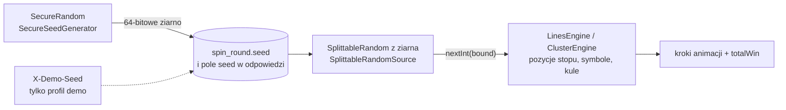
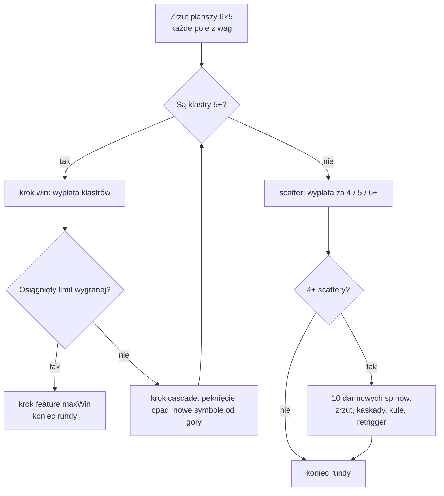

# 03. Silnik gier: losowanie, RTP, taśmy, linie, klastry, kaskady

Przystępne wyjaśnienie, **jak serwer liczy wynik spinu** i **skąd wiemy, że gry oddają 95–96%**. Wszystkie tabele
wypłat, taśmy, wagi i zmierzone liczby są w [`../projekt/07-gry-i-matematyka.md`](../projekt/07-gry-i-matematyka.md)
— tutaj ich nie kopiujemy, tylko odsyłamy (§ numer w 07), żeby była jedna wersja prawdy. Kod: pakiet
`slots/application/engine` (ścieżki skrócone jak w [`02-przewodnik-po-kodzie.md`](02-przewodnik-po-kodzie.md)).

## 1. Słowniczek w minutę

| Pojęcie | Znaczenie | Gdzie w kodzie |
|---|---|---|
| zakład (`bet`) | ile gracz stawia za jedną rundę; tylko poziomy z `bet_levels` gry | `SlotMachine.allowsBet` |
| runda | jeden zakład = cała sekwencja: obrót, wygrane, kaskady, **wszystkie** darmowe spiny | `SpinRound`, `RoundResult` |
| wygrana (`totalWin`) | suma wszystkich wygranych rundy (po limicie) | `RoundBuilder.totalWin` |
| mnożnik rundy (`multiplier`) | `totalWin / bet`, 2 miejsca po przecinku | `SpinRound.resolve`, `SpinDocument.multiplier` |
| poziom (`tier`) | `small` < 5× ≤ `medium` < 15× ≤ `big` < 30× ≤ `mega` < 60× ≤ `epic` < 100× ≤ `ultra` | `slots/entity/WinTier.java:33` |
| RTP | *return to player*: suma wygranych / suma zakładów w długim okresie (np. 96 z każdych 100 cebulionów) | test `SlotMathMonteCarloTest` |
| częstość trafień | jaki odsetek rund kończy się jakąkolwiek wygraną | j.w. |
| zmienność (σ) | jak bardzo wygrane z rundy różnią się od średniej (w zakładach); duża σ = rzadkie, duże wygrane | j.w., 07 § 7 |

## 2. Losowanie: ziarno, `SplittableRandom`, odtwarzalność



**Dwa generatory, dwa zadania:**

1. **Ziarno rundy** losuje `SecureRandom` (`engine/SecureSeedGenerator.java:17`) — generator kryptograficzny: z
   poprzednich ziaren nie da się przewidzieć następnego (zwykły `java.util.Random` da się „odgadnąć” po kilku
   obserwacjach).
2. **Liczby w trakcie rundy** daje `SplittableRandom(seed)` (`engine/SplittableRandomSource.java:20`) — szybki,
   deterministyczny generator (algorytm SplitMix64). `nextInt(bound)` zwraca każdą wartość z przedziału `[0, bound)`
   z tym samym prawdopodobieństwem.

**Dlaczego tak:** 64-bitowe ziarno w bazie **w pełni wyznacza** rundę. Ta sama gra + ten sam zakład + to samo ziarno =
co do kroku ten sam przebieg. Daje to:

* **audyt / reklamację** — rundę z bazy można policzyć jeszcze raz i porównać z zapisanym `result_json`;
  test `SlotEnginesIntegrationTest.spinsFollowContract` (`slots/SlotEnginesIntegrationTest.java:81`) robi to dla
  każdej rundy zagranej przez HTTP;
* **testy konkretnych układów** — silnik losuje wyłącznie przez interfejs `RandomSource` (`engine/RandomSource.java:17`),
  więc test podaje „ustawione liczby” (np. pozycje zatrzymania bębnów) zamiast losowych. Przykład: dokładne RTP S1
  przechodzi wszystkie 32 768 układów lambdą `bound -> stops[next[0]++]` (`SlotMathMonteCarloTest.java:71–94`);
* **nagrania filmików** — w profilu `demo` nagłówek `X-Demo-Seed` narzuca ziarno (`slots/web/SlotController.java:96`);
  w `dev` i `prod` jest ignorowany, bo gracz mógłby powtarzać znaną sobie wygrywającą rundę.

**Czy pokazywanie ziarna graczowi jest bezpieczne?** Tak: ziarno pokazujemy **po** rundzie, a ziarno następnej rundy
losuje znowu `SecureRandom`, niezależnie od poprzednich. Znajomość przeszłych ziaren nic nie mówi o przyszłych.

**Przeglądarka też „losuje”, ale tylko wygląd** — `js/game/core/random.js` (ziarno z `roundId`) wybiera kierunki iskier
i rozrzut monet. Wyniku gry front nie losuje i nie liczy: dostaje go w krokach.

## 3. Skąd silnik bierze dane

| Co | Gdzie | Dlaczego tam |
|---|---|---|
| symbole, rodzaj, wagi, wypłaty | `data.sql` → `slot_symbol` | to dane gry: zmiana bez kompilacji, widać je w jednym miejscu |
| taśmy bębnów, linie (S1, S2) | `data.sql` → `slot_machine.reel_strips`, `free_reel_strips`, `paylines` | czytane zawsze w całości razem z automatem (07 § 8) |
| reguły funkcji (×2, ×10, darmowe spiny, kule, limity) | stałe w `engine/SlotEnginesConfig.java:32–60` | to logika gry, używana wprost przez testy RTP |
| algorytm | `LinesEngine` (S1, S2), `ClusterEngine` (S3), wspólna baza `ConfiguredSlotEngine` | jeden przetestowany algorytm na dwie gry liniowe |

`GameMathProvider.mathFor` (`engine/GameMathProvider.java:32`) przy pierwszym spinie gry czyta konfigurację z bazy
i kompiluje ją do `GameMath` (`engine/GameMath.java:30`): symbole jako liczby `0..n-1`, taśmy jako tablice indeksów,
wagi jako sumy narastające, **wypłaty w setnych częściach mnożnika na `long`** (`1.5 → 150`, `toHundredths`, `:128`).
Przy okazji sprawdza dane (nieznany symbol na taśmie, zła liczba linii, wypłata z ułamkiem groszy) i trzyma wynik
w `ConcurrentHashMap` — kolejne spiny nie czytają już symboli z bazy.

**Kwoty są całkowite.** Wypłaty dobraliśmy tak, że przy **najmniejszym** zakładzie każdej gry (a wszystkie poziomy są
jego wielokrotnościami) żadna kwota nie wymaga zaokrąglenia, więc RTP nie zależy od wysokości zakładu — pilnuje tego
`SlotMathDataTest.paysAreWholeAtMinimumBet` (`slots/application/engine/SlotMathDataTest.java:95`). Silnik liczy na `long`
(szybko, miliony rund), a na granicy z resztą systemu wynik staje się `BigDecimal` (`ConfiguredSlotEngine.play`, `:38`).

## 4. Taśmy (S1, S2) i wagi (S3)

**Taśma** to pętla symboli nadrukowanych na bębnie w ustalonej kolejności. Silnik dla każdego bębna losuje pozycję
zatrzymania `0..długość−1`, a w oknie widać kolejne `rows` symboli od tej pozycji, z zawinięciem
(`LinesEngine.spinReels`, `engine/LinesEngine.java:110–121`):

```java
int stop = random.nextInt(strip.length);
grid[reel][row] = strip[(stop + row) % strip.length];
```

Szansa symbolu w polu = ile razy jest na taśmie / długość taśmy. Przykład S1: każdy bęben ma 32 pozycje, w tym
2 siódemki (07 § 2.4), więc 3 siódemki na wybranej linii bez pomocy WILD-a to (2/32)³ = 1 / 4 096 rund. **Taśma decyduje
też o sąsiedztwie**: bloki „wisnie wisnie wisnie” umożliwiają NEON JACKPOT (cały ekran jednego symbolu — dokładnie 4
z 32 768 układów, czyli 1 na 8 192 rundy), a scattery S2 stoją co ≥ 3 pozycje, więc w oknie bębna jest najwyżej jeden
(test `SlotMathDataTest.faraonStripLayout`). Tak działają prawdziwe automaty bębnowe.

**Wagi** (S3): każde pole planszy 6×5 losujemy niezależnie. `GameMath.drawSymbol` (`engine/GameMath.java:192`) losuje
liczbę z `[0, suma wag)` i szuka pierwszego symbolu, którego suma narastająca ją przekracza. Np. `szafir` ma wagę 300
z 1 244, czyli 24,1% pól w grze podstawowej (07 § 4.2). Kula mnożnika ma wagę 128, ale tylko w darmowych spinach
(`cumulativeWeights(…, free)`, `:173`). W S3 nie ma bębnów (zrzut planszy i dolosowanie w kaskadach), więc taśmy nie
są potrzebne.

W grach liniowych kolumna `slot_symbol.weight` jest informacyjna (= ile razy symbol jest na taśmach gry podstawowej);
zgodność z taśmami sprawdza `SlotMathDataTest.linesWeightsMatchStrips`.

## 5. Linie wygrywające (S1, S2)

Linia to lista indeksów rzędów dla kolejnych bębnów (`0` = górny), np. środkowa `[1,1,1]`, skośna `[0,1,2]`
(`Paylines`, 07 § 2.1 i § 3.1). Ocena jednej linii — `LinesEngine.evaluateLine` (`engine/LinesEngine.java:155–211`):

1. liczymy od **lewego** bębna; kolejne pola muszą mieć ten sam symbol albo WILD;
2. WILD zastępuje każdy zwykły symbol, ale **nie** scatter;
3. gdy linię da się odczytać na kilka sposobów (np. `WILD WILD 7`: trzy siódemki albo dwa WILD), płaci **najwyższa**
   kombinacja; na linii płaci jedna kombinacja;
4. kwota = mnożnik z tabeli × (zakład / liczba linii) × mnożnik WILD (S1: ×2) × mnożnik darmowych spinów (S2: ×2),
   ułamki w dół (`:204`).

Przykład z 07 § 2.6 (S1, zakład 50): `cytryna – WILD – WILD` na linii 1 → 2,5 × (50 / 5) × 2 = **50**.

**Scatter** płaci za liczbę w dowolnym miejscu planszy × zakład całkowity (`LinesEngine.evaluate`, `:140–146`).
**NEON JACKPOT** (S1): cała plansza to jeden zwykły symbol (z WILD-ami) → krok `feature` dodaje 9 × wygrana linii
(razem ×10; `isFullScreen`, `:225`). **Antycypacja** (pole `anticipation` w kroku `spin`): S1 — WILD na bębnach 1–2 jednej
linii → zwalnia bęben 3; S2 — 2 scattery na dotychczasowych bębnach → zwalniają kolejne (07 § 1.7).

## 6. Klastry i kaskady (S3)

**Klaster** = co najmniej 5 takich samych zwykłych symboli połączonych **bokami** (góra, dół, lewo, prawo; po skosie
się nie liczy). `ClusterEngine.findClusters` (`engine/ClusterEngine.java:140–178`) przechodzi planszę przeszukiwaniem
wszerz (BFS) z tablicą `visited`. Wypłata za rozmiar klastra × zakład całkowity; rozmiar większy niż próg w tabeli
płaci jak najbliższy niższy próg (klaster 11 płaci jak 10 — `Payouts.forCluster`, `slots/entity/Payouts.java:77`).
Scatter i kula mnożnika nie tworzą klastrów.



**Kaskada** (`ClusterEngine.cascade`, `:192–239`): symbole z wygranych klastrów pękają, pozostałe w kolumnie opadają w
dół z zachowaniem kolejności (razem z kulami), a puste miejsca u góry wypełniają nowe losowe symbole. Ocena powtarza
się, dopóki powstają klastry (`cascadeSequence`, `:119–134`) — to **sekwencja kaskad**. Scatter nigdy nie pęka i liczymy
go na końcu sekwencji (także te, które dospadły). Pełny przykład z odpowiedzią JSON: 07 § 4.5.

## 7. Darmowe spiny

Darmowe spiny są **częścią tej samej rundy**: gracz płaci zakład raz, a serwer od razu rozgrywa wszystkie darmowe spiny
i zwraca je jako kolejne kroki (`freeSpinsStart`, `spin` z `phase: "free"`, …, `freeSpinsEnd`). Dzięki temu nie ma stanu
„w połowie bonusu” do przechowywania i dokańczania po zerwaniu połączenia.

| | S2 Złoty Faraon | S3 Kryształowa Kaskada |
|---|---|---|
| wyzwalacz | 3+ scattery w grze podstawowej | 4+ scattery |
| start | 10 spinów | 10 spinów |
| w spinach | osobne taśmy (więcej WILD), **WILD rozszerza się na cały bęben** (krok `expandWild`), wygrane liniowe ×2 | kule mnożników na planszy (krok `applyMultiplier`) |
| dodatkowe spiny | 3 scattery → +10 | 3 scattery → +5 |
| limit | łącznie 50 w rundzie | łącznie 50 w rundzie |
| kod | `LinesEngine.playFreeSpins` (`:74`), `expandWilds` (`:242`) | `ClusterEngine.playFreeSpins` (`:71`) |

Reguły: `FreeSpinsRules` (`engine/FreeSpinsRules.java:16`) w `SlotEnginesConfig` (S2 `:39`, S3 `:46`). Limit 50 zamyka
„nieskończony” łańcuch dodatkowych spinów i ogranicza najdłuższą odpowiedź.

## 8. Mnożniki — zestawienie

| Gra | Mnożnik | Jak działa | Kod |
|---|---|---|---|
| S1 | „neonowy” ×2 | wygrana linii, na której WILD **zastąpił** symbol (linia samych WILD bez ×2) | `LinesRules.wildLineMultiplier`, `evaluateLine` |
| S1 | NEON JACKPOT ×10 | cały ekran jednego symbolu: krok `feature` dodaje (10 − 1) × wygrana linii | `LinesEngine.playRound`, `:51–59` |
| S2 | ×2 w darmowych spinach | tylko wygrane liniowe (scatter bez ×2) | `LinesRules.freeSpinWinMultiplier` |
| S3 | suma kul ×2…×100 | na końcu sekwencji kaskad w darmowym spinie suma wartości wszystkich kul na planszy mnoży wygraną sekwencji; krok `applyMultiplier` **dodaje** `baseWin × (orbsSum − 1)` | `ClusterEngine.java:90–98` |

Wartości kul losujemy z osobnego rozkładu (`SlotEnginesConfig.java:49–59`, 07 § 4.3): ×2 i ×3 po 17,5%, ×100 — 1,4%;
średnia ≈ 9,1. Kule nie przechodzą na następny darmowy spin.

## 9. Limit maksymalnej wygranej

Każde miejsce, które dodaje wygraną (linie, klastry, NEON JACKPOT, kule), przechodzi przez jedną metodę
`RoundBuilder.addWin` (`engine/RoundBuilder.java:40–47`):

```java
long allowed = Math.min(amount, maxWin - totalWin);   // kwota ponad limit jest ucinana
totalWin += allowed;
if (totalWin >= maxWin) maxWinReached = true;
```

Po osiągnięciu limitu `stopAtMaxWin` (`:55`) dopisuje krok `feature maxWin` i silnik kończy rundę (bez dalszych kaskad
i spinów). Limity: S1 1 000×, S2 5 000×, S3 10 000× zakładu (07 § 1.5). W S1 limit = teoretyczne maksimum (pełny ekran
siódemek z WILD), w S2 i S3 nie wystąpił w żadnej z ponad 26 mln rund testowych. **Po co:** najgorszy przypadek dla
kasyna jest znany z góry, a odpowiedź ma ograniczoną długość. Testy: `LinesEngineTest.maxWinCapsRound`,
`maxWinStopsFreeSpins`, `ClusterEngineTest.maxWinStopsCascades`.

## 10. RTP: jak liczymy i jak sprawdzamy

**RTP = suma wygranych / suma zakładów.** Docelowo: S1 95%, S2 96%, S3 96% (`slot_machine.target_rtp`). Każdą grę
sprawdzamy inaczej, bo różna jest jej złożoność:

| Gra | Metoda | Wynik (szczegóły w 07) |
|---|---|---|
| S1 | **dokładnie**: wszystkie 32³ = 32 768 układów bębnów, każdy z prawdopodobieństwem 1/32 768 | **94,892%** (07 § 2.5) |
| S2 | model z wartości oczekiwanej (linie z rozkładów pól, scattery splotem, darmowe spiny łańcuchem Markowa) + Monte Carlo 10 mln rund | model 95,99%, test **96,178%** (07 § 3.5, § 6.4) |
| S3 | tylko symulacja (kaskad nie da się prosto policzyć wzorem): 14 mln rund w teście, 60 mln przy kalibracji | test **96,282%**, długa próba 95,97% (07 § 4.4) |

**Test Monte Carlo** (`SlotMathMonteCarloTest`, `slots/application/engine/SlotMathMonteCarloTest.java`) gra miliony rund
**prawdziwym silnikiem** na **prawdziwych danych** z `data.sql` (`@DataJpaTest` + `GameMathProvider`) — to ten sam kod,
który działa w aplikacji, a nie uproszczona kopia.

* **Ile rund:** błąd standardowy zmierzonego RTP to σ / √n (σ — odchylenie wygranej z rundy w zakładach). Chcemy, żeby
  tolerancja ±0,8 p.p. była ≥ 3 błędami standardowymi, więc n ≥ (3σ / 0,008)². Dla S3 (σ ≈ 9,38) to ≥ 12,4 mln — stąd
  14 mln. Test sam sprawdza `3 × błąd std. ≤ 0,8 p.p.` (`:116`, `:130`). Mniejsza próba (np. 300 tys. rund S3, błąd
  ±1,7 p.p.) „przechodziłaby” także dla źle skalibrowanej gry. Tabela: 07 § 6.2.
* **Powtarzalność:** stałe ziarno 20261011; rundy liczone równolegle w 16 porcjach, każda z generatorem wydzielonym
  `SplittableRandom.split()` w stałej kolejności (`simulate`, `:136–155`); każda runda dostaje własne 64-bitowe ziarno,
  jak w aplikacji. Wynik nie zależy od liczby rdzeni.
* **Co jeszcze sprawdza:** częstość trafień (S1 30–35%, S2 25–30%, S3 25–35%), częstość darmowych spinów (S2 1/150–1/200,
  S3 1/200–1/300), dla S1 — dokładnie 4 NEON JACKPOTy w 32 768 układach.
* **Uruchomienie:** `mvn -B test -Dtest='SlotMath*'` — w wyjściu linie `[MATEMATYKA] S2 Złoty Faraon: rundy=10000000
  seed=20261011 RTP=… (błąd std. … p.p.) trafienia=… sigma=… FS=1/…`. Trwa ok. 20 s na 4 rdzeniach.

**Rzeczywisty RTP w aplikacji** pokazuje raport `GET /api/reports/rtp` (`GameRtp.actualRtp`,
`slots/api/GameRtp.java:30`; zapytanie `SpinRoundRepository.findRtp`, `:66–73`). Przy kilkudziesięciu rundach może
wynosić 40% albo 300% — to normalne przy losowości (σ ≈ 3–9 zakładów na rundę); dlatego raport podaje też liczbę rund.

## 11. Jak odpowiedzieć na pytanie „skąd wiecie, że RTP jest 96%?”

**Odpowiedź w 30 sekund:**

> „Nie zgadujemy — mierzymy. Test `SlotMathMonteCarloTest` rozgrywa 10 mln rund Złotego Faraona i 14 mln rund
> Kryształowej Kaskady **tym samym silnikiem co aplikacja**, na danych z `data.sql`, ze stałym ziarnem. Wychodzi
> 96,18% i 96,28%. Liczbę rund dobraliśmy ze wzoru na błąd standardowy σ/√n tak, żeby tolerancja ±0,8 p.p. była
> co najmniej trzema błędami standardowymi — test sam to sprawdza. Dla Cebulowego 777 liczymy RTP **dokładnie**,
> przechodząc wszystkie 32 768 układów bębnów: 94,892%. Szczegóły są w dokumencie 07.”

**Pokaż w kodzie:** `SlotMathMonteCarloTest.java:110` (`faraonMonteCarlo`) i `:71` (`cebulowyExactRtp`), uruchom
`mvn -B test -Dtest='SlotMath*'` i wskaż linię `[MATEMATYKA]`.

**Pytania dodatkowe i odpowiedzi:**

| Pytanie | Odpowiedź |
|---|---|
| „Czemu S1 ma 94,89%, a nie 95%?” | wypłaty zmieniają się skokowo co 0,5 (żeby przy zakładzie 10 kwoty były całkowite) i mają „okrągłe” wartości; 0,11 p.p. to dużo mniej niż tolerancja (07 § 2.5) |
| „Czy wynik nie jest dopasowany do jednego ziarna?” | przy n = 14 mln błąd std. to 0,25 p.p.; inne ziarno da wynik w tym zakresie (kalibracja S3 na 60 mln rund innym ziarnem: 95,97%); stałe ziarno służy powtarzalności testu, nie „ustawieniu” wyniku |
| „Raport w aplikacji pokazuje 70% — to błąd?” | nie, przy małej liczbie rund losowość dominuje; RTP to średnia w długim okresie |
| „Co jeśli ktoś zmieni `data.sql`?” | test Monte Carlo (i dokładny test S1 z wartością 94,892%) przestanie przechodzić; procedura zmiany matematyki: 07 § 6.4 |
| „Czy silnik w teście to ten sam co w aplikacji?” | tak: `LinesEngine`/`ClusterEngine.playRound` z regułami `SlotEnginesConfig`, dane z H2 przez `GameMathProvider`; w aplikacji dochodzi tylko `ConfiguredSlotEngine.play` (ziarno → `RandomSource`, wynik → JSON) |
| „A RTP nie zależy od zakładu?” | nie — wypłaty są całkowite przy minimalnym zakładzie (`paysAreWholeAtMinimumBet`), więc kwoty skalują się liniowo |
| „Czy runda w aplikacji na pewno liczy się tak jak w teście?” | `SlotEnginesIntegrationTest` gra przez HTTP i każdą rundę odtwarza z ziarna, porównując z zapisaną odpowiedzią |

## 12. Testy silników (skrót; pełna tabela: 07 § 6.1)

| Test | Przykład, co sprawdza |
|---|---|
| `LinesEngineTest` | `wildSubstitutesAndDoubles` (`:46`), `picksHighestCombination`, `neonJackpot`, `freeSpinsWithExpandingWild` (`:212`), `retriggerUpToLimit`, `maxWinCapsRound` (`:125`), `jsonFormat`, `replayFromSeed` (`:292`) |
| `ClusterEngineTest` | `clusterOfFivePaysFourDoesNot` (`:84`), `onlyOrthogonalNormalSymbols`, `cascadeDropsSymbols` (`:125`), `freeSpinsWithMultiplierOrbs` (`:164`), `retriggerInFreeSpins`, `replayFromSeed` (`:240`) |
| `GameMathTest` | wypłaty w setnych, nieznany symbol na taśmie, ułamek groszy, kula tylko w FS |
| `SlotMathDataTest` | dane z `data.sql`: kody symboli z briefu, linie S1 jak w kontrakcie, wagi = taśmy, wypłaty całkowite, WILD S2 tylko na bębnach 2–4, scattery co ≥ 3 pozycje |
| `SlotMathMonteCarloTest` | RTP, trafienia, darmowe spiny (§ 10) |
| `SlotEnginesIntegrationTest` | 25 spinów każdej gry przez HTTP, kontrakt § 2.4, saldo, suma kroków = `totalWin`, odtworzenie z ziarna |

```bash
mvn -B test -Dtest='LinesEngineTest,ClusterEngineTest'   # układy i kroki (poniżej 2 s)
mvn -B test -Dtest='SlotMath*'                           # matematyka (ok. 20 s)
```

## 13. Typowe pułapki w odpowiedziach

* „Przeglądarka losuje symbole” — **nie**. Bębny kręcą się „na pokaz”, a zatrzymują na planszy z odpowiedzi serwera
  (`ReelSet.land(grid)`); wizualna taśma w `S1_CONFIG.fillerWeights` to tylko wygląd.
* „Darmowe spiny to osobne żądania” — **nie**, są krokami tej samej odpowiedzi (jedna transakcja, jeden zakład).
* „Kwoty liczymy w `double`” — **nie**: silnik na `long` w setnych, baza i API na `BigDecimal`.
* „Wagi S1 decydują o losowaniu” — w grach liniowych decydują **taśmy**; waga jest informacyjna (test pilnuje zgodności).
* „Limit wygranej obniża RTP” — tylko o tyle, o ile zdarza się w praktyce; w testach (26 mln rund S2+S3) nie wystąpił.

## Powiązane dokumenty

[`../projekt/07-gry-i-matematyka.md`](../projekt/07-gry-i-matematyka.md) (wszystkie liczby i tabele) ·
[`../projekt/09-kontrakt-api-i-assetow.md`](../projekt/09-kontrakt-api-i-assetow.md) § 2.4 (format kroków) ·
[`02-przewodnik-po-kodzie.md`](02-przewodnik-po-kodzie.md) § 3.5 · [`05-decyzje-projektowe.md`](05-decyzje-projektowe.md) ·
[`06-pytania-na-obrone.md`](06-pytania-na-obrone.md)
