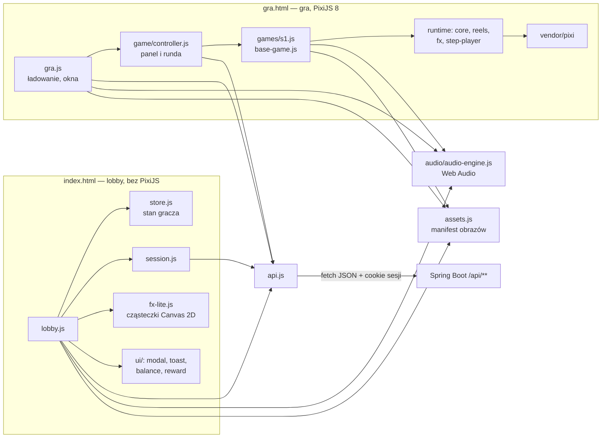
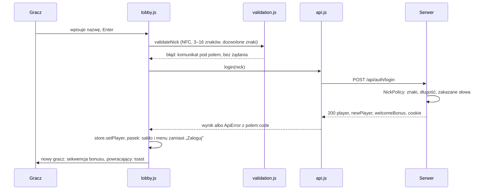
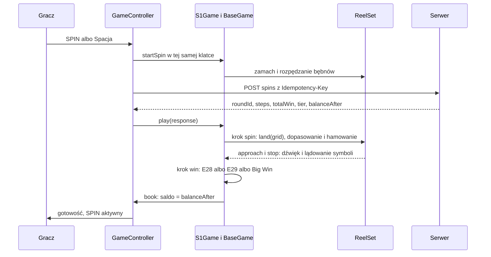
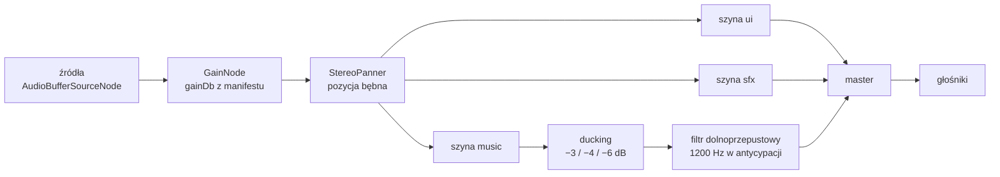
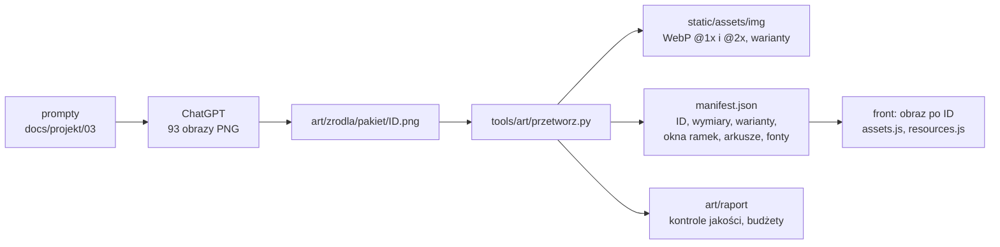

# 04. Front: lobby, gra, efekty i dźwięk

Przystępne wyjaśnienie, **jak działa część w przeglądarce**: lobby i logowanie, strona gry od kliknięcia SPIN do
zaksięgowania salda, bębny, cząsteczki, błyski, drżenie, Big Win, poziomy jakości i dźwięk — oraz skąd biorą się
grafika i dźwięki. Na końcu (§ 8) dziesięć typowych pytań o front z gotowymi odpowiedziami. Liczby i tabele są
w dokumentach projektowych — tutaj odsyłamy do nich, żeby była jedna wersja prawdy:
[`06-interfejs-ux.md`](../projekt/06-interfejs-ux.md) (ekrany, teksty, dostępność),
[`08-wydajnosc-i-jakosc.md`](../projekt/08-wydajnosc-i-jakosc.md) (wydajność, jakość, pomiary),
[`10-runtime-gier.md`](../projekt/10-runtime-gier.md) (silnik gier).

**Jak czytać odnośniki** (jak w [`02-przewodnik-po-kodzie.md`](02-przewodnik-po-kodzie.md)): `js/game/controller.js:119`
= `src/main/resources/static/js/game/controller.js`, linia 119; `account/application/NickPolicy.java:49` =
`src/main/java/pl/wsb/kasyno/account/application/NickPolicy.java`; `tools/…` — od katalogu głównego repozytorium.
Numery linii według stanu z 2026-10-11.

**S2 i S3** działają dziś na grze zastępczej na tym samym runtime (`js/game/games/zastepcza.js`); ich własne sceny
i efekty (rozszerzony WILD, kaskady, kule mnożników) — **uzupełnimy po scaleniu S2/S3** (§ 9).

---

## 0. Front w jednym obrazku



**Zasada nr 1 (ADR-01): przeglądarka niczego nie losuje i niczego nie liczy.** Serwer zwraca całą rundę jako listę
kroków (obrót, wygrane, funkcje specjalne) i saldo po rundzie; front tylko to **odgrywa**. Jedyna arytmetyka frontu
to wybór oprawy (small … ultra) według mnożnika — nigdy kwoty (`js/game/base-game.js:39`).

**Zasada nr 2 (ADR-11): bez bundlera i frameworka.** Przeglądarki obsługują moduły ES (`import` / `export`)
natywnie, Spring Boot serwuje pliki z `static/` bez kroku budowania, PixiJS leży w repozytorium
(`vendor/pixi/pixi.min.mjs`, wersja 8.22.0) — działa bez internetu na obronie.

## 1. Słowniczek w minutę

| Pojęcie | Znaczenie |
|---|---|
| moduł ES | plik JS z `import`/`export`; `<script type="module">` ładuje go z zależnościami |
| manifest | `static/assets/img/manifest.json` i `static/assets/audio/manifest.json` — spis plików po ID; front prosi o „`s1_sym_wild`”, nie o ścieżkę |
| sprite, tekstura | obrazek na scenie Pixi / obraz wgrany do pamięci karty graficznej |
| atlas | wiele małych obrazków w jednej teksturze — jedno wywołanie rysowania zamiast wielu |
| ticker | zegar Pixi wołający naszą funkcję co klatkę (~60 razy na sekundę) |
| tween | animacja wartości w czasie (np. alfa 0 → 1 w 300 ms z krzywą `easeOutCubic`) |
| `ParticleContainer` | kontener Pixi 8 do tysięcy prostych sprite'ów jednym wywołaniem rysowania |
| filtr / shader | mały program na karcie graficznej przetwarzający piksele (bloom, połysk) |
| DPR | `devicePixelRatio` — ile pikseli ekranu przypada na piksel CSS (Retina: 2–3) |
| Web Audio | API przeglądarki do dźwięku z dokładnością do milisekund, z mikserem w kodzie |
| szyna | „suwak miksera”: wszystkie dźwięki UI, efekty albo muzyka przechodzą przez jedną głośność |
| ducking | automatyczne ściszenie muzyki pod ważnym efektem |

---

## 2. Lobby i logowanie od strony przeglądarki

### 2.1. Start strony

`index.html` ładuje style i jeden moduł `js/lobby.js` (`index.html:25`). Funkcja `init()` (`js/lobby.js:116`)
uruchamia równolegle:

1. silnik cząsteczek `FxLite` i licznik salda;
2. nasłuch **pierwszego dowolnego gestu** — odblokowuje dźwięk i wczytuje pakiety `ui` + `lobby` (`:128`);
3. manifest obrazów → podmiana grafik zastępczych na obrazy z ChatGPT (`assets.applyTo`, `js/assets.js:131`);
4. przywrócenie sesji (`restoreSession`, `js/session.js:38`);
5. katalog gier `GET /api/slots` (przy braku serwera — katalog zapasowy, `js/lobby.js:36`).

Potem: kafle, feed i ranking (odświeżane co 45 s, tylko gdy karta jest widoczna) i obsługa adresu `/?gra=<kod>`.

### 2.2. Sesja: cookie, którego JavaScript nie widzi

Po zalogowaniu serwer ustawia **cookie sesji `HttpOnly`** (`SameSite=Lax`, 7 dni) — skrypt na stronie nie może go
odczytać, więc nie da się go ukraść przez XSS. Przeglądarka dołącza je sama do każdego `fetch` z
`credentials: 'same-origin'` (`js/api.js:56`). W `localStorage` zapisujemy tylko **wskazówkę** `cebulion.sesja = 1`
(„logowałem się tu”) — żeby nowy gość nie dostawał przy każdym wejściu zbędnego `401` w konsoli. O tym, kto jest
zalogowany, zawsze decyduje serwer (`GET /api/me`) — `js/session.js:1–31`.

### 2.3. Logowanie krok po kroku



* **Walidacja w przeglądarce to wygoda**, prawdziwa jest w Javie (`NickPolicy.java:49`) — żądanie da się wysłać
  z pominięciem strony. Backend dodatkowo odrzuca nazwy zastrzeżone i wulgarne po „uproszczeniu” (`Adm1n`,
  `A_d_m_i_n` → `admin`). Porównanie reguł obu stron: [06 § 8](../projekt/06-interfejs-ux.md).
* W trakcie żądania przycisk pokazuje kręciołek, a okna nie da się zamknąć (`js/lobby.js:416`).
* Po sukcesie okno się zamyka, a sekwencja bonusu startuje **dwie klatki później** — zdjęcie atrybutu `inert`
  z całej strony to przeliczenie stylów i nie może zbiec się ze startem animacji (`js/lobby.js:429`).

### 2.4. Jeden stan, wiele widoków (`store.js`)

Saldo widać w pigułce, w menu gracza, w panelu bankructwa i w rankingu („· Ty”). Zamiast aktualizować każde miejsce
ręcznie, kod zmienia stan w jednym obiekcie, a widoki słuchają zdarzeń `player` i `balance`
(`js/store.js:28`, `store.on('player', renderPlayer)` w `js/lobby.js:138`). Źródłem prawdy jest serwer — w `store`
trzymamy tylko kopię ostatniej odpowiedzi. Bankrut = `balance < minBet` (`js/store.js:56`).

### 2.5. Rozmowa z serwerem: `api.js`

Jedno miejsce na wszystkie żądania (`js/api.js:49`): JSON, cookie sesji, limit czasu 12 s (`AbortController`),
`cache: 'no-store'`. Błąd serwera w formacie `application/problem+json` (RFC 9457) zamieniamy na `ApiError` z polem
`code`, więc reszta kodu pyta `err.code === 'INSUFFICIENT_FUNDS'`, a nie parsuje tekstów. Brak sieci i przekroczenie
czasu to też `ApiError` (`NETWORK_ERROR`, `TIMEOUT`). Teksty dla gracza do każdego kodu: `messageFor`
(`js/api.js:110`, `:131`; tabela w [06 § 7.3](../projekt/06-interfejs-ux.md)).

### 2.6. Bonus powitalny, bankructwo i ratunek

* **Bonus powitalny (E07)** — `playReward` (`js/ui/reward.js:40`): zasłona, promienie, skrzynia, fontanna 24 monet,
  które po łukach (krzywe Béziera) lecą do pigułki salda; każda doliczona moneta podnosi licznik. Kliknięcie, Esc,
  Enter albo „Pomiń” przewija do końca — saldo **zawsze** kończy się wartością z serwera. Przy „ogranicz ruch” saldo
  ustawia się od razu.
* **Bankructwo (E09)** — panel z maskotką zastępuje przyciski sekcji powitalnej; bonus dostępny → „Odbierz 10 000
  cebulionów”, inaczej odliczanie „Dostępny za 09:41” (`js/lobby.js:473–551`). Serwer i tak sprawdza limit 10 minut —
  front tylko pokazuje stan z `canRescue` i `rescueAvailableInSeconds`.

### 2.7. Bezpieczeństwo w przeglądarce

Nazwy graczy (dane z zewnątrz) wstawiamy wyłącznie przez `textContent`, nigdy `innerHTML` — nazwa nie może wstrzyknąć
HTML (XSS) (`js/lobby.js:11`); jedyne `innerHTML` w lobby to stała grafika zastępcza kafla z kodu (`:602`). Sesja
w cookie `HttpOnly`. Wynik spinu nie istnieje w przeglądarce, dopóki nie przyśle go serwer (pytanie 1 w § 8).

---

## 3. Strona gry: od kliknięcia SPIN do salda

### 3.1. Ładowanie i przycisk „Graj”

`js/gra.js:73` (`init`): sprawdza kod gry w adresie, sesję (`GET /api/me`) i automat (`GET /api/slots/{code}` —
poziomy zakładu, symbole, tabela wypłat, kształty linii), potem **dynamicznie importuje** runtime i PixiJS
(`startRuntime`, `:145`) — lobby tych plików nie pobiera. `BaseGame.load()` (`js/game/base-game.js:104`) wczytuje
obrazy po ID, rysuje brakujące w Canvas 2D, składa atlasy cząsteczek, wgrywa tekstury na kartę graficzną
i kompiluje shadery — wszystko **na ekranie ładowania**, żeby nic z tego nie trafiło w spin. Pasek postępu nigdy się
nie cofa.

Na końcu pojawia się **„Graj”** (`js/gra.js:124`). Kliknięcie to gest użytkownika, w którego obsłudze odblokowujemy
dźwięk (`audio.unlock()`, `:127`) — bez gestu przeglądarka nie zagra ani jednego dźwięku (§ 6.3). Potem intro
automatu (E21), a po 1000 ms SPIN staje się aktywny (`controller.ready()`, `js/game/controller.js:110`).

### 3.2. SPIN — kontroler rundy

Stany: `intro → ready → spinning → presenting → ready` (`js/game/controller.js:4`). Metoda `spin()` (`:119`):

1. saldo < zakład → okno „Za mało cebulionów” (z bonusem ratunkowym, gdy dostępny);
2. stan `spinning`, **nowy `Idempotency-Key`** (`crypto.randomUUID()`) na każde kliknięcie (`:128`);
3. na ekranie saldo od razu minus zakład (gracz widzi, ile postawił);
4. **bębny ruszają w tej samej klatce** (`game.startSpin`, `:136`) — nie czekamy na serwer, gra „reaguje” natychmiast;
5. równolegle `POST /api/slots/{code}/spins` (`:140`);
6. odpowiedź → stan `presenting` → `game.play(response)` (`:151`) odgrywa kroki;
7. księgowanie salda (`#book`, `:162`) — **dokładnie raz** na rundę: na końcu liczenia wygranej, przy przylocie licznika
   Big Win do panelu albo po zatrzymaniu bębnów bez wygranej. Liczba w pasku zgadza się z tym, co widać na ekranie.

Ten sam przycisk ma trzy role (`primary()`, `:229`): w spoczynku **SPIN**, w trakcie obrotu **STOP** (szybkie
zatrzymanie), w trakcie prezentacji **przewinięcie**. Spacja działa tak samo; dotknięcie sceny przewija.



### 3.3. `StepPlayer` — odtwarzacz kroków

Serwer liczy całą rundę naraz (ADR-02: jedna runda = jeden zakład, także z kaskadami i darmowymi spinami) i zwraca
listę kroków: `spin`, `win`, `feature`, `cascade`, `expandWild`, `applyMultiplier`, `freeSpinsStart`,
`freeSpinsRetrigger`, `freeSpinsEnd` (format: [09 § 2.4](../projekt/09-kontrakt-api-i-assetow.md)).

`StepPlayer.play()` (`js/game/step-player.js:56`) robi coś bardzo prostego — i właśnie dlatego niezawodnego:

```js
for (let i = 0; i < steps.length; i++) {          // step-player.js:80
  const handler = handlers.get(step.type) ?? defaultHandler(step.type);
  await handler(step, ctx);                        // następny krok startuje dopiero po zakończeniu poprzedniego
}
```

* Każdy handler to funkcja `async` — **kolejność animacji = kolejność w odpowiedzi serwera**.
* `BaseGame` rejestruje domyślne handlery wszystkich 9 typów (`onSpin`, `onWin`, `onCascade`…,
  `js/game/base-game.js:75`), a gra konkretna nadpisuje te, które mają mieć własne efekty (S1: `onFeature` dla
  NEON JACKPOT). Nieznany typ = ostrzeżenie w konsoli, runda idzie dalej (`step-player.js:98`).
* Kontekst `ctx` przekazuje między krokami: odpowiedź, zakład, tempo (TURBO), token przewinięcia, sumę pokazaną na
  liczniku i podgląd kolejnych kroków (`ctx.next('feature')`).
* Ziarno **efektów** (kierunki iskier, rozrzut monet) pochodzi z `roundId` (`step-player.js:76`) — ta sama runda
  wygląda zawsze tak samo. To losowość tylko dla wyglądu; wynik losuje serwer.

**Jednostki prezentacji.** Spin bazowy, każdy darmowy spin i podsumowanie darmowych spinów to osobne „jednostki”;
`m = (totalWin po − totalWin przed) / bet` wybiera oprawę według progów z briefu (small < 5×, medium ≥ 5×, big ≥ 15×,
mega ≥ 30×, epic ≥ 60×, ultra ≥ 100×) — `tierFor`, `base-game.js:39`. W rundzie bez darmowych spinów wynik musi
równać się polu `tier` z serwera; rozjazd liczy `stats.tierMismatch` (test e2e wymaga 0) — `base-game.js:412`.

---

## 4. Bębny: fizyka w `ReelSet`

**Model taśmy** (`js/game/reels/reelset.js:1–23`). Bęben to nieskończona pionowa taśma symboli. Liczba `p`
(przesunięcie w polach) rośnie, gdy taśma jedzie w dół; rząd `j` pokazuje symbol o indeksie `j − p`. Symbol pod
indeksem pochodzi z mapy wyniku (gdy przyjdzie odpowiedź) albo z „wizualnej taśmy” wybieranej stałym skrótem z indeksu
— ta sama pozycja to zawsze ten sam symbol, więc nic nie migocze. Na bęben przypada tylko `rzędy + 2` sprite'ów,
przypisywanych co klatkę do widocznych indeksów.

| Faza (S1, TURBO = czasy × 0,45) | Co się dzieje | Kod |
|---|---|---|
| zamach | 0,18 pola w górę w 120 ms (`easeOutQuad`) — „naciągnięcie” przed startem | `reelset.js:340` |
| rozpędzanie | do 22 pól/s w 200 ms, prędkość rośnie jak `easeInQuad`; bębny startują co 50 ms | `:289` |
| obrót | stała prędkość; rozmycie ruchu = podmiana tekstur (`ruch2` > 60% v_max, `ruch1` 20–60%) | `:417` |
| **dopasowanie** | gdy przyjdzie wynik: wybór pozycji docelowej `N` i współczynnika prędkości `f` tak, żeby koniec hamowania wypadł **dokładnie** w zaplanowanej milisekundzie stopu | `:303` |
| hamowanie | `p(t) = pb + d·(1 − (1 − t/D)³)`, `D` = 260 ms; prędkość na starcie hamowania = prędkość obrotu (bez szarpnięcia), na końcu 0; kończy się **za** celem o 0,12 pola — to „moment stopu” | `:367` |
| osiadanie | powrót o te 0,12 pola w 160 ms z lekkim odbiciem (`easeOutBack`) | `:385` |

Stopy S1: 1240 / 1420 / 1600 ms od kliknięcia (`S1_TIMING`, `:30`).

**Dopasowanie na przykładzie.** Bęben kręci się 22 pola/s, odpowiedź przyszła po 300 ms, stop ma wypaść w 1240 ms,
więc hamowanie zaczyna się w 980 ms. Kod całkuje prędkość do chwili hamowania (48 kroków), dodaje drogę hamowania
(`v·D/3` — z wzoru wyżej) i odejmuje odbicie; zaokrągla wynik do całkowitej pozycji `N` (wynik musi wjechać z góry,
z niewidocznej części taśmy), a różnicę rozkłada na współczynnik prędkości `f` (zwykle o kilka procent od 1) —
gracz tego nie zauważa. Drogę hamowania `d` liczymy od **rzeczywistej** pozycji w chwili startu hamowania, więc
wyrównanie jest zawsze dokładne co do piksela (`reelset.js:362`).

| Sytuacja | Zachowanie | Kod |
|---|---|---|
| antycypacja (pole `anticipation` w kroku `spin`) | wskazany bęben i kolejne stają +900 ms później; po 400 ms bęben zwalnia do 0,55 v_max | `:211`, `:290` |
| szybki stop (STOP / Spacja / dotknięcie) | wszystkie kręcące się bębny hamują od razu (0,6 D, co 40 ms); antycypacja pominięta | `:237`, `:243` |
| spóźniona odpowiedź serwera | pierwszy stop = max(plan, teraz + 450 ms), kolejne przesunięte o tyle samo | `:222` |
| błąd sieci (E40) | łagodne hamowanie (1,5 D, bez odbicia) na planszy **sprzed** spinu — nie wymyślamy wyniku | `:261` |

**Zapowiedź stopu.** Bęben ~170 ms przed stopem wysyła zdarzenie `approach` z dokładnym czasem do stopu
(`reelset.js:373`). Dzięki temu dźwięk uderzenia planujemy na zegarze audio co do milisekundy (§ 6.7), a nie „w klatce,
w której wypadło”. W chwili stopu zdarzenie `stop` uruchamia „przysiad” symboli (squash & stretch,
`base-game.js:295`) i haptykę.

---

## 5. Efekty

### 5.1. Pętla gry i czas

Jeden ticker Pixi, stała kolejność w klatce (`js/game/core/app.js:122`): zegar i tweeny → bębny → scena → cząsteczki →
Big Win → kamera → bloom → **dopiero potem rysowanie**. Logika nigdy nie dzieje się w trakcie rysowania.

* **Przycięcie `dt`:** pojedyncze zacięcie przeglądarki liczy się najwyżej jako 50 ms — animacja nie „przeskakuje”
  o pół sekundy. Gdy urządzenie stale nie wyrabia (8+ długich klatek), limit rośnie do 100 ms, żeby runda nie trwała
  dwa razy dłużej (`app.js:128`).
* **Zegar gry stoi przy ukrytej karcie** (ticker zatrzymany) — po powrocie nic nie przeskakuje, a `wait()` czeka dalej.
* **Dwa czasy:** zwykły i „efektów”, który staje na 80 ms przy eskalacji Big Win (*hit-stop* — stopklatka jak
  w bijatykach: licznik i cząsteczki zamierają, kamera i muzyka nie) — `js/game/core/tween.js:82`, `:174`.
* **Przewinięcie** to `SkipToken` (`tween.js:19`): przekazany do `wait`/`tween` kończy je natychmiast; sekwencja sama
  decyduje, jak wygląda jej stan końcowy (np. kwota końcowa na liczniku).

### 5.2. Cząsteczki

`js/game/fx/particles.js` — monety, iskry, konfetti, dym, neonowe iskry, pył.

* **Fizyka w jednej linijce na wielkość** (`particles.js:107`): `v += g·dt; v *= exp(−opór·dt); p += v·dt` —
  dzięki `exp` wynik nie zależy od tego, czy ekran ma 60, czy 120 Hz.
* **Struktura tablic:** stan wszystkich cząsteczek warstwy w `Float32Array` (x, y, vx, vy, wiek, życie…), a nie
  obiekt na cząsteczkę. Martwa cząsteczka znika przez **zamianę z ostatnią żywą** (O(1)) — w trakcie gry nie ma
  alokacji ani sprzątania pamięci (`:85`).
* **Rysowanie:** `ParticleContainer` z Pixi 8 — jedno wywołanie rysowania na warstwę. Warunek: wszystkie cząsteczki
  warstwy z jednego obrazu, dlatego przy starcie składamy atlasy `fx` (iskry, dym) i `normal` (monety, konfetti)
  (`js/game/core/canvas-art.js:257`, `:281`).
* **Moneta „obraca się”**, choć to płaski obrazek: szerokość mnożona przez |cos φ| i podmiana jednego z trzech ujęć
  (przód / skos / bok) z `g_moneta_*` (`particles.js:155`). Konfetti — udawany obrót 3D tym samym trikiem.
* **Limit** z poziomu jakości (600 / 300 / 120) i priorytety: monety i iskry wygranej rodzą się zawsze, konfetti
  i dym — gdy jest miejsce, pył tła — pierwszy ustępuje (`:248`).

### 5.3. Błysk i strażnik błysków

Błyski ekranu mogą wywołać napad u osób z padaczką fotogenną, więc **najwyżej 3 błyski na sekundę** (WCAG 2.3.1)
pilnuje kod, a nie animator (`js/game/fx/flash.js:41`, ADR-14):

* każdy efekt, który może być błyskiem, **pyta strażnika** (`request`, `:68`) i dostaje decyzję: pełny, łagodny,
  wchłonięty albo pominięty;
* siłę błysku liczymy jak WCAG — jako zmianę jasności względem **podłoża** (ta sama biel na ciemnym tle to mocniejszy
  błysk niż na złotym symbolu, `:29`);
* małe i słabe rozbłyski (≤ 1/36 ekranu albo ΔL < 0,10) nie są błyskami i nie zużywają limitu;
* **rezerwacja:** reżyser zna wynik rundy z góry, więc rezerwuje miejsca dla błysków-bohaterów (uderzenie BIG WIN,
  eskalacje). Błysk przy lądowaniu WILD, który zabrałby to miejsce, dostaje wersję łagodną (`base-game.js:386`);
* w trybie „ogranicz ruch” błysków nie ma wcale. Test e2e: maks. 2 błyski / s, 0 pominiętych bohaterów.

Algorytm krok po kroku: [08 § 6](../projekt/08-wydajnosc-i-jakosc.md).

### 5.4. Drżenie kamery

Model „trauma” (S. Eiserloh, GDC 2016) — `js/game/fx/camera.js`:

* zdarzenia **dodają** traumę `T` (0…1), która gaśnie o 1,2 na sekundę;
* siła drżenia `w = T²` — drobne zdarzenia prawie nie trzęsą, duże wyraźnie (proporcjonalność);
* przesunięcie i obrót z **gładkiego szumu** o częstotliwości 22 Hz, a nie z losowania co klatkę (to dawałoby drgania
  zależne od odświeżania ekranu i wyglądające jak błąd) — `camera.js:14`, `:63`;
* drżenie ≤ 18 px × skala (nie więcej niż 1,6% krótszego boku); drżeń poniżej 0,4 px nie pokazujemy (rozmyłyby obraz);
* drży kontener ze sceną, Big Win dostaje 35% drżenia, a **licznik wygranej 0%** — wynik musi być czytelny;
* osobno: „kopnięcie” w dół 3 px przy stopie ostatniego bębna z WILD i zoom w stronę bębna w antycypacji;
* poziom Low i „ogranicz ruch” — bez drżenia.

### 5.5. Big Win

`js/game/fx/bigwin.js` — sekwencja dla wygranych ≥ 15× zakładu (E30–E32):

1. **Wejście** (`:201`): zasłona, dym, „ciemny takt” (scena dociemnia się, iskry zasysane do środka) i w 300 ms
   **uderzenie**: baner BIG WIN, błysk, trauma 0,45, iskry, flara, pierścień; dźwięk stingera i start muzyki Big Win
   trafiają dokładnie w tę chwilę.
2. **Liczenie** (`:249`) od 0 przez kolejne progi 30×, 60×, 100× zakładu: segmenty liniowe, ostatni po krzywej Hermite'a —
   licznik wjeżdża w ostatni segment z dotychczasową prędkością i łagodnie hamuje (`countSegments`, `:38`). Przykład:
   wygrana 45× → BIG liczy 0 → 30× w 2,6 s, na progu eskalacja do MEGA, potem 30× → 45× w 1,2 s.
3. **Eskalacja** na progu (`#escalate`, `:417`): stopklatka 80 ms, błysk poziomu, nowy baner, mocniejsza trauma
   (+0,50 / +0,60 / +0,75), konfetti od MEGA, pioruny od EPIC, tęczowe promienie w ULTRA.
4. **Slam i wyjście** (`:335`): kwota końcowa z „uderzeniem”, przytrzymanie 1,5–2,6 s, a potem licznik **leci po łuku
   do pola „Wygrana” w panelu** — dopiero w chwili przylotu księgujemy saldo (`onLanded`, `:384`).

**Przewinięcie** (`skip`, `:157`): ignorowane przez pierwsze 400 ms (żeby to samo kliknięcie nie przewinęło od razu);
w trakcie liczenia — skok do kwoty i **jedna łączna** eskalacja do poziomu końcowego (bez serii banerów); w trakcie
przytrzymania — natychmiastowe wyjście. Licznik stoi na warstwie, która nie drży.

### 5.6. Pozostałe efekty

| Efekt | Jak działa | Kod |
|---|---|---|
| promienie | dwie warstwy obracające się w przeciwne strony (≤ 8°/s — wolno, bezpiecznie dla oczu), „oddech” alfy co 2 s, tryb `add` | `js/game/fx/effects.js:118` |
| flary, pierścienie, pioruny | sprite'y z puli obiektów (zero alokacji w trakcie Big Win); flara i piorun pytają strażnika błysków | `effects.js:233` |
| połysk | własny shader: jasny ukośny pas przesuwa się po symbolu, maską jest alfa obiektu (świeci tylko na symbolu) | `effects.js:36`, `:337` |
| bloom | własny jednoprzebiegowy shader na warstwach świateł — tylko High, włączany tylko, gdy coś świeci | `effects.js:58`, `:401` |
| linie wygranych | wstęgi `MeshRope` z miękką teksturą (gładki brzeg bez MSAA), rysowane od lewej do prawej w 220 ms | `js/game/reels/paylines.js` |
| złote cyfry | sprite'y glifów `g_font_cyfry` — zmiana liczby to podmiana tekstur, bez przerysowania tekstu | `js/game/fx/digits.js` |

**Światło bez kosztu:** efekty świetlne to obrazy z **czarnym tłem** w trybie mieszania `add` — czarny dodany do
obrazu nic nie zmienia, więc staje się przezroczysty (brief § 5). Shadery kompilujemy na ekranie ładowania renderem do
niewidocznej tekstury 64 × 64 — inaczej kompilacja trafiłaby w pierwszy Big Win (`effects.js:453`).

### 5.7. Poziomy jakości

Ten sam automat ma działać na słabym telefonie i na monitorze 4K, więc są **trzy poziomy** (`js/game/core/quality.js`):
High (rozdzielczość do DPR 2, 600 cząsteczek, bloom), Medium (DPR 1,5, 300, poświaty „upieczone” w obrazach), Low
(DPR 1, 120, bez drżenia i filtrów). Start: komputer High, telefon Medium, mało pamięci albo oszczędzanie danych Low.
**Automat** mierzy czas każdej klatki: gdy 90. percentyl przekracza 20 ms w 4 kolejnych pomiarach co 500 ms (2 s),
obniża poziom o jeden; podwyższa tylko między rundami (p90 < 12 ms przez 20 s, najwyżej raz na 2 min, bez powrotu na
poziom, z którego dwa razy spadł). Limit cząsteczek i drżenie zmieniają się od razu, rozdzielczość — dopiero między
rundami (zmiana ostrości w trakcie spinu byłaby widoczna). Gracz może wybrać poziom ręcznie w ustawieniach. Dokładny
algorytm: [08 § 5](../projekt/08-wydajnosc-i-jakosc.md).

### 5.8. Ograniczony ruch

Systemowe „ogranicz ruch” (`prefers-reduced-motion`) albo przełącznik w ustawieniach gry: bez błysków, drżenia,
piorunów, flar, migotania neonów; promienie bez obrotu; cząsteczki × 0,3, bez konfetti; „uderzenia” zastąpione
przenikaniem; Big Win liczy się szybciej. W lobby: bez animacji wejścia, pyłu, pochylenia kafli i sekwencji bonusu
(saldo od razu) — `css/base.css:171`, `js/game/core/quality.js:175`.

---

## 6. Dźwięk

### 6.1. Dlaczego Web Audio, a nie `<audio>`

`js/audio/audio-engine.js` (nagłówek `:1–31`): dźwięki startują **z dokładnością do milisekund** (synchronizacja
z bębnami), może ich grać wiele naraz, można zmieniać wysokość (rosnące stopy bębnów, transpozycja do tonacji gry)
i miksować głośności szynami. Element `<audio>` nie daje żadnej z tych rzeczy.

### 6.2. Graf audio: szyny, ducking, filtr



* Szyny `ui`, `sfx`, `music` → `master` (głośności domyślne 0,6 / 0,85 / 0,45 / 0,9, zapamiętane w `localStorage`) —
  `audio-engine.js:34`, `:125`.
* **Ducking** ścisza muzykę pod ważnymi efektami: wygrana −3 dB, antycypacja −4 dB, Big Win i stinger NEON JACKPOT
  −6 dB; kilka naraz → bierzemy **najgłębszy**, nie sumę (`:623`, `:633`).
* **Filtr** „przytłumia” muzykę w antycypacji do 1200 Hz — napięcie jak przed burzą (`:644`).

### 6.3. Odblokowanie gestem

Przeglądarki (zwłaszcza Safari na iPhonie) nie pozwalają grać dźwięku przed **gestem użytkownika** na stronie —
`AudioContext` jest wtedy „uśpiony”. `unlock()` (`audio-engine.js:120`) tworzy kontekst i woła `resume()`
**synchronicznie w obsłudze kliknięcia** (przed pierwszym `await` — inaczej przeglądarka odmówi), potem sprawdza, czy
kontekst naprawdę gra; jeśli nie — czeka na kolejny gest, bez błędów. Gdzie: „Zaloguj”, „Wejdź do kasyna”, kafel,
pierwszy dowolny gest w lobby (`unlockOnGesture`, `:161` — `pointerup`, `keydown`, `click`, bo na ekranie dotykowym
aktywacja przychodzi dopiero przy `pointerup`) i przycisk **„Graj”** na stronie gry. Lobby i gra to dwie osobne
strony, każda ma własny kontekst audio, więc każda potrzebuje własnego gestu — stąd „Graj”.

### 6.4. Manifest, formaty, pakiety

Każdy dźwięk ma wpis w `static/assets/audio/manifest.json`: pliki `.webm` (Opus) i `.m4a` (AAC), szyna, poziom
`gainDb`, priorytet, pętla i jej punkty, `pitchCents`, `keyTrack`, `syncPoint`, pakiety. **Poziom każdego dźwięku
ustala manifest**, nie kod — miks stroi się w jednym miejscu. Format wybieramy raz na stronę przez `canPlayType`:
Opus (mniejszy), a gdy przeglądarka go nie gra (starsze Safari) — AAC (`:201`). Pakiety: lobby wczytuje `ui` + `lobby`
po pierwszym geście; gra pobiera **bajty** pakietu krytycznego już na ekranie ładowania (pobieranie nie wymaga
kontekstu audio), dekoduje je po „Graj”, a pakiet dalszy (Big Win, antycypacja, darmowe spiny) wczytuje po intro,
w chwili bezczynności (`js/game/audio/game-audio.js:38–55`). Brak pliku = cisza bez błędów.

### 6.5. Pętle bez czkawki: „zakładki”

Kodery AAC i Opus dokładają ciszę na początku i końcu pliku, więc pętla po całym pliku „czkałaby” co obieg. Pipeline
zapisuje plik jako **koniec pętli + pętla + początek pętli** (0,1 s dla efektów, 0,25 s dla muzyki), a manifest podaje
`loopStart` i `loopEnd`, np. `mus_s1`: plik 32,5 s, pętla 0,25–32,25 s. Silnik ustawia `source.loopStart/loopEnd`
i **startuje od `loopStart`**, pomijając ciszę kodera (`audio-engine.js:416–441`, `tools/audio/README.md` § 4).

### 6.6. `keyTrack`: dźwięki w tonacji gry

Każda gra ma swoją tonację: lobby i S1 bazowo, S2 +200 centów, S3 +400 centów, Big Win zawsze bazowo
(`KEYS`, `audio-engine.js:42`). Dźwięki tonalne z `keyTrack` są transponowane do tonacji bieżącej gry (`:319`) przez
zmianę prędkości odtwarzania `2^(c/1200)` (+400 c → × 1,26). Łącznie z wariantem zdarzenia (np. +100 c na każdy
poziom zakładu) przesunięcie jest ograniczone do ±400 c — powyżej słychać „efekt wiewiórki” (świadomy wyjątek:
`sfx_linia` do +700 c).

### 6.7. `syncPoint`: uderzenie w punkt

Wiele dźwięków ma narastanie przed „uderzeniem” (WILD, antycypacja, stinger Big Win, eskalacja). Manifest podaje
`syncPoint` — po ilu sekundach pliku jest uderzenie (np. `sfx_wild`: 0,15 s, `sfx_bigwin_wejscie`: 0,3 s). Kod mówi
silnikowi tylko, **kiedy ma nastąpić zdarzenie** (`hitIn`), a silnik startuje plik o `syncPoint / prędkość` wcześniej
(z poprawką na transpozycję); gdy jest już za późno — wchodzi w środek pliku tak, by uderzenie i tak trafiło
(`audio-engine.js:431`).

Razem z zapowiedzią stopu bębna (§ 4) daje to synchronizację co do milisekundy: bęben ~170 ms przed stopem podaje
dokładny czas, a dźwięk stopu dostaje `delay` na **zegarze audio** (`game-audio.js:74`) — niezależnie od tego, czy
akurat wypadła wolniejsza klatka. Muzyka Big Win startuje na zegarze audio w chwili uderzenia stingera
(`game-audio.js:196`).

### 6.8. Głosy i priorytety

Najwyżej **24 efekty naraz** (Low: 16, bez panoramy) z priorytetami 1–5: przy przepełnieniu kradniemy głos o najniższym
priorytecie (przy równym — najstarszy), z wyciszeniem 12 ms zamiast trzasku; krytycznych (5) nie kradniemy nigdy
(`#acquireVoice`, `audio-engine.js:341`). Do tego limity na dźwięk / grupę z manifestu (`maxVoices`, `cooldownMs`) —
inaczej 24 monety w bonusie dałyby 24 nakładające się „brzdęki” (`:395`). Warianty losowe bez powtórzeń
(`playVariant`, `:532`).

### 6.9. Muzyka

Zawsze gra jeden utwór, zmiana z przenikaniem (`playMusic`, `:551`). Przed Big Win zapamiętujemy pozycję muzyki gry,
a po nim wznawiamy ją **od początku taktu** (tempo i metrum z manifestu: `bpm`, `beatsPerBar`, `:589`), z wejściem
1,2 s. W antycypacji na muzykę nakładamy warstwę napięcia `mus_napiecie` (osobne gniazdo) — `game-audio.js:111`.
Przy ukrytej karcie kontekst audio jest wstrzymywany (`:104`).

### 6.10. `GameAudio` — tabela zdarzeń w kodzie

`js/game/audio/game-audio.js` to tabela „zdarzenie gry → dźwięk” z [05 § 6.1](../projekt/05-dzwiek-i-muzyka.md)
przepisana na metody (`spinStart`, `reelApproach`, `reelStop`, `winSmall`, `bigwinEnter`…). Zamiast `audio.play(…)`
rozsianych po kodzie efektów jest jedno miejsce — na obronie można pokazać „tu tabela z dokumentu, a tu ta sama tabela
w kodzie”.

---

## 7. Skąd grafika i dźwięk

### 7.1. Grafika: ChatGPT → `tools/art/przetworz.py` → manifest



1. Właściciel projektu generuje obrazy w **ChatGPT** według gotowych promptów (6 czatów,
   [03-prompty-chatgpt.md](../projekt/03-prompty-chatgpt.md)); pliki trafiają do `art/zrodla/<pakiet>/<ID>.png`.
2. **`tools/art/przetworz.py`** (Python + Pillow + NumPy, ADR-12) dla każdego z 85 assetów: sprawdza wejście,
   rozpoznaje typ tła, usuwa fałszywą „szachownicę” udającą przezroczystość, czyści brzegi alfy, przycina z marginesem,
   wykrywa przezroczyste okno w ramkach bębnów, tnie arkusze (iskry, konfetti, cyfry) na pojedyncze obrazki, robi
   warianty (rozmycie ruchu, poświata, cień, sylwetka, miniatury), skaluje do @1x/@2x, koduje do WebP i zapisuje
   **`manifest.json`** oraz raport jakości z budżetami wagi ([02 § 5–8](../projekt/02-lista-obrazow.md)). Te same PNG
   dają te same bajty — `git diff` pokazuje tylko prawdziwe zmiany.
3. Front prosi o obraz **wyłącznie przez ID** (`js/assets.js`, `js/game/core/resources.js:65`). Podmiana grafiki =
   nowy PNG + skrypt, **bez zmian w kodzie**. Gdy obrazu nie ma, gra rysuje własną wersję w Canvas 2D
   (`js/game/games/s1-art.js`, `js/game/core/canvas-art.js`) — nigdy szare kwadraty.

Stan: 93/93 obrazy dostarczone; w aplikacji 84 z ChatGPT + `g_win_epic` zastępczy do czasu poprawki.

### 7.2. Dźwięk: synteza w `tools/audio`

Cały dźwięk (59 efektów + 8 pętli muzycznych, ADR-13) powstaje **z kodu**: przepisy w Pythonie
(`tools/audio/dzwieki.py`, `muzyka.py`) syntezują próbki w NumPy (oscylatory bez aliasingu, FM dla dzwonów i kryształu,
synteza modalna dla monet i gongu, Karplus–Strong dla strun, szumy, filtry przez FFT, pogłos splotowy), mastering
normalizuje głośność (LUFS, szczyt prawdziwy), ffmpeg koduje do **Opus (WebM) i AAC (M4A)** i zapisuje manifest,
a `sprawdz.py` mierzy wynik bez słuchania (głośność, szczyty, szwy pętli, budżety) i pisze raport
`tools/audio/build/raport.md` (`python3 tools/audio/generuj_wszystko.py`, ~4–5 min). Pętle są matematycznie
okresowe (nuty i pogłos zawijane na początek) i mają zakładki (§ 6.5). Ten sam kod daje te same bajty plików.

---

## 8. Jak odpowiedzieć na pytanie X (10 typowych pytań o front)

**1. „Czy da się oszukać grę z konsoli przeglądarki?”**
Nie, bo w przeglądarce nie ma czego oszukać: wynik spinu losuje i liczy serwer w Javie, a front dostaje gotową listę
kroków i saldo po rundzie. Zmiana zmiennych w konsoli zmieni najwyżej to, co widać na ekranie — przy następnym
żądaniu serwer i tak zwróci prawdziwe saldo. Zakład spoza listy dostaje `400 BET_INVALID`, brak środków
`409 INSUFFICIENT_FUNDS`.
*Pokaż:* `js/game/controller.js:140` (front tylko wysyła zakład), `js/game/step-player.js:1–12`; ADR-01.

**2. „Skąd przeglądarka wie, co pokazać po spinie?”**
Z listy kroków w odpowiedzi. `StepPlayer` odgrywa je po kolei — każdy handler to funkcja `async`, następny krok
startuje po `await` poprzedniego, więc kolejność animacji = kolejność w odpowiedzi. `BaseGame` ma domyślne handlery
wszystkich typów, a S1 dopisuje swoje efekty (NEON JACKPOT).
*Pokaż:* `js/game/step-player.js:56`, `:80`; `js/game/base-game.js:75`, `:370`, `:405`.

**3. „Bębny kręcą się, zanim przyjdzie odpowiedź. Jak trafiają dokładnie w wynik?”**
Ruszają w klatce kliknięcia, a gdy przyjdzie wynik, kod wybiera całkowitą pozycję docelową i koryguje prędkość
o kilka procent tak, żeby koniec hamowania wypadł dokładnie w zaplanowanej milisekundzie. Hamowanie to krzywa
sześcienna liczona od rzeczywistej pozycji, więc wyrównanie jest dokładne; wynik wjeżdża z niewidocznej części taśmy.
Spóźniona odpowiedź przesuwa stopy; błąd sieci — bębny stają na starej planszy.
*Pokaż:* `js/game/reels/reelset.js:206` (`land`), `:303` (`#match`), `:367` (hamowanie).

**4. „Co się stanie, gdy w trakcie spinu padnie internet?”**
Bębny łagodnie stają na planszy sprzed spinu (front nie wymyśla wyniku), gracz dostaje komunikat, a saldo odświeżamy
z `GET /api/me` — runda mogła się rozliczyć po stronie serwera mimo zerwanego połączenia. Każde kliknięcie ma własny
`Idempotency-Key`, więc ponowienie tego samego żądania nie pobierze zakładu drugi raz.
*Pokaż:* `js/game/controller.js:197` (`#spinFailed`), `js/game/reels/reelset.js:261` (`abort`), `js/api.js:84`; ADR-05.

**5. „Jak osiągacie 60 fps i co ze słabym telefonem?”**
Logika i rysowanie rozdzielone w jednej pętli; pule obiektów i cząsteczki w tablicach typowanych (zero alokacji);
`ParticleContainer` i atlasy (jedno wywołanie rysowania na warstwę); poświaty i rozmycia „upieczone” w obrazach;
tekstury i shadery przygotowane na ekranie ładowania. Słaby sprzęt: trzy poziomy jakości z automatem (p90 > 20 ms
przez 2 s → poziom niżej). Zmierzone: kod gry (logika) p95 poniżej 1 ms na klatkę, kilka ms przy dławieniu CPU × 4;
60 fps potwierdzamy na prawdziwym urządzeniu panelem `?fx=debug`, bo testy szły bez karty graficznej.
*Pokaż:* `js/game/core/app.js:122`, `js/game/core/quality.js:99`, `js/game/fx/particles.js:1–16`;
[08 § 11](../projekt/08-wydajnosc-i-jakosc.md).

**6. „Czy te błyski nie są niebezpieczne?”**
Pilnuje ich strażnik w kodzie: najwyżej 3 błyski na sekundę (WCAG 2.3.1), siła liczona jak w WCAG względem jasności
podłoża, rezerwacje dla najważniejszych błysków, a tryb „ogranicz ruch” (systemowy albo w ustawieniach gry) wyłącza
błyski, drżenie i migotanie. Test e2e sprawdza maksimum błysków w każdym oknie 1 s i to, że w trybie ograniczonym nie
ma żadnego.
*Pokaż:* `js/game/fx/flash.js:68`, `:54`; `js/game/core/quality.js:175`; ADR-14.

**7. „Po co przycisk „Graj”? Dlaczego dźwięk nie startuje sam?”**
Przeglądarki blokują dźwięk do pierwszego gestu użytkownika na danej stronie (polityka autoplay). Lobby i gra to dwie
strony, każda z własnym kontekstem audio, więc na stronie gry potrzebny jest gest — „Graj” wywołuje `audio.unlock()`
w obsłudze kliknięcia, a w tym czasie gra jest już w pełni załadowana. Tak robią topowe sloty mobilne („tap to
continue”).
*Pokaż:* `js/gra.js:126`, `js/audio/audio-engine.js:120`, `:144`.

**8. „Jak dźwięk trafia idealnie w zatrzymanie bębna?”**
Bęben ~170 ms przed stopem wysyła zdarzenie z dokładnym czasem, a dźwięk planujemy na zegarze audio (`delay`), który
jest niezależny od klatek animacji. Dla dźwięków z narastaniem manifest podaje `syncPoint` (moment uderzenia w pliku),
a silnik sam startuje plik odpowiednio wcześniej, z poprawką na transpozycję.
*Pokaż:* `js/game/reels/reelset.js:373`, `js/game/audio/game-audio.js:74`, `js/audio/audio-engine.js:431`.

**9. „Dlaczego PixiJS tylko w grze, a lobby w zwykłym HTML? I dlaczego bez Reacta?”**
Lobby to głównie tekst, formularze i listy — HTML jest ostry, dostępny dla czytników ekranu i szybki (bez ~230 KiB
biblioteki i bez WebGL); efekty lobby robi lekki silnik Canvas 2D. Gra potrzebuje setek animowanych obiektów
i shaderów — tam WebGL przez PixiJS. Bez Reacta i bundlera, bo moduły ES działają natywnie, Spring Boot serwuje pliki
bez budowania, a każdy plik można otworzyć i omówić jeden do jednego.
*Pokaż:* `index.html:25` (tylko `lobby.js`), `js/game/core/app.js:49` (dynamiczny import Pixi), `gra.html:13`; ADR-11.

**10. „Jak działa logowanie bez hasła i gdzie jest sesja?”**
Gracz wpisuje nazwę; przeglądarka sprawdza ją dla wygody, serwer — naprawdę (długość, znaki, nazwy zastrzeżone
i wulgaryzmy po uproszczeniu). Nowy gracz dostaje konto i 10 000 cebulionów, powracający — swoje saldo. Sesja to
cookie `HttpOnly` (niewidoczne dla JavaScriptu, `SameSite=Lax`), a w `localStorage` jest tylko wskazówka „logowałem
się”, żeby nie pytać serwera przy każdym nowym gościu. Brak hasła to świadome uproszczenie (waluta nie ma wartości),
opisane z propozycją poprawy.
*Pokaż:* `js/lobby.js:404` (`submitLogin`), `js/validation.js:20`, `js/session.js:38`,
`account/application/NickPolicy.java:49`; ADR-06.

---

## 9. Ściąga: pliki frontu

| Plik | Po co | Najważniejsze miejsca |
|---|---|---|
| `index.html`, `js/lobby.js` | lobby: pasek, logowanie, bonus, kafle, feed, ranking, ratunek, historia | `lobby.js:116` init, `:404` logowanie, `:518` ratunek, `:657` kafel |
| `js/api.js` | wszystkie żądania, `ApiError`, teksty błędów | `:49` request, `:89` endpointy, `:131` messageFor |
| `js/session.js`, `js/store.js` | sesja (wskazówka), stan gracza i zdarzenia | `session.js:38`, `store.js:28` |
| `js/validation.js` | walidacja nazwy w przeglądarce | `:20` |
| `js/ui/*.js` | okna z pułapką fokusu, toasty, licznik salda, sekwencja nagrody, awatary | `modal.js:50`, `reward.js:40`, `balance.js:42` |
| `js/fx-lite.js` | cząsteczki lobby (Canvas 2D) | `:113` |
| `gra.html`, `js/gra.js` | strona gry: ładowanie, „Graj”, okna, `?fx=debug` | `gra.js:73`, `:126`, `:221` |
| `js/game/controller.js` | panel, stany rundy, saldo, autoplay, skróty, błędy | `:119` spin, `:162` księgowanie, `:452` klawiatura |
| `js/game/core/app.js` | aplikacja Pixi, warstwy, pętla, cykl życia | `:48`, `:122`, `:186`, `:198` |
| `js/game/core/quality.js` | poziomy jakości, automat, ograniczony ruch | `:16`, `:99`, `:132`, `:175` |
| `js/game/core/tween.js` | zegar, tweeny, hit-stop, przewinięcie, oś czasu | `:19`, `:82`, `:174`, `:231` |
| `js/game/step-player.js` | odtwarzacz kroków | `:56` |
| `js/game/base-game.js` | wspólna podstawa automatu, domyślne handlery, prezentacja wygranych | `:104` load, `:370` spin, `:534` wygrane |
| `js/game/games/s1.js` | S1: scena, układ, E21–E51 | `:364` układ, `:613` intro |
| `js/game/reels/reelset.js` | fizyka bębnów | `:206`, `:303`, `:328` |
| `js/game/fx/*.js` | cząsteczki, błysk i strażnik, kamera, efekty, cyfry, Big Win | `particles.js:107`, `flash.js:68`, `camera.js:63`, `bigwin.js:173` |
| `js/audio/audio-engine.js` | silnik Web Audio | `:120` unlock, `:379` play, `:551` muzyka |
| `js/game/audio/game-audio.js` | zdarzenia gry → dźwięki | `:66`, `:74`, `:196` |
| `tools/art/przetworz.py`, `tools/audio/generuj_wszystko.py` | pipeline grafiki i syntezy dźwięku | — |
| `tools/e2e/*.mjs` | testy w prawdziwej przeglądarce | 08 § 10 |

**S2 i S3:** własne sceny, rozszerzony WILD (E60), kaskady (E70–E71) i kule mnożników (E72–E73) — **uzupełnimy po
scaleniu S2/S3**. Do tego czasu ich odpowiedzi odgrywają domyślne handlery `BaseGame` (`base-game.js:426–498`).

---

## Powiązane dokumenty

[`01-architektura.md`](01-architektura.md) (diagramy całości) · [`02-przewodnik-po-kodzie.md`](02-przewodnik-po-kodzie.md)
(mapa kodu) · [`05-decyzje-projektowe.md`](05-decyzje-projektowe.md) (ADR-01, 02, 05, 06, 11–14) ·
[`06-pytania-na-obrone.md`](06-pytania-na-obrone.md) (sekcja K) · [`../projekt/06-interfejs-ux.md`](../projekt/06-interfejs-ux.md) ·
[`../projekt/08-wydajnosc-i-jakosc.md`](../projekt/08-wydajnosc-i-jakosc.md) · [`../projekt/10-runtime-gier.md`](../projekt/10-runtime-gier.md) ·
[`../projekt/04-efekty-wizualne.md`](../projekt/04-efekty-wizualne.md) · [`../projekt/05-dzwiek-i-muzyka.md`](../projekt/05-dzwiek-i-muzyka.md) ·
[`README.md`](README.md)
