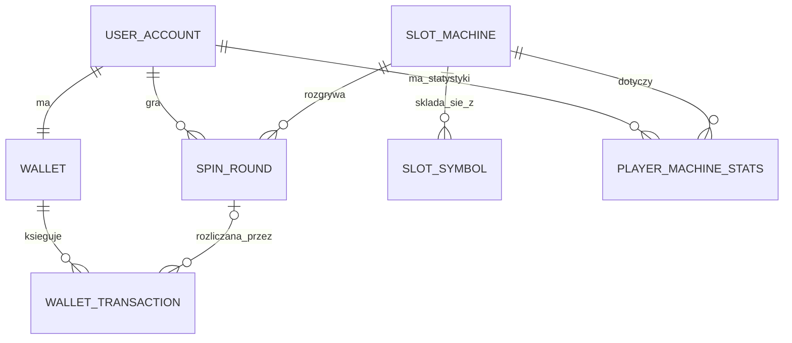
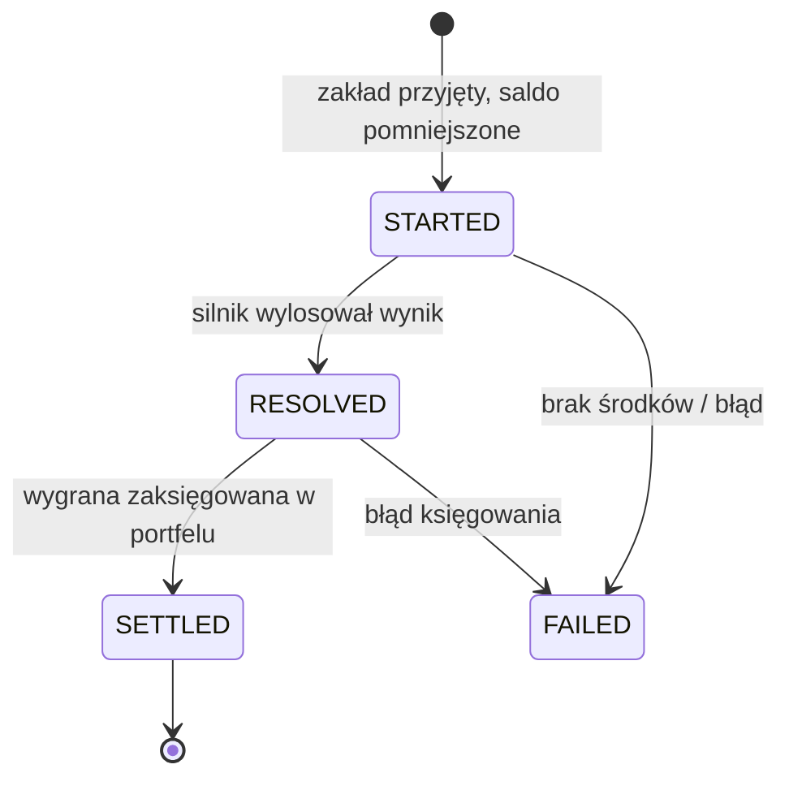
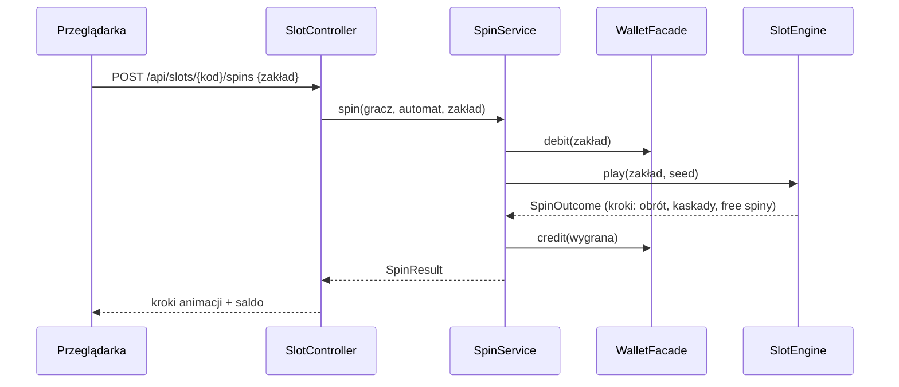

# Cebulion Casino — plan całego projektu

Symulator kasyna online z wirtualną walutą **cebulion**. Backend w Javie (Spring Boot, JPA, H2), przeglądarkowy
interfejs z trzema profesjonalnymi automatami (sloty), dźwiękiem, animacjami i efektami.
Projekt realizuje wymagania przedmiotu *Wprowadzenie do technologii backendowych* (LAB 01–07).

> **Status dokumentu:** plan do akceptacji. Wartości oznaczone **(domyślnie)** to moje propozycje — zmieniamy je
> jednym zdaniem, zanim powstanie pierwszy asset.

---

## 1. Cel i założenia

| Założenie | Decyzja |
|---|---|
| Waluta | **Cebulion** (wirtualny, bez wartości, zero prawdziwych pieniędzy) |
| Logowanie | wpisujesz tylko **nazwę gracza** → jesteś zalogowany (konto tworzy się samo) |
| Start | po pierwszym logowaniu **10 000 cebulionów** |
| Gry | **3 automaty** (sloty), każdy z inną mechaniką |
| Strona główna | lobby z **filmikami z rozgrywki** w prawym górnym rogu przycisk **Zaloguj** |
| Język programowania logiki | **Java** — losowanie, wypłaty, saldo i historia liczy wyłącznie serwer |
| Jakość | płynne 60 fps, bez zacięć, responsywne (telefon → monitor 4K), dźwięk, animacje, efekty |
| Dokumentacja | opis każdego elementu kodu tak, żeby zespół mógł **obronić projekt** |

**Dlaczego serwer rozstrzyga o wyniku (a nie przeglądarka).** Przeglądarka tylko *animuje* wynik, który dostała z serwera.
To jest właśnie „backend” z wymagań przedmiotu, a przy okazji jedyne uczciwe rozwiązanie dla gry z saldem:
gracz nie może podmienić wyniku w konsoli przeglądarki.

## 2. Zgodność z wymaganiami przedmiotu

Źródło: `docs/*.html` w repozytorium (strona prowadzącego na GitHub Pages — w repo, nie na GitLabie).

### 2.1. Warunki koncepcji projektu (`docs/pomysl.html`)

| Warunek | Jak spełniamy |
|---|---|
| Określony klient (persona) | „Kamil, student, chce poćwiczyć strategie i emocje slotów **bez ryzyka prawdziwych pieniędzy**” |
| ≥ 2 moduły | `account`, `wallet`, `slots`, `report` (4 moduły) |
| 5–6 własnych tabel | `wallet`, `wallet_transaction`, `slot_machine`, `slot_symbol`, `spin_round`, `player_machine_stats` (6) |
| Obiekt ze statusem i cyklem życia | `spin_round`: `STARTED → RESOLVED → SETTLED / FAILED` |
| Wielkości mierzalne | kwoty (cebuliony), zakłady, wygrane, RTP, liczba spinów |
| Relacja M:N z własnymi atrybutami | gracz ↔ automat przez `player_machine_stats` (spiny, obrót, wygrana, rekord) |
| 5 pytań „inwestora” | patrz § 4.5 |
| Czego unikać | brak prawdziwych pieniędzy ✔, brak scrapingu ✔, backend z prawdziwą logiką (nie „sama gra”) ✔ |

### 2.2. Reguły LAB 01 (`src/test/java/pl/wsb/rules/lab01`)

| Reguła | Wymaganie | Co zrobimy | Blokada |
|---|---|---|---|
| R1.01 | pakiet `pl.wsb.<nazwa>` + `artifactId` `wdtb-2026-backend-<nazwa>` | `pl.wsb.kasyno`, `KasynoApplication`, `wdtb-2026-backend-kasyno` **(domyślnie)** | — |
| R1.02 | aplikacja startuje | już zielone na szablonie (sprawdzone: `BUILD SUCCESS`) | — |
| R1.03 | ≥ 3 konta zespołu w `data.sql` | konta 3 osób | **potrzebne dane osób** |
| R1.04 | brak `[uzupełnij` w `static/index.html` | wizytówka zespołu jako sekcja „O projekcie” w lobby | **potrzebne dane osób** |
| R1.05 | `1.0.0-<indeks>-<indeks>-<indeks>` w `pom.xml` | numery indeksów | **potrzebne numery indeksów** |

Reguły LAB 02–06 pojawią się w szablonie prowadzącego dopiero „przed danymi zajęciami”. Trzymamy się opisanej
w `docs/reguly.html` konwencji pakietów (`domain / application / api / web / infrastructure`), a przed każdym
laboratorium robimy *Sync fork* i uruchamiamy `mvn verify -Dlab=N`.
Nie ruszamy `src/test/java/pl/wsb/rules` ani `.github/workflows` (zakaz z README).

## 3. Doświadczenie użytkownika (UX)

1. **Lobby (niezalogowany).** Pełnoekranowa scena: logo, trzy kafle gier z **zapętlonym wideo z prawdziwej rozgrywki**
   (poster → wideo dopiero gdy kafel jest widoczny), **„Zaloguj”** w prawym górnym rogu.
2. **Logowanie.** Modal z jednym polem (nazwa gracza, 3–16 znaków) → Enter → zalogowany.
   Pierwsze logowanie: animacja **+10 000 cebulionów** (deszcz monet, licznik odlicza w górę, dźwięk).
3. **Lobby (zalogowany).** Awatar + saldo w prawym górnym rogu, kafle gier, ostatnie duże wygrane, ranking, historia.
4. **Automat.** Scena na cały ekran: bębny, panel (zakład −/+, SPIN, AUTO, TURBO, dźwięk, tabela wypłat, wyjście),
   linie wygrywające, liczenie wygranej, **Big / Mega / Epic Win** z efektami i dźwiękiem, darmowe spiny.
5. **Bankructwo.** Saldo poniżej minimalnego zakładu → przycisk „Dostań 10 000 cebulionów” (z limitem, żeby nie
   znosić sensu gry) **(domyślnie)**.

Dodatkowo: skrót klawiszowy `Spacja` = SPIN, tryb ograniczonego ruchu (`prefers-reduced-motion`),
przycisk wyciszenia z zapamiętaną głośnością, komunikat „symulator — bez prawdziwych pieniędzy”.

## 4. Backend (Java)

### 4.1. Stos
Spring Boot 3.5 · Java 21 · Spring Data JPA · H2 · Bean Validation · springdoc (OpenAPI/Swagger) · JUnit 5 ·
Mockito · ArchUnit (reguły kursu) — wszystko już jest w `pom.xml` szablonu, dojdzie tylko `springdoc` (LAB 05).

### 4.2. Moduły i pakiety (zgodne z konwencją kursu)

```
pl.wsb.kasyno
├── KasynoApplication
├── account
│   ├── domain          UserAccount, AccountRole (gotowe), UserAccountRepository
│   ├── application     LoginService   — nazwa → konto + portfel + bonus startowy
│   └── web             AuthController, LoginRequest, PlayerResponse
├── wallet
│   ├── domain          Wallet, WalletTransaction, TransactionType, repozytoria
│   ├── application     WalletService  — debit / credit / rescue (@Transactional)
│   ├── api             WalletFacade, BalanceChanged (zdarzenie)
│   └── web             WalletController
├── slots
│   ├── domain          SlotMachine, SlotSymbol, SpinRound, SpinStatus, PlayerMachineStats, repozytoria
│   ├── application     SpinService, StatsUpdater
│   │   └── engine      SlotEngine (interfejs) + 3 silniki, ReelStrip, Paytable, RandomSource
│   ├── api             SlotsFacade, SpinCompleted (zdarzenie), SpinStep (rekordy kroków animacji)
│   └── web             SlotController, SpinRequest, SpinResponse
├── report
│   ├── application     InvestorReports (5 pytań inwestora), Leaderboard
│   └── web             ReportController, LeaderboardController
└── shared              CasinoProperties (@ConfigurationProperties), obsługa błędów (ProblemDetail), Clock
```

Zależności: `slots → wallet.api`, `report → *.domain` (tylko odczyt). `wallet` nie wie o `slots` (brak cykli — pilnuje ArchUnit).
Na LAB 04 relacje między modułami zamieniamy na identyfikatory (`userId`), zgodnie z roadmapą.

### 4.3. Model danych



| Tabela | Kluczowe kolumny |
|---|---|
| `user_account` (gotowa) | email (techniczny: `<nick>@kasyno.local`), display_name, role, created_at |
| `wallet` | user_id (1:1), balance, version (blokada optymistyczna), updated_at |
| `wallet_transaction` | wallet_id, type (`WELCOME_BONUS`, `RESCUE_BONUS`, `BET`, `WIN`), amount, balance_after, spin_round_id?, created_at |
| `slot_machine` | code, name, reels, rows, min_bet, max_bet, target_rtp, volatility, engine_type |
| `slot_symbol` | slot_machine_id, code, kind (`NORMAL/WILD/SCATTER`), weight, pay_x3/x4/x5 |
| `spin_round` | user_id, slot_machine_id, bet, total_win, status, seed, result_json, created_at, settled_at |
| `player_machine_stats` | user_id, slot_machine_id, spins, total_wagered, total_won, biggest_win, last_played_at |

Kwoty: `BigDecimal` (wymóg LAB 02); mnożniki i poziomy zakładu dobieramy tak, by wygrane były liczbami całkowitymi.

### 4.4. Cykl życia rundy i przebieg spinu





Kluczowa decyzja: **jedna runda = jeden zakład**. Cała sekwencja (obrót, kaskady, darmowe spiny) jest liczona na serwerze
od razu i wysyłana jako lista kroków do animacji. Saldo rozliczamy raz, w jednej transakcji — nie ma stanu „w połowie bonusu”,
który trzeba by trzymać i zabezpieczać. Każda runda zapisuje `seed`, więc **da się ją odtworzyć** (audyt, testy, nagrania).

### 4.5. Pięć pytań „inwestora” (LAB 03)

1. Które automaty są najpopularniejsze (liczba spinów) w ostatnich 7 dniach?
2. Jaki jest **rzeczywisty RTP** każdego automatu w porównaniu z teoretycznym?
3. Kto jest na szczycie rankingu (największa pojedyncza wygrana / najlepszy bilans)?
4. Ilu graczy jest „na zero” i ile cebulionów jest w obiegu (gospodarka kasyna)?
5. O jakich godzinach gra się najwięcej i jaki jest średni zakład?

### 4.6. REST API (LAB 05), projektowane najpierw jako kontrakt

| Metoda i ścieżka | Opis |
|---|---|
| `POST /api/auth/login` `{nick}` | znajdź lub utwórz gracza, bonus startowy, sesja (cookie `HttpOnly`) |
| `POST /api/auth/logout`, `GET /api/me` | wylogowanie, bieżący gracz i saldo |
| `POST /api/me/rescue` | bonus ratunkowy, gdy saldo < min. zakład |
| `GET /api/slots`, `GET /api/slots/{kod}` | katalog automatów, konfiguracja i tabela wypłat dla klienta |
| `POST /api/slots/{kod}/spins` `{bet}` | spin; nagłówek `Idempotency-Key` chroni przed podwójnym kliknięciem |
| `GET /api/me/history`, `GET /api/me/stats` | historia rund (stronicowana), statystyki per automat |
| `GET /api/leaderboard`, `GET /api/feed/big-wins` | ranking i ostatnie duże wygrane |
| `GET /api/reports/*` | raporty „inwestora” (rola `ADMIN`) |

Błędy zwracamy jako `ProblemDetail` (RFC 9457), dokumentacja pod `/swagger-ui.html`, przykładowe żądania w plikach `.http`.
**Kontrakt zamrażamy wcześnie** — dzięki temu front powstaje równolegle z backendem (na atrapie serwera).

### 4.7. Rozbudowa (LAB 06)
Zdarzenia: `SpinCompleted` → aktualizacja statystyk, rankingu i feedu dużych wygranych (`@TransactionalEventListener`).
Konfiguracja: `CasinoProperties` jako rekord (bonus 10 000, poziomy zakładów, limity, RTP), profile `dev` / `demo` / `prod`.
`@Scheduled`: migawka gospodarki co godzinę, sprzątanie nieaktywnych sesji, reset limitu bonusu ratunkowego.
Zadanie dodatkowe: integracja z API innego zespołu przez `RestClient` (np. ranking między kasynami) + `MockRestServiceServer`.

### 4.8. Logowanie samą nazwą — świadome uproszczenie
Brak hasła = każdy, kto wpisze Twoją nazwę, wejdzie na Twoje konto. To dopuszczalne w symulatorze z walutą bez wartości
(wymaganie projektu), ale opisujemy to w dokumentacji jako **znane ograniczenie** z propozycją rozwiązania (PIN / OAuth).
Sesja jest serwerowa (cookie `HttpOnly`, `SameSite=Lax`), a nazwy są walidowane (długość, znaki, lista zakazanych).

## 5. Silnik gier (Java) i matematyka

Interfejs `SlotEngine` (wzorzec *strategia*), trzy implementacje. Losowanie: `SecureRandom` generuje `seed` rundy,
a `SplittableRandom(seed)` daje szybkie, **powtarzalne** losowanie wewnątrz rundy (ważne dla testów i nagrań).

| # | Automat (domyślnie) | Siatka | Mechanika | RTP |
|---|---|---|---|---|
| 1 | **Cebulowy 777** — klasyk retro-neon | 3×3, 5 linii | wild „Złota Cebula”, mnożniki na liniach, szybka gra | ~95% |
| 2 | **Złoty Faraon** — przygoda w piramidzie | 5×3, 20 linii | rozszerzający się wild, scatter → 10 darmowych spinów ×2 | ~96% |
| 3 | **Kryształowa Kaskada** — klejnoty | 6×5, wygrane „klastrowe” | kaskady (znikają i spadają), rosnący mnożnik, darmowe spiny | ~96% |

Weryfikacja matematyki: test Monte Carlo (miliony spinów, ziarno stałe) sprawdza, że RTP mieści się w tolerancji,
oraz testy pojedynczych układów (np. „trzy siódemki na linii 2 płacą ×50”). Wyniki trafiają do dokumentacji obrony.

## 6. Front-end (przeglądarka)

Statyczne pliki w `src/main/resources/static` serwowane przez Spring Boot — **bez Node.js w produkcji, bez CDN**.

| Warstwa | Wybór | Uzasadnienie |
|---|---|---|
| Lobby | czysty HTML/CSS + ES modules | lekkie, szybkie LCP, nie ładuje silnika gry |
| Scena automatu | **PixiJS 8** (WebGL), wendorowany lokalnie | batching sprite'ów, filtry (glow/blur), tysiące cząstek bez spadku fps |
| Dźwięk | **Web Audio API**, własny mały `AudioEngine` | zdekodowane bufory, dokładna synchronizacja stopów bębnów, odblokowanie po geście (klik „Zaloguj”) |
| Animacje | własny `Tween` + easing (gsap opcjonalnie) | pełna kontrola nad czasem spinu, zero zależności |
| Układ | CSS `clamp()`, `dvh`, `safe-area`, `ResizeObserver` | jedna baza kodu: telefon pionowo/poziomo, tablet, desktop, 4K |

**Budżety wydajności** (sprawdzane skryptem Playwright z dławieniem CPU ×4):
LCP lobby < 2,5 s na „średnim mobilnym 4G”, brak „long tasks” > 50 ms podczas spinu,
p95 czasu klatki ≤ 16,7 ms na desktopie (≤ 33 ms przy dławieniu), brak wycieków pamięci po 200 spinach,
DPR ograniczony do 2, atlas tekstur zamiast setek plików, `preload` zasobów z paskiem postępu.

## 7. Grafika, animacje i efekty (Blender)

Blender **nie potrzebuje MCP**: pakiet `bpy` (Blender 5.2 jako moduł Pythona) instaluje się przez `pip` i renderuje
w terminalu — sprawdziłem w tym środowisku, że instaluje się i renderuje (Cycles na CPU, próbny obraz 256 px w < 1 s).
Skrypty trafią do `tools/blender/`,
gotowe obrazy do `static/assets/`, więc **aplikacja do działania nie wymaga Blendera**.

| Asset | Sposób |
|---|---|
| Symbole (owoce, klejnoty, skarabeusz, złota cebula…) | modele z prymitywów + modyfikatory, materiały proceduralne (złoto, szkło, ceramika), render Cycles, tło przezroczyste |
| Moneta cebulion (ikona waluty + animacja obrotu) | turntable 24–48 klatek → sprite sheet |
| Tła i ramy bębnów, przyciski | render + obróbka Pillow, parallax w 3 warstwach |
| Cząstki (monety, iskry, konfetti, promienie) | sprite'y renderowane + silnik cząstek w Pixi |
| Kompresja | WebP (+ AVIF jeśli opłacalne), atlasy, rozmiary @1x/@2x |

Zasada: **zero zewnętrznych assetów** — wszystko własne, więc brak problemów licencyjnych i można je wytłumaczyć na obronie.

## 8. Dźwięk

Generowany własnym kodem (`tools/audio/*.py`, NumPy → WAV → ffmpeg → OGG Opus + M4A AAC z wyborem po `canPlayType`):
kliknięcia UI, dźwięk logowania i bonusu, start spinu, pętla obrotu bębnów, **osobne stopy bębnów** (rosnąca wysokość),
napięcie przy „prawie wygranej”, małe/duże wygrane, liczenie monet, fanfary Big/Mega/Epic Win, wejście w darmowe spiny,
pop kaskady (rosnąca nuta w kolejnych kaskadach), muzyka tła lobby i każdego automatu.
Ograniczenie: to dźwięk syntetyczny, nie nagrany w studiu. Architektura pozwala podmienić pliki na licencjonowane próbki.

## 9. Filmiki z gier na stronie głównej

Nie robimy „makiet” — **nagrywamy prawdziwą grę**. Skrypt Playwright (Chromium z `/opt/pw-browsers`) uruchamia aplikację
w trybie `demo`, loguje się, wykonuje scenariusz spinów (ziarna dobrane tak, by pokazać wygrane i efekty) i nagrywa ekran.
`ffmpeg` robi pętle 8–12 s w MP4 (H.264) i WebM (VP9), `+faststart`, plus plakat WebP.
Na stronie: `muted loop playsinline preload=none`, start dopiero w widoku (`IntersectionObserver`),
na słabym łączu / `prefers-reduced-data` zostaje sam plakat.

## 10. Etapy realizacji

Dwa równoległe tory: **tor kursowy** (LAB 01–07, zielone reguły) i **tor produktowy** (front, grafika, dźwięk).
Kontrakt REST jest zamrożony wcześnie, więc tory nie czekają na siebie.

| Etap | Zawartość | Lab | Gotowe, gdy |
|---|---|---|---|
| 0 | Fundament: R1.01–R1.05, wizytówka, design system, szkielet lobby, narzędzia (`tools/`), dokumentacja bazowa | LAB 01 | `mvn verify` zielone dla lab 1, lobby się otwiera |
| 1 | **Próba stylu**: 1 symbol z Blendera + 1 dźwięk + 1 animacja spinu — pokazuję Ci zrzut i nagranie *zanim* zrobię resztę | — | akceptujesz kierunek wizualny |
| 2 | Encje, relacje, `data.sql` (6 tabel, 3 automaty) | LAB 02 | reguły lab 2 zielone |
| 3 | Repozytoria, 5 pytań inwestora, testy `@DataJpaTest` | LAB 03 | reguły lab 3 zielone, brak N+1 |
| 4 | Serwisy: logowanie, portfel, silniki gier, testy RTP | LAB 04 | RTP w tolerancji, testy jednostkowe |
| 5 | Kontrolery REST, DTO, walidacja, Swagger, **pierwszy pełny pion: Slot 1 od logowania do wygranej** | LAB 05 | e2e Playwright: login → spin → saldo |
| 6 | Sloty 2 i 3, pełne efekty i dźwięk, filmiki w lobby, ranking, feed | — | wszystkie 3 sloty grywalne |
| 7 | Zdarzenia, konfiguracja, `@Scheduled`, profile | LAB 06 | reguły lab 6 zielone |
| 8 | Hartowanie: wydajność, dostępność, Docker, dokumentacja obrony, próbne obrony | LAB 07 | budżety z § 6 spełnione |

Do prac równoległych (grafika, dźwięk, silniki gier, front) użyję osobnych agentów, ale **całość scalam i testuję sam**.

## 11. Jakość i testy

| Poziom | Narzędzie | Co sprawdza |
|---|---|---|
| Reguły kursu | `mvn verify -Dlab=N` | R1.xx … |
| Jednostkowe | JUnit 5, Mockito | portfel (brak ujemnego salda), silniki, tabele wypłat |
| Matematyka | Monte Carlo, stałe ziarno | RTP, częstotliwość trafień |
| Dane | `@DataJpaTest` | zapytania inwestora, brak N+1 |
| API | `@WebMvcTest` + MockMvc | kody odpowiedzi, walidacja, idempotencja |
| Architektura | ArchUnit | brak cykli między modułami, warstwy |
| E2E / wydajność | Playwright (lokalnie: `tools/e2e`) | scenariusz gracza, czas klatki, long tasks, wycieki |

Czego **nie** uruchomię automatycznie w CI: katalog `.github/workflows` jest objęty zakazem modyfikacji z README,
więc testy e2e odpalamy lokalnie (`npm run e2e` w `tools/e2e`), a wynik opisujemy w dokumentacji.

## 12. Dokumentacja do obrony (`docs/obrona/`)

| Plik | Zawartość |
|---|---|
| `00-uruchomienie.md` | jak uruchomić (IntelliJ, Maven, Docker), adresy, konta |
| `01-architektura.md` | diagramy Mermaid: warstwy, moduły, ERD, sekwencje, maszyna stanów |
| `02-przewodnik-po-kodzie.md` | pakiet po pakiecie, klasa po klasie: po co jest i które metody są ważne |
| `03-silnik-gier.md` | losowanie, tabele wypłat, wyliczenie RTP, wyniki symulacji |
| `04-front-grafika-dzwiek.md` | jak powstają animacje, dźwięk i grafika, pipeline Blender |
| `05-decyzje-projektowe.md` | dlaczego tak (serwer rozstrzyga, jedna runda = jeden zakład, `BigDecimal`…) |
| `06-pytania-na-obrone.md` | ~40 pytań i odpowiedzi z odnośnikami „pokaż w kodzie” |
| `07-podzial-pracy.md` | kto z trzech osób „broni” który moduł + ściąga per osoba |

W kodzie: polskie Javadoc na każdej klasie publicznej („po co ta klasa”) i komentarze przy nieoczywistych decyzjach —
w stylu szablonu prowadzącego.

## 13. Uruchomienie i hostowanie

* **Lokalnie (na obronę):** IntelliJ → `KasynoApplication` → http://localhost:8080 albo `mvn spring-boot:run`.
* **GitHub:** kod, historia commitów (wkład każdej osoby liczy `ci/contributions.sh`), reguły w Actions,
  dokumentacja i galeria nagrań na **GitHub Pages z katalogu `docs/`** (bez workflowu).
* **Żywa aplikacja online — ograniczenie:** GitHub Pages hostuje tylko pliki statyczne, więc **aplikacji Spring Boot tam nie uruchomimy**.
  Dodam `Dockerfile` (+ plik konfiguracyjny pod Render/Fly.io/Koyeb), a Wy łączycie repozytorium z hostingiem.
  Darmowe plany usypiają aplikację i kasują lokalną bazę H2 przy restarcie, więc na produkcję przygotuję profil z trwałą bazą.
* Domyślnie szablon używa `ddl-auto=create-drop`: **saldo zeruje się przy restarcie serwera**. Zostawiamy to na czas laboratoriów
  (zgodnie z szablonem), a profil `prod` ma trwałą bazę.

## 14. Ryzyka i ograniczenia (szczerze)

| Ryzyko | Skutek | Jak ograniczamy |
|---|---|---|
| Brak generatora obrazów AI w środowisku | grafika nie będzie „fotorealistyczna” | stylizowany glossy-3D w Blenderze + etap 1 (próba stylu) przed produkcją masową |
| Dźwięk syntetyczny | brzmi spójnie, ale nie jak studio | pełny zestaw efektów, architektura pod podmianę na próbki CC0 |
| „Bez zacięć” na słabym sprzęcie | spadki fps na starych telefonach | budżety wydajności, tryb „lekki” (mniej cząstek), mierzymy zamiast zakładać |
| Reguły LAB 02–06 jeszcze nie istnieją | możliwe poprawki po Sync fork | trzymamy się konwencji z `reguly.html`, `mvn verify -Dlab=N` po każdej synchronizacji |
| Kurs zakłada pracę **na zajęciach** i ocenę z tagu `lab-N` zrobionego w trakcie zajęć (`docs/zasady.html`) | gotowe repo trzeba umieć wyjaśnić i odtworzyć | dokumentacja obrony + dla każdej reguły opis „jak to zrobić samemu”; ustalcie z prowadzącym, jak ma wyglądać Wasz tag |
| Logowanie bez hasła | przejęcie cudzego konta po nazwie | świadoma decyzja, opisana jako ograniczenie z propozycją poprawy |
| Hazard | kontekst społeczny | jawny komunikat „symulator, bez prawdziwych pieniędzy”, brak płatności, brak mechanik wciągających poza typową grą |

## 15. Co potrzebuję od Was

1. **Dane trzech osób:** imię i nazwisko, numer indeksu, e-mail uczelniany, grupa (R1.03, R1.04, R1.05).
2. Potwierdzenie lub zmiana wartości **(domyślnie)**: nazwa projektu `kasyno`, nazwa marki *Cebulion Casino*,
   trzy automaty z § 5, bonus ratunkowy z § 3.
3. Decyzja o hostingu żywej aplikacji (§ 13): wystarczy lokalnie na obronę, czy ma też działać online?
