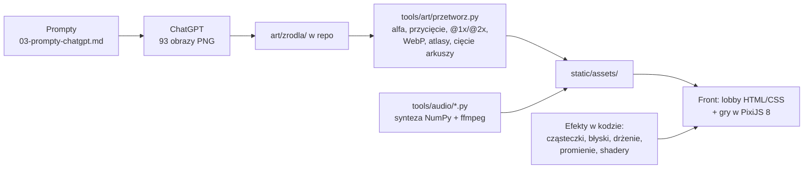
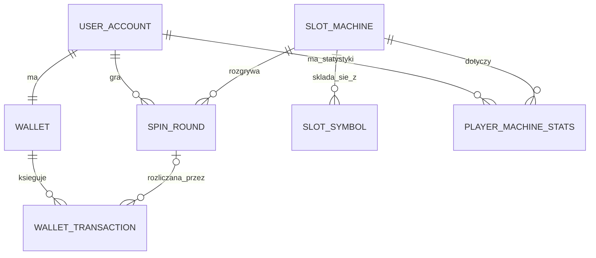
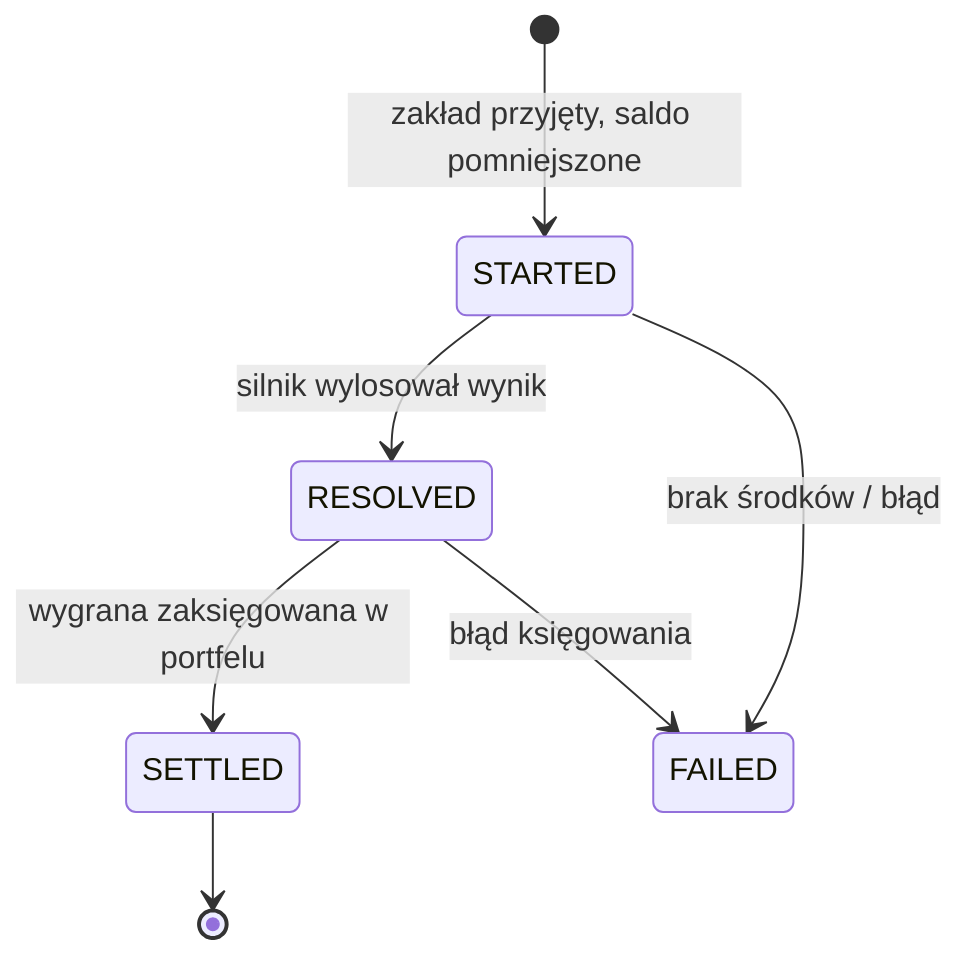
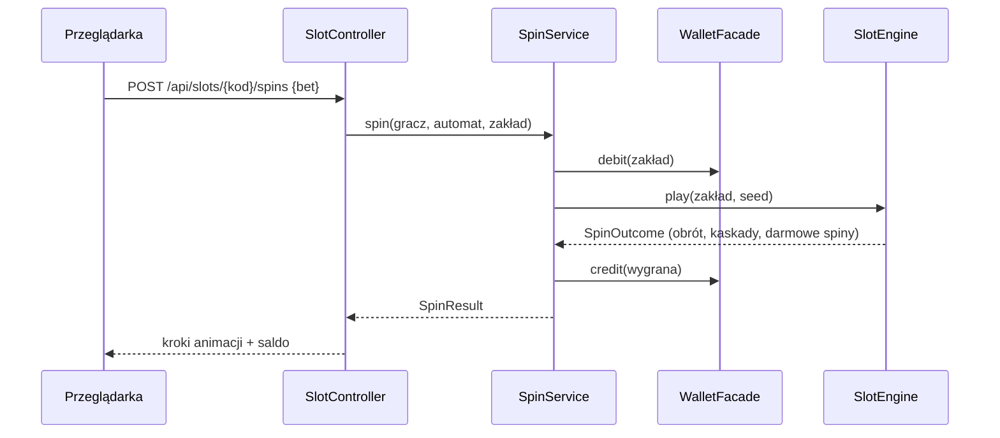

# Cebulion Casino — plan całego projektu

Symulator kasyna online z wirtualną walutą **cebulion**. Backend w Javie (Spring Boot, JPA, H2), w przeglądarce
trzy automaty (sloty) z dźwiękiem, animacjami, błyskami i efektami na poziomie topowych gier mobilnych.
Projekt realizuje wymagania przedmiotu *Wprowadzenie do technologii backendowych* (LAB 01–07).

Ten dokument to **mapa całości**: co budujemy, w jakiej kolejności i gdzie jest szczegółowy opis każdej części.
Szczegóły są w [`docs/projekt/`](projekt/README.md).

| Zespół | Nr indeksu | E-mail |
|---|---|---|
| Konrad Paulus | 112960 | s428425@student.wroclaw.merito.pl |
| Dominik Pacanowski | 112961 | s433776@student.wroclaw.merito.pl |
| Dawid Majewski | 113154 | s156704@student.wroclaw.merito.pl |

---

## 1. Status

| Etap | Stan |
|---|---|
| LAB 01: nazwa `kasyno`, wersja z indeksami, konta zespołu, wizytówka | **zrobione**, `mvn verify -Dlab=1`: 5/5 reguł zielonych |
| Dokumentacja projektowa (`docs/projekt/01–08`) | w trakcie |
| Grafika: 93 obrazy z ChatGPT według [`03-prompty-chatgpt.md`](projekt/03-prompty-chatgpt.md) | **czeka na Was** |
| Backend gier, front, dźwięk, efekty | po dokumentacji, równolegle z generowaniem grafiki |

## 2. Co budujemy

| Element | Decyzja |
|---|---|
| Marka | **Cebulion Casino**, hasło „Graj bez ryzyka. Wygrywaj z klasą.”, maskotka **Pan Cebulion** |
| Waluta | **cebulion** — wirtualny, bez wartości, nie da się go kupić ani wypłacić |
| Logowanie | wpisujesz **nazwę gracza** w prawym górnym rogu → od razu jesteś zalogowany |
| Start | pierwsze logowanie: **10 000 cebulionów** (efektowna sekwencja: skrzynia, fontanna monet, licznik) |
| Bankructwo | saldo poniżej minimalnego zakładu → bonus ratunkowy 10 000 (raz na 10 minut) |
| Strona główna | lobby z **filmikami z prawdziwej rozgrywki** każdej gry |
| Gry | **Cebulowy 777** (3×3, 5 linii), **Złoty Faraon** (5×3, 20 linii, darmowe spiny), **Kryształowa Kaskada** (6×5, klastry, kaskady, mnożniki) |
| Logika | **Java na serwerze** liczy wynik, saldo i historię; przeglądarka tylko animuje |
| Jakość | 60 fps bez zacięć, responsywnie od telefonu po 4K, automatyczne poziomy jakości grafiki |
| Dokumentacja | każdy element opisany tak, żeby zespół mógł **obronić projekt** |

**Dlaczego serwer rozstrzyga o wyniku.** Przeglądarka dostaje gotowy wynik z serwera i tylko go odgrywa. To jest „backend”
z wymagań przedmiotu, a jednocześnie jedyne uczciwe rozwiązanie dla gry z saldem: nie da się podmienić wyniku w konsoli.
Każda runda zapisuje `seed` losowania, więc można ją odtworzyć (audyt, testy, nagrania filmików).

## 3. Zgodność z wymaganiami przedmiotu

Źródło: `docs/*.html` w repozytorium (materiały prowadzącego, także na GitHub Pages).

### 3.1. Warunki koncepcji (`docs/pomysl.html`)

| Warunek | Jak spełniamy |
|---|---|
| Określony klient (persona) | „Kamil, student, lubi sloty i chce sprawdzać strategie i emocje **bez ryzyka prawdziwych pieniędzy**” |
| ≥ 2 moduły | `account`, `wallet`, `slots`, `report` |
| 5–6 własnych tabel | `wallet`, `wallet_transaction`, `slot_machine`, `slot_symbol`, `spin_round`, `player_machine_stats` |
| Obiekt ze statusem i cyklem życia | `spin_round`: `STARTED → RESOLVED → SETTLED / FAILED` |
| Wielkości mierzalne | kwoty w cebulionach, zakłady, wygrane, RTP, liczba spinów |
| Relacja M:N z atrybutami | gracz ↔ automat przez `player_machine_stats` (spiny, obrót, wygrana, rekord, ostatnia gra) |
| 5 pytań „inwestora” | § 5.5 |
| Czego unikać | bez prawdziwych pieniędzy ✔, bez scrapingu ✔, prawdziwy backend, a nie „sama gra” ✔ |

### 3.2. Reguły LAB 01 — zrobione

| Reguła | Wymaganie | Zrobione |
|---|---|---|
| R1.01 | pakiet `pl.wsb.<nazwa>` + `artifactId` | `pl.wsb.kasyno`, `KasynoApplication`, `wdtb-2026-backend-kasyno` |
| R1.02 | aplikacja startuje | ✔ |
| R1.03 | ≥ 3 konta zespołu w `data.sql` | 3 konta (Konrad, Dominik, Dawid) |
| R1.04 | wizytówka bez `[uzupełnij` | strona startowa w stylu marki: autorzy, pomysł, persona, funkcje, zmiany |
| R1.05 | `1.0.0-<indeks>-<indeks>-<indeks>` | `1.0.0-112960-112961-113154` |

Do zrobienia przez Was: nazwa repozytorium według konwencji kursu (`WdTB-2026-Backend-kasyno`, *Settings → General →
Repository name*; GitHub przekierowuje stare adresy) oraz wpis w arkuszu zespołów (nazwa, link, krótki opis).

Reguły LAB 02–06 pojawią się w szablonie prowadzącego dopiero przed zajęciami. Trzymamy się konwencji pakietów z
`docs/reguly.html` (`domain / application / api / web / infrastructure`); przed każdym laboratorium *Sync fork*
i `mvn verify -Dlab=N`. Nie ruszamy `src/test/java/pl/wsb/rules` ani `.github/workflows` (zakaz z README).

## 4. Jak powstaje oprawa (grafika, efekty, dźwięk)



| Część | Kto / czym | Szczegóły |
|---|---|---|
| Kierunek artystyczny | wspólna biblia stylu dla wszystkich obrazów | [`01-kierunek-artystyczny.md`](projekt/01-kierunek-artystyczny.md) |
| Grafika (93 obrazy: 8 makiet + 85 assetów, cały UI) | **Wy w ChatGPT**, 6 czatów, gotowe prompty do wklejenia | [`02-lista-obrazow.md`](projekt/02-lista-obrazow.md), [`03-prompty-chatgpt.md`](projekt/03-prompty-chatgpt.md) |
| Obróbka grafiki | ja: skrypt w Pythonie (przezroczystość, atlasy, WebP, cięcie arkuszy, cyfry → font bitmapowy) | [`02-lista-obrazow.md`](projekt/02-lista-obrazow.md) |
| Efekty, błyski, animacje | ja, w kodzie (PixiJS 8): każde z ~40 zdarzeń rozpisane na osi czasu w ms | [`04-efekty-wizualne.md`](projekt/04-efekty-wizualne.md) |
| Dźwięk i muzyka | ja: synteza w Pythonie; opcjonalnie muzyka z Suno według naszych promptów | [`05-dzwiek-i-muzyka.md`](projekt/05-dzwiek-i-muzyka.md) |
| Filmiki w lobby | ja: nagranie prawdziwej gry przez Playwright + ffmpeg | § 7 |

**Kolejność generowania grafiki:** najpierw czat 0 (8 makiet), wybieracie najlepsze i dołączacie je jako referencję
stylu do czatów 1–5. Priorytet **P0** (lobby, logowanie, Cebulowy 777) wystarczy do pierwszej grywalnej wersji.

## 5. Backend (Java)

### 5.1. Stos
Spring Boot 3.5 · Java 21 · Spring Data JPA · H2 · Bean Validation · springdoc (OpenAPI/Swagger, od LAB 05) ·
JUnit 5 · Mockito · ArchUnit.

### 5.2. Moduły i pakiety

```
pl.wsb.kasyno
├── KasynoApplication
├── account
│   ├── domain          UserAccount, AccountRole (z szablonu), UserAccountRepository
│   ├── application     LoginService   — nazwa → konto + portfel + bonus startowy
│   └── web             AuthController, LoginRequest, PlayerResponse
├── wallet
│   ├── domain          Wallet, WalletTransaction, TransactionType, repozytoria
│   ├── application     WalletService  — debit / credit / rescue (@Transactional)
│   ├── api             WalletFacade, BalanceChanged (zdarzenie)
│   └── web             WalletController
├── slots
│   ├── domain          SlotMachine, SlotSymbol, SpinRound, SpinStatus, PlayerMachineStats, repozytoria
│   ├── application     SpinService, StatsUpdater
│   │   └── engine      SlotEngine (interfejs) + 3 silniki, ReelStrip, Paytable, RandomSource
│   ├── api             SlotsFacade, SpinCompleted (zdarzenie), SpinStep (kroki animacji)
│   └── web             SlotController, SpinRequest, SpinResponse
├── report
│   ├── application     InvestorReports (5 pytań inwestora), Leaderboard
│   └── web             ReportController, LeaderboardController
└── shared              CasinoProperties (@ConfigurationProperties), obsługa błędów (ProblemDetail), Clock
```

Zależności: `slots → wallet.api`, `report` tylko czyta. `wallet` nie zna `slots` (brak cykli, pilnuje ArchUnit).
Na LAB 04 relacje między modułami zamieniamy na identyfikatory (`userId`), zgodnie z roadmapą kursu.

### 5.3. Model danych



| Tabela | Kluczowe kolumny |
|---|---|
| `user_account` (z szablonu) | email (dla graczy techniczny: `<nick>@kasyno.local`), display_name, role, created_at |
| `wallet` | user_id (1:1), balance, version (blokada optymistyczna), updated_at |
| `wallet_transaction` | wallet_id, type (`WELCOME_BONUS`, `RESCUE_BONUS`, `BET`, `WIN`), amount, balance_after, spin_round_id, created_at |
| `slot_machine` | code, name, reels, rows, min_bet, max_bet, target_rtp, volatility, engine_type |
| `slot_symbol` | slot_machine_id, code, kind (`NORMAL/WILD/SCATTER/MULTIPLIER`), weight, wypłaty |
| `spin_round` | user_id, slot_machine_id, bet, total_win, status, seed, result_json, created_at, settled_at |
| `player_machine_stats` | user_id, slot_machine_id, spins, total_wagered, total_won, biggest_win, last_played_at |

Kwoty: `BigDecimal` (wymóg LAB 02); zakłady i mnożniki dobrane tak, żeby wygrane były liczbami całkowitymi.

### 5.4. Cykl życia rundy i przebieg spinu





**Jedna runda = jeden zakład.** Cała sekwencja (obrót, kaskady, darmowe spiny) jest liczona na serwerze od razu
i wysyłana jako lista kroków do animacji. Saldo rozliczamy raz, w jednej transakcji, więc nie ma stanu
„w połowie bonusu”, który trzeba by przechowywać i zabezpieczać. Szczegóły i format JSON:
[`07-gry-i-matematyka.md`](projekt/07-gry-i-matematyka.md).

### 5.5. Pięć pytań „inwestora” (LAB 03)

1. Które automaty są najpopularniejsze (liczba spinów) w ostatnich 7 dniach?
2. Jaki jest **rzeczywisty RTP** każdego automatu w porównaniu z docelowym?
3. Kto prowadzi w rankingu (największa pojedyncza wygrana, najlepszy bilans)?
4. Ilu graczy jest „na zero” i ile cebulionów jest w obiegu?
5. O jakich godzinach gra się najwięcej i jaki jest średni zakład?

### 5.6. REST API (LAB 05) — kontrakt ustalany najpierw

| Metoda i ścieżka | Opis |
|---|---|
| `POST /api/auth/login` `{nick}` | znajdź lub utwórz gracza, bonus startowy, sesja (cookie `HttpOnly`) |
| `POST /api/auth/logout`, `GET /api/me` | wylogowanie, bieżący gracz i saldo |
| `POST /api/me/rescue` | bonus ratunkowy |
| `GET /api/slots`, `GET /api/slots/{kod}` | katalog automatów, konfiguracja i tabela wypłat |
| `POST /api/slots/{kod}/spins` `{bet}` | spin; nagłówek `Idempotency-Key` chroni przed podwójnym kliknięciem |
| `GET /api/me/history`, `GET /api/me/stats` | historia rund (stronicowana), statystyki per automat |
| `GET /api/leaderboard`, `GET /api/feed/big-wins` | ranking i ostatnie duże wygrane |
| `GET /api/reports/*` | raporty „inwestora” (rola `ADMIN`) |

Błędy jako `ProblemDetail` (RFC 9457), dokumentacja pod `/swagger-ui.html`, przykładowe żądania w plikach `.http`.

### 5.7. Rozbudowa (LAB 06)
Zdarzenia: `SpinCompleted` → statystyki, ranking, feed dużych wygranych (`@TransactionalEventListener`).
Konfiguracja: `CasinoProperties` jako rekord (bonus 10 000, zakłady, limity), profile `dev` / `demo` / `prod`.
`@Scheduled`: migawka gospodarki co godzinę, sprzątanie sesji, reset limitu bonusu ratunkowego.
Zadanie dodatkowe: integracja z API innego zespołu przez `RestClient` + test z `MockRestServiceServer`.

### 5.8. Logowanie samą nazwą — świadome uproszczenie
Bez hasła każdy, kto wpisze Twoją nazwę, wejdzie na Twoje konto. W symulatorze z walutą bez wartości to
dopuszczalne i wynika wprost z wymagań, ale opisujemy to jako **znane ograniczenie** z propozycją poprawy (PIN, OAuth).
Sesja jest serwerowa (`HttpOnly`, `SameSite=Lax`), nazwy są walidowane (długość, znaki, zakazane słowa).

## 6. Front-end i wydajność

| Warstwa | Wybór | Dlaczego |
|---|---|---|
| Lobby | HTML/CSS + ES modules + wideo | lekkie, szybkie ładowanie, nie wczytuje silnika gry |
| Gry | **PixiJS 8** (WebGL), plik lokalnie w projekcie | tysiące sprite'ów i cząsteczek w jednym wywołaniu rysowania |
| Dźwięk | Web Audio API, własny `AudioEngine` | dokładna synchronizacja z animacją, odblokowanie po kliknięciu „Zaloguj” |
| Teksty UI | HTML (nie obrazki) | ostre na każdym ekranie, dostępne dla czytników ekranu |
| Fonty | Cinzel, Manrope, Bungee, Cinzel Decorative, Marcellus (OFL, hostowane lokalnie) | brak zależności od zewnętrznych serwerów |

Płynność osiągamy architekturą, nie nadzieją: atlasy tekstur, pule obiektów, brak alokacji w pętli animacji,
efekty świetlne przez mieszanie addytywne zamiast kosztownych filtrów, **trzy poziomy jakości przełączane automatycznie**
po pomiarze czasu klatki i testy Playwright ze spowolnionym CPU. Szczegóły:
[`06-interfejs-ux.md`](projekt/06-interfejs-ux.md), [`08-wydajnosc-i-jakosc.md`](projekt/08-wydajnosc-i-jakosc.md).

## 7. Filmiki z gier na stronie głównej

Nagrywamy **prawdziwą grę**, a nie makiety. Skrypt Playwright (Chromium z `/opt/pw-browsers`) uruchamia aplikację
w profilu `demo`, loguje się i gra scenariusz spinów, a `seed` rund dobieramy tak, żeby pokazać wygrane, darmowe spiny
i efekty. `ffmpeg` tnie 8–12-sekundowe pętle (MP4 H.264 + WebM VP9, `+faststart`) i robi plakat.
Na stronie: `muted loop playsinline preload="none"`, start dopiero, gdy kafel jest widoczny; na słabym łączu sam plakat.

## 8. Etapy

Dwa równoległe tory: **kursowy** (LAB 02–07, zielone reguły) i **produktowy** (grafika, front, efekty, dźwięk).
Kontrakt REST jest ustalony wcześniej, więc front nie czeka na backend.

| Etap | Zawartość | Lab | Gotowe, gdy |
|---|---|---|---|
| 0 | LAB 01, plan, dokumentacja projektowa | LAB 01 | ✔ reguły zielone, dokumenty w `docs/projekt/` |
| 1 | **Wy:** czat 0 (makiety) w ChatGPT → wybór stylu → czaty 1 i 3 (P0) | — | mam makiety + assety P0 |
| 2 | Encje, relacje, `data.sql` (6 tabel, 3 automaty) | LAB 02 | reguły lab 2 zielone |
| 3 | Repozytoria, 5 pytań inwestora, testy `@DataJpaTest` | LAB 03 | reguły lab 3 zielone |
| 4 | Serwisy: logowanie, portfel, silniki gier, testy RTP (Monte Carlo) | LAB 04 | RTP w tolerancji |
| 5 | REST + **pierwszy pełny pion**: lobby, logowanie, bonus, Cebulowy 777 z efektami i dźwiękiem | LAB 05 | test e2e: logowanie → spin → saldo |
| 6 | Złoty Faraon i Kryształowa Kaskada, filmiki w lobby, ranking, feed | — | 3 sloty grywalne |
| 7 | Zdarzenia, konfiguracja, `@Scheduled`, profile | LAB 06 | reguły lab 6 zielone |
| 8 | Hartowanie: wydajność, dostępność, Docker, dokumentacja obrony, próbne obrony | LAB 07 | budżety z `08-wydajnosc-i-jakosc.md` spełnione |

## 9. Testy

| Poziom | Narzędzie | Co sprawdza |
|---|---|---|
| Reguły kursu | `mvn verify -Dlab=N` | R1.xx, R2.xx … |
| Jednostkowe | JUnit 5, Mockito | portfel (nigdy ujemne saldo), silniki gier, tabele wypłat |
| Matematyka | Monte Carlo ze stałym seedem | RTP, częstotliwość trafień |
| Dane | `@DataJpaTest` | zapytania inwestora, brak N+1 |
| API | `@WebMvcTest` + MockMvc | kody odpowiedzi, walidacja, idempotencja |
| Architektura | ArchUnit | brak cykli między modułami |
| E2E i wydajność | Playwright (`tools/e2e`, lokalnie) | scenariusz gracza, czas klatki, long tasks, wycieki pamięci |

Testów e2e nie dokładamy do GitHub Actions, bo katalog `.github/workflows` jest objęty zakazem modyfikacji;
uruchamiamy je lokalnie (`npm run e2e` w `tools/e2e`), a wyniki opisujemy w dokumentacji.

## 10. Dokumentacja do obrony (`docs/obrona/`, powstaje razem z kodem)

| Plik | Zawartość |
|---|---|
| `00-uruchomienie.md` | jak uruchomić (IntelliJ, Maven, Docker), adresy, konta |
| `01-architektura.md` | diagramy: warstwy, moduły, ERD, sekwencje, maszyna stanów |
| `02-przewodnik-po-kodzie.md` | pakiet po pakiecie, klasa po klasie: po co jest, które metody są ważne |
| `03-silnik-gier.md` | losowanie, tabele wypłat, wyliczenie RTP, wyniki symulacji |
| `04-front-efekty-dzwiek.md` | jak działają animacje, efekty, dźwięk i obróbka grafiki |
| `05-decyzje-projektowe.md` | dlaczego tak (serwer rozstrzyga, jedna runda = jeden zakład, `BigDecimal`…) |
| `06-pytania-na-obrone.md` | ~40 pytań i odpowiedzi z odnośnikami „pokaż w kodzie” |
| `07-podzial-pracy.md` | kto broni którego modułu + ściąga dla każdej osoby |

W kodzie: polskie Javadoc na każdej klasie publicznej („po co ta klasa”) i komentarze przy nieoczywistych decyzjach.

## 11. Uruchomienie i hostowanie

* **Lokalnie (na obronę):** IntelliJ → `KasynoApplication` → http://localhost:8080 albo `mvn spring-boot:run`.
* **GitHub:** kod, historia commitów (wkład każdej osoby liczy `ci/contributions.sh`), reguły w Actions,
  dokumentacja i galeria nagrań na GitHub Pages z katalogu `docs/` (bez workflowu).
* **Online:** GitHub Pages hostuje tylko pliki statyczne, więc **aplikacji w Javie tam nie uruchomimy**. Dodam
  `Dockerfile` pod darmowy hosting (Render, Fly.io, Koyeb), a Wy łączycie z nim repozytorium. Darmowe plany usypiają
  aplikację, a przy restarcie kasują plikową bazę H2, dlatego profil `prod` dostanie trwałą bazę.
* Szablon kursu ma `ddl-auto=create-drop`: **saldo zeruje się przy restarcie serwera**. Na czas laboratoriów zostawiamy
  to bez zmian (tak działa szablon i reguły), trwałość daje profil `prod`.

## 12. Ryzyka i ograniczenia

| Ryzyko | Skutek | Jak ograniczamy |
|---|---|---|
| ChatGPT generuje obrazy niespójnie lub z błędami | różne style, literówki w napisach, fałszywa przezroczystość | makiety jako referencja w każdym czacie, biblioteka promptów poprawkowych, automatyczne wykrywanie szachownicy i tła w obróbce |
| Rozdzielczość ChatGPT (maks. 1536 px) | tła na ekranach 4K mniej ostre | tła są przyciemnione i rozmyte pod UI; skalowanie + ziarno; ostre są elementy rysowane kodem i teksty HTML |
| Dźwięk syntetyczny | spójny, ale nie studyjny | pełny zestaw efektów; muzykę można wygenerować w Suno według promptów z `05` |
| „Bez zacięć” na słabym sprzęcie | spadki fps na starych telefonach | poziomy jakości z automatycznym przełączaniem, budżety i pomiary |
| Reguły LAB 02–06 jeszcze nie istnieją | poprawki po *Sync fork* | konwencje z `reguly.html`, `mvn verify -Dlab=N` po każdej synchronizacji |
| Kurs zakłada pracę **na zajęciach** i ocenę z tagu `lab-N` zrobionego w ich trakcie (`docs/zasady.html`) | gotowy kod trzeba umieć wyjaśnić i odtworzyć | dokumentacja obrony; ustalcie z prowadzącym, jak ma wyglądać Wasz tag |
| Logowanie bez hasła | przejęcie konta po samej nazwie | świadoma decyzja opisana jako ograniczenie |
| Tematyka hazardu | kontekst społeczny | stały komunikat „symulator, bez prawdziwych pieniędzy”, brak płatności |

## 13. Co jest teraz po Waszej stronie

1. **Wygenerować grafikę w ChatGPT** według [`03-prompty-chatgpt.md`](projekt/03-prompty-chatgpt.md): zacznijcie od czatu 0
   (makiety), potem czaty 1 i 3 (priorytet P0). Pliki do `art/zrodla/{makiety,global,s1,s2,s3}/` z nazwą = ID obrazu.
2. Opcjonalnie: muzyka w Suno według promptów z [`05-dzwiek-i-muzyka.md`](projekt/05-dzwiek-i-muzyka.md).
3. Zmienić nazwę repozytorium na `WdTB-2026-Backend-kasyno` i uzupełnić arkusz zespołów.
4. Zdecydować, czy aplikacja ma działać też online (§ 11).
