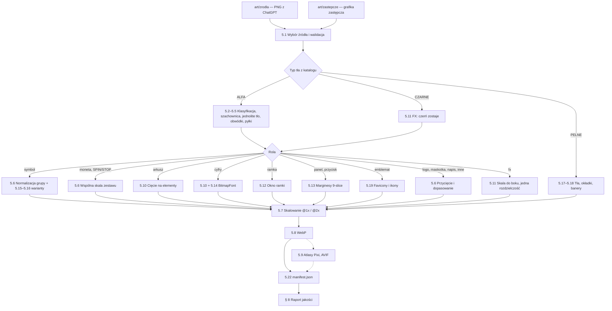

# 02 — Lista obrazów, dostarczenie i obróbka (manifest + pipeline)

Ten dokument to **pełny manifest 93 obrazów** Cebulion Casino (8 makiet + 85 assetów): co to jest, gdzie występuje
w aplikacji, w jakim rozmiarze trafia do przeglądarki i jak go obrabiamy. Opisuje też, **jak przekazać nam pliki**
z ChatGPT, oraz **pipeline** `tools/art/przetworz.py`, który z surowych PNG robi gotowe WebP, atlasy tekstur
i `manifest.json`.

Jak czytać: jeśli generujesz albo wysyłasz grafiki, wystarczą § 1–4 (lista + wysyłka). Jeśli obrabiasz obrazy,
piszesz front albo bronisz projektu, czytaj § 5–8 (pipeline, struktura plików, budżety, raport jakości). ID obrazów,
formaty, typy tła i priorytety pochodzą z briefu i są **wiążące**. Prompty do wygenerowania obrazów są
w [03-prompty-chatgpt.md](03-prompty-chatgpt.md), wymagania stylu w [01-kierunek-artystyczny.md](01-kierunek-artystyczny.md),
a kontrakt plików wynikowych (`assets/img/...`, `manifest.json`) w [09-kontrakt-api-i-assetow.md](09-kontrakt-api-i-assetow.md).

**Stan pipeline'u.** § 5–8 opisują to, co **naprawdę robi** `tools/art/przetworz.py` w wersji **1.0.0**
(lista assetów i parametry: `tools/art/katalog.py`). Elementy zaprojektowane, ale jeszcze niezaimplementowane, mają
znacznik **[plan]** — zostawiamy ich opis, bo mówi, dokąd zmierzamy i dlaczego, ale nie wolno na nich polegać
(zestawienie: § 5.0, tabela „Co jest w wersji 1.0.0”).

## Spis treści

1. [Podsumowanie liczbowe](#1-podsumowanie-liczbowe)
2. [Konwencje](#2-konwencje)
3. [Pełny manifest obrazów](#3-pełny-manifest-obrazów)
4. [Jak dostarczyć obrazy](#4-jak-dostarczyć-obrazy)
5. [Pipeline obróbki `tools/art/przetworz.py`](#5-pipeline-obróbki-toolsartprzetworzpy)
6. [Docelowa struktura plików w aplikacji](#6-docelowa-struktura-plików-w-aplikacji)
7. [Budżety wagi i szacunki](#7-budżety-wagi-i-szacunki)
8. [Automatyczny raport jakości](#8-automatyczny-raport-jakości)
9. [Otwarte kwestie i ryzyka](#9-otwarte-kwestie-i-ryzyka)
10. [Powiązane dokumenty](#powiązane-dokumenty)

---

## 1. Podsumowanie liczbowe

**93 obrazy = 8 makiet + 85 assetów.** Makiety to referencje stylu i układu ekranów — nie trafiają do aplikacji
i nie mają priorytetu. 85 assetów trafia do aplikacji (po obróbce).

### 1.1. Czaty ChatGPT i priorytety

Priorytety z briefu: **P0** = pierwsza grywalna wersja (lobby + logowanie + S1), **P1** = S2 i pełne efekty,
**P2** = S3 i dopieszczenie. Czat 3 (S1) jest w całości P0, czat 4 (S2) w całości P1, czat 5 (S3) w całości P2;
czaty 1–2 mają priorytet wpisany przy każdym obrazie.

| Czat | Zakres | Obrazów | P0 | P1 | P2 | bez priorytetu |
|---|---|---:|---:|---:|---:|---:|
| 0 | Makiety (referencje, poza aplikacją) | 8 | — | — | — | 8 |
| 1 | GLOBAL A: marka, waluta, maskotka, tła lobby | 13 | 10 | 3 | 0 | — |
| 2 | GLOBAL B: UI kit, banery wygranych, efekty | 18 | 10 | 8 | 0 | — |
| 3 | S1 „Cebulowy 777” | 14 | 14 | 0 | 0 | — |
| 4 | S2 „Złoty Faraon” | 22 | 0 | 22 | 0 | — |
| 5 | S3 „Kryształowa Kaskada” | 18 | 0 | 0 | 18 | — |
| **Razem** | | **93** | **34** | **33** | **18** | **8** |

Kontrola: 34 + 33 + 18 = 85 assetów; 85 + 8 makiet = 93.

**P0 w skrócie (34 obrazy — minimum do pierwszej grywalnej wersji):**
`g_logo`, `g_emblemat`, `g_moneta_przod`, `g_moneta_skos`, `g_moneta_bok`, `g_tlo_lobby_desktop`,
`g_tlo_lobby_mobile`, `g_maskotka_powitanie`, `g_skrzynia`, `g_font_cyfry` (czat 1: 10) ·
`g_ui_spin`, `g_ui_spin_stop`, `g_ui_ikony`, `g_ui_panel`, `g_ui_przycisk_glowny`, `g_ui_przycisk_drugi`,
`g_win_big`, `g_fx_promienie`, `g_fx_flara`, `g_fx_iskry` (czat 2: 10) · wszystkie 14 obrazów `s1_*` (czat 3).

**P1 spoza S2 (11 obrazów):** `g_maskotka_wygrana`, `g_maskotka_bankrut`, `g_awatary` (czat 1) ·
`g_ui_ornament`, `g_win_mega`, `g_win_epic`, `g_win_ultra`, `g_win_free_spins`, `g_fx_blyskawice`, `g_fx_dym`,
`g_fx_konfetti` (czat 2). Do czasu ich dostarczenia aplikacja używa grafiki zastępczej z `art/zastepcze/` (§ 5.1).

Sumy kontrolne tych list sprawdza skrypt audytu dokumentu (każde z 93 ID dokładnie raz w § 3, format, tło i priorytet
zgodne z briefem, sumy per czat i per priorytet); ten sam zestaw 85 assetów jest wpisany w `tools/art/katalog.py`,
który pilnuje liczby asercją `len(ASSETY) == 85`.

### 1.2. Formaty i typy tła w czatach

| Czat | 1:1 (1024×1024) | 3:2 (1536×1024) | 2:3 (1024×1536) | ALFA | CZARNE | PELNE | w tym SHEET |
|---|---:|---:|---:|---:|---:|---:|---:|
| 0 | 0 | 6 | 2 | 0 | 0 | 8 | 0 |
| 1 | 8 | 4 | 1 | 11 | 0 | 2 | 2 |
| 2 | 6 | 12 | 0 | 13 | 5 | 0 | 4 |
| 3 | 9 | 3 | 2 | 10 | 0 | 4 | 0 |
| 4 | 12 | 6 | 4 | 15 | 1 | 6 | 1 |
| 5 | 10 | 5 | 3 | 12 | 0 | 6 | 1 |
| **Razem (93)** | **45** | **36** | **12** | **61** | **6** | **26** | **8** |
| w tym assety (85) | 45 | 30 | 10 | 61 | 6 | 18 | 8 |

### 1.3. Arkusze (SHEET) i liczba obrazów po cięciu

8 arkuszy daje **76 elementów**. Po cięciu pipeline pracuje więc na 77 obrazach pojedynczych + 76 elementach
z arkuszy = **153 obrazach bazowych** (zanim powstaną warianty @2x, rozmycia ruchu, poświaty itd.).

| Arkusz | Tło | Siatka | Elementów |
|---|---|---|---:|
| `g_awatary` | ALFA | 4×2 | 8 |
| `g_font_cyfry` | ALFA | 5×3 (2 ostatnie pola puste) | 13 |
| `g_ui_ikony` | ALFA | 4×3 | 12 |
| `g_fx_iskry` | CZARNE | 4×2 | 8 |
| `g_fx_blyskawice` | CZARNE | 3×1 | 3 |
| `g_fx_konfetti` | ALFA | 4×3 | 12 |
| `s2_fx_hieroglify` | CZARNE | 4×2 | 8 |
| `s3_fx_odlamki` | ALFA | 4×3 | 12 |
| **Razem** | | | **76** |

### 1.4. Assety według roli

| Rola | Liczba | ID |
|---|---:|---|
| Symbole bębnów | 29 | 8 × `s1_sym_*`, 12 × `s2_sym_*`, 9 × `s3_sym_*` |
| Rozszerzony WILD | 1 | `s2_wild_rozszerzony` |
| Tła (lobby, gry, darmowe spiny) | 12 | `g_tlo_lobby_*` (2), `s1_tlo_*` (2), `s2_tlo_*` (4), `s3_tlo_*` (4) |
| Ramki bębnów | 3 | `s1_ramka`, `s2_ramka`, `s3_ramka` |
| Logotypy | 4 | `g_logo`, `s1_logo`, `s2_logo`, `s3_logo` |
| Okładki kafli | 3 | `s1_okladka`, `s2_okladka`, `s3_okladka` |
| Banery / key art | 3 | `s1_baner`, `s2_baner`, `s3_baner` |
| Marka i waluta | 4 | `g_emblemat`, `g_moneta_przod`, `g_moneta_skos`, `g_moneta_bok` |
| Maskotka | 3 | `g_maskotka_powitanie`, `g_maskotka_wygrana`, `g_maskotka_bankrut` |
| Rekwizyt bonusu | 1 | `g_skrzynia` |
| Awatary, cyfry (arkusze) | 2 | `g_awatary`, `g_font_cyfry` |
| UI kit | 7 | `g_ui_spin`, `g_ui_spin_stop`, `g_ui_ikony`, `g_ui_panel`, `g_ui_przycisk_glowny`, `g_ui_przycisk_drugi`, `g_ui_ornament` |
| Napisy wygranych | 5 | `g_win_big`, `g_win_mega`, `g_win_epic`, `g_win_ultra`, `g_win_free_spins` |
| Efekty | 8 | `g_fx_promienie`, `g_fx_flara`, `g_fx_iskry`, `g_fx_blyskawice`, `g_fx_dym`, `g_fx_konfetti`, `s2_fx_hieroglify`, `s3_fx_odlamki` |
| **Razem** | **85** | |

### 1.5. Najważniejsze liczby wynikowe (szczegóły w § 7)

| Wielkość | Wartość |
|---|---|
| Surowe PNG z ChatGPT (93 pliki) | ≈ 180–260 MB (1–3,5 MB na plik) — dlatego trzymamy je poza gałęzią `main` (§ 4.4) |
| Pliki wynikowe w `static/assets/img/` | wersja 1.0.0 (tylko WebP, pliki pojedyncze): ≈ 15–20 MB; docelowo z AVIF i atlasami **[plan]**: ≈ 20–28 MB |
| Gra S1 / S2 / S3 — to, co pobiera przeglądarka (najgorszy przypadek: desktop, @2x) | ≈ 3,3 / 4,0 / 3,6 MB (budżet ≤ 6 MB; szacunek § 7, prawdziwe liczby liczy raport — Q23) |
| Lobby bez wideo (desktop, @2x, ze wszystkim doładowywanym na żądanie) | ≈ 2,4 MB z AVIF, ≈ 2,7 MB z samym WebP (wersja 1.0.0) — budżet ≤ 3 MB; uwaga: raport 1.0.0 liczy lobby pesymistycznie i może zgłosić Q23 (§ 7.4) |
| Atlasy tekstur Pixi | **[plan]** 20 atlasów (każdy = WebP + JSON), strony ≤ 2048 px na telefonach, ≤ 4096 px na desktopie (§ 5.9); w 1.0.0 scena Pixi ładuje pliki pojedyncze |

---

## 2. Konwencje

### 2.1. Formaty z ChatGPT

| Proporcja | Piksele | Użycie | Obrazów |
|---|---|---|---:|
| 1:1 | 1024×1024 | symbole, monety, maskotka, przyciski okrągłe, panel, ramki S1 i S3, pojedyncze efekty | 45 |
| 3:2 | 1536×1024 | tła desktop, logotypy, banery wygranych, przyciski-pigułki, arkusze, ramka S2, banery, makiety | 36 |
| 2:3 | 1024×1536 | tła mobile, okładki kafli, rozszerzony WILD, makiety mobile | 12 |

Zawsze **PNG**, zawsze dokładnie te wymiary. Jeśli ChatGPT odda inny rozmiar (np. po edycji fragmentu), pipeline
przyjmie plik, ale raport oznaczy go ostrzeżeniem Q03 (§ 8). Zamieniona orientacja (np. 1024×1536 zamiast
1536×1024) to błąd — taki obraz trzeba wygenerować ponownie.

### 2.2. Typy tła

| Typ | Co dostajemy z ChatGPT | Co robi pipeline | Jak rysujemy w aplikacji | Obrazów |
|---|---|---|---|---:|
| `ALFA` | prawdziwa przezroczystość, obiekt ~80–85% kadru, margines ≥ 6%, bez cienia, bez tekstu (chyba że wskazano), światło z lewej-góry | naprawa fałszywej szachownicy / jednolitego tła (§ 5.3–5.4), usuwanie obwódek (§ 5.5), przycięcie do alfy (§ 5.6) | normalne mieszanie (`blend: "normal"`); w Pixi alfa jest premultiplikowana przy wgrywaniu tekstury | 61 |
| `CZARNE` | obraz **nieprzezroczysty** (OPAQUE, bez kanału alfa albo z alfą w całości kryjącą), jednolite tło `#000000`, poświata wygasa do czerni przed krawędzią | czerń **zostaje**; zerowanie poziomu czerni i winieta krawędzi (§ 5.11); bez kanału alfa | tryb mieszania `add` (`blend: "add"`): w Pixi `blendMode = 'add'`, w CSS `mix-blend-mode: plus-lighter` (zapas: `screen`), w canvas 2D `globalCompositeOperation = 'lighter'` | 6 |
| `PELNE` | pełny, **nieprzezroczysty** obraz (OPAQUE) bez tekstu i UI (wyjątek: okładki z logo, makiety) | skalowanie do wariantów szerokości, lekki szum przeciw pasmom, dopasowanie do proporcji źródła wokół punktu `focus`, LQIP (§ 5.17); kadr pod proporcje ekranu robi front (`object-fit: cover` + `focus`) | tło sceny Pixi, ``/`<picture>` albo `background-image` w HTML | 26 |

**Dlaczego efekty świetlne nie mają alfy:** w trybie `add` czarny piksel nic nie dodaje do obrazu, więc znika, a miękka
poświata zachowuje pełne przejście tonalne. Wycinanie poświaty do przezroczystości daje brudne, szare krawędzie.
Uzasadnienie artystyczne: [01 § 4.8](01-kierunek-artystyczny.md#48-obrazy-efektów-tło-czarne-i-konfetti).

### 2.3. Arkusze (`SHEET`)

* Elementy w równej siatce, każdy w całości w swojej komórce z marginesem, bez nachodzenia. Siatka nie musi być
  idealna co do piksela — tniemy automatycznie po spójnych składowych alfy albo jasności (§ 5.10).
* **Kolejność komórek: wierszami, od lewej-góry do prawej-dołu.** Nazwy komórek są stałe (zgodnie z
  [09 § 3](09-kontrakt-api-i-assetow.md#3-assety-w-aplikacji)); plik komórki ma nazwę `<ID>__<komórka>`.
* Komórki numerowane liczymy **od 0** (jak indeksy tablic w kodzie; `avatarIndex` z API ma zakres 0–7).

| Arkusz | Komórki w kolejności (wiersz 1 / wiersz 2 / wiersz 3) | Przykładowa nazwa pliku |
|---|---|---|
| `g_awatary` (4×2) | `0 1 2 3` / `4 5 6 7` | `g_awatary__3.webp` |
| `g_font_cyfry` (5×3) | `0 1 2 3 4` / `5 6 7 8 9` / `przecinek plus razy` + 2 puste | `g_font_cyfry__razy.webp` |
| `g_ui_ikony` (4×3) | `autoplay turbo minus plus` / `dzwiek_wl dzwiek_wyl info menu` / `lobby zamknij ustawienia historia` | `g_ui_ikony__turbo.webp` |
| `g_fx_iskry` (4×2) | `0 1 2 3` / `4 5 6 7` (kształty: [01 § 4.8](01-kierunek-artystyczny.md#48-obrazy-efektów-tło-czarne-i-konfetti)) | `g_fx_iskry__5.webp` |
| `g_fx_blyskawice` (3×1) | `0 1 2` | `g_fx_blyskawice__1.webp` |
| `g_fx_konfetti` (4×3) | `0 1 2 3` / `4 5 6 7` / `8 9 10 11` | `g_fx_konfetti__10.webp` |
| `s2_fx_hieroglify` (4×2) | `0 1 2 3` / `4 5 6 7` | `s2_fx_hieroglify__0.webp` |
| `s3_fx_odlamki` (4×3) | `0 1 2 3` / `4 5 6 7` / `8 9 10 11` | `s3_fx_odlamki__11.webp` |

### 2.4. Elementy 9-slice

`g_ui_panel`, `g_ui_przycisk_glowny`, `g_ui_przycisk_drugi` są rozciągane metodą 9-slice: rogi zachowują
proporcje (nie są rozciągane), a krawędzie i środek się rozciągają. Dlatego **środek jest jednolity** (bez ornamentów),
a przyciski i panele są **bez tekstu** (tekst jest w HTML — ostry i dostępny dla czytników ekranu).
Marginesy (`top/right/bottom/left`) wykrywa pipeline (§ 5.13) i zapisuje w `manifest.json` → `nineSlice` jako ułamki
wymiarów obrazu. Front używa ich w CSS `border-image` (panele i przyciski są w HTML).

Ramki bębnów (`s1_ramka`, `s2_ramka`, `s3_ramka`) też są rysowane jako 9-slice (`NineSliceSprite` w Pixi), ale
marginesy wyznacza **okno** ramki (§ 2.5, § 5.12), a nie analiza jednolitego środka.

### 2.5. Okna ramek bębnów

Każda ramka ma w środku **w pełni przezroczyste, prostokątne okno**. Pipeline **sam wykrywa** jego granice (§ 5.12)
i zapisuje je w `manifest.json` → `frames.<ID>.window` (ułamki: `x`, `y`, `w`, `h`), więc bezwzględny rozmiar okna
w źródle nie musi być co do piksela — liczy się **proporcja** okna, bo musi pasować do siatki bębnów (pola symboli
są kwadratowe):

| Ramka | Siatka | Docelowa proporcja okna (szer. : wys.) | Okno w źródle (prompt z [03](03-prompty-chatgpt.md)) | Okno @1x (px) | Tolerancja bez rozciągania |
|---|---|---|---|---|---|
| `s1_ramka` (1:1) | 3×3 | 1,000 (kwadrat) | kwadratowe, ok. 640×640 px (~62% × 62% kadru 1024×1024) | 768×768 (3 × 256) | ±3% |
| `s2_ramka` (3:2) | 5×3 | 1,667 (5:3) | ok. 1075×645 px (~70% × 63% kadru 1536×1024) | 960×576 (5 × 192 na 3 × 192) | ±3% |
| `s3_ramka` (1:1) | 6×5 | 1,200 (6:5) | ok. 717×598 px (~70% × 58% kadru 1024×1024) | 864×720 (6 × 144 na 5 × 144) | ±3% |

Okno zajmuje ok. 70% szerokości kadru (S1: ~62%), a nie ~80% jak w pierwszej wersji 01 § 10.8 / § 11.8: okno 80%
plus boki ramy ~10% dawałyby 100% szerokości i łamały wymóg briefu „margines ≥ 6%, nic nie przycięte”. Cała ramka
mieści się więc w 88% kadru, czyli w marginesie 6% z każdej strony, a proporcje okien (1:1, 5:3, 6:5) zostają
dokładne. Liczby są zgodne z [01](01-kierunek-artystyczny.md) (§ 10.8, § 11.8) i promptami w 03.

Odchyłka proporcji 3–15% → pipeline zgłasza ostrzeżenie Q15, a front dopasowuje ramkę rozciągnięciem pasów 9-slice
(`NineSliceSprite` z marginesami z `frames.<ID>.nineSlice`); > 15% → błąd Q15, obraz do ponownego wygenerowania
(szczegóły w § 5.12). Sam pipeline ramki nie rozciąga — tylko ją mierzy, skaluje i opisuje w manifeście.

Skala ramki `s` wynika z okna (okno @1x : okno w źródle): S1 ≈ 768/640 = 1,20, S2 ≈ 960/1075 = 0,89,
S3 ≈ 864/717 = 1,20 — wszystkie w limicie powiększenia ×1,25 dla @1x. Pipeline 1.0.0 robi @2x tylko wtedy, gdy
wymaga ono powiększenia źródła najwyżej ×1,25 (`2·s ≤ 1,25`, § 2.6), więc **wszystkie trzy ramki mają tylko @1x**
(S2: @2x wymagałoby ×1,79). Obniżone @2x (≤ ×1,25 względem źródła) ma sens tylko dla S2 — ok. 1690 px szerokości
zamiast ≈ 1200 px @1x — i jest **[plan]**; dla S1 i S3 byłoby najwyżej ~4% większe od @1x (poniżej progu 1,15× z § 2.6), więc nie powstanie.
Jeśli generator narysuje okno innej wielkości, zmieni się tylko `s` (i ewentualnie dostępność @2x), nie wynik w grze.

### 2.6. Rozdzielczości @1x i @2x

* **@1x** = rozmiar elementu w pikselach CSS na **widoku referencyjnym desktop 1920×1080**. Wartości @1x
  wynikają z rozmiarów pól symboli z [01 § 5.2](01-kierunek-artystyczny.md#52-czytelność-pięć-testów):
  S1 pole 256 px (01: 180–220 px CSS), S2 192 px (150–190), S3 144 px (110–140) — z zapasem na puls wygranej 1,12.
* **@2x** = dwa razy więcej pikseli; ładowane, gdy efektywna gęstość (skala sceny × rozdzielczość renderowania)
  przekracza **1,15**. Na poziomie jakości **Low** zawsze ładujemy @1x.
* **Telefon zwykle ma dość @1x.** Pole S1 na telefonie ma 100–120 px CSS; przy DPR ograniczonym do 2 (poziom High)
  to 200–240 px fizycznych — mniej niż 256 px tekstury @1x. Dzięki temu telefon pobiera ok. 4× mniej pikseli,
  a po wdrożeniu atlasów ([plan], § 5.9) ich strony na telefonach zmieszczą się w limicie 2048 px.
* **Limit powiększania (sprite'y, wersja 1.0.0):** `s` = skala @1x względem źródła. Plik **@2x powstaje tylko,
  gdy `2·s ≤ 1,25`**, czyli gdy wymaga powiększenia źródła najwyżej ×1,25 (Lanczos + lekkie wyostrzenie). W przeciwnym
  razie @2x nie ma wcale, a `src2x` nie występuje w manifeście — zgodnie z 09: „@2x, gdy źródło na to pozwala”
  (raport: info Q20 „bez @2x”). Plik @1x powstaje **zawsze**; jeśli sam wymaga powiększenia > ×1,25, raport daje
  info Q20 z współczynnikiem. W praktyce bez @2x zostają ramki bębnów (§ 2.5) i napisy `g_win_*` (pole 960×640 @1x,
  więc @2x potrzebowałoby napisu szerokiego na ≥ 1536 px, a w kadrze 1536 px z marginesem 6% napis ma ok. 1350 px).
  Na granicy są `g_logo` (@2x 1440 px wymaga logo ≥ 1152 px w źródle) i `g_maskotka_powitanie` (≥ 768 px wysokości).
* **Obniżone @2x (`@2x↓`) dla sprite'ów — [plan]:** zamiast pomijać @2x, zrobić je w największym rozmiarze ≤ ×1,25
  źródła, jeśli ma ≥ 1,15× pikseli @1x (ramka S2 ≈ 1690 px, napisy wygranych ≈ 1600 px szerokości).
* **Tła i plakaty** mają limit **×1,67** (są ciemne, częściowo rozmyte i przykryte bębnami —
  [01 § 6.4](01-kierunek-artystyczny.md#64-kadrowanie-na-różnych-ekranach)); wariant szerokości wymagający więcej jest
  pomijany (Q20). Ich @2x jest zawsze „obniżone” w tym sensie, że ma mniej niż 2× pikseli @1x (2560 zamiast 3840 px).
* **Efekty miękkie** (`g_fx_promienie`, `g_fx_flara`, `g_fx_dym`, komórki `g_fx_iskry` i `g_fx_blyskawice`) mają
  **jedną** rozdzielczość; poświaty i cienie (`glow`, `cien`) są w skali @0,5x — rozmyty gradient nie zyskuje na @2x,
  a oszczędzamy 75% pikseli. Wyjątek: `s2_fx_hieroglify` (wyraźne kształty) ma parę @1x/@2x.
* Wymiary @2x są **dokładnie** 2× wymiary @1x (zaokrąglamy @1x w górę do liczb parzystych), żeby sprite'y obu wersji
  miały identyczny rozmiar logiczny w scenie.
* **Tła, okładki i banery** mają **warianty szerokości** do `srcset` i wyboru według poziomu jakości (§ 5.17).
  Zgodnie z kontraktem 09 wariant „@1x” zapisujemy jako `<ID>.webp`, wariant „@2x” jako `<ID>@2x.webp`, a pozostałą
  szerokość jako `<ID>.w<N>.webp`; pole `widths` w manifeście wymienia wszystkie trzy. Klient znający tylko kontrakt 09
  używa `src` / `src2x` i też działa.

### 2.7. Nazwy plików

| Co | Wzorzec | Przykład |
|---|---|---|
| Plik źródłowy od Was | `art/zrodla/<pakiet>/<ID>.png` | `art/zrodla/s2/s2_sym_anubis.png` |
| Kolejna wersja tego samego ID | `<ID>.v2.png`, `<ID>.v3.png` (wygrywa najwyższy numer) | `s2_sym_anubis.v2.png` |
| Plik zastępczy (generowany) | `art/zastepcze/<pakiet>/<ID>.png` | `art/zastepcze/s2/s2_sym_anubis.png` |
| Wynik @1x / @2x (kontrakt 09) | `<ID>.webp`, `<ID>@2x.webp` | `s2_sym_anubis@2x.webp` |
| Komórka arkusza (kontrakt 09) | `<ID>__<komórka>.webp` (+ `@2x`) | `g_ui_ikony__turbo@2x.webp` |
| Wariant pochodny (rozszerzenie) | `<ID>.<wariant>.webp` (+ `@2x`) | `s1_sym_wild.ruch2.webp`, `g_moneta_przod.male@2x.webp`, `s1_baner.k169@2x.webp` |
| Trzecia szerokość tła / okładki (poza @1x i @2x) | `<ID>.w<szerokość>.webp` | `g_tlo_lobby_desktop.w1280.webp`, `s1_okladka.w600.webp` |
| Favicony i ikony aplikacji (z `g_emblemat`) | stałe nazwy w `global/` | `global/favicon.ico`, `global/icon-512.png` |
| BitmapFont cyfr (z `g_font_cyfry`) | `global/fonty/cebulion-cyfry@<k>x.{fnt,webp}` | `global/fonty/cebulion-cyfry@2x.fnt` |
| AVIF — **[plan]** | `<ID>[.<wariant>][.w<N>].avif` | `g_tlo_lobby_desktop.avif` |
| Atlas tekstur Pixi — **[plan]** | `<pakiet>/atlas/<nazwa>@<skala>x.{webp,json}` | `s1/atlas/s1-symbole@2x.webp` |

Zasady: tylko małe litery ASCII, cyfry, `_` w ID; `__` oddziela komórkę arkusza, `.` oddziela wariant, `@` skalę.
ID są bez polskich znaków (np. `s1_sym_wisnie`, nie `wiśnie`), bo trafiają do adresów URL i kodu. Pipeline szuka
źródła po nazwie bez względu na wielkość liter (`S1_SYM_WILD.PNG` też zadziała), ale prosimy o małe litery.

Lista wariantów pochodnych (opis w § 5):

| Wariant | Co to jest | Rozdzielczość | Dla kogo |
|---|---|---|---|
| `ruch1`, `ruch2` | pionowe rozmycie ruchu (słabe / mocne) | tylko @1x | symbole S1, S2; S3 tylko `ruch1` (opad) |
| `syl` | biała sylwetka (alfa jak w symbolu) | tylko @1x | symbole — błysk lądowania, poziom Low |
| `cien` | rozmyta czarna sylwetka (cień rzucany robi kod) | @0,5x | symbole, banery wygranych |
| `glow` | biała poświata do zabarwienia `tint` w trybie `add` | @0,5x | symbole, `s2_wild_rozszerzony`, banery wygranych, `s1_logo`–`s3_logo` |
| `glowzl` | poświata **już zabarwiona** na złoto `#F5C542` (CSS nie umie tanio barwić obrazów) | tylko @1x | `g_logo`, `g_ui_spin`, `g_skrzynia` (HTML) |
| `mini` | miniatura do tabeli wypłat w HTML | 96 / 192 px | symbole wszystkich gier |
| `male` | mała wersja do cząsteczek (lepsza ostrość niż silne zmniejszanie w locie) | 64 / 128 px | `g_moneta_przod`, `g_moneta_skos`, `g_moneta_bok` |
| `ikona` | wyostrzona ikona waluty w HTML | 28 / 56 px | `g_moneta_przod` |
| `naglowek` | emblemat do paska górnego (01 § 2.3: emblemat 40 px + napis HTML) | 40 / 80 px | `g_emblemat` |
| `rozmyte` | mocno rozmyta, przyciemniona miniatura tła (zamiast kosztownego `backdrop-filter`) | 640 px szer. (tło desktop), 480 px (tło mobile, banery) | wszystkie tła `*_tlo_*` (lobby i gry) oraz `s*_baner` |
| `k169` | kadr 16:9 do plakatu wideo | 960×540 (`.k169.webp`) i 1536×864 (`.k169@2x.webp`) | `s*_baner` |
| `w<N>` | trzecia szerokość do `srcset` / wyboru wg poziomu jakości (obok `<ID>.webp` i `<ID>@2x.webp`) | patrz § 5.17 | tła (`w1280` desktop, `w720` mobile), okładki (`w600`) |

### 2.8. Foldery

```text
art/                              ← poza src/, więc nie trafia do pliku JAR aplikacji
├── zrodla/                       ← PNG od Was (gałąź grafika-zrodla, § 4.4)
│   ├── makiety/   m01_lobby_desktop.png … m08_big_win.png
│   ├── global/    g_logo.png … g_fx_konfetti.png
│   ├── s1/        s1_sym_wisnie.png … s1_baner.png
│   ├── s2/        s2_sym_10.png … s2_fx_hieroglify.png
│   ├── s3/        s3_sym_szafir.png … s3_fx_odlamki.png
│   └── nieposortowane/           ← pliki o nieznanych nazwach (§ 4.6) — pipeline ich NIE czyta
├── zastepcze/                    ← grafika zastępcza, generowana skryptem (kontrakt 09); te same podfoldery
│   └── _render/                  ← pośrednie rendery Blendera dla generatorów (nie trafiają do aplikacji)
├── raport/                       ← raport jakości raport.html + raport.json (domyślne --raport)
└── robocze/                      ← [plan] podglądy pośrednie dla opcji --etap
tools/art/                        ← pipeline (Python), § 5
src/main/resources/static/assets/img/   ← wynik dla przeglądarki, § 6
```

Pipeline szuka źródła **tylko** w folderze swojego pakietu (prefiks ID: `g_` → `global/`, `s1_` → `s1/` itd.).
Plik w złym folderze albo pod nazwą, która nie jest ID, jest pomijany bez komunikatu — wtedy w raporcie to ID
dalej ma źródło `zastepcze` (kontrola nazw Q02 to [plan], § 4.6). Folder `makiety/` pipeline 1.0.0 pomija w ogóle.

---

## 3. Pełny manifest obrazów

Każde ID z briefu występuje poniżej **dokładnie raz, w osobnym wierszu**. Kolumny:

* **Plik** — ścieżka względem `art/zrodla/`.
* **Gdzie użyty** — ekran i zdarzenia z katalogu `E01`–`E73` (efekty: [04](04-efekty-wizualne.md), dźwięk:
  [05](05-dzwiek-i-muzyka.md), zachowanie UI: [06](06-interfejs-ux.md)).
* **Rozmiar docelowy** — `@1x / @2x` w pikselach (definicja w § 2.6); „szer.”/„wys.” = wymiar, do którego dopasowujemy,
  drugi wynika z proporcji po przycięciu. „(jedna)” = tylko jedna rozdzielczość. Wartość @1x to parametr `cel`
  z `tools/art/katalog.py`; @2x powstaje tylko, gdy źródło na to pozwala (`2·s ≤ 1,25`, § 2.6).
* **Obróbka** — znaczniki kroków pipeline'u z tabeli niżej. Znaczniki oznaczone w tabeli jako **[plan]** (`ATLAS`,
  `AVIF`, `OG`, `PODGLAD`) wersja 1.0.0 pomija — zostają w wierszach, żeby było widać docelowy zakres obróbki.

### 3.0. Znaczniki obróbki

Każdy asset przechodzi kroki wspólne: wejście i walidacja (§ 5.1), klasyfikacja tła (§ 5.2), skalowanie @1x/@2x
(§ 5.7), kodowanie WebP (§ 5.8), wpis do `manifest.json` i raport (§ 8). Tych kroków nie powtarzamy w tabelach.

| Znacznik | Krok | § |
|---|---|---|
| `ALFA` | kontrola przezroczystości: wykrycie i usunięcie fałszywej szachownicy albo jednolitego tła | 5.3–5.4 |
| `DEFR` | usuwanie obwódek (halo), czyszczenie alfy i „pyłków” | 5.5 |
| `TRIM` | przycięcie do alfy + margines | 5.6 |
| `NORM(…)` | normalizacja skali i środka (w nawiasie: według czego; wspólna dla zestawu przy symbolach, monetach i SPIN/STOP) | 5.6 |
| `CIECIE n` | cięcie arkusza na `n` elementów | 5.10 |
| `FX` | obraz z czarnym tłem: zerowanie czerni, winieta krawędzi, `blend: "add"`, bez alfy | 5.11 |
| `OKNO` | wykrycie przezroczystego okna ramki → `frames.<ID>.window` + marginesy 9-slice ramki | 5.12 |
| `9S` | wykrycie marginesów 9-slice → `nineSlice` (CSS `border-image` pisze front; gotowy plik CSS — [plan]) | 5.13 |
| `BMF` | cyfry → BitmapFont (`.fnt` + strona glifów) dla Pixi i pliki glifów `g_font_cyfry__*` dla HTML | 5.14 |
| `RUCH` | warianty z rozmyciem ruchu `ruch1`/`ruch2` | 5.15 |
| `GLOW` / `GLOW(zl)` | poświata biała do `tint` / poświata zabarwiona na złoto dla HTML | 5.16 |
| `CIEN` / `SYL` | sprite cienia / biała sylwetka | 5.16 |
| `MINI` | miniatura do tabeli wypłat (96 / 192 px) | 5.16 |
| `TLO` | tło: 3 szerokości, szum przeciw pasmom, LQIP, wersja `rozmyte`, punkt `focus` | 5.17 |
| `SRCSET` | okładka w szerokościach 400 (`<ID>.webp`), 600 (`.w600`), 800 (`@2x`) + LQIP | 5.17 |
| `PLAKAT` | baner 960 / 1536 + kadr 16:9 `k169` + `rozmyte` + LQIP (klatki z nagrań — [plan]) | 5.18 |
| `IKONY` | favicon, ikony aplikacji, `site.webmanifest` | 5.19 |
| `OG` — **[plan]** | składnik obrazu Open Graph 1200×630 | 5.20 |
| `AVIF` — **[plan]** | dodatkowo AVIF (dla `<picture>` w HTML) | 5.8 |
| `ATLAS:nazwa` — **[plan]** | pakowanie do atlasu tekstur Pixi | 5.9 |
| `PODGLAD` — **[plan]** | tylko miniatura 768 px do raportu (makiety; w 1.0.0 makiety są pomijane) | 5.21 |

### 3.1. Czat 0 — Makiety (8 obrazów, nie trafiają do aplikacji)

| ID | Plik | Format (px) | Tło | Prio | Gdzie użyty | Rozmiar docelowy @1x / @2x | Obróbka |
|---|---|---|---|---|---|---|---|
| `m01_lobby_desktop` | `makiety/m01_lobby_desktop.png` | 1536×1024 | PELNE | — | referencja układu lobby niezalogowanego (logo, 3 kafle, „Zaloguj” w prawym górnym rogu) dla 06 i nastroju teł lobby (czat 1) | — | `PODGLAD` |
| `m02_logowanie` | `makiety/m02_logowanie.png` | 1536×1024 | PELNE | — | referencja modala logowania E04 i rozmycia lobby pod modalem (wariant `rozmyte`) | — | `PODGLAD` |
| `m03_bonus_powitalny` | `makiety/m03_bonus_powitalny.png` | 1536×1024 | PELNE | — | referencja sceny bonusu powitalnego E07 (skrzynia, deszcz monet, saldo w rogu) | — | `PODGLAD` |
| `m04_lobby_mobile` | `makiety/m04_lobby_mobile.png` | 1024×1536 | PELNE | — | referencja lobby zalogowanego na telefonie pionowo (06) | — | `PODGLAD` |
| `m05_s1_desktop` | `makiety/m05_s1_desktop.png` | 1536×1024 | PELNE | — | referencja ekranu S1 z panelem; **kotwica stylu** dołączana do czatów 1–5 ([01 § 1.4](01-kierunek-artystyczny.md#14-kolejność-pracy-i-kotwice-stylu)) | — | `PODGLAD` |
| `m06_s2_desktop` | `makiety/m06_s2_desktop.png` | 1536×1024 | PELNE | — | referencja ekranu S2 (siatka 5×3, ramka, panel) | — | `PODGLAD` |
| `m07_s3_mobile` | `makiety/m07_s3_mobile.png` | 1024×1536 | PELNE | — | referencja ekranu S3 na telefonie pionowo (siatka 6×5) | — | `PODGLAD` |
| `m08_big_win` | `makiety/m08_big_win.png` | 1536×1024 | PELNE | — | referencja sekwencji MEGA WIN E30–E31 (skala napisu, promienie, monety) dla 04 | — | `PODGLAD` |

### 3.2. Czat 1 — GLOBAL A: marka, waluta, maskotka, tła lobby (13 obrazów)

| ID | Plik | Format (px) | Tło | Prio | Gdzie użyty | Rozmiar docelowy @1x / @2x | Obróbka |
|---|---|---|---|---|---|---|---|
| `g_logo` | `global/g_logo.png` | 1536×1024 | ALFA | P0 | sekcja powitalna lobby (szer. 360–720 px CSS), odsłonięcie logo z błyskiem po literach E01, ekran ładowania gry E20, obraz OG; **nie** w pasku górnym ([01 § 2.3](01-kierunek-artystyczny.md#23-logotyp-g_logo)) | 720 / 1440 szer. (+ `glowzl` 720) | `ALFA DEFR TRIM GLOW(zl) OG` |
| `g_emblemat` | `global/g_emblemat.png` | 1024×1024 | ALFA | P0 | pasek górny (40 px obok napisu HTML), loader E20 (obrót + puls), favicon i ikony aplikacji, znak wodny modala E04 | loader 192 / 384; `naglowek` 40 / 80; ikony 16–512 | `ALFA DEFR TRIM IKONY` |
| `g_moneta_przod` | `global/g_moneta_przod.png` | 1024×1024 | ALFA | P0 | ikona waluty przed kwotą (HTML, 20–28 px) z pulsem E08; pierwsza klatka obrotu: scena bonusu E07/E10 (160–256 px), cząsteczki — fontanna E07, lot monet do salda, deszcz monet E29–E32 | 256 / 512; `male` 64 / 128; `ikona` 28 / 56 | `ALFA DEFR TRIM NORM(skala z wys. przodu) ATLAS:wspolne-czastki` |
| `g_moneta_skos` | `global/g_moneta_skos.png` | 1024×1024 | ALFA | P0 | klatka obrotu: przód → skos → bok → skos odbity (`scale.x = -1`) → przód ([01 § 2.5](01-kierunek-artystyczny.md#25-moneta-cebulion-g_moneta_przod-g_moneta_skos-g_moneta_bok)); scena bonusu i cząsteczki jak wyżej | 256 / 512 (płótno; skala jak przód); `male` 64 / 128 | `ALFA DEFR TRIM NORM(skala z wys. przodu) ATLAS:wspolne-czastki` |
| `g_moneta_bok` | `global/g_moneta_bok.png` | 1024×1024 | ALFA | P0 | klatka obrotu „na krawędzi” (najwęższa faza), scena bonusu i cząsteczki jak wyżej | 256 / 512 (płótno; skala jak przód); `male` 64 / 128 | `ALFA DEFR TRIM NORM(skala z wys. przodu) ATLAS:wspolne-czastki` |
| `g_tlo_lobby_desktop` | `global/g_tlo_lobby_desktop.png` | 1536×1024 | PELNE | P0 | tło lobby, gdy okno jest poziome (wybór wersji: 06); powolny zoom 1,00 → 1,04 i warstwy cząsteczek E02; wersja rozmyta pod modalami E04, E07, E09 | 1920 (@1x, `<ID>.webp`) / 2560 (@2x↓, `<ID>@2x.webp`) + `w1280` + `rozmyte` 640 + LQIP 24×16 | `TLO AVIF` |
| `g_tlo_lobby_mobile` | `global/g_tlo_lobby_mobile.png` | 1024×1536 | PELNE | P0 | tło lobby, gdy okno jest pionowe (telefon) | 1080 (@1x) / 1280 (@2x↓) + `w720` + `rozmyte` 480 + LQIP 16×24 | `TLO AVIF` |
| `g_maskotka_powitanie` | `global/g_maskotka_powitanie.png` | 1024×1024 | ALFA | P0 | lobby niezalogowane obok przycisku „Zaloguj” (wejście z odbiciem E01), modal logowania E04, scena bonusu E07; „oddech”, kołysanie i cień-elipsę robi kod ([01 § 2.7](01-kierunek-artystyczny.md#27-maskotka-pan-cebulion)) | 480 / 960 wys. | `ALFA DEFR TRIM NORM(wys.)` |
| `g_maskotka_wygrana` | `global/g_maskotka_wygrana.png` | 1024×1024 | ALFA | P1 | modal podsumowania darmowych spinów E37 (HTML nad grą); nagłówek sekcji „Ostatnie duże wygrane” w lobby | 420 / 840 wys. | `ALFA DEFR TRIM NORM(wys.)` |
| `g_maskotka_bankrut` | `global/g_maskotka_bankrut.png` | 1024×1024 | ALFA | P1 | modal bankructwa E09 i odbiór bonusu ratunkowego E10 (w lobby i w grze) | 420 / 840 wys. | `ALFA DEFR TRIM NORM(wys.)` |
| `g_skrzynia` | `global/g_skrzynia.png` | 1024×1024 | ALFA | P0 | scena bonusu powitalnego E07 i ratunkowego E10: wejście skali 0 → 1,08 → 1, promienie za skrzynią, fontanna monet z wnętrza | 480 / 960 (+ `glowzl` 480) | `ALFA DEFR TRIM GLOW(zl)` |
| `g_awatary` | `global/g_awatary.png` | 1536×1024 | ALFA SHEET 4×2 | P1 | awatar gracza w pasku górnym (`avatarIndex` 0–7 z API, [09 § 2.1](09-kontrakt-api-i-assetow.md#21-logowanie-i-gracz)), ranking, feed dużych wygranych (32–64 px) | każda komórka 64 / 128 | `ALFA CIECIE 8 DEFR TRIM NORM(0,96 komórki)` |
| `g_font_cyfry` | `global/g_font_cyfry.png` | 1536×1024 | ALFA SHEET | P0 | arkusz w siatce 5×3 (2 ostatnie pola puste); kwoty w scenie gry jako `BitmapText` (E28–E32, E36, E37), mnożniki „×2”, „×10”, „×5” (E50, E51, E72, E73), „+10” przy retriggerze E61; licznik „+10 000” w lobby E07 (pliki glifów `g_font_cyfry__*` w HTML) | wys. cyfry 96 / 192 | `ALFA CIECIE 13 DEFR BMF` |

### 3.3. Czat 2 — GLOBAL B: UI kit, banery wygranych, efekty (18 obrazów)

| ID | Plik | Format (px) | Tło | Prio | Gdzie użyty | Rozmiar docelowy @1x / @2x | Obróbka |
|---|---|---|---|---|---|---|---|
| `g_ui_spin` | `global/g_ui_spin.png` | 1024×1024 | ALFA | P0 | przycisk SPIN w panelu gry (HTML nad kanwą, 120–140 px desktop, 88–104 px telefon): wciśnięcie `scale(0.94)` i przenikanie do STOP w 120 ms przy E24, pulsująca poświata co 2,4 s w bezczynności E22; przycisku **nie obracamy** ([01 § 7.3](01-kierunek-artystyczny.md#73-przycisk-spin-g_ui_spin-i-g_ui_spin_stop)); skrót Spacja | 144 / 288 (+ `glowzl` 188) | `ALFA DEFR TRIM NORM(wspólny z g_ui_spin_stop) GLOW(zl)` |
| `g_ui_spin_stop` | `global/g_ui_spin_stop.png` | 1024×1024 | ALFA | P0 | ten sam przycisk w stanie STOP (przenikanie 120 ms ze SPIN): szybkie zatrzymanie bębnów, przerwanie autoplay E38 | 144 / 288 | `ALFA DEFR TRIM NORM(wspólny z g_ui_spin)` |
| `g_ui_ikony` | `global/g_ui_ikony.png` | 1536×1024 | ALFA SHEET 4×3 | P0 | okrągłe przyciski-ikony panelu gry i lobby (40–52 px): autoplay E38, turbo E39, minus/plus zakładu E23, dźwięk wł./wył., info (tabela wypłat), menu, lobby E12, zamknij, ustawienia, historia | każda ikona 56 / 112 | `ALFA CIECIE 12 DEFR TRIM NORM(0,96 komórki)` |
| `g_ui_panel` | `global/g_ui_panel.png` | 1024×1024 | ALFA | P0 | modale HTML: logowanie E04, bankructwo E09, ustawienia, tabela wypłat, historia, podsumowanie FS E37, błąd sieci E40 | ≈ 460 / ≈ 920 (po przycięciu) + `nineSlice` | `ALFA DEFR TRIM 9S` |
| `g_ui_przycisk_glowny` | `global/g_ui_przycisk_glowny.png` | 1536×1024 | ALFA | P0 | przyciski główne (HTML): „Zaloguj”, „Wejdź do kasyna”, „Odbierz 10 000”, „Graj” | wys. 80 / 160 | `ALFA DEFR TRIM 9S` |
| `g_ui_przycisk_drugi` | `global/g_ui_przycisk_drugi.png` | 1536×1024 | ALFA | P0 | przyciski drugorzędne (HTML): „Anuluj”, „Tabela wypłat”, „Wróć do lobby”, przyciski ustawień | wys. 80 / 160 | `ALFA DEFR TRIM 9S` |
| `g_ui_ornament` | `global/g_ui_ornament.png` | 1536×1024 | ALFA | P1 | ozdobnik nagłówków modali i sekcji lobby, separator w tabeli wypłat | 480 / 960 szer. | `ALFA DEFR TRIM` |
| `g_win_big` | `global/g_win_big.png` | 1536×1024 | ALFA | P0 | pełnoekranowa sekwencja wygranej (scena Pixi): wejście E30, początek eskalacji E31, zakończenie / przewinięcie E32 | w polu 960×640 (@1x); @2x zwykle brak (§ 2.6), obniżone ≈ 1600 szer. — [plan]; + `glow`, `cien` | `ALFA DEFR TRIM NORM(pole 960×640) GLOW CIEN ATLAS:wspolne-wygrane` |
| `g_win_mega` | `global/g_win_mega.png` | 1536×1024 | ALFA | P1 | eskalacja BIG → MEGA (E31), zakończenie E32 | w polu 960×640 (@1x); @2x zwykle brak (§ 2.6), obniżone ≈ 1600 szer. — [plan]; + `glow`, `cien` | `ALFA DEFR TRIM NORM(pole 960×640) GLOW CIEN ATLAS:wspolne-wygrane` |
| `g_win_epic` | `global/g_win_epic.png` | 1536×1024 | ALFA | P1 | eskalacja MEGA → EPIC (E31), zakończenie E32 | w polu 960×640 (@1x); @2x zwykle brak (§ 2.6), obniżone ≈ 1600 szer. — [plan]; + `glow`, `cien` | `ALFA DEFR TRIM NORM(pole 960×640) GLOW CIEN ATLAS:wspolne-wygrane` |
| `g_win_ultra` | `global/g_win_ultra.png` | 1536×1024 | ALFA | P1 | eskalacja EPIC → ULTRA (E31) — najmocniejszy poziom; zakończenie E32 | w polu 960×640 (@1x); @2x zwykle brak (§ 2.6), obniżone ≈ 1600 szer. — [plan]; + `glow`, `cien` | `ALFA DEFR TRIM NORM(pole 960×640) GLOW CIEN ATLAS:wspolne-wygrane` |
| `g_win_free_spins` | `global/g_win_free_spins.png` | 1536×1024 | ALFA | P1 | aktywacja darmowych spinów E35 (S2, S3), retrigger E61 (z „+10” z `g_font_cyfry`), nagłówek podsumowania E37 | w polu 960×640 (@1x); @2x zwykle brak (§ 2.6), obniżone ≈ 1600 szer. — [plan]; + `glow`, `cien` | `ALFA DEFR TRIM NORM(pole 960×640) GLOW CIEN ATLAS:wspolne-wygrane` |
| `g_fx_promienie` | `global/g_fx_promienie.png` | 1024×1024 | CZARNE | P0 | obracające się snopy (4–8°/s) za napisami wygranych E30–E32, za skrzynią E07/E10, aktywacja FS E35, NEON JACKPOT E51, intro gry E21 | 1024 (jedna) | `FX ATLAS:wspolne-fx` |
| `g_fx_flara` | `global/g_fx_flara.png` | 1024×1024 | CZARNE | P0 | błysk przy lądowaniu WILD / scattera E33/E34, stop bębna z wygraną E26, uderzenie przy eskalacji E31, przejścia E12 | 512 (jedna) | `FX ATLAS:wspolne-fx` |
| `g_fx_iskry` | `global/g_fx_iskry.png` | 1536×1024 | CZARNE SHEET 4×2 | P0 | tekstury cząsteczek: wygrana medium E29, eskalacja E31, WILD / scatter E33/E34, bonus E07, neonowy mnożnik E50, pęknięcie S3 E70 | każda 128 (jedna) | `CIECIE 8 FX ATLAS:wspolne-fx` |
| `g_fx_blyskawice` | `global/g_fx_blyskawice.png` | 1536×1024 | CZARNE SHEET 3×1 | P1 | wyładowania przy eskalacji E31, neonowy mnożnik S1 E50, łuki energii wzdłuż bębna przy antycypacji E27 | każda 384×768 (jedna) | `CIECIE 3 FX ATLAS:wspolne-fx` |
| `g_fx_dym` | `global/g_fx_dym.png` | 1024×1024 | CZARNE | P1 | kłęby przy wejściu sekwencji big win E30, przejścia lobby ↔ gra E12, aktywacja FS E35, intro gry E21 | 512 (jedna) | `FX ATLAS:wspolne-fx` |
| `g_fx_konfetti` | `global/g_fx_konfetti.png` | 1536×1024 | ALFA SHEET 4×3 | P1 | cząsteczki konfetti (normalne mieszanie, nie `add`): od MEGA w E31–E32, bonus E07, podsumowanie FS E37 | każdy element 48 / 96 (dłuższy bok) | `ALFA CIECIE 12 DEFR TRIM ATLAS:wspolne-czastki` |

### 3.4. Czat 3 — S1 „Cebulowy 777” (14 obrazów, P0)

Warianty symboli S1: `ruch1`, `ruch2`, `syl` (@1x), `glow`, `cien` (@0,5x), `mini` (96 / 192). Hierarchia do
normalizacji (§ 5.6): niskie `wisnie`, `cytryna`, `sliwka`, `arbuz`; wysokie `dzwonek`, `bar`, `siodemka`;
specjalny `wild`.

| ID | Plik | Format (px) | Tło | Prio | Gdzie użyty | Rozmiar docelowy @1x / @2x | Obróbka |
|---|---|---|---|---|---|---|---|
| `s1_sym_wisnie` | `s1/s1_sym_wisnie.png` | 1024×1024 | ALFA | P0 | bęben S1 (niski): obrót E25 (`ruch1`/`ruch2`), stop E26 (błysk `syl`), wygrana E28/E29 (`glow`), przyciemnienie niewygrywających; tabela wypłat (`mini`) | 256 / 512 + warianty S1 | `ALFA DEFR TRIM NORM(niskie S1) RUCH GLOW CIEN SYL MINI ATLAS:s1-symbole` |
| `s1_sym_cytryna` | `s1/s1_sym_cytryna.png` | 1024×1024 | ALFA | P0 | bęben S1 (niski): E25, E26, E28/E29; tabela wypłat | 256 / 512 + warianty S1 | `ALFA DEFR TRIM NORM(niskie S1) RUCH GLOW CIEN SYL MINI ATLAS:s1-symbole` |
| `s1_sym_sliwka` | `s1/s1_sym_sliwka.png` | 1024×1024 | ALFA | P0 | bęben S1 (niski): E25, E26, E28/E29; tabela wypłat | 256 / 512 + warianty S1 | `ALFA DEFR TRIM NORM(niskie S1) RUCH GLOW CIEN SYL MINI ATLAS:s1-symbole` |
| `s1_sym_arbuz` | `s1/s1_sym_arbuz.png` | 1024×1024 | ALFA | P0 | bęben S1 (niski): E25, E26, E28/E29; tabela wypłat | 256 / 512 + warianty S1 | `ALFA DEFR TRIM NORM(niskie S1) RUCH GLOW CIEN SYL MINI ATLAS:s1-symbole` |
| `s1_sym_dzwonek` | `s1/s1_sym_dzwonek.png` | 1024×1024 | ALFA | P0 | bęben S1 (wysoki): E25, E26, E28/E29, pełny ekran = NEON JACKPOT E51; tabela wypłat | 256 / 512 + warianty S1 | `ALFA DEFR TRIM NORM(wysokie S1) RUCH GLOW CIEN SYL MINI ATLAS:s1-symbole` |
| `s1_sym_bar` | `s1/s1_sym_bar.png` | 1024×1024 | ALFA | P0 | bęben S1 (wysoki): E25, E26, E28/E29, E51; tabela wypłat | 256 / 512 + warianty S1 | `ALFA DEFR TRIM NORM(wysokie S1) RUCH GLOW CIEN SYL MINI ATLAS:s1-symbole` |
| `s1_sym_siodemka` | `s1/s1_sym_siodemka.png` | 1024×1024 | ALFA | P0 | bęben S1 (najwyższy): E25, E26, E28/E29, E51; tabela wypłat | 256 / 512 + warianty S1 | `ALFA DEFR TRIM NORM(wysokie S1) RUCH GLOW CIEN SYL MINI ATLAS:s1-symbole` |
| `s1_sym_wild` | `s1/s1_sym_wild.png` | 1024×1024 | ALFA | P0 | bęben S1 (WILD): lądowanie E33, „prawie bonus” przy 2 WILD na linii E27, neonowy mnożnik ×2 E50, NEON JACKPOT E51; tabela wypłat | 256 / 512 + warianty S1 | `ALFA DEFR TRIM NORM(specjalne S1) RUCH GLOW CIEN SYL MINI ATLAS:s1-symbole` |
| `s1_tlo_desktop` | `s1/s1_tlo_desktop.png` | 1536×1024 | PELNE | P0 | tło sceny S1 przy oknie poziomym: intro E21, bezczynność E22; podkład bębna i neonowe migotanie rysuje kod ([01 § 6.6](01-kierunek-artystyczny.md#66-tła-gier-i-podkład-bębna)) | 1920 (@1x) / 2560 (@2x↓) + `w1280` + `rozmyte` 640 + LQIP | `TLO` |
| `s1_tlo_mobile` | `s1/s1_tlo_mobile.png` | 1024×1536 | PELNE | P0 | tło sceny S1 przy oknie pionowym (telefon) | 1080 (@1x) / 1280 (@2x↓) + `w720` + `rozmyte` 480 + LQIP | `TLO` |
| `s1_ramka` | `s1/s1_ramka.png` | 1024×1024 | ALFA | P0 | ramka automatu nad bębnami 3×3 (`NineSliceSprite`, okno = siatka + 2% luzu); świecenie ramy przy antycypacji E27 i E51 robi kod | okno 768×768 → ramka ≈ 1080 (jedna — okno w źródle ma ~640 px, więc @1x to już ×1,2; ramka zajmuje ~88% kadru) | `ALFA DEFR TRIM OKNO` |
| `s1_logo` | `s1/s1_logo.png` | 1536×1024 | ALFA | P0 | logo nad ramką (pas górny tła): wejście E21, neonowe migotanie E22 (`glow` z tintem magenta / cyjan), ekran ładowania S1 E20 | 640 / 1280 szer. + `glow` | `ALFA DEFR TRIM GLOW` |
| `s1_okladka` | `s1/s1_okladka.png` | 1024×1536 | PELNE | P0 | kafel gry w lobby: przechył 3D i poświata E03, plakat przed startem wideo kafla, wersja przy `prefers-reduced-motion` / słabym łączu | 400 (@1x) / 800 (@2x) + `w600` + LQIP | `SRCSET AVIF` |
| `s1_baner` | `s1/s1_baner.png` | 1536×1024 | PELNE | P0 | karuzela / sekcja powitalna lobby (tytuł i przycisk HTML w lewych ~40%), plakat wideo 16:9, tło ekranu ładowania S1 E20 (`rozmyte`) | 960 (@1x) / 1536 (@2x, natywny); `k169` 960×540 / 1536×864; `rozmyte` 480 + LQIP | `PLAKAT AVIF` |

### 3.5. Czat 4 — S2 „Złoty Faraon” (22 obrazy, P1)

Warianty symboli S2: jak w S1 (`ruch1`, `ruch2`, `syl`, `glow`, `cien`, `mini`). Hierarchia: niskie `10`, `j`, `q`,
`k`, `a`; wysokie `ankh`, `oko`, `skarabeusz`, `anubis`, `faraon`; specjalne `wild`, `scatter`.

| ID | Plik | Format (px) | Tło | Prio | Gdzie użyty | Rozmiar docelowy @1x / @2x | Obróbka |
|---|---|---|---|---|---|---|---|
| `s2_sym_10` | `s2/s2_sym_10.png` | 1024×1024 | ALFA | P1 | bęben S2 (niski): obrót E25, stop E26, wygrana E28/E29, przyciemnienie niewygrywających; tabela wypłat | 192 / 384 + warianty S2 | `ALFA DEFR TRIM NORM(niskie S2) RUCH GLOW CIEN SYL MINI ATLAS:s2-symbole` |
| `s2_sym_j` | `s2/s2_sym_j.png` | 1024×1024 | ALFA | P1 | bęben S2 (niski): E25, E26, E28/E29; tabela wypłat | 192 / 384 + warianty S2 | `ALFA DEFR TRIM NORM(niskie S2) RUCH GLOW CIEN SYL MINI ATLAS:s2-symbole` |
| `s2_sym_q` | `s2/s2_sym_q.png` | 1024×1024 | ALFA | P1 | bęben S2 (niski): E25, E26, E28/E29; tabela wypłat | 192 / 384 + warianty S2 | `ALFA DEFR TRIM NORM(niskie S2) RUCH GLOW CIEN SYL MINI ATLAS:s2-symbole` |
| `s2_sym_k` | `s2/s2_sym_k.png` | 1024×1024 | ALFA | P1 | bęben S2 (niski): E25, E26, E28/E29; tabela wypłat | 192 / 384 + warianty S2 | `ALFA DEFR TRIM NORM(niskie S2) RUCH GLOW CIEN SYL MINI ATLAS:s2-symbole` |
| `s2_sym_a` | `s2/s2_sym_a.png` | 1024×1024 | ALFA | P1 | bęben S2 (niski): E25, E26, E28/E29; tabela wypłat | 192 / 384 + warianty S2 | `ALFA DEFR TRIM NORM(niskie S2) RUCH GLOW CIEN SYL MINI ATLAS:s2-symbole` |
| `s2_sym_ankh` | `s2/s2_sym_ankh.png` | 1024×1024 | ALFA | P1 | bęben S2 (wysoki): E25, E26, E28/E29; tabela wypłat | 192 / 384 + warianty S2 | `ALFA DEFR TRIM NORM(wysokie S2) RUCH GLOW CIEN SYL MINI ATLAS:s2-symbole` |
| `s2_sym_oko` | `s2/s2_sym_oko.png` | 1024×1024 | ALFA | P1 | bęben S2 (wysoki): E25, E26, E28/E29; tabela wypłat | 192 / 384 + warianty S2 | `ALFA DEFR TRIM NORM(wysokie S2) RUCH GLOW CIEN SYL MINI ATLAS:s2-symbole` |
| `s2_sym_skarabeusz` | `s2/s2_sym_skarabeusz.png` | 1024×1024 | ALFA | P1 | bęben S2 (wysoki): E25, E26, E28/E29; tabela wypłat | 192 / 384 + warianty S2 | `ALFA DEFR TRIM NORM(wysokie S2) RUCH GLOW CIEN SYL MINI ATLAS:s2-symbole` |
| `s2_sym_anubis` | `s2/s2_sym_anubis.png` | 1024×1024 | ALFA | P1 | bęben S2 (wysoki): E25, E26, E28/E29; tabela wypłat | 192 / 384 + warianty S2 | `ALFA DEFR TRIM NORM(wysokie S2) RUCH GLOW CIEN SYL MINI ATLAS:s2-symbole` |
| `s2_sym_faraon` | `s2/s2_sym_faraon.png` | 1024×1024 | ALFA | P1 | bęben S2 (najwyższy): E25, E26, E28/E29; tabela wypłat | 192 / 384 + warianty S2 | `ALFA DEFR TRIM NORM(wysokie S2) RUCH GLOW CIEN SYL MINI ATLAS:s2-symbole` |
| `s2_sym_wild` | `s2/s2_sym_wild.png` | 1024×1024 | ALFA | P1 | bęben S2 (WILD): lądowanie E33; w darmowych spinach punkt startowy rozszerzenia E60; tabela wypłat | 192 / 384 + warianty S2 | `ALFA DEFR TRIM NORM(specjalne S2) RUCH GLOW CIEN SYL MINI ATLAS:s2-symbole` |
| `s2_sym_scatter` | `s2/s2_sym_scatter.png` | 1024×1024 | ALFA | P1 | bęben S2 (SCATTER): lądowanie E34 (1., 2., 3.+), antycypacja E27 (drżenie + poświata), aktywacja FS E35, retrigger E61; tabela wypłat | 192 / 384 + warianty S2 | `ALFA DEFR TRIM NORM(specjalne S2) RUCH GLOW CIEN SYL MINI ATLAS:s2-symbole` |
| `s2_wild_rozszerzony` | `s2/s2_wild_rozszerzony.png` | 1024×1536 | ALFA | P1 | rozszerzenie WILD na cały bęben w darmowych spinach E60 (słup światła); dopasowany do wysokości 3 pól, szerokość może wychodzić do 15% na sąsiednie bębny | wys. 576 / 1152 (= 3 pola × 192), szer. z proporcji (przycięcie ciasne) + `glow` | `ALFA DEFR TRIM NORM(wys. 3 pól) GLOW ATLAS:s2-symbole` |
| `s2_tlo_desktop` | `s2/s2_tlo_desktop.png` | 1536×1024 | PELNE | P1 | tło skarbca przy oknie poziomym: intro E21, bezczynność E22 (migotanie pochodni robi kod) | 1920 (@1x) / 2560 (@2x↓) + `w1280` + `rozmyte` 640 + LQIP | `TLO` |
| `s2_tlo_mobile` | `s2/s2_tlo_mobile.png` | 1024×1536 | PELNE | P1 | tło skarbca przy oknie pionowym | 1080 (@1x) / 1280 (@2x↓) + `w720` + `rozmyte` 480 + LQIP | `TLO` |
| `s2_tlo_fs_desktop` | `s2/s2_tlo_fs_desktop.png` | 1536×1024 | PELNE | P1 | tło darmowych spinów (noc nad piramidami): przenikanie 600–900 ms z błyskiem przy E35, w trakcie E36, powrót po E37; doładowywane w tle po E21 | 1920 (@1x) / 2560 (@2x↓) + `w1280` + `rozmyte` 640 + LQIP | `TLO` |
| `s2_tlo_fs_mobile` | `s2/s2_tlo_fs_mobile.png` | 1024×1536 | PELNE | P1 | jak wyżej, okno pionowe | 1080 (@1x) / 1280 (@2x↓) + `w720` + `rozmyte` 480 + LQIP | `TLO` |
| `s2_ramka` | `s2/s2_ramka.png` | 1536×1024 | ALFA | P1 | ramka 5×3 (`NineSliceSprite`); rozbłyski przy E35 i E60 robi kod | okno 960×576 (w źródle ~1075×645, skala ≈ 0,89) → ramka ≈ 1200 szer. (jedna — @2x wymagałoby powiększenia ×1,79; obniżone ≈ 1690 — [plan]) | `ALFA DEFR TRIM OKNO` |
| `s2_logo` | `s2/s2_logo.png` | 1536×1024 | ALFA | P1 | logo nad ramką: wejście E21, ekran ładowania S2 E20; złota poświata pulsuje w darmowych spinach | 640 / 1280 szer. + `glow` | `ALFA DEFR TRIM GLOW` |
| `s2_okladka` | `s2/s2_okladka.png` | 1024×1536 | PELNE | P1 | kafel gry w lobby (E03), plakat przed startem wideo kafla | 400 (@1x) / 800 (@2x) + `w600` + LQIP | `SRCSET AVIF` |
| `s2_baner` | `s2/s2_baner.png` | 1536×1024 | PELNE | P1 | karuzela / sekcja powitalna lobby, plakat wideo 16:9, tło ekranu ładowania S2 E20 (`rozmyte`) | 960 (@1x) / 1536 (@2x, natywny); `k169` 960×540 / 1536×864; `rozmyte` 480 + LQIP | `PLAKAT AVIF` |
| `s2_fx_hieroglify` | `s2/s2_fx_hieroglify.png` | 1536×1024 | CZARNE SHEET 4×2 | P1 | świecące hieroglify unoszące się wzdłuż bębna przy rozszerzaniu WILD E60, wir przy aktywacji FS E35, retrigger E61, lądowanie scattera E34 | każdy 128 / 256 | `CIECIE 8 FX ATLAS:s2-fx` |

### 3.6. Czat 5 — S3 „Kryształowa Kaskada” (18 obrazów, P2)

Warianty symboli S3: `ruch1` (krótkie rozmycie do opadu), `syl`, `glow`, `cien`, `mini`; bez `ruch2`, bo plansza
nie wiruje. Pipeline zapisuje w manifeście **kolor symbolu** (`tint`) z tabeli
[01 § 11.4](01-kierunek-artystyczny.md#114-symbole-s3) (np. szafir `#2F6BFF`; w kodzie: `TINT_S3` w `tools/art/katalog.py`)
— nim kod barwi neutralne odłamki przy pękaniu (E70, [01 § 5.7](01-kierunek-artystyczny.md#57-stany-symbolu-które-robi-kod)).
Wartości z 01 § 11.4: szafir `#2F6BFF` (kropla), szmaragd `#19D17A` (pionowy ośmiokąt), **ametyst `#C77DFF`**
(poziomy sześciokąt 1,25 : 1 — jaśniejszy od szafiru, żeby para była odróżnialna także w daltonizmie; `#A64DFF` zostaje
tylko na obrzeża, kryształy w tle i UI), topaz `#FFB23D` (ukośne wrzeciono), rubin `#FF2D55`, diament `#E8FBFF`;
dla cebuli, scattera i mnożnika 01 podaje opis słowny, a `TINT_S3` dobiera `#F5C542`, `#19F5D2` i `#E8FBFF`. **Do poprawy w pipeline:** `TINT_S3` w `katalog.py` ma
jeszcze dla ametystu stare `#A64DFF`. Kontrola zmierzonego koloru dominującego (Q19) to [plan].
Hierarchia: niskie `szafir`, `szmaragd`, `ametyst`, `topaz`; wysokie `rubin`, `diament`, `cebula`; specjalne
`scatter`, `mnoznik`.

| ID | Plik | Format (px) | Tło | Prio | Gdzie użyty | Rozmiar docelowy @1x / @2x | Obróbka |
|---|---|---|---|---|---|---|---|
| `s3_sym_szafir` | `s3/s3_sym_szafir.png` | 1024×1024 | ALFA | P2 | plansza S3 (niski): zrzut E25 (`ruch1`), wygrana klastrowa E28/E29, pęknięcie E70, opad E71; tabela wypłat | 144 / 288 + warianty S3 | `ALFA DEFR TRIM NORM(niskie S3) RUCH GLOW CIEN SYL MINI ATLAS:s3-symbole` |
| `s3_sym_szmaragd` | `s3/s3_sym_szmaragd.png` | 1024×1024 | ALFA | P2 | plansza S3 (niski): E25, E28/E29, E70, E71; tabela wypłat | 144 / 288 + warianty S3 | `ALFA DEFR TRIM NORM(niskie S3) RUCH GLOW CIEN SYL MINI ATLAS:s3-symbole` |
| `s3_sym_ametyst` | `s3/s3_sym_ametyst.png` | 1024×1024 | ALFA | P2 | plansza S3 (niski): E25, E28/E29, E70, E71; tabela wypłat | 144 / 288 + warianty S3 | `ALFA DEFR TRIM NORM(niskie S3) RUCH GLOW CIEN SYL MINI ATLAS:s3-symbole` |
| `s3_sym_topaz` | `s3/s3_sym_topaz.png` | 1024×1024 | ALFA | P2 | plansza S3 (niski): E25, E28/E29, E70, E71; tabela wypłat | 144 / 288 + warianty S3 | `ALFA DEFR TRIM NORM(niskie S3) RUCH GLOW CIEN SYL MINI ATLAS:s3-symbole` |
| `s3_sym_rubin` | `s3/s3_sym_rubin.png` | 1024×1024 | ALFA | P2 | plansza S3 (wysoki): E25, E28/E29, E70, E71; tabela wypłat | 144 / 288 + warianty S3 | `ALFA DEFR TRIM NORM(wysokie S3) RUCH GLOW CIEN SYL MINI ATLAS:s3-symbole` |
| `s3_sym_diament` | `s3/s3_sym_diament.png` | 1024×1024 | ALFA | P2 | plansza S3 (wysoki): E25, E28/E29, E70, E71; tabela wypłat | 144 / 288 + warianty S3 | `ALFA DEFR TRIM NORM(wysokie S3) RUCH GLOW CIEN SYL MINI ATLAS:s3-symbole` |
| `s3_sym_cebula` | `s3/s3_sym_cebula.png` | 1024×1024 | ALFA | P2 | plansza S3 (najwyższy): E25, E28/E29, E70, E71; tabela wypłat | 144 / 288 + warianty S3 | `ALFA DEFR TRIM NORM(wysokie S3) RUCH GLOW CIEN SYL MINI ATLAS:s3-symbole` |
| `s3_sym_scatter` | `s3/s3_sym_scatter.png` | 1024×1024 | ALFA | P2 | plansza S3 (SCATTER): lądowanie E34, antycypacja przy 3 scatterach E27, aktywacja FS przy 4+ E35; tabela wypłat | 144 / 288 + warianty S3 | `ALFA DEFR TRIM NORM(specjalne S3) RUCH GLOW CIEN SYL MINI ATLAS:s3-symbole` |
| `s3_sym_mnoznik` | `s3/s3_sym_mnoznik.png` | 1024×1024 | ALFA | P2 | kula mnożnika w darmowych spinach: lądowanie E72 (liczba „×2…×100” jako `BitmapText` z `g_font_cyfry` na jasnym środku), lot do licznika E73; pipeline zapisuje w manifeście środek i promień pustego wnętrza (`pole`) | 144 / 288 + warianty S3 | `ALFA DEFR TRIM NORM(specjalne S3) RUCH GLOW CIEN SYL MINI ATLAS:s3-symbole` |
| `s3_tlo_desktop` | `s3/s3_tlo_desktop.png` | 1536×1024 | PELNE | P2 | tło jaskini przy oknie poziomym: intro E21, bezczynność E22 (kaustyki i pył robi kod) | 1920 (@1x) / 2560 (@2x↓) + `w1280` + `rozmyte` 640 + LQIP | `TLO` |
| `s3_tlo_mobile` | `s3/s3_tlo_mobile.png` | 1024×1536 | PELNE | P2 | tło jaskini przy oknie pionowym | 1080 (@1x) / 1280 (@2x↓) + `w720` + `rozmyte` 480 + LQIP | `TLO` |
| `s3_tlo_fs_desktop` | `s3/s3_tlo_fs_desktop.png` | 1536×1024 | PELNE | P2 | tło darmowych spinów (komnata z zorzą): przenikanie z błyskiem przy E35, w trakcie E36, powrót po E37; doładowywane w tle po E21 | 1920 (@1x) / 2560 (@2x↓) + `w1280` + `rozmyte` 640 + LQIP | `TLO` |
| `s3_tlo_fs_mobile` | `s3/s3_tlo_fs_mobile.png` | 1024×1536 | PELNE | P2 | jak wyżej, okno pionowe | 1080 (@1x) / 1280 (@2x↓) + `w720` + `rozmyte` 480 + LQIP | `TLO` |
| `s3_ramka` | `s3/s3_ramka.png` | 1024×1024 | ALFA | P2 | ramka 6×5 (`NineSliceSprite`); migotanie kryształów przy E35 i E73 robi kod | okno 864×720 (w źródle ~717×598, skala ≈ 1,20) → ramka ≈ 1080 (jedna — źródło za małe na @2x, § 2.5) | `ALFA DEFR TRIM OKNO` |
| `s3_logo` | `s3/s3_logo.png` | 1536×1024 | ALFA | P2 | logo nad ramką: wejście E21, ekran ładowania S3 E20 | 640 / 1280 szer. + `glow` | `ALFA DEFR TRIM GLOW` |
| `s3_okladka` | `s3/s3_okladka.png` | 1024×1536 | PELNE | P2 | kafel gry w lobby (E03), plakat przed startem wideo kafla | 400 (@1x) / 800 (@2x) + `w600` + LQIP | `SRCSET AVIF` |
| `s3_baner` | `s3/s3_baner.png` | 1536×1024 | PELNE | P2 | karuzela / sekcja powitalna lobby, plakat wideo 16:9, tło ekranu ładowania S3 E20 (`rozmyte`) | 960 (@1x) / 1536 (@2x, natywny); `k169` 960×540 / 1536×864; `rozmyte` 480 + LQIP | `PLAKAT AVIF` |
| `s3_fx_odlamki` | `s3/s3_fx_odlamki.png` | 1536×1024 | ALFA SHEET 4×3 | P2 | odłamki przy pękaniu wygrywających symboli E70 (fizykę liczy kod, `tint` = pole `tint` pękającego symbolu z manifestu) | każdy 64 / 128 (dłuższy bok) | `ALFA CIECIE 12 DEFR TRIM ATLAS:s3-symbole` |

---

## 4. Jak dostarczyć obrazy

### 4.1. W skrócie

1. W ChatGPT **pobierz oryginalny PNG** przyciskiem pobierania, w przeglądarce na komputerze (nie zrzut ekranu,
   nie „kopiuj obraz”, nie zapis z aplikacji na telefonie — § 4.3).
2. Nazwij plik **dokładnie** `<ID>.png` (np. `s2_sym_anubis.png`). Brak czasu na nazwy? Patrz § 4.6.
3. Włóż go do właściwego folderu `art/zrodla/{makiety,global,s1,s2,s3}/` — folder wynika z prefiksu ID: `m01`–`m08`
   → `makiety/`, `g_*` → `global/`, `s1_*` → `s1/`, `s2_*` → `s2/`, `s3_*` → `s3/`. Plik w złym folderze pipeline pominie.
4. Wyślij: **commit do repozytorium** (dowolna gałąź, najlepiej `grafika-zrodla`) albo **ZIP jako załącznik w czacie**.
5. Napisz, które ID są w paczce. My uruchamiamy pipeline i odsyłamy raport z listą ewentualnych poprawek.

### 4.2. Foldery i nazwy

| Folder w `art/zrodla/` | Co tam trafia | Liczba plików |
|---|---|---:|
| `makiety/` | `m01_lobby_desktop.png` … `m08_big_win.png` | 8 |
| `global/` | wszystkie `g_*` (czaty 1 i 2) | 31 |
| `s1/` | wszystkie `s1_*` (czat 3) | 14 |
| `s2/` | wszystkie `s2_*` (czat 4) | 22 |
| `s3/` | wszystkie `s3_*` (czat 5) | 18 |
| `nieposortowane/` | pliki, których nie zdążyłeś nazwać (opcjonalnie) | — |
| **Razem** | | **93** |

Nazwa pliku = ID z § 3 + `.png`, małymi literami, bez spacji i polskich znaków. Druga wersja tego samego obrazu:
`<ID>.v2.png`, trzecia `<ID>.v3.png`. Pipeline bierze **wersję o najwyższym numerze** (`<ID>.png` liczy się jak wersja 0);
żeby wrócić do starszej, usuwamy (albo przenosimy poza folder) nowszy plik — wskazywanie wersji w konfiguracji
(`wybor` w `manifest.toml`) to [plan], § 5.0. Pliki `.webp` / `.jpg` / `.jpeg` o nazwie ID pipeline też przyjmie,
ale z ostrzeżeniem Q04 (przy tym samym numerze wersji wygrywa PNG). Nie wysyłaj więcej niż 2–3 wersji jednego ID:
każda zostaje w historii repozytorium na zawsze.

### 4.3. Jak pobrać oryginał z ChatGPT

* **W przeglądarce na komputerze:** kliknij obraz, w podglądzie użyj ikony pobierania (strzałka w dół). Plik ma
  nazwę w rodzaju `ChatGPT Image …png` — zmień ją na ID. Interfejs ChatGPT się zmienia; jeśli ikona jest gdzie
  indziej, szukaj polecenia „Pobierz” przy obrazie, a nie „Kopiuj” i nie „Zapisz obraz jako” z menu miniatury
  (miniatura bywa pomniejszona). Gdyby pobrany plik miał rozszerzenie `.webp` albo `.jpg`, **nie zmieniaj go** —
  nazwij `<ID>.webp` i wyślij; pipeline przyjmie go z ostrzeżeniem Q04, a my ocenimy, czy wystarczy.
* **W aplikacji na telefonie** obraz trafia zwykle do galerii, a galeria przy udostępnianiu potrafi zamienić PNG
  na JPEG/HEIC bez przezroczystości. Dlatego obrazy `ALFA` pobieraj na komputerze. Jeśli musisz z telefonu —
  wysyłaj je jako plik (ZIP), nie jako zdjęcie.
* **Sprawdź po pobraniu:**
  * rozszerzenie `.png` i rozmiar pliku zwykle 1–3,5 MB (kilkaset KB może oznaczać kompresję albo zrzut);
  * wymiary 1024×1024, 1536×1024 albo 1024×1536 (Windows: *Właściwości → Szczegóły*; macOS: *Podgląd →
    Narzędzia → Pokaż inspektora*);
  * **przezroczystość** (obrazy `ALFA`): przeciągnij plik do karty Chrome/Edge. Prawdziwa przezroczystość = przez
    tło obiektu prześwituje ciemne tło karty. Jeśli na ciemnym tle widać **szaro-białą szachownicę**, jest ona
    narysowana (fałszywa) — pipeline spróbuje ją usunąć automatycznie (§ 5.3), ale lepiej od razu poprosić ChatGPT
    o ponowne wygenerowanie (gotowa poprawka w [03-prompty-chatgpt.md](03-prompty-chatgpt.md)).

**Czego nie robić** (każde z tych działań niszczy jakość albo przezroczystość):

| Nie | Dlaczego |
|---|---|
| zrzut ekranu zamiast pobrania | niższa rozdzielczość, brak alfy, ramki interfejsu na obrazie |
| „Kopiuj obraz” i wklejanie | schowek systemowy często gubi kanał alfa |
| wysyłka przez Messengera / WhatsAppa / Discorda jako zdjęcie | komunikatory kompresują do JPEG i usuwają przezroczystość |
| otwieranie i zapisywanie w Paint / Zdjęciach / edytorach online | ponowny zapis potrafi spłaszczyć alfę albo zmienić profil kolorów |
| konwersja do JPG / WebP, „optymalizatory” typu TinyPNG | stratna kwantyzacja palety niszczy gradienty złota; kompresją zajmuje się pipeline |
| zmiana samego rozszerzenia (`.webp` → `.png`) | plik dalej jest (często stratnym) WebP; pipeline go odczyta (Pillow rozpoznaje format po zawartości), ale wersja 1.0.0 sprawdza tylko rozszerzenie, więc **nie ostrzeże** — kontrola sygnatury pliku to [plan] (Q04) |

### 4.4. Sposób A: commit do repozytorium (zalecany)

**Dowolna gałąź zadziała**, ale zalecamy osobną gałąź **`grafika-zrodla`**, której nie scalamy do `main`.
**Dlaczego:** 93 surowe PNG to ok. 200 MB. Na `main` spowolniłyby każde klonowanie projektu (np. na komputerach
uczelni na zajęciach) i każdą synchronizację forka. Na `main` trafiają tylko pliki wynikowe pipeline'u
(ok. 20–28 MB, § 6). Git LFS nie jest potrzebny przy tej skali — dodaje konfigurację, a jego limity na darmowych
kontach i w forkach to osobna komplikacja.

**Przez stronę GitHub (bez instalowania czegokolwiek):**

1. Otwórz repozytorium `CasinoPlayer/Symulator-Kasyna`.
2. Lista gałęzi (przycisk z nazwą gałęzi) → wybierz `grafika-zrodla`. Gałąź z folderami
   `art/zrodla/{makiety,global,s1,s2,s3}/` zakładamy my przed pierwszą dostawą (w każdym plik `.gitkeep`, bo git
   nie przechowuje pustych folderów).
3. Wejdź do folderu `art/zrodla/` → *Add file → Upload files* → przeciągnij z dysku **folder czatu** (np. `s1`
   z 14 plikami). Przy przeciąganiu folderu GitHub zachowuje jego nazwę, więc pliki trafią do `art/zrodla/s1/`.
   Wariant z [03 § 11.3](03-prompty-chatgpt.md#113-jak-wysłać): jeśli na dysku masz już całą strukturę
   `art/zrodla/<folder>/…`, możesz w katalogu **głównym** repozytorium przeciągnąć folder `art` — efekt jest ten sam.
   Nie przeciągaj samych plików do katalogu głównego ani do `art/zrodla/` (bez podfolderu) — pipeline ich nie znajdzie.
4. Sprawdź listę plików na dole strony (ścieżki muszą zaczynać się od `art/zrodla/<folder>/`). Opis zmiany, np.
   „Grafika: czat 3 (S1), 14 obrazów” → *Commit directly to the grafika-zrodla branch*.
5. Limity przesyłania przez przeglądarkę: do **100 plików** naraz i do **25 MB** na plik — paczka jednego czatu
   (maks. 22 pliki) mieści się bez problemu. Przeciąganie całych folderów sprawdzaj w Chrome albo Edge (w innych
   przeglądarkach nie mamy pewności); gdyby lista z kroku 4 pokazała pliki bez folderu, anuluj, wejdź najpierw do
   `art/zrodla/s1/` i przeciągnij same pliki.

**Przez git (dla zespołu):**

```bash
git fetch origin
git switch grafika-zrodla             # gałąź już jest na GitHubie (krok 2 wyżej); git utworzy lokalną kopię
mkdir -p art/zrodla/s1
cp ~/Pobrane/s1_*.png art/zrodla/s1/
git add -f art/zrodla/s1             # -f: na wypadek, gdy .gitignore ignoruje art/zrodla/ (patrz niżej)
git commit -m "Grafika: czat 3 (S1), 14 obrazów"
git push origin grafika-zrodla
git switch main                       # wróć do pracy nad aplikacją
```

**Jak pipeline sięga po źródła z innej gałęzi** (bez przełączania się z `main`):

```bash
git fetch origin grafika-zrodla
git worktree add ../kasyno-grafika grafika-zrodla        # pierwszy raz: druga kopia robocza obok projektu
git -C ../kasyno-grafika pull                            # przy kolejnych paczkach: pobierz nowe pliki
python3 tools/art/przetworz.py --zrodla ../kasyno-grafika/art/zrodla
```

`git worktree add` sam tworzy lokalną gałąź śledzącą `origin/grafika-zrodla`, jeśli lokalnej jeszcze nie ma. Ta sama
gałąź nie może być jednocześnie wybrana w dwóch kopiach roboczych — w głównej kopii pracuj na `main`.

Na `main` w `.gitignore` muszą być wpisy `art/zrodla/` i `art/raport/`, żeby nikt przypadkiem nie dodał 200 MB do
głównej gałęzi lokalnym `git add .`. **Stan na dziś: tych wpisów jeszcze nie ma** — dopisujemy je przed pierwszą
dostawą (wtedy w gałęzi `grafika-zrodla` potrzebne jest `git add -f`, jak w przykładzie). `.gitignore` nie blokuje
przesyłania przez stronę GitHub, dlatego przy sposobie przez przeglądarkę trzeba wybrać gałąź `grafika-zrodla`.

### 4.5. Sposób B: załącznik w czacie

* Spakuj folder (np. `czat4.zip` z podfolderem `s2/`) i wyślij **jako plik**. ZIP zachowuje nazwy i oryginalne bajty.
* **Nie wklejaj obrazów bezpośrednio do wiadomości** — interfejs czatu może przekazać je przeskalowane albo
  skompresowane (na potrzeby podglądu), a wtedy tracimy rozdzielczość i alfę. Nie mamy pewności, jak zachowa się
  dany interfejs, więc ZIP jest bezpieczniejszy. Pipeline i tak sprawdzi wymiary (Q03) i alfę (Q06), więc
  zepsuty plik nie przejdzie niezauważony.
* Paczki dziel według czatów (największa, czat 4, to ok. 50 MB).
* Pliki z czatu wrzucamy do repozytorium sami (sposób A), żeby źródła zawsze były w jednym miejscu.

### 4.6. Co gdy nazwy się pomieszają

To normalne przy 93 plikach. Nie musisz niczego poprawiać ręcznie — **rozpoznamy obrazy wizualnie**.

**Jak to działa dziś (pipeline 1.0.0).** Pipeline czyta wyłącznie pliki `<ID>[.vN].png` w folderze swojego pakietu;
każdy inny plik po cichu pomija. Dlatego nazwy porządkujemy my, **przed** uruchomieniem pipeline'u:

1. Pliki o nieznanych nazwach wrzuć do `art/zrodla/nieposortowane/` (albo przyślij w ZIP-ie bez sortowania).
2. Otwieramy folder w widoku dużych miniatur i przypisujemy ID, korzystając z: formatu (1:1 / 3:2 / 2:3), typu tła
   (alfa / czerń / pełny obraz), liczby elementów (arkusz 4×2, 4×3, 5×3, 3×1 albo pojedynczy obiekt), palety gry,
   przezroczystego okna (ramki), proporcji (pionowa kolumna = `s2_wild_rozszerzony`) i **kolejności generowania** —
   godzina w nazwie `ChatGPT Image …` odpowiada kolejności pozycji w bloku promptów czatu (03).
3. Zmieniamy nazwy na `<ID>.png`, przenosimy do właściwych folderów i commitujemy na `grafika-zrodla`.
4. Uruchamiamy pipeline; w raporcie sprawdzamy licznik źródeł (`chatgpt` / `zastepcze`) — jeśli dla ID, które
   przyszło w paczce, nadal widać `zastepcze`, plik ma złą nazwę albo leży w złym folderze.

**Pomylone ID** (np. w `s1_sym_cytryna.png` jest śliwka) wychwytujemy w `art/raport/raport.html`, gdzie każde ID ma
kartę z miniaturami wyników — przeglądamy karty jednej gry jedna pod drugą.

**[plan] — automatyczne dopasowanie.** Opcja `--dopasuj` miałaby tworzyć stronę `art/raport/dopasowanie.html`: obok
każdego nieznanego pliku miniatura i **3 najbardziej prawdopodobne ID**, wyliczone z tych samych cech co w kroku 2
(plus lista ID, których jeszcze brakuje — dopasowanie zawęża się do brakujących). Decyzję zapisywalibyśmy w
`tools/art/mapowanie.toml` zamiast zmieniać nazwy plików:

```toml
# nazwa pliku od właściciela = ID z manifestu   ([plan] — pipeline 1.0.0 tego pliku nie czyta)
"ChatGPT Image 12 paź 2026, 14_03_22.png" = "s2_sym_anubis"
"ChatGPT Image 12 paź 2026, 14_05_10.png" = "s2_sym_faraon"
```

W tym samym planie: kontrola nazw Q02 (raport wymienia każdy plik, który nie jest ID), stykówka zestawu (wszystkie
symbole gry obok siebie na tle gry, § 8.3), kontrola koloru dominującego Q19 (cytryna żółta, szafir niebieski)
i wykrywanie **duplikatów** (ten sam obraz pod dwiema nazwami) odciskiem percepcyjnym dHash (Q05).

### 4.7. Kolejność dostaw

| Paczka | Zawartość | Obrazów | Po co |
|---|---|---:|---|
| 1 | Czat 0: makiety `m01`–`m08` | 8 | akceptacja kierunku, zanim powstanie pierwszy asset |
| 2 | Kotwice stylu: `g_moneta_przod`, `g_emblemat`, `g_ui_spin` | 3 | szybka kontrola „naszego złota” i UI ([01 § 1.4](01-kierunek-artystyczny.md#14-kolejność-pracy-i-kotwice-stylu)) |
| 3 | Reszta P0 z czatów 1–2 | 17 | lobby, logowanie, bonus, panel gry |
| 4 | Czat 3: S1 | 14 | **pierwsza grywalna wersja** (razem 34 obrazy P0) |
| 5 | P1 z czatów 1–2 + czat 4 (S2) | 33 | druga gra, pełne efekty i eskalacja wygranych |
| 6 | Czat 5 (S3) | 18 | trzecia gra |

Po każdej paczce uruchamiamy pipeline i odsyłamy raport: lista obrazów do poprawy z numerem kontroli
(np. „Q07 — obiekt dotyka krawędzi”) i gotową poprawką promptu z 03. Do czasu dostarczenia danego ID aplikacja
używa grafiki zastępczej (`source: "zastepcze"` w manifeście), więc nic nie czeka na komplet. Jeśli dla ID nie ma
ani źródła, ani grafiki zastępczej, pipeline zostawia w manifeście poprzedni wynik i zgłasza Q01 (dla P0 — błąd).

### 4.8. Lista kontrolna przed wysłaniem

* [ ] Nazwa = ID (albo plik w `nieposortowane/` z dopiskiem w wiadomości), właściwy folder (`g_*` → `global/` itd.).
* [ ] PNG, wymiary zgodne z § 3.
* [ ] `ALFA`: prawdziwa przezroczystość, nic nie przycięte krawędzią, bez cienia i podłogi pod obiektem.
* [ ] `CZARNE`: czysto czarne tło, poświata nie dotyka krawędzi, obraz **nieprzezroczysty** (OPAQUE: w podglądzie
  z jasnym tłem albo szachownicą czerń jest czarna, nic nie prześwituje; pipeline sprawdza to i tak — Q11).
* [ ] `PELNE`: obraz nieprzezroczysty na całej powierzchni, bez przezroczystych rogów czy pasów (pipeline to sprawdza — § 5.2).
* [ ] Tekst na obrazie dokładnie jak w prompcie (`WILD`, `SCATTER`, `BAR`, logotypy) — litera po literze;
  w „ZŁOTY FARAON” i „KRYSZTAŁOWA KASKADA” litera Ł (L z kreską).
* [ ] Arkusze: właściwa liczba elementów, każdy w całości w swojej komórce.
* [ ] Ramki: okno w środku puste (przezroczyste) i prostokątne.

Pełna checklista stylu: [01-kierunek-artystyczny.md](01-kierunek-artystyczny.md) (§ 13); poprawki promptów:
[03-prompty-chatgpt.md](03-prompty-chatgpt.md).

---

## 5. Pipeline obróbki `tools/art/przetworz.py`

### 5.0. Przegląd

Pipeline działa jak **kompilator grafiki**: uruchamiamy go u siebie po każdej dostawie obrazów, a do repozytorium
trafia jego wynik (`src/main/resources/static/assets/img/`). Aplikacja Spring Boot niczego nie przetwarza —
serwuje gotowe pliki. Dzięki temu zachowanie jest powtarzalne: te same PNG + te same parametry = te same bajty.

**Dlaczego Python w projekcie Javowym:** to narzędzie budowania, nie część aplikacji (jak Maven czy kompilator CSS).
Python ma najlepsze biblioteki do obróbki obrazu (Pillow, NumPy) — w Javie ten sam kod byłby kilka razy
dłuższy. Przedmiot ocenia backend w Javie; skrypty pomocnicze mogą być w czym innym.

| Zależność | Wersja | Do czego |
|---|---|---|
| Python | ≥ 3.9 (sprawdzone na 3.13) | sam skrypt; `Path.is_relative_to` wymaga 3.9 |
| Pillow | ≥ 9.1 (sprawdzone na 12.3) | wczytywanie PNG/JPEG/WebP, skalowanie Lanczos w trybie `F`, zapis WebP, ICO i PNG ikon; `Image.Resampling` jest od 9.1 |
| NumPy | sprawdzone na 2.5 | wszystkie operacje na pikselach: alfa, odległości kolorów ΔE, rozmycia, morfologia, etykietowanie spójnych składowych |
| ffmpeg, `cwebp`, SciPy | — | **niepotrzebne** w 1.0.0. ffmpeg będzie potrzebny dopiero do klatek z nagrań (§ 5.18, [plan]) |

Pipeline celowo działa na „gołym” Pillow + NumPy: klasyczne algorytmy (rozmycie Gaussa przybliżone trzema rozmyciami
pudełkowymi, dylatacja/erozja, etykietowanie spójnych składowych metodą przebiegów + union-find, „rozlewanie” koloru
zamiast transformaty odległości, konwersja sRGB → CIELAB) są napisane w `kroki/obraz.py`, krótko i z komentarzem —
łatwiej je obronić niż wywołanie czarnej skrzynki, a instalacja to jedna linia. Instalacja (pliku `requirements.txt`
jeszcze nie ma): `python3 -m venv .venv && .venv/bin/pip install pillow numpy`.

**Moduły** (polskie komentarze i docstringi „Po co to jest”, żeby dało się je omówić na obronie):

```text
tools/art/
├── przetworz.py        CLI, wybór źródła, obsługa ról, zapis plików, scalanie manifest.json, kody wyjścia
├── katalog.py          lista 85 assetów: format, tło, rola, priorytet, rozmiar docelowy (cel), siatka arkusza,
│                       paczki do budżetów; nazwy komórek arkuszy; kolory TINT_S3; budżety wagi
├── kroki/
│   ├── obraz.py        operacje bazowe: sRGB ↔ liniowe, CIELAB, rozmycie, morfologia, spójne składowe, Otsu
│   ├── alfa.py         5.2–5.6  klasyfikacja tła, szachownica, jednolite tło, obwódki, pyłki, przycięcie
│   ├── geometria.py    5.6, 5.12, 5.13  normalizacja symboli, okno ramki, 9-slice
│   ├── skala.py        5.7–5.8  skalowanie w świetle liniowym, wyostrzanie, kodowanie WebP, zapis „tylko gdy zmiana”
│   ├── arkusze.py      5.10, 5.14  cięcie arkuszy, metryki cyfr, plik .fnt
│   ├── fx.py           5.11     czarne tło: spłaszczenie, zerowanie czerni, środek, dym, winieta, barwa
│   ├── warianty.py     5.15–5.16  ruch1/ruch2, syl, glow/glowzl, cien, pomniejszenia
│   ├── tla.py          5.17–5.18  tła, okładki, banery: szerokości, szum, LQIP, rozmyte, kadr 16:9
│   ├── ikony.py        5.19     favicony, ikony aplikacji, site.webmanifest
│   └── raport.py       § 8      konsola, raport.json, raport.html, budżety wagi
├── testy/
│   └── test_przetworz.py   13 testów na obrazach syntetycznych (§ 5.23)
└── zastepcze/          generatory grafiki zastępczej (Pillow + opcjonalnie Blender) → art/zastepcze/
```

**[plan]** — pliki opisane w tym dokumencie, których w 1.0.0 jeszcze nie ma: `manifest.toml` (ręczne korekty
`skala`, `przesuniecie`, `wybor`, `akceptuj`), `mapowanie.toml` (§ 4.6), `requirements.txt`, `kroki/atlas.py`
(MaxRects, § 5.9), kodowanie AVIF i obraz OG (§ 5.8, § 5.20).

**Przepływ** (linie przerywane = [plan]):



**Uruchamianie:**

```bash
python3 tools/art/przetworz.py                                  # wszystkie 85 assetów
python3 tools/art/przetworz.py --tylko s1                       # tylko pakiet s1 (global | s1 | s2 | s3)
python3 tools/art/przetworz.py --tylko s1_sym_wild,g_ui_ikony   # wybrane ID (można mieszać z pakietami)
python3 tools/art/przetworz.py --zrodla ../kasyno-grafika/art/zrodla   # źródła z worktree gałęzi grafika-zrodla
python3 tools/art/przetworz.py --dokladnie --strict --sprzataj  # przed commitem: najmniejsze pliki, ostrzeżenia = błędy, bez sierot
```

| Opcja | Domyślnie | Działanie |
|---|---|---|
| `--tylko <lista>` | wszystkie | ID albo pakiety rozdzielone przecinkami; nieznana nazwa kończy program. Dla symbolu, monety i SPIN/STOP i tak liczona jest cała grupa (wspólna normalizacja), ale zapisywane są tylko wskazane ID |
| `--zrodla <katalog>` | `art/zrodla` | skąd brać grafikę z ChatGPT |
| `--zastepcze <katalog>` | `art/zastepcze` | skąd brać grafikę zastępczą |
| `--wyjscie <katalog>` | `src/main/resources/static/assets/img` | dokąd zapisać wyniki i `manifest.json` |
| `--raport <katalog>` | `art/raport` | dokąd zapisać `raport.json` i `raport.html` |
| `--watki <n>` | min(4, liczba rdzeni) | liczba procesów (grupy assetów idą równolegle) |
| `--dokladnie` | wyłączone | WebP `method=6` zamiast `4`: mniejsze pliki, wielokrotnie wolniej |
| `--strict` | wyłączone | ostrzeżenia traktuje jak błędy (kod wyjścia 2) |
| `--sprzataj` | wyłączone | usuwa z `assets/img` pliki-sieroty, do których nie prowadzi żaden wpis manifestu (Q30) |

Kody wyjścia: `0` — wszystko w porządku, `1` — są ostrzeżenia, `2` — są błędy (albo ostrzeżenia z `--strict`).

**[plan] — opcje opisane wcześniej, których 1.0.0 nie ma:** `--etap <krok>` (podgląd pośredni w `art/robocze/`),
`--od-nowa` (ignoruj cache), `--bez-avif`, `--dopasuj` (§ 4.6), samo odświeżenie raportu, `--sprawdz-determinizm`
(dwa przebiegi i porównanie SHA-256).

**Konfiguracja: `tools/art/katalog.py`.** Jedna lista 85 assetów, z której korzystają pipeline i generatory grafiki
zastępczej. Każdy wpis to `Asset(id, format, tlo, rola, prio, opis, cel={…}, siatka=…, paczki=…)`:

```python
_sym("s1_sym_wild", "specjalne", 256, "Złota Cebula WILD", "P0", "s1"),     # symbol: poziom, pole @1x, paczka
Asset("s2_ramka", "3:2", "ALFA", "ramka", "P1", "złoto-kamienna ramka 5×3",
      cel={"okno": (960, 576), "siatka": (5, 3)}, paczki=("s2",)),
Asset("g_logo", "3:2", "ALFA", "obiekt", "P0", "logotyp CEBULION CASINO z emblematem",
      cel={"szer": 720, "warianty": ["glowzl"]}, paczki=("lobby",)),
```

Role: `symbol`, `moneta`, `obiekt`, `napis`, `emblemat`, `ramka`, `panel9`, `przycisk9`, `fx`, `arkusz`, `cyfry`,
`tlo`, `okladka`, `baner`. Klucze `cel`: `pole` (symbol, moneta, SPIN), `szer` / `wys` / `bok` / `pudelko`
(obiekty), `wys_dokladna` (rozszerzony WILD), `okno` + `siatka` (ramki), `komorka` / `komorka_wh` (arkusze),
`jedna` (arkusz bez @2x), `dopasuj: "kolo"` (ikony, awatary), `wys_cyfry`, `szerokosci` + `x1` + `x2` (`PELNE`),
`focus`, `rozmyte`, `warianty`, `grupa`, `srodek` / `dym` (fx). Zmiana rozmiaru docelowego = zmiana `cel`
w `katalog.py` i ponowne uruchomienie. Ręczne korekty pojedynczego obrazu (`skala`, `przesuniecie`), wybór
starszej wersji (`wybor`) i akceptacja ostrzeżeń (`akceptuj`) w osobnym pliku `manifest.toml` to [plan].

**Przyrostowość i cache.** 1.0.0 **nie ma cache**: każde uruchomienie przetwarza wszystkie wybrane assety (równolegle,
`--watki`). Żeby `git diff` pokazywał tylko prawdziwe zmiany, plik wynikowy jest zapisywany **tylko wtedy, gdy jego
bajty się zmieniły**, a `manifest.version` zmienia się tylko wtedy, gdy zmieniła się treść manifestu. Assety bez
źródła zachowują w manifeście poprzedni wynik. Cache po SHA-256 źródła i parametrów (druga iteracja w sekundy) to [plan].

**Co jest w wersji 1.0.0** (szczegóły w podrozdziałach):

| § | Krok | Stan w 1.0.0 |
|---|---|---|
| 5.1 | wybór źródła, walidacja wymiarów | zrobione; typ pliku tylko po rozszerzeniu, profil ICC pomijany bez konwersji |
| 5.2–5.5 | klasyfikacja tła, szachownica, jednolite tło (też kolor klucza z planu B w 03), obwódki, pyłki | zrobione (bez zaciśnięcia `defringe = "mocny"` i bez miary obwódki Q09) |
| 5.6 | przycięcie i normalizacja | zrobione dla symboli, monet, SPIN/STOP, ikon, awatarów, napisów; maskotka — tylko dopasowanie wysokości; ręczne korekty — [plan] |
| 5.7 | skalowanie @1x / @2x | zrobione; obniżone @2x sprite'ów — [plan] |
| 5.8 | kodowanie | tylko WebP; AVIF, JPEG OG, kontrola PSNR (Q21), kodowanie do rozmiaru — [plan] |
| 5.9 | atlasy Pixi | [plan] |
| 5.10 | cięcie arkuszy | zrobione |
| 5.11 | efekty FX | zrobione (bez opcji `neutralizuj`) |
| 5.12–5.13 | okno ramki, 9-slice | zrobione; generowany plik CSS 9-slice — [plan] |
| 5.14 | BitmapFont | zrobione (`.fnt` + strona glifów + pliki glifów); plik CSS z klasami `.cy-*` i próbki w raporcie — [plan] |
| 5.15–5.16 | ruch, poświaty, cienie, sylwetki, miniatury, `tint`, `pole` | zrobione; kontrola koloru Q19 — [plan] |
| 5.17–5.18 | tła, okładki, banery, kadr 16:9 | zrobione; pomiary jasności Q12, podglądy kadrów, klatki z nagrań — [plan] |
| 5.19 | favicony i ikony | zrobione |
| 5.20–5.21 | obraz OG, podglądy makiet | [plan] |
| 5.22 | `manifest.json` | zrobione (bez `atlases`, `bundles`, `avif`) |
| 5.23 | powtarzalność, testy | zrobione (13 testów); `--sprawdz-determinizm` — [plan] |
| § 8 | raport | konsola + JSON + HTML z miniaturami; część kontroli Q — [plan] (tabela w § 8.2) |

### 5.1. Wejście i walidacja

1. **Wybór źródła:** w `art/zrodla/<pakiet>/` pliki o nazwie `<ID>.png` albo `<ID>.vN.png` (wielkość liter bez
   znaczenia) → wygrywa najwyższy numer wersji (`<ID>.png` = wersja 0) → gdy brak, `art/zastepcze/<pakiet>/<ID>.png`
   → gdy i tego brak: Q01 (P0 — błąd, P1/P2 — ostrzeżenie) i poprzedni wynik zostaje w manifeście. Do manifestu trafia
   `source: "chatgpt"` albo `"zastepcze"` (kontrakt 09); konsola i raport pokazują, ile ID ma które źródło.
2. **Typ pliku:** przyjmowane są też `<ID>.webp`, `<ID>.jpg`, `<ID>.jpeg` (ostrzeżenie Q04; przy tym samym numerze
   wersji wygrywa PNG). Wersja 1.0.0 ocenia typ **po rozszerzeniu**; Pillow i tak dekoduje plik według zawartości,
   więc WebP przemianowany na `.png` zostanie poprawnie odczytany, tylko bez ostrzeżenia. Kontrola sygnatury
   (`89 50 4E 47`) — [plan]. JPEG dla obrazu `ALFA` nie ma alfy, więc trafia na ścieżkę „jednolite tło” (§ 5.4).
3. **Normalizacja trybu:** każdy tryb Pillow (`P`, `L`, `LA`, `RGB`, 16-bitowe `I;16`) → `RGBA`, 8 bitów na kanał,
   dalej `float32` 0–1.
4. **Kolory:** osadzony profil ICC jest **pomijany** (bez konwersji); wyniki nie mają profilu, więc przeglądarka
   traktuje je jako sRGB. ChatGPT zapisuje PNG w sRGB, więc w praktyce to bez znaczenia. Konwersja profilu innego niż
   sRGB przez `PIL.ImageCms` — [plan], gdyby trafił się taki plik (np. po edycji w programie graficznym).
5. **Wymiary** (Q03): inne niż format z katalogu → ostrzeżenie (inny rozmiar albo proporcja odbiegająca o > 0,02);
   zamieniona orientacja (np. 1024×1536 zamiast 1536×1024) → błąd.
6. **Skrót** `hash` w manifeście = 8 znaków SHA-256 pliku wynikowego @1x (unieważnianie pamięci podręcznej, § 5.22).
   SHA-256 źródła do cache i dHash do wykrywania duplikatów (Q05) — [plan].

### 5.2. Klasyfikacja tła

Pipeline nie ufa deklaracji — mierzy obraz i porównuje z typem z katalogu. Pas brzegowy = zewnętrzne 3% krótszego
boku (min. 4 px) ze wszystkich stron.

| Deklaracja | Pomiar | Działanie |
|---|---|---|
| `ALFA` | ≥ 60% pikseli pasa brzegowego ma α < 0,05 (prawdziwa alfa) | dalej do § 5.5 (obwódki) |
| `ALFA` | brak przezroczystego brzegu, test szachownicy (§ 5.3) z pewnością ≥ 0,80 | § 5.3; Q06: info przy pewności ≥ 0,90, ostrzeżenie przy 0,80–0,90 |
| `ALFA` | brak przezroczystego brzegu, to nie szachownica | § 5.4 (jednolite tło, info Q06); jeśli tła nie da się opisać ani stałym kolorem, ani łagodnym gradientem → błąd Q06, obraz do ponownego wygenerowania |
| `ALFA` | częściowa przezroczystość bez przezroczystego brzegu (< 97% pikseli kryjących) | dodatkowo ostrzeżenie Q06 „sprawdź obraz” |
| `CZARNE` | ma kanał alfa (> 0,1% pikseli z α < 0,98) | spłaszczenie na czerń (kolor × α), ostrzeżenie Q11 |
| `CZARNE` | mediana jasności pasa > 40/255 | błąd Q11 „tło efektu nie jest czarne”, do ponownego wygenerowania (zerowanie czerni z § 5.11 tego nie naprawi) |
| `PELNE` | ma przezroczyste obszary (> 0,1% pikseli z α < 0,98) | spłaszczenie na `--bg-0` `#07060F`, ostrzeżenie (w 1.0.0 z kodem Q03) |

### 5.3. Wykrycie i usunięcie fałszywej szachownicy

Generatory czasem **rysują** wzór „przezroczystości” (szaro-białą szachownicę) zamiast zapisać prawdziwą alfę.
Ponieważ wzór jest okresowy, znamy kolor tła w każdym pikselu — także pod krawędzią obiektu — więc możemy policzyć
alfę dokładnie, a nie zgadywać.

**Wykrycie** (tylko gdy obraz nie ma prawdziwej alfy, § 5.2):

1. W pasie brzegowym (4% krótszego boku, min. 8 px): najwyżej 15% pikseli może mieć nasycenie
   (max(R,G,B) − min(R,G,B)) > 18/255 — szachownica jest szara. Dzielimy piksele pasa na dwie grupy progiem Otsu
   jasności; każda grupa ≥ 20% pasa, różnica jasności median 6–90/255 (typowe pary: `#FFFFFF`/`#E6E6E6`,
   `#FFFFFF`/`#CCCCCC`, `#CCCCCC`/`#999999`), ≥ 75% pikseli pasa w odległości ≤ 14/255 od jednego z dwóch kolorów.
2. **Okres** `p`: długości serii jednego koloru w wierszach górnego pasa i kolumnach lewego pasa (serie 4–160 px),
   wstępnie mediana; ≥ 60% serii w zakresie `p ± max(2 px, 12%)`. Potem **statystyka kołowa**: każdą granicę pól `x`
   zamieniamy na kąt 2π·x/p i szukamy `p` (krok 0,02 px wokół mediany), dla którego średni wektor jednostkowy jest
   najdłuższy — działa też okres ułamkowy (np. 23,6 px, gdy generator przeskalował wzór). Długość wektora ≥ 0,6
   w obu osiach; jego kąt daje fazę `(x0, y0)`.
3. **Weryfikacja:** syntetyzujemy wzór `P(x, y) = c1`, gdy `(⌊(x−x0)/p⌋ + ⌊(y−y0)/p⌋ + parzystość) mod 2 = 0`,
   inaczej `c2` (parzystość wybieramy lepiej pasującą). Na granicach pól (do 1,6 px) dopuszczamy dowolną mieszankę
   `c1`/`c2` (antyaliasing generatora) — liczymy odległość od odcinka `[c2, c1]` w RGB. **Pewność** = odsetek pikseli
   pasa różniących się od wzoru o ≤ 12/255. Pewność < 0,80 → to nie jest szachownica, obraz idzie do § 5.4.

**Usunięcie:**

4. `B` = wzór na całym obrazie (kolor tła w każdym pikselu); `D` = maksymalna różnica kanałów `|I − B|`.
5. **Pewne tło:** spójne składowe maski `D ≤ 10/255` dotykające brzegu. Dodatkowo „dziury” wewnątrz obiektu
   (np. między ogonkami wiśni, w uchwycie dzwonka, okno ramki): składowe niedotykające brzegu o powierzchni
   ≥ max(400 px przy 1024², 2 pola szachownicy), które zawierają pola **obu** kolorów (20–80% jasnych) — sam biały
   odblask na obiekcie pasowałby tylko do jasnych pól, więc zostaje nietknięty.
6. **Strefa przejścia** = piksele „podobne do tła” (`D < 60/255`) połączone z pewnym tłem + pas 4 px wokół tła
   (krawędź z antyaliasingiem i miękka poświata). Kolor obiektu `F` = kolor najbliższego pewnego piksela obiektu
   („rozlewanie” koloru 10 krokami), alfa z rzutu:
   `α = clamp( ((I − B) · (F − B)) / |F − B|², 0, 1 )`; gdy `|F − B|²` ≤ 0,02 (np. biel na bieli), rzut jest
   niepewny i wtedy `α = smoothstep(D; 10/255, 60/255)`. Kolor odkażony: `F' = (I − (1 − α) · B) / α` dla α ≥ 0,05.
7. Wynik → § 5.5. Raport: „naprawiono fałszywą szachownicę (pole 24.0 px, pewność 0.96)”. Pewność 0,80–0,90 →
   ostrzeżenie do ręcznej kontroli; ≥ 0,90 → info.

Test `test_szachownica_ulamkowa_i_rozmyta` (§ 5.23) sprawdza przypadek najtrudniejszy: wzór przeskalowany do
pola 23,6 px, rozmyty i zaszumiony — średni błąd alfy na krawędzi < 14/255, resztki wzoru w tle < 0,08.

### 5.4. Awaryjne usuwanie jednolitego tła

Gdy obraz `ALFA` przyszedł z jednolitym tłem (białym, szarym, czarnym, kolorowym — także z **kolorem klucza**
z planu B w [03 § 10](03-prompty-chatgpt.md#101-zasady-planu-b), np. `#00FF00`) albo jako JPEG:

1. **Model tła:** jeśli odchylenie pasa brzegowego (3%) ≤ 3/255 → stały kolor (mediana pasa); inaczej powierzchnia
   kwadratowa `B(x, y)` dopasowana metodą najmniejszych kwadratów do pikseli pasa (6 współczynników) — radzi sobie
   z lekką winietą albo gradientem. Średnia reszta dopasowania > 10/255 → tło nie jest jednolite: błąd Q06, obraz
   zostaje bez zmian (do ponownego wygenerowania).
2. **Odległość** ΔE76 w przestrzeni CIELAB (konwersja sRGB → Lab napisana w NumPy, ok. 15 linii).
3. **Pewne tło (spójność):** obszary z ΔE < 6 **połączone z brzegiem obrazu**. Dzięki temu biały odblask na złocie przy
   białym tle zostaje nietknięty. Do tła dołączamy też „dziury” w obiekcie: przy kolorze klucza (nasycenie > 0,35)
   — składowe ≥ 100 px (przy 1024²) o średnim ΔE < 4; przy ramkach — składowe ≥ 4% obrazu o średnim ΔE < 4 (okno);
   zawsze — składowe ≥ 1% obrazu o średnim ΔE < 2.
4. **Alfa w strefie przejścia** jak w § 5.3 pkt 6 (rzut na kierunek „tło → kolor obiektu”, strefa = piksele z ΔE < 30
   połączone z tłem + pas 4 px); gdy rzut jest niepewny, `α = smoothstep(ΔE; 6, 30)`. Odkażenie koloru jak w § 5.3,
   z `B` z modelu tła.
5. **Usunięcie przebarwienia** (tylko kolor klucza): przy krawędzi (do 2 px od przezroczystości) dominujący kanał
   tła (np. zielony) jest ograniczany do poziomu pozostałych kanałów, mocniej przy niższej alfie — bez zielonej obwódki.
6. **Ryzyko:** jeśli > 30% pikseli obrysu obiektu ma ΔE < 10 względem tła (ciemny obiekt na czerni, kremowe rękawiczki
   maskotki na bieli), raport zgłasza ostrzeżenie Q06 „niski kontrast obiektu z tłem” i zalecamy ponowne wygenerowanie.

Plan B dla pojedynczych opornych obrazów: usuwanie tła modelem ML (np. pakiet `rembg`). Nie jest zależnością
pipeline'u — wymaga pobrania modelu (~170 MB) i nie mamy pewności co do jakości na błyszczącym złocie.

### 5.5. Usuwanie obwódek (defringe) i czyszczenie alfy

**Problem:** półprzezroczyste piksele krawędzi mają w sobie kolor dawnego tła (najczęściej jasną, szarawą obwódkę).
Na naszych prawie czarnych tłach (`#07060F`) jasna obwódka jest bardzo widoczna. Premultiplikacja alfy w Pixi
naprawia artefakty filtrowania, ale **nie** usuwa koloru „wypalonego” w pliku.

Kolejność w 1.0.0 (po każdej ścieżce z § 5.2 — prawdziwa alfa, szachownica, jednolite tło):

1. **Odkażenie krawędzi:** kolor odniesienia = kolor najbliższego w pełni kryjącego piksela (α ≥ 249/255),
   „rozlany” 6 krokami. Jeśli piksel krawędzi (0 < α < 249/255) jest jaśniejszy od odniesienia o > 12% i nie bardziej
   nasycony (typowa szara/biała obwódka): `RGB' = RGB + w · (ref − RGB)`, gdzie `w = (1 − α)^0,8` — im bardziej
   przezroczysty piksel, tym mocniejsza korekta. Pod pikselami z α = 0 wpisujemy kolor sąsiada (lepiej się skaluje
   i kompresuje).
2. **Progi alfy:** α < 6/255 → 0, α > 249/255 → 1. Niewidoczny szum powiększa prostokąt przycięcia i wagę WebP.
3. **„Pyłki”:** składowe alfy < 0,01% płótna (≈ 105 px przy 1024²) położone dalej niż 2% od prostokąta głównego
   obiektu są usuwane (info Q10). Nie dotyczy arkuszy i cyfr (tam drobne elementy są treścią — np. przecinek).
4. **[plan] Zaciśnięcie** (z `defringe = "mocny"` w `manifest.toml`): `α' = clamp((α − 32) · 255/223)` — zdejmuje
   ok. 1 px miękkiej krawędzi.
5. **[plan] Miara obwódki** (Q09): na pierścieniu pikseli z α ∈ [0,1; 0,9] złożonych na `#07060F` liczymy średnią
   jasność L\* i porównujemy z krawędzią „idealną” (kolor wnętrza zmieszany z tłem w tej samej proporcji). Różnica
   > +8 → „jasna obwódka”, < −12 → „ciemna obwódka”. Funkcja `miara_obwodki` jest już w `kroki/alfa.py`, ale 1.0.0
   jej nie wywołuje — obwódki oceniamy na miniaturach w raporcie (tło `#07060F` i białe).

### 5.6. Przycięcie, margines i normalizacja

**Przycięcie:** prostokąt pikseli z α ≥ 8/255, potem margines zależny od roli:

| Rola | Margines po przycięciu | Dlaczego |
|---|---|---|
| obiekty (logo, maskotka, skrzynia, ornament, napisy), emblemat | max(4 px, 2% dłuższego boku) w skali źródła | miejsce na antyaliasing i lekkie wyjście poświaty |
| symbole, monety, SPIN/STOP, komórki arkuszy, rozszerzony WILD | 0 (ciasno) — obraz trafia na płótno o stałym rozmiarze pola (np. 256×256) | położenie w polu wyznacza normalizacja, nie margines |
| ramki | 0, min. 2 px | krawędź obrazu = krawędź ramy, okno w ułamkach liczone od niej |
| panel, przyciski 9-slice | 0 | krawędź obrazu = krawędź ramy, inaczej wycinki 9-slice byłyby przesunięte |

Przy przycinaniu sprawdzamy **Q07**: α > 32/255 w pasie 2 px przy krawędzi płótna = obiekt ucięty przez generator
(błąd dla symboli i obiektów, ostrzeżenie dla ramek). Przycięcie sprite'ów w atlasach z metadanymi `trimmed` /
`spriteSourceSize` / `sourceSize` (rozmiar logiczny bez zmian) — [plan] razem z atlasami (§ 5.9).

**Normalizacja** — w obrębie zestawu obrazy muszą mieć spójną wielkość i środek, inaczej podmiana albo
sąsiedztwo zdradzają różnice:

| Grupa | Reguła w 1.0.0 |
|---|---|
| Symbole (osobno dla każdej gry i poziomu hierarchii; grupa `cel.grupa` w katalogu) | 1) dłuższy bok prostokąta = 0,86 pola (niskie), 0,89 (wysokie), 0,92 (specjalne) — te same proporcje co wypełnienie kadru 80 : 83 : 85% w [01 § 5.1](01-kierunek-artystyczny.md#51-hierarchia-niskie-wysokie-specjalne), więc hierarchia wielkości zostaje zachowana; 2) **pokrycie alfą** (odsetek pola z α > 0,5) porównane z medianą grupy: jeśli odbiega o więcej niż ±12% ([01 § 5.3](01-kierunek-artystyczny.md#53-kadrowanie)), skala jest korygowana o `√(cel / pokrycie)`, gdzie `cel` = mediana × 1,12 albo × 0,88 (dociągamy do granicy tolerancji, nie do samej mediany), ale dłuższy bok nie więcej niż 0,94 pola; 3) środek = środek ciężkości alfy (środek optyczny) uśredniony 50/50 ze środkiem prostokąta; 4) ręczne korekty `skala`, `przesuniecie` — [plan] (`manifest.toml`) |
| `s2_wild_rozszerzony` | wysokość ciasno przyciętego obrazu = dokładnie 576 px @1x (3 pola); szerokość z proporcji. [plan]: +4% wysokości (lekkie wyjście za ramę) i ostrzeżenie przy szerokości > 1,3 pola |
| Monety (3 ujęcia) | wspólna skala z **wysokości przodu** (`0,94 × 256 / wysokość g_moneta_przod`; pionowa średnica nie zmienia się przy obrocie wokół osi pionowej), każda klatka wyśrodkowana na płótnie 256×256 — klatki obrotu nie „skaczą” |
| Maskotka (3 pozy) | każda poza osobno: wysokość (z marginesem) = 480 px (`powitanie`) albo 420 px (`wygrana`, `bankrut`). [plan]: wspólna skala z porównaniem szerokości bulwy (różnica > 5% → korekta) i dół postaci na wspólnej linii ([01 § 2.7](01-kierunek-artystyczny.md#27-maskotka-pan-cebulion)) |
| `g_ui_spin` + `g_ui_spin_stop` | wspólna skala z `g_ui_spin` (dłuższy bok = 0,98 × 144 px), oba wyśrodkowane na płótnie 144×144 — przy identycznym kadrze z generatora podmiana nie drga. [plan]: koło dopasowane do alfy pierścienia (odporne na różnice kadru) |
| Ikony `g_ui_ikony__*` | każda ikona osobno: dłuższy bok = 0,96 komórki (56 px), wyśrodkowana na płótnie 56×56 (przełącznik dźwięku podmienia ikonę w miejscu, [01 § 7.5](01-kierunek-artystyczny.md#75-ikony-g_ui_ikony-sheet-43)). [plan]: wspólna średnica i środek dysku dla wszystkich 12 |
| Awatary `g_awatary__*` | dłuższy bok = 0,96 komórki (64 px), wyśrodkowany |
| Napisy `g_win_*` | dopasowanie w prostokącie 960×640 px @1x (napis w dwóch wierszach, [01 § 7.8](01-kierunek-artystyczny.md#78-banery-wygranych-g_win_)); różnicę wielkości między poziomami robi kod (skala przy eskalacji E31) |
| Konfetti, odłamki | dłuższy bok = rozmiar docelowy (48 / 64 px), bez wyrównywania pokrycia |

### 5.7. Skalowanie @1x / @2x

1. **Światło liniowe i alfa premultiplikowana:** sRGB → liniowe (float32, dokładna krzywa sRGB), mnożenie przez α,
   skalowanie każdego kanału osobno (`Image.resize(..., Image.Resampling.LANCZOS)` w trybie `F`), dzielenie przez α,
   powrót do sRGB 8 bit.
   **Dlaczego:** uśrednianie w przestrzeni gamma przyciemnia jasne odblaski na złocie i krysztale oraz „wychudza”
   jasne cienkie linie (rdzenie neonów S1). Premultiplikacja zapobiega ciemnym i kolorowym obwódkom od niewidocznych
   pikseli z α = 0.
2. **Wyostrzenie po zmniejszeniu** (tylko RGB, nie alfa): `UnsharpMask(radius=0.6, percent=40, threshold=2)`;
   dla wyników ≤ 128 px (ikony, `male`, `ikona`, `mini`): `radius=0.5, percent=70`.
3. **Powiększanie:** Lanczos + `UnsharpMask(radius=1.0, percent=35, threshold=2)`. Limity (§ 2.6): sprite'y ×1,25
   dla @2x (@1x powstaje zawsze, przekroczenie → info Q20 ze współczynnikiem), tła i banery ×1,67 (wariant ponad
   limit jest pomijany, Q20). Przy powiększaniu teł dochodzi szum przeciw pasmom (§ 5.17).
4. **Wymiary:** @1x zaokrąglone w górę do liczby parzystej (symbole, monety, ikony: stałe płótno pola, np. 256×256),
   @2x = dokładnie 2 × @1x — rozmiar @2x liczymy z @1x, a nie ze źródła, więc oba pliki mają ten sam rozmiar logiczny.
5. **Decyzja o @2x:** jak w § 2.6 — @2x tylko, gdy `2·s ≤ 1,25`; inaczej brak `src2x` (obniżone @2x — [plan]).
6. Poświaty, cienie, sylwetki i rozmycia liczymy z gotowego @1x (§ 5.15–5.16), a nie ze źródła — tańsze
   i spójne z tym, co widać w grze.

### 5.8. Kodowanie: WebP, AVIF i inne

| Klasa obrazów | Format | Parametry | Dlaczego |
|---|---|---|---|
| `ALFA`: symbole, napisy, maskotka, skrzynia, logotypy, monety, ramki, `mini`, `male`, konfetti, odłamki | WebP stratny kolor + bezstratna alfa (rodzaj `alfa`) | `quality=82, alpha_quality=100, method=4` (`--dokladnie`: `method=6`) | najlepsza jakość do wagi dla błyszczących renderów; alfa bez strat, więc krawędzie się nie „gryzą” |
| UI: panel, przyciski, ikony `g_ui_ikony__*`, glify cyfr, strona BitmapFont, `ikona`, `naglowek` (rodzaj `ui`) | WebP: kodujemy bezstratnie i stratnie, zostaje mniejszy plik | `lossless=True, exact=False` albo `quality=90, alpha_quality=100` | ostre krawędzie i gładkie gradienty; dla małych plików bezstratny bywa mniejszy; `exact=False` pozwala koderowi pominąć niewidoczne RGB pod α = 0 |
| `PELNE`: tła, okładki, banery, `k169` | WebP bez alfy | `quality=85` ([01 § 4.9](01-kierunek-artystyczny.md#49-krawędzie-alfa-i-jakość-pliku)) | brak alfy = mniejszy plik |
| `CZARNE`: efekty i ich komórki | WebP bez alfy | `quality=80` | miękkie gradienty dobrze się kompresują |
| Warianty `ruch1`, `ruch2`, `syl`, `glow`, `glowzl`, `cien`, `rozmyte` (rodzaj `miekkie`) | WebP | `quality=70` | rozmyte / jednobarwne — artefakty niewidoczne |
| Favicony, ikony aplikacji | ICO (16/32/48), PNG | PNG `optimize=True` | wymagane formaty |
| **[plan]** `PELNE` w HTML | dodatkowo AVIF | `quality≈60, speed=6` | AVIF jest zwykle o 20–35% mniejszy przy podobnej jakości; WebP jako zapas i dla Pixi |
| **[plan]** obraz Open Graph | JPEG progresywny | `quality=85, progressive=True, optimize=True` | najszersza obsługa w serwisach i komunikatorach |

* **Bez zapasowych PNG:** WebP obsługują wszystkie przeglądarki, na które celujemy (Chrome, Edge, Firefox,
  Safari 14+).
* **[plan] AVIF tylko w HTML** (`<picture>` ze źródłem AVIF i WebP). Tekstury Pixi zostają w WebP — dekodowanie
  AVIF jest cięższe, a nie chcemy wydłużać ładowania gry. Wykonalność sprawdzona: w naszym środowisku Pillow 12.3
  ma wbudowany AVIF (`PIL.features.check("avif")` zwraca `True`). Plan B: ffmpeg (`-c:v libaom-av1 -still-picture 1`)
  albo pominięcie AVIF (WebP wystarcza).
* **[plan] Kodowanie do rozmiaru:** dla obrazu LCP lobby (`g_tlo_lobby_mobile` w wariantach 720 i 1080 px, AVIF)
  bisekcja jakości z przedziału 40–75 tak, by plik miał ≤ 120 KB (§ 7.3).
* **Metadane** (EXIF, XMP, ICC) nie są kopiowane — pliki powstają z tablic pikseli; oszczędność 2–20 KB na plik.
* **Zapis „tylko gdy zmiana”:** plik jest nadpisywany wyłącznie wtedy, gdy jego bajty się różnią — git nie widzi
  fałszywych zmian.
* **[plan] Kontrola jakości** (Q21): PSNR obrazu po zdekodowaniu względem obrazu przed kodowaniem, oba złożone na
  `#07060F`: UI ≥ 38 dB, tła ≥ 36 dB, reszta ≥ 34 dB.
* **[plan] Opcjonalnie** `cwebp -sharp_yuv` — poprawia krawędzie nasyconych czerwieni i magenty (siódemka S1, muszka
  maskotki). To dodatek, nie wymóg.

### 5.9. Atlasy tekstur dla Pixi

> **Stan: [plan] — w wersji 1.0.0 atlasów nie ma.** Pipeline zapisuje wyłącznie pliki pojedyncze z kontraktu 09
> (wraz z wariantami); scena Pixi ładuje je osobno przez `Assets.load`. Całą tę sekcję trzymamy jako projekt
> następnego kroku: zysk (mniej żądań HTTP i wywołań rysowania) pojawi się dopiero przy S2 i pełnych efektach, a pliki
> pojedyncze wystarczą do pierwszej grywalnej wersji z S1. Pola `atlas` i `atlases` w manifeście pojawią się razem
> z tą funkcją.

**Dlaczego atlasy:** sam S2 ma 13 symboli × 6 wariantów = 78 tekstur. Bez atlasu to 78 żądań HTTP, 78 wgrań na GPU
i wiele wywołań rysowania (Pixi 8 łączy w jedną paczkę sprite'y korzystające łącznie z maks. kilkunastu tekstur —
zależnie od GPU, na części telefonów mniej). Atlas to **jedna tekstura**: cały bęben rysuje się w jednym wywołaniu.
Pliki pojedyncze z kontraktu 09 nadal powstają (HTML, podglądy, awaryjne ładowanie); atlas jest dodatkową, szybszą
drogą dla sceny Pixi, opisaną w manifeście (§ 5.22).

* **Pakowanie:** własna implementacja MaxRects (wariant Best Short Side Fit), ok. 150 linii — do obrony lepsza niż
  czarna skrzynka (plan B: biblioteka `rectpack`). Elementy sortowane malejąco po dłuższym boku, **bez obracania**
  (Pixi obsługuje obrócone ramki, ale to zbędna komplikacja).
* **Odstępy:** 2 px (@1x i @0,5x), 4 px (@2x). Bez „extrude” (powielania krawędzi): sprite'y `ALFA` mają przezroczyste
  brzegi, a alfa jest premultiplikowana, więc nic nie przecieka; w atlasie efektów tło i odstępy są czarne, a czerń
  w trybie `add` jest niewidoczna.
* **Rozmiary stron:** potęgi dwójki 256–4096, najmniejsza mieszcząca zawartość. Profil **`m`** (telefony): strony
  ≤ 2048×2048. Profil **`d`** (desktop): ≤ 4096×4096 — tworzony tylko dla @2x i tylko wtedy, gdy profil `m`
  potrzebuje więcej niż jednej strony (inaczej `d` = `m`). Cel wypełnienia ≥ 70% (Q22).
* **Nazwy ramek** = klucze z `manifest.json` (`s1_sym_wild`, `g_fx_iskry__3`, `s1_sym_wild.ruch2`) — front nigdy
  nie zna ścieżek plików.
* **Mipmapy:** wyłączone dla symboli i napisów (rysowane blisko natywnej skali dzięki wyborowi @1x/@2x; mipmapy
  w atlasie mieszałyby sąsiadów na małych poziomach); **włączone** dla `wspolne-fx` (efekty skalujemy od 0,2 do 2,0,
  a czarne odstępy czynią mieszanie nieszkodliwym). Informacja trafia do manifestu (`mipmap: true`).
* **Wiele stron:** każda strona ma własny JSON, a pole `meta.related_multi_packs` wskazuje pozostałe (format
  TexturePackera obsługiwany przez loader arkuszy Pixi — sprawdzimy na wendorowanej wersji 8.x; plan B: każda
  strona jako osobny wpis w manifeście `Assets`).
* **Animacje:** w JSON pole `animations`, np. `"moneta-obrot": ["g_moneta_przod.male", "g_moneta_skos.male",
  "g_moneta_bok.male"]`; odbicie `scale.x = -1` w drugiej połowie obrotu robi kod ([01 § 2.5](01-kierunek-artystyczny.md#25-moneta-cebulion-g_moneta_przod-g_moneta_skos-g_moneta_bok)).

Format JSON (TexturePacker „JSON Hash”, czytany przez `Spritesheet` w Pixi):

```json
{
  "frames": {
    "s1_sym_wild": {
      "frame": { "x": 2, "y": 2, "w": 458, "h": 470 },
      "rotated": false,
      "trimmed": true,
      "spriteSourceSize": { "x": 27, "y": 21, "w": 458, "h": 470 },
      "sourceSize": { "w": 512, "h": 512 }
    }
  },
  "meta": {
    "app": "tools/art/przetworz.py",
    "image": "s1-symbole@2x.webp",
    "format": "RGBA8888",
    "size": { "w": 2048, "h": 1024 },
    "scale": "2"
  }
}
```

**Lista atlasów (20):**

| Atlas | Zawartość | Skale | Strony (szacunek) |
|---|---|---|---|
| `global/atlas/wspolne-wygrane` | 5 napisów `g_win_*` | @1x, @2x | @1x: 1 × 2048²; @2x: `m` 3 × 2048², `d` 2 × 4096×2048 |
| `global/atlas/wspolne-miekkie` | `glow` i `cien` napisów wygranych | @0,5x | 1 × 2048×1024 |
| `global/atlas/wspolne-czastki` | `g_moneta_*.male` (3), `g_fx_konfetti__0…11` | @1x, @2x | 256² / 512² |
| `global/atlas/wspolne-fx` | `g_fx_promienie`, `g_fx_flara`, `g_fx_iskry__0…7`, `g_fx_blyskawice__0…2`, `g_fx_dym` (czarne tło, bez alfy, mipmapy) | jedna | 1 × 2048² |
| `s1/atlas/s1-symbole` | 8 symboli S1 | @1x, @2x | 1024×512 / 2048×1024 |
| `s1/atlas/s1-ruch` | `ruch1`, `ruch2`, `syl` × 8 | @1x | 2048×1024 |
| `s1/atlas/s1-miekkie` | `glow`, `cien` × 8 + `s1_logo.glow` | @0,5x | 1024×512 |
| `s2/atlas/s2-symbole` | 12 symboli S2 + `s2_wild_rozszerzony` | @1x, @2x | 1024² / 2048² |
| `s2/atlas/s2-ruch` | `ruch1`, `ruch2`, `syl` × 12 | @1x | 2048×1024 |
| `s2/atlas/s2-miekkie` | `glow`, `cien` × 12 + `s2_wild_rozszerzony.glow` + `s2_logo.glow` | @0,5x | 1024² |
| `s2/atlas/s2-fx` | `s2_fx_hieroglify__0…7` (czarne tło) | @1x, @2x | 512×256 / 1024×512 |
| `s3/atlas/s3-symbole` | 9 symboli S3 + `s3_fx_odlamki__0…11` | @1x, @2x | 512² / 1024² |
| `s3/atlas/s3-ruch` | `ruch1`, `syl` × 9 | @1x | 1024×512 |
| `s3/atlas/s3-miekkie` | `glow`, `cien` × 9 + `s3_logo.glow` | @0,5x | 512² |

Liczba plików atlasów: wspólne 6 (wygrane ×2, miękkie, cząstki ×2, fx), S1 4, S2 6, S3 4 = **20**.
Atlasy w skali @0,5x mają w nazwie `@0.5x` i `meta.scale: "0.5"` — Pixi rysuje je w rozmiarze logicznym @1x,
z połową pikseli (miękkie poświaty i cienie tego nie potrzebują). Tła, ramki i logotypy nie trafiają do atlasów:
są duże i pojedyncze, więc atlas nic by nie dał.

### 5.10. Cięcie arkuszy przez spójne składowe

1. **Maska:** `ALFA` → α ≥ 24/255 (po naprawie alfy z § 5.2–5.5, bez usuwania pyłków); `CZARNE` → max(R, G, B)
   ≥ 12/255 (po spłaszczeniu alfy i zerowaniu czerni z § 5.11).
2. **Domknięcie morfologiczne** (dylatacja, potem erozja) kwadratem o promieniu 1,2% krótszego boku (≈ 12 px,
   min. 2 px) — łączy części jednego elementu (kropki wiązki iskier, ogonek przecinka, kawałki serpentyny).
3. **Etykietowanie** 8-spójne (własna implementacja: przebiegi + union-find w `kroki/obraz.py`), odrzucenie składowych
   < 0,05% płótna.
4. **Wybór elementów:** jeśli plam jest więcej niż oczekiwanych, `n` największych to „ziarna”, a każdą mniejszą
   dołączamy do najbliższego ziarna (rozbity element — info Q13). Prostokąt elementu = suma prostokątów jego plam.
5. **Kolejność komórek:** środki elementów dzielimy na wiersze według **największych przerw w osi Y** (siatka może
   być nierówna i przesunięta), w wierszu sortujemy od lewej. Wiersz krótszy niż liczba kolumn dopełniamy pustymi
   polami na końcu — tak `g_font_cyfry` (5×3) dostaje 13 glifów i 2 puste pola.
6. **Kontrola:** liczba elementów = oczekiwana (8 / 12 / 13 / 3), inaczej błąd Q13; w `g_font_cyfry` element
   w którymś z dwóch ostatnich pól → ostrzeżenie Q14.
7. **Plan awaryjny** (gdy liczba się nie zgadza): (a) profile rzutów — suma maski po kolumnach i wierszach, cięcie
   w środkach przerw (serie zer ≥ 1% długości); (b) gdy profile nie dają właściwej liczby przerw — równa siatka.
   Każdy plan awaryjny = ostrzeżenie Q13. Podgląd nałożonej siatki w raporcie — [plan].
8. **Wycięcie:** `ALFA` — prostokąt + 4 px, przy czym zostają tylko piksele tej plamy (maska poszerzona o 3 px), więc
   sąsiedzi nie przeciekają; potem obwódki (§ 5.5) i ciasne przycięcie. `CZARNE` — prostokąt + 8% rozmiaru elementu
   (ogony poświaty), element skalowany do 92% komórki docelowej na czarnym płótnie, potem winieta krawędzi 8%
   (§ 5.11).
9. **Nazwy** komórek z § 2.3 (`KOMORKI` w `katalog.py`); pliki `<ID>__<komórka>.webp`, w manifeście osobne wpisy
   `images.<ID>__<komórka>` i `sheets.<ID>.cells` (kontrakt 09). Rozmiary: § 5.6 (koło 0,96 komórki dla ikon
   i awatarów, dłuższy bok dla konfetti i odłamków), `CZARNE` — stała komórka (iskry 128×128, błyskawice 384×768,
   hieroglify 128×128 + @2x).

Test `test_arkusz_nierowna_siatka` (§ 5.23): 12 plam w siatce 4×3 przesuniętych do ±70 px, jedna rozbita na dwie
części → 12 elementów w poprawnej kolejności.

### 5.11. Efekty z czarnym tłem (FX)

Czerń **zostaje** — obraz nie dostaje kanału alfy. Kroki w kolejności z `kroki/fx.py`:

1. **Nieprzezroczystość (OPAQUE):** obraz `CZARNE` ma być nieprzezroczysty (zasada z 03). Jeśli ma przezroczyste
   piksele (> 0,1% z α < 0,98), pipeline spłaszcza go na czerń (kolor × α — w trybie `add` daje to ten sam wygląd)
   i zgłasza ostrzeżenie Q11 „efekt miał kanał alfa”.
2. **Zerowanie czerni:** `b` = 2. percentyl jasności pasa brzegowego (3% krótszego boku; zwykle 0–6/255), potem dla
   każdego kanału `v' = clamp((v − b) · 255 / (255 − b))`. **Dlaczego:** w trybie `add` nawet 4/255 na dużym sprite'cie
   daje widoczny, jaśniejszy prostokąt na tle `#07060F`, szczególnie na ekranach OLED. Mediana pasa > 40/255 → błąd
   Q11 (tło nie jest czarne).
3. **Środek promieni i flary** (`cel.srodek` w katalogu): kod obraca `g_fx_promienie` (4–8°/s) i skaluje `g_fx_flara`
   wokół środka, więc środek ciężkości jasności musi leżeć w środku obrazu. Przesunięcie > 2% → automatyczne
   przesunięcie obrazu (dopełnienie czernią) i info Q11 w raporcie.
4. **Limit jasności dymu** (`g_fx_dym`): 99. percentyl jasności sprowadzany do 70% (czysta biel w `add` prześwietla ekran).
5. **Winieta krawędzi:** mnożnik `smoothstep(0, 6% krótszego boku, odległość od krawędzi)` — na samej krawędzi
   zawsze 0, więc żaden efekt nie ma twardego brzegu. Raport podaje, ile energii (suma jasności) zabrała winieta;
   > 3% → ostrzeżenie Q11 „poświata dotyka krawędzi”. Komórki arkuszy `CZARNE` dostają winietę 8% na płótnie komórki
   (§ 5.10).
6. **Neutralność barwy:** efekty mają być prawie białe, bo kolor nadaje `tint`
   ([01 § 4.8](01-kierunek-artystyczny.md#48-obrazy-efektów-tło-czarne-i-konfetti)). Średnie nasycenie pikseli
   o jasności > 0,5 większe niż 0,25 → ostrzeżenie Q11. [plan]: opcja `neutralizuj = true` zamieniająca obraz na
   luminancję z lekko ciepłym odcieniem `#FFF3D1`.
7. **Skala i zapis:** dłuższy bok do rozmiaru z katalogu (`g_fx_promienie` 1024, `g_fx_flara` i `g_fx_dym` 512), jedna
   rozdzielczość, WebP bez alfy `quality=80`; w manifeście `blend: "add"`. Atlasy `wspolne-fx` / `s2-fx` — [plan].
8. **Użycie:** Pixi — `blendMode = 'add'` + `tint`; CSS (lobby) — `mix-blend-mode: plus-lighter` (dokładne
   dodawanie; zapas `screen`); canvas 2D — `globalCompositeOperation = 'lighter'`.

### 5.12. Okno w ramkach bębnów

1. **Maska przezroczystości** `α ≤ 16/255` (po naprawie alfy i ciasnym przycięciu ramki) → spójne składowe; odrzucamy
   składowe dotykające brzegu obrazu (to tło wokół ramki). Największa pozostała = okno; musi zajmować ≥ 25% prostokąta
   ramki (prostokąt pikseli z α > 0,5).
2. **Prostokątność** = pole składowej / pole jej prostokąta: ≥ 0,97 OK; 0,95–0,97 ostrzeżenie Q15 (np. zaokrąglone
   rogi okna); < 0,95 błąd Q15.
3. **Dokładne krawędzie:** dla każdego boku, na liniach skanowania w środkowych 60% tego boku, szukamy od środka
   okna pierwszego piksela z α ≥ 0,5; mediana = krawędź. Mediana ignoruje ornamenty wchodzące w okno.
4. **Okno zamalowane** (generator narysował ciemne szkło zamiast przezroczystości): brak dużej wewnętrznej
   przezroczystej składowej → wypełnianie od środka **ramki** z tolerancją ΔE < 10; jeśli wynik nie dotyka brzegu,
   jest prostokątny (≥ 0,95) i zajmuje ≥ 25% ramki → ustawiamy tam α = 0 i zgłaszamy ostrzeżenie Q15 „okno było
   zamalowane — wycięte automatycznie”. Inaczej błąd Q15 „nie znaleziono przezroczystego okna ramki”.
5. **Proporcja** względem siatki (§ 2.5): odchyłka ≤ 3% OK; 3–15% ostrzeżenie Q15 (front dopasuje rozciągnięciem
   pasów 9-slice); > 15% błąd Q15 (do ponownego wygenerowania).
6. **Skala:** `s = √((okno_docelowe_szer / okno_szer) · (okno_docelowe_wys / okno_wys))` — średnia geometryczna,
   więc przy lekko złej proporcji pole okna @1x i tak odpowiada siatce. @2x według § 2.6 (w praktyce brak, § 2.5).
7. **Marginesy 9-slice ramki** = odległości okna od krawędzi obrazu po przeskalowaniu (`left = x0`, `top = y0`,
   `right = W − x1`, `bottom = H − y1`, w px @1x). [plan]: kontrola, czy rozciągane pasy (środkowe odcinki listew) są
   jednolite wzdłuż kierunku rozciągania (odchylenie profilu ≤ 6/255); ornament w pasie (np. herb na środku górnej
   listwy) → ostrzeżenie i zalecenie skalowania równomiernego (lukę wypełnia podkład bębna z 01 § 6.6).
8. **Zapis:** `frames.<ID>.window` jako ułamki wymiarów obrazu (kontrakt 09) + rozszerzenie `frames.<ID>.nineSlice`
   w px @1x.
9. **W Pixi:** `new NineSliceSprite({ texture, leftWidth, topHeight, rightWidth, bottomHeight })`; szerokość
   i wysokość dobrane tak, by okno = siatka bębnów + 2% luzu. Bębny leżą pod ramką i są przycinane prostokątem okna
   (prostokątna maska wyrównana do osi jest tania — może być realizowana nożycami GPU).

Testy `test_okno_ramki` i `test_okno_zamalowane` (§ 5.23): okno 300×200 w (100, 120) wykryte z dokładnością ±1 px
(także po naprawie szachownicy) i ±2 px, gdy okno było zamalowane.

### 5.13. Marginesy 9-slice (panel, przyciski)

1. Obraz jest przycięty **ciasno** (krawędź obrazu = krawędź ramy). Liczymy sygnatury **całych** kolumn i wierszy
   (kolor z alfą premultiplikowaną, lekko wygładzony rozmyciem σ = 1 px — tłumi szum generatora). Całe, a nie tylko
   pasmo środkowe, bo ozdobny róg sięgający w głąb krawędzi też musi trafić do wycinka narożnika.
2. Szukamy najdłuższego ciągłego odcinka wokół środka, gdzie sąsiednie kolumny różnią się średnio o ≤ 1,5/255,
   a od kolumny środkowej o ≤ 3/255 → `[xL, xR]`. Analogicznie wiersze → `[yT, yB]`.
3. **Wycinki:** `left = xL + 2`, `right = W − xR + 2`, `top = yT + 2`, `bottom = H − yB + 2` (2 px zapasu).
4. **Przyciski-pigułki:** w pionie nie ma jednolitych wierszy (gradient fazy), więc tryb „pigułka”:
   `top = bottom = ⌊H/2⌋ − 1` (rozciąga się tylko pasek 2 px, gdy przycisk jest wyższy niż projekt), `left/right`
   = max(wykryty odcinek, 0,5 H) — nie mniej niż zaokrąglenie. Przyciski mają stałe wysokości w CSS, więc w praktyce
   nie rozciągają się w pionie.
5. **Kontrola** (Q16, błąd): jednolity środek < 20% szerokości (panel: także wysokości).
6. **Zapis:** `nineSlice.<ID>` jako ułamki (kontrakt 09). Regułę CSS pisze front na podstawie manifestu; generowany
   plik `global/ui-9slice.css` (przykład niżej) — [plan]:

```css
/* wygenerowane przez tools/art/przetworz.py — nie edytować ręcznie */
.ui-panel {
  border-style: solid;
  border-width: 56px;              /* narożnik renderowany 48–64 px (01 § 7.6); wycinek @1x = 0,174 × 460 ≈ 80 px */
  border-image-source: image-set(url("g_ui_panel.webp") 1x, url("g_ui_panel@2x.webp") 2x);
  border-image-slice: 17.4% fill;  /* ułamek z manifest.json → nineSlice */
  border-image-repeat: stretch;
}
```

**Dlaczego procenty w `border-image-slice`:** ten sam CSS działa dla pliku @1x i @2x wybranego przez `image-set()`
(liczby bez jednostek oznaczałyby piksele konkretnego pliku). `border-width` mniejsze od wycinka po prostu
proporcjonalnie zmniejsza rogi — dzięki temu ostrość rogów zapewnia plik @2x także na ekranach DPR 1,5–2.
Zapas dla starszych Safari: `-webkit-image-set`.

### 5.14. Cyfry → BitmapFont

1. **Cięcie** 15 komórek (§ 5.10) → 13 glifów; 2 ostatnie pola puste (Q14).
2. **Linia bazowa:** dla wiersza 1 (cyfry 0–4) i wiersza 2 (5–9) linia bazowa = mediana dołów prostokątów cyfr;
   wysokość cyfr `H` = mediana wysokości cyfr. Wiersz 3 (`,` `+` `×`) dostaje linię bazową przesuniętą o ten sam
   odstęp co między wierszami 1 i 2 (siatka ma równe wiersze), więc przecinek schodzi pod linię, a `+` i `×` zostają
   tam, gdzie narysował je generator. Q26: brak którejś cyfry → błąd; cyfra odbiega od linii bazowej o > 2 px @1x →
   ostrzeżenie (poza 3, 5, 9, które w kroju nautycznym mogą schodzić pod linię).
3. **Skala:** `H` = 96 px @1x, 192 px @2x (@2x według § 2.6 — przy cyfrach wysokich na ~250 px w źródle zawsze jest).
   Wysokość linii `lineHeight` = 1,25 × 96 = 120 px, `base` = 96 + 0,4 × 24 ≈ 106 px (40% zapasu linii nad cyframi).
4. **Cyfry tabularne:** `xadvance` cyfr = najszersza cyfra + 4% `H`, glif wyśrodkowany (`xoffset = (adv − w) / 2`).
   Wszystkie cyfry mają tę samą szerokość, więc licznik wygranej nie „pływa” w trakcie liczenia. `,` → szerokość
   + 4% `H`; `+`, `×` → szerokość + 8% `H`. **Spacja U+0020 i spacja niełamliwa U+00A0** (separator tysięcy „10 000”,
   [01 § 2.1](01-kierunek-artystyczny.md#21-nazwa-i-zapis)): bez glifu, `xadvance` = 0,25 szerokości cyfry
   ([01 § 7.9](01-kierunek-artystyczny.md#79-złote-cyfry-g_font_cyfry-sheet-53)).
5. **Strona** glifów: 13 glifów w jednym rzędzie (proste pakowanie półkowe — przy 13 znakach MaxRects byłby
   przesadą), 4 px odstępu (@2x: 8 px), wymiary strony = potęgi dwójki; WebP (mniejszy z bezstratnego i `quality=90`).
   Pliki: `global/fonty/cebulion-cyfry@1x.webp` i `@2x.webp`.
6. **Plik `.fnt`** (format BMFont tekstowy, czytany przez loader `BitmapFont` w Pixi 8), osobno `@1x` i `@2x`;
   przykład @1x (liczby przykładowe — zależą od obrazu):

```text
info face="CebulionCyfry" size=96 bold=0 italic=0 charset="" unicode=1 stretchH=100 smooth=1 aa=1 padding=0,0,0,0 spacing=4,4
common lineHeight=120 base=106 scaleW=1024 scaleH=128 pages=1 packed=0
page id=0 file="cebulion-cyfry@1x.webp"
chars count=15
char id=48 x=4 y=4 width=70 height=96 xoffset=3 yoffset=10 xadvance=76 page=0 chnl=15
char id=215 x=880 y=4 width=58 height=58 xoffset=4 yoffset=34 xadvance=66 page=0 chnl=15
char id=32 x=0 y=0 width=0 height=0 xoffset=0 yoffset=0 xadvance=18 page=0 chnl=15
char id=160 x=0 y=0 width=0 height=0 xoffset=0 yoffset=0 xadvance=18 page=0 chnl=15
```

   15 znaków = 13 glifów + spacja + spacja niełamliwa. W Pixi: `Assets.load('…/cebulion-cyfry@1x.fnt')`, potem
   `new BitmapText({ text: '10 000', style: { fontFamily: 'CebulionCyfry', fontSize: 96 } })`. Czy loader odczyta
   skalę z `@2x` w nazwie — sprawdzimy na wendorowanej wersji; plan B: ładujemy plik @2x i ustawiamy `fontSize`.
7. **Manifest:** `fonts.CebulionCyfry` = `size`, `lineHeight`, `base`, `space`, `tabular: true`, `fnt` (ścieżki
   `.fnt` dla skali 1 i 2) oraz `chars` — dla każdego znaku komórka, ID pliku glifu i metryki (`w`, `h`, `xoffset`,
   `yoffset`, `xadvance`) w px @1x.
8. **HTML:** każdy glif jest też osobnym plikiem `g_font_cyfry__<komórka>.webp` (+ `@2x`) na płótnie o wysokości
   linii (120 px @1x) i szerokości `xadvance` — w HTML wystarczy postawić obrazki obok siebie (`` albo
   `background-image`) w kolejności znaków; metryki są w `fonts.CebulionCyfry.chars`. Kontener ma `aria-label`
   z pełną kwotą, pojedyncze glify `aria-hidden="true"`.
9. **[plan]** Wygenerowany `global/fonty/cebulion-cyfry.css` z klasami `.cy-0` … `.cy-9`, `.cy-przecinek`, `.cy-plus`,
   `.cy-razy`, `.cy-spacja` (sprite na stronie glifów, `image-set` dla @1x/@2x) oraz próbki „+10 000”, „1 250 000”,
   „×100”, „×2” w raporcie.

Test `test_arkusz_cyfr_puste_pola` (§ 5.23): 13 glifów + 2 puste pola, wysokość cyfr wyznaczona z dokładnością ±2 px.

### 5.15. Rozmycie ruchu (pre-baked)

| Wariant | Długość rozmycia | Gdzie |
|---|---|---|
| `ruch1` | 12 px @1x (≈ 24 px przy @2x) | S1, S2: rozpędzanie i hamowanie bębna; S3: zrzut i opad (tu 8 px @1x) |
| `ruch2` | 20 px @1x (≈ 40 px przy @2x) + rozciągnięcie w pionie ×1,04 i jasność ×0,95 | S1, S2: pełna prędkość |

Wartości odpowiadają [01 § 5.7](01-kierunek-artystyczny.md#57-stany-symbolu-które-robi-kod) (24–40 px przy @2x).
Algorytm (`kroki/warianty.py`): obraz @1x w świetle liniowym z alfą premultiplikowaną, dopełnienie w pionie o `L/2`
u góry i u dołu (smuga się nie ucina — dlatego plik `ruch1` S1 ma 256×268, a `ruch2` 256×288), dwukrotne rozmycie
pudełkowe o długości ≈ `L/2` (≈ jądro trójkątne, liczone sumami skumulowanymi w czasie liniowym), powrót do alfy
prostej i sRGB. Zapisujemy tylko @1x (WebP `quality=70`) — rozmyty obraz nie zyskuje na @2x.

Kod przełącza tekstury według prędkości bębna (progi w [04](04-efekty-wizualne.md)), np. > 60% prędkości → `ruch2`,
20–60% → `ruch1`, mniej → ostry symbol.
**Dlaczego nie filtr w czasie rzeczywistym:** `BlurFilter` na 15 poruszających się symbolach S2 to dodatkowe
przebiegi renderowania w każdej klatce; podmiana tekstury kosztuje zero.

### 5.16. Poświaty, cienie, sylwetki, miniatury

| Wariant | Algorytm | Rozdzielczość i użycie |
|---|---|---|
| `glow` | sylwetka z alfy (α > 0,5) → dylatacja 2% S → rozmycie Gaussa σ = 5% S → normalizacja do 1 → gamma 0,8 (dłuższy ogon) → RGB białe, alfa = wynik; płótno powiększone o 15% S z każdej strony | @0,5x (plik ma połowę pikseli, manifest podaje rozmiar logiczny @1x i `scale: 0.5`); w kodzie `tint` (kolor gry / poziomu wygranej) + `blendMode = 'add'` + puls alfy. Zastępuje filtr glow na poziomie Medium (brief § 5) |
| `glowzl` | jak `glow`, ale RGB = `#F5C542` (`--gold-2`) | @1x; w HTML jako pseudo-element animowany przez `opacity`. **Dlaczego:** animacja `opacity` jest komponowana przez GPU, a animowanie `filter: drop-shadow` przerysowuje element w każdej klatce |
| `cien` | alfa → rozmycie Gaussa σ = 4% S (napisy `g_win_*`: 3% S) → RGB czarne; płótno powiększone o 3σ | @0,5x (jak `glow`); przesunięcie (x +3% S, y +5% S; banery y +4%) i krycie (0,45; banery 0,6) ustawia kod ([01 § 4.7](01-kierunek-artystyczny.md#47-cienie--dodaje-kod-nie-obraz)) |
| `syl` | RGB białe, α = α symbolu | @1x; błysk lądowania (alfa 0 → 0,8 → 0 w ~120 ms) i stany na poziomie Low (bez filtrów) |
| `mini` | symbol zmniejszony do 96 px (@2x: 192) z wyostrzeniem małych rozmiarów | tabela wypłat w HTML |

`S` = rozmiar pola symbolu (256 / 192 / 144 px; także `g_ui_spin`: 144) albo **połowa** dłuższego boku obiektu @1x
(napisy `g_win_*`, logotypy, `s2_wild_rozszerzony`, `g_logo`, `g_skrzynia`). Wszystkie warianty liczymy z gotowego
pliku @1x. `male` (64 / 128), `ikona` (28 / 56) i `naglowek` (40 / 80) to pomniejszenia z wyostrzeniem małych
rozmiarów (§ 5.7). Dodatkowo dla S3:

* **`tint`** (do barwienia odłamków E70): wartość z tabeli kolorów [01 § 11.4](01-kierunek-artystyczny.md#114-symbole-s3),
  wpisana w `TINT_S3` w `tools/art/katalog.py`, trafia do manifestu bez zmian. **[plan]** Kontrolnie liczyć kolor
  dominujący — k-średnie (k = 3) na pikselach z α = 255 i nasyceniem > 0,25, skupienie o największym iloczynie
  liczności i nasycenia — i przy różnicy ΔE > 20 od tabeli zgłaszać ostrzeżenie Q19 (pomyłka nazwy albo dryf koloru).
* **`pole`** kuli `s3_sym_mnoznik`: jasny, mało nasycony, kryjący obszar w środkowych 60% (jasność > 0,75, nasycenie
  < 0,2, α > 0,9) → największa składowa → środek ciężkości i promień równoważny `√(pole/π)`; zapis jako ułamki
  szerokości `{x, y, r}` (gdy nic nie znaleziono: `{0,5; 0,5; 0,25}`). Kod skaluje liczbę „×5” do wysokości ≈ 1,2 r.

### 5.17. Tła

1. **Warianty szerokości** (`cel.szerokosci` w katalogu): desktop 3:2 → 1280 (×0,83), **1920** (×1,25), **2560**
   (×1,67); mobile 2:3 → 720 (×0,70), **1080** (×1,05), **1280** (×1,25). Pliki: wariant @1x (1920 / 1080) =
   `<ID>.webp`, wariant @2x (2560 / 1280) = `<ID>@2x.webp`, najmniejszy = `<ID>.w1280.webp` / `<ID>.w720.webp`
   — dzięki temu `src` / `src2x` mają dokładnie nazwy z kontraktu 09. W manifeście `widths` mapuje szerokość na
   ścieżkę dla wszystkich trzech (`{"1280": "global/g_tlo_lobby_desktop.w1280.webp", "1920": "…/g_tlo_lobby_desktop.webp",
   "2560": "…/g_tlo_lobby_desktop@2x.webp"}`). Wariant wymagający powiększenia > ×1,67 jest pomijany (Q20; brak @1x
   → błąd Q20). Pole `avif` — [plan].
2. **Szum przeciw pasmom** (01 § 4.9): każdy wariant dostaje szum trójkątny ±1/255, a przy powiększaniu mocniejszy
   (dodatkowo 2,5/255 na każde 1,0 powiększenia ponad ×1, czyli ok. ±2,7/255 przy ×1,67), silniejszy w ciemnych
   partiach (tam pasma są najbardziej widoczne). Ziarno losowania = skrót `ID:szerokość`, więc wynik jest powtarzalny.
   [plan]: dithering adaptacyjny — tylko tam, gdzie próbne kodowanie dało schodki > 2 poziomów co ≥ 8 px w gładkich
   ciemnych obszarach (L\* < 25).
3. **[plan] Pomiary jasności** ([01 § 6.1](01-kierunek-artystyczny.md#61-zasady-ogólne)): średnie L\* całego tła 12–22,
   strefy bębnów 6–14 (desktop x 18–82%, y 12–80%; mobile x 4–96%, y 20–66%) — Q12.
4. **Kadrowanie:** pipeline przycina tylko źródło o innej proporcji niż format z katalogu (np. ChatGPT oddał 1536×1000)
   — największy prostokąt właściwej proporcji wokół punktu `focus`. Kadr pod proporcje **ekranu** robi front:
   tło działa jak `object-fit: cover` z punktem ogniskowym `focus` z manifestu (desktop `[0.5, 0.45]` — punkt zbiegu
   na ~45% wysokości; mobile i banery `[0.5, 0.5]`; pole `focus` mają tła i banery). [plan]: raport z kadrami dla
   proporcji desktop 16:10, 16:9, 4:3, 21:9 (z ograniczeniem przycięcia pionowego do 12%) i mobile 9:19,5, 9:16, 3:4,
   z nałożonymi strefami bezpiecznymi (desktop x 6–94%, y 9–91%; mobile x 16–84%, y 6–94%) i strefą bębnów —
   wartości z [01 § 6.4](01-kierunek-artystyczny.md#64-kadrowanie-na-różnych-ekranach).
5. **LQIP:** miniatura 24×16 (mobile i okładki 16×24) WebP `quality=30` jako data URI (~250–400 B) w `manifest.json →
   images.<ID>.lqip`, dla wszystkich obrazów `PELNE` (tła, okładki, banery); front pokazuje ją rozmytą natychmiast,
   zanim przyjdzie właściwy plik.
6. **`rozmyte`** (`<ID>.rozmyte.webp`, `variants.rozmyte`): rozmycie Gaussa σ = 3% szerokości, przyciemnienie ×0,75,
   zapis 640 px (tła desktop) / 480 px (tła mobile i banery). Powstaje dla **wszystkich** teł (`g_tlo_lobby_*`
   i teł gier) oraz banerów. Tło pod modalami (E04, E07, E09) zamiast `backdrop-filter: blur()`, które na telefonach
   rozmywa cały ekran w każdej klatce animacji. Banery dają `rozmyte` na ekran ładowania gry (E20).
7. **Okładki** `s*_okladka`: 400 (`<ID>.webp`), 600 (`<ID>.w600.webp`), 800 (`<ID>@2x.webp`) i LQIP; bez `rozmyte`
   i bez `focus`. `srcset` z deskryptorami `w` i `sizes` wg szerokości kafla (06). AVIF — [plan].

**Wybór wariantu** (zalecenie; ostateczną logikę opisują 06 i 08). Zasada: najmniejszy wariant ≥ 0,9 × potrzebnych
pikseli (wymiar pokrywający ekran × DPR). W HTML lobby: `<picture>` ze źródłem `media="(max-aspect-ratio: 1/1)"`
dla wersji mobile, `srcset` z deskryptorami `w` (ścieżki z `widths`), `sizes="100vw"`, a obraz tła lobby
z `fetchpriority="high"` (kandydat LCP); po wdrożeniu AVIF ([plan]) — źródło `type="image/avif"` przed WebP.
W tabeli niżej `w<N>` = wariant o szerokości N (plik z `widths`, np. `w1920` = `<ID>.webp`).

| Poziom jakości | Okno poziome (tło 3:2) | Okno pionowe (tło 2:3) |
|---|---|---|
| Low (DPR 1) | `w1280`; przy oknie szerszym niż 1440 px `w1920` | `w720` |
| Medium (DPR ≤ 1,5) | `w1920` | `w1080` |
| High (DPR ≤ 2) | `w1920`; `w2560`, gdy szerokość okna × DPR > 2200 px | `w1280` |

### 5.18. Plakaty wideo

* **Z banerów** `s*_baner`: kadr 16:9 (`k169`) wycinany z 1536×1024 do 1536×864 (tylko w pionie, wg `focus`;
  motyw w prawych 60% kadru pozostaje nietknięty, [01 § 6.8](01-kierunek-artystyczny.md#68-okładki-i-banery--wspólne-zasady))
  → 960×540 (`<ID>.k169.webp`) i 1536×864 (`<ID>.k169@2x.webp`), WebP (AVIF — [plan]); w manifeście
  `variants.k169`. Banery dostają też `rozmyte` 480 px i LQIP (§ 5.17). Użycie: `<video poster>` i warstwa `` nad wideo, która znika
  przenikaniem 300–400 ms po zdarzeniu `playing` (bez mignięcia czernią albo pierwszą klatką).
* **Kafle gier:** plakatem wideo kafla jest okładka `s*_okladka` (wideo pojawia się na niej przy E03).
* **[plan] Klatki z nagrań** (gdy w `art/wideo/` są nagrania rozgrywki z Playwrighta, plan § 9; tylko ten krok
  potrzebuje ffmpeg):
  `ffmpeg -v error -ss 0 -i art/wideo/s1-podglad.mp4 -frames:v 1 -vf "scale=960:-2:flags=lanczos" klatka.png`
  → `s1_baner.klatka.webp`. Raport porównuje średnią jasność pierwszej klatki i plakatu; różnica > 15% → zalecamy
  dłuższe przenikanie (600 ms).
* Samo kodowanie wideo (pętle 8–12 s, MP4 H.264 + WebM VP9) jest poza pipeline'em obrazów (plan § 9, 06, 08);
  proponowane miejsce: `static/assets/wideo/`.

### 5.19. Favicony i ikony aplikacji

Źródło: `g_emblemat` (przycięty do kwadratu). Zgodnie z [01 § 2.4](01-kierunek-artystyczny.md#24-emblemat-g_emblemat)
favicon to zmniejszony i wyostrzony emblemat, bez osobnego obrazu.

| Plik | Rozmiar | Szczegóły |
|---|---|---|
| `favicon.ico` | 16, 32, 48 w jednym pliku | Pillow `save(..., sizes=[(16, 16), (32, 32), (48, 48)])`; każdy rozmiar zmniejszany osobno, dla ≤ 48 px wyostrzenie (`radius=0.5, percent=80`) i kontrast +10%, tło przezroczyste |
| `favicon-32.png` | 32 | ta sama ikona jako PNG (dla przeglądarek wolących PNG w `<link rel="icon">`) |
| `icon-192.png`, `icon-512.png` | 192, 512 | tło przezroczyste, do `site.webmanifest` |
| `icon-maskable-512.png` | 512 | pełne tło — gradient radialny `#1E1442` → `#120B2A`, emblemat w kole bezpiecznym 80% (skala 0,62), bo system przycina ikonę do własnego kształtu |
| `apple-touch-icon.png` | 180 | bez przezroczystości (iOS zamienia ją na czerń): emblemat 82% na gradiencie radialnym `#1E1442` → `#07060F` |
| `site.webmanifest` | — | `name` „Cebulion Casino”, `short_name`, opis, trzy ikony PNG, `display: standalone`, `theme_color` i `background_color` = `#07060F` |

Pliki trafiają **bezpośrednio** do `assets/img/global/` (np. `global/favicon.ico`), a ich ścieżki do sekcji `icons`
w `manifest.json`; znaczniki `<link rel="icon">` i `<link rel="manifest">` dodaje front w `index.html`. Ikony
powstają przy każdym przetworzeniu `g_emblemat` (także z grafiki zastępczej). [plan]: podgląd 16 i 32 px
w powiększeniu 400% na jasnym i ciemnym tle w raporcie oraz opcja `ikona_kadr = 0.8` (sama cebula z koroną, bez
pierścienia) — tylko jeśli 16 px okaże się nieczytelne.

### 5.20. Obraz Open Graph 1200×630

> **Stan: [plan]** — w 1.0.0 obrazu OG nie ma. Wykonalność sprawdzona: Pillow w naszym środowisku ma FreeType
> i czyta pliki WOFF2 z `static/fonts/`.

Podgląd linku w komunikatorach i serwisach społecznościowych. Składamy go w Pillow:

1. Tło `g_tlo_lobby_desktop` dopasowane `cover` do 1200×630 (proporcja 1,905), przyciemnione o 30%, z winietą.
2. `g_logo` po lewej (szerokość 560 px, środek na x 34%, y 44%).
3. `g_maskotka_powitanie` po prawej (wysokość 520 px, przy dolnej krawędzi, x 66–96%) + 5–7 monet
   `g_moneta_*.male` rozrzuconych ze stałym ziarnem losowania, lekko rozmytych dla głębi.
4. Hasło „Graj bez ryzyka. Wygrywaj z klasą.” — Cinzel 700, 40 px, `#FFE08A`, pod logo; stopka „Symulator ·
   wirtualna waluta bez wartości” — Manrope 600, 22 px, `#C9C3E6`. Tekst rysuje nasz kod (nie generator obrazów),
   więc zasada „hasło nie jest częścią grafiki z ChatGPT” ([01 § 2.2](01-kierunek-artystyczny.md#22-hasło)) jest
   zachowana. Fonty z `static/fonts/*.woff2`; pakiety @fontsource dzielą kroje na podzbiory `latin` i `latin-ext`,
   więc znaki spoza ASCII (ą, ę, ł) rysujemy fontem z pliku `latin-ext` (wybór fontu dla każdego znaku).
5. JPEG progresywny `quality=85`, ≤ 250 KB (część komunikatorów ignoruje większe podglądy) →
   `assets/img/global/og-image.jpg`. Znacznik `og:image` wymaga adresu bezwzględnego — front dodaje go, gdy aplikacja
   będzie miała publiczny adres.

### 5.21. Makiety

Makiety nie trafiają do aplikacji (nie ma ich w `katalog.py`) i pipeline 1.0.0 w ogóle nie czyta folderu
`art/zrodla/makiety/`. [plan]: podglądy 768 px (WebP `quality=80`) w `art/raport/makiety/` — do raportu i porównania
z gotowymi ekranami.

### 5.22. `manifest.json` — wynik dla front-endu

Plik `src/main/resources/static/assets/img/manifest.json` ma format z [09 § 3](09-kontrakt-api-i-assetow.md#3-assety-w-aplikacji)
(`version`, `images`, `sheets`, `frames`, `nineSlice` — bez zmian) oraz **pola dodatkowe**, które klient znający
tylko kontrakt 09 może pominąć (`src` / `src2x` zawsze wystarczą do narysowania obrazu). Fragment tego, co zapisuje
wersja 1.0.0 (wartości przykładowe; prawdziwy plik ma wcięcie 1 spacji i klucze w kolejności katalogu):

```json
{
  "version": "2026-10-11T12:00:00Z",
  "pipeline": "1.0.0",
  "images": {
    "s1_sym_wild": {
      "source": "chatgpt", "blend": "normal",
      "src": "s1/s1_sym_wild.webp", "w": 256, "h": 256, "hash": "3fa2c1d9",
      "src2x": "s1/s1_sym_wild@2x.webp",
      "variants": {
        "ruch1": { "src": "s1/s1_sym_wild.ruch1.webp", "w": 256, "h": 268 },
        "ruch2": { "src": "s1/s1_sym_wild.ruch2.webp", "w": 256, "h": 288 },
        "syl":   { "src": "s1/s1_sym_wild.syl.webp",   "w": 256, "h": 256 },
        "glow":  { "src": "s1/s1_sym_wild.glow.webp",  "w": 332, "h": 332, "scale": 0.5 },
        "cien":  { "src": "s1/s1_sym_wild.cien.webp",  "w": 318, "h": 318, "scale": 0.5 },
        "mini":  { "src": "s1/s1_sym_wild.mini.webp", "src2x": "s1/s1_sym_wild.mini@2x.webp", "w": 96, "h": 96 }
      }
    },
    "g_tlo_lobby_desktop": {
      "source": "zastepcze", "blend": "normal",
      "src": "global/g_tlo_lobby_desktop.webp", "w": 1920, "h": 1280, "hash": "9c04e1aa",
      "src2x": "global/g_tlo_lobby_desktop@2x.webp",
      "widths": { "1280": "global/g_tlo_lobby_desktop.w1280.webp", "1920": "global/g_tlo_lobby_desktop.webp",
                  "2560": "global/g_tlo_lobby_desktop@2x.webp" },
      "focus": [0.5, 0.45],
      "lqip": "data:image/webp;base64,UklGR…",
      "variants": { "rozmyte": { "src": "global/g_tlo_lobby_desktop.rozmyte.webp", "w": 640, "h": 427 } }
    },
    "g_fx_flara":        { "src": "global/g_fx_flara.webp", "w": 512, "h": 512, "source": "chatgpt", "blend": "add", "hash": "…" },
    "g_ui_ikony__turbo": { "source": "chatgpt", "blend": "normal", "src": "global/g_ui_ikony__turbo.webp", "w": 56, "h": 56, "hash": "…", "src2x": "global/g_ui_ikony__turbo@2x.webp" },
    "s3_sym_szafir":     { "src": "s3/s3_sym_szafir.webp", "…": "…", "tint": "#2F6BFF" },
    "s3_sym_mnoznik":    { "src": "s3/s3_sym_mnoznik.webp", "…": "…", "pole": { "x": 0.5, "y": 0.47, "r": 0.24 } }
  },
  "sheets":    { "g_ui_ikony": { "cells": ["autoplay", "turbo", "minus", "plus", "dzwiek_wl", "dzwiek_wyl", "info", "menu", "lobby", "zamknij", "ustawienia", "historia"] } },
  "frames":    { "s1_ramka": { "window": { "x": 0.1457, "y": 0.1457, "w": 0.7086, "h": 0.7086 }, "nineSlice": { "left": 157, "top": 157, "right": 157, "bottom": 157 } } },
  "nineSlice": { "g_ui_panel": { "top": 0.174, "right": 0.174, "bottom": 0.174, "left": 0.174 } },
  "fonts":     { "CebulionCyfry": { "size": 96, "lineHeight": 120, "base": 106, "space": 18, "tabular": true,
                                    "chars": { "0": { "cell": "0", "image": "g_font_cyfry__0", "w": 70, "h": 96, "xoffset": 3, "yoffset": 10, "xadvance": 76 }, "…": {} },
                                    "fnt": { "1": "global/fonty/cebulion-cyfry@1x.fnt", "2": "global/fonty/cebulion-cyfry@2x.fnt" } } },
  "icons":     { "favicon.ico": "global/favicon.ico", "favicon-32.png": "global/favicon-32.png", "icon-192.png": "global/icon-192.png",
                 "icon-512.png": "global/icon-512.png", "icon-maskable-512.png": "global/icon-maskable-512.png",
                 "apple-touch-icon.png": "global/apple-touch-icon.png", "site.webmanifest": "global/site.webmanifest" }
}
```

| Pole dodatkowe (poza kontraktem 09) | Gdzie | Znaczenie |
|---|---|---|
| `pipeline` | korzeń | wersja skryptu, który zapisał manifest |
| `hash` | obraz | 8 znaków SHA-256 pliku @1x (unieważnianie pamięci podręcznej) |
| `variants.<nazwa>` | obraz | warianty z § 2.7: `src`, opcjonalnie `src2x`, rozmiar **logiczny** `w`/`h` (rysujemy w nim), `scale` = skala pikseli pliku (0,5 dla `glow`/`cien`) |
| `widths`, `focus`, `lqip` | `PELNE` | szerokość → ścieżka; punkt ogniskowy kadru (tła, banery); miniatura data URI |
| `tint`, `pole` | symbole S3 | kolor do barwienia odłamków; środek i promień pustego wnętrza kuli mnożnika |
| `frames.<ID>.nineSlice` | ramki | marginesy 9-slice ramki w px @1x (okno → krawędź obrazu) |
| `fonts.CebulionCyfry` | korzeń | metryki BitmapFont i ścieżki `.fnt` (§ 5.14) |
| `icons` | korzeń | favicony, ikony aplikacji i `site.webmanifest` (§ 5.19) |

`version` zmienia się **tylko**, gdy zmieniła się treść manifestu (inaczej zostaje poprzednia data) — powtórne
uruchomienie bez zmian nie tworzy fałszywej zmiany w git. Assety bez źródła zachowują poprzedni wpis.

**[plan] — pola, które pojawią się z kolejnymi funkcjami:** `atlas` w obrazie i wariancie oraz sekcja `atlases`
(`{ "s1-symbole": { "scales": { "1": "s1/atlas/s1-symbole@1x.json", "2": "…@2x.json" }, "mipmap": false } }`, § 5.9),
`avif` w obrazach `PELNE` (§ 5.8), `fonts.CebulionCyfry.css` (§ 5.14) i `bundles` (paczki ładowania, niżej).

**[plan] Paczki ładowania** (`bundles`) — co pobiera przeglądarka i kiedy. Do czasu, aż pipeline je zapisze, tę samą
listę trzyma front (06, 08); pipeline 1.0.0 używa przypisania assetów do paczek (`paczki` w `katalog.py`: `lobby`,
`wspolne`, `s1`, `s2`, `s3`) tylko do liczenia budżetów wagi (§ 7):

| Paczka | Kiedy | Zawartość |
|---|---|---|
| `lobby` | start strony | tło lobby (jeden wariant), `g_logo`, `g_emblemat.naglowek`, `g_moneta_przod.ikona`, 3 okładki, pierwszy baner, `g_maskotka_powitanie`, UI kit HTML |
| `lobby-bonus` | otwarcie modala logowania E04 (zanim padnie E07) | `g_skrzynia`, monety, cząsteczki i efekty (`g_fx_*`, `g_fx_konfetti__*`), cyfry |
| `wspolne` | ekran ładowania gry E20 | napisy `g_win_*` z poświatami i cieniami, efekty, monety, konfetti, cyfry, UI panelu gry, `g_emblemat` (loader) |
| `s1` / `s2` / `s3` | E20 | symbole (@1x albo @2x) z wariantami `ruch*`, `syl`, `glow`, `cien`, tło gry, ramka, logo (S2: + `s2_fx_hieroglify__*`); po wdrożeniu atlasów — atlasy `-symbole`, `-ruch`, `-miekkie` |
| `s2-fs` / `s3-fs` | w tle po E21, gdy przeglądarka jest bezczynna | tła darmowych spinów |
| na żądanie | przy zdarzeniu | `g_maskotka_bankrut` (E09), `g_maskotka_wygrana` (E37), `mini` (tabela wypłat), awatary w rankingu, kolejne banery karuzeli |

`hash` (8 znaków SHA-256 pliku) służy do unieważniania pamięci podręcznej: loader dopisuje `?v=<hash>`, więc serwer
może wysyłać `/assets/**` z długim czasem ważności (konfiguracja w [08](08-wydajnosc-i-jakosc.md)).

### 5.23. Czas działania, powtarzalność i testy pipeline'u

* **Czas (szacunek, do zmierzenia przy pierwszej pełnej dostawie):** pełne przetworzenie 85 assetów 1–3 min przy
  4 procesach (`--watki`), z `--dokladnie` (WebP `method=6`) kilka razy dłużej. Cache nie ma, więc każde uruchomienie
  liczy wybrane assety od nowa — przy iteracjach nad jednym obrazem używamy `--tylko <ID>` (sekundy). Dla porównania:
  test całościowy na 2 assetach (symbol na szachownicy + ramka na zieleni) trwa ok. 4 s w jednym procesie.
* **Powtarzalność:** stałe ziarna losowania (szum przeciw pasmom = skrót `ID:szerokość`), stała kolejność kluczy
  w manifeście (kolejność katalogu), brak znaczników czasu w plikach poza `manifest.version`. Te same wejścia dają
  te same bajty, a plik jest nadpisywany tylko przy zmianie bajtów — diff w git pokazuje tylko to, co naprawdę się
  zmieniło. Automatyczne sprawdzenie (`--sprawdz-determinizm`, dwa przebiegi + porównanie SHA-256) — [plan].
* **Testy:** `python3 tools/art/testy/test_przetworz.py [katalog_na_obrazy]` (działają też pod `pytest`); obrazy
  wejściowe i wyniki zostają w podanym katalogu (domyślnie katalog tymczasowy), żeby można je obejrzeć. 13 testów
  na obrazach syntetycznych o znanym wyniku — wszystkie przechodzą w wersji 1.0.0:

| Test | Wejście | Oczekiwany wynik |
|---|---|---|
| `test_szachownica_calkowita` | złote koło z odblaskiem i dziurą w uchwycie na narysowanej szachownicy 24 px | metoda „szachownica”, średni błąd alfy na krawędzi < 8/255, resztki wzoru w tle < 0,03, dziura usunięta |
| `test_szachownica_ulamkowa_i_rozmyta` | wzór przeskalowany do pola 23,6 px, rozmyty, z szumem | metoda „szachownica”, błąd krawędzi < 14/255, tło < 0,08 |
| `test_zielone_tlo_z_dziura` | ten sam obiekt na `#00FF00` (kolor klucza) | metoda „jednolite”, dziura w uchwycie usunięta, zieleń na krawędzi < 0,08 |
| `test_biale_tlo_odblask_nietkniety` | złoty kształt z białym odblaskiem na białym tle | odblask nietknięty (α > 0,97) — spójność z brzegiem |
| `test_arkusz_nierowna_siatka` | 12 plam w siatce 4×3, przesunięcia do ±70 px, jedna rozbita na 2 części | 12 elementów w poprawnej kolejności |
| `test_arkusz_cyfr_puste_pola` | 13 glifów w siatce 5×3 | 2 ostatnie pola puste, wysokość cyfr ±2 px |
| `test_okno_ramki` | ramka z oknem 300×200 w (100, 120), z ornamentem wchodzącym w okno; wersja z alfą i na szachownicy | okno wykryte ±1 px |
| `test_okno_zamalowane` | ta sama ramka z oknem zamalowanym ciemnym „szkłem” | okno wycięte i wykryte ±2 px |
| `test_9slice` | panel 600×400 z ornamentem 80 px w rogach | wycinki 82 ± 2 px |
| `test_9slice_pigulka` | przycisk-pigułka 1300×340 z gradientem | tryb pigułki, wycinki ≥ zaokrąglenia, bez błędów |
| `test_skalowanie_liniowe` | biała linia 1 px na czerni, zmniejszenie ×0,5 | jasność linii ≥ 0,68 i wyraźnie wyższa niż przy skalowaniu w gamma (≈ 0,45) |
| `test_skladowe` | maska z plamami stykającymi się po skosie | 8-spójność, poprawne pola i flaga „dotyka brzegu” |
| `test_calosc_pipeline` | pełne `przetworz.main(...)` na symbolu z szachownicą i ramce na zieleni | `manifest.json` z `w = 256`, `source: "chatgpt"`, przezroczystym tłem symbolu i oknem ramki ±1% |

**[plan]** testy atlasu (200 losowych prostokątów: brak nakładania, wypełnienie ≥ 70%) i BitmapFont (15 znaków w `.fnt`,
równe `xadvance` cyfr) — razem z tymi funkcjami.

Testy są też argumentem na obronie: „skąd wiecie, że wykrywanie okna działa?” → pokazujemy test i jego wynik.

---

## 6. Docelowa struktura plików w aplikacji

Katalog `src/main/resources/static/assets/img/` należy **wyłącznie do pipeline'u** ([09 § 4](09-kontrakt-api-i-assetow.md#4-podział-katalogów-kto-co-zmienia)):
nikt nie edytuje tam plików ręcznie — każda zmiana to nowe źródło albo parametr w `tools/art/katalog.py` i ponowne
uruchomienie skryptu. Podkatalogi = pakiety `global`, `s1`, `s2`, `s3` (prefiks ID). Stan wersji 1.0.0:

```text
src/main/resources/static/
├── index.html                           front: <link rel="icon" …>, <link rel="manifest" …>
├── fonts/                               woff2 z @fontsource (już w repozytorium)
└── assets/
    ├── img/                             ← WYŁĄCZNIE wynik tools/art/przetworz.py
    │   ├── manifest.json                kontrakt 09 + rozszerzenia (§ 5.22)
    │   ├── global/
    │   │   ├── g_logo.webp  g_logo@2x.webp  g_logo.glowzl.webp
    │   │   ├── g_emblemat.webp  g_emblemat@2x.webp  g_emblemat.naglowek.webp  g_emblemat.naglowek@2x.webp
    │   │   ├── g_moneta_przod.webp  g_moneta_przod@2x.webp  g_moneta_przod.male.webp  g_moneta_przod.male@2x.webp
    │   │   │   g_moneta_przod.ikona.webp  g_moneta_przod.ikona@2x.webp  (skos, bok: bez „ikona”)
    │   │   ├── g_tlo_lobby_desktop.webp (1920)  g_tlo_lobby_desktop@2x.webp (2560)  g_tlo_lobby_desktop.w1280.webp
    │   │   │   g_tlo_lobby_desktop.rozmyte.webp
    │   │   ├── g_tlo_lobby_mobile.webp (1080)  g_tlo_lobby_mobile@2x.webp (1280)  g_tlo_lobby_mobile.w720.webp  …rozmyte.webp
    │   │   ├── g_maskotka_powitanie.webp  g_maskotka_powitanie@2x.webp  g_skrzynia.webp  g_skrzynia.glowzl.webp …
    │   │   ├── g_awatary__0.webp … g_awatary__7@2x.webp
    │   │   ├── g_font_cyfry__0.webp … g_font_cyfry__razy@2x.webp       (glify dla HTML)
    │   │   ├── g_ui_spin.webp  g_ui_spin@2x.webp  g_ui_spin.glowzl.webp  g_ui_ikony__turbo@2x.webp …
    │   │   ├── g_ui_panel.webp  g_ui_panel@2x.webp  g_ui_przycisk_glowny.webp …
    │   │   ├── g_win_mega.webp  g_win_mega.glow.webp  g_win_mega.cien.webp …   (napisy: zwykle bez @2x, § 2.6)
    │   │   ├── g_fx_flara.webp  g_fx_promienie.webp  g_fx_dym.webp  g_fx_iskry__0.webp … g_fx_iskry__7.webp …
    │   │   ├── g_fx_konfetti__0.webp … g_fx_konfetti__11@2x.webp
    │   │   ├── favicon.ico  favicon-32.png  icon-192.png  icon-512.png  icon-maskable-512.png
    │   │   │   apple-touch-icon.png  site.webmanifest
    │   │   └── fonty/
    │   │       ├── cebulion-cyfry@1x.fnt  cebulion-cyfry@1x.webp
    │   │       └── cebulion-cyfry@2x.fnt  cebulion-cyfry@2x.webp
    │   ├── s1/
    │   │   ├── s1_sym_wild.webp  s1_sym_wild@2x.webp
    │   │   ├── s1_sym_wild.ruch1.webp  s1_sym_wild.ruch2.webp  s1_sym_wild.syl.webp
    │   │   ├── s1_sym_wild.glow.webp  s1_sym_wild.cien.webp  s1_sym_wild.mini.webp  s1_sym_wild.mini@2x.webp
    │   │   ├── … (7 pozostałych symboli tak samo)
    │   │   ├── s1_tlo_desktop.webp  s1_tlo_desktop@2x.webp  s1_tlo_desktop.w1280.webp  s1_tlo_desktop.rozmyte.webp
    │   │   ├── s1_tlo_mobile.webp  s1_tlo_mobile@2x.webp  s1_tlo_mobile.w720.webp  s1_tlo_mobile.rozmyte.webp
    │   │   ├── s1_ramka.webp                (bez @2x — źródło za małe, § 2.5)
    │   │   ├── s1_logo.webp  s1_logo@2x.webp  s1_logo.glow.webp
    │   │   ├── s1_okladka.webp (400)  s1_okladka.w600.webp  s1_okladka@2x.webp (800)
    │   │   └── s1_baner.webp (960)  s1_baner@2x.webp (1536)  s1_baner.k169.webp  s1_baner.k169@2x.webp
    │   │       s1_baner.rozmyte.webp
    │   ├── s2/                          jak s1 + s2_wild_rozszerzony (+ @2x, .glow), s2_tlo_fs_*, s2_fx_hieroglify__0…7
    │   │                                (+ @2x); s2_ramka bez @2x
    │   └── s3/                          jak s1 (bez ruch2) + s3_tlo_fs_*, s3_fx_odlamki__0…11 (+ @2x); s3_ramka bez @2x
    ├── audio/                           pipeline dźwięku (05, kontrakt 09)
    └── wideo/                           propozycja: pętle wideo do lobby (poza pipeline'em obrazów)
```

**[plan]** — pojawią się z kolejnymi funkcjami: `global/atlas/` i `s*/atlas/` (atlasy `*.webp` + `*.json`, § 5.9),
pliki `*.avif` obok WebP dla obrazów `PELNE` (§ 5.8), `global/ui-9slice.css` (§ 5.13),
`global/fonty/cebulion-cyfry.css` (§ 5.14), `global/og-image.jpg` (§ 5.20).

Zasady:

* Ścieżki w `manifest.json` są **względne wobec `assets/img/`** (jak w przykładzie z 09).
* Plik pojedynczy istnieje dla każdego obrazu i komórki arkusza (kontrakt 09). Po wdrożeniu atlasów ([plan]) będą one
  dodatkową drogą dla sceny Pixi; HTML (lobby, panel, modale) zawsze korzysta z plików pojedynczych.
* Pipeline przed zapisem usuwa poprzednie wyniki danego ID (np. @2x, którego już nie da się zrobić), a pliki,
  do których nie prowadzi żaden wpis manifestu, zgłasza jako sieroty (Q30) i usuwa opcją `--sprzataj`.
* Wszystko poza `assets/img/` (HTML, CSS, JS, `fonts/`) należy do front-endu; pipeline tam nie pisze.
* `art/` i `tools/art/` nie trafiają do pliku JAR (są poza `src/main/resources`).

---

## 7. Budżety wagi i szacunki

### 7.1. Budżety z briefu

| Budżet | Wartość | Co z tego wynika dla obrazów |
|---|---|---|
| Waga assetów jednej gry | **≤ 6 MB (WebP)** | warianty miękkie w @0,5x, rozmycia tylko @1x, efekty w jednej rozdzielczości; atlasy ([plan]) zmniejszają liczbę żądań, a nie wagę; AVIF niepotrzebny w Pixi |
| Lobby bez wideo | **≤ 3 MB** | pliki pojedyncze, ładowanie na żądanie (`bundles` — [plan], dziś lista po stronie frontu), AVIF w `<picture>` ([plan]) |
| LCP lobby (mobile 4G) | **< 2,5 s** | mały obraz LCP (≤ 120 KB), LQIP, `fetchpriority="high"` |
| Long tasks w trakcie spinu | **brak > 50 ms** | dekodowanie i wgrywanie tekstur na GPU tylko na ekranie ładowania (E20) i w bezczynności — nigdy w trakcie spinu; strony atlasów na telefonach ≤ 2048 px, więc pojedyncze wgranie jest krótkie |
| Czas klatki | **p95 ≤ 16,7 ms** (desktop) | pre-baked rozmycia, poświaty i cienie zamiast filtrów; jeden atlas = jedno wywołanie rysowania |

**Jak liczymy:** waga gry = wszystko, co przeglądarka pobiera dla danej gry w **najcięższej konfiguracji**
(desktop, @2x, tło `w2560`), łącznie z tłem darmowych spinów doładowywanym w tle i częścią wspólną liczoną w całości
(pierwsza wizyta). Waga lobby = obrazy lobby łącznie z doładowywanymi na żądanie. Dźwięk, fonty, JS i CSS mają osobne
budżety w [05](05-dzwiek-i-muzyka.md) i [08](08-wydajnosc-i-jakosc.md).

**Jak liczy raport 1.0.0** (`raport.budzety`, kontrola Q23): każdy asset ma w `katalog.py` listę `paczki`
(`lobby`, `wspolne`, `s1`, `s2`, `s3`). Gra = assety z paczką gry **plus** wszystkie z paczką `wspolne`; lobby = assety
z paczką `lobby` (w tym okładki i banery). Dla każdego pliku wynikowego pipeline księguje, czy pobiera go desktop,
telefon, czy oba:

| Plik | Desktop | Telefon |
|---|:---:|:---:|
| @1x sprite'a, gdy istnieje @2x | — | ✓ |
| @1x sprite'a bez @2x (ramki, napisy) | ✓ | ✓ |
| @2x sprite'a, `mini@2x`, `male@2x`, `ikona@2x`, `naglowek@2x` | ✓ | — |
| warianty `ruch*`, `syl`, `glow`, `glowzl`, `cien`, `rozmyte`; efekty w jednej rozdzielczości | ✓ | ✓ |
| tło / okładka / baner: wariant @2x (`<ID>@2x.webp`), `k169@2x` | ✓ | — |
| tło / okładka / baner: wariant @1x (`<ID>.webp`), `k169` | — | ✓ |
| trzecia szerokość (`.w1280`, `.w720`, `.w600`) | — | — |
| favicony, strona BitmapFont (`fonty/*.webp`) | — | — |

Q23: desktop > 100% budżetu → błąd, ≥ 85% → ostrzeżenie (oba liczą się do kodu wyjścia). **Uwaga — to liczenie jest
pesymistyczne względem definicji wyżej:** sumuje tła **obu** orientacji (desktop pobrałby tylko tło 3:2), plakaty
`k169` (potrzebne dopiero z wideo) i wszystkie trzy banery. Dla gier zapas jest duży (§ 7.3), ale dla lobby może to dać
fałszywy alarm Q23 (§ 7.4). Liczenie zgodne z definicją (jedna orientacja tła, plakaty osobno) — [plan].

### 7.2. Budżety pochodne (pilnuje ich raport, § 8)

| Budżet | Wartość | Kontrola |
|---|---|---|
| Pojedynczy plik | ≤ 450 KB (tła 2560 px), pozostałe ≤ 300 KB | Q25 — [plan] |
| Obraz LCP lobby (`g_tlo_lobby_mobile` 720 / 1080 px, docelowo AVIF) | ≤ 120 KB | Q24 — [plan] |
| Strona atlasu | ≤ 2048×2048 (profil `m`), ≤ 4096×4096 (profil `d`) | Q22 — [plan] razem z atlasami |
| Pamięć tekstur GPU jednej gry (orientacyjnie) | ≤ 192 MiB desktop, ≤ 96 MiB telefon | § 7.5, weryfikacja w 08 |
| Próg ostrzeżenia | 85% budżetu gry i lobby (wartość desktop) | Q23 — zrobione |

### 7.3. Szacunek wagi gier

Szacunek ±30% na podstawie typowej kompresji WebP błyszczących renderów (ok. 1,5–2 bity na piksel obiektu, tła
ok. 0,9–1,1 bita na piksel przy `quality=85`). Prawdziwe liczby poda raport po pierwszej dostawie (Q23).
Kolumna „telefon” = @1x, tło mobile 1280 px; „desktop” = @2x, tło 2560 px. Wartości w KB. Tabele opisują wersję
docelową (pozycje nazwane jak atlasy z § 5.9); w 1.0.0 te same tekstury są plikami pojedynczymi o podobnej łącznej
wadze, a napisy `g_win_*` i ramki S2/S3 nie mają @2x — więc desktop wyjdzie raczej **lżej** (ok. −0,7 MB na napisach),
za to raport 1.0.0 doliczy tła drugiej orientacji i warianty `rozmyte` teł gier (ok. +0,3 MB w S1, +0,6 MB w S2
i S3, które mają też tła darmowych spinów; § 7.1). Wszystkie trzy gry zostają wyraźnie poniżej 6 MB.

**Część wspólna gier** (paczka `wspolne`, pobierana raz):

| Składnik | Telefon | Desktop |
|---|---:|---:|
| `wspolne-wygrane` (5 napisów) | 500 | 1 250 |
| `wspolne-miekkie` (poświaty i cienie napisów) | 30 | 30 |
| `wspolne-fx` (efekty, jedna rozdzielczość) | 220 | 220 |
| `wspolne-czastki` (monety, konfetti) | 30 | 80 |
| `cebulion-cyfry` (strona BitmapFont) | 35 | 90 |
| UI panelu gry w HTML (SPIN, STOP, poświata, ikony, panel, przyciski, ornament) | 107 | 274 |
| `g_emblemat` (loader) | 18 | 45 |
| **Razem** | **940** | **1 989** |

| Składnik | S1 telefon | S1 desktop | S2 telefon | S2 desktop | S3 telefon | S3 desktop |
|---|---:|---:|---:|---:|---:|---:|
| atlas symboli (S2: + rozszerzony WILD; S3: + odłamki) | 112 | 360 | 145 | 430 | 87 | 240 |
| atlas `-ruch` (@1x) | 144 | 144 | 144 | 144 | 54 | 54 |
| atlas `-miekkie` (@0,5x) | 24 | 24 | 40 | 40 | 27 | 27 |
| miniatury do tabeli wypłat | 32 | 96 | 48 | 144 | 36 | 108 |
| tło gry | 300 | 430 | 300 | 430 | 300 | 430 |
| tło darmowych spinów (w tle po E21) | — | — | 300 | 430 | 300 | 430 |
| ramka (S1 tylko @1x) | 150 | 150 | 140 | 260 | 150 | 200 |
| logo + `glow` | 46 | 116 | 46 | 116 | 46 | 116 |
| atlas `s2-fx` (hieroglify) | — | — | 25 | 60 | — | — |
| **Razem pakiet gry** | **808** | **1 320** | **1 188** | **2 054** | **1 000** | **1 605** |
| **Z częścią wspólną** | **≈ 1,7 MB** | **≈ 3,3 MB** | **≈ 2,1 MB** | **≈ 4,0 MB** | **≈ 1,9 MB** | **≈ 3,6 MB** |
| Zapas do budżetu 6 MB | 4,3 MB | 2,7 MB | 3,9 MB | 2,0 MB | 4,1 MB | 2,4 MB |

Wniosek: nawet S2 w najcięższej konfiguracji zostawia ok. 2,0 MB zapasu — na cięższe od oczekiwań poprawki
generatora albo podniesienie jakości kodowania.

### 7.4. Szacunek wagi lobby (bez wideo)

| Składnik | Kiedy | Telefon | Desktop |
|---|---|---:|---:|
| tło lobby (AVIF, jeden wariant) + `rozmyte` + LQIP | start | 132 | 320 |
| `g_logo` | start | 60 | 180 |
| `g_emblemat.naglowek` + `g_moneta_przod.ikona` | start | 5 | 11 |
| `g_maskotka_powitanie` | start | 45 | 130 |
| UI lobby (panel, przyciski, ikony, ornament) | start | 75 | 210 |
| 3 okładki (AVIF; telefon `w600`, desktop `w800`) | start | 180 | 270 |
| pierwszy baner (AVIF) | start | 60 | 140 |
| **Razem start** | | **557** | **1 261** |
| 2 kolejne banery karuzeli | na żądanie | 120 | 280 |
| scena bonusu: `g_skrzynia` + `glowzl`, 3 monety 256 / 512 | po E04 | 119 | 320 |
| `wspolne-czastki` + pojedyncze FX (promienie, flara, iskry) | po E04 | 130 | 180 |
| cyfry (strona BitmapFont dla CSS) | po E04 | 35 | 90 |
| 8 awatarów | ranking, feed | 24 | 72 |
| `g_maskotka_bankrut` + `g_maskotka_wygrana` | E09 / sekcja wygranych | 76 | 220 |
| **Razem na żądanie** | | **504** | **1 162** |
| **Łącznie** | | **≈ 1,1 MB** | **≈ 2,4 MB** |

Desktop w najgorszym przypadku wykorzystuje ok. 81% budżetu 3 MB — tuż pod progiem ostrzeżenia. Tabela zakłada
AVIF dla tła, okładek i banerów ([plan]); z samym WebP (wersja 1.0.0) te pozycje są o ok. 25–35% cięższe, czyli
łącznie ok. **2,7–2,8 MB (≈ 92%)** — powyżej progu ostrzeżenia 85%.

**Co pokaże raport 1.0.0 dla lobby (szacunek):** do powyższych ok. 2,75 MB doliczy jeszcze tło mobile @2x z `rozmyte`
(ok. +0,3 MB) i trzy plakaty `k169@2x` (ok. +0,5 MB), bo liczy pesymistycznie (§ 7.1) — razem ok. **3,5 MB, czyli
błąd Q23 i kod wyjścia 2**, mimo że przeglądarka desktopowa pobierze mniej niż 3 MB. Dopóki liczenie nie zostanie
poprawione ([plan]: jedna orientacja tła, `k169` poza budżetem lobby do czasu wideo), wynik Q23 dla lobby czytamy
ręcznie z tabeli `pliki` w `raport.json`, a nie z samego kodu wyjścia.

Gotowe środki zaradcze, gdyby po prawdziwej dostawie wyszło więcej: (1) AVIF dla tła, okładek i banerów, a także dla
obrazów z alfą w HTML (maskotka, skrzynia, logo; zwykle −20–30%), (2) niższa jakość wariantu 2560 px (tło jest i tak
częściowo zasłonięte), (3) `g_maskotka_wygrana` tylko w grze (E37), a nie w lobby.

**Ścieżka krytyczna LCP (telefon):** HTML + CSS + JS lobby + fonty nagłówków (szacunek ok. 150 KB, 08) + obraz LCP
≤ 120 KB. Przy profilu „Slow 4G” z Lighthouse (1,6 Mb/s, RTT 150 ms) to ok. 1,4 s samego transferu — mieści się
w 2,5 s z zapasem na renderowanie.

### 7.5. Pliki na dysku i pamięć GPU

* **Na dysku**, wersja docelowa (wszystkie warianty, WebP + AVIF, pliki pojedyncze + atlasy): ≈ 25 MB (szacunek
  20–28 MB). Największe pozycje: tła (ok. 10 MB, bo każde ma 3 szerokości), atlasy (ok. 3,5 MB), banery z plakatami
  (ok. 3 MB). Wersja 1.0.0 (sam WebP, bez atlasów): ≈ 15–20 MB. Tyle urośnie plik JAR aplikacji.
* **Źródła PNG** na gałęzi `grafika-zrodla`: ok. 180–260 MB.
* **Pamięć tekstur GPU** (najcięższa gra S2, wersja docelowa z atlasami): desktop @2x ≈ 155 MiB (m.in. 3 strony
  `wspolne-wygrane` po 16 MiB, dwa tła 2560×1707 po ok. 17 MiB, `wspolne-fx` z mipmapami ok. 21 MiB); telefon @1x
  ≈ 85 MiB. W 1.0.0 (pliki pojedyncze, napisy bez @2x) pamięć jest podobna albo mniejsza — każdy plik to osobna
  tekstura, ale bez pustych miejsc stron atlasu. Jeśli okaże się to za
  dużo na słabszych telefonach: zwalniamy tło darmowych spinów po E37, a w ostateczności rozważymy skompresowane
  tekstury GPU (KTX2/Basis) — dziś ich nie planujemy, bo komplikują pipeline.

---

## 8. Automatyczny raport jakości

### 8.1. Gdzie i kiedy

Każde uruchomienie pipeline'u kończy się raportem:

* `art/raport/raport.html` — strona do obejrzenia w przeglądarce (miniatury, nakładki, wykresy budżetów);
* `art/raport/raport.json` — to samo w formie maszynowej (do porównań między uruchomieniami);
* podsumowanie w konsoli i kod wyjścia (`0` / `1` / `2`, § 5.0).

Raport odsyłamy właścicielowi po każdej paczce (§ 4.7) — błędy z gotową poprawką promptu z [03](03-prompty-chatgpt.md).

### 8.2. Kontrole

Poziomy: **błąd** (obraz nie może trafić do aplikacji w tej postaci), **ostrzeżenie** (do obejrzenia przez
człowieka), **info** (naprawiono automatycznie / do wiadomości). Kolumna „1.0.0” mówi, czy kontrola już działa;
progi w wierszach zrobionych są progami z kodu.

| Nr | Kontrola | Próg | Poziom | 1.0.0 |
|---|---|---|---|---|
| Q00 | wyjątek w obróbce | nieoczekiwany błąd przy jednym obrazie — pipeline zapisuje go przy tym ID i przetwarza resztę | błąd | zrobione |
| Q01 | komplet źródeł | brak źródła i grafiki zastępczej: ID P0 → błąd, P1/P2 → ostrzeżenie (poprzedni wynik zostaje); konsola podaje liczbę ID `chatgpt` / `zastepcze` / `brak` | błąd / ostrz. | zrobione |
| Q02 | nieznane nazwy plików | każdy plik spoza listy ID → propozycja dopasowania (§ 4.6) | ostrz. | [plan] — dziś takie pliki są pomijane po cichu |
| Q03 | wymiary i orientacja | inny rozmiar albo proporcja niż 1024², 1536×1024, 1024×1536 → ostrz.; zamieniona orientacja → błąd. Pod tym kodem 1.0.0 zgłasza też przezroczystość w obrazie `PELNE` (ostrz., spłaszczenie na `#07060F`) | ostrz. / błąd | zrobione |
| Q04 | typ pliku | rozszerzenie inne niż `.png` → ostrz. [plan]: rozpoznanie po sygnaturze (WebP przemianowany na `.png`) i błąd dla JPEG jako `ALFA` | ostrz. | częściowo |
| Q05 | duplikaty | odległość dHash ≤ 4 bity z 64 | ostrz. | [plan] |
| Q06 | prawdziwa alfa (`ALFA`) | naprawiona szachownica: pewność ≥ 0,90 → info, 0,80–0,90 → ostrz.; usunięte jednolite tło → info; niski kontrast obiektu z tłem → ostrz.; częściowa przezroczystość bez przezroczystego brzegu → ostrz.; tła nie da się usunąć → błąd | info / ostrz. / błąd | zrobione |
| Q07 | obiekt przycięty krawędzią | α > 32/255 w ramce 2 px od krawędzi płótna | błąd (ramki: ostrz.) | zrobione |
| Q08 | margines i wypełnienie | margines < 6% → ostrz.; dłuższy bok obiektu poza 70–90% kadru → ostrz. | ostrz. | [plan] |
| Q09 | obwódka (halo) | różnica L\* pierścienia krawędzi > +8 albo < −12 (po § 5.5) | ostrz. | [plan] (funkcja jest, niewywoływana) |
| Q10 | pyłki | usunięte → info; luźne fragmenty > 1% powierzchni obiektu → ostrz. | info / ostrz. | info zrobione, ostrz. [plan] |
| Q11 | efekty `CZARNE`: nieprzezroczystość i czystość czerni | **plik z przezroczystością (kanał alfa z α < 0,98 w > 0,1% pikseli) → ostrz. i spłaszczenie na czerń** (obraz ma być OPAQUE); tło (mediana pasa) > 40/255 → błąd; winieta zabrała > 3% energii → ostrz.; efekt mocno kolorowy → ostrz.; przesunięty środek → info | ostrz. / błąd / info | zrobione |
| Q12 | tła `PELNE`: nieprzezroczystość i jasność | **plik z przezroczystością → ostrz. i spłaszczenie na `#07060F`** (obraz ma być OPAQUE; w 1.0.0 z kodem Q03); [plan]: L\* całości 12–22, strefa bębnów 6–14 ([01 § 6.1](01-kierunek-artystyczny.md#61-zasady-ogólne)), wykryte pasma → dithering (info) | ostrz. / info | nieprzezroczystość zrobiona, jasność [plan] |
| Q13 | elementy arkusza | liczba ≠ oczekiwanej po planach awaryjnych → błąd; użyty plan awaryjny → ostrz.; połączone rozbite elementy → info | błąd / ostrz. / info | zrobione |
| Q14 | puste pola arkusza | `g_font_cyfry`: element w którymś z 2 ostatnich pól | ostrz. | zrobione |
| Q15 | okno ramki | prostokątność ≥ 0,97 OK, 0,95–0,97 ostrz., < 0,95 błąd; proporcja ±3% OK, 3–15% ostrz., > 15% błąd; okno zamalowane → ostrz.; brak okna → błąd | ostrz. / błąd | zrobione |
| Q16 | środek 9-slice | jednolity środek < 20% szerokości (panel: także wysokości) | błąd | zrobione |
| Q17 | spójność zestawu symboli | pokrycie alfą w grupie poza ±12% po normalizacji; średnia L\* symbolu poza 45–75 ([01 § 6.1](01-kierunek-artystyczny.md#61-zasady-ogólne)) | ostrz. | [plan] (wyrównanie pokrycia działa w § 5.6, bez raportu) |
| Q18 | kierunek światła (symbole) | środek ciężkości jasności przesunięty o > 2% w prawo **i** w dół względem środka ciężkości alfy | ostrz. | zrobione |
| Q19 | kolor zgodny z ID | barwa dominująca poza zakresem dla ID (np. `cytryna` 40–70°, `szafir` 200–250°, `szmaragd` 120–170°, `ametyst` 260–300° — `#C77DFF` ma ok. 274°, `topaz` 25–50°, `rubin` 340–15°) → możliwa pomyłka nazwy | ostrz. | [plan] |
| Q20 | powiększanie | @1x wymaga > ×1,25 → info; brak @2x → info; pominięty wariant szerokości tła → info; brak wariantu @1x tła → błąd | info / błąd | zrobione |
| Q21 | jakość kodowania | PSNR < 38 dB (UI) / 36 dB (tła) / 34 dB (reszta) | ostrz. | [plan] |
| Q22 | atlasy | strona > 2048² (`m`) / > 4096² (`d`) albo nakładanie ramek → błąd; wypełnienie < 70% → ostrz. | błąd / ostrz. | [plan] |
| Q23 | budżety wagi | lobby ≤ 3 MB, gra ≤ 6 MB (§ 7.1, liczone pesymistycznie); desktop ≥ 85% → ostrz.; > 100% → błąd | ostrz. / błąd | zrobione (komunikat w konsoli i podsumowaniu, nie przy ID) |
| Q24 | obraz LCP lobby | > 120 KB | ostrz. | [plan] |
| Q25 | pojedynczy plik | > 450 KB (tła 2560 px) / > 300 KB (pozostałe) | ostrz. | [plan] |
| Q26 | BitmapFont | brak którejś cyfry → błąd; cyfra (poza 3, 5, 9) odbiega od linii bazowej o > 2 px @1x → ostrz. | błąd / ostrz. | zrobione |
| Q27 | czytelność symboli (testy T1–T5 z [01 § 5.2](01-kierunek-artystyczny.md#52-czytelność-pięć-testów)) | T2 automatycznie: para symboli jednej gry z jasnością różną o < 10% i podobną sylwetką (IoU sylwetek > 0,8) → ostrz.; T1, T3, T4, T5 — podglądy do oceny człowieka | ostrz. | [plan] |
| Q28 | ikony | `favicon.ico` zawiera 16, 32 i 48 px; podglądy na jasnym i ciemnym tle | błąd / info | [plan] (ikony powstają, bez kontroli) |
| Q29 | obraz OG | 1200×630, ≤ 250 KB, każdy znak hasła ma glif | ostrz. | [plan] |
| Q30 | spójność wyników | każdy `src` / `src2x` z manifestu istnieje (brak → „BŁĄD Q30” w konsoli); pliki-sieroty w `assets/img/` → „UWAGA Q30” (usuwa `--sprzataj`); @2x = 2 × @1x gwarantuje konstrukcja (§ 5.7) | błąd / ostrz. | częściowo: tylko komunikat w konsoli, bez wpływu na kod wyjścia |

### 8.3. Co pokazuje strona raportu

**Wersja 1.0.0** (`art/raport/raport.html`, ciemna strona w kolorach marki):

* **Nagłówek:** podsumowanie (wersja pipeline'u, data, liczba błędów i ostrzeżeń, ile ID z ChatGPT, a ile
  zastępczych) i budżety wagi lobby, S1, S2, S3 — desktop i telefon względem limitu.
* **Karta każdego ID** (w kolejności katalogu, ramka żółta przy ostrzeżeniu, czerwona przy błędzie): źródło, rozmiar
  @1x (z dopiskiem `+@2x`), łączna waga, lista uwag z kodami Q i **miniatura każdego pliku wynikowego @1x na trzech
  tłach** — szachownica, `#07060F` i biel (jasna obwódka jest widoczna na ciemnym, ciemna na jasnym) — z nazwą
  pliku i wagą.

**[plan]** — kolejne elementy strony:

* „przed / po” dla naprawy alfy, nałożony prostokąt przycięcia i marginesu 6%, współczynnik skalowania;
* **Nakładki specjalne:** okno ramki z siatką pól i luzem 2%; ramka rozciągnięta do docelowej siatki; 9-slice
  w trzech rozmiarach (panel 320×200, 640×420, 1200×800; przycisk 160×56, 280×56, 420×72); siatka cięcia arkusza
  z numerami komórek; pasek wariantów symbolu (`ruch1`, `ruch2`, `syl`, `glow`, `cien`, `mini`).
* **Stykówka zestawu:** wszystkie symbole gry obok siebie, w rozmiarze @1x, na tle gry z podkładem bębna
  (01 § 6.6) — od razu widać różnice wielkości, jasności i pomyłki nazw.
* **Testy czytelności z 01 § 5.2:** T1 — symbole w 64 px (S3: 56 px); T2 — skala szarości z wartościami jasności
  i oznaczonymi parami zbyt podobnymi; T3 — czarne sylwetki; T4 — symulacja deuteranopii, protanopii i tritanopii
  (macierze Machado i in., 2009, w NumPy); T5 — symbol na tle gry.
* **Tła:** kadry dla 7 proporcji ekranu ze strefami bezpiecznymi i strefą bębnów, wynik pomiaru L\*, LQIP
  i wersja `rozmyte`.
* **Atlasy:** podgląd każdej strony z obrysami ramek i wypełnieniem w %.
* **Pozostałe:** próbki BitmapFont, favicony 16/32 px w powiększeniu 400%, obraz OG, plakaty, podglądy makiet,
  wykresy budżetów i pamięci GPU.

### 8.4. Przykład wyniku w konsoli

Format z `kroki/raport.py` (liczby przykładowe). Uwagi na poziomie info nie są drukowane w tabeli — są w raporcie;
znacznik `!!` = błąd, `! ` = ostrzeżenie. Kod wyjścia zwraca proces (`echo $?`).

```text
Cebulion Casino — pipeline grafiki 1.0.0: 85 assetów, 4 proc.

ID                       źródło     rozmiar @1x                 waga  uwagi
--------------------------------------------------------------------------------------------------------------
  g_logo                 chatgpt    720×412 +@2x              184 KB  
  g_emblemat             chatgpt    192×192 +@2x + ikony       52 KB  
! g_skrzynia             chatgpt    480×480 +@2x              131 KB  Q06 naprawiono fałszywą szachownicę (pole 24.0 px, pewność 0.86)
!!s1_sym_dzwonek         chatgpt    256×256 +@2x               41 KB  Q07 obiekt przycięty krawędzią obrazu
! s1_ramka               chatgpt    1078×1078 okno 782×754    148 KB  Q15 proporcja okna 1.038 zamiast 1.000 (+3.8%) → rozciąganie pasów 9-slice
  s2_sym_10              zastepcze  192×192 +@2x               28 KB  
  …
--------------------------------------------------------------------------------------------------------------
Źródła: 34 × chatgpt, 51 × zastepcze, 0 × brak źródła · czas 74 s
Budżety wagi (brief § 5; desktop = @2x i tło 2560 px, telefon = @1x i tło mobile):
  lobby  desktop 3,48 MB (116%) · telefon 1,62 MB (54%) · limit 3,00 MB → PRZEKROCZONY
  s1     desktop 3,05 MB (51%) · telefon 1,91 MB (32%) · limit 6,00 MB → OK
  s2     desktop 3,92 MB (65%) · telefon 2,40 MB (40%) · limit 6,00 MB → OK
  s3     desktop 3,60 MB (60%) · telefon 2,21 MB (37%) · limit 6,00 MB → OK
BŁĄD Q23: budżet lobby przekroczony
Błędy: 2, ostrzeżenia: 2. Raport: art/raport/raport.html
```

W przykładzie widać fałszywy alarm z § 7.4: lobby „przekroczone” przez pesymistyczne liczenie (oba tła, plakaty
`k169`, WebP zamiast AVIF) — sprawdzamy ręcznie, ile pobiera przeglądarka desktopowa, zanim cokolwiek obetniemy.

### 8.5. Fragment `raport.json`

```json
{
  "podsumowanie": { "pipeline": "1.0.0", "uruchomienie": "2026-10-12T18:04:11Z", "bledy": 2, "ostrzezenia": 2,
                    "chatgpt": 34, "zastepcze": 51 },
  "budzety": { "lobby": { "desktop": 3480123, "telefon": 1620442, "limit": 3000000 }, "…": {} },
  "obrazy": {
    "g_skrzynia": {
      "id": "g_skrzynia",
      "zrodlo": "chatgpt",
      "plik_zrodla": "art/zrodla/global/g_skrzynia.png",
      "rozmiar": "480×480 +@2x",
      "waga": 172560, "waga_desktop": 129105, "waga_telefon": 50766,
      "pliki": { "global/g_skrzynia.webp": 43455, "global/g_skrzynia@2x.webp": 121794, "global/g_skrzynia.glowzl.webp": 7311 },
      "uwagi": [ ["ostrzezenie", "Q06", "naprawiono fałszywą szachownicę (pole 24.0 px, pewność 0.86)"] ],
      "metoda_alfy": "szachownica"
    }
  }
}
```

`uruchomienie` = `manifest.version` z tego przebiegu. `raport.json` z poprzedniego przebiegu jest czytany przy
`--tylko`, żeby budżety obejmowały też assety, których tym razem nie przetwarzano.

### 8.6. Co robimy z wynikiem

| Wynik | Działanie |
|---|---|
| Błąd w obrazie z ChatGPT | prosimy o ponowne wygenerowanie z gotową poprawką promptu (03); do tego czasu zostaje grafika zastępcza albo poprzednia wersja |
| Ostrzeżenie | oglądamy kartę w raporcie; jeśli wygląda dobrze — akceptujemy i zapisujemy to w opisie commita (ostrzeżenie wróci przy kolejnym przebiegu; trwała akceptacja `akceptuj = ["Q09"]` w `manifest.toml` — [plan]); jeśli nie — zmiana parametru `cel` w `katalog.py` albo nowa wersja obrazu |
| Info | nic — informacja, co pipeline naprawił sam |
| Budżet ≥ 85% | przegląd największych plików (`pliki` w `raport.json` z wagą każdego pliku; sortowanie w raporcie HTML — [plan]) i środki z § 7.4; najpierw sprawdzamy, czy to nie skutek pesymistycznego liczenia (§ 7.1) |

---

## 9. Otwarte kwestie i ryzyka

| # | Kwestia | Skutek | Co robimy / plan B |
|---|---|---|---|
| 1 | ChatGPT daje maks. 1536 px | w 1.0.0 ramki i napisy wygranych nie mają @2x (§ 2.5–2.6); tła mają @2x 2560 px (×1,67); tła na 4K miękkie | świadomie akceptujemy (01 § 6.4); obniżone @2x dla ramki S2 i napisów — [plan]; plan B: upscaler AI offline (np. Real-ESRGAN) — nie zakładamy, że zadziała, sprawdzimy przed użyciem |
| 2 | Przezroczystość z ChatGPT bywa fałszywa (szachownica, jednolite tło) | gorsza krawędź po automatycznej naprawie, zwłaszcza przy półprzezroczystej poświacie | § 5.3–5.4 (zrobione, 4 testy); prompty (03) wymagają zwartej poświaty (01 § 4.5), plan B z kolorem klucza (03 § 10); przy pewności szachownicy < 0,80 i nieudanym usunięciu tła — ponowne generowanie |
| 3 | Dryf stylu między czatami | niespójny zestaw | kotwice stylu (01 § 1.4), karty w raporcie oglądane grami; automatyczne kontrole Q17, Q19 i stykówki — [plan]; ostatecznie decyduje człowiek |
| 4 | Rozszerzenia kontraktu 09: w 1.0.0 `pipeline`, `hash`, `variants`, `widths`, `focus`, `lqip`, `tint`, `pole`, `frames.<ID>.nineSlice`, `fonts`, `icons`; w planie `atlas`/`atlases`, `avif`, `bundles` | front musi je znać, żeby korzystać z wariantów, teł i cyfr | są addytywne — klient znający tylko 09 nadal działa (`src` / `src2x`); do wpisania w 09 po akceptacji front-endu (tabela pól w § 5.22) |
| 5 | Szczegóły Pixi 8 do potwierdzenia na wendorowanej wersji | `meta.related_multi_packs`, skala `@0.5x` z nazwy, `@2x` w BitmapFont, API `NineSliceSprite` | dla każdego jest plan B opisany w § 5.9 i § 5.14 (osobne wpisy w manifeście `Assets`, jawne `meta.scale`, `fontSize`) |
| 6 | Budżet lobby: szacunek ok. 81% z AVIF, ok. 92% z samym WebP (1.0.0); raport 1.0.0 liczy pesymistycznie i może pokazać > 100% | ostrzeżenie albo **fałszywy błąd Q23** (kod wyjścia 2) przy prawdziwej dostawie | § 7.4: poprawa liczenia (jedna orientacja tła, `k169` poza lobby) — [plan]; środki zaradcze z § 7.4 (AVIF najpierw) |
| 7 | Szacunki wag ±30% | liczby w § 7 mogą się przesunąć | prawdziwe wartości z raportu po pierwszej paczce; tabele w § 7 zaktualizujemy |
| 8 | Wideo w lobby (kodowanie, budżet, proporcje kafli) | brak ustaleń w tym dokumencie | plakaty `k169` są gotowe (§ 5.18); wideo opisze 06/08 |
| 9 | Surowe PNG na `main` | repozytorium +200 MB na zawsze (historia git) | gałąź `grafika-zrodla` (§ 4.4); wpisy `art/zrodla/` i `art/raport/` w `.gitignore` na `main` — **jeszcze do dopisania**; przepisywania historii nie planujemy (zepsułoby forki) |
| 10 | Normalizacja maskotki i monet jest heurystyczna | możliwe drobne różnice wielkości między pozami / klatkami | w 1.0.0 maskotka tylko dopasowana wysokością; korekta = zmiana `cel` w `katalog.py`; ręczne `skala` / `przesuniecie` per obraz — [plan] (`manifest.toml`) |
| 11 | Pipeline 1.0.0 pomija po cichu pliki o złej nazwie albo w złym folderze (brak Q02) | obraz od właściciela „nie działa”, a w manifeście zostaje grafika zastępcza | po każdej paczce porównujemy listę ID z wiadomości z licznikiem `chatgpt` w raporcie (§ 4.6); Q02 — [plan] |
| 12 | Część opisu § 5 i § 8 to [plan] (atlasy, AVIF, OG, cache, `manifest.toml`, ok. połowa kontroli Q) | nie wolno zakładać tych funkcji przy pracy nad frontem ani na obronie | zestawienie w § 5.0 i kolumna „1.0.0” w § 8.2; kolejność wdrażania: AVIF i poprawne liczenie Q23 (lobby) → Q02 → atlasy (S2) → reszta |
| 13 | Komunikaty Q30 (brak pliku z manifestu) nie zmieniają kodu wyjścia | uszkodzony wynik może przejść z kodem 0 | czytamy konsolę przed commitem; doliczenie Q30 do błędów — [plan] |

---

## Powiązane dokumenty

* [README.md](README.md) — spis dokumentacji projektu i wspólny język ID.
* [01-kierunek-artystyczny.md](01-kierunek-artystyczny.md) — styl obrazów, rozmiary pól symboli, cienie, poświaty,
  kadrowanie teł, testy czytelności.
* [03-prompty-chatgpt.md](03-prompty-chatgpt.md) — gotowe prompty do czatów 0–5, procedura i poprawki.
* [04-efekty-wizualne.md](04-efekty-wizualne.md) — jak efekty `g_fx_*`, poświaty i rozmycia są użyte w zdarzeniach E01–E73.
* [05-dzwiek-i-muzyka.md](05-dzwiek-i-muzyka.md) — pipeline dźwięku i jego budżet.
* [06-interfejs-ux.md](06-interfejs-ux.md) — ekrany, komponenty HTML (9-slice, ikony, cyfry), wybór wersji teł.
* [08-wydajnosc-i-jakosc.md](08-wydajnosc-i-jakosc.md) — poziomy jakości, wybór @1x/@2x, pamięć GPU, pomiary.
* [09-kontrakt-api-i-assetow.md](09-kontrakt-api-i-assetow.md) — kontrakt `assets/img/` i `manifest.json`.
* [../../tools/art/przetworz.py](../../tools/art/przetworz.py) i [../../tools/art/katalog.py](../../tools/art/katalog.py)
  — pipeline opisany w § 5 i lista 85 assetów z parametrami.
* [../plan-projektu.md](../plan-projektu.md) — plan całego projektu (nagrania wideo do lobby: § 9).

