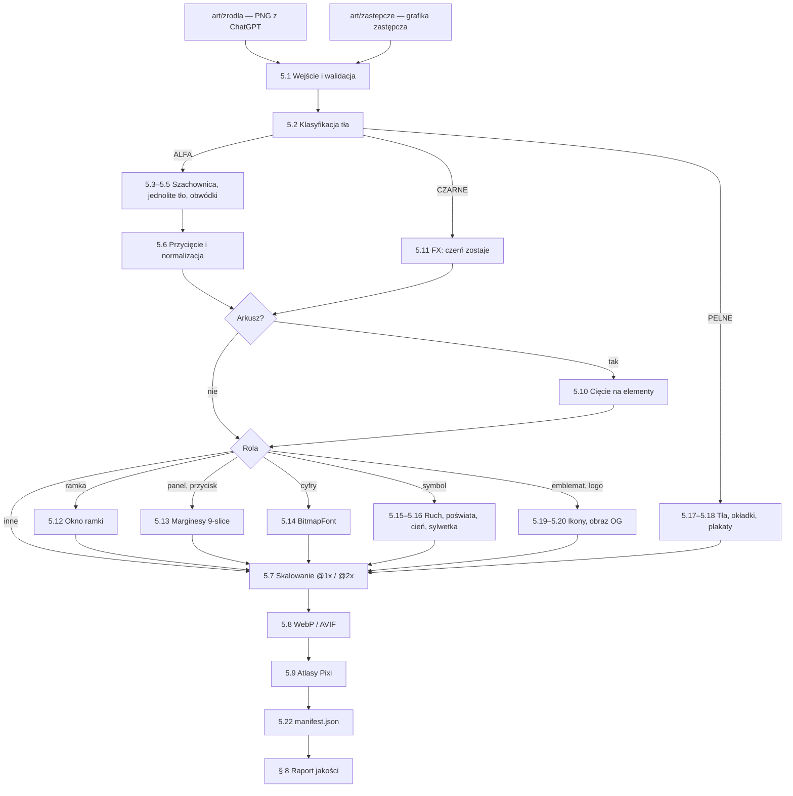

# 02 — Lista obrazów, dostarczenie i obróbka (manifest + pipeline)

Ten dokument to **pełny manifest 93 obrazów** Cebulion Casino (8 makiet + 85 assetów): co to jest, gdzie występuje
w aplikacji, w jakim rozmiarze trafia do przeglądarki i jak go obrabiamy. Opisuje też, **jak przekazać nam pliki**
z ChatGPT, oraz **pipeline** `tools/art/przetworz.py`, który z surowych PNG robi gotowe WebP, atlasy tekstur
i `manifest.json`.

Jak czytać: jeśli generujesz albo wysyłasz grafiki, wystarczą § 1–4 (lista + wysyłka). Jeśli obrabiasz obrazy,
piszesz front albo bronisz projektu, czytaj § 5–8 (pipeline, struktura plików, budżety, raport jakości). ID obrazów,
formaty, typy tła i priorytety pochodzą z briefu i są **wiążące**. Prompty do wygenerowania obrazów są
w [03-prompty-chatgpt.md](03-prompty-chatgpt.md), wymagania stylu w [01-kierunek-artystyczny.md](01-kierunek-artystyczny.md),
a kontrakt plików wynikowych (`assets/img/...`, `manifest.json`) w [09-kontrakt-api-i-assetow.md](09-kontrakt-api-i-assetow.md).

## Spis treści

1. [Podsumowanie liczbowe](#1-podsumowanie-liczbowe)
2. [Konwencje](#2-konwencje)
3. [Pełny manifest obrazów](#3-pełny-manifest-obrazów)
4. [Jak dostarczyć obrazy](#4-jak-dostarczyć-obrazy)
5. [Pipeline obróbki `tools/art/przetworz.py`](#5-pipeline-obróbki-toolsartprzetworzpy)
6. [Docelowa struktura plików w aplikacji](#6-docelowa-struktura-plików-w-aplikacji)
7. [Budżety wagi i szacunki](#7-budżety-wagi-i-szacunki)
8. [Automatyczny raport jakości](#8-automatyczny-raport-jakości)
9. [Otwarte kwestie i ryzyka](#9-otwarte-kwestie-i-ryzyka)
10. [Powiązane dokumenty](#powiązane-dokumenty)

---

## 1. Podsumowanie liczbowe

**93 obrazy = 8 makiet + 85 assetów.** Makiety to referencje stylu i układu ekranów — nie trafiają do aplikacji
i nie mają priorytetu. 85 assetów trafia do aplikacji (po obróbce).

### 1.1. Czaty ChatGPT i priorytety

Priorytety z briefu: **P0** = pierwsza grywalna wersja (lobby + logowanie + S1), **P1** = S2 i pełne efekty,
**P2** = S3 i dopieszczenie. Czat 3 (S1) jest w całości P0, czat 4 (S2) w całości P1, czat 5 (S3) w całości P2;
czaty 1–2 mają priorytet wpisany przy każdym obrazie.

| Czat | Zakres | Obrazów | P0 | P1 | P2 | bez priorytetu |
|---|---|---:|---:|---:|---:|---:|
| 0 | Makiety (referencje, poza aplikacją) | 8 | — | — | — | 8 |
| 1 | GLOBAL A: marka, waluta, maskotka, tła lobby | 13 | 10 | 3 | 0 | — |
| 2 | GLOBAL B: UI kit, banery wygranych, efekty | 18 | 10 | 8 | 0 | — |
| 3 | S1 „Cebulowy 777” | 14 | 14 | 0 | 0 | — |
| 4 | S2 „Złoty Faraon” | 22 | 0 | 22 | 0 | — |
| 5 | S3 „Kryształowa Kaskada” | 18 | 0 | 0 | 18 | — |
| **Razem** | | **93** | **34** | **33** | **18** | **8** |

Kontrola: 34 + 33 + 18 = 85 assetów; 85 + 8 makiet = 93.

**P0 w skrócie (34 obrazy — minimum do pierwszej grywalnej wersji):**
`g_logo`, `g_emblemat`, `g_moneta_przod`, `g_moneta_skos`, `g_moneta_bok`, `g_tlo_lobby_desktop`,
`g_tlo_lobby_mobile`, `g_maskotka_powitanie`, `g_skrzynia`, `g_font_cyfry` (czat 1: 10) ·
`g_ui_spin`, `g_ui_spin_stop`, `g_ui_ikony`, `g_ui_panel`, `g_ui_przycisk_glowny`, `g_ui_przycisk_drugi`,
`g_win_big`, `g_fx_promienie`, `g_fx_flara`, `g_fx_iskry` (czat 2: 10) · wszystkie 14 obrazów `s1_*` (czat 3).

**P1 spoza S2 (11 obrazów):** `g_maskotka_wygrana`, `g_maskotka_bankrut`, `g_awatary` (czat 1) ·
`g_ui_ornament`, `g_win_mega`, `g_win_epic`, `g_win_ultra`, `g_win_free_spins`, `g_fx_blyskawice`, `g_fx_dym`,
`g_fx_konfetti` (czat 2). Do czasu ich dostarczenia aplikacja używa grafiki zastępczej z `art/zastepcze/` (§ 5.1).

### 1.2. Formaty i typy tła w czatach

| Czat | 1:1 (1024×1024) | 3:2 (1536×1024) | 2:3 (1024×1536) | ALFA | CZARNE | PELNE | w tym SHEET |
|---|---:|---:|---:|---:|---:|---:|---:|
| 0 | 0 | 6 | 2 | 0 | 0 | 8 | 0 |
| 1 | 8 | 4 | 1 | 11 | 0 | 2 | 2 |
| 2 | 6 | 12 | 0 | 13 | 5 | 0 | 4 |
| 3 | 9 | 3 | 2 | 10 | 0 | 4 | 0 |
| 4 | 12 | 6 | 4 | 15 | 1 | 6 | 1 |
| 5 | 10 | 5 | 3 | 12 | 0 | 6 | 1 |
| **Razem (93)** | **45** | **36** | **12** | **61** | **6** | **26** | **8** |
| w tym assety (85) | 45 | 30 | 10 | 61 | 6 | 18 | 8 |

### 1.3. Arkusze (SHEET) i liczba obrazów po cięciu

8 arkuszy daje **76 elementów**. Po cięciu pipeline pracuje więc na 77 obrazach pojedynczych + 76 elementach
z arkuszy = **153 obrazach bazowych** (zanim powstaną warianty @2x, rozmycia ruchu, poświaty itd.).

| Arkusz | Tło | Siatka | Elementów |
|---|---|---|---:|
| `g_awatary` | ALFA | 4×2 | 8 |
| `g_font_cyfry` | ALFA | 5×3 (2 ostatnie pola puste) | 13 |
| `g_ui_ikony` | ALFA | 4×3 | 12 |
| `g_fx_iskry` | CZARNE | 4×2 | 8 |
| `g_fx_blyskawice` | CZARNE | 3×1 | 3 |
| `g_fx_konfetti` | ALFA | 4×3 | 12 |
| `s2_fx_hieroglify` | CZARNE | 4×2 | 8 |
| `s3_fx_odlamki` | ALFA | 4×3 | 12 |
| **Razem** | | | **76** |

### 1.4. Assety według roli

| Rola | Liczba | ID |
|---|---:|---|
| Symbole bębnów | 29 | 8 × `s1_sym_*`, 12 × `s2_sym_*`, 9 × `s3_sym_*` |
| Rozszerzony WILD | 1 | `s2_wild_rozszerzony` |
| Tła (lobby, gry, darmowe spiny) | 12 | `g_tlo_lobby_*` (2), `s1_tlo_*` (2), `s2_tlo_*` (4), `s3_tlo_*` (4) |
| Ramki bębnów | 3 | `s1_ramka`, `s2_ramka`, `s3_ramka` |
| Logotypy | 4 | `g_logo`, `s1_logo`, `s2_logo`, `s3_logo` |
| Okładki kafli | 3 | `s1_okladka`, `s2_okladka`, `s3_okladka` |
| Banery / key art | 3 | `s1_baner`, `s2_baner`, `s3_baner` |
| Marka i waluta | 4 | `g_emblemat`, `g_moneta_przod`, `g_moneta_skos`, `g_moneta_bok` |
| Maskotka | 3 | `g_maskotka_powitanie`, `g_maskotka_wygrana`, `g_maskotka_bankrut` |
| Rekwizyt bonusu | 1 | `g_skrzynia` |
| Awatary, cyfry (arkusze) | 2 | `g_awatary`, `g_font_cyfry` |
| UI kit | 7 | `g_ui_spin`, `g_ui_spin_stop`, `g_ui_ikony`, `g_ui_panel`, `g_ui_przycisk_glowny`, `g_ui_przycisk_drugi`, `g_ui_ornament` |
| Napisy wygranych | 5 | `g_win_big`, `g_win_mega`, `g_win_epic`, `g_win_ultra`, `g_win_free_spins` |
| Efekty | 8 | `g_fx_promienie`, `g_fx_flara`, `g_fx_iskry`, `g_fx_blyskawice`, `g_fx_dym`, `g_fx_konfetti`, `s2_fx_hieroglify`, `s3_fx_odlamki` |
| **Razem** | **85** | |

### 1.5. Najważniejsze liczby wynikowe (szczegóły w § 7)

| Wielkość | Wartość |
|---|---|
| Surowe PNG z ChatGPT (93 pliki) | ≈ 180–260 MB (1–3,5 MB na plik) — dlatego trzymamy je poza gałęzią `main` (§ 4.4) |
| Pliki wynikowe w `static/assets/img/` (wszystkie warianty, WebP + AVIF) | ≈ 20–28 MB |
| Gra S1 / S2 / S3 — to, co pobiera przeglądarka (najgorszy przypadek: desktop, @2x) | ≈ 3,3 / 4,0 / 3,6 MB (budżet ≤ 6 MB) |
| Lobby bez wideo (desktop, @2x, ze wszystkim doładowywanym na żądanie) | ≈ 2,4 MB (budżet ≤ 3 MB) |
| Atlasy tekstur Pixi | 20 atlasów (każdy = WebP + JSON), strony ≤ 2048 px na telefonach, ≤ 4096 px na desktopie (§ 5.9) |

---

## 2. Konwencje

### 2.1. Formaty z ChatGPT

| Proporcja | Piksele | Użycie | Obrazów |
|---|---|---|---:|
| 1:1 | 1024×1024 | symbole, monety, maskotka, przyciski okrągłe, panel, ramki S1 i S3, pojedyncze efekty | 45 |
| 3:2 | 1536×1024 | tła desktop, logotypy, banery wygranych, przyciski-pigułki, arkusze, ramka S2, banery, makiety | 36 |
| 2:3 | 1024×1536 | tła mobile, okładki kafli, rozszerzony WILD, makiety mobile | 12 |

Zawsze **PNG**, zawsze dokładnie te wymiary. Jeśli ChatGPT odda inny rozmiar (np. po edycji fragmentu), pipeline
przyjmie plik, ale raport oznaczy go ostrzeżeniem Q03 (§ 8). Zamieniona orientacja (np. 1024×1536 zamiast
1536×1024) to błąd — taki obraz trzeba wygenerować ponownie.

### 2.2. Typy tła

| Typ | Co dostajemy z ChatGPT | Co robi pipeline | Jak rysujemy w aplikacji | Obrazów |
|---|---|---|---|---:|
| `ALFA` | prawdziwa przezroczystość, obiekt ~80–85% kadru, margines ≥ 6%, bez cienia, bez tekstu (chyba że wskazano), światło z lewej-góry | naprawa fałszywej szachownicy / jednolitego tła (§ 5.3–5.4), usuwanie obwódek (§ 5.5), przycięcie do alfy (§ 5.6) | normalne mieszanie (`blend: "normal"`); w Pixi alfa jest premultiplikowana przy wgrywaniu tekstury | 61 |
| `CZARNE` | jednolite tło `#000000`, poświata wygasa do czerni przed krawędzią | czerń **zostaje**; zerowanie poziomu czerni i winieta krawędzi (§ 5.11); bez kanału alfa | tryb mieszania `add` (`blend: "add"`): w Pixi `blendMode = 'add'`, w CSS `mix-blend-mode: plus-lighter` (zapas: `screen`), w canvas 2D `globalCompositeOperation = 'lighter'` | 6 |
| `PELNE` | pełny obraz bez tekstu i UI (wyjątek: okładki z logo, makiety) | skalowanie do wariantów szerokości, dithering przeciw pasmom, kadrowanie pod proporcje ekranu, LQIP (§ 5.17) | tło sceny Pixi, ``/`<picture>` albo `background-image` w HTML | 26 |

**Dlaczego efekty świetlne nie mają alfy:** w trybie `add` czarny piksel nic nie dodaje do obrazu, więc znika, a miękka
poświata zachowuje pełne przejście tonalne. Wycinanie poświaty do przezroczystości daje brudne, szare krawędzie.
Uzasadnienie artystyczne: [01 § 4.8](01-kierunek-artystyczny.md#48-obrazy-efektów-tło-czarne-i-konfetti).

### 2.3. Arkusze (`SHEET`)

* Elementy w równej siatce, każdy w całości w swojej komórce z marginesem, bez nachodzenia. Siatka nie musi być
  idealna co do piksela — tniemy automatycznie po spójnych składowych alfy albo jasności (§ 5.10).
* **Kolejność komórek: wierszami, od lewej-góry do prawej-dołu.** Nazwy komórek są stałe (zgodnie z
  [09 § 3](09-kontrakt-api-i-assetow.md#3-assety-w-aplikacji)); plik komórki ma nazwę `<ID>__<komórka>`.
* Komórki numerowane liczymy **od 0** (jak indeksy tablic w kodzie; `avatarIndex` z API ma zakres 0–7).

| Arkusz | Komórki w kolejności (wiersz 1 / wiersz 2 / wiersz 3) | Przykładowa nazwa pliku |
|---|---|---|
| `g_awatary` (4×2) | `0 1 2 3` / `4 5 6 7` | `g_awatary__3.webp` |
| `g_font_cyfry` (5×3) | `0 1 2 3 4` / `5 6 7 8 9` / `przecinek plus razy` + 2 puste | `g_font_cyfry__razy.webp` |
| `g_ui_ikony` (4×3) | `autoplay turbo minus plus` / `dzwiek_wl dzwiek_wyl info menu` / `lobby zamknij ustawienia historia` | `g_ui_ikony__turbo.webp` |
| `g_fx_iskry` (4×2) | `0 1 2 3` / `4 5 6 7` (kształty: [01 § 4.8](01-kierunek-artystyczny.md#48-obrazy-efektów-tło-czarne-i-konfetti)) | `g_fx_iskry__5.webp` |
| `g_fx_blyskawice` (3×1) | `0 1 2` | `g_fx_blyskawice__1.webp` |
| `g_fx_konfetti` (4×3) | `0 1 2 3` / `4 5 6 7` / `8 9 10 11` | `g_fx_konfetti__10.webp` |
| `s2_fx_hieroglify` (4×2) | `0 1 2 3` / `4 5 6 7` | `s2_fx_hieroglify__0.webp` |
| `s3_fx_odlamki` (4×3) | `0 1 2 3` / `4 5 6 7` / `8 9 10 11` | `s3_fx_odlamki__11.webp` |

### 2.4. Elementy 9-slice

`g_ui_panel`, `g_ui_przycisk_glowny`, `g_ui_przycisk_drugi` są rozciągane metodą 9-slice: rogi zachowują
proporcje (nie są rozciągane), a krawędzie i środek się rozciągają. Dlatego **środek jest jednolity** (bez ornamentów),
a przyciski i panele są **bez tekstu** (tekst jest w HTML — ostry i dostępny dla czytników ekranu).
Marginesy (`top/right/bottom/left`) wykrywa pipeline (§ 5.13) i zapisuje w `manifest.json` → `nineSlice` jako ułamki
wymiarów obrazu. Front używa ich w CSS `border-image` (panele i przyciski są w HTML).

Ramki bębnów (`s1_ramka`, `s2_ramka`, `s3_ramka`) też są rysowane jako 9-slice (`NineSliceSprite` w Pixi), ale
marginesy wyznacza **okno** ramki (§ 2.5, § 5.12), a nie analiza jednolitego środka.

### 2.5. Okna ramek bębnów

Każda ramka ma w środku **w pełni przezroczyste, prostokątne okno**. Pipeline wykrywa jego granice (§ 5.12)
i zapisuje je w `manifest.json` → `frames.<ID>.window` (ułamki: `x`, `y`, `w`, `h`). Okno musi pasować do siatki
bębnów (pola symboli są kwadratowe):

| Ramka | Siatka | Docelowa proporcja okna (szer. : wys.) | Okno @1x (px) | Tolerancja bez rozciągania |
|---|---|---|---|---|
| `s1_ramka` (1:1) | 3×3 | 1,000 | 768×768 (3 × 256) | ±3% |
| `s2_ramka` (3:2) | 5×3 | 1,667 | 960×576 (5 × 192 na 3 × 192) | ±3% |
| `s3_ramka` (1:1) | 6×5 | 1,200 | 864×720 (6 × 144 na 5 × 144) | ±3% |

Odchyłka 3–15% → ramka jest dopasowywana przez rozciągnięcie pasów 9-slice; > 15% → obraz do ponownego
wygenerowania (szczegóły w § 5.12).

Okna w źródłach mają według [01](01-kierunek-artystyczny.md) ok. 640×640 px (S1, 62% kadru), 1229×737 px (S2)
i 819×686 px (S3). Stąd rozdzielczości ramek: S1 tylko @1x (już ×1,2), S2 i S3 z obniżonym @2x (§ 2.6).

### 2.6. Rozdzielczości @1x i @2x

* **@1x** = rozmiar elementu w pikselach CSS na **widoku referencyjnym desktop 1920×1080**. Wartości @1x
  wynikają z rozmiarów pól symboli z [01 § 5.2](01-kierunek-artystyczny.md#52-czytelność-pięć-testów):
  S1 pole 256 px (01: 180–220 px CSS), S2 192 px (150–190), S3 144 px (110–140) — z zapasem na puls wygranej 1,12.
* **@2x** = dwa razy więcej pikseli; ładowane, gdy efektywna gęstość (skala sceny × rozdzielczość renderowania)
  przekracza **1,15**. Na poziomie jakości **Low** zawsze ładujemy @1x.
* **Telefon zwykle ma dość @1x.** Pole S1 na telefonie ma 100–120 px CSS; przy DPR ograniczonym do 2 (poziom High)
  to 200–240 px fizycznych — mniej niż 256 px tekstury @1x. Dzięki temu atlasy na telefonach mieszczą się
  w limicie 2048 px.
* **Limit powiększania:** nigdy nie powiększamy źródła bardziej niż **×1,25** (Lanczos + lekkie wyostrzenie);
  wyjątek: tła i plakaty do **×1,67** (są ciemne, częściowo rozmyte i przykryte bębnami — [01 § 6.4](01-kierunek-artystyczny.md#64-kadrowanie-na-różnych-ekranach)).
  Jeśli pełne @2x wymagałoby więcej, @2x jest **obniżone** do tego limitu (raport: `@2x↓`). Jeśli obniżone @2x
  ma mniej niż 1,15× pikseli @1x, nie tworzymy go wcale (`src2x` nie występuje w manifeście — zgodnie z 09:
  „@2x, gdy źródło na to pozwala”).
* **Efekty miękkie** (promienie, flara, iskry, dym, błyskawice, poświaty, cienie) mają **jedną** rozdzielczość —
  rozmyty gradient nie zyskuje na @2x, a oszczędzamy 75% pikseli.
* Wymiary @2x są **dokładnie** 2× wymiary @1x (zaokrąglamy @1x do liczb parzystych), żeby sprite'y obu wersji
  miały identyczny rozmiar logiczny w scenie.
* **Tła, okładki, banery i plakaty** nie mają pary @1x/@2x w ścisłym sensie, tylko **warianty szerokości** (`w720` …
  `w2560`) do `srcset` i wyboru według poziomu jakości (§ 5.17). W manifeście `src` / `src2x` wskazują dla nich
  wariant średni i największy, żeby klient znający tylko kontrakt 09 też działał.

### 2.7. Nazwy plików

| Co | Wzorzec | Przykład |
|---|---|---|
| Plik źródłowy od Was | `<ID>.png` | `s2_sym_anubis.png` |
| Kolejna wersja tego samego ID | `<ID>.v2.png`, `<ID>.v3.png` | `s2_sym_anubis.v2.png` |
| Plik zastępczy (generowany) | `art/zastepcze/<pakiet>/<ID>.png` | `art/zastepcze/s2/s2_sym_anubis.png` |
| Wynik @1x / @2x (kontrakt 09) | `<ID>.webp`, `<ID>@2x.webp` | `s2_sym_anubis@2x.webp` |
| Komórka arkusza (kontrakt 09) | `<ID>__<komórka>.webp` (+ `@2x`) | `g_ui_ikony__turbo@2x.webp` |
| Wariant pochodny (rozszerzenie) | `<ID>.<wariant>.webp` (+ `@2x`) | `s1_sym_wild.ruch2.webp`, `g_moneta_przod.male@2x.webp` |
| Wariant szerokości (tła, okładki, banery) | `<ID>.w<szerokość>.<webp/avif>` | `g_tlo_lobby_desktop.w2560.avif` |
| Wariant + szerokość | `<ID>.<wariant>.w<szerokość>.<webp/avif>` | `s1_baner.k169.w1536.avif` |
| Atlas tekstur Pixi | `<pakiet>/atlas/<nazwa>@<skala>x.{webp,json}` | `s1/atlas/s1-symbole@2x.webp` |

Zasady: tylko małe litery ASCII, cyfry, `_` w ID; `__` oddziela komórkę arkusza, `.` oddziela wariant, `@` skalę.
ID są bez polskich znaków (np. `s1_sym_wisnie`, nie `wiśnie`), bo trafiają do adresów URL i kodu.

Lista wariantów pochodnych (opis w § 5):

| Wariant | Co to jest | Rozdzielczość | Dla kogo |
|---|---|---|---|
| `ruch1`, `ruch2` | pionowe rozmycie ruchu (słabe / mocne) | tylko @1x | symbole S1, S2; S3 tylko `ruch1` (opad) |
| `syl` | biała sylwetka (alfa jak w symbolu) | tylko @1x | symbole — błysk lądowania, poziom Low |
| `cien` | rozmyta czarna sylwetka (cień rzucany robi kod) | @0,5x | symbole, banery wygranych |
| `glow` | biała poświata do zabarwienia `tint` w trybie `add` | @0,5x | symbole, `s2_wild_rozszerzony`, banery wygranych, `s1_logo`–`s3_logo` |
| `glowzl` | poświata **już zabarwiona** na złoto `#F5C542` (CSS nie umie tanio barwić obrazów) | tylko @1x | `g_logo`, `g_ui_spin`, `g_skrzynia` (HTML) |
| `mini` | miniatura do tabeli wypłat w HTML | 96 / 192 px | symbole wszystkich gier |
| `male` | mała wersja do cząsteczek (lepsza ostrość niż silne zmniejszanie w locie) | 64 / 128 px | `g_moneta_przod`, `g_moneta_skos`, `g_moneta_bok` |
| `ikona` | wyostrzona ikona waluty w HTML | 28 / 56 px | `g_moneta_przod` |
| `naglowek` | emblemat do paska górnego (01 § 2.3: emblemat 40 px + napis HTML) | 40 / 80 px | `g_emblemat` |
| `rozmyte` | mocno rozmyta, przyciemniona miniatura tła (zamiast kosztownego `backdrop-filter`) | 640 px szer. (tło desktop), 480 px (tło mobile, banery) | `g_tlo_lobby_*`, `s*_baner` |
| `k169` | kadr 16:9 do plakatu wideo | 960×540 i 1536×864 | `s*_baner` |
| `w<N>` | wariant szerokości do `srcset` / wyboru wg poziomu jakości | patrz § 5.17 | tła, okładki, banery |

### 2.8. Foldery

```text
art/                              ← poza src/, więc nie trafia do pliku JAR aplikacji
├── zrodla/                       ← PNG od Was (gałąź grafika-zrodla, § 4.4)
│   ├── makiety/   m01_lobby_desktop.png … m08_big_win.png
│   ├── global/    g_logo.png … g_fx_konfetti.png
│   ├── s1/        s1_sym_wisnie.png … s1_baner.png
│   ├── s2/        s2_sym_10.png … s2_fx_hieroglify.png
│   ├── s3/        s3_sym_szafir.png … s3_fx_odlamki.png
│   └── nieposortowane/           ← pliki o nieznanych nazwach (§ 4.6)
├── zastepcze/                    ← grafika zastępcza, generowana skryptem (kontrakt 09)
├── robocze/                      ← wyniki pośrednie i cache (w .gitignore)
└── raport/                       ← raport jakości HTML + JSON (w .gitignore)
tools/art/                        ← pipeline (Python), § 5
src/main/resources/static/assets/img/   ← wynik dla przeglądarki, § 6
```

---

## 3. Pełny manifest obrazów

Każde ID z briefu występuje poniżej **dokładnie raz, w osobnym wierszu**. Kolumny:

* **Plik** — ścieżka względem `art/zrodla/`.
* **Gdzie użyty** — ekran i zdarzenia z katalogu `E01`–`E73` (efekty: [04](04-efekty-wizualne.md), dźwięk:
  [05](05-dzwiek-i-muzyka.md), zachowanie UI: [06](06-interfejs-ux.md)).
* **Rozmiar docelowy** — `@1x / @2x` w pikselach (definicja w § 2.6); „szer.”/„wys.” = wymiar, do którego dopasowujemy,
  drugi wynika z proporcji po przycięciu. „(jedna)” = tylko jedna rozdzielczość.
* **Obróbka** — znaczniki kroków pipeline'u z tabeli niżej.

### 3.0. Znaczniki obróbki

Każdy asset przechodzi kroki wspólne: wejście i walidacja (§ 5.1), klasyfikacja tła (§ 5.2), skalowanie @1x/@2x
(§ 5.7), kodowanie WebP (§ 5.8), wpis do `manifest.json` i raport (§ 8). Tych kroków nie powtarzamy w tabelach.

| Znacznik | Krok | § |
|---|---|---|
| `ALFA` | kontrola przezroczystości: wykrycie i usunięcie fałszywej szachownicy albo jednolitego tła | 5.3–5.4 |
| `DEFR` | usuwanie obwódek (halo), czyszczenie alfy i „pyłków” | 5.5 |
| `TRIM` | przycięcie do alfy + margines | 5.6 |
| `NORM(…)` | normalizacja skali i środka w zestawie (w nawiasie: według czego) | 5.6 |
| `CIECIE n` | cięcie arkusza na `n` elementów | 5.10 |
| `FX` | obraz z czarnym tłem: zerowanie czerni, winieta krawędzi, `blend: "add"`, bez alfy | 5.11 |
| `OKNO` | wykrycie przezroczystego okna ramki → `frames.window` + marginesy 9-slice ramki | 5.12 |
| `9S` | wykrycie marginesów 9-slice → `nineSlice` + CSS `border-image` | 5.13 |
| `BMF` | cyfry → BitmapFont (`.fnt`) dla Pixi + sprite CSS | 5.14 |
| `RUCH` | warianty z rozmyciem ruchu `ruch1`/`ruch2` | 5.15 |
| `GLOW` / `GLOW(zl)` | poświata biała do `tint` / poświata zabarwiona na złoto dla HTML | 5.16 |
| `CIEN` / `SYL` | sprite cienia / biała sylwetka | 5.16 |
| `MINI` | miniatura do tabeli wypłat (96 / 192 px) | 5.16 |
| `TLO` | tło: warianty szerokości, dithering, kadrowanie pod proporcje, LQIP, wersja rozmyta | 5.17 |
| `SRCSET` | warianty szerokości `w400/w600/w800` dla `` | 5.17 |
| `PLAKAT` | plakat wideo (kadr 16:9, wersja rozmyta) | 5.18 |
| `IKONY` | favicon, ikony aplikacji | 5.19 |
| `OG` | składnik obrazu Open Graph 1200×630 | 5.20 |
| `AVIF` | dodatkowo AVIF (dla `<picture>` w HTML) | 5.8 |
| `ATLAS:nazwa` | pakowanie do atlasu tekstur Pixi | 5.9 |
| `PODGLAD` | tylko miniatura 768 px do raportu (makiety) | 5.21 |

### 3.1. Czat 0 — Makiety (8 obrazów, nie trafiają do aplikacji)

| ID | Plik | Format (px) | Tło | Prio | Gdzie użyty | Rozmiar docelowy @1x / @2x | Obróbka |
|---|---|---|---|---|---|---|---|
| `m01_lobby_desktop` | `makiety/m01_lobby_desktop.png` | 1536×1024 | PELNE | — | referencja układu lobby niezalogowanego (logo, 3 kafle, „Zaloguj” w prawym górnym rogu) dla 06 i nastroju teł lobby (czat 1) | — | `PODGLAD` |
| `m02_logowanie` | `makiety/m02_logowanie.png` | 1536×1024 | PELNE | — | referencja modala logowania E04 i rozmycia lobby pod modalem (wariant `rozmyte`) | — | `PODGLAD` |
| `m03_bonus_powitalny` | `makiety/m03_bonus_powitalny.png` | 1536×1024 | PELNE | — | referencja sceny bonusu powitalnego E07 (skrzynia, deszcz monet, saldo w rogu) | — | `PODGLAD` |
| `m04_lobby_mobile` | `makiety/m04_lobby_mobile.png` | 1024×1536 | PELNE | — | referencja lobby zalogowanego na telefonie pionowo (06) | — | `PODGLAD` |
| `m05_s1_desktop` | `makiety/m05_s1_desktop.png` | 1536×1024 | PELNE | — | referencja ekranu S1 z panelem; **kotwica stylu** dołączana do czatów 1–5 ([01 § 1.4](01-kierunek-artystyczny.md#14-kolejność-pracy-i-kotwice-stylu)) | — | `PODGLAD` |
| `m06_s2_desktop` | `makiety/m06_s2_desktop.png` | 1536×1024 | PELNE | — | referencja ekranu S2 (siatka 5×3, ramka, panel) | — | `PODGLAD` |
| `m07_s3_mobile` | `makiety/m07_s3_mobile.png` | 1024×1536 | PELNE | — | referencja ekranu S3 na telefonie pionowo (siatka 6×5) | — | `PODGLAD` |
| `m08_big_win` | `makiety/m08_big_win.png` | 1536×1024 | PELNE | — | referencja sekwencji MEGA WIN E30–E31 (skala napisu, promienie, monety) dla 04 | — | `PODGLAD` |

### 3.2. Czat 1 — GLOBAL A: marka, waluta, maskotka, tła lobby (13 obrazów)

| ID | Plik | Format (px) | Tło | Prio | Gdzie użyty | Rozmiar docelowy @1x / @2x | Obróbka |
|---|---|---|---|---|---|---|---|
| `g_logo` | `global/g_logo.png` | 1536×1024 | ALFA | P0 | sekcja powitalna lobby (szer. 360–720 px CSS), odsłonięcie logo z błyskiem po literach E01, ekran ładowania gry E20, obraz OG; **nie** w pasku górnym ([01 § 2.3](01-kierunek-artystyczny.md#23-logotyp-g_logo)) | 720 / 1440 szer. (+ `glowzl` 720) | `ALFA DEFR TRIM GLOW(zl) OG` |
| `g_emblemat` | `global/g_emblemat.png` | 1024×1024 | ALFA | P0 | pasek górny (40 px obok napisu HTML), loader E20 (obrót + puls), favicon i ikony aplikacji, znak wodny modala E04 | loader 192 / 384; `naglowek` 40 / 80; ikony 16–512 | `ALFA DEFR TRIM IKONY` |
| `g_moneta_przod` | `global/g_moneta_przod.png` | 1024×1024 | ALFA | P0 | ikona waluty przed kwotą (HTML, 20–28 px) z pulsem E08; pierwsza klatka obrotu: scena bonusu E07/E10 (160–256 px), cząsteczki — fontanna E07, lot monet do salda, deszcz monet E29–E32 | 256 / 512; `male` 64 / 128; `ikona` 28 / 56 | `ALFA DEFR TRIM NORM(średnica) ATLAS:wspolne-czastki` |
| `g_moneta_skos` | `global/g_moneta_skos.png` | 1024×1024 | ALFA | P0 | klatka obrotu: przód → skos → bok → skos odbity (`scale.x = -1`) → przód ([01 § 2.5](01-kierunek-artystyczny.md#25-moneta-cebulion-g_moneta_przod-g_moneta_skos-g_moneta_bok)); scena bonusu i cząsteczki jak wyżej | 256 / 512 wys.; `male` 64 / 128 | `ALFA DEFR TRIM NORM(wys. i środek jak przód) ATLAS:wspolne-czastki` |
| `g_moneta_bok` | `global/g_moneta_bok.png` | 1024×1024 | ALFA | P0 | klatka obrotu „na krawędzi” (najwęższa faza), scena bonusu i cząsteczki jak wyżej | 256 / 512 wys.; `male` 64 / 128 | `ALFA DEFR TRIM NORM(wys. i środek jak przód) ATLAS:wspolne-czastki` |
| `g_tlo_lobby_desktop` | `global/g_tlo_lobby_desktop.png` | 1536×1024 | PELNE | P0 | tło lobby, gdy okno jest poziome (wybór wersji: 06); powolny zoom 1,00 → 1,04 i warstwy cząsteczek E02; wersja rozmyta pod modalami E04, E07, E09 | `w1280`, `w1920` (= @1x), `w2560` (= @2x↓) + `rozmyte` 640 + LQIP 24×16 | `TLO AVIF` |
| `g_tlo_lobby_mobile` | `global/g_tlo_lobby_mobile.png` | 1024×1536 | PELNE | P0 | tło lobby, gdy okno jest pionowe (telefon) | `w720`, `w1080` (= @1x), `w1280` (= @2x↓) + `rozmyte` 480 + LQIP 16×24 | `TLO AVIF` |
| `g_maskotka_powitanie` | `global/g_maskotka_powitanie.png` | 1024×1024 | ALFA | P0 | lobby niezalogowane obok przycisku „Zaloguj” (wejście z odbiciem E01), modal logowania E04, scena bonusu E07; „oddech”, kołysanie i cień-elipsę robi kod ([01 § 2.7](01-kierunek-artystyczny.md#27-maskotka-pan-cebulion)) | 480 / 960 wys. | `ALFA DEFR TRIM NORM(wys., linia stóp)` |
| `g_maskotka_wygrana` | `global/g_maskotka_wygrana.png` | 1024×1024 | ALFA | P1 | modal podsumowania darmowych spinów E37 (HTML nad grą); nagłówek sekcji „Ostatnie duże wygrane” w lobby | 420 / 840 wys. | `ALFA DEFR TRIM NORM(wys., linia stóp)` |
| `g_maskotka_bankrut` | `global/g_maskotka_bankrut.png` | 1024×1024 | ALFA | P1 | modal bankructwa E09 i odbiór bonusu ratunkowego E10 (w lobby i w grze) | 420 / 840 wys. | `ALFA DEFR TRIM NORM(wys., linia stóp)` |
| `g_skrzynia` | `global/g_skrzynia.png` | 1024×1024 | ALFA | P0 | scena bonusu powitalnego E07 i ratunkowego E10: wejście skali 0 → 1,08 → 1, promienie za skrzynią, fontanna monet z wnętrza | 480 / 960 (+ `glowzl` 480) | `ALFA DEFR TRIM GLOW(zl)` |
| `g_awatary` | `global/g_awatary.png` | 1536×1024 | ALFA SHEET 4×2 | P1 | awatar gracza w pasku górnym (`avatarIndex` 0–7 z API, [09 § 2.1](09-kontrakt-api-i-assetow.md#21-logowanie-i-gracz)), ranking, feed dużych wygranych (32–64 px) | każda komórka 64 / 128 | `ALFA CIECIE 8 DEFR TRIM NORM(średnica koła)` |
| `g_font_cyfry` | `global/g_font_cyfry.png` | 1536×1024 | ALFA SHEET 5×3 | P0 | kwoty w scenie gry jako `BitmapText` (E28–E32, E36, E37), mnożniki „×2”, „×10”, „×5” (E50, E51, E72, E73), „+10” przy retriggerze E61; licznik „+10 000” w lobby E07 (sprite CSS z tej samej strony) | wys. cyfry 96 / 192 | `ALFA CIECIE 13 DEFR BMF` |

### 3.3. Czat 2 — GLOBAL B: UI kit, banery wygranych, efekty (18 obrazów)

| ID | Plik | Format (px) | Tło | Prio | Gdzie użyty | Rozmiar docelowy @1x / @2x | Obróbka |
|---|---|---|---|---|---|---|---|
| `g_ui_spin` | `global/g_ui_spin.png` | 1024×1024 | ALFA | P0 | przycisk SPIN w panelu gry (HTML nad kanwą, 120–140 px desktop, 88–104 px telefon): wciśnięcie `scale(0.94)` i przenikanie do STOP w 120 ms przy E24, pulsująca poświata co 2,4 s w bezczynności E22; przycisku **nie obracamy** ([01 § 7.3](01-kierunek-artystyczny.md#73-przycisk-spin-g_ui_spin-i-g_ui_spin_stop)); skrót Spacja | 144 / 288 (+ `glowzl` 188) | `ALFA DEFR TRIM NORM(wspólny z g_ui_spin_stop) GLOW(zl)` |
| `g_ui_spin_stop` | `global/g_ui_spin_stop.png` | 1024×1024 | ALFA | P0 | ten sam przycisk w stanie STOP (przenikanie 120 ms ze SPIN): szybkie zatrzymanie bębnów, przerwanie autoplay E38 | 144 / 288 | `ALFA DEFR TRIM NORM(wspólny z g_ui_spin)` |
| `g_ui_ikony` | `global/g_ui_ikony.png` | 1536×1024 | ALFA SHEET 4×3 | P0 | okrągłe przyciski-ikony panelu gry i lobby (40–52 px): autoplay E38, turbo E39, minus/plus zakładu E23, dźwięk wł./wył., info (tabela wypłat), menu, lobby E12, zamknij, ustawienia, historia | każda ikona 56 / 112 | `ALFA CIECIE 12 DEFR TRIM NORM(średnica dysku)` |
| `g_ui_panel` | `global/g_ui_panel.png` | 1024×1024 | ALFA | P0 | modale HTML: logowanie E04, bankructwo E09, ustawienia, tabela wypłat, historia, podsumowanie FS E37, błąd sieci E40 | ≈ 460 / ≈ 920 (po przycięciu) + `nineSlice` | `ALFA DEFR TRIM 9S` |
| `g_ui_przycisk_glowny` | `global/g_ui_przycisk_glowny.png` | 1536×1024 | ALFA | P0 | przyciski główne (HTML): „Zaloguj”, „Wejdź do kasyna”, „Odbierz 10 000”, „Graj” | wys. 80 / 160 | `ALFA DEFR TRIM 9S` |
| `g_ui_przycisk_drugi` | `global/g_ui_przycisk_drugi.png` | 1536×1024 | ALFA | P0 | przyciski drugorzędne (HTML): „Anuluj”, „Tabela wypłat”, „Wróć do lobby”, przyciski ustawień | wys. 80 / 160 | `ALFA DEFR TRIM 9S` |
| `g_ui_ornament` | `global/g_ui_ornament.png` | 1536×1024 | ALFA | P1 | ozdobnik nagłówków modali i sekcji lobby, separator w tabeli wypłat | 480 / 960 szer. | `ALFA DEFR TRIM` |
| `g_win_big` | `global/g_win_big.png` | 1536×1024 | ALFA | P0 | pełnoekranowa sekwencja wygranej (scena Pixi): wejście E30, początek eskalacji E31, zakończenie / przewinięcie E32 | w polu 960×640 / ≈ 1600 szer. (@2x↓) + `glow`, `cien` | `ALFA DEFR TRIM NORM(szer.) GLOW CIEN ATLAS:wspolne-wygrane` |
| `g_win_mega` | `global/g_win_mega.png` | 1536×1024 | ALFA | P1 | eskalacja BIG → MEGA (E31), zakończenie E32 | w polu 960×640 / ≈ 1600 szer. (@2x↓) + `glow`, `cien` | `ALFA DEFR TRIM NORM(szer.) GLOW CIEN ATLAS:wspolne-wygrane` |
| `g_win_epic` | `global/g_win_epic.png` | 1536×1024 | ALFA | P1 | eskalacja MEGA → EPIC (E31), zakończenie E32 | w polu 960×640 / ≈ 1600 szer. (@2x↓) + `glow`, `cien` | `ALFA DEFR TRIM NORM(szer.) GLOW CIEN ATLAS:wspolne-wygrane` |
| `g_win_ultra` | `global/g_win_ultra.png` | 1536×1024 | ALFA | P1 | eskalacja EPIC → ULTRA (E31) — najmocniejszy poziom; zakończenie E32 | w polu 960×640 / ≈ 1600 szer. (@2x↓) + `glow`, `cien` | `ALFA DEFR TRIM NORM(szer.) GLOW CIEN ATLAS:wspolne-wygrane` |
| `g_win_free_spins` | `global/g_win_free_spins.png` | 1536×1024 | ALFA | P1 | aktywacja darmowych spinów E35 (S2, S3), retrigger E61 (z „+10” z `g_font_cyfry`), nagłówek podsumowania E37 | w polu 960×640 / ≈ 1600 szer. (@2x↓) + `glow`, `cien` | `ALFA DEFR TRIM NORM(szer.) GLOW CIEN ATLAS:wspolne-wygrane` |
| `g_fx_promienie` | `global/g_fx_promienie.png` | 1024×1024 | CZARNE | P0 | obracające się snopy (4–8°/s) za napisami wygranych E30–E32, za skrzynią E07/E10, aktywacja FS E35, NEON JACKPOT E51, intro gry E21 | 1024 (jedna) | `FX ATLAS:wspolne-fx` |
| `g_fx_flara` | `global/g_fx_flara.png` | 1024×1024 | CZARNE | P0 | błysk przy lądowaniu WILD / scattera E33/E34, stop bębna z wygraną E26, uderzenie przy eskalacji E31, przejścia E12 | 512 (jedna) | `FX ATLAS:wspolne-fx` |
| `g_fx_iskry` | `global/g_fx_iskry.png` | 1536×1024 | CZARNE SHEET 4×2 | P0 | tekstury cząsteczek: wygrana medium E29, eskalacja E31, WILD / scatter E33/E34, bonus E07, neonowy mnożnik E50, pęknięcie S3 E70 | każda 128 (jedna) | `CIECIE 8 FX ATLAS:wspolne-fx` |
| `g_fx_blyskawice` | `global/g_fx_blyskawice.png` | 1536×1024 | CZARNE SHEET 3×1 | P1 | wyładowania przy eskalacji E31, neonowy mnożnik S1 E50, łuki energii wzdłuż bębna przy antycypacji E27 | każda 384×768 (jedna) | `CIECIE 3 FX ATLAS:wspolne-fx` |
| `g_fx_dym` | `global/g_fx_dym.png` | 1024×1024 | CZARNE | P1 | kłęby przy wejściu sekwencji big win E30, przejścia lobby ↔ gra E12, aktywacja FS E35, intro gry E21 | 512 (jedna) | `FX ATLAS:wspolne-fx` |
| `g_fx_konfetti` | `global/g_fx_konfetti.png` | 1536×1024 | ALFA SHEET 4×3 | P1 | cząsteczki konfetti (normalne mieszanie, nie `add`): od MEGA w E31–E32, bonus E07, podsumowanie FS E37 | każdy element 48 / 96 (dłuższy bok) | `ALFA CIECIE 12 DEFR TRIM ATLAS:wspolne-czastki` |

### 3.4. Czat 3 — S1 „Cebulowy 777” (14 obrazów, P0)

Warianty symboli S1: `ruch1`, `ruch2`, `syl` (@1x), `glow`, `cien` (@0,5x), `mini` (96 / 192). Hierarchia do
normalizacji (§ 5.6): niskie `wisnie`, `cytryna`, `sliwka`, `arbuz`; wysokie `dzwonek`, `bar`, `siodemka`;
specjalny `wild`.

| ID | Plik | Format (px) | Tło | Prio | Gdzie użyty | Rozmiar docelowy @1x / @2x | Obróbka |
|---|---|---|---|---|---|---|---|
| `s1_sym_wisnie` | `s1/s1_sym_wisnie.png` | 1024×1024 | ALFA | P0 | bęben S1 (niski): obrót E25 (`ruch1`/`ruch2`), stop E26 (błysk `syl`), wygrana E28/E29 (`glow`), przyciemnienie niewygrywających; tabela wypłat (`mini`) | 256 / 512 + warianty S1 | `ALFA DEFR TRIM NORM(niskie S1) RUCH GLOW CIEN SYL MINI ATLAS:s1-symbole` |
| `s1_sym_cytryna` | `s1/s1_sym_cytryna.png` | 1024×1024 | ALFA | P0 | bęben S1 (niski): E25, E26, E28/E29; tabela wypłat | 256 / 512 + warianty S1 | `ALFA DEFR TRIM NORM(niskie S1) RUCH GLOW CIEN SYL MINI ATLAS:s1-symbole` |
| `s1_sym_sliwka` | `s1/s1_sym_sliwka.png` | 1024×1024 | ALFA | P0 | bęben S1 (niski): E25, E26, E28/E29; tabela wypłat | 256 / 512 + warianty S1 | `ALFA DEFR TRIM NORM(niskie S1) RUCH GLOW CIEN SYL MINI ATLAS:s1-symbole` |
| `s1_sym_arbuz` | `s1/s1_sym_arbuz.png` | 1024×1024 | ALFA | P0 | bęben S1 (niski): E25, E26, E28/E29; tabela wypłat | 256 / 512 + warianty S1 | `ALFA DEFR TRIM NORM(niskie S1) RUCH GLOW CIEN SYL MINI ATLAS:s1-symbole` |
| `s1_sym_dzwonek` | `s1/s1_sym_dzwonek.png` | 1024×1024 | ALFA | P0 | bęben S1 (wysoki): E25, E26, E28/E29, pełny ekran = NEON JACKPOT E51; tabela wypłat | 256 / 512 + warianty S1 | `ALFA DEFR TRIM NORM(wysokie S1) RUCH GLOW CIEN SYL MINI ATLAS:s1-symbole` |
| `s1_sym_bar` | `s1/s1_sym_bar.png` | 1024×1024 | ALFA | P0 | bęben S1 (wysoki): E25, E26, E28/E29, E51; tabela wypłat | 256 / 512 + warianty S1 | `ALFA DEFR TRIM NORM(wysokie S1) RUCH GLOW CIEN SYL MINI ATLAS:s1-symbole` |
| `s1_sym_siodemka` | `s1/s1_sym_siodemka.png` | 1024×1024 | ALFA | P0 | bęben S1 (najwyższy): E25, E26, E28/E29, E51; tabela wypłat | 256 / 512 + warianty S1 | `ALFA DEFR TRIM NORM(wysokie S1) RUCH GLOW CIEN SYL MINI ATLAS:s1-symbole` |
| `s1_sym_wild` | `s1/s1_sym_wild.png` | 1024×1024 | ALFA | P0 | bęben S1 (WILD): lądowanie E33, „prawie bonus” przy 2 WILD na linii E27, neonowy mnożnik ×2 E50, NEON JACKPOT E51; tabela wypłat | 256 / 512 + warianty S1 | `ALFA DEFR TRIM NORM(specjalne S1) RUCH GLOW CIEN SYL MINI ATLAS:s1-symbole` |
| `s1_tlo_desktop` | `s1/s1_tlo_desktop.png` | 1536×1024 | PELNE | P0 | tło sceny S1 przy oknie poziomym: intro E21, bezczynność E22; podkład bębna i neonowe migotanie rysuje kod ([01 § 6.6](01-kierunek-artystyczny.md#66-tła-gier-i-podkład-bębna)) | `w1280`, `w1920` (= @1x), `w2560` (= @2x↓) | `TLO` |
| `s1_tlo_mobile` | `s1/s1_tlo_mobile.png` | 1024×1536 | PELNE | P0 | tło sceny S1 przy oknie pionowym (telefon) | `w720`, `w1080` (= @1x), `w1280` (= @2x↓) | `TLO` |
| `s1_ramka` | `s1/s1_ramka.png` | 1024×1024 | ALFA | P0 | ramka automatu nad bębnami 3×3 (`NineSliceSprite`, okno = siatka + 2% luzu); świecenie ramy przy antycypacji E27 i E51 robi kod | okno 768×768 → ramka ≈ 1230 (jedna — okno w źródle ma ~640 px, więc @1x to już ×1,2) | `ALFA DEFR TRIM OKNO` |
| `s1_logo` | `s1/s1_logo.png` | 1536×1024 | ALFA | P0 | logo nad ramką (pas górny tła): wejście E21, neonowe migotanie E22 (`glow` z tintem magenta / cyjan), ekran ładowania S1 E20 | 640 / 1280 szer. + `glow` | `ALFA DEFR TRIM GLOW` |
| `s1_okladka` | `s1/s1_okladka.png` | 1024×1536 | PELNE | P0 | kafel gry w lobby: przechył 3D i poświata E03, plakat przed startem wideo kafla, wersja przy `prefers-reduced-motion` / słabym łączu | `w400` (= @1x), `w600`, `w800` (= @2x) + LQIP | `SRCSET AVIF` |
| `s1_baner` | `s1/s1_baner.png` | 1536×1024 | PELNE | P0 | karuzela / sekcja powitalna lobby (tytuł i przycisk HTML w lewych ~40%), plakat wideo 16:9, tło ekranu ładowania S1 E20 (`rozmyte`) | `w960`, `w1536` (natywny); `k169` 960×540 / 1536×864; `rozmyte` 480 | `PLAKAT AVIF` |

### 3.5. Czat 4 — S2 „Złoty Faraon” (22 obrazy, P1)

Warianty symboli S2: jak w S1 (`ruch1`, `ruch2`, `syl`, `glow`, `cien`, `mini`). Hierarchia: niskie `10`, `j`, `q`,
`k`, `a`; wysokie `ankh`, `oko`, `skarabeusz`, `anubis`, `faraon`; specjalne `wild`, `scatter`.

| ID | Plik | Format (px) | Tło | Prio | Gdzie użyty | Rozmiar docelowy @1x / @2x | Obróbka |
|---|---|---|---|---|---|---|---|
| `s2_sym_10` | `s2/s2_sym_10.png` | 1024×1024 | ALFA | P1 | bęben S2 (niski): obrót E25, stop E26, wygrana E28/E29, przyciemnienie niewygrywających; tabela wypłat | 192 / 384 + warianty S2 | `ALFA DEFR TRIM NORM(niskie S2) RUCH GLOW CIEN SYL MINI ATLAS:s2-symbole` |
| `s2_sym_j` | `s2/s2_sym_j.png` | 1024×1024 | ALFA | P1 | bęben S2 (niski): E25, E26, E28/E29; tabela wypłat | 192 / 384 + warianty S2 | `ALFA DEFR TRIM NORM(niskie S2) RUCH GLOW CIEN SYL MINI ATLAS:s2-symbole` |
| `s2_sym_q` | `s2/s2_sym_q.png` | 1024×1024 | ALFA | P1 | bęben S2 (niski): E25, E26, E28/E29; tabela wypłat | 192 / 384 + warianty S2 | `ALFA DEFR TRIM NORM(niskie S2) RUCH GLOW CIEN SYL MINI ATLAS:s2-symbole` |
| `s2_sym_k` | `s2/s2_sym_k.png` | 1024×1024 | ALFA | P1 | bęben S2 (niski): E25, E26, E28/E29; tabela wypłat | 192 / 384 + warianty S2 | `ALFA DEFR TRIM NORM(niskie S2) RUCH GLOW CIEN SYL MINI ATLAS:s2-symbole` |
| `s2_sym_a` | `s2/s2_sym_a.png` | 1024×1024 | ALFA | P1 | bęben S2 (niski): E25, E26, E28/E29; tabela wypłat | 192 / 384 + warianty S2 | `ALFA DEFR TRIM NORM(niskie S2) RUCH GLOW CIEN SYL MINI ATLAS:s2-symbole` |
| `s2_sym_ankh` | `s2/s2_sym_ankh.png` | 1024×1024 | ALFA | P1 | bęben S2 (wysoki): E25, E26, E28/E29; tabela wypłat | 192 / 384 + warianty S2 | `ALFA DEFR TRIM NORM(wysokie S2) RUCH GLOW CIEN SYL MINI ATLAS:s2-symbole` |
| `s2_sym_oko` | `s2/s2_sym_oko.png` | 1024×1024 | ALFA | P1 | bęben S2 (wysoki): E25, E26, E28/E29; tabela wypłat | 192 / 384 + warianty S2 | `ALFA DEFR TRIM NORM(wysokie S2) RUCH GLOW CIEN SYL MINI ATLAS:s2-symbole` |
| `s2_sym_skarabeusz` | `s2/s2_sym_skarabeusz.png` | 1024×1024 | ALFA | P1 | bęben S2 (wysoki): E25, E26, E28/E29; tabela wypłat | 192 / 384 + warianty S2 | `ALFA DEFR TRIM NORM(wysokie S2) RUCH GLOW CIEN SYL MINI ATLAS:s2-symbole` |
| `s2_sym_anubis` | `s2/s2_sym_anubis.png` | 1024×1024 | ALFA | P1 | bęben S2 (wysoki): E25, E26, E28/E29; tabela wypłat | 192 / 384 + warianty S2 | `ALFA DEFR TRIM NORM(wysokie S2) RUCH GLOW CIEN SYL MINI ATLAS:s2-symbole` |
| `s2_sym_faraon` | `s2/s2_sym_faraon.png` | 1024×1024 | ALFA | P1 | bęben S2 (najwyższy): E25, E26, E28/E29; tabela wypłat | 192 / 384 + warianty S2 | `ALFA DEFR TRIM NORM(wysokie S2) RUCH GLOW CIEN SYL MINI ATLAS:s2-symbole` |
| `s2_sym_wild` | `s2/s2_sym_wild.png` | 1024×1024 | ALFA | P1 | bęben S2 (WILD): lądowanie E33; w darmowych spinach punkt startowy rozszerzenia E60; tabela wypłat | 192 / 384 + warianty S2 | `ALFA DEFR TRIM NORM(specjalne S2) RUCH GLOW CIEN SYL MINI ATLAS:s2-symbole` |
| `s2_sym_scatter` | `s2/s2_sym_scatter.png` | 1024×1024 | ALFA | P1 | bęben S2 (SCATTER): lądowanie E34 (1., 2., 3.+), antycypacja E27 (drżenie + poświata), aktywacja FS E35, retrigger E61; tabela wypłat | 192 / 384 + warianty S2 | `ALFA DEFR TRIM NORM(specjalne S2) RUCH GLOW CIEN SYL MINI ATLAS:s2-symbole` |
| `s2_wild_rozszerzony` | `s2/s2_wild_rozszerzony.png` | 1024×1536 | ALFA | P1 | rozszerzenie WILD na cały bęben w darmowych spinach E60 (słup światła); dopasowany do wysokości 3 pól, szerokość może wychodzić do 15% na sąsiednie bębny | 192×576 / 384×1152 (wys. 3 pól) + `glow` | `ALFA DEFR TRIM NORM(wys. 3 pól) GLOW ATLAS:s2-symbole` |
| `s2_tlo_desktop` | `s2/s2_tlo_desktop.png` | 1536×1024 | PELNE | P1 | tło skarbca przy oknie poziomym: intro E21, bezczynność E22 (migotanie pochodni robi kod) | `w1280`, `w1920` (= @1x), `w2560` (= @2x↓) | `TLO` |
| `s2_tlo_mobile` | `s2/s2_tlo_mobile.png` | 1024×1536 | PELNE | P1 | tło skarbca przy oknie pionowym | `w720`, `w1080` (= @1x), `w1280` (= @2x↓) | `TLO` |
| `s2_tlo_fs_desktop` | `s2/s2_tlo_fs_desktop.png` | 1536×1024 | PELNE | P1 | tło darmowych spinów (noc nad piramidami): przenikanie 600–900 ms z błyskiem przy E35, w trakcie E36, powrót po E37; doładowywane w tle po E21 | `w1280`, `w1920` (= @1x), `w2560` (= @2x↓) | `TLO` |
| `s2_tlo_fs_mobile` | `s2/s2_tlo_fs_mobile.png` | 1024×1536 | PELNE | P1 | jak wyżej, okno pionowe | `w720`, `w1080` (= @1x), `w1280` (= @2x↓) | `TLO` |
| `s2_ramka` | `s2/s2_ramka.png` | 1536×1024 | ALFA | P1 | ramka 5×3 (`NineSliceSprite`); rozbłyski przy E35 i E60 robi kod | okno 960×576 → ramka ≈ 1200 / ≈ 1920 szer. (@2x↓) | `ALFA DEFR TRIM OKNO` |
| `s2_logo` | `s2/s2_logo.png` | 1536×1024 | ALFA | P1 | logo nad ramką: wejście E21, ekran ładowania S2 E20; złota poświata pulsuje w darmowych spinach | 640 / 1280 szer. + `glow` | `ALFA DEFR TRIM GLOW` |
| `s2_okladka` | `s2/s2_okladka.png` | 1024×1536 | PELNE | P1 | kafel gry w lobby (E03), plakat przed startem wideo kafla | `w400` (= @1x), `w600`, `w800` (= @2x) + LQIP | `SRCSET AVIF` |
| `s2_baner` | `s2/s2_baner.png` | 1536×1024 | PELNE | P1 | karuzela / sekcja powitalna lobby, plakat wideo 16:9, tło ekranu ładowania S2 E20 (`rozmyte`) | `w960`, `w1536` (natywny); `k169` 960×540 / 1536×864; `rozmyte` 480 | `PLAKAT AVIF` |
| `s2_fx_hieroglify` | `s2/s2_fx_hieroglify.png` | 1536×1024 | CZARNE SHEET 4×2 | P1 | świecące hieroglify unoszące się wzdłuż bębna przy rozszerzaniu WILD E60, wir przy aktywacji FS E35, retrigger E61, lądowanie scattera E34 | każdy 128 / 256 | `CIECIE 8 FX ATLAS:s2-fx` |

### 3.6. Czat 5 — S3 „Kryształowa Kaskada” (18 obrazów, P2)

Warianty symboli S3: `ruch1` (krótkie rozmycie do opadu), `syl`, `glow`, `cien`, `mini`; bez `ruch2`, bo plansza
nie wiruje. Pipeline zapisuje w manifeście **kolor symbolu** (`tint`) z tabeli
[01 § 11.4](01-kierunek-artystyczny.md#114-symbole-s3) (np. szafir `#2F6BFF`) — nim kod barwi neutralne odłamki
przy pękaniu (E70, [01 § 5.7](01-kierunek-artystyczny.md#57-stany-symbolu-które-robi-kod)); zmierzony kolor
dominujący służy tylko do kontroli (Q19).
Hierarchia: niskie `szafir`, `szmaragd`, `ametyst`, `topaz`; wysokie `rubin`, `diament`, `cebula`; specjalne
`scatter`, `mnoznik`.

| ID | Plik | Format (px) | Tło | Prio | Gdzie użyty | Rozmiar docelowy @1x / @2x | Obróbka |
|---|---|---|---|---|---|---|---|
| `s3_sym_szafir` | `s3/s3_sym_szafir.png` | 1024×1024 | ALFA | P2 | plansza S3 (niski): zrzut E25 (`ruch1`), wygrana klastrowa E28/E29, pęknięcie E70, opad E71; tabela wypłat | 144 / 288 + warianty S3 | `ALFA DEFR TRIM NORM(niskie S3) RUCH GLOW CIEN SYL MINI ATLAS:s3-symbole` |
| `s3_sym_szmaragd` | `s3/s3_sym_szmaragd.png` | 1024×1024 | ALFA | P2 | plansza S3 (niski): E25, E28/E29, E70, E71; tabela wypłat | 144 / 288 + warianty S3 | `ALFA DEFR TRIM NORM(niskie S3) RUCH GLOW CIEN SYL MINI ATLAS:s3-symbole` |
| `s3_sym_ametyst` | `s3/s3_sym_ametyst.png` | 1024×1024 | ALFA | P2 | plansza S3 (niski): E25, E28/E29, E70, E71; tabela wypłat | 144 / 288 + warianty S3 | `ALFA DEFR TRIM NORM(niskie S3) RUCH GLOW CIEN SYL MINI ATLAS:s3-symbole` |
| `s3_sym_topaz` | `s3/s3_sym_topaz.png` | 1024×1024 | ALFA | P2 | plansza S3 (niski): E25, E28/E29, E70, E71; tabela wypłat | 144 / 288 + warianty S3 | `ALFA DEFR TRIM NORM(niskie S3) RUCH GLOW CIEN SYL MINI ATLAS:s3-symbole` |
| `s3_sym_rubin` | `s3/s3_sym_rubin.png` | 1024×1024 | ALFA | P2 | plansza S3 (wysoki): E25, E28/E29, E70, E71; tabela wypłat | 144 / 288 + warianty S3 | `ALFA DEFR TRIM NORM(wysokie S3) RUCH GLOW CIEN SYL MINI ATLAS:s3-symbole` |
| `s3_sym_diament` | `s3/s3_sym_diament.png` | 1024×1024 | ALFA | P2 | plansza S3 (wysoki): E25, E28/E29, E70, E71; tabela wypłat | 144 / 288 + warianty S3 | `ALFA DEFR TRIM NORM(wysokie S3) RUCH GLOW CIEN SYL MINI ATLAS:s3-symbole` |
| `s3_sym_cebula` | `s3/s3_sym_cebula.png` | 1024×1024 | ALFA | P2 | plansza S3 (najwyższy): E25, E28/E29, E70, E71; tabela wypłat | 144 / 288 + warianty S3 | `ALFA DEFR TRIM NORM(wysokie S3) RUCH GLOW CIEN SYL MINI ATLAS:s3-symbole` |
| `s3_sym_scatter` | `s3/s3_sym_scatter.png` | 1024×1024 | ALFA | P2 | plansza S3 (SCATTER): lądowanie E34, antycypacja przy 3 scatterach E27, aktywacja FS przy 4+ E35; tabela wypłat | 144 / 288 + warianty S3 | `ALFA DEFR TRIM NORM(specjalne S3) RUCH GLOW CIEN SYL MINI ATLAS:s3-symbole` |
| `s3_sym_mnoznik` | `s3/s3_sym_mnoznik.png` | 1024×1024 | ALFA | P2 | kula mnożnika w darmowych spinach: lądowanie E72 (liczba „×2…×100” jako `BitmapText` z `g_font_cyfry` na jasnym środku), lot do licznika E73; pipeline zapisuje w manifeście środek i promień pustego wnętrza (`pole`) | 144 / 288 + warianty S3 | `ALFA DEFR TRIM NORM(specjalne S3) RUCH GLOW CIEN SYL MINI ATLAS:s3-symbole` |
| `s3_tlo_desktop` | `s3/s3_tlo_desktop.png` | 1536×1024 | PELNE | P2 | tło jaskini przy oknie poziomym: intro E21, bezczynność E22 (kaustyki i pył robi kod) | `w1280`, `w1920` (= @1x), `w2560` (= @2x↓) | `TLO` |
| `s3_tlo_mobile` | `s3/s3_tlo_mobile.png` | 1024×1536 | PELNE | P2 | tło jaskini przy oknie pionowym | `w720`, `w1080` (= @1x), `w1280` (= @2x↓) | `TLO` |
| `s3_tlo_fs_desktop` | `s3/s3_tlo_fs_desktop.png` | 1536×1024 | PELNE | P2 | tło darmowych spinów (komnata z zorzą): przenikanie z błyskiem przy E35, w trakcie E36, powrót po E37; doładowywane w tle po E21 | `w1280`, `w1920` (= @1x), `w2560` (= @2x↓) | `TLO` |
| `s3_tlo_fs_mobile` | `s3/s3_tlo_fs_mobile.png` | 1024×1536 | PELNE | P2 | jak wyżej, okno pionowe | `w720`, `w1080` (= @1x), `w1280` (= @2x↓) | `TLO` |
| `s3_ramka` | `s3/s3_ramka.png` | 1024×1024 | ALFA | P2 | ramka 6×5 (`NineSliceSprite`); migotanie kryształów przy E35 i E73 robi kod | okno 864×720 → ramka ≈ 1080 / ≈ 1280 (@2x↓) | `ALFA DEFR TRIM OKNO` |
| `s3_logo` | `s3/s3_logo.png` | 1536×1024 | ALFA | P2 | logo nad ramką: wejście E21, ekran ładowania S3 E20 | 640 / 1280 szer. + `glow` | `ALFA DEFR TRIM GLOW` |
| `s3_okladka` | `s3/s3_okladka.png` | 1024×1536 | PELNE | P2 | kafel gry w lobby (E03), plakat przed startem wideo kafla | `w400` (= @1x), `w600`, `w800` (= @2x) + LQIP | `SRCSET AVIF` |
| `s3_baner` | `s3/s3_baner.png` | 1536×1024 | PELNE | P2 | karuzela / sekcja powitalna lobby, plakat wideo 16:9, tło ekranu ładowania S3 E20 (`rozmyte`) | `w960`, `w1536` (natywny); `k169` 960×540 / 1536×864; `rozmyte` 480 | `PLAKAT AVIF` |
| `s3_fx_odlamki` | `s3/s3_fx_odlamki.png` | 1536×1024 | ALFA SHEET 4×3 | P2 | odłamki przy pękaniu wygrywających symboli E70 (fizykę liczy kod, `tint` = kolor dominujący pękającego symbolu) | każdy 64 / 128 (dłuższy bok) | `ALFA CIECIE 12 DEFR TRIM ATLAS:s3-symbole` |

---

## 4. Jak dostarczyć obrazy

### 4.1. W skrócie

1. W ChatGPT **pobierz oryginalny PNG** przyciskiem pobierania (nie zrzut ekranu, nie „kopiuj obraz”).
2. Nazwij plik **dokładnie** `<ID>.png` (np. `s2_sym_anubis.png`). Brak czasu na nazwy? Patrz § 4.6.
3. Włóż go do właściwego folderu `art/zrodla/{makiety,global,s1,s2,s3}/`.
4. Wyślij: **commit do repozytorium** (dowolna gałąź, najlepiej `grafika-zrodla`) albo **ZIP jako załącznik w czacie**.
5. Napisz, które ID są w paczce. My uruchamiamy pipeline i odsyłamy raport z listą ewentualnych poprawek.

### 4.2. Foldery i nazwy

| Folder w `art/zrodla/` | Co tam trafia | Liczba plików |
|---|---|---:|
| `makiety/` | `m01_lobby_desktop.png` … `m08_big_win.png` | 8 |
| `global/` | wszystkie `g_*` (czaty 1 i 2) | 31 |
| `s1/` | wszystkie `s1_*` (czat 3) | 14 |
| `s2/` | wszystkie `s2_*` (czat 4) | 22 |
| `s3/` | wszystkie `s3_*` (czat 5) | 18 |
| `nieposortowane/` | pliki, których nie zdążyłeś nazwać (opcjonalnie) | — |
| **Razem** | | **93** |

Nazwa pliku = ID z § 3 + `.png`, małymi literami, bez spacji i polskich znaków. Druga wersja tego samego obrazu:
`<ID>.v2.png` (pipeline bierze najnowszą wersję, chyba że w `tools/art/manifest.toml` wskażemy inną — § 5.0).
Nie wysyłaj więcej niż 2–3 wersji jednego ID: każda zostaje w historii repozytorium na zawsze.

### 4.3. Jak pobrać oryginał z ChatGPT

* **W przeglądarce na komputerze:** kliknij obraz, w podglądzie użyj ikony pobierania (strzałka w dół). Plik ma
  nazwę w rodzaju `ChatGPT Image …png` — zmień ją na ID.
* **W aplikacji na telefonie** obraz trafia zwykle do galerii, a galeria przy udostępnianiu potrafi zamienić PNG
  na JPEG/HEIC bez przezroczystości. Dlatego obrazy `ALFA` pobieraj na komputerze. Jeśli musisz z telefonu —
  wysyłaj je jako plik (ZIP), nie jako zdjęcie.
* **Sprawdź po pobraniu:**
  * rozszerzenie `.png` i rozmiar pliku zwykle 1–3,5 MB (kilkaset KB może oznaczać kompresję albo zrzut);
  * wymiary 1024×1024, 1536×1024 albo 1024×1536 (Windows: *Właściwości → Szczegóły*; macOS: *Podgląd →
    Narzędzia → Pokaż inspektora*);
  * **przezroczystość** (obrazy `ALFA`): przeciągnij plik do karty Chrome/Edge. Prawdziwa przezroczystość = przez
    tło obiektu prześwituje ciemne tło karty. Jeśli na ciemnym tle widać **szaro-białą szachownicę**, jest ona
    narysowana (fałszywa) — pipeline spróbuje ją usunąć automatycznie (§ 5.3), ale lepiej od razu poprosić ChatGPT
    o ponowne wygenerowanie (gotowa poprawka w [03-prompty-chatgpt.md](03-prompty-chatgpt.md)).

**Czego nie robić** (każde z tych działań niszczy jakość albo przezroczystość):

| Nie | Dlaczego |
|---|---|
| zrzut ekranu zamiast pobrania | niższa rozdzielczość, brak alfy, ramki interfejsu na obrazie |
| „Kopiuj obraz” i wklejanie | schowek systemowy często gubi kanał alfa |
| wysyłka przez Messengera / WhatsAppa / Discorda jako zdjęcie | komunikatory kompresują do JPEG i usuwają przezroczystość |
| otwieranie i zapisywanie w Paint / Zdjęciach / edytorach online | ponowny zapis potrafi spłaszczyć alfę albo zmienić profil kolorów |
| konwersja do JPG / WebP, „optymalizatory” typu TinyPNG | stratna kwantyzacja palety niszczy gradienty złota; kompresją zajmuje się pipeline |
| zmiana samego rozszerzenia (`.webp` → `.png`) | plik dalej jest WebP; pipeline i tak to wykryje (Q04) |

### 4.4. Sposób A: commit do repozytorium (zalecany)

**Dowolna gałąź zadziała**, ale zalecamy osobną gałąź **`grafika-zrodla`**, której nie scalamy do `main`.
**Dlaczego:** 93 surowe PNG to ok. 200 MB. Na `main` spowolniłyby każde klonowanie projektu (np. na komputerach
uczelni na zajęciach) i każdą synchronizację forka. Na `main` trafiają tylko pliki wynikowe pipeline'u
(ok. 20–28 MB, § 6). Git LFS nie jest potrzebny przy tej skali — dodaje konfigurację, a jego limity na darmowych
kontach i w forkach to osobna komplikacja.

**Przez stronę GitHub (bez instalowania czegokolwiek):**

1. Otwórz repozytorium `CasinoPlayer/Symulator-Kasyna`.
2. Lista gałęzi (przycisk z nazwą gałęzi) → wybierz `grafika-zrodla`. Gałąź z folderami
   `art/zrodla/{makiety,global,s1,s2,s3}/` zakładamy my przed pierwszą dostawą (w każdym plik `.gitkeep`, bo git
   nie przechowuje pustych folderów).
3. Wejdź do folderu `art/zrodla/` → *Add file → Upload files* → przeciągnij z dysku **folder czatu** (np. `s1`
   z 14 plikami). Przy przeciąganiu folderu GitHub zachowuje jego nazwę, więc pliki trafią do `art/zrodla/s1/`.
4. Opis zmiany, np. „Grafika: czat 3 (S1), 14 obrazów” → *Commit directly to the grafika-zrodla branch*.
5. Limity przesyłania przez przeglądarkę: do **100 plików** naraz i do **25 MB** na plik — paczka jednego czatu
   (maks. 22 pliki) mieści się bez problemu.

**Przez git (dla zespołu):**

```bash
git switch -c grafika-zrodla          # pierwszy raz; potem: git switch grafika-zrodla
mkdir -p art/zrodla/s1
cp ~/Pobrane/s1_*.png art/zrodla/s1/
git add -f art/zrodla/s1             # -f, bo .gitignore z main ignoruje art/zrodla/ (patrz niżej)
git commit -m "Grafika: czat 3 (S1), 14 obrazów"
git push -u origin grafika-zrodla
```

**Jak pipeline sięga po źródła z innej gałęzi** (bez przełączania się z `main`):

```bash
git fetch origin grafika-zrodla
git worktree add ../kasyno-grafika grafika-zrodla        # druga kopia robocza obok projektu
python tools/art/przetworz.py --zrodla ../kasyno-grafika/art/zrodla
```

Na `main` dopisujemy do `.gitignore` wpisy `art/zrodla/`, `art/robocze/` i `art/raport/` (razem z pierwszą wersją
pipeline'u), żeby nikt przypadkiem nie dodał 200 MB do głównej gałęzi lokalnym `git add .`. `.gitignore` nie blokuje
przesyłania przez stronę GitHub, dlatego przy sposobie przez przeglądarkę trzeba wybrać gałąź `grafika-zrodla`.

### 4.5. Sposób B: załącznik w czacie

* Spakuj folder (np. `czat4.zip` z podfolderem `s2/`) i wyślij **jako plik**. ZIP zachowuje nazwy i oryginalne bajty.
* **Nie wklejaj obrazów bezpośrednio do wiadomości** — interfejs czatu może przekazać je przeskalowane albo
  skompresowane (na potrzeby podglądu), a wtedy tracimy rozdzielczość i alfę. Nie mamy pewności, jak zachowa się
  dany interfejs, więc ZIP jest bezpieczniejszy. Pipeline i tak sprawdzi wymiary (Q03) i alfę (Q06), więc
  zepsuty plik nie przejdzie niezauważony.
* Paczki dziel według czatów (największa, czat 4, to ok. 50 MB).
* Pliki z czatu wrzucamy do repozytorium sami (sposób A), żeby źródła zawsze były w jednym miejscu.

### 4.6. Co gdy nazwy się pomieszają

To normalne przy 93 plikach. Nie musisz niczego poprawiać ręcznie — **rozpoznamy obrazy wizualnie**,
a pipeline nam w tym pomaga:

1. Pliki o nieznanych nazwach wrzuć do `art/zrodla/nieposortowane/` (albo gdziekolwiek — pipeline zgłosi każdą
   nazwę, która nie jest ID, kontrola Q02).
2. Uruchamiamy `python tools/art/przetworz.py --dopasuj`. Powstaje strona `art/raport/dopasowanie.html`: obok
   każdego nieznanego pliku miniatura i **3 najbardziej prawdopodobne ID**, wyliczone z:
   * formatu (1:1 / 3:2 / 2:3) i typu tła (alfa / czerń / pełny obraz),
   * liczby elementów (arkusz 4×2, 4×3, 5×3, 3×1 albo pojedynczy obiekt),
   * palety (S1: gorący róż + elektryczny błękit; S2: złoto + lapis + piaskowiec; S3: cyjan + ametyst; global:
     złoto + granat),
   * przezroczystego okna (ramki) i proporcji obiektu (np. pionowa kolumna = `s2_wild_rozszerzony`),
   * daty w nazwie `ChatGPT Image …` — kolejność generowania odpowiada kolejności promptów w czacie (03),
   * listy ID, których jeszcze brakuje (dopasowanie zawęża się do brakujących).
3. Decyzję podejmuje człowiek. Zamiast zmieniać nazwy plików, wpisujemy przypisanie do `tools/art/mapowanie.toml`:

```toml
# nazwa pliku od właściciela = ID z manifestu
"ChatGPT Image 12 paź 2026, 14_03_22.png" = "s2_sym_anubis"
"ChatGPT Image 12 paź 2026, 14_05_10.png" = "s2_sym_faraon"
```

**Pomylone ID** (np. w `s1_sym_cytryna.png` jest śliwka) wychwytujemy na stykówce zestawu (wszystkie symbole
gry obok siebie na tle gry, § 8.3) i kontrolą koloru dominującego Q19 (cytryna powinna być żółta, szafir
niebieski itd.). **Duplikaty** (ten sam obraz pod dwiema nazwami) wykrywa odcisk percepcyjny dHash (Q05).

### 4.7. Kolejność dostaw

| Paczka | Zawartość | Obrazów | Po co |
|---|---|---:|---|
| 1 | Czat 0: makiety `m01`–`m08` | 8 | akceptacja kierunku, zanim powstanie pierwszy asset |
| 2 | Kotwice stylu: `g_moneta_przod`, `g_emblemat`, `g_ui_spin` | 3 | szybka kontrola „naszego złota” i UI ([01 § 1.4](01-kierunek-artystyczny.md#14-kolejność-pracy-i-kotwice-stylu)) |
| 3 | Reszta P0 z czatów 1–2 | 17 | lobby, logowanie, bonus, panel gry |
| 4 | Czat 3: S1 | 14 | **pierwsza grywalna wersja** (razem 34 obrazy P0) |
| 5 | P1 z czatów 1–2 + czat 4 (S2) | 33 | druga gra, pełne efekty i eskalacja wygranych |
| 6 | Czat 5 (S3) | 18 | trzecia gra |

Po każdej paczce uruchamiamy pipeline i odsyłamy raport: lista obrazów do poprawy z numerem kontroli
(np. „Q07 — obiekt dotyka krawędzi”) i gotową poprawką promptu z 03. Do czasu dostarczenia danego ID aplikacja
używa grafiki zastępczej (`source: "zastepcze"` w manifeście), więc nic nie czeka na komplet.

### 4.8. Lista kontrolna przed wysłaniem

* [ ] Nazwa = ID (albo wpis w `mapowanie.toml`), właściwy folder.
* [ ] PNG, wymiary zgodne z § 3.
* [ ] `ALFA`: prawdziwa przezroczystość, nic nie przycięte krawędzią, bez cienia i podłogi pod obiektem.
* [ ] `CZARNE`: czysto czarne tło, poświata nie dotyka krawędzi.
* [ ] Tekst na obrazie dokładnie jak w prompcie (`WILD`, `SCATTER`, `BAR`, logotypy) — litera po literze;
  w „ZŁOTY FARAON” i „KRYSZTAŁOWA KASKADA” litera Ł (L z kreską).
* [ ] Arkusze: właściwa liczba elementów, każdy w całości w swojej komórce.
* [ ] Ramki: okno w środku puste (przezroczyste) i prostokątne.

Pełna checklista stylu: [01-kierunek-artystyczny.md](01-kierunek-artystyczny.md) (§ 13); poprawki promptów:
[03-prompty-chatgpt.md](03-prompty-chatgpt.md).

---

## 5. Pipeline obróbki `tools/art/przetworz.py`

### 5.0. Przegląd

Pipeline działa jak **kompilator grafiki**: uruchamiamy go u siebie po każdej dostawie obrazów, a do repozytorium
trafia jego wynik (`src/main/resources/static/assets/img/`). Aplikacja Spring Boot niczego nie przetwarza —
serwuje gotowe pliki. Dzięki temu zachowanie jest powtarzalne: te same PNG + te same parametry = te same bajty.

**Dlaczego Python w projekcie Javowym:** to narzędzie budowania, nie część aplikacji (jak Maven czy kompilator CSS).
Python ma najlepsze biblioteki do obróbki obrazu (Pillow, NumPy, SciPy) — w Javie ten sam kod byłby kilka razy
dłuższy. Przedmiot ocenia backend w Javie; skrypty pomocnicze mogą być w czym innym.

| Zależność | Wersja | Do czego |
|---|---|---|
| Python | ≥ 3.11 | `tomllib` (odczyt `manifest.toml`) jest w bibliotece standardowej od 3.11 |
| Pillow | ≥ 11.2 | wczytywanie PNG, skalowanie Lanczos, zapis WebP, **AVIF** (wbudowany od 11.2; w naszym środowisku Pillow 12.3 — `features.check("avif")` zwraca `True`), ICO, JPEG, rysowanie tekstu (FreeType czyta pliki WOFF2 z `static/fonts/` — sprawdzone) |
| NumPy | ≥ 2.0 | operacje na pikselach: alfa, odległości kolorów, rozmycia kierunkowe, statystyki |
| SciPy | ≥ 1.13 | `scipy.ndimage`: etykietowanie spójnych składowych, morfologia, transformata odległości, rozmycie Gaussa |
| ffmpeg | ≥ 6 | klatki z nagrań gry na plakaty (§ 5.18), zapasowe kodowanie AVIF (`libaom-av1` / `libsvtav1`) |
| opcjonalnie `cwebp` | libwebp | opcja `-sharp_yuv` (ostrzejsze krawędzie nasyconych czerwieni i magenty) |

SciPy wykracza poza zestaw „Pillow + NumPy + ffmpeg”, ale oszczędza ok. 300 linii własnego kodu (etykietowanie,
morfologia). Plan B bez SciPy: własne etykietowanie metodą union-find na masce zmniejszonej 4× — wolniejsze, ale
wystarczające. Instalacja: `python -m venv .venv && .venv/bin/pip install -r tools/art/requirements.txt`.

**Moduły** (każdy 100–250 linii z polskimi komentarzami, żeby dało się go omówić na obronie):

```text
tools/art/
├── przetworz.py        CLI, kolejność kroków, cache, kody wyjścia
├── manifest.toml       93 pozycje: format, tło, priorytet, rola, parametry (+ ręczne korekty)
├── mapowanie.toml      nazwy plików od właściciela → ID (§ 4.6)
├── requirements.txt    Pillow, numpy, scipy
├── kroki/
│   ├── wejscie.py      5.1–5.2  wybór źródła, walidacja, sRGB, klasyfikacja tła
│   ├── alfa.py         5.3–5.5  szachownica, jednolite tło, obwódki
│   ├── geometria.py    5.6, 5.12, 5.13  przycięcie, normalizacja, okno ramki, 9-slice
│   ├── skala.py        5.7      skalowanie w świetle liniowym, wyostrzanie
│   ├── koduj.py        5.8      WebP, AVIF, PNG, ICO, JPEG, kontrola PSNR
│   ├── atlas.py        5.9      MaxRects, JSON dla Pixi
│   ├── arkusze.py      5.10     cięcie arkuszy
│   ├── fx.py           5.11, 5.16  czarne tło, poświaty, cienie, sylwetki
│   ├── bmfont.py       5.14     BitmapFont + sprite CSS
│   ├── ruch.py         5.15     rozmycie ruchu
│   ├── tla.py          5.17–5.18  tła, LQIP, plakaty
│   ├── ikony.py        5.19–5.20  favicony, obraz OG
│   └── raport.py       § 8      raport HTML + JSON
└── testy/              testy pytest na obrazach syntetycznych (§ 5.23)
```

**Przepływ:**



**Uruchamianie:**

```bash
python tools/art/przetworz.py                         # wszystko, co się zmieniło (przyrostowo)
python tools/art/przetworz.py --gra s1                # tylko pakiet s1 (global | s1 | s2 | s3)
python tools/art/przetworz.py --id s1_sym_wild,s1_ramka --etap alfa   # zatrzymaj po kroku, podgląd w art/robocze/
python tools/art/przetworz.py --zrodla ../kasyno-grafika/art/zrodla   # źródła z worktree gałęzi grafika-zrodla
python tools/art/przetworz.py --dopasuj               # rozpoznawanie nieznanych plików (§ 4.6)
python tools/art/przetworz.py --od-nowa --strict      # bez cache; ostrzeżenia = błędy (przed commitem)
```

| Opcja | Działanie |
|---|---|
| `--gra`, `--id` | ogranicza przetwarzanie do pakietu albo listy ID |
| `--etap <krok>` | zatrzymuje się po kroku (`wejscie`, `alfa`, `geometria`, `skala`, `koduj`, `atlas`) i zapisuje podgląd pośredni |
| `--od-nowa` | ignoruje cache |
| `--bez-avif` | pomija AVIF (najwolniejszy krok) — do szybkich iteracji |
| `--raport` | tylko odświeża raport jakości (§ 8) |
| `--strict` | ostrzeżenia traktuje jak błędy (kod wyjścia 2) |
| `--sprawdz-determinizm` | przetwarza dwukrotnie i porównuje skróty SHA-256 wyników |

Kody wyjścia: `0` — wszystko w porządku, `1` — są ostrzeżenia, `2` — są błędy (albo ostrzeżenia z `--strict`).

**Konfiguracja `tools/art/manifest.toml`.** Wartości domyślne zależą od roli (symbol, tło, ramka, fx, ui9, …);
przy ID wpisujemy tylko to, co odbiega od domyślnych, albo ręczne korekty po obejrzeniu raportu:

```toml
[domyslne.symbol]
warianty = ["ruch1", "ruch2", "syl", "glow", "cien", "mini"]
webp_q   = 82

[s1_sym_wild]
plik    = "s1/s1_sym_wild.png"
format  = "1:1"
tlo     = "ALFA"
prio    = "P0"
rola    = "symbol"
poziom  = "specjalne"      # niskie | wysokie | specjalne — do normalizacji (5.6)
pole_1x = 256              # rozmiar pola symbolu @1x
atlas   = "s1-symbole"

[s2_sym_anubis]
plik         = "s2/s2_sym_anubis.png"
format       = "1:1"
tlo          = "ALFA"
prio         = "P1"
rola         = "symbol"
poziom       = "wysokie"
pole_1x      = 192
atlas        = "s2-symbole"
wybor        = "v2"         # użyj s2_sym_anubis.v2.png zamiast najnowszej wersji
skala        = 0.97         # ręczna korekta po normalizacji
przesuniecie = [0, -3]      # px @1x — korekta optyczna
```

**Cache.** Klucz = SHA-256 pliku źródłowego + SHA-256 sekcji z `manifest.toml` + wersja pipeline'u.
Niezmienione obrazy są pomijane, więc druga i kolejne iteracje trwają sekundy (§ 5.23).

### 5.1. Wejście i walidacja

1. **Wybór źródła:** `art/zrodla/<pakiet>/<ID>.png` → najnowsze `<ID>.vN.png` (albo wskazane `wybor`) →
   `art/zastepcze/<pakiet>/<ID>.png`. Do manifestu trafia `source: "chatgpt"` albo `"zastepcze"` (kontrakt 09).
   Raport pokazuje, ile ID wciąż korzysta z grafiki zastępczej.
2. **Typ pliku po zawartości**, nie po rozszerzeniu (sygnatura PNG `89 50 4E 47`). JPEG/WebP jest przyjmowany
   z ostrzeżeniem Q04; JPEG dla obrazu `ALFA` → automatycznie ścieżka „jednolite tło” (§ 5.4).
3. **Normalizacja trybu:** `P`, `L`, `LA`, `RGB` → `RGBA`, 8 bitów na kanał.
4. **Kolory:** jeśli PNG ma osadzony profil ICC inny niż sRGB, konwersja do sRGB (`PIL.ImageCms`), potem profil
   usuwamy. Przeglądarki traktują obrazy bez profilu jako sRGB, więc zachowujemy wygląd i oszczędzamy bajty.
5. **Wymiary:** zgodność z formatem z manifestu (Q03).
6. **Skrót SHA-256** → cache i wykrywanie duplikatów (razem z dHash, Q05).

### 5.2. Klasyfikacja tła

Pipeline nie ufa deklaracji — mierzy obraz i porównuje z typem z manifestu:

| Pomiar | Definicja |
|---|---|
| `alfa_zero` | odsetek pikseli z α = 0 |
| pas brzegowy | zewnętrzne 3% szerokości obrazu ze wszystkich stron |
| `czarne` | brak alfy, średnia jasność pasa ≤ 6/255, 99. percentyl ≤ 20/255 |
| `jednolite` | brak alfy, odchylenie standardowe pasa ≤ 8/255, nie czarne |
| `szachownica` | wynik testu z § 5.3 (pewność 0–1) |
| `alfa_prawdziwa` | `alfa_zero` ≥ 15% |

| Deklaracja | Wykryto | Działanie |
|---|---|---|
| `ALFA` | prawdziwa alfa | dalej do § 5.5 |
| `ALFA` | szachownica | § 5.3 (ostrzeżenie Q06) |
| `ALFA` | jednolite tło (białe, szare, czarne, kolorowe) | § 5.4 (ostrzeżenie Q06) |
| `CZARNE` | ma kanał alfa | spłaszczenie na czerń (kolor × α), ostrzeżenie |
| `CZARNE` | tło nie jest czarne | zerowanie czerni (§ 5.11) nie wystarczy → błąd Q11, do ponownego wygenerowania |
| `PELNE` | ma przezroczyste obszary | spłaszczenie na `--bg-0` `#07060F`, ostrzeżenie |

### 5.3. Wykrycie i usunięcie fałszywej szachownicy

Generatory czasem **rysują** wzór „przezroczystości” (szaro-białą szachownicę) zamiast zapisać prawdziwą alfę.
Ponieważ wzór jest okresowy, znamy kolor tła w każdym pikselu — także pod krawędzią obiektu — więc możemy policzyć
alfę dokładnie, a nie zgadywać.

**Wykrycie** (tylko gdy `alfa_zero` < 1%):

1. W pasie brzegowym (4% szerokości) dzielimy piksele na dwie grupy progiem Otsu jasności. Warunki: obie grupy
   prawie bez nasycenia (max(R,G,B) − min(R,G,B) ≤ 18), różnica jasności 6–90 poziomów (typowe pary:
   `#FFFFFF`/`#E6E6E6`, `#FFFFFF`/`#CCCCCC`, `#CCCCCC`/`#999999`), razem ≥ 85% pikseli pasa.
2. **Okres** `p`: długości serii jednego koloru wzdłuż wierszy górnego pasa i kolumn lewego pasa; dominanta
   z przedziału 6–64 px, ≥ 70% serii w zakresie `p ± 2`. Faza `(x0, y0)` = położenie pierwszej zmiany koloru.
3. **Weryfikacja:** syntetyzujemy wzór `P(x, y) = c1`, gdy `(⌊(x−x0)/p⌋ + ⌊(y−y0)/p⌋) mod 2 = 0`, inaczej `c2`.
   **Pewność** = odsetek pikseli pasa, które różnią się od wzoru o ≤ 6 poziomów w każdym kanale.

**Usunięcie:**

4. `B` = wzór na całym obrazie; `D` = maksymalna różnica kanałów `|I − B|`.
5. **Pewne tło:** spójne składowe maski `D ≤ 8` dotykające brzegu. Dodatkowo „dziury” wewnątrz obiektu (np. między
   ogonkami wiśni, w uchwycie dzwonka): składowe nie dotykające brzegu o powierzchni ≥ 400 px (dla 1024²), które
   w ≥ 95% pasują do wzoru.
6. **Pas krawędzi** (do 4 px od tła, `8 < D < 60`): kolor obiektu `F` = kolor najbliższego pewnego piksela obiektu
   (`D ≥ 60`, indeksy z transformaty odległości), alfa z rzutu:
   `α = clamp( ((I − B) · (F − B)) / |F − B|², 0, 1 )`, a kolor odkażony: `F' = (I − (1 − α) · B) / α` dla α ≥ 0,05.
7. Wynik → § 5.5. Raport: „naprawiono szachownicę (komórka 24 px, pewność 0,96)”. Pewność 0,80–0,90 →
   ostrzeżenie do ręcznej kontroli; < 0,80 → bez zmian i błąd Q06 (obraz do ponownego wygenerowania).

### 5.4. Awaryjne usuwanie jednolitego tła

Gdy obraz `ALFA` przyszedł z jednolitym tłem (białym, szarym, czarnym, kolorowym) albo jako JPEG:

1. **Model tła:** jeśli odchylenie pasa ≤ 3/255 → stały kolor (mediana pasa); inaczej powierzchnia kwadratowa
   `B(x, y)` dopasowana metodą najmniejszych kwadratów do pikseli pasa (6 współczynników) — radzi sobie z lekką
   winietą albo gradientem.
2. **Odległość** ΔE76 w przestrzeni CIELAB (konwersja sRGB → Lab napisana w NumPy, ok. 15 linii).
3. **Alfa** = `smoothstep(ΔE; 4, 18)`: ΔE < 4 → 0, ΔE > 18 → 1, pomiędzy płynnie.
4. **Spójność:** za tło uznajemy tylko obszary połączone z brzegiem obrazu. Dzięki temu biały odblask na złocie przy
   białym tle zostaje nietknięty.
5. **Odkażenie koloru** krawędzi jak w § 5.3 (pkt 6), z `B` z modelu tła.
6. **Ryzyko:** jeśli > 3% obrysu obiektu ma ΔE < 10 względem tła (ciemny obiekt na czerni, kremowe rękawiczki
   maskotki na bieli), raport zgłasza „niski kontrast tła” i zalecamy ponowne wygenerowanie.

Plan B dla pojedynczych opornych obrazów: usuwanie tła modelem ML (np. pakiet `rembg`). Nie jest zależnością
pipeline'u — wymaga pobrania modelu (~170 MB) i nie mamy pewności co do jakości na błyszczącym złocie.

### 5.5. Usuwanie obwódek (defringe) i czyszczenie alfy

**Problem:** półprzezroczyste piksele krawędzi mają w sobie kolor dawnego tła (najczęściej jasną, szarawą obwódkę).
Na naszych prawie czarnych tłach (`#07060F`) jasna obwódka jest bardzo widoczna. Premultiplikacja alfy w Pixi
naprawia artefakty filtrowania, ale **nie** usuwa koloru „wypalonego” w pliku.

1. **Progi alfy:** α < 6 → 0, α > 249 → 255. Niewidoczny szum powiększa prostokąt przycięcia i wagę WebP.
2. **„Pyłki”:** składowe alfy < 0,01% płótna (≈ 105 px przy 1024²) położone dalej niż 2% od głównego obiektu
   są usuwane (raport Q10).
3. **Odkażenie krawędzi** (piksele 0 < α < 255, gdy tło nie było znane z § 5.3–5.4): kolor odniesienia = kolor
   najbliższego w pełni nieprzezroczystego piksela (transformata odległości), wygładzony medianą 3×3. Jeśli piksel
   krawędzi jest jaśniejszy od odniesienia o > 12% i mniej nasycony (typowa szara/biała obwódka):
   `RGB' = RGB + w · (ref − RGB)`, gdzie `w = (1 − α/255)^0,8` — im bardziej przezroczysty piksel, tym mocniejsza
   korekta.
4. **Zaciśnięcie** (tylko z `defringe = "mocny"` w manifeście): `α' = clamp((α − 32) · 255/223)` — zdejmuje
   ok. 1 px miękkiej krawędzi.
5. **Miara obwódki** (Q09): na pierścieniu pikseli z α ∈ [0,1; 0,9] złożonych na `#07060F` liczymy średnią
   jasność L\* i porównujemy z pierścieniem 3–6 px w głąb obiektu. Różnica > +8 → „jasna obwódka”, < −12 →
   „ciemna obwódka”. Raport pokazuje wynik przed i po.

### 5.6. Przycięcie, margines i normalizacja

**Przycięcie:** prostokąt pikseli z α ≥ 8. Margines: pojedyncze pliki — max(4 px, 2% dłuższego boku) w skali źródła;
sprite'y w atlasach — przycięte ciasno, z metadanymi `trimmed` / `spriteSourceSize` / `sourceSize`, dzięki którym
Pixi ustawia je tak, jakby miały pełny rozmiar pola (rozmiar logiczny się nie zmienia).

**Normalizacja** — w obrębie zestawu obrazy muszą mieć spójną wielkość i środek, inaczej podmiana albo
sąsiedztwo zdradzają różnice:

| Grupa | Reguła |
|---|---|
| Symbole (osobno dla każdej gry i poziomu hierarchii) | 1) dłuższy bok prostokąta = 0,86 pola (niskie), 0,89 (wysokie), 0,92 (specjalne) — te same proporcje co wypełnienie kadru 80 : 83 : 85% w [01 § 5.1](01-kierunek-artystyczny.md#51-hierarchia-niskie-wysokie-specjalne), więc hierarchia wielkości zostaje zachowana; 2) **pokrycie alfą** (piksele z α > 127) wyrównane do mediany grupy z tolerancją ±12% ([01 § 5.3](01-kierunek-artystyczny.md#53-kadrowanie)) — skalowanie o `√(mediana / pokrycie)`, ale dłuższy bok nie więcej niż 0,94 pola; 3) środek = środek ciężkości alfy (środek optyczny) uśredniony 50/50 ze środkiem prostokąta; 4) ręczne korekty `skala`, `przesuniecie` |
| `s2_wild_rozszerzony` | wysokość = 3 pola + 4% (lekko wychodzi za ramę), środek w osi bębna; szerokość > 1,3 pola → ostrzeżenie |
| Monety (3 ujęcia) | wspólna skala z **wysokości** (pionowa średnica nie zmienia się przy obrocie wokół osi pionowej) i wspólny środek — klatki obrotu nie „skaczą” |
| Maskotka (3 pozy) | wspólna skala (każda poza ma ~82% wysokości kadru, [01 § 2.7](01-kierunek-artystyczny.md#27-maskotka-pan-cebulion)), dół postaci na wspólnej linii; raport porównuje szerokość bulwy — różnica > 5% → korekta `skala` |
| `g_ui_spin` + `g_ui_spin_stop` | wspólne koło dopasowane do alfy pierścienia: identyczny środek i średnica — podmiana nie może drgnąć o piksel |
| Ikony `g_ui_ikony__*` | każda ikona to okrągły przycisk: okrąg dysku dopasowany do alfy = 0,96 komórki, wspólna średnica i środek dla wszystkich 12 (przełącznik dźwięku podmienia ikonę w miejscu, [01 § 7.5](01-kierunek-artystyczny.md#75-ikony-g_ui_ikony-sheet-43)) |
| Awatary `g_awatary__*` | okrąg dopasowany do alfy = 0,96 komórki |
| Napisy `g_win_*` | dopasowanie w prostokącie 960×640 px @1x (napis w dwóch wierszach, [01 § 7.8](01-kierunek-artystyczny.md#78-banery-wygranych-g_win_)); różnicę wielkości między poziomami robi kod (skala przy eskalacji E31) |
| Konfetti, odłamki | dłuższy bok = rozmiar docelowy, bez wyrównywania pokrycia |

### 5.7. Skalowanie @1x / @2x

1. **Światło liniowe i alfa premultiplikowana:** sRGB → liniowe (float32, dokładna krzywa sRGB), mnożenie przez α,
   skalowanie każdego kanału osobno (`Image.resize(..., Image.Resampling.LANCZOS)` w trybie `F`), dzielenie przez α,
   powrót do sRGB 8 bit.
   **Dlaczego:** uśrednianie w przestrzeni gamma przyciemnia jasne odblaski na złocie i krysztale oraz „wychudza”
   jasne cienkie linie (rdzenie neonów S1). Premultiplikacja zapobiega ciemnym i kolorowym obwódkom od niewidocznych
   pikseli z α = 0.
2. **Wyostrzenie po zmniejszeniu** (tylko RGB, nie alfa): `UnsharpMask(radius=0.6, percent=40, threshold=2)`;
   dla wyników ≤ 128 px (ikony, `male`, `ikona`, `mini`): `radius=0.5, percent=70`.
3. **Powiększanie** (maks. ×1,25; tła i plakaty ×1,67): Lanczos + `UnsharpMask(1.0, 35, 2)`; współczynnik trafia
   do raportu (Q20).
4. **Wymiary:** @1x zaokrąglone w górę do liczby parzystej, @2x = dokładnie 2 × @1x (ewentualne dopełnienie
   przezroczystymi pikselami).
5. **Decyzja o @2x:** jak w § 2.6 — obniżone do limitu powiększenia, pominięte, gdy daje < 1,15× pikseli @1x.

### 5.8. Kodowanie: WebP, AVIF i inne

| Klasa obrazów | Format | Parametry | Dlaczego |
|---|---|---|---|
| `ALFA`: symbole, napisy, maskotka, skrzynia, logotypy, monety | WebP stratny z bezstratną alfą | `quality=82, method=6, exact=False` | najlepsza jakość do wagi dla błyszczących renderów; `exact=False` pozwala koderowi pominąć niewidoczne RGB pod α = 0 |
| UI 9-slice, ikony, cyfry | WebP: kodujemy stratnie (`quality=90`) i bezstratnie, zostaje mniejszy plik | `lossless=True, method=6` / `quality=90` | ostre krawędzie i gładkie gradienty; dla małych plików bezstratny bywa mniejszy |
| `PELNE`: tła, okładki, banery | WebP bez alfy + AVIF dla HTML | WebP `quality=85` ([01 § 4.9](01-kierunek-artystyczny.md#49-krawędzie-alfa-i-jakość-pliku)); AVIF `quality≈60, speed=6` | AVIF jest zwykle o 20–35% mniejszy przy podobnej jakości; WebP jako zapas i dla Pixi |
| `CZARNE`: efekty | WebP bez alfy | `quality=80, method=6` | miękkie gradienty dobrze się kompresują; brak alfy = mniejszy plik |
| Warianty `glow`, `cien`, `syl`, `rozmyte` | WebP | `quality=70` | rozmyte / jednobarwne — artefakty niewidoczne |
| Favicony, ikony aplikacji | ICO, PNG | `optimize=True` | wymagane formaty |
| Obraz Open Graph | JPEG progresywny | `quality=85, progressive=True, optimize=True` | najszersza obsługa w serwisach i komunikatorach |

* **Bez zapasowych PNG:** WebP obsługują wszystkie przeglądarki, na które celujemy (Chrome, Edge, Firefox,
  Safari 14+).
* **AVIF tylko w HTML** (`<picture>` ze źródłem AVIF i WebP). Tekstury Pixi i atlasy zostają w WebP — dekodowanie
  AVIF jest cięższe, a nie chcemy wydłużać ładowania gry. Plan B, gdyby Pillow nie miał AVIF: ffmpeg
  (`-c:v libaom-av1 -still-picture 1`) albo pominięcie AVIF (WebP wystarcza).
* **Kodowanie do rozmiaru:** dla obrazów na ścieżce LCP lobby (`g_tlo_lobby_mobile.w720` i `.w1080` w AVIF) pipeline
  szuka bisekcją jakości z przedziału 40–75 tak, by plik miał ≤ 120 KB (§ 7.3).
* **Metadane** (EXIF, XMP, ICC) nie są kopiowane — oszczędność 2–20 KB na plik.
* **Kontrola jakości** (Q21): PSNR obrazu po zdekodowaniu względem obrazu przed kodowaniem, oba złożone na
  `#07060F`: UI ≥ 38 dB, tła ≥ 36 dB, reszta ≥ 34 dB.
* **Opcjonalnie** `cwebp -sharp_yuv`, jeśli używana wersja Pillow nie udostępnia tej opcji — poprawia krawędzie
  nasyconych czerwieni i magenty (siódemka S1, muszka maskotki). To dodatek, nie wymóg.

### 5.9. Atlasy tekstur dla Pixi

**Dlaczego atlasy:** sam S2 ma 13 symboli × 6 wariantów = 78 tekstur. Bez atlasu to 78 żądań HTTP, 78 wgrań na GPU
i wiele wywołań rysowania (Pixi 8 łączy w jedną paczkę sprite'y korzystające łącznie z maks. kilkunastu tekstur —
zależnie od GPU, na części telefonów mniej). Atlas to **jedna tekstura**: cały bęben rysuje się w jednym wywołaniu.
Pliki pojedyncze z kontraktu 09 nadal powstają (HTML, podglądy, awaryjne ładowanie); atlas jest dodatkową, szybszą
drogą dla sceny Pixi, opisaną w manifeście (§ 5.22).

* **Pakowanie:** własna implementacja MaxRects (wariant Best Short Side Fit), ok. 150 linii — do obrony lepsza niż
  czarna skrzynka (plan B: biblioteka `rectpack`). Elementy sortowane malejąco po dłuższym boku, **bez obracania**
  (Pixi obsługuje obrócone ramki, ale to zbędna komplikacja).
* **Odstępy:** 2 px (@1x i @0,5x), 4 px (@2x). Bez „extrude” (powielania krawędzi): sprite'y `ALFA` mają przezroczyste
  brzegi, a alfa jest premultiplikowana, więc nic nie przecieka; w atlasie efektów tło i odstępy są czarne, a czerń
  w trybie `add` jest niewidoczna.
* **Rozmiary stron:** potęgi dwójki 256–4096, najmniejsza mieszcząca zawartość. Profil **`m`** (telefony): strony
  ≤ 2048×2048. Profil **`d`** (desktop): ≤ 4096×4096 — tworzony tylko dla @2x i tylko wtedy, gdy profil `m`
  potrzebuje więcej niż jednej strony (inaczej `d` = `m`). Cel wypełnienia ≥ 70% (Q22).
* **Nazwy ramek** = klucze z `manifest.json` (`s1_sym_wild`, `g_fx_iskry__3`, `s1_sym_wild.ruch2`) — front nigdy
  nie zna ścieżek plików.
* **Mipmapy:** wyłączone dla symboli i napisów (rysowane blisko natywnej skali dzięki wyborowi @1x/@2x; mipmapy
  w atlasie mieszałyby sąsiadów na małych poziomach); **włączone** dla `wspolne-fx` (efekty skalujemy od 0,2 do 2,0,
  a czarne odstępy czynią mieszanie nieszkodliwym). Informacja trafia do manifestu (`mipmap: true`).
* **Wiele stron:** każda strona ma własny JSON, a pole `meta.related_multi_packs` wskazuje pozostałe (format
  TexturePackera obsługiwany przez loader arkuszy Pixi — sprawdzimy na wendorowanej wersji 8.x; plan B: każda
  strona jako osobny wpis w manifeście `Assets`).
* **Animacje:** w JSON pole `animations`, np. `"moneta-obrot": ["g_moneta_przod.male", "g_moneta_skos.male",
  "g_moneta_bok.male"]`; odbicie `scale.x = -1` w drugiej połowie obrotu robi kod ([01 § 2.5](01-kierunek-artystyczny.md#25-moneta-cebulion-g_moneta_przod-g_moneta_skos-g_moneta_bok)).

Format JSON (TexturePacker „JSON Hash”, czytany przez `Spritesheet` w Pixi):

```json
{
  "frames": {
    "s1_sym_wild": {
      "frame": { "x": 2, "y": 2, "w": 458, "h": 470 },
      "rotated": false,
      "trimmed": true,
      "spriteSourceSize": { "x": 27, "y": 21, "w": 458, "h": 470 },
      "sourceSize": { "w": 512, "h": 512 }
    }
  },
  "meta": {
    "app": "tools/art/przetworz.py",
    "image": "s1-symbole@2x.webp",
    "format": "RGBA8888",
    "size": { "w": 2048, "h": 1024 },
    "scale": "2"
  }
}
```

**Lista atlasów (20):**

| Atlas | Zawartość | Skale | Strony (szacunek) |
|---|---|---|---|
| `global/atlas/wspolne-wygrane` | 5 napisów `g_win_*` | @1x, @2x | @1x: 1 × 2048²; @2x: `m` 3 × 2048², `d` 2 × 4096×2048 |
| `global/atlas/wspolne-miekkie` | `glow` i `cien` napisów wygranych | @0,5x | 1 × 2048×1024 |
| `global/atlas/wspolne-czastki` | `g_moneta_*.male` (3), `g_fx_konfetti__0…11` | @1x, @2x | 256² / 512² |
| `global/atlas/wspolne-fx` | `g_fx_promienie`, `g_fx_flara`, `g_fx_iskry__0…7`, `g_fx_blyskawice__0…2`, `g_fx_dym` (czarne tło, bez alfy, mipmapy) | jedna | 1 × 2048² |
| `s1/atlas/s1-symbole` | 8 symboli S1 | @1x, @2x | 1024×512 / 2048×1024 |
| `s1/atlas/s1-ruch` | `ruch1`, `ruch2`, `syl` × 8 | @1x | 2048×1024 |
| `s1/atlas/s1-miekkie` | `glow`, `cien` × 8 + `s1_logo.glow` | @0,5x | 1024×512 |
| `s2/atlas/s2-symbole` | 12 symboli S2 + `s2_wild_rozszerzony` | @1x, @2x | 1024² / 2048² |
| `s2/atlas/s2-ruch` | `ruch1`, `ruch2`, `syl` × 12 | @1x | 2048×1024 |
| `s2/atlas/s2-miekkie` | `glow`, `cien` × 12 + `s2_wild_rozszerzony.glow` + `s2_logo.glow` | @0,5x | 1024² |
| `s2/atlas/s2-fx` | `s2_fx_hieroglify__0…7` (czarne tło) | @1x, @2x | 512×256 / 1024×512 |
| `s3/atlas/s3-symbole` | 9 symboli S3 + `s3_fx_odlamki__0…11` | @1x, @2x | 512² / 1024² |
| `s3/atlas/s3-ruch` | `ruch1`, `syl` × 9 | @1x | 1024×512 |
| `s3/atlas/s3-miekkie` | `glow`, `cien` × 9 + `s3_logo.glow` | @0,5x | 512² |

Liczba plików atlasów: wspólne 6 (wygrane ×2, miękkie, cząstki ×2, fx), S1 4, S2 6, S3 4 = **20**.
Atlasy w skali @0,5x mają w nazwie `@0.5x` i `meta.scale: "0.5"` — Pixi rysuje je w rozmiarze logicznym @1x,
z połową pikseli (miękkie poświaty i cienie tego nie potrzebują). Tła, ramki i logotypy nie trafiają do atlasów:
są duże i pojedyncze, więc atlas nic by nie dał.

### 5.10. Cięcie arkuszy przez spójne składowe

1. **Maska:** `ALFA` → α ≥ 24; `CZARNE` → max(R, G, B) ≥ 12 (po zerowaniu czerni z § 5.11).
2. **Domknięcie morfologiczne** (dylatacja, potem erozja) dyskiem o promieniu 1,2% krótszego boku (≈ 12 px) —
   łączy części jednego elementu (kropki wiązki iskier, ogonek przecinka, kawałki serpentyny).
3. **Etykietowanie** 8-spójne (`scipy.ndimage.label`), odrzucenie składowych < 0,05% płótna.
4. **Przypisanie do siatki:** komórka = (⌊y_środka / (H / wiersze)⌋, ⌊x_środka / (W / kolumny)⌋). Kilka składowych
   w jednej komórce → łączymy (prostokąt = suma).
5. **Kontrola:** liczba elementów = oczekiwana (8 / 12 / 13 / 3); w `g_font_cyfry` dwa ostatnie pola muszą być puste
   (alfa < 0,1% komórki) — Q13, Q14.
6. **Plan awaryjny:** (a) profile rzutów — suma maski po kolumnach i wierszach, cięcie w środkach przerw (serie zer
   ≥ 1% szerokości); (b) równa siatka z 3% marginesu wewnętrznego. Każdy plan awaryjny = ostrzeżenie z podglądem
   nałożonej siatki w raporcie.
7. **Wycięcie** z oryginalnej (niedomkniętej) maski + margines: `ALFA` 4 px, `CZARNE` 8% rozmiaru elementu (ogony
   poświaty), potem winieta krawędzi z § 5.11.
8. **Nazwy** komórek z § 2.3; w manifeście `sheets.<ID>.cells` (kontrakt 09). Każdy element przechodzi dalej przez
   § 5.6–5.9 jak zwykły obraz.

### 5.11. Efekty z czarnym tłem (FX)

Czerń **zostaje** — obraz nie dostaje kanału alfy. Kroki:

1. **Zerowanie czerni:** `b` = 2. percentyl jasności pasa brzegowego (zwykle 0–6/255), potem dla każdego kanału
   `v' = clamp((v − b) · 255 / (255 − b))`. **Dlaczego:** w trybie `add` nawet 4/255 na dużym sprite'cie daje widoczny,
   jaśniejszy prostokąt na tle `#07060F`, szczególnie na ekranach OLED.
2. **Winieta krawędzi:** mnożnik `smoothstep(0, 6% krótszego boku, odległość od krawędzi)` — na samej krawędzi
   zawsze 0, więc żaden efekt nie ma twardego brzegu. Raport podaje, ile energii (suma jasności) zabrała winieta;
   > 3% → „poświata dotyka krawędzi” (Q11).
3. **Środek promieni i flary:** kod obraca `g_fx_promienie` (4–8°/s) i skaluje `g_fx_flara` wokół środka, więc
   środek ciężkości jasności musi leżeć w środku obrazu. Przesunięcie > 2% → automatyczne przesunięcie obrazu
   (dopełnienie czernią) i informacja w raporcie.
4. **Neutralność barwy:** efekty mają być prawie białe, bo kolor nadaje `tint`
   ([01 § 4.8](01-kierunek-artystyczny.md#48-obrazy-efektów-tło-czarne-i-konfetti)). Średnie nasycenie jasnych pikseli
   > 0,25 → ostrzeżenie; opcja `neutralizuj = true` zamienia obraz na luminancję z lekko ciepłym odcieniem `#FFF3D1`.
5. **Limit jasności dymu:** `g_fx_dym` — 99. percentyl jasności sprowadzany do ~70% (czysta biel w `add`
   prześwietla ekran).
6. **Zapis:** WebP bez alfy w atlasie `wspolne-fx` / `s2-fx`; w manifeście `blend: "add"`.
7. **Użycie:** Pixi — `blendMode = 'add'` + `tint`; CSS (lobby) — `mix-blend-mode: plus-lighter` (dokładne
   dodawanie; zapas `screen`); canvas 2D — `globalCompositeOperation = 'lighter'`.

### 5.12. Okno w ramkach bębnów

1. **Maska przezroczystości** `α ≤ 16` → spójne składowe; odrzucamy składowe dotykające brzegu obrazu (to tło wokół
   ramki). Największa pozostała = okno; musi zajmować ≥ 25% prostokąta ramki.
2. **Prostokątność** = pole składowej / pole jej prostokąta: ≥ 0,97 OK; 0,95–0,97 ostrzeżenie (np. zaokrąglone
   rogi okna); < 0,95 błąd Q15.
3. **Dokładne krawędzie:** dla każdego boku, na liniach skanowania w środkowych 60% tego boku, szukamy od środka
   okna pierwszego piksela z α ≥ 128; mediana = krawędź. Mediana ignoruje ornamenty wchodzące w okno.
4. **Okno zamalowane** (generator narysował ciemne szkło zamiast przezroczystości): brak wewnętrznej przezroczystej
   składowej → wypełnianie od środka z tolerancją ΔE < 10; jeśli wynik jest prostokątny (≥ 0,95) i zajmuje ≥ 25%
   ramki → ustawiamy tam α = 0 (z 1 px wygładzenia) i zgłaszamy ostrzeżenie „okno było zamalowane — wycięte
   automatycznie”.
5. **Proporcja** względem siatki (§ 2.5): odchyłka ≤ 3% → skalowanie równomierne; 3–15% → rozciąganie pasów
   9-slice; > 15% → błąd (do ponownego wygenerowania).
6. **Marginesy 9-slice ramki** = odległości okna od krawędzi obrazu (`left = x0`, `top = y0`, `right = W − x1`,
   `bottom = H − y1`). Sprawdzamy, czy rozciągane pasy (środkowe odcinki listew) są jednolite wzdłuż kierunku
   rozciągania (odchylenie profilu ≤ 6/255). Ornament w pasie (np. herb na środku górnej listwy) → ostrzeżenie
   i zalecenie skalowania równomiernego z minimalnym marginesem (lukę wypełnia podkład bębna z 01 § 6.6).
7. **Zapis:** `frames.<ID>.window` jako ułamki (kontrakt 09) + rozszerzenie `frames.<ID>.nineSlice` w px @1x.
8. **W Pixi:** `new NineSliceSprite({ texture, leftWidth, topHeight, rightWidth, bottomHeight })`; szerokość
   i wysokość dobrane tak, by okno = siatka bębnów + 2% luzu. Bębny leżą pod ramką i są przycinane prostokątem okna
   (prostokątna maska wyrównana do osi jest tania — może być realizowana nożycami GPU).

### 5.13. Marginesy 9-slice (panel, przyciski)

1. Po przycięciu liczymy **sygnatury kolumn** (średni kolor RGBA kolumny w paśmie 35–65% wysokości) i **sygnatury
   wierszy** (w paśmie 35–65% szerokości).
2. `d(x)` = maks. różnica kanałów między sąsiednimi kolumnami. Szukamy najdłuższego ciągłego odcinka wokół środka,
   gdzie `d(x) ≤ 1,5/255` i odchylenie od kolumny środkowej ≤ 4/255 → `[xL, xR]`. Analogicznie wiersze → `[yT, yB]`.
3. **Wycinki:** `left = xL + 2`, `right = W − xR + 2`, `top = yT + 2`, `bottom = H − yB + 2` (2 px zapasu w głąb
   jednolitej strefy).
4. **Przyciski-pigułki:** w pionie nie ma jednolitych wierszy (gradient fazy), więc tryb „pigułka”:
   `top = bottom = ⌊H/2⌋ − 1` (rozciąga się tylko pasek 2 px, gdy przycisk jest wyższy niż projekt), `left/right`
   = wykryty koniec zaokrąglenia (≈ H/2). Przyciski mają stałe wysokości w CSS, więc w praktyce nie rozciągają się
   w pionie.
5. **Kontrola** (Q16): jednolity środek ≥ 20% każdego wymiaru.
6. **Zapis:** `nineSlice.<ID>` jako ułamki (kontrakt 09) + wygenerowany `global/ui-9slice.css`:

```css
/* wygenerowane przez tools/art/przetworz.py — nie edytować ręcznie */
.ui-panel {
  border-style: solid;
  border-width: 56px;              /* narożnik renderowany 48–64 px (01 § 7.6); wycinek @1x = 0,174 × 460 ≈ 80 px */
  border-image-source: image-set(url("g_ui_panel.webp") 1x, url("g_ui_panel@2x.webp") 2x);
  border-image-slice: 17.4% fill;  /* ułamek z manifest.json → nineSlice */
  border-image-repeat: stretch;
}
```

**Dlaczego procenty w `border-image-slice`:** ten sam CSS działa dla pliku @1x i @2x wybranego przez `image-set()`
(liczby bez jednostek oznaczałyby piksele konkretnego pliku). `border-width` mniejsze od wycinka po prostu
proporcjonalnie zmniejsza rogi — dzięki temu ostrość rogów zapewnia plik @2x także na ekranach DPR 1,5–2.
Zapas dla starszych Safari: `-webkit-image-set`.

### 5.14. Cyfry → BitmapFont

1. **Cięcie** 15 komórek (§ 5.10) → 13 glifów; 2 ostatnie pola puste (Q14).
2. **Linia bazowa:** dla cyfr 0–9 dół prostokąta w komórce → mediana = linia bazowa; wysokość cyfr `H` = mediana
   wysokości. Wiersz 3 (`,` `+` `×`) dostaje tę samą linię bazową względem komórki (komórki mają równą wysokość),
   więc przecinek schodzi pod linię, a `+` i `×` zostają tam, gdzie narysował je generator.
3. **Skala:** `H` = 96 px @1x, 192 px @2x.
4. **Cyfry tabularne:** `xadvance` cyfr = najszersza cyfra + 4% `H`, glif wyśrodkowany (`xoffset = (adv − w) / 2`).
   Wszystkie cyfry mają tę samą szerokość, więc licznik wygranej nie „pływa” w trakcie liczenia. `,` → szerokość
   + 4% `H`; `+`, `×` → szerokość + 8% `H`. **Spacja U+0020 i spacja niełamliwa U+00A0** (separator tysięcy „10 000”,
   [01 § 2.1](01-kierunek-artystyczny.md#21-nazwa-i-zapis)): bez glifu, `xadvance` = 0,25 szerokości cyfry
   ([01 § 7.9](01-kierunek-artystyczny.md#79-złote-cyfry-g_font_cyfry-sheet-53)).
5. **Strona** glifów pakowana MaxRects (4 px odstępu), WebP (mniejszy z bezstratnego i `quality=90`).
6. **Plik `.fnt`** (format BMFont tekstowy, czytany przez loader `BitmapFont` w Pixi 8):

```text
info face="CebulionCyfry" size=96 bold=0 italic=0 charset="" unicode=1 stretchH=100 smooth=1 aa=1 padding=0,0,0,0 spacing=4,4
common lineHeight=120 base=96 scaleW=512 scaleH=256 pages=1 packed=0
page id=0 file="cebulion-cyfry@1x.webp"
chars count=15
char id=48 x=2 y=2 width=70 height=98 xoffset=3 yoffset=0 xadvance=76 page=0 chnl=15
char id=215 x=226 y=104 width=58 height=58 xoffset=0 yoffset=24 xadvance=66 page=0 chnl=15
char id=160 x=0 y=0 width=0 height=0 xoffset=0 yoffset=0 xadvance=25 page=0 chnl=15
```

   15 znaków = 13 glifów + spacja + spacja niełamliwa. W Pixi: `Assets.load('…/cebulion-cyfry@1x.fnt')`, potem
   `new BitmapText({ text: '10 000', style: { fontFamily: 'CebulionCyfry', fontSize: 96 } })`. Czy loader odczyta
   skalę z `@2x` w nazwie — sprawdzimy na wendorowanej wersji; plan B: ładujemy plik @2x i ustawiamy `fontSize`.
7. **HTML:** wygenerowany `global/fonty/cebulion-cyfry.css` z klasami `.cy-0` … `.cy-9`, `.cy-przecinek`, `.cy-plus`,
   `.cy-razy`, `.cy-spacja` (wymiary i `background-position` na tej samej stronie glifów, `image-set` dla @1x/@2x).
   Kontener ma `aria-label` z pełną kwotą, pojedyncze glify `aria-hidden="true"`.
8. **Raport:** próbki „+10 000”, „1 250 000”, „×100”, „×2” wyrenderowane gotowym fontem.

### 5.15. Rozmycie ruchu (pre-baked)

| Wariant | Długość rozmycia | Gdzie |
|---|---|---|
| `ruch1` | 12 px @1x (≈ 24 px przy @2x) | S1, S2: rozpędzanie i hamowanie bębna; S3: zrzut i opad (tu 8 px @1x) |
| `ruch2` | 20 px @1x (≈ 40 px przy @2x) + rozciągnięcie w pionie ×1,04 i jasność ×0,95 | S1, S2: pełna prędkość |

Wartości odpowiadają [01 § 5.7](01-kierunek-artystyczny.md#57-stany-symbolu-które-robi-kod) (24–40 px przy @2x).
Algorytm: obraz @1x w świetle liniowym z alfą premultiplikowaną, dopełnienie w pionie o `L`, dwukrotne rozmycie
pudełkowe o długości `L/2` (≈ jądro trójkątne, liczone sumami skumulowanymi w czasie liniowym), powrót do alfy
prostej i sRGB. Zapisujemy tylko @1x — rozmyty obraz nie zyskuje na @2x.

Kod przełącza tekstury według prędkości bębna (progi w [04](04-efekty-wizualne.md)), np. > 60% prędkości → `ruch2`,
20–60% → `ruch1`, mniej → ostry symbol.
**Dlaczego nie filtr w czasie rzeczywistym:** `BlurFilter` na 15 poruszających się symbolach S2 to dodatkowe
przebiegi renderowania w każdej klatce; podmiana tekstury kosztuje zero.

### 5.16. Poświaty, cienie, sylwetki, miniatury

| Wariant | Algorytm | Rozdzielczość i użycie |
|---|---|---|
| `glow` | sylwetka z alfy → dylatacja 2% S → rozmycie Gaussa σ = 5% S → normalizacja do 1 → gamma 0,8 (dłuższy ogon) → RGB białe, alfa = wynik; płótno powiększone o 15% S z każdej strony | @0,5x; w kodzie `tint` (kolor gry / poziomu wygranej) + `blendMode = 'add'` + puls alfy. Zastępuje filtr glow na poziomie Medium (brief § 5) |
| `glowzl` | jak `glow`, ale RGB = `#F5C542` (`--gold-2`) | @1x; w HTML jako pseudo-element animowany przez `opacity`. **Dlaczego:** animacja `opacity` jest komponowana przez GPU, a animowanie `filter: drop-shadow` przerysowuje element w każdej klatce |
| `cien` | sylwetka → rozmycie Gaussa σ = 4% S (banery: 3%) → RGB czarne | @0,5x; przesunięcie (x +3% S, y +5% S; banery y +4%) i krycie (0,45; banery 0,6) ustawia kod ([01 § 4.7](01-kierunek-artystyczny.md#47-cienie--dodaje-kod-nie-obraz)) |
| `syl` | RGB białe, α = α symbolu | @1x; błysk lądowania (alfa 0 → 0,8 → 0 w ~120 ms) i stany na poziomie Low (bez filtrów) |
| `mini` | symbol zmniejszony do 96 px (@2x: 192) z wyostrzeniem małych rozmiarów | tabela wypłat w HTML |

`S` = rozmiar pola symbolu (albo szerokość napisu). Dodatkowo dla S3:

* **`tint`** (do barwienia odłamków E70): wartość z tabeli kolorów [01 § 11.4](01-kierunek-artystyczny.md#114-symbole-s3),
  wpisana w `manifest.toml`. Kontrolnie liczymy kolor dominujący — k-średnie (k = 3) na pikselach z α = 255
  i nasyceniem > 0,25, skupienie o największym iloczynie liczności i nasycenia — i przy różnicy ΔE > 20 od tabeli
  zgłaszamy ostrzeżenie Q19 (pomyłka nazwy albo dryf koloru).
* **`pole`** kuli `s3_sym_mnoznik`: jasny, mało nasycony obszar w środkowych 60% (jasność > 0,75, nasycenie < 0,2)
  → największa składowa → środek ciężkości i promień równoważny `√(pole/π)`; zapis jako ułamki `{x, y, r}`.
  Kod skaluje liczbę „×5” do wysokości ≈ 1,2 r.

### 5.17. Tła

1. **Warianty szerokości:** desktop 3:2 → `w1280` (×0,83), `w1920` (×1,25), `w2560` (×1,67); mobile 2:3 → `w720`,
   `w1080` (×1,05), `w1280` (×1,25). W manifeście `src` = `w1920` / `w1080`, `src2x` = `w2560` / `w1280`, a `widths`
   i `avif` wymieniają wszystkie warianty.
2. **Dithering przeciw pasmom** (01 § 4.9): po próbnym kodowaniu porównujemy gładkie ciemne obszary (L\* < 25,
   lokalne odchylenie < 1/255). Jeśli powstały schodki > 2 poziomów co ≥ 8 px, dodajemy w tych obszarach szum
   trójkątny ±1,5/255 (≈ 1%) z ziarnem zależnym od ID i kodujemy ponownie.
3. **Pomiary jasności** ([01 § 6.1](01-kierunek-artystyczny.md#61-zasady-ogólne)): średnie L\* całego tła 12–22,
   strefy bębnów 6–14 (desktop x 18–82%, y 12–80%; mobile x 4–96%, y 20–66%) — Q12.
4. **Kadrowanie pod proporcje ekranu:** tło działa jak `object-fit: cover` z punktem ogniskowym `focus` z manifestu
   (domyślnie desktop `[0.5, 0.45]` — punkt zbiegu na ~45% wysokości, mobile `[0.5, 0.5]`). Raport pokazuje kadry
   dla proporcji desktop 16:10, 16:9, 4:3, 21:9 (z ograniczeniem przycięcia pionowego do 12%) i mobile 9:19,5, 9:16,
   3:4, z nałożonymi strefami bezpiecznymi (desktop x 6–94%, y 9–91%; mobile x 16–84%, y 6–94%) i strefą bębnów —
   wartości z [01 § 6.4](01-kierunek-artystyczny.md#64-kadrowanie-na-różnych-ekranach).
5. **LQIP:** miniatura 24×16 (mobile 16×24) WebP `quality=30` jako data URI (~250–400 B) w `manifest.json → lqip`;
   front pokazuje ją rozmytą natychmiast, zanim przyjdzie właściwy plik.
6. **`rozmyte`:** rozmycie Gaussa σ = 3% szerokości, przyciemnienie ×0,75, zapis 640 px (desktop) / 480 px (mobile).
   Tło pod modalami (E04, E07, E09) zamiast `backdrop-filter: blur()`, które na telefonach rozmywa cały ekran
   w każdej klatce animacji. Banery dostają `rozmyte` 480 px na ekran ładowania gry (E20).
7. **Okładki** `s*_okladka`: `w400`, `w600`, `w800` (WebP + AVIF) i LQIP; `srcset` z deskryptorami `w`
   i `sizes` wg szerokości kafla (06).

**Wybór wariantu** (zalecenie; ostateczną logikę opisują 06 i 08). Zasada: najmniejszy wariant ≥ 0,9 × potrzebnych
pikseli (wymiar pokrywający ekran × DPR). W HTML lobby: `<picture>` ze źródłem `media="(max-aspect-ratio: 1/1)"`
dla wersji mobile, `type="image/avif"` przed WebP, `srcset` z deskryptorami `w`, `sizes="100vw"`, a obraz tła lobby
z `fetchpriority="high"` (kandydat LCP).

| Poziom jakości | Okno poziome (tło 3:2) | Okno pionowe (tło 2:3) |
|---|---|---|
| Low (DPR 1) | `w1280`; przy oknie szerszym niż 1440 px `w1920` | `w720` |
| Medium (DPR ≤ 1,5) | `w1920` | `w1080` |
| High (DPR ≤ 2) | `w1920`; `w2560`, gdy szerokość okna × DPR > 2200 px | `w1280` |

### 5.18. Plakaty wideo

* **Z banerów** `s*_baner`: kadr 16:9 (`k169`) wycinany z 1536×1024 do 1536×864 (tylko w pionie, wg `focus`;
  motyw w prawych 60% kadru pozostaje nietknięty, [01 § 6.8](01-kierunek-artystyczny.md#68-okładki-i-banery--wspólne-zasady))
  → 960×540 i 1536×864, WebP + AVIF. Użycie: `<video poster>` i warstwa `` nad wideo, która znika
  przenikaniem 300–400 ms po zdarzeniu `playing` (bez mignięcia czernią albo pierwszą klatką).
* **Kafle gier:** plakatem wideo kafla jest okładka `s*_okladka` (wideo pojawia się na niej przy E03).
* **Klatki z nagrań** (gdy w `art/wideo/` są nagrania rozgrywki z Playwrighta, plan § 9):
  `ffmpeg -v error -ss 0 -i art/wideo/s1-podglad.mp4 -frames:v 1 -vf "scale=960:-2:flags=lanczos" klatka.png`
  → `s1_baner.klatka.webp`. Raport porównuje średnią jasność pierwszej klatki i plakatu; różnica > 15% → zalecamy
  dłuższe przenikanie (600 ms).
* Samo kodowanie wideo (pętle 8–12 s, MP4 H.264 + WebM VP9) jest poza pipeline'em obrazów (plan § 9, 06, 08);
  proponowane miejsce: `static/assets/wideo/`.

### 5.19. Favicony i ikony aplikacji

Źródło: `g_emblemat` (przycięty do kwadratu). Zgodnie z [01 § 2.4](01-kierunek-artystyczny.md#24-emblemat-g_emblemat)
favicon to zmniejszony i wyostrzony emblemat, bez osobnego obrazu.

| Plik | Rozmiar | Szczegóły |
|---|---|---|
| `favicon.ico` | 16, 32, 48 w jednym pliku | Pillow `save(..., sizes=[(16, 16), (32, 32), (48, 48)])`; każdy rozmiar zmniejszany osobno, wyostrzenie (`radius=0.5, percent=80`), kontrast +10%, tło przezroczyste |
| `icon-192.png`, `icon-512.png` | 192, 512 | tło przezroczyste, do `site.webmanifest` |
| `icon-maskable-512.png` | 512 | pełne tło `#120B2A`, emblemat w kole bezpiecznym 80% (skala 0,62), bo system przycina ikonę do własnego kształtu |
| `apple-touch-icon.png` | 180 | bez przezroczystości (iOS zamienia ją na czerń): emblemat 82% na gradiencie radialnym `#1E1442` → `#07060F` |
| `site.webmanifest` | — | nazwa, ikony, `theme_color` i `background_color` = `#07060F` |

Raport pokazuje 16 i 32 px w powiększeniu 400% na jasnym i ciemnym tle (karty przeglądarki bywają jasne i ciemne).
Opcja `ikona_kadr = 0.8` (sama cebula z koroną, bez pierścienia) — tylko jeśli 16 px okaże się nieczytelne.
Pliki trafiają do `assets/img/global/ikony/`; znaczniki `<link rel="icon">` dodaje front w `index.html`.

### 5.20. Obraz Open Graph 1200×630

Podgląd linku w komunikatorach i serwisach społecznościowych. Składamy go w Pillow:

1. Tło `g_tlo_lobby_desktop` dopasowane `cover` do 1200×630 (proporcja 1,905), przyciemnione o 30%, z winietą.
2. `g_logo` po lewej (szerokość 560 px, środek na x 34%, y 44%).
3. `g_maskotka_powitanie` po prawej (wysokość 520 px, przy dolnej krawędzi, x 66–96%) + 5–7 monet
   `g_moneta_*.male` rozrzuconych ze stałym ziarnem losowania, lekko rozmytych dla głębi.
4. Hasło „Graj bez ryzyka. Wygrywaj z klasą.” — Cinzel 700, 40 px, `#FFE08A`, pod logo; stopka „Symulator ·
   wirtualna waluta bez wartości” — Manrope 600, 22 px, `#C9C3E6`. Tekst rysuje nasz kod (nie generator obrazów),
   więc zasada „hasło nie jest częścią grafiki z ChatGPT” ([01 § 2.2](01-kierunek-artystyczny.md#22-hasło)) jest
   zachowana. Fonty z `static/fonts/*.woff2`; pakiety @fontsource dzielą kroje na podzbiory `latin` i `latin-ext`,
   więc znaki spoza ASCII (ą, ę, ł) rysujemy fontem z pliku `latin-ext` (wybór fontu dla każdego znaku).
5. JPEG progresywny `quality=85`, ≤ 250 KB (część komunikatorów ignoruje większe podglądy) →
   `assets/img/global/og-image.jpg`. Znacznik `og:image` wymaga adresu bezwzględnego — front dodaje go, gdy aplikacja
   będzie miała publiczny adres.

### 5.21. Makiety

Makiety nie trafiają do aplikacji. Pipeline tworzy tylko podglądy 768 px (WebP `quality=80`) w `art/raport/makiety/`
— do raportu i porównania z gotowymi ekranami.

### 5.22. `manifest.json` — wynik dla front-endu

Plik `src/main/resources/static/assets/img/manifest.json` ma format z [09 § 3](09-kontrakt-api-i-assetow.md#3-assety-w-aplikacji)
(`version`, `images`, `sheets`, `frames`, `nineSlice` — bez zmian) oraz **pola dodatkowe**, które klient znający
tylko kontrakt 09 może pominąć (`src` / `src2x` zawsze wystarczą do narysowania obrazu):

```json
{
  "version": "2026-10-11T12:00:00Z",
  "pipeline": "1.0.0",
  "images": {
    "s1_sym_wild": {
      "src": "s1/s1_sym_wild.webp", "src2x": "s1/s1_sym_wild@2x.webp",
      "w": 256, "h": 256, "source": "chatgpt", "blend": "normal",
      "atlas": "s1-symbole", "hash": "3fa2c1d9",
      "variants": {
        "ruch2": { "src": "s1/s1_sym_wild.ruch2.webp", "w": 256, "h": 276, "atlas": "s1-ruch" },
        "glow":  { "src": "s1/s1_sym_wild.glow.webp", "w": 334, "h": 334, "scale": 0.5, "atlas": "s1-miekkie" }
      }
    },
    "g_tlo_lobby_desktop": {
      "src": "global/g_tlo_lobby_desktop.w1920.webp", "src2x": "global/g_tlo_lobby_desktop.w2560.webp",
      "w": 1920, "h": 1280, "source": "chatgpt", "blend": "normal",
      "widths": { "1280": "global/g_tlo_lobby_desktop.w1280.webp", "1920": "…", "2560": "…" },
      "avif":   { "1280": "global/g_tlo_lobby_desktop.w1280.avif", "1920": "…", "2560": "…" },
      "focus": [0.5, 0.45],
      "lqip": "data:image/webp;base64,UklGR…"
    },
    "s3_sym_szafir":  { "src": "s3/s3_sym_szafir.webp", "tint": "#2F6BFF" },
    "s3_sym_mnoznik": { "src": "s3/s3_sym_mnoznik.webp", "pole": { "x": 0.5, "y": 0.47, "r": 0.24 } }
  },
  "sheets":    { "g_ui_ikony": { "cells": ["autoplay", "turbo", "minus", "plus", "dzwiek_wl", "dzwiek_wyl", "info", "menu", "lobby", "zamknij", "ustawienia", "historia"] } },
  "frames":    { "s1_ramka": { "window": { "x": 0.12, "y": 0.13, "w": 0.76, "h": 0.76 }, "nineSlice": { "left": 122, "top": 130, "right": 122, "bottom": 112 } } },
  "nineSlice": { "g_ui_panel": { "top": 0.174, "right": 0.174, "bottom": 0.174, "left": 0.174 } },
  "atlases":   { "s1-symbole": { "scales": { "1": "s1/atlas/s1-symbole@1x.json", "2": "s1/atlas/s1-symbole@2x.json" }, "mipmap": false } },
  "fonts":     { "CebulionCyfry": { "1": "global/fonty/cebulion-cyfry@1x.fnt", "2": "global/fonty/cebulion-cyfry@2x.fnt", "css": "global/fonty/cebulion-cyfry.css" } },
  "bundles":   { "lobby": ["g_tlo_lobby_desktop", "g_tlo_lobby_mobile", "g_logo", "…"], "s1": ["s1-symbole", "s1-ruch", "…"] }
}
```

**Paczki ładowania** (`bundles`) — co pobiera przeglądarka i kiedy:

| Paczka | Kiedy | Zawartość |
|---|---|---|
| `lobby` | start strony | tło lobby (jeden wariant), `g_logo`, `g_emblemat.naglowek`, `g_moneta_przod.ikona`, 3 okładki, pierwszy baner, `g_maskotka_powitanie`, UI kit HTML |
| `lobby-bonus` | otwarcie modala logowania E04 (zanim padnie E07) | `g_skrzynia`, monety, `wspolne-czastki`, `wspolne-fx`, cyfry |
| `wspolne` | ekran ładowania gry E20 | `wspolne-wygrane`, `wspolne-miekkie`, `wspolne-czastki`, `wspolne-fx`, cyfry, UI panelu gry, `g_emblemat` (loader) |
| `s1` / `s2` / `s3` | E20 | atlasy symboli (@1x albo @2x), `-ruch`, `-miekkie`, tło gry, ramka, logo (S2: + `s2-fx`) |
| `s2-fs` / `s3-fs` | w tle po E21, gdy przeglądarka jest bezczynna | tła darmowych spinów |
| na żądanie | przy zdarzeniu | `g_maskotka_bankrut` (E09), `g_maskotka_wygrana` (E37), `mini` (tabela wypłat), awatary w rankingu, kolejne banery karuzeli |

`hash` (8 znaków SHA-256 pliku) służy do unieważniania pamięci podręcznej: loader dopisuje `?v=<hash>`, więc serwer
może wysyłać `/assets/**` z długim czasem ważności (konfiguracja w [08](08-wydajnosc-i-jakosc.md)).

### 5.23. Czas działania, powtarzalność i testy pipeline'u

* **Czas (szacunek):** pełne przetworzenie 93 obrazów na laptopie 2–4 min (najwolniejszy jest AVIF: 1–3 s na duży
  obraz); przyrostowo — sekundy. `--bez-avif` skraca pełny przebieg mniej więcej o połowę.
* **Powtarzalność:** stałe ziarna losowania (szum ditheringu = skrót ID, monety w OG = stała), sortowana kolejność
  przetwarzania, brak znaczników czasu w plikach poza `manifest.version`. Te same wejścia dają te same bajty, więc
  diff w git pokazuje tylko to, co naprawdę się zmieniło (`--sprawdz-determinizm`).
* **Testy** (`pytest`, `tools/art/testy/`) na obrazach syntetycznych, o znanym wyniku:

| Test | Wejście | Oczekiwany wynik |
|---|---|---|
| szachownica | koło na narysowanej szachownicy 24 px | błąd alfy na krawędzi < 2/255, brak resztek wzoru |
| jednolite tło | złoty kształt z białym odblaskiem na białym tle | odblask nietknięty (spójność z brzegiem) |
| okno ramki | ramka z oknem 300×200 w (100, 120) | wykryte okno ±1 px |
| 9-slice | panel z ornamentem 80 px i jednolitym środkiem | wycinki 82 ± 2 px |
| arkusz | 12 plam w siatce 4×3, jedna rozbita na 2 części | 12 elementów, poprawna kolejność |
| atlas | 200 losowych prostokątów | brak nakładania, wszystko na stronach, wypełnienie ≥ 70% |
| BitmapFont | 13 syntetycznych glifów | 15 znaków w `.fnt`, równe `xadvance` cyfr |
| skalowanie | biała linia 1 px na czerni, zmniejszenie ×0,5 | jasność linii ≥ 70% (w gamma byłoby ok. 50%) |

Testy są też argumentem na obronie: „skąd wiecie, że wykrywanie okna działa?” → pokazujemy test i jego wynik.

---

## 6. Docelowa struktura plików w aplikacji

Katalog `src/main/resources/static/assets/img/` należy **wyłącznie do pipeline'u** ([09 § 4](09-kontrakt-api-i-assetow.md#4-podział-katalogów-kto-co-zmienia)):
nikt nie edytuje tam plików ręcznie — każda zmiana to nowe źródło albo parametr w `manifest.toml` i ponowne
uruchomienie skryptu. Podkatalogi = pakiety `global`, `s1`, `s2`, `s3` (prefiks ID).

```text
src/main/resources/static/
├── index.html                           front: <link rel="icon" …>, <meta property="og:image" …>
├── fonts/                               woff2 z @fontsource (już w repozytorium)
└── assets/
    ├── img/                             ← WYŁĄCZNIE wynik tools/art/przetworz.py
    │   ├── manifest.json                kontrakt 09 + rozszerzenia (§ 5.22)
    │   ├── global/
    │   │   ├── g_logo.webp  g_logo@2x.webp  g_logo.glowzl.webp
    │   │   ├── g_emblemat.webp  g_emblemat@2x.webp  g_emblemat.naglowek.webp  g_emblemat.naglowek@2x.webp
    │   │   ├── g_moneta_przod.webp  g_moneta_przod@2x.webp  g_moneta_przod.male.webp  g_moneta_przod.ikona@2x.webp …
    │   │   ├── g_tlo_lobby_desktop.w1280.avif  g_tlo_lobby_desktop.w1920.webp  g_tlo_lobby_desktop.w2560.avif …
    │   │   ├── g_tlo_lobby_desktop.rozmyte.webp  g_tlo_lobby_mobile.w720.avif  g_tlo_lobby_mobile.w1080.webp …
    │   │   ├── g_maskotka_powitanie.webp  g_maskotka_powitanie@2x.webp  g_skrzynia.glowzl.webp …
    │   │   ├── g_awatary__0.webp … g_awatary__7@2x.webp
    │   │   ├── g_ui_spin.webp  g_ui_spin@2x.webp  g_ui_spin.glowzl.webp  g_ui_ikony__turbo@2x.webp …
    │   │   ├── g_ui_panel.webp  g_ui_panel@2x.webp  ui-9slice.css
    │   │   ├── g_win_mega.webp  g_win_mega@2x.webp  g_win_mega.glow.webp  g_win_mega.cien.webp …
    │   │   ├── g_fx_flara.webp  g_fx_iskry__0.webp … g_fx_iskry__7.webp …     (pojedyncze — lobby i podglądy)
    │   │   ├── atlas/
    │   │   │   ├── wspolne-wygrane@1x.webp  wspolne-wygrane@1x.json
    │   │   │   ├── wspolne-wygrane@2x.webp  wspolne-wygrane@2x.json  (+ strony wspolne-wygrane@2x-1, -2 w profilu m)
    │   │   │   ├── wspolne-miekkie@0.5x.webp/.json  wspolne-czastki@1x.webp/.json  wspolne-czastki@2x.webp/.json
    │   │   │   └── wspolne-fx@1x.webp  wspolne-fx@1x.json
    │   │   ├── fonty/
    │   │   │   ├── cebulion-cyfry@1x.fnt  cebulion-cyfry@1x.webp
    │   │   │   ├── cebulion-cyfry@2x.fnt  cebulion-cyfry@2x.webp
    │   │   │   └── cebulion-cyfry.css
    │   │   ├── ikony/
    │   │   │   └── favicon.ico  icon-192.png  icon-512.png  icon-maskable-512.png  apple-touch-icon.png  site.webmanifest
    │   │   └── og-image.jpg
    │   ├── s1/
    │   │   ├── s1_sym_wild.webp  s1_sym_wild@2x.webp
    │   │   ├── s1_sym_wild.ruch1.webp  s1_sym_wild.ruch2.webp  s1_sym_wild.syl.webp
    │   │   ├── s1_sym_wild.glow.webp  s1_sym_wild.cien.webp  s1_sym_wild.mini.webp  s1_sym_wild.mini@2x.webp
    │   │   ├── … (7 pozostałych symboli tak samo)
    │   │   ├── s1_tlo_desktop.w1280.webp  s1_tlo_desktop.w1920.webp  s1_tlo_desktop.w2560.webp
    │   │   ├── s1_tlo_mobile.w720.webp  s1_tlo_mobile.w1080.webp  s1_tlo_mobile.w1280.webp
    │   │   ├── s1_ramka.webp                (bez @2x — źródło za małe, § 2.5)
    │   │   ├── s1_logo.webp  s1_logo@2x.webp  s1_logo.glow.webp
    │   │   ├── s1_okladka.w400.avif  s1_okladka.w400.webp  … w600 … w800
    │   │   ├── s1_baner.w960.avif  s1_baner.w1536.webp  s1_baner.k169.w960.webp  s1_baner.k169.w1536.avif  s1_baner.rozmyte.webp …
    │   │   └── atlas/
    │   │       ├── s1-symbole@1x.webp  s1-symbole@1x.json  s1-symbole@2x.webp  s1-symbole@2x.json
    │   │       ├── s1-ruch@1x.webp  s1-ruch@1x.json
    │   │       └── s1-miekkie@0.5x.webp  s1-miekkie@0.5x.json
    │   ├── s2/                          jak s1 + s2_wild_rozszerzony*, s2_tlo_fs_*, s2_fx_hieroglify__0…7,
    │   │                                atlas/s2-fx@1x, atlas/s2-fx@2x
    │   └── s3/                          jak s1 (bez ruch2) + s3_tlo_fs_*, s3_fx_odlamki__0…11; s3_ramka@2x jest
    ├── audio/                           pipeline dźwięku (05, kontrakt 09)
    └── wideo/                           propozycja: pętle wideo do lobby (poza pipeline'em obrazów)
```

Zasady:

* Ścieżki w `manifest.json` są **względne wobec `assets/img/`** (jak w przykładzie z 09).
* Plik pojedynczy istnieje dla każdego obrazu i komórki arkusza (kontrakt 09); atlas jest dodatkową drogą dla Pixi.
  Dzięki temu HTML (lobby, panel, modale) korzysta z plików, a scena gry z atlasów — bez duplikowania logiki.
* Wszystko poza `assets/img/` (HTML, CSS, JS, `fonts/`) należy do front-endu; pipeline tam nie pisze.
* `art/` i `tools/art/` nie trafiają do pliku JAR (są poza `src/main/resources`).

---

## 7. Budżety wagi i szacunki

### 7.1. Budżety z briefu

| Budżet | Wartość | Co z tego wynika dla obrazów |
|---|---|---|
| Waga assetów jednej gry | **≤ 6 MB (WebP)** | atlasy, warianty miękkie w @0,5x, rozmycia tylko @1x, AVIF niepotrzebny w Pixi |
| Lobby bez wideo | **≤ 3 MB** | pliki pojedyncze, AVIF w `<picture>`, ładowanie na żądanie (`bundles`) |
| LCP lobby (mobile 4G) | **< 2,5 s** | mały obraz LCP (≤ 120 KB), LQIP, `fetchpriority="high"` |
| Long tasks w trakcie spinu | **brak > 50 ms** | dekodowanie i wgrywanie tekstur na GPU tylko na ekranie ładowania (E20) i w bezczynności — nigdy w trakcie spinu; strony atlasów na telefonach ≤ 2048 px, więc pojedyncze wgranie jest krótkie |
| Czas klatki | **p95 ≤ 16,7 ms** (desktop) | pre-baked rozmycia, poświaty i cienie zamiast filtrów; jeden atlas = jedno wywołanie rysowania |

**Jak liczymy:** waga gry = wszystko, co przeglądarka pobiera dla danej gry w **najcięższej konfiguracji**
(desktop, @2x, tło `w2560`), łącznie z tłem darmowych spinów doładowywanym w tle i częścią wspólną liczoną w całości
(pierwsza wizyta). Waga lobby = obrazy lobby łącznie z doładowywanymi na żądanie. Dźwięk, fonty, JS i CSS mają osobne
budżety w [05](05-dzwiek-i-muzyka.md) i [08](08-wydajnosc-i-jakosc.md).

### 7.2. Budżety pochodne (pilnuje ich raport, § 8)

| Budżet | Wartość | Kontrola |
|---|---|---|
| Pojedynczy plik | ≤ 450 KB (tła `w2560`), pozostałe ≤ 300 KB | Q25 |
| Obraz LCP lobby (AVIF `w720` / `w1080`) | ≤ 120 KB | Q24 |
| Strona atlasu | ≤ 2048×2048 (profil `m`), ≤ 4096×4096 (profil `d`) | Q22 |
| Pamięć tekstur GPU jednej gry (orientacyjnie) | ≤ 192 MiB desktop, ≤ 96 MiB telefon | § 7.5, weryfikacja w 08 |
| Próg ostrzeżenia | 85% każdego budżetu | Q23 |

### 7.3. Szacunek wagi gier

Szacunek ±30% na podstawie typowej kompresji WebP błyszczących renderów (ok. 1,5–2 bity na piksel obiektu, tła
ok. 0,9–1,1 bita na piksel przy `quality=85`). Prawdziwe liczby poda raport po pierwszej dostawie (Q23).
Kolumna „telefon” = @1x, tło mobile `w1280`; „desktop” = @2x, tło `w2560`. Wartości w KB.

**Część wspólna gier** (paczka `wspolne`, pobierana raz):

| Składnik | Telefon | Desktop |
|---|---:|---:|
| `wspolne-wygrane` (5 napisów) | 500 | 1 250 |
| `wspolne-miekkie` (poświaty i cienie napisów) | 30 | 30 |
| `wspolne-fx` (efekty, jedna rozdzielczość) | 220 | 220 |
| `wspolne-czastki` (monety, konfetti) | 30 | 80 |
| `cebulion-cyfry` (strona BitmapFont) | 35 | 90 |
| UI panelu gry w HTML (SPIN, STOP, poświata, ikony, panel, przyciski, ornament) | 107 | 274 |
| `g_emblemat` (loader) | 18 | 45 |
| **Razem** | **940** | **1 989** |

| Składnik | S1 telefon | S1 desktop | S2 telefon | S2 desktop | S3 telefon | S3 desktop |
|---|---:|---:|---:|---:|---:|---:|
| atlas symboli (S2: + rozszerzony WILD; S3: + odłamki) | 112 | 360 | 145 | 430 | 87 | 240 |
| atlas `-ruch` (@1x) | 144 | 144 | 144 | 144 | 54 | 54 |
| atlas `-miekkie` (@0,5x) | 24 | 24 | 40 | 40 | 27 | 27 |
| miniatury do tabeli wypłat | 32 | 96 | 48 | 144 | 36 | 108 |
| tło gry | 300 | 430 | 300 | 430 | 300 | 430 |
| tło darmowych spinów (w tle po E21) | — | — | 300 | 430 | 300 | 430 |
| ramka (S1 tylko @1x) | 150 | 150 | 140 | 260 | 150 | 200 |
| logo + `glow` | 46 | 116 | 46 | 116 | 46 | 116 |
| atlas `s2-fx` (hieroglify) | — | — | 25 | 60 | — | — |
| **Razem pakiet gry** | **808** | **1 320** | **1 188** | **2 054** | **1 000** | **1 605** |
| **Z częścią wspólną** | **≈ 1,7 MB** | **≈ 3,3 MB** | **≈ 2,1 MB** | **≈ 4,0 MB** | **≈ 1,9 MB** | **≈ 3,6 MB** |
| Zapas do budżetu 6 MB | 4,3 MB | 2,7 MB | 3,9 MB | 2,0 MB | 4,1 MB | 2,4 MB |

Wniosek: nawet S2 w najcięższej konfiguracji zostawia ok. 2,0 MB zapasu — na cięższe od oczekiwań poprawki
generatora albo podniesienie jakości kodowania.

### 7.4. Szacunek wagi lobby (bez wideo)

| Składnik | Kiedy | Telefon | Desktop |
|---|---|---:|---:|
| tło lobby (AVIF, jeden wariant) + `rozmyte` + LQIP | start | 132 | 320 |
| `g_logo` | start | 60 | 180 |
| `g_emblemat.naglowek` + `g_moneta_przod.ikona` | start | 5 | 11 |
| `g_maskotka_powitanie` | start | 45 | 130 |
| UI lobby (panel, przyciski, ikony, ornament) | start | 75 | 210 |
| 3 okładki (AVIF; telefon `w600`, desktop `w800`) | start | 180 | 270 |
| pierwszy baner (AVIF) | start | 60 | 140 |
| **Razem start** | | **557** | **1 261** |
| 2 kolejne banery karuzeli | na żądanie | 120 | 280 |
| scena bonusu: `g_skrzynia` + `glowzl`, 3 monety 256 / 512 | po E04 | 119 | 320 |
| `wspolne-czastki` + pojedyncze FX (promienie, flara, iskry) | po E04 | 130 | 180 |
| cyfry (strona BitmapFont dla CSS) | po E04 | 35 | 90 |
| 8 awatarów | ranking, feed | 24 | 72 |
| `g_maskotka_bankrut` + `g_maskotka_wygrana` | E09 / sekcja wygranych | 76 | 220 |
| **Razem na żądanie** | | **504** | **1 162** |
| **Łącznie** | | **≈ 1,1 MB** | **≈ 2,4 MB** |

Desktop w najgorszym przypadku wykorzystuje ok. 81% budżetu 3 MB — tuż pod progiem ostrzeżenia. Gotowe środki
zaradcze, gdyby po prawdziwej dostawie wyszło więcej: (1) AVIF również dla obrazów z alfą w HTML (maskotka, skrzynia,
logo; zwykle −20–30%), (2) niższa jakość `w2560` (tło jest i tak częściowo zasłonięte), (3) `g_maskotka_wygrana`
tylko w grze (E37), a nie w lobby.

**Ścieżka krytyczna LCP (telefon):** HTML + CSS + JS lobby + fonty nagłówków (szacunek ok. 150 KB, 08) + obraz LCP
≤ 120 KB. Przy profilu „Slow 4G” z Lighthouse (1,6 Mb/s, RTT 150 ms) to ok. 1,4 s samego transferu — mieści się
w 2,5 s z zapasem na renderowanie.

### 7.5. Pliki na dysku i pamięć GPU

* **Na dysku** (wszystkie warianty, WebP + AVIF, pliki pojedyncze + atlasy): ≈ 25 MB (szacunek 20–28 MB). Największe
  pozycje: tła (ok. 10 MB, bo każde ma 3 szerokości), atlasy (ok. 3,5 MB), banery z plakatami (ok. 3 MB).
  Tyle urośnie plik JAR aplikacji.
* **Źródła PNG** na gałęzi `grafika-zrodla`: ok. 180–260 MB.
* **Pamięć tekstur GPU** (najcięższa gra S2): desktop @2x ≈ 155 MiB (m.in. 3 strony `wspolne-wygrane` po 16 MiB,
  dwa tła 2560×1707 po ok. 17 MiB, `wspolne-fx` z mipmapami ok. 21 MiB); telefon @1x ≈ 85 MiB. Jeśli okaże się to za
  dużo na słabszych telefonach: zwalniamy tło darmowych spinów po E37, a w ostateczności rozważymy skompresowane
  tekstury GPU (KTX2/Basis) — dziś ich nie planujemy, bo komplikują pipeline.

---

## 8. Automatyczny raport jakości

### 8.1. Gdzie i kiedy

Każde uruchomienie pipeline'u kończy się raportem:

* `art/raport/raport.html` — strona do obejrzenia w przeglądarce (miniatury, nakładki, wykresy budżetów);
* `art/raport/raport.json` — to samo w formie maszynowej (do porównań między uruchomieniami);
* podsumowanie w konsoli i kod wyjścia (`0` / `1` / `2`, § 5.0).

Raport odsyłamy właścicielowi po każdej paczce (§ 4.7) — błędy z gotową poprawką promptu z [03](03-prompty-chatgpt.md).

### 8.2. Kontrole

Poziomy: **błąd** (obraz nie może trafić do aplikacji w tej postaci), **ostrzeżenie** (do obejrzenia przez
człowieka), **info** (naprawiono automatycznie / do wiadomości).

| Nr | Kontrola | Próg | Poziom |
|---|---|---|---|
| Q01 | komplet źródeł | brak źródła dla ID P0 → błąd; P1/P2 → ostrzeżenie; grafika zastępcza → info z licznikiem | błąd / ostrz. / info |
| Q02 | nieznane nazwy plików | każdy plik spoza listy ID → propozycja dopasowania (§ 4.6) | ostrz. |
| Q03 | wymiary i orientacja | inne niż 1024², 1536×1024, 1024×1536 → ostrz.; zamieniona orientacja → błąd | ostrz. / błąd |
| Q04 | typ pliku | nie PNG → ostrz.; JPEG dla `ALFA` → błąd jakości (alfa odtwarzana awaryjnie) | ostrz. / błąd |
| Q05 | duplikaty | odległość dHash ≤ 4 bity z 64 | ostrz. |
| Q06 | prawdziwa alfa (`ALFA`) | po obróbce ≥ 15% pikseli z α = 0; naprawiona szachownica / tło → ostrz. z pewnością; pewność < 0,80 → błąd | ostrz. / błąd |
| Q07 | obiekt przycięty krawędzią | α > 32 w ramce 2 px od krawędzi płótna | błąd |
| Q08 | margines i wypełnienie | margines < 6% → ostrz.; dłuższy bok obiektu poza 70–90% kadru → ostrz. | ostrz. |
| Q09 | obwódka (halo) | różnica L\* pierścienia krawędzi > +8 albo < −12 (po § 5.5) | ostrz. |
| Q10 | pyłki | usunięte → info; luźne fragmenty > 1% powierzchni obiektu → ostrz. | info / ostrz. |
| Q11 | czystość czerni (`CZARNE`) | brzeg ≤ 3/255 po zerowaniu; energia zabrana winietą ≤ 3%; tło niebędące czernią → błąd | ostrz. / błąd |
| Q12 | jasność teł (`PELNE`) | L\* całości 12–22, strefa bębnów 6–14 ([01 § 6.1](01-kierunek-artystyczny.md#61-zasady-ogólne)); wykryte pasma → dithering (info) | ostrz. / info |
| Q13 | elementy arkusza | liczba ≠ oczekiwanej po planach awaryjnych → błąd; użyty plan awaryjny → ostrz. | błąd / ostrz. |
| Q14 | puste pola arkusza | `g_font_cyfry`: 2 ostatnie pola z alfą ≥ 0,1% | ostrz. |
| Q15 | okno ramki | prostokątność ≥ 0,97; proporcja ±3% OK, 3–15% ostrz., > 15% błąd; okno zamalowane → ostrz. | ostrz. / błąd |
| Q16 | środek 9-slice | jednolity środek < 20% wymiaru | błąd |
| Q17 | spójność zestawu symboli | pokrycie alfą w grupie poza ±12% po normalizacji; średnia L\* symbolu poza 45–75 ([01 § 6.1](01-kierunek-artystyczny.md#61-zasady-ogólne)) | ostrz. |
| Q18 | kierunek światła | środek ciężkości jasności obiektu nie leży w lewej-górnej ćwiartce względem środka ciężkości alfy | ostrz. |
| Q19 | kolor zgodny z ID | barwa dominująca poza zakresem dla ID (np. `cytryna` 40–70°, `szafir` 200–250°, `szmaragd` 120–170°, `ametyst` 260–300°, `topaz` 25–50°, `rubin` 340–15°) → możliwa pomyłka nazwy | ostrz. |
| Q20 | powiększanie | potrzebne > ×1,25 (sprite'y) / > ×1,67 (tła) → @2x obniżone (`@2x↓`) albo pominięte | info |
| Q21 | jakość kodowania | PSNR < 38 dB (UI) / 36 dB (tła) / 34 dB (reszta) | ostrz. |
| Q22 | atlasy | strona > 2048² (`m`) / > 4096² (`d`) albo nakładanie ramek → błąd; wypełnienie < 70% → ostrz. | błąd / ostrz. |
| Q23 | budżety wagi | lobby ≤ 3 MB, gra ≤ 6 MB (§ 7.1); ≥ 85% → ostrz.; > 100% → błąd | ostrz. / błąd |
| Q24 | obraz LCP lobby | > 120 KB | ostrz. |
| Q25 | pojedynczy plik | > 450 KB (`w2560`) / > 300 KB (pozostałe) | ostrz. |
| Q26 | BitmapFont | 15 znaków; linia bazowa cyfr ±2 px @1x; równe `xadvance` cyfr | błąd |
| Q27 | czytelność symboli (testy T1–T5 z [01 § 5.2](01-kierunek-artystyczny.md#52-czytelność-pięć-testów)) | T2 automatycznie: para symboli jednej gry z jasnością różną o < 10% i podobną sylwetką (IoU sylwetek > 0,8) → ostrz.; T1, T3, T4, T5 — podglądy do oceny człowieka | ostrz. |
| Q28 | ikony | `favicon.ico` zawiera 16, 32 i 48 px; podglądy na jasnym i ciemnym tle | błąd / info |
| Q29 | obraz OG | 1200×630, ≤ 250 KB, każdy znak hasła ma glif (żaden nie jest pustym prostokątem) | ostrz. |
| Q30 | spójność wyników | @2x = 2 × @1x; każdy plik z manifestu istnieje; brak plików-sierot w `assets/img/` | błąd |

### 8.3. Co pokazuje strona raportu

* **Nagłówek:** liczba błędów / ostrzeżeń / info, ile ID z ChatGPT, a ile zastępczych, paski budżetów (lobby, S1,
  S2, S3 — telefon i desktop) i pamięci GPU.
* **Karta obrazu** (pogrupowane według czatów 0–5): miniatura **na trzech tłach** — szachownica, `#07060F` i biel
  (jasna obwódka jest widoczna na ciemnym, ciemna na jasnym), „przed / po” dla naprawy alfy, nałożony prostokąt
  przycięcia i marginesu 6%, lista kontroli z wynikami, wymiary i waga każdego pliku wynikowego, współczynnik
  skalowania.
* **Nakładki specjalne:** okno ramki z siatką pól i luzem 2%; ramka rozciągnięta do docelowej siatki; 9-slice
  w trzech rozmiarach (panel 320×200, 640×420, 1200×800; przycisk 160×56, 280×56, 420×72); siatka cięcia arkusza
  z numerami komórek; pasek wariantów symbolu (`ruch1`, `ruch2`, `syl`, `glow`, `cien`, `mini`).
* **Stykówka zestawu:** wszystkie symbole gry obok siebie, w rozmiarze @1x, na tle gry z podkładem bębna
  (01 § 6.6) — od razu widać różnice wielkości, jasności i pomyłki nazw.
* **Testy czytelności z 01 § 5.2:** T1 — symbole w 64 px (S3: 56 px); T2 — skala szarości z wartościami jasności
  i oznaczonymi parami zbyt podobnymi; T3 — czarne sylwetki; T4 — symulacja deuteranopii, protanopii i tritanopii
  (macierze Machado i in., 2009, w NumPy); T5 — symbol na tle gry.
* **Tła:** kadry dla 7 proporcji ekranu ze strefami bezpiecznymi i strefą bębnów, wynik pomiaru L\*, LQIP
  i wersja `rozmyte`.
* **Atlasy:** podgląd każdej strony z obrysami ramek i wypełnieniem w %.
* **Pozostałe:** próbki BitmapFont, favicony 16/32 px w powiększeniu 400%, obraz OG, plakaty, podglądy makiet.

### 8.4. Przykład wyniku w konsoli

```text
Cebulion Casino — pipeline grafiki 1.0.0
Źródła: 34 × chatgpt, 51 × zastepcze (P1/P2 w drodze), makiety 8/8
Przetworzono: 37 (z cache: 48) · czas 41 s
BŁĘDY (1):
  Q07  s1_sym_dzwonek     obiekt dotyka górnej krawędzi (uchwyt dzwonka) → ponowić prompt z poprawką „więcej marginesu” (03)
OSTRZEŻENIA (3):
  Q06  g_skrzynia         naprawiono fałszywą szachownicę (komórka 24 px, pewność 0,96) — sprawdź krawędzie
  Q15  s1_ramka           okno 0,962 zamiast 1,000 (−3,8%) → rozciąganie pasów 9-slice
  Q09  g_ui_spin          jasna obwódka +9 L* po korekcie → rozważ defringe = "mocny"
Budżety: lobby 1,9/3 MB (63%) · S1 3,3/6 MB (55%)
Raport: art/raport/raport.html
Kod wyjścia: 2
```

### 8.5. Fragment `raport.json`

```json
{
  "pipeline": "1.0.0",
  "uruchomienie": "2026-10-12T18:04:11Z",
  "podsumowanie": { "bledy": 1, "ostrzezenia": 3, "info": 12, "chatgpt": 34, "zastepcze": 51 },
  "obrazy": {
    "g_skrzynia": {
      "zrodlo": "art/zrodla/global/g_skrzynia.png",
      "sha256": "9b1c…",
      "kontrole": [
        { "nr": "Q06", "poziom": "ostrzezenie", "wynik": "szachownica naprawiona", "komorka_px": 24, "pewnosc": 0.96 },
        { "nr": "Q08", "poziom": "ok", "margines_proc": 7.1, "wypelnienie_proc": 83.4 }
      ],
      "wyniki": { "g_skrzynia.webp": 44812, "g_skrzynia@2x.webp": 128930, "g_skrzynia.glowzl.webp": 7311 }
    }
  },
  "budzety": { "lobby": { "telefon": 980123, "desktop": 1990442, "limit": 3000000 } }
}
```

### 8.6. Co robimy z wynikiem

| Wynik | Działanie |
|---|---|
| Błąd w obrazie z ChatGPT | prosimy o ponowne wygenerowanie z gotową poprawką promptu (03); do tego czasu zostaje grafika zastępcza albo poprzednia wersja |
| Ostrzeżenie | oglądamy kartę w raporcie; jeśli wygląda dobrze — akceptujemy (wpis `akceptuj = ["Q09"]` w `manifest.toml`, żeby nie wracało); jeśli nie — korekta parametru albo nowa wersja obrazu |
| Info | nic — informacja, co pipeline naprawił sam |
| Budżet ≥ 85% | przegląd największych plików (raport sortuje je malejąco) i środki z § 7.4 |

---

## 9. Otwarte kwestie i ryzyka

| # | Kwestia | Skutek | Co robimy / plan B |
|---|---|---|---|
| 1 | ChatGPT daje maks. 1536 px | ramki, tła, napisy wygranych mają obniżone @2x (`@2x↓`); `s1_ramka` bez @2x; tła na 4K miękkie | świadomie akceptujemy (01 § 6.4); plan B: upscaler AI offline (np. Real-ESRGAN) — nie zakładamy, że zadziała, sprawdzimy przed użyciem |
| 2 | Przezroczystość z ChatGPT bywa fałszywa (szachownica, jednolite tło) | gorsza krawędź po automatycznej naprawie, zwłaszcza przy półprzezroczystej poświacie | § 5.3–5.4; prompty (03) wymagają zwartej poświaty (01 § 4.5); przy pewności < 0,80 — ponowne generowanie |
| 3 | Dryf stylu między czatami | niespójny zestaw | kotwice stylu (01 § 1.4), kontrole Q17–Q19, stykówki; ostatecznie decyduje człowiek |
| 4 | Rozszerzenia kontraktu 09 (`atlases`, `variants`, `widths`, `avif`, `bundles`, `fonts`, `focus`, `lqip`, `tint`, `pole`) | front musi je znać, żeby korzystać z atlasów i wariantów | są addytywne — klient znający tylko 09 nadal działa (`src` / `src2x`); do wpisania w 09 po akceptacji front-endu |
| 5 | Szczegóły Pixi 8 do potwierdzenia na wendorowanej wersji | `meta.related_multi_packs`, skala `@0.5x` z nazwy, `@2x` w BitmapFont, API `NineSliceSprite` | dla każdego jest plan B opisany w § 5.9 i § 5.14 (osobne wpisy w manifeście `Assets`, jawne `meta.scale`, `fontSize`) |
| 6 | Lobby na desktopie ok. 81% budżetu (szacunek) | ostrzeżenie Q23 możliwe po prawdziwej dostawie | środki z § 7.4 |
| 7 | Szacunki wag ±30% | liczby w § 7 mogą się przesunąć | prawdziwe wartości z raportu po pierwszej paczce; tabele w § 7 zaktualizujemy |
| 8 | Wideo w lobby (kodowanie, budżet, proporcje kafli) | brak ustaleń w tym dokumencie | plakaty są gotowe (§ 5.18); wideo opisze 06/08 |
| 9 | Surowe PNG na `main` | repozytorium +200 MB na zawsze (historia git) | gałąź `grafika-zrodla` (§ 4.4); przepisywania historii nie planujemy (zepsułoby forki) |
| 10 | Normalizacja maskotki i monet jest heurystyczna | możliwe drobne różnice wielkości między pozami / klatkami | ręczne `skala` / `przesuniecie` po obejrzeniu raportu |

---

## Powiązane dokumenty

* [README.md](README.md) — spis dokumentacji projektu i wspólny język ID.
* [01-kierunek-artystyczny.md](01-kierunek-artystyczny.md) — styl obrazów, rozmiary pól symboli, cienie, poświaty,
  kadrowanie teł, testy czytelności.
* [03-prompty-chatgpt.md](03-prompty-chatgpt.md) — gotowe prompty do czatów 0–5, procedura i poprawki.
* [04-efekty-wizualne.md](04-efekty-wizualne.md) — jak efekty `g_fx_*`, poświaty i rozmycia są użyte w zdarzeniach E01–E73.
* [05-dzwiek-i-muzyka.md](05-dzwiek-i-muzyka.md) — pipeline dźwięku i jego budżet.
* [06-interfejs-ux.md](06-interfejs-ux.md) — ekrany, komponenty HTML (9-slice, ikony, cyfry), wybór wersji teł.
* [08-wydajnosc-i-jakosc.md](08-wydajnosc-i-jakosc.md) — poziomy jakości, wybór @1x/@2x, pamięć GPU, pomiary.
* [09-kontrakt-api-i-assetow.md](09-kontrakt-api-i-assetow.md) — kontrakt `assets/img/` i `manifest.json`.
* [../plan-projektu.md](../plan-projektu.md) — plan całego projektu (nagrania wideo do lobby: § 9).

