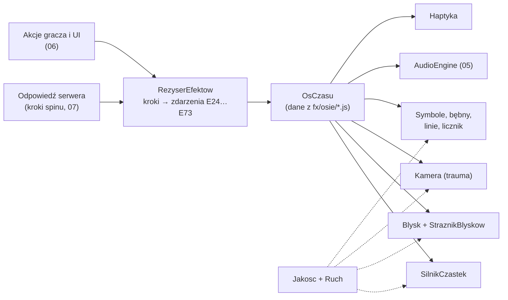
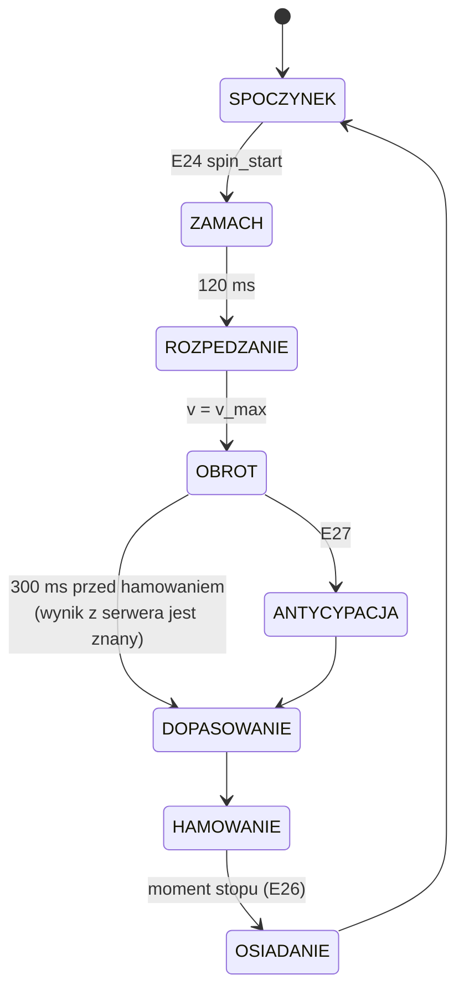

# 04 — Efekty wizualne (biblia efektów)

> Ten dokument opisuje **ruch, światło i czas** w Cebulion Casino: co dokładnie dzieje się na ekranie przy każdym
> z 41 zdarzeń katalogu E01–E73, w której milisekundzie, na której warstwie, z jakim dźwiękiem i wibracją, ile
> kosztuje to procesor i kartę graficzną oraz jak wygląda wersja dla słabszego sprzętu i dla osób z włączonym
> ograniczeniem ruchu. Najpierw przeczytaj § 1 (zasady) i § 2 (systemy wspólne), potem karty zdarzeń z § 3 dla
> części, którą piszesz albo bronisz.

| Metryka | |
|---|---|
| Projekt | Cebulion Casino, symulator kasyna z wirtualną walutą (przedmiot „Wprowadzenie do technologii backendowych”, Uniwersytet WSB Merito Wrocław) |
| Zespół | Konrad Paulus (112960, s428425@student.wroclaw.merito.pl) · Dominik Pacanowski (112961, s433776@student.wroclaw.merito.pl) · Dawid Majewski (113154, s156704@student.wroclaw.merito.pl) |
| Wersja dokumentu | 1.0 (2026-10-11) |
| Zakres | 41 zdarzeń (E01–E12, E20–E40, E50–E51, E60–E61, E70–E73), 18 systemów globalnych, 3 poziomy jakości, wariant `prefers-reduced-motion` |
| Hierarchia źródeł | brief projektu → [01-kierunek-artystyczny.md](01-kierunek-artystyczny.md) (wygląd) → **ten dokument** (ruch, czas, światło) → kod. Przy rozbieżności poprawiamy kod, a sprzeczność z 01 zgłaszamy i rozstrzygamy na korzyść briefu. |
| Kod (propozycja) | `src/main/resources/static/js/fx/` — wspólne systemy; `static/js/gry/s1…s3/` — efekty gier; `static/js/lobby/fx/` — efekty lobby (bez Pixi) |

## Spis treści

1. [Cel, zasady i bezpieczeństwo](#1-cel-zasady-i-bezpieczeństwo)
2. [Systemy globalne](#2-systemy-globalne)
3. [Karty zdarzeń E01–E73](#3-karty-zdarzeń-e01e73)
4. [Choreografia Big Win](#4-choreografia-big-win)
5. [Przejścia](#5-przejścia)
6. [Specyfika gier](#6-specyfika-gier)
7. [Warstwy renderu i kolejność rysowania](#7-warstwy-renderu-i-kolejność-rysowania)
8. [Koszt efektów i co wyłączamy na Low](#8-koszt-efektów-i-co-wyłączamy-na-low)
9. [Strojenie, testy i narzędzia](#9-strojenie-testy-i-narzędzia)
10. [Otwarte kwestie](#10-otwarte-kwestie)
11. [Powiązane dokumenty](#powiązane-dokumenty)

---

## 1. Cel, zasady i bezpieczeństwo

### 1.1. Po co ten dokument i jak go czytać

Właściciel projektu chce efektu „kozackiego” — poziomu topowych slotów mobilnych (Pragmatic Play, NetEnt,
Play'n GO) — przy płynnych 60 fps na telefonie i w przeglądarce na komputerze. Topowe studia osiągają to nie
„większą liczbą efektów”, tylko **reżyserią**: każdy błysk ma swój moment, każda cząsteczka ma powód, a siła
efektu rośnie razem z wygraną. Ten dokument jest taką reżyserią spisaną co do milisekundy, żeby:

1. **programista** mógł przepisać osie czasu wprost do kodu (osie czasu z § 3 = obiekty danych w
   `fx/osie/*.js`, a nie logika rozsiana po plikach),
2. **osoba broniąca projektu** mogła odpowiedzieć na pytania „czemu ten błysk trwa 40 ms?”, „jak liczycie
   drżenie ekranu?”, „co się dzieje na słabym telefonie?” — każda nieoczywista decyzja ma akapit **Dlaczego**,
3. **dokumenty 05 (dźwięk) i 06 (UI)** używały tych samych momentów: kolumna „Dźwięk” w każdej osi czasu wskazuje
   ID z briefu (§ 10), które dokument 05 musi dostarczyć z transjentem (najgłośniejszym momentem) w podanej
   milisekundzie.

| Kto | Co czytać |
|---|---|
| Programista efektów / gier | § 2 w całości, § 3 dla swojej gry, § 6, § 7 |
| Programista lobby (HTML/CSS) | § 1, § 2.1–2.4, § 2.12, karty E01–E12, § 5 |
| Osoba od dźwięku | kolumny „Dźwięk” w § 3 i § 4, § 1.2 (synchronizacja) |
| Osoba od wydajności | § 2.2, § 2.3, § 7, § 8 |
| Osoba broniąca projektu | akapity **Dlaczego**, § 1.4 (WCAG), § 1.5, § 4 |

Słowa kluczowe: **MUSI** = wymaganie, którego test nie przepuści; **POWINIEN** = domyślnie tak, odstępstwo
trzeba uzasadnić; **MOŻE** = opcja do dopieszczenia (zwykle priorytet P2).

### 1.2. Zasada nadrzędna: „kozacko, ale czytelnie i płynnie”

Dziesięć reguł, które rozstrzygają każdy spór o efekt:

| # | Reguła | Co to znaczy w praktyce |
|---|---|---|
| R1 | **Wynik jest święty** | Kwota wygranej, linie wygrywające i saldo nigdy nie są zasłonięte efektem dłużej niż 300 ms. Licznik wygranej leży na warstwie nad cząsteczkami (§ 7). Drżenie ekranu nie rusza licznika ani panelu. |
| R2 | **Proporcjonalność** | Siła efektu rośnie z wielkością wygranej według drabiny z § 1.3. Mała wygrana nie może wyglądać jak duża — inaczej gracz przestaje wierzyć efektom (inflacja efektów) i Big Win traci moc. |
| R3 | **Nie świętujemy straty** | Wygrana mniejsza niż zakład (np. 0,4×) dostaje najskromniejszą prezentację: podświetlenie, neutralny `sfx_wygrana_small_1`, bez monet i bez „brzęku”. **Dlaczego:** branża nazywa to *loss disguised as win* — fanfary przy wygranej niższej od stawki wprowadzają w błąd. Nawet w symulatorze bez pieniędzy chcemy uczciwego komunikatu. |
| R4 | **Jeden bohater naraz** | W każdej chwili najwyżej jeden efekt „główny” przyciąga wzrok (baner, skrzynia, rozszerzający się WILD). Reszta jest tłem: niższa jasność, mniejsza skala, wolniejszy ruch. |
| R5 | **Antycypacja → akcja → wybrzmienie** | Każdy mocny moment ma fazę napięcia (zamach, przyciemnienie, narastający dźwięk), uderzenie (1–3 klatki szczytu) i wybrzmienie (wygaszanie 3–10× dłuższe niż atak). To klasyczne zasady animacji Disneya: *anticipation*, *squash & stretch*, *follow-through*, *slow in / slow out*, *exaggeration*. |
| R6 | **Obraz i dźwięk co do klatki** | Szczyt efektu (pierwsza klatka błysku, największa skala) wypada w tej samej klatce co transjent dźwięku (±16,7 ms). Dźwięk planujemy na zegarze `AudioContext.currentTime` z kompensacją `outputLatency`, obraz na tickerze Pixi; obie osie startują z jednego znacznika czasu (§ 2.1). |
| R7 | **Nie blokujemy gracza** | Każda sekwencja dłuższa niż 1,5 s ma przewinięcie (skip). Przycisk SPIN jest aktywny najwcześniej, jak to możliwe (np. w E21 po 1000 ms, a nie po końcu intro). |
| R8 | **Płynność ponad przepych** | Efekt, który nie mieści się w budżecie klatki, ma tańszy wariant (§ 2.2, § 8) — nigdy nie „zacina”. Lepiej 120 cząsteczek przy 60 fps niż 600 przy 40 fps. |
| R9 | **Bezpieczeństwo jest twarde** | Limit błysków (§ 1.4) i ograniczenie ruchu (§ 1.5) pilnuje kod (`StraznikBlyskow`, `Ruch`), a nie dobra wola animatora. Test e2e sprawdza limit w najgorszych scenariuszach (§ 9). |
| R10 | **Determinizm** | Losowość efektów (kierunki iskier, rozrzut monet) pochodzi z generatora z ziarnem wyliczonym z `roundId`. Ta sama runda wygląda zawsze tak samo — powtarzalne nagrania filmików do lobby i porównywanie zrzutów ekranu w testach. |

### 1.3. Drabina intensywności

Jedna tabela wyznacza „głośność wizualną” każdego poziomu. Progi poziomów pochodzą z briefu (§ 3) i liczone są
jako wielokrotność zakładu `m = wygrana / zakład`.

| Poziom | Warunek | Czas prezentacji (bazowy) | Błysk ekranu (szczyt alfa) | Trauma drżenia | Cząsteczki na szczycie (High) | Promienie | Baner |
|---|---|---|---|---|---|---|---|
| brak | `m = 0` | 0 ms (bębny po prostu stają) | — | — | — | — | — |
| small, strata | `0 < m < 1` | 500–750 ms | — | — | 0–4 migotania na symbol | — | — |
| small | `1 ≤ m < 5` | 750–1300 ms | — | — | 6–12 migotań na symbol | — | — |
| medium | `m ≥ 5` | 1300–1800 ms | lokalny na symbolach 0,60 | 0,25 | do 160 | mini, za kwotą, alfa 0,5 | — |
| big | `m ≥ 15` | ≈ 4,3–5,3 s | pełny ekran 0,40 | 0,45 | do 450 | 2 warstwy, 4°/s | `g_win_big` |
| mega | `m ≥ 30` | ≈ 6,9–8,1 s | 0,45 przy eskalacji | +0,35 | do 550 | 2 warstwy, 5,5°/s | `g_win_mega` |
| epic | `m ≥ 60` | ≈ 9,7–10,9 s | 0,50 | +0,45 | 600 (limit) | 2 warstwy, 7°/s | `g_win_epic` |
| ultra | `m ≥ 100` | ≈ 13,9–15,7 s | 0,55 | +0,55 (sufit 1,0) | 600 (limit) | 2 warstwy, 8°/s, tęczowy tint | `g_win_ultra` |

Czasy big+ wynikają z krzywej liczenia z § 4.2. Wartości cząsteczek dotyczą poziomu High; Medium i Low
przycinają je do swoich limitów (§ 2.2).

**Dlaczego progi są tak „rozciągnięte” w czasie:** gracz musi poczuć różnicę między poziomami bez patrzenia
na kwotę. Każdy kolejny poziom dodaje nową jakość (konfetti od MEGA, pioruny od EPIC, tęcza w ULTRA), a nie tylko
„więcej tego samego”.

### 1.4. Bezpieczeństwo błysków (WCAG 2.3.1)

**Wymaganie:** WCAG 2.1, kryterium 2.3.1 *Three Flashes or Below Threshold* (poziom A): treść nie może
błyskać **więcej niż 3 razy w dowolnym okresie 1 sekundy**, chyba że błyski są poniżej progu ogólnego i progu
czerwonego. Brief (§ 4) przyjmuje wprost: **maks. 3 błyski na sekundę**. Błyski mogą wywołać napad u osób
z padaczką fotogenną, więc traktujemy to jako wymaganie bezpieczeństwa, nie estetyki.

**Co liczymy jako błysk** (definicja robocza zgodna z WCAG):

* para przeciwnych zmian jasności względnej (rozjaśnienie i ściemnienie) o **≥ 10%**, gdy ciemniejszy stan ma
  jasność względną < 0,80,
* zachodząca szybko — rozjaśnienie i powrót mieszczą się w **< 333 ms**,
* na powierzchni **większej niż 1/36 ekranu** (≈ 2,8%). To przeniesienie progu WCAG „25% pola widzenia 10°”
  (341×256 px na ekranie 1024×768, czyli 1/3 × 1/3 ekranu) na dowolną rozdzielczość: 25% z 1/9 ekranu = 1/36.
  Na widoku referencyjnym 1920×1080 to 57 600 px², np. kwadrat 240×240 px.

**Jak to pilnujemy w kodzie — `StraznikBlyskow` (flash governor):**

| Element | Reguła |
|---|---|
| Rejestracja | Każdy efekt, który może być błyskiem (błysk ekranu, `syl` na symbolach, flara, piorun, migotanie neonu, rozbłysk tła przy E35), przed startem woła `straznik.prosba(rodzaj, prostokat, amplituda)`. Strażnik liczy pole prostokąta na ekranie jako ułamek powierzchni okna (dynamicznie — na telefonie ten sam symbol zajmuje większy ułamek ekranu niż na monitorze). |
| Poniżej progu | Pole ≤ 1/36 ekranu **albo** amplituda < 10% → efekt nie jest błyskiem, nie zużywa limitu. |
| Limit | Okno przesuwne 1000 ms: najwyżej **3** zarejestrowane błyski. Projektujemy tak, żeby normalnie były **najwyżej 2 na sekundę** — trzeci to rezerwa. |
| Scalanie | Błyski, które zaczynają się w odstępie < 120 ms, liczymy jako **jeden** (np. 3 scattery S3 lądujące w sąsiednich kolumnach co 50 ms). Strażnik przesuwa późniejsze do klatki pierwszego, więc fizycznie zachodzą jednocześnie. |
| Brak miejsca w limicie | Efekt dostaje wariant **łagodny**: amplituda × 0,25 (poniżej progu 10%), atak wydłużony do ≥ 150 ms. Błysk pełnoekranowy bez miejsca w limicie jest **pomijany**. |
| Kolor | Błyski pełnoekranowe mają tint o nasyceniu ≤ 20% (prawie biel: `#FFF3D1`, `#FFE9F4`, `#EEE4FF`, `#E6FBFF`). **Nigdy** pełnoekranowego błysku w nasyconej czerwieni — WCAG ma dla czerwieni osobny, ostrzejszy próg. `--danger` występuje tylko na małych elementach UI. |
| TURBO | Tryb TURBO skraca czasy gry (× 0,45), ale **nie skraca** czasów błysków ani nie zmienia limitu. **Dlaczego:** skrócenie całej osi czasu zagęściłoby błyski — z 2 na sekundę zrobiłoby się 4,4. |
| Log | W trybie deweloperskim strażnik zapisuje każdą prośbę (czas, rodzaj, pole, decyzja) — test e2e z § 9 sprawdza ten log. |

**Wzory i pulsy:** WCAG 2.3.1 nie obejmuje wzorów, ale wytyczne nadawców TV (np. Harding/ITU-R BT.1702)
ostrzegają przed kontrastowymi pasami. Dlatego promienie (`g_fx_promienie`) mają miękkie krawędzie, alfę ≤ 0,85
i wolną rotację ≤ 8°/s: przy ~20 promieniach przez dany punkt ekranu przechodzi 20 × 8/360 ≈ **0,44 promienia
na sekundę** (przy dwóch warstwach obracających się przeciwnie ≈ 0,7/s) — daleko od zakresu 3–30 Hz. Pulsy
poświaty mają okres ≥ 600 ms (≤ 1,7 Hz).

**Dlaczego nie wystarczy „uważać przy animowaniu”:** w kaskadach S3, darmowych spinach i trybie TURBO zdarzenia
nakładają się w sposób, którego nie da się przewidzieć ręcznie (np. WILD + 2 scattery + wygrana medium w 400 ms).
Tylko centralny licznik daje gwarancję.

### 1.5. Ograniczenie ruchu (`prefers-reduced-motion`)

Tryb włącza się, gdy system zgłasza `prefers-reduced-motion: reduce` **albo** gracz włączy w ustawieniach
„Ogranicz ruch i błyski” (domyślnie przełącznik przyjmuje wartość z systemu, zmiana działa od razu, bez
przeładowania). Brief (§ 4) wymaga minimum: **wyłączone błyski i drżenie**. Idziemy dalej, bo ograniczenie ruchu
dotyczy też osób z zaburzeniami błędnika (WCAG 2.3.3, poziom AAA):

| Element | Zachowanie w trybie ograniczonego ruchu |
|---|---|
| Błyski ekranu, `syl` na pełną jasność, flary, pioruny, migotanie neonów | **wyłączone**. Zamiast błysku — nic albo zmiana jasności winiety o ≤ 6% w czasie ≥ 400 ms (poniżej progu WCAG). |
| Drżenie kamery, „podbicie” planszy przy lądowaniu | **wyłączone** |
| Paralaksa lobby, powolny zoom tła, pochylenie kafli 3D | wyłączone (statyczne tło) |
| Promienie | bez rotacji; tylko powolny „oddech” alfy 0,6 ↔ 0,8, okres 4 s |
| Cząsteczki | liczba × 0,3, prędkości × 0,6, bez konfetti; monety lecące do salda zastępuje przenikanie licznika |
| Skala „uderzeń” (punch) | baner wchodzi przenikaniem i skalą 0,96 → 1,00 (300 ms) zamiast 0,2 → 1,15 → 1,00 |
| Obrót bębnów | **zostaje** (to istota gry), ale bez fazy zamachu i bez overshootu przy zatrzymaniu; rozmycie ruchu zostaje (zmniejsza wrażenie migotania) |
| Kaskady S3 | symbole znikają przenikaniem 200 ms z 4 odłamkami zamiast 12; opad bez odbicia |
| Liczenie wygranej | zostaje, krótsze o 40% |
| Haptyka | bez zmian (nie jest ruchem na ekranie), ma osobny przełącznik |

W kodzie jeden obiekt `Ruch` (`fx/ruch.js`) z polami `ograniczony`, `mnoznikCzastek`, `drzenie` itd. Każdy efekt
czyta go w chwili startu. W CSS lobby: `@media (prefers-reduced-motion: reduce)` plus klasa `.ruch-ograniczony`
na `<html>` ustawiana z ustawień gracza.

### 1.6. Haptyka (wibracje)

Wibracje to „trzeci kanał” efektu na telefonie: krótki impuls przy zatrzymaniu bębna sprawia, że stop jest
fizycznie odczuwalny. Używamy Vibration API (`navigator.vibrate(wzorzec)`).

| ID | Wzorzec (ms: wibracja, przerwa, wibracja…) | Charakter | Przykładowe użycie |
|---|---|---|---|
| `H_tik` | `[8]` | ledwie wyczuwalny | przełącznik UI, co 4. moneta przy przylocie do salda |
| `H_lekki` | `[14]` | krótki stuk | stop bębna, wygrana small, przycisk SPIN |
| `H_sredni` | `[24]` | wyraźne puknięcie | ostatni stop z wygraną, wygrana medium, WILD |
| `H_mocny` | `[40]` | uderzenie | 3. scatter, rozszerzenie WILD, koniec liczenia big win |
| `H_podwojny` | `[20, 60, 30]` | „ta-dam” | neonowy mnożnik, duży klaster |
| `H_serce` | `[28, 110, 16]` | bicie serca | antycypacja, co drugie uderzenie |
| `H_fanfara` | `[30, 40, 30, 40, 70]` | seria | start big win, start darmowych spinów |
| `H_eskalacja` | `[50, 30, 90]` | narastające uderzenie | eskalacja poziomu E31, NEON JACKPOT |
| `H_blad` | `[25, 50, 25]` | dwa krótkie | błąd logowania, błąd sieci |

Zasady:

* tylko urządzenia dotykowe (`matchMedia('(pointer: coarse)')`), tylko po pierwszej interakcji gracza (przeglądarki
  blokują `vibrate` bez aktywacji użytkownika), tylko gdy karta jest widoczna,
* przełącznik „Wibracje” w ustawieniach, domyślnie włączony na telefonach,
* najwyżej jeden wzorzec na 120 ms; nowy wzorzec w trakcie trwania poprzedniego jest **odrzucany** (bez kolejki —
  zaległe wibracje po fakcie są gorsze niż żadne),
* **Safari na iOS nie obsługuje Vibration API** — na iPhonie haptyka po prostu nie działa. Nie budujemy obejść
  (np. ukrytych przełączników formularza), bo są nieudokumentowane i mogą przestać działać.

### 1.7. Jednostki i konwencje zapisu

| Zapis | Znaczenie |
|---|---|
| `0 ms` w osi czasu | moment wystąpienia zdarzenia (np. kliknięcie SPIN, zatrzymanie bębna) |
| px | piksele CSS **widoku referencyjnego 1920×1080** (tak jak @1x w [02 § 2.6](02-lista-obrazow.md#26-rozdzielczości-1x-i-2x)); w scenie mnożymy przez skalę sceny `k` (układ: [06-interfejs-ux.md](06-interfejs-ux.md)) |
| pole | wysokość jednej komórki symbolu danej gry; prędkości bębnów w polach/s, żeby nie zależały od rozdzielczości |
| `S` | rozmiar pola symbolu albo szerokość obiektu, do którego odnosi się wartość (jak w 01 i 02) |
| alfa | krycie 0–1; przy trybie `add` alfa mnoży jasność sprite'a |
| tint | kolor mnożący teksturę (`sprite.tint`); białe tekstury efektów barwimy tintem na kolor poziomu lub gry |
| `easeOutCubic` itd. | funkcje wygładzania z § 2.12 |
| H / M / L | poziomy jakości High / Medium / Low (§ 2.2) |
| RM | wariant `prefers-reduced-motion` (§ 1.5) |
| TURBO | tryb szybki: czasy faz gry × 0,45 (brief § 4); wyjątki w § 1.4 i § 2.14 |
| warstwa `L5` itd. | numer warstwy renderu z § 7 |

---

## 2. Systemy globalne

Systemy z tego rozdziału są wspólne dla lobby i trzech gier. Karty zdarzeń z § 3 tylko je **wywołują**
z parametrami — nie mają własnej fizyki ani własnych błysków. Dzięki temu poprawka w jednym miejscu (np. krzywa
wygaszania błysku) działa wszędzie, a limit błysków i poziomy jakości obejmują każdy efekt automatycznie.

### 2.1. Architektura: reżyser efektów i oś czasu



| Element | Plik (propozycja) | Odpowiedzialność |
|---|---|---|
| `RezyserEfektow` | `fx/rezyser.js` | Zamienia kroki z odpowiedzi serwera ([07-gry-i-matematyka.md](07-gry-i-matematyka.md)) i akcje gracza na sekwencję zdarzeń. Pilnuje kolejności (np. E51 przed E30), przewijania (skip) i trybu TURBO. |
| `OsCzasu` | `fx/os-czasu.js` | Mały silnik osi czasu (~250 linii, bez zewnętrznej biblioteki): lista kroków `{ t, akcja, … }`, wykonywanych, gdy zegar osi przekroczy `t`. Obsługuje skalę czasu (TURBO × 0,45, *hit-stop* × 0), pauzę i skok na koniec (skip). |
| Osie zdarzeń | `fx/osie/e01-lobby-intro.js` … `e73-s3-mnoznik-zbior.js` | **Dane**, nie logika. Każda tabela osi czasu z § 3 ma swój plik 1:1 — student może pokazać na obronie „tu jest tabela z dokumentu, a tu ten sam obiekt w kodzie”. |
| `Tween` | `fx/tween.js` | Animacja jednej właściwości (`x`, `alpha`, `scale`…) z funkcją wygładzania z § 2.12. Pula obiektów, zero alokacji w pętli. |
| `Zegar` | `fx/zegar.js` | Jeden ticker (`app.ticker` w grach, `requestAnimationFrame` w lobby). `deltaMS` przycięte do 50 ms, żeby po przełączeniu karty efekty nie „przeskakiwały”. Karta ukryta (`visibilitychange`) → pauza osi i `AudioContext.suspend()`. |
| `Los` | `fx/los.js` | Generator mulberry32, ziarno = FNV-1a z `roundId + ':' + numerZdarzenia` (R10). W lobby ziarno z czasu (tam nie ma rund). |

Przykład osi czasu w kodzie (karta E29 z § 3):

```js
// fx/osie/e29-wygrana-medium.js — 1:1 z tabelą E29 w docs/projekt/04-efekty-wizualne.md
export default {
  id: 'E29',
  turbo: true,                 // w TURBO czasy × 0,45 (oprócz błysków, § 1.4)
  kroki: [
    { t: 0,   akcja: 'linie.rysuj',    czas: 220 },
    { t: 0,   akcja: 'dzwiek',         id: 'sfx_linia' },
    { t: 200, akcja: 'symbole.puls',   skala: 1.12, czas: 420 },
    { t: 200, akcja: 'dzwiek',         id: 'sfx_wygrana_medium' },
    { t: 200, akcja: 'blysk.lokalny',  cel: 'wygrywajace', alfa: 0.6 },
    { t: 200, akcja: 'czastki.wybuch', emiter: 'iskry_wybuch', ile: { H: 24, M: 14, L: 6 }, na: 'kazdy_symbol' },
    { t: 200, akcja: 'kamera.trauma',  ile: 0.25 },
    { t: 200, akcja: 'haptyka',        wzorzec: 'H_sredni' },
  ],
};
```

**Synchronizacja z dźwiękiem (R6).** Oś startuje w chwili `T0` (czas `performance.now()`). Dźwięki osi są
planowane na zegarze audio z wyprzedzeniem 50 ms: `start = ctx.currentTime + (t − tTeraz)/1000`. Obraz sceny
opóźniamy o zmierzone `ctx.outputLatency` (zwykle 10–40 ms, maks. 60 ms), żeby szczyt błysku zgadzał się
z transjentem w głośniku. Reakcja przycisków HTML (wciśnięcie, E11) jest natychmiastowa — opóźniamy tylko scenę.

**Dlaczego własna oś czasu, a nie biblioteka (np. GSAP):** potrzebujemy trzech rzeczy, których ogólna biblioteka
nie zrobi za nas — wspólnej skali czasu TURBO, *hit-stop* (zamrożenie części efektów na 80 ms) i skoku na koniec
przy przewinięciu, który ustawia stan końcowy wszystkich efektów naraz. 250 linii własnego kodu student umie
wytłumaczyć w całości; to też jedna zależność mniej do wendorowania.

### 2.2. Poziomy jakości

Wartości z briefu (§ 5) są wiążące; pozostałe ustawienia to nasze rozwinięcie.

| Ustawienie | High | Medium | Low |
|---|---|---|---|
| Rozdzielczość renderowania (DPR) | ≤ 2 | ≤ 1,5 | 1 |
| **Limit cząsteczek (łącznie)** | **≤ 600** | **≤ 300** | **≤ 120** |
| Limit cząsteczek w lobby (Canvas 2D, § 2.3) | ≤ 300 | ≤ 150 | ≤ 60 |
| Bloom | **filtr** na warstwach `add` (§ 2.6) | **pre-baked** `glow` w trybie `add` | brak |
| Drżenie kamery | tak | tak | **brak** |
| Filtry dodatkowe (fala uderzeniowa, desaturacja przyciemnienia) | tak | nie | nie |
| Promienie | 2 warstwy przeciwbieżne | 2 warstwy, druga alfa × 0,6 | 1 warstwa |
| Dym (`g_fx_dym`), sprite'y naraz | ≤ 12 | ≤ 6 | ≤ 2 |
| Przelot połysku na symbolach | shader (§ 2.7) | shader | zastąpiony pulsem `syl` |
| Efekty tła (pochodnie, kaustyki, zorza, siatka S1) | animowane | animowane, połowa elementów | statyczne |
| Tekstury @2x | wg gęstości ([02 § 2.6](02-lista-obrazow.md#26-rozdzielczości-1x-i-2x)) | wg gęstości | zawsze @1x |
| Rozmycie ruchu bębnów (`ruch1`, `ruch2`) | tak | tak | tak (podmiana tekstur nic nie kosztuje) |
| Pioruny | tak | tak | 1 naraz |
| Konfetti, maks. na salwę | 220 | 110 | 40 |

**Przełączanie automatyczne (brief § 5):** obniżenie o jeden poziom, gdy **p90 czasu klatki > 20 ms przez 2 s**.
Implementacja: bufor kołowy 120 ostatnich czasów klatki, p90 liczony co 500 ms, warunek musi być spełniony
4 razy z rzędu. Pomijamy klatki ekranu ładowania i przejść (wgrywanie tekstur zawyża pomiar).

| Kwestia | Propozycja (ostatecznie rozstrzyga [08-wydajnosc-i-jakosc.md](08-wydajnosc-i-jakosc.md)) |
|---|---|
| Poziom startowy | komputer: High; telefon/tablet (`pointer: coarse`): Medium; `navigator.deviceMemory ≤ 2` albo `saveData`: Low |
| Podwyższenie | tylko między rundami, gdy p90 < 12 ms przez 20 s; najwyżej raz na 2 min; po dwóch obniżeniach z danego poziomu nie wracamy na niego w tej sesji |
| Kiedy zmiana działa | limit cząsteczek, drżenie, filtry — od razu; DPR i tekstury @1x/@2x — dopiero między rundami (zmiana rozdzielczości w trakcie spinu dałaby widoczny „skok” ostrości) |
| Ręcznie | ustawienia: Auto / High / Medium / Low; wybór ręczny wyłącza automat |

### 2.3. Silnik cząsteczek

**Budowa.** Jeden rdzeń symulacji i dwa sposoby rysowania:

| Część | Gdzie | Jak |
|---|---|---|
| Rdzeń (`SilnikCzastek`) | `fx/czastki/rdzen.js` | Stan cząsteczek w tablicach typowanych (`Float32Array`: x, y, vx, vy, wiek, życie, obrót, prędkość obrotu, skala…) — układ „struktura tablic”, bez obiektu na cząsteczkę, zero alokacji w trakcie gry. Martwe cząsteczki wracają do puli przez zamianę z ostatnią żywą (O(1)). |
| Renderer Pixi | `fx/czastki/pixi.js` | `ParticleContainer` z PixiJS 8 (lekkie obiekty `Particle`, jedno wywołanie rysowania na kontener). Wymaga jednej tekstury źródłowej na kontener, dlatego mamy 4 kontenery = 4 atlasy: `wspolne-czastki` (monety, konfetti; mieszanie normalne), `wspolne-fx` (iskry, flary, dym; `add`), `s2-fx` (hieroglify; `add`), `s3-symbole` (odłamki; normalne). |
| Renderer Canvas 2D | `lobby/fx/czastki-canvas.js` | Lobby nie ładuje Pixi (brief § 5), więc ta sama symulacja rysuje się na `<canvas>` przez `drawImage`; tryb `add` = `globalCompositeOperation = 'lighter'`. Canvas 2D nie ma taniego tintu, więc przy starcie przygotowujemy kopie tekstur w potrzebnych kolorach (złoto, magenta, cyjan) na płótnach pozaekranowych (`source-in`). |

**Plan B:** jeśli `ParticleContainer` w wendorowanej wersji Pixi 8 nie obsłuży czegoś, czego potrzebujemy
(np. tintu i alfy per cząsteczka w jednym kontenerze), używamy zwykłego `Container` ze sprite'ami z puli.
Pixi i tak łączy je w jedną paczkę rysowania (batch), kosztem ~2× więcej pracy procesora przy aktualizacji.

**Krok symulacji** (dla każdej żywej cząsteczki, `dt` w sekundach):

```text
v   += (a + g) · dt
v   *= exp(−opor · dt)          // opór powietrza niezależny od liczby klatek na sekundę
p   += v · dt
obr += vobr · dt
u    = wiek / zycie             // 0…1
skala = lerp(s0, s1, wygladzanie(u));   alfa = krzywaAlfy(u)
```

`exp(−opor · dt)` zamiast `v *= 0.98`: mnożenie „na klatkę” dawałoby inny ruch przy 60 i 120 Hz (ekrany 120 Hz
w telefonach i MacBookach). Koszt: ~0,3–0,5 µs na cząsteczkę na klatkę w JS → 600 cząsteczek ≈ 0,3 ms.

**Priorytety przy limicie.** Każdy emiter ma klasę: **P1** — główne (monety i iskry wygranej, odłamki S3),
**P2** — wzbogacające (konfetti, hieroglify, dym), **P3** — tło (pył, bokeh, gwiazdy). Gdy zajętość limitu
≥ 85%, emitery P3 przestają tworzyć nowe cząsteczki; ≥ 95% — P2 tworzą o połowę mniej; P1 dostają zawsze to,
co zostało. Liczby w kartach zdarzeń to **prośby** — silnik przycina je do limitu poziomu.

**Monety: obrót z trzech ujęć.** Animacja `moneta-obrot` z atlasu `wspolne-czastki` (02 § 5.9):
`g_moneta_przod.male` → `g_moneta_skos.male` → `g_moneta_bok.male` → `g_moneta_skos.male` z `scale.x = −1` →
z powrotem. Faza obrotu każdej monety biegnie z losową prędkością 1,6–3,2 obrotu/s (4 klatki na pół obrotu),
a między klatkami `scale.x` jest dodatkowo ściskane funkcją `|cos(φ)|` (minimum 0,15), co wygładza skoki
między ujęciami. Faza startowa losowa — monety nie obracają się synchronicznie.

**Katalog emiterów** (rozmiary w px widoku referencyjnego; „H/M/L” = prośba o liczbę na danym poziomie):

| Emiter | Tekstury, mieszanie, klasa | Start i ilość (H / M / L) | Ruch | Życie, skala, alfa, obrót | Gdzie |
|---|---|---|---|---|---|
| `monety_fontanna` | `g_moneta_*.male`, normalne, P1 | punkt (otwór skrzyni, środek kwoty); strumień 90 / 50 / 22 na s; kąt −90° ± 28° | 900–1500 px/s; grawitacja 2200 px/s²; opór 0,4 | 1400–2000 ms; średnica 24–64 px; alfa 1, wygaszanie w ostatnich 200 ms | E07, E10, E30–E32 |
| `monety_deszcz` | jak wyżej, P1 | górna krawędź ekranu + 10% zapasu z boków; strumień wg poziomu (§ 4.4) | vy 250–650 px/s; vx ± 60; grawitacja 1400; opór 0,6 | do wyjścia za dolną krawędź (maks. 2500 ms); 28–72 px; 20% monet na warstwie przedniej, większe o 30% | E30–E32 |
| `monety_wybuch` | jak wyżej, P1 | punkt; salwa 60 / 34 / 14 | promieniście 360°, 700–1600 px/s; grawitacja 2000; opór 1,2 | 900–1400 ms; 24–56 px | E29 (salwa 16 / 10 / 4), E32 |
| `monety_lot` | jak wyżej, P1 | punkt startu → ikona salda; 24 / 16 / 8 monet, odstęp 35 ms | **bez fizyki**: krzywa Béziera 2. stopnia, punkt kontrolny 30–45% odległości w górę i ± 20% w bok; postęp `easeInCubic` | 600–900 ms; skala 1,0 → 0,45 przy celu; przy przylocie zdarzenie „moneta dotarła” (E08) | E07, E10, E32 |
| `iskry_wybuch` | `g_fx_iskry__0,1,3,4,6` + smuga `__5` (obrót = kierunek lotu), `add`, P1 | punkt lub prostokąt symbolu; salwa 60 / 36 / 16 | promieniście, 400–1100 px/s; opór 3,0; grawitacja 300 | 350–700 ms; 10–36 px, skala 1 → 0 (`easeInQuad`); alfa 1 → 0 (`easeOutQuad`) | E26 z WILD, E29, E30–E33, E70 |
| `iskry_migot` | `g_fx_iskry__0,1,7`, `add`, P2 | losowo w elipsie wokół obiektu; 30 / 18 / 6 na s | brak (lub dryf 10 px/s w górę) | 300–600 ms; skala 0 → 1 → 0 (`easeOutBack` / `easeInQuad`); obrót 0–90° | E22, E28, E30–E32, poświata WILD |
| `iskry_smuga` | `g_fx_iskry__2,5`, `add`, P1 | wzdłuż toru lecącego obiektu, co 12 px drogi | prędkość obiektu × 0,1, opór 6 | 200–350 ms; skala 0,8 → 0 | E73 (kule), `monety_lot` na High |
| `konfetti` | `g_fx_konfetti__0…11`, normalne, P2 | dwa działka w dolnych rogach, kąty −62° i −118° ± 14°; salwa 220 / 110 / 40 (lub opad z góry) | 1400–2200 px/s; grawitacja 900; opór 1,8; trzepotanie: `x += A·sin(ωt)`, A 20–60 px, ω 1,5–3 Hz | 2500–4000 ms; 14–34 px; **obrót 3D udawany** `scale.y = s·|cos(ω₂t)|`, ω₂ 4–10 rad/s; obrót 2D ± 360°/s | E07, E31 (od MEGA), E32, E37, E51 |
| `pyl` | `g_fx_iskry__2`, `add`, P3 | prostokąt ekranu; stała populacja 60 / 30 / 0 (gry), 40 / 24 / 12 (lobby) | dryf 6–20 px/s, w górę z odchyleniem; błądzenie `sin` 0,2–0,5 Hz | życie nieskończone, zawijanie przy krawędzi; 3–9 px; alfa 0,05–0,25 | E02, E22, tła gier |
| `bokeh` | `g_fx_iskry__2`, `add`, P3 | 3 warstwy głębi; 12 / 8 / 0 | 2–8 px/s, paralaksa (§ 3, E02) | ∞; 40–140 px; alfa 0,04–0,12; tint `--gold-1` / `--magenta` / `--cyan` | E02, E21 |
| `odlamki` | `s3_fx_odlamki__0…11`, normalne, P1, tint = kolor symbolu (01 § 11.4) | prostokąt symbolu; salwa 12 / 7 / 3 na symbol | promieniście z przewagą w górę (−90° ± 70°), 250–700 px/s; grawitacja 2400; opór 0,3 | 500–800 ms; 0,18–0,42 S; obrót ± 720°/s; alfa 1, wygaszanie w ostatnich 150 ms | E70 |
| `hieroglify` | `s2_fx_hieroglify__0…7`, `add`, P2, tint `--gold-1` lub `#2EC4B6` | wzdłuż krawędzi bębna lub po okręgu (wir); 16 / 10 / 4 na bęben | wznoszenie 60–140 px/s albo wir (współrzędne biegunowe: ω 2–4 rad/s, promień 1,0 → 0,2 w 1200 ms) | 900–1400 ms; 0,25–0,4 S, skala 0,6 → 1,0; alfa 0 → 0,9 → 0; obrót ± 8° | E34, E35, E60, E61 |
| `piasek` | `g_fx_iskry__2`, `add` (atlas FX nie ma alfy), P3, tint `#8A6A3A`, alfa ≤ 0,5 | strużki z górnej krawędzi ramki S2; 40 / 20 / 0 na s | vy 120–260 px/s, grawitacja 600 | 600–1100 ms; 2–5 px | E21, E26, E60 (S2) |
| `dym_klab` | `g_fx_dym`, `add`, P2, tint `#C9C3E6` | punkt/pierścień; 8 / 5 / 2 | promieniście 120–260 px/s; opór 1,5 | 1200–2000 ms; 400–900 px, skala 0,6 → 1,8; alfa 0 → 0,35 → 0; obrót ± 10°/s | E12, E21, E30, E35 |
| `gwiazdy_migot` | `g_fx_iskry__0,2`, `add`, P3 | górne 45% tła FS S2; populacja 40 / 20 / 0 | brak | migotanie alfy 0,2 ↔ 0,8, okres 1,5–4 s | E35–E37 (S2) |
| `swietliki` | `g_fx_iskry__2`, `add`, P3, tint `#19F5D2` / `#A64DFF` | boki tła S3; populacja 36 / 18 / 0 | dryf w górę 8–24 px/s, błądzenie | ∞; 4–12 px; puls alfy 0,15 ↔ 0,6, okres 2–5 s | E22, tło S3 |
| `neon_iskry` | `g_fx_iskry__5,3`, `add`, P1, tint `--cyan` / `--magenta` | punkt na rurce neonu; salwa 18 / 10 / 4 | 300–800 px/s w dół ± 50°; grawitacja 1800; **jedno odbicie** od dolnej krawędzi ramki (współczynnik 0,35) | 400–900 ms; 6–14 px | E50, E51 (S1) |

**Dlaczego tekstury efektów są białe i barwione tintem:** jeden arkusz `g_fx_iskry` obsługuje złote iskry
BIG WIN, cyjanowe S1 i turkusowe S2 — oszczędność megabajtów i spójność ([01 § 4.8](01-kierunek-artystyczny.md#48-obrazy-efektów-tło-czarne-i-konfetti)).

### 2.4. Błysk ekranu

Błysk to jeden pełnoekranowy sprite (`Texture.WHITE` rozciągnięta na ekran) w trybie `add` na warstwie `L13`.
Gdy alfa = 0, sprite ma `visible = false` i nic nie kosztuje. Wariant **radialny** używa tekstury gradientu
radialnego (biel w środku → przezroczystość na brzegu, 256×256, generowana w kodzie przy starcie) — jaśniejszy
środek wygląda jak wybuch światła z centrum, a nie jak „mignięcie monitora”.

| Rodzaj | Tint | Szczyt alfa | Atak | Przytrzymanie | Wygaszanie | Gdzie |
|---|---|---|---|---|---|---|
| `blysk_big` (radialny) | `#FFF3D1` | 0,40 | 40 ms, liniowo | 0 | 360 ms, `easeOutExpo` | E30 (uderzenie banera) |
| `blysk_mega` (radialny) | `#FFE9F4` | 0,45 | 40 ms | 20 ms | 380 ms | E31 → MEGA |
| `blysk_epic` (radialny) | `#EEE4FF` | 0,50 | 40 ms | 20 ms | 400 ms | E31 → EPIC |
| `blysk_ultra` (radialny) | `#FFFFFF` | 0,55 | 40 ms | 30 ms | 420 ms | E31 → ULTRA |
| `blysk_koniec` | tint poziomu | 0,35 | 30 ms | 0 | 300 ms | E32 (koniec liczenia) |
| `blysk_fs` (pełny) | `#E6FBFF` | 0,45 | 60 ms | 0 | 500 ms | E35, E51 |
| `blysk_lokalny` | biel (`syl` symbolu) | 0,80 | 40 ms | 0 | 80 ms | E33, E34, E70 (zgodnie z 02 § 5.16: ~120 ms) |

* Sufit dla błysków pełnoekranowych: **alfa 0,55**. Wyżej obraz „wypala się” do bieli i gubi się baner.
* Każdy błysk przechodzi przez `StraznikBlyskow` (§ 1.4). W trybie RM — pominięty.
* W lobby (bez Pixi) błysk to `<div class="blysk">` z `mix-blend-mode: plus-lighter` (zapas: `screen`)
  i animacją `opacity` — animacja `opacity` jest komponowana przez GPU, bez przerysowania strony.

**Dlaczego atak 40 ms, a wygaszanie ~10× dłuższe:** oko odczytuje błysk jako „uderzenie”, gdy jasność rośnie
w 2–3 klatkach. Długie wygaszanie daje poświatę po uderzeniu i sprawia, że rozjaśnienie i ściemnienie tworzą
**jeden** błysk, a nie migotanie.

### 2.5. Drżenie kamery (model „trauma”)

Model z wykładu Squirrela Eiserloha *Math for Game Programmers: Juicing Your Cameras With Math* (GDC 2016),
używany w wielu grach akcji:

| Wielkość | Wzór / wartość |
|---|---|
| Trauma `T` | liczba 0…1; zdarzenia **dodają** traumę: `T = min(1, T + Δ)` |
| Wygaszanie | `T = max(0, T − 1,2 · dt)` → trauma 0,45 znika w ~0,38 s, pełna 1,0 w ~0,83 s |
| Siła drżenia | `w = T²` — mała trauma prawie niewidoczna, duża wyraźna (naturalna progresja) |
| Przesunięcie | `x = Xmax · w · n(ziarnoX, t · f)`, `y = Ymax · w · n(ziarnoY, t · f)` |
| Obrót | `kąt = Rmax · w · n(ziarnoR, t · f)` |
| Szum `n` | gładki szum 1D (value noise z interpolacją `smoothstep`) w zakresie −1…1, częstotliwość `f = 22 Hz` |
| Maksima | `Xmax = Ymax = 18 px · k` (nie więcej niż 1,6% krótszego boku ekranu); `Rmax = 1,2°` |
| Co drży | kontener `swiat` (warstwy `L0`–`L11`). Warstwa Big Win `L12` dostaje 35% przesunięcia (baner), **licznik wygranej 0%** (R1). Panel HTML nie drży nigdy. |
| Zapas krawędzi | tło gry skalowane z zapasem 2% (≥ 18 px z każdej strony), żeby drżenie nie odsłaniało krawędzi |

**Kopnięcie** (`kamera.kopnij(kierunek, sila)`) — krótkie, kierunkowe „podbicie” zamiast losowego drżenia, np.
przy lądowaniu planszy S3: `y = A · e^(−t/τ) · cos(2π · 9 Hz · t)`, `A = 6 px · k`, `τ = 70 ms`. Wyłączone na
Low i w RM (to też ruch kamery).

| Zdarzenie | Δ traumy | Uwagi |
|---|---|---|
| E26 stop ostatniego bębna z WILD lub scatterem | 0,10 | ledwie wyczuwalne |
| E27 antycypacja | stała podłoga traumy 0,08 → 0,18 przy końcu | „brzęczenie” napięcia |
| E29 wygrana medium | 0,25 | |
| E30 uderzenie banera BIG | 0,45 | |
| E31 eskalacja → MEGA / EPIC / ULTRA | +0,35 / +0,45 / +0,55 | sufit 1,0 |
| E32 koniec liczenia big+ | 0,30 | |
| E34 trzeci scatter | 0,30 | |
| E35 start FS | 0,40 | |
| E51 NEON JACKPOT | 0,70 | |
| E60 rozszerzenie WILD | 0,30 | |
| E61 retrigger | 0,35 | |
| E70 pęknięcie klastra | 0,12 + 0,04 za każdy kolejny klaster w tej samej kaskadzie | |
| E73 mnożnik zebrany (finał) | 0,40 | |

**Dlaczego szum, a nie losowanie co klatkę:** losowe przesunięcie co klatkę daje drgania 60 Hz, które wyglądają
jak błąd obrazu, a przy 120 Hz zmieniają charakter. Gładki szum ma stałą częstotliwość niezależną od fps.
**Dlaczego kwadrat traumy:** przy liniowej zależności każde drobne zdarzenie trzęsłoby ekranem zauważalnie;
kwadrat zostawia małe wartości prawie bez ruchu i rezerwuje mocne drżenie dla dużych momentów (R2).

### 2.6. Bloom i poświata

| Poziom | Technika | Parametry |
|---|---|---|
| **High** | filtr `AdvancedBloomFilter` z pakietu `pixi-filters` (wersja zgodna z Pixi 8, wendorowana lokalnie) nałożony **tylko** na warstwy `add` (`L10` i podwarstwę `add` w `L12`), nie na całą scenę | `threshold 0.5`, `bloomScale 0.9`, `brightness 1.0`, `blur 6`, `quality 4`, `resolution 0.5` (połowa rozdzielczości) |
| **Medium** | pre-baked: warianty `glow` z obróbki (02 § 5.16) — biała poświata w trybie `add`, tint = kolor gry / poziomu, puls alfy | alfa 0,35–0,9 zależnie od stanu (§ 2.13) |
| **Low** | brak; zostaje poświata wbudowana w obrazy i stany przez `syl` | — |

* Filtr jest **włączany tylko wtedy, gdy warstwa ma widoczne elementy** (z histerezą 300 ms) — w spoczynku nie
  kosztuje nic.
* Shader filtra kompilujemy na ekranie ładowania (E20), renderując jedną niewidoczną klatkę z włączonym
  filtrem. **Dlaczego:** kompilacja shadera przy pierwszym Big Win dawałaby zacięcie 50–200 ms dokładnie
  w najważniejszym momencie gry.
* Szacunkowy koszt na zintegrowanej grafice przy 1080p: 0,6–1,5 ms GPU na klatkę, gdy aktywny (do zmierzenia
  w 08).
* **Niepewność i plan B:** jeśli wersja `pixi-filters` nie będzie zgodna z wendorowanym Pixi, robimy „tani
  bloom” sami: warstwa `add` renderowana do `RenderTexture` w 1/4 rozdzielczości, `BlurFilter` z rdzenia Pixi
  (`strength 4`, `quality 2`), wynik dodany na wierzch w trybie `add`.

**Dlaczego bloom tylko na warstwach `add`:** bloom całej sceny rozjaśniałby też tło i symbole, a kosztowałby
pełny przebieg na każdy piksel ekranu. Na warstwie efektów świecą tylko rzeczy, które mają świecić.

### 2.7. Przelot połysku (shine sweep)

Jasny ukośny pas przesuwający się po obiekcie — najtańszy sposób, żeby złoto i szkło „zagrały” jak w topowych
slotach. Pas świeci **tylko w obrębie obiektu** (alfa obiektu jest maską).

| Parametr | Wartość domyślna |
|---|---|
| Szerokość pasa | 18% przekątnej obiektu, brzegi miękkie (`smoothstep`) |
| Kąt | 25° od pionu, ruch od lewej-góry do prawej-dołu (zgodnie z kierunkiem światła key z 01 § 4.2) |
| Czas przelotu | 450–700 ms (symbol 550 ms, baner 700 ms, przycisk 450 ms), `easeInOutSine` |
| Kolor, siła | `#FFF6D6` (`--gold-hi`), intensywność 0,85, mieszanie `add` |

**Pixi (gry):** własny shader na `Mesh` rysowanym nad obiektem (jedno wywołanie rysowania na przelot):

```glsl
// fx/shadery/polysk.frag — alfa tekstury obiektu jest maską pasa
in vec2 vUV;
uniform sampler2D uTekstura;   // tekstura obiektu (atlas)
uniform vec4  uRamka;          // x, y, w, h ramki w atlasie (UV) → normalizacja do 0…1
uniform float uPozycja;        // −0,3 … 1,3 (pas wjeżdża i wyjeżdża poza obiekt)
uniform float uSzerokosc;      // 0,18
uniform vec2  uKierunek;       // kierunek prostopadły do pasa
uniform vec3  uKolor;
uniform float uSila;
out vec4 finalColor;
void main() {
  vec2 uv = (vUV - uRamka.xy) / uRamka.zw;
  float a = texture(uTekstura, vUV).a;
  float d = dot(uv - 0.5, uKierunek) + 0.5 - uPozycja;
  float pas = 1.0 - smoothstep(0.0, uSzerokosc, abs(d));
  finalColor = vec4(uKolor * pas * a * uSila, 0.0);   // tryb add: dodajemy tylko światło
}
```

**Niepewność i plan B:** API własnych shaderów w Pixi 8 (`Shader` + `GlProgram`) sprawdzimy na wendorowanej
wersji. Plan B: maska alfa (`sprite.mask`) z gradientowym sprite'em — droższa (osobny przebieg na obiekt), więc
wtedy najwyżej 3 przeloty naraz. Na **Low** przelot zastępuje puls `syl` (alfa 0 → 0,25 → 0 w 300 ms).

**HTML (lobby, przyciski, logo):** pseudo-element `::after` z `linear-gradient(105deg, transparent 40%,
rgba(255,246,214,.75) 50%, transparent 60%)` o szerokości 250% elementu, animowany przez `transform: translateX()`
(komponowane przez GPU). Dla logotypu pas przycinamy do liter maską `mask-image: url(g_logo.webp)`. Plan B, jeśli
maska okaże się kosztowna na telefonach: przelot tylko na prostokątnych przyciskach z `overflow: hidden`.

**Dlaczego pas, a nie rozjaśnienie całego obiektu:** wąski ruchomy pas w każdej chwili zajmuje mały ułamek
powierzchni (poniżej progu z § 1.4), więc nie jest błyskiem w sensie WCAG, a daje wrażenie polerowanego metalu.

### 2.8. Promienie `g_fx_promienie`

Snopy światła za banerami, skrzynią i scatterami. Sprite z czarnym tłem w trybie `add`, obracany przez kod.

| Parametr | Wartość |
|---|---|
| Warstwy | A: skala `s`, obrót `+ω`, alfa `a`; B: skala 1,15 `s`, obrót `−0,6 ω`, alfa 0,5 `a` (Medium: 0,3 `a`; Low: brak warstwy B). Przeciwbieżne warstwy dają żywą, „mieniącą się” strukturę przy wolnym obrocie. |
| Wejście | skala 0 → `s` w 500 ms (`easeOutBack`, s = 1,4), alfa 0 → `a` w 200 ms |
| Oddech | alfa `a · (0,85 + 0,15 · sin(2π t / 2000 ms))` — okres 2 s, daleko poniżej 3 Hz |
| Wyjście | skala → 0,6 `s`, alfa → 0 w 400 ms (`easeInCubic`) |
| Rotacja | 4–8°/s (01 § 4.8, 02); dokładne wartości w tabeli niżej |
| HTML (lobby) | `` z `mix-blend-mode: plus-lighter`, animacja CSS `transform: rotate()` `linear infinite` |

| Użycie | Średnica | ω | Alfa `a` | Tint A / B |
|---|---|---|---|---|
| E30 BIG | 1,6 × krótszy bok ekranu (Medium 1,3×, Low 1,1×) | 4°/s | 0,85 | `#FFF3D1` / `#FFF3D1` |
| E31 MEGA | jak wyżej | 5,5°/s | 0,85 | `#FFE08A` / `#FF2E88` |
| E31 EPIC | jak wyżej | 7°/s | 0,85 | `#FFE08A` / `#8F3DFF` |
| E31 ULTRA | jak wyżej | 8°/s | 0,85 | A: cykl barw `#21E6FF` → `#8F3DFF` → `#FF2E88` → `#FFE08A` w 4 s / B: `#FFFFFF` |
| E07, E10 skrzynia | 2,2 × wysokość skrzyni | 6°/s | 0,7 | `--gold-1` |
| E21 intro (za logo) | 1,8 × szerokość logo | 4°/s | 0,4 przez 1200 ms | kolor akcentu gry |
| E29 medium (za kwotą) | 360 px | 6°/s | 0,5 | `--gold-2` |
| E34 scatter (2., 3.) | 2,5 `S` | 8°/s | 0,6 / 0,85 | S2 `#9FE8FF`, S3 cykl tęczy |
| E35 FS | 1,4 × krótszy bok | 5°/s | 0,7 | S2 `#9FE8FF`, S3 `#5CFFB0` → `#B66BFF` |
| E51 NEON JACKPOT | 1,6 × krótszy bok | 8°/s | 0,85 | `--magenta` / `--cyan` |

**Koszt:** promienie to duży sprite, w większości czarny, ale GPU i tak miesza każdy piksel. Dwie warstwy
o średnicy 1,6 × 1080 px to ~2,9 ekranu przerysowania (*overdraw*) — dlatego Medium i Low zmniejszają średnicę.

### 2.9. Flara i fala uderzeniowa

| Efekt | Tekstura | Animacja | Rozmiar |
|---|---|---|---|
| Flara | `g_fx_flara`, `add` | skala 0 → 1,2 (80 ms, `easeOutCubic`) → 0,9 (120 ms); potem alfa 1 → 0 w 300 ms; obrót +15° w trakcie życia; `scale.x × 1,4` (rozciągnięcie anamorficzne) | symbol: 1,6 `S`; uderzenie banera: 900 px; skrzynia: 600 px |
| Pierścień (fala) | `g_fx_iskry__7` (pierścień błysku), `add` | skala 0,2 → 3,0 × rozmiar bazowy w 450 ms (`easeOutCubic`), alfa 0,9 → 0 (`easeInQuad`) | bazowy: symbol 200 px, baner 600 px |
| Zniekształcenie (tylko High) | `ShockwaveFilter` z `pixi-filters` na kontenerze `swiat` | promień rośnie z prędkością 900 px/s, `amplitude 18`, `wavelength 140`, `brightness 1.05`, czas 650 ms | środek w punkcie uderzenia |

Zniekształcenie używamy tylko w czterech momentach: uderzenie banera (E30), eskalacja (E31), start FS (E35),
NEON JACKPOT (E51). To pełnoekranowy przebieg filtra (~0,5–1,2 ms GPU), więc nie na Medium i Low.
Flara i pierścień symbolu zajmują zwykle mniej niż 1/36 ekranu, ale na telefonie mogą przekroczyć próg — wtedy
strażnik błysków liczy je jak błysk (§ 1.4).

### 2.10. Pioruny `g_fx_blyskawice`

* **Ułożenie między punktami A → B:** sprite z kotwicą `(0.5, 0)`, `rotation = atan2(B − A) − 90°`,
  `scale.y = |AB| / wysokośćTekstury`, `scale.x` 0,6–1,0 (grubość), losowe odbicie w poziomie, losowa komórka
  `__0…__2`.
* **Życie:** atak 30 ms (alfa 0 → 1), przytrzymanie 40 ms, wygaszanie 130 ms (`easeOutQuad`) = **200 ms**.
  Jedno rozjaśnienie i jedno ściemnienie = jeden błysk.
* **Bez wewnętrznego migotania.** Klasyczny „trzask” 1 → 0,2 → 0,9 → 0 to dwa błyski w 140 ms — nie robimy tego.
  Wrażenie trzasku daje dźwięk i drobne iskry w punkcie B (`iskry_wybuch`, 8 sztuk) z małą flarą.
* **Powtarzanie:** w tym samym obszarze kolejny piorun najwcześniej po 350 ms; pioruny jednoczesne (≤ 3) startują
  w tej samej klatce, więc strażnik liczy je jako jeden błysk.
* **Poświata:** druga kopia sprite'a z `scale.x × 3` i alfą 0,25 (Medium); na High bloom robi to sam.
* **Tinty:** S1 rdzeń `#FFFFFF` + poświata `--cyan`; EPIC rdzeń `#FFFFFF` + poświata `#8F3DFF`; antycypacja `#9FD8FF`.

### 2.11. Dym `g_fx_dym`

Miękka mgła w trybie `add` z tintem `#C9C3E6` (lawendowa biel). Obraz ma maksymalną jasność ~70%
([01 § 4.8](01-kierunek-artystyczny.md#48-obrazy-efektów-tło-czarne-i-konfetti)), a kod trzyma alfę pojedynczego
kłębu ≤ 0,35 i sumę nakładających się kłębów ≤ 0,6 — inaczej mgła prześwietla obraz do bieli.

| Wzór | Ruch | Gdzie |
|---|---|---|
| Pierścień | 8 kłębów co 45° od promienia 80 px na zewnątrz, 120–260 px/s, opór 1,5; skala 0,6 → 1,8; obrót ± 10°/s; alfa 0 → 0,35 (200 ms) → 0 (`easeInQuad`), życie 1600 ms | E30 (wejście big win) |
| Kurtyna | rząd 6–10 kłębów przesuwających się poziomo w 600 ms, gęstniejących na środku | E12, E35 |
| Mgła przyziemna | 3 duże kłęby przy dolnej krawędzi ramki, dryf 20 px/s w bok, alfa 0,18, życie 3 s | E21 |

**Koszt:** kłąb 600 px to ~0,36 Mpx; 8 kłębów ≈ 1,4 ekranu przerysowania. Low: najwyżej 2 kłęby.

### 2.12. Biblioteka easingów

Plik `fx/wygladzanie.js`. Wszystkie funkcje przyjmują `t ∈ [0, 1]` i zwracają postęp (może wyjść poza 0…1
przy funkcjach z odbiciem). Kolumna CSS podaje odpowiednik dla animacji HTML (lobby, panel gry). Wzory zgodne
z powszechnie używanym zestawem Roberta Pennera (easings.net).

| Nazwa | Wzór `f(t)` | CSS | Do czego używamy |
|---|---|---|---|
| `linear` | `t` | `linear` | środkowe segmenty liczenia big win, stała rotacja |
| `easeInQuad` | `t²` | `cubic-bezier(0.11, 0, 0.5, 0)` | gaśnięcie skali iskier, rozpędzanie bębna (prędkość) |
| `easeOutQuad` | `1 − (1 − t)²` | `cubic-bezier(0.5, 1, 0.89, 1)` | alfa iskier, przyciemnienia, zamach bębna |
| `easeInOutQuad` | `t < 0,5 ? 2t² : 1 − (−2t + 2)² / 2` | `cubic-bezier(0.45, 0, 0.55, 1)` | przesunięcia paneli |
| `easeInCubic` | `t³` | `cubic-bezier(0.32, 0, 0.67, 0)` | odloty: wyjście banera, lot monet do salda |
| `easeOutCubic` | `1 − (1 − t)³` | `cubic-bezier(0.33, 1, 0.68, 1)` | hamowanie bębna (droga), wejścia, końcówka liczenia big win |
| `easeInOutCubic` | `t < 0,5 ? 4t³ : 1 − (−2t + 2)³ / 2` | `cubic-bezier(0.65, 0, 0.35, 1)` | przejścia ekranów, obrót emblematu w loaderze |
| `easeOutQuart` | `1 − (1 − t)⁴` | `cubic-bezier(0.25, 1, 0.5, 1)` | liczenie wygranej small/medium |
| `easeOutExpo` | `t = 1 ? 1 : 1 − 2^(−10t)` | `cubic-bezier(0.16, 1, 0.3, 1)` | wygaszanie błysku |
| `easeInOutSine` | `−(cos(πt) − 1) / 2` | `cubic-bezier(0.37, 0, 0.63, 1)` | oddechy, pulsy, przelot połysku |
| `easeOutBack(s)` | `1 + (s + 1)(t − 1)³ + s(t − 1)²` | `cubic-bezier(0.34, 1.56, 0.64, 1)` (dla s = 1,70158) | wejścia z odbiciem, osiadanie bębna |
| `easeInBack(s)` | `(s + 1)t³ − s t²` | `cubic-bezier(0.36, 0, 0.66, -0.56)` | zamach przed wylotem |
| `easeOutElastic` | `t ∈ {0, 1} ? t : 2^(−10t) · sin((10t − 0,75) · 2π/3) + 1` | `linear(...)` z próbkami | „sprężynka” licznika darmowych spinów, ikon |
| `easeOutBounce` | `n = 7,5625, d = 2,75`: `t < 1/d → n t²`; `t < 2/d → n(t − 1,5/d)² + 0,75`; `t < 2,5/d → n(t − 2,25/d)² + 0,9375`; w przeciwnym razie `n(t − 2,625/d)² + 0,984375` | `linear(...)` z próbkami | opad kul mnożnika na Low (zamiast fizyki) |
| `punch(a)` | klatki: 0 → `1 + a` przy 45% czasu (`easeOutCubic`) → 1 przy 100% (`easeInOutSine`) | `@keyframes` | uderzenia banerów (`a` = 0,15), slam licznika (`a` = 0,3) |
| `sprezyna(ζ, f)` | `1 − e^(−ζωt) · (cos(ω_d t) + (ζω/ω_d) · sin(ω_d t))`, `ω = 2πf`, `ω_d = ω√(1 − ζ²)` | — | kopnięcie kamery, przechył kafla, odbicia UI |

**Overshoot funkcji `easeOutBack`:** maksymalne przekroczenie wynosi `4s³ / (27(s + 1)²)`. Dla s = 1,70158 →
**10%**, s = 1,2 → 5,3%, s = 2,2 → 15,4%. Dzięki temu wzorowi dobieramy `s` do zamierzonego odbicia zamiast
„na oko”.
**CSS `linear()`** (funkcja wygładzania z listą punktów) jest obsługiwana w aktualnych Chrome, Firefox i Safari;
dla starszych przeglądarek plan B to `@keyframes` z 8–10 klatkami pośrednimi.

### 2.13. Animacje symboli

Rozwinięcie tabeli stanów z [01 § 5.7](01-kierunek-artystyczny.md#57-stany-symbolu-które-robi-kod) o dokładne czasy.
Wszystkie skale liczone są względem kotwicy w **dolnym środku pola** przy lądowaniu (symbol „siada” na dnie) i w
**środku** przy pulsie.

| Stan | Animacja | Parametry | Low | RM |
|---|---|---|---|---|
| Spoczynek | symbol + sprite `cien` | przesunięcie cienia x +3% `S`, y +5% `S`, alfa 0,45 (01 § 4.7) | bez zmian | bez zmian |
| Obrót | podmiana tekstur `ruch1` / `ruch2` według prędkości (§ 2.14); cień ukryty, gdy prędkość > 20% | — | bez zmian | bez zmian |
| **Lądowanie (squash & stretch)** | 0–40 ms: skala (x 1,06, y 0,92), `easeOutQuad` · 40–80 ms: (0,96, 1,06), `easeInOutSine` · 80–120 ms: (1, 1), `easeOutBack(1,2)` | zgodnie z 01: ściśnięcie 0,92 / rozciągnięcie 1,06 w 80–120 ms; symbole specjalne (WILD, scatter, kula mnożnika): amplituda × 1,5, czas 160 ms | bez zmian (to tylko skala) | brak |
| Połysk lądowania | wąski pas światła (sprite gradientu 1 pole × 0,15 pola, `add`, alfa 0,35) przejeżdża w dół po kolumnie w 90 ms | tylko na kolumnie, która właśnie stanęła | brak | brak |
| **Puls wygranej** | skala 1,00 → 1,12 (160 ms, `easeOutQuad`) → 1,00 (260 ms, `easeInOutSine`) = 420 ms; `glow` w kolorze poziomu: alfa 0 → 0,9 → 0,5; przelot połysku 550 ms startujący po 80 ms | powtarzany w każdym cyklu prezentacji linii (§ 2.16) | `syl` alfa 0 → 0,25 → 0 zamiast `glow` i połysku | skala 1,00 → 1,05, bez połysku |
| **Przyciemnienie** (symbole niewygrywające) | symbole wygrywające przenosimy na warstwę `L5`; na `L4` prostokąt `#07060F` z alfą 0,55 nad całym oknem bębnów (jedno wywołanie rysowania) → jasność ~45%; na High dodatkowo `ColorMatrixFilter` (nasycenie −0,4) na kontenerze bębnów `L3` | przejście 200 ms, `easeOutQuad` | sam prostokąt | bez zmian |
| **Poświata WILD** (od lądowania do następnego spinu) | `glow` alfa 0,35 ↔ 0,7 i skala 1,00 ↔ 1,03, okres 1200 ms (`easeInOutSine`); `iskry_migot` 3/s wokół (High) | S1: tint `glow` przechodzi magenta ↔ cyjan, okres 2400 ms; S2: złoto `--gold-2` + jeden hieroglif wznoszący się co 900 ms (High) | bez iskier i hieroglifów | stała poświata 0,5 |
| **Antycypacja** (scattery, WILD w S1) | „bicie serca” 100 BPM (okres 600 ms): skala 1,0 → 1,08 (90 ms) → 1,0 (220 ms) + drugie, słabsze uderzenie 1,04 po 180 ms („lub-dub”); `glow` alfa 0,6 ↔ 1,0; drżenie ± 2 px szumem 18 Hz | tint: S1 `--magenta`, S2 `#9FE8FF`, S3 cykl tęczy (§ 6.3) | bez drżenia | sama poświata, bez skali i drżenia |
| Pęknięcie (S3) | karta E70 | | | |
| Rozszerzony WILD (S2) | karta E60 | | | |

**Dlaczego przenosimy wygrywające symbole na osobną warstwę:** zamiast przyciemniać 25 symboli osobno (25 zmian
tintu, a z desaturacją 25 filtrów), kładziemy jeden ciemny prostokąt nad całym oknem, a wygrywające symbole
wyciągamy nad niego. Jedno wywołanie rysowania zamiast dwudziestu kilku.

### 2.14. Fizyka bębnów (S1, S2)

Bęben to pionowa taśma symboli przesuwająca się w dół. Każdy bęben ma `wiersze + 2` sprite'y symboli (S1 i S2:
5) z cieniami — sprite, który wyjedzie dołem o więcej niż jedno pole, wraca na górę i dostaje kolejny symbol
z wizualnej taśmy. Prędkości podajemy w **polach na sekundę**.



| Parametr | S1 | S2 | TURBO (× 0,45 czasu) |
|---|---|---|---|
| Odstęp startu kolejnych bębnów | 50 ms | 60 ms | 23 / 27 ms |
| Zamach (*wind-up*): ruch **w górę** | 0,18 pola w 120 ms, `easeOutQuad` | 0,18 pola w 120 ms | 54 ms |
| Rozpędzanie do `v_max` | 200 ms, prędkość rośnie jak `easeInQuad` | 220 ms | 90 / 99 ms |
| `v_max` | **22 pola/s** | **26 pola/s** | bez zmian |
| Moment stopu bębna i (szczyt overshootu) | **1240, 1420, 1600 ms** (brief: ostatni 1600 ms, odstęp 180 ms) | **1400, 1600, 1800, 2000, 2200 ms** (brief: 2200 ms, odstęp 200 ms) | S1: 558, 639, 720 ms · S2: 630, 720, 810, 900, 990 ms |
| Czas hamowania `D` | 260 ms | 300 ms | 117 / 135 ms |
| Droga hamowania `d = v_max · D / 3` | 1,91 pola | 2,60 pola | 0,86 / 1,17 pola |
| Overshoot (za pozycję docelową) | 0,12 pola | 0,10 pola | bez zmian |
| Osiadanie (powrót o overshoot) | 160 ms, `easeOutBack(1,2)` | 180 ms | 72 / 81 ms |
| Antycypacja: wydłużenie | +900 ms dla 3. bębna (nasza decyzja — brief nie określa S1) | **+1200 ms** dla każdego kolejnego bębna (brief) | 405 / 540 ms |
| Prędkość w antycypacji | po 400 ms spada do 0,55 `v_max` (`easeInOutSine`, 300 ms) | jak S1 | |

**Hamowanie.** Droga w fazie hamowania biegnie jak `easeOutCubic`: `p(t) = d · (1 − (1 − t/D)³)`. Prędkość
początkowa tej krzywej to `3d/D`, dlatego `d = v_max · D / 3` — prędkość na styku obrotu i hamowania jest ciągła
(brak szarpnięcia). Krzywa kończy się z prędkością 0 **za** pozycją docelową o overshoot, a osiadanie cofa taśmę
na miejsce z lekkim odbiciem `easeOutBack(1,2)` (5,3% z 0,12 pola ≈ 1,3 px). **Moment stopu** (dźwięk
`sfx_beben_stop_i`, lądowanie symboli, haptyka) = koniec hamowania, czyli szczyt overshootu.

**Podmiana tekstur rozmycia** (02 § 5.15): prędkość > 60% `v_max` → `ruch2`, 20–60% → `ruch1`, < 20% → ostry
symbol. Przy hamowaniu `v(t) = v_max · (1 − t/D)²`, więc `ruch2 → ruch1` po 0,225 `D` (S1: 59 ms), `ruch1 → ostry`
po 0,553 `D` (S1: 144 ms). Przy rozpędzaniu odwrotnie.

**Dopasowanie do wyniku.** Wynik przychodzi z serwera w trakcie obrotu. Na 300 ms przed planowanym hamowaniem
bęben zna już swoje końcowe symbole: wizualna taśma zostaje „przeszyta” tak, że końcowe symbole wjadą z góry
dokładnie wtedy, gdy trzeba, a prędkość jest korygowana o najwyżej ± 4%, żeby moment stopu wypadł co do klatki.
**Dlaczego korekta prędkości:** bez niej moment stopu mógłby się rozjechać o pół pola (≈ 23 ms), a dźwięki stopu
i rytm 180/200 ms przestałyby się zgadzać.

**Gdy serwer się spóźnia.** Spin startuje od razu po kliknięciu, bez czekania na odpowiedź (gracz widzi reakcję
w tej samej klatce). Jeśli 300 ms przed hamowaniem pierwszego bębna odpowiedzi nadal nie ma, bębny kręcą się
dalej; po nadejściu odpowiedzi w chwili `t_r` pierwszy stop = `max(plan, t_r + 450 ms)`, kolejne przesuwają się
o tyle samo. Po 8 s bez odpowiedzi → E40.

**Szybkie zatrzymanie** (przycisk STOP, dotknięcie bębnów, Spacja w trakcie obrotu): jeśli wynik jest znany,
wszystkie kręcące się bębny przechodzą od razu do hamowania z czasem `0,6 D`, z odstępem 40 ms; antycypacja jest
pomijana. Jeśli wyniku jeszcze nie ma, zatrzymanie wykona się zaraz po jego nadejściu.

**Cieniowanie walca.** Nad oknem bębnów leży statyczny gradient (czarny, alfa 0,5 → 0 na wysokości 0,35 pola
od górnej i dolnej krawędzi okna), generowany w kodzie. Udaje krzywiznę walca i ukrywa wjazd symboli.
**MOŻE (P2), tylko S1, High/Medium:** prawdziwe zakrzywienie walca — dla każdego sprite'a kąt
`α = (y − środek) / R`, `R = 2,2 pola`, pozycja `y' = R · sin α`, `scale.y = cos α` (rząd skrajny ≈ 0,90).
Pasuje do mechanicznego klimatu retro S1; w S2 (wideo-slot) zostajemy przy płaskiej taśmie.

### 2.15. Fizyka planszy S3 (zrzut, opad, odbicie)

S3 nie ma bębnów: plansza 6×5 „spada” kolumnami, a po wygranej symbole pękają i dosypują się nowe.

| Parametr | Wartość bazowa | Uwagi |
|---|---|---|
| Grawitacja `g` | 85 pól/s² | dobrana tak, by spadek z 5,5 pola trwał 360 ms: `t = √(2 · 5,5 / 85)` |
| Prędkość uderzenia | `g · t` ≈ 30,6 pola/s | |
| Współczynnik odbicia | 0,12 | odbicie na 0,08 pola (≈ 11 px), trwa ~86 ms; kolejne odbicia pomijamy |
| Wyjazd starej planszy | 0–220 ms; kolumny co 30 ms; symbole spadają z `g` i gasną (alfa 1 → 0 w ostatnich 80 ms) | |
| Nowa plansza: start kolumny `c` (0–5) | `120 + 50 · c` ms | |
| Opóźnienie w kolumnie | dolny rząd pierwszy, każdy wyższy +20 ms | |
| Wysokość startu | 5,5 pola nad pozycją docelową | wszystkie spadają tyle samo → ten sam czas lotu |
| **Koniec zrzutu** | ostatnia kolumna: 370 + 80 + 360 + 86 ≈ **900 ms** (brief § 4) | |
| Dźwięk lądowania kolumny | `sfx_beben_stop_{c+1}` przy lądowaniu dolnego symbolu kolumny `c` | 6 wariantów o rosnącej wysokości = 6 kolumn |
| Kopnięcie kamery | przy lądowaniu ostatniej kolumny, `A = 6 px` | nie na Low, nie w RM |
| TURBO | wszystkie czasy × 0,45; `g` × (1 / 0,45²) ≈ 420 pól/s² | zrzut ≈ 405 ms |

**Kaskada (E70 + E71) ≈ 1100 ms** (brief § 4):

| ms | Faza |
|---|---|
| 0–200 | wyróżnienie klastra: obrys rysuje się w 150 ms (§ 2.16), symbole pulsują do 1,12, `glow` |
| 200–280 | „przed-pęknięcie”: 3–5 rys (linie `Graphics`, biel `add`) rośnie od losowego punktu w 80 ms, symbol drży ± 2 px |
| 280 | pęknięcie: symbol znika, salwa odłamków i iskier, błysk lokalny (jeden dla całej kaskady), dźwięk |
| 450 | start opadu: kolumny co 40 ms; symbol spada o tyle pól, ile jest pod nim luk (`t = √(2n/g)`: n = 1 → 153 ms, 3 → 266 ms, 5 → 343 ms); nowe symbole startują z rzędów −1, −2, … nad planszą i spadają razem z resztą |
| ≈ 1080 | ostatnie odbicie: 450 + 5 · 40 + 343 + 86 |
| +120 | pauza na ocenę → kolejna kaskada albo koniec sekwencji |

RM: bez odbić (opad `easeInQuad`), bez rys, pęknięcie = przenikanie 200 ms + 4 odłamki.

### 2.16. Linie wygranych i obrys klastrów

**Linie (S1, S2).** `MeshRope` (wstęga rozpięta na punktach) z miękką teksturą 16×64 px generowaną w kodzie
(przezroczysty → biały → przezroczysty w poprzek). Punkty: środki pól linii na kolejnych bębnach, przedłużone o
0,35 pola poza skrajne bębny. **Dlaczego `MeshRope`, a nie `Graphics`:** renderujemy bez MSAA (szybciej), więc
linie z `Graphics` miałyby poszarpane krawędzie; miękka tekstura daje gładki brzeg za darmo.

| Element | S1 | S2 |
|---|---|---|
| Rdzeń | 6 px, `#FFFFFF` | 6 px, `--gold-1` |
| Poświata (`add`) | 22 px, alfa 0,35, linie nieparzyste `--magenta`, parzyste `--cyan` | 22 px, alfa 0,35, `#2EC4B6` |
| Rysowanie | 220 ms, `easeOutCubic`: koniec wstęgi wędruje od lewej do prawej (przebudowa ≤ 60 punktów na klatkę) | jak S1 |
| Numer linii | przy krawędzi okna (wygląd i położenie: 06) | jak S1 |

**Cykl prezentacji wygranej:** (a) wszystkie wygrywające linie naraz, 700 ms, wszystkie wygrywające symbole
pulsują; (b) każda linia osobno po 900 ms, od najwyżej płatnej, z kwotą linii przy środku linii; (c) pętla (b)
do następnego spinu. W autoplay i TURBO tylko (a), skrócone do 700 × 0,45 = 315 ms w TURBO.

**Obrys klastra (S3).** Krawędzie pól klastra sąsiadujące z polem spoza klastra (albo z krawędzią planszy)
łączymy w zamknięte łamane, wcięte o 3 px, z narożnikami zaokrąglonymi promieniem 0,12 pola. Rysujemy je jak
linie (`MeshRope`, zamknięta pętla): rdzeń 4 px + poświata 16 px w kolorze symbolu
([01 § 11.4](01-kierunek-artystyczny.md#114-symbole-s3)). Na High po obrysie krąży „kometa” (`g_fx_iskry__2`,
24 px) z prędkością 1,6 okrążenia/s ze smugą `iskry_smuga`. Obrys rysuje się w 150 ms.

### 2.17. Licznik wygranej (złote cyfry)

| Element | Ustalenie |
|---|---|
| Font | `BitmapText` z fontem `CebulionCyfry` zbudowanym z `g_font_cyfry` ([02 § 5.14](02-lista-obrazow.md#514-cyfry--bitmapfont)); cyfry tabelaryczne — liczba nie „pływa” w poziomie |
| Rozmiar | Big Win: cyfry 120 px (desktop) / 72 px (telefon) ([01 § 8.2](01-kierunek-artystyczny.md#82-skala-typograficzna)); kwoty nad liniami i klastrami: 40–56 px; poniżej 32 px zamiast złotych cyfr Manrope 800 `tabular-nums` |
| Format | separator tysięcy = spacja niełamliwa (`12 400`), kwoty nad liniami ze znakiem `+`, mnożniki ze znakiem `×` |
| Aktualizacja | `wartość(t) = round(W · f(t / T))`; tekst zmieniamy tylko, gdy zmieni się liczba całkowita (każda zmiana `BitmapText` przebudowuje geometrię) |
| Czas liczenia small/medium | `T = clamp(400 + 350 · log₂(1 + m), 500, 2000)` ms, krzywa `easeOutQuart`; np. m = 0,2 → 500 ms (dolna granica), m = 0,5 → 605 ms, m = 1 → 750 ms, m = 4 → 1213 ms, m = 10 → 1611 ms, m = 14,9 → 1797 ms |
| Czas liczenia big+ | segmenty poziomów, § 4.2 |
| Podkład | miękka elipsa (`g_fx_iskry__2` rozciągnięta 3× w poziomie, `add`, tint `--gold-2`, alfa 0,35 z oddechem 2 s) za cyframi — High/Medium |
| Slam na końcu | `punch(0,3)` w 380 ms + `blysk_koniec` (big+) + `iskry_wybuch` 40 / 24 / 10 + `sfx_licznik_koniec` |
| Dźwięk | `sfx_licznik_tik` (pętla) przez cały czas liczenia; co klatkę przekazujemy do silnika audio postęp `u = t/T` (`audio.postepLicznika(u)`) — tempo i wysokość tików ustala 05 |
| Panel HTML | pole „WYGRANA” liczy synchronicznie (to samo `u`), Manrope 800 `tabular-nums` |
| Dostępność | po zakończeniu liczenia kwota trafia do regionu `aria-live="polite"` („Wygrana: 12 400 cebulionów”) — 06 |
| Przewinięcie | skok na `W`, od razu slam |

### 2.18. Winieta, przyciemnienie i reflektor

| Element | Jak | Parametry |
|---|---|---|
| Winieta gry | sprite z gradientem radialnym (czerń na brzegach, generowany w kodzie) na `L11` | alfa 0,25 stale; w antycypacji 0,25 → 0,55 (400 ms) |
| Reflektor na bębnie (E27) | 2 ciemne prostokąty po bokach aktywnego bębna (alfa 0,35) + 2 paski gradientu na ich krawędziach (miękkie przejście 0,4 pola) — 4 sprite'y zamiast maski z „dziurą” | przesuwa się na kolejny bęben w 250 ms (`easeInOutCubic`) |
| Zasłona Big Win | pełnoekranowy `Texture.WHITE` z tintem `#07060F` na `L12` | alfa 0 → 0,62 (300 ms) |
| Tło modali HTML | `rgba(7, 6, 15, 0.6)` + wariant `rozmyte` tła ([02 § 2.7](02-lista-obrazow.md#27-nazwy-plików)) zamiast `backdrop-filter: blur()` | przenikanie 200 ms |

**Dlaczego reflektor z czterech prostokątów:** maska z „dziurą” wymaga bufora szablonu albo renderowania do
tekstury; cztery sprite'y to jedno wywołanie rysowania w tej samej paczce co reszta efektów.

---

## 3. Karty zdarzeń E01–E73

### 3.0. Jak czytać karty zdarzeń

Każda karta ma ten sam układ:

* **Cel** — co gracz ma poczuć; **Technika** — HTML/CSS, Canvas 2D (lobby) czy Pixi (gry); **Czas** — długość
  bazowa i moment, od którego gracz może działać dalej.
* **Oś czasu** — tabela: milisekunda → warstwa (§ 7) → co widać → dźwięk (ID z briefu § 10) → haptyka (§ 1.6).
  Wiersz „ciągle” oznacza stan trwający do końca zdarzenia. Dźwięk w wierszu = **transjent** dźwięku w tej
  milisekundzie (dokument 05 projektuje plik tak, żeby najgłośniejszy moment był na początku pliku albo podaje
  przesunięcie).
* **Assety** — ID obrazów z briefu § 7 (z wariantami z 02, np. `.glow`, `.male`).
* **Jakość** — różnice High / Medium / Low; brak wiersza = bez różnic.
* **RM** — wariant `prefers-reduced-motion` (§ 1.5).

Wszystkie liczby cząsteczek to prośby — silnik przytnie je do limitu poziomu (§ 2.3). W trybie TURBO czasy
zdarzeń E24–E29, E33–E34, E36, E70–E73 mnożymy przez 0,45 (z wyjątkiem błysków, § 1.4).

**Indeks kart:**

| Lobby i konto | Gra: rdzeń | Wygrane | Funkcje i stany | Gry |
|---|---|---|---|---|
| [E01](#e01-lobby_intro) `lobby_intro` | [E20](#e20-gra_ladowanie) `gra_ladowanie` | [E28](#e28-wygrana_small) `wygrana_small` | [E33](#e33-wild_ladowanie) `wild_ladowanie` | [E50](#e50-s1_neon_mnoznik) `s1_neon_mnoznik` |
| [E02](#e02-lobby_idle) `lobby_idle` | [E21](#e21-gra_intro) `gra_intro` | [E29](#e29-wygrana_medium) `wygrana_medium` | [E34](#e34-scatter_ladowanie) `scatter_ladowanie` | [E51](#e51-s1_neon_jackpot) `s1_neon_jackpot` |
| [E03](#e03-kafel_hover) `kafel_hover` | [E22](#e22-gra_idle) `gra_idle` | [E30](#e30-wygrana_big) `wygrana_big` | [E35](#e35-free_spins_start) `free_spins_start` | [E60](#e60-s2_wild_rozszerzenie) `s2_wild_rozszerzenie` |
| [E04](#e04-login_open) `login_open` | [E23](#e23-zaklad_zmiana) `zaklad_zmiana` | [E31](#e31-eskalacja_poziomu) `eskalacja_poziomu` | [E36](#e36-free_spins_spin) `free_spins_spin` | [E61](#e61-s2_retrigger) `s2_retrigger` |
| [E05](#e05-login_blad) `login_blad` | [E24](#e24-spin_start) `spin_start` | [E32](#e32-wygrana_koniec) `wygrana_koniec` | [E37](#e37-free_spins_podsumowanie) `free_spins_podsumowanie` | [E70](#e70-s3_kaskada_pekniecie) `s3_kaskada_pekniecie` |
| [E06](#e06-login_sukces) `login_sukces` | [E25](#e25-bebny_obrot) `bebny_obrot` | | [E38](#e38-autoplay) `autoplay` | [E71](#e71-s3_kaskada_opad) `s3_kaskada_opad` |
| [E07](#e07-bonus_powitalny) `bonus_powitalny` | [E26](#e26-beben_stop) `beben_stop` | | [E39](#e39-turbo) `turbo` | [E72](#e72-s3_mnoznik_ladowanie) `s3_mnoznik_ladowanie` |
| [E08](#e08-saldo_zmiana) `saldo_zmiana` | [E27](#e27-antycypacja) `antycypacja` | | [E40](#e40-blad_sieci) `blad_sieci` | [E73](#e73-s3_mnoznik_zbior) `s3_mnoznik_zbior` |
| [E09](#e09-bankrut) `bankrut` | | | | |
| [E10](#e10-bonus_ratunkowy) `bonus_ratunkowy` | | | | |
| [E11](#e11-ui_mikro) `ui_mikro` | | | | |
| [E12](#e12-przejscie_do_gry) `przejscie_do_gry` | | | | |

### E01 `lobby_intro`

**Cel:** pierwsze wrażenie „drogiego” kasyna w ciągu 2 sekund, bez opóźniania wczytania strony.
**Technika:** HTML/CSS + Canvas 2D. **Czas:** 1800 ms; nic nie blokuje interakcji — „Zaloguj” działa od 0 ms.
Pełna wersja tylko przy pierwszym wejściu w sesji (flaga w `sessionStorage`); kolejne: wszystko przenikaniem 300 ms.

**Dlaczego tło bez animacji wejścia:** tło lobby jest elementem LCP (*Largest Contentful Paint*, budżet < 2,5 s
z briefu § 5). Element z `opacity: 0` nie jest liczony jako narysowany, więc animowane wejście tła opóźniłoby
pomiar. Animujemy tylko elementy leżące na tle.

| ms | Warstwa | Co widać | Dźwięk | Haptyka |
|---|---|---|---|---|
| 0 | tło | `g_tlo_lobby_desktop` / `_mobile` widoczne od razu (najpierw rozmyty LQIP 24×16, pełny obraz przenika w 200 ms po wczytaniu); start powolnego zoomu z E02 | — (przeglądarki blokują dźwięk przed pierwszą interakcją; `mus_lobby` rusza po pierwszym kliknięciu — 05) | — |
| 0 | pasek górny | emblemat `g_emblemat.naglowek`, napis „CEBULION CASINO” i przycisk „Zaloguj”: y −12 px → 0, alfa 0 → 1, 400 ms `easeOutCubic` | — | — |
| 120 | sekcja powitalna | `g_logo`: alfa 0 → 1, skala 0,94 → 1,00, 600 ms `easeOutCubic`; poświata `g_logo.glowzl` alfa 0 → 0,8 → 0,35 w 900 ms | — | — |
| 400 | sekcja powitalna | hasło „Graj bez ryzyka. Wygrywaj z klasą.”: y +8 px → 0, alfa, 400 ms | — | — |
| 500 | sekcja powitalna | przelot połysku po literach logo (maska alfa logo), 700 ms (§ 2.7) | — | — |
| 560 | sekcja powitalna | gwiazdka błysku: `g_fx_flara` (180 px, `plus-lighter`) przy prawym-górnym brzegu emblematu, skala 0 → 1 → 0 w 400 ms, obrót +20° | — | — |
| 600 / 720 / 840 | kafle gier | 3 kafle (`s1_okladka`, `s2_okladka`, `s3_okladka`) kolejno: y +32 px → 0, skala 0,96 → 1, alfa 0 → 1, 500 ms `cubic-bezier(0.34, 1.56, 0.64, 1)` | — | — |
| 900 | pasek górny | `g_maskotka_powitanie` obok „Zaloguj” wskakuje: y +40 px → 0, obrót −6° → 0°, 520 ms `easeOutBack`; potem „oddech” z E02 | — | — |
| 1100 | pasek górny | „Zaloguj”: jednorazowy puls `g_ui_przycisk_glowny` + poświata (alfa 0 → 1 → 0, 900 ms); powtarzany co 6 s do zalogowania | — | — |
| 1200 | cząsteczki | populacja pyłu i bokeh (Canvas 2D) pojawia się: alfa całej warstwy 0 → 1 w 800 ms → przejście w E02 | — | — |
| 1500 | kafle | kafle zaczynają przyjmować wideo (E03) | — | — |

**Assety:** `g_tlo_lobby_desktop`, `g_tlo_lobby_mobile`, `g_logo` (+ `glowzl`), `g_emblemat` (`naglowek`),
`g_fx_flara`, `g_fx_iskry` (`__2` w Canvas 2D), `s1_okladka`, `s2_okladka`, `s3_okladka`, `g_maskotka_powitanie`,
`g_ui_przycisk_glowny`.

| Jakość | High | Medium | Low |
|---|---|---|---|
| Gwiazdka błysku, połysk logo | tak | tak | brak |
| Cząsteczki | pył 40 + bokeh 12 | 24 + 8 | 12 pyłu, bez bokeh |

**RM:** wszystkie elementy pojawiają się jednocześnie przenikaniem 300 ms, bez przesunięć, skali, połysku i flary;
cząsteczki nieruchome.

### E02 `lobby_idle`

**Cel:** lobby „żyje” jak sala kasyna nocą — subtelnie, nie odciągając uwagi od kafli. **Technika:** CSS
(`transform`, `opacity`) + Canvas 2D. **Czas:** ciągle, dopóki lobby jest widoczne.

| ms | Warstwa | Co widać | Dźwięk | Haptyka |
|---|---|---|---|---|
| ciągle | tło | zoom 1,00 → 1,04 w 20 s i z powrotem, `easeInOutSine`, `transform: scale()` (01 § 4.6) | `mus_lobby` (pętla, po pierwszej interakcji) | — |
| ciągle | cząsteczki | 3 plany głębi: daleki — `bokeh` 2 px/s; środkowy — `pyl` 6–9 px, 10 px/s; bliski — `pyl` 3–5 px, 18 px/s | — | — |
| ruch kursora | tło, cząsteczki | paralaksa: tło przesuwa się do 12 px przeciwnie do kursora, plany cząsteczek 4 / 8 / 16 px; wygładzanie `lerp 0,06` na klatkę (≈ 260 ms do 63% drogi); tylko `pointer: fine` | — | — |
| co 8 s | sekcja powitalna | przelot połysku po logo, 700 ms | — | — |
| ciągle | maskotka (niezalogowany) | „oddech”: skala Y 1,00 ↔ 1,015 (okres 3 s) i kołysanie ± 1,5° (okres 4 s, przesunięte w fazie), cień-elipsa skaluje się odwrotnie | — | — |
| co 6 s | pasek górny | puls „Zaloguj” (niezalogowany) | — | — |
| ciągle | kafle | wideo w kaflach zgodnie z E03 | — | — |

Oszczędzanie: karta ukryta → zatrzymanie `requestAnimationFrame` i wideo; lobby zasłonięte grą → Canvas 2D
zatrzymany, wideo z `src` usuniętym (zwalnia dekoder).

| Jakość | High | Medium | Low |
|---|---|---|---|
| Cząsteczki | 40 pyłu + 12 bokeh | 24 + 8 | 12 pyłu |
| Paralaksa | tak | tak | brak |

**RM:** brak zoomu, paralaksy, połysku i kołysania maskotki; cząsteczki nieruchome (lub ukryte).

### E03 `kafel_hover`

**Cel:** kafel „zaprasza” — reaguje na kursor jak fizyczna karta i pokazuje prawdziwą rozgrywkę na wideo.
**Technika:** CSS 3D `transform` + `<video>`. **Czas:** od wejścia kursora / fokusu do wyjścia.

| ms | Warstwa | Co widać | Dźwięk | Haptyka |
|---|---|---|---|---|
| 0 | kafel | przechył 3D `perspective(900px) rotateX() rotateY()` do ± 8° według położenia kursora, skala 1,04; wejście 160 ms (`sprezyna(0,6; 4 Hz)`), potem śledzenie kursora `lerp 0,15` | `ui_hover` (tylko mysz, nie częściej niż co 80 ms) | — |
| 0 | kafel | obrys `--line-gold-ui` → `--gold-2`, poświata `0 0 24px rgba(245,197,66,.45)`, 160 ms | — | — |
| 0 | kafel | przelot połysku po okładce, 450 ms (raz na wejście) | — | — |
| ciągle | kafel | „blik”: radialny gradient (biel 12% alfa, średnica 60% kafla) podąża za kursorem po powierzchni | — | — |
| 150 | kafel | `video.play()`; po zdarzeniu `playing` przenikanie plakatu (`s*_okladka`) w wideo, 300 ms | — | — |
| wyjście | kafel | powrót przechyłu sprężyną 300 ms (ζ 0,6); przenikanie wideo → plakat 200 ms, potem `pause()` | — | — |

* **Dotyk:** przechyłu brak. Wideo odtwarza się w kaflu widocznym w ≥ 60% (`IntersectionObserver`), naraz tylko
  jeden kafel; dotknięcie = wejście do gry (E12). W rogu kafla przycisk pauzy wideo (06) — wymóg WCAG 2.2.2
  dla ruchu, który startuje sam i trwa dłużej niż 5 s.
* **Klawiatura:** fokus = jak hover bez przechyłu i bliku, obrys fokusu cyjanowy (01 § 7.2).
* **Słabe łącze** (`saveData`, `effectiveType` 2g/3g): sam plakat.

**Assety:** `s1_okladka`, `s2_okladka`, `s3_okladka`, nagrania wideo (plan projektu § 7).

| Jakość | High | Medium | Low |
|---|---|---|---|
| Przechył 3D, blik | tak | tak | sama skala 1,03 |
| Wideo | wg reguł wyżej | wg reguł wyżej | tylko w kaflu z hoverem/fokusem |

**RM:** bez przechyłu, bliku i połysku; wideo nie startuje samo — gracz włącza je przyciskiem ▶ na kaflu.

### E04 `login_open`

**Cel:** szybkie, eleganckie otwarcie jedynego pola logowania; pierwsza interakcja odblokowuje dźwięk.
**Technika:** HTML/CSS. **Czas:** 600 ms; pole przyjmuje tekst od ~300 ms.

| ms | Warstwa | Co widać | Dźwięk | Haptyka |
|---|---|---|---|---|
| 0 | pasek górny | „Zaloguj” w stanie wciśnięcia (E11) | `ui_klik` (pierwsze kliknięcie odblokowuje `AudioContext` — dźwięk może zabrzmieć 10–30 ms później, to akceptowalne) | `H_lekki` |
| 0 | zasłona | `rgba(7,6,15,.6)` + `g_tlo_lobby_*.rozmyte`: alfa 0 → 1, 200 ms `easeOutQuad`; wideo kafli pauza; cząsteczki lobby zwalniają × 0,3 | — | — |
| 40 | modal | panel `g_ui_panel` (9-slice): skala 0,94 → 1, alfa 0 → 1, 280 ms `cubic-bezier(0.34, 1.56, 0.64, 1)` | `ui_otworz` | — |
| 120 | modal | znak wodny `g_emblemat` w tle panelu: alfa 0 → 0,08, obrót 0 → −6°, 600 ms | — | — |
| 160 | modal | `g_maskotka_powitanie` wychyla się zza lewej krawędzi panelu: x −40 px → 0, obrót −8° → 0°, 420 ms `easeOutBack` | — | — |
| 200 | modal | przelot połysku po złotej ramie panelu, 600 ms | — | — |
| 300 | modal | fokus w polu „Nazwa gracza” (na komputerze automatycznie; na telefonie zasady w 06), obrys fokusu cyjan | — | — |
| zamknięcie | modal | Esc / ikona `g_ui_ikony__zamknij` / klik w tło: skala 1 → 0,96, alfa → 0, 160 ms `easeInCubic`; zasłona → 0 w 200 ms | `ui_zamknij` | — |

**Assety:** `g_ui_panel`, `g_ui_przycisk_glowny`, `g_ui_ikony` (`__zamknij`), `g_emblemat`, `g_maskotka_powitanie`,
`g_tlo_lobby_desktop` / `_mobile` (`rozmyte`); referencja: `m02_logowanie`.

| Jakość | High | Medium | Low |
|---|---|---|---|
| Połysk ramy, obrót znaku wodnego | tak | tak | brak |

**RM:** samo przenikanie 200 ms (zasłona, panel, maskotka), bez skali i przesunięć.

### E05 `login_blad`

**Cel:** jasno i bez dramatu pokazać, co jest nie tak z nazwą (`NICK_INVALID`, `NICK_FORBIDDEN` z
[09](09-kontrakt-api-i-assetow.md)). **Technika:** HTML/CSS. **Czas:** 360 ms.

| ms | Warstwa | Co widać | Dźwięk | Haptyka |
|---|---|---|---|---|
| 0 | modal | przycisk „Wejdź do kasyna” wraca ze stanu ładowania do zwykłego | `ui_blad` | `H_blad` |
| 0 | modal | obrys pola `--danger` 2 px (przejście 120 ms) + ikona ostrzeżenia | — | — |
| 0 | modal | potrząśnięcie pola w poziomie: `translateX` 0 → −8 → 7 → −5 → 3 → −1 → 0 px w 360 ms (klatki co 60 ms, `linear`) | — | — |
| 60 | modal | komunikat pod polem (treść: 06): y −6 px → 0, alfa 0 → 1, 160 ms | — | — |
| 120 | modal | maskotka przechyla się −4° i wraca (300 ms, `easeInOutSine`) — „hmm” | — | — |

**Assety:** `g_ui_panel`, `g_maskotka_powitanie`. **Jakość:** bez różnic.
**RM:** bez potrząśnięcia i przechyłu maskotki; zostaje obrys, ikona i komunikat.

### E06 `login_sukces`

**Cel:** powracający gracz od razu „jest u siebie”: jego awatar, nazwa i saldo. **Technika:** HTML/CSS.
**Czas:** 900 ms (+ toast 3 s).

| ms | Warstwa | Co widać | Dźwięk | Haptyka |
|---|---|---|---|---|
| 0 | modal | treść przycisku znika (100 ms), rysuje się ptaszek (SVG `stroke-dashoffset`, 220 ms) | `sfx_logowanie` | `H_lekki` |
| 250 | modal | panel: skala 1 → 0,96, alfa → 0 (200 ms `easeInCubic`); zasłona → 0 (300 ms) | — | — |
| 250 | pasek górny | „Zaloguj” zamienia się w chip gracza (awatar `g_awatary__N` + nazwa + saldo): technika FLIP (zmierz → odwróć → animuj), 400 ms `easeInOutCubic` | — | — |
| 450 | pasek górny | awatar: skala 0,6 → 1, 300 ms `easeOutBack` | — | — |
| 500 | pasek górny | saldo pojawia się od razu właściwą wartością (to nie wygrana — bez liczenia od zera); puls ikony monety (E08) | `sfx_saldo_puls` | — |
| 600 | toast | „Witaj ponownie, …!” (06): y −12 px → 0, alfa, 300 ms; znika po 3 s | — | — |
| 600 | pasek górny | `g_maskotka_powitanie` przy „Zaloguj” gaśnie (300 ms) — układ zalogowanego lobby jest inny (06) | — | — |
| 700 | kafle | przyciski „Graj” na kaflach: przelot połysku po kolei co 120 ms | — | — |

**Assety:** `g_awatary` (komórka wg `avatarIndex` z 09), `g_moneta_przod` (`ikona`), `g_ui_przycisk_glowny`.
**Jakość:** Low bez połysku przycisków. **RM:** przenikania 200 ms zamiast FLIP i skali.

### E07 `bonus_powitalny`

**Cel:** najważniejszy moment lobby — nowy gracz dostaje **10 000 cebulionów** i ma to poczuć jak wygraną
w kasynie: skrzynia, wybuch światła, fontanna monet, monety lecące do salda (brief § 0, makieta
`m03_bonus_powitalny`). **Technika:** HTML/CSS + Canvas 2D (lobby bez Pixi). **Czas:** ≈ 4,4 s do pojawienia
się przycisku; przewinięcie od 500 ms.

| ms | Warstwa | Co widać | Dźwięk | Haptyka |
|---|---|---|---|---|
| 0 | modal | ptaszek w przycisku (jak E06), panel zamyka się w 200 ms; chip gracza w pasku górnym pojawia się jak w E06, ale z saldem **0** | `sfx_logowanie` | `H_lekki` |
| 150 | zasłona | przyciemnienie rośnie do `rgba(7,6,15,.72)` (300 ms), lobby w tle wyciszone, wideo pauza | — | — |
| 300 | scena bonusu | `g_skrzynia` (wysokość 260 px desktop / 200 px telefon) wpada z y −60 px: skala 0 → 1,08 (380 ms `easeOutBack`) → 1,00 (160 ms); cień-elipsa alfa 0 → 0,35 | — | — |
| 680 | scena bonusu | lądowanie skrzyni: squash 1,06 / 0,94 → 1 w 120 ms; 4 drobinki `pyl` przy podstawie | początek `sfx_skrzynia_otwarcie` (05: stuk lądowania przed głównym transjentem) | `H_sredni` |
| 700–900 | scena bonusu | napięcie: `g_skrzynia.glowzl` dwa szybkie pulsy (alfa 0,3 ↔ 0,7 co 100 ms), skrzynia drży ± 2 px | — | — |
| **900** | scena bonusu | **wybuch światła:** błysk lokalny nad skrzynią (radialny `div`, alfa 0,6, atak 40 ms, wygaszanie 360 ms; przez strażnika), flara `g_fx_flara` 600 px, `glowzl` → 1, promienie `g_fx_promienie` za skrzynią: skala 0 → 1 (500 ms), obrót 6°/s | **transjent `sfx_skrzynia_otwarcie`** | `H_mocny` |
| 900 | cząsteczki | `iskry_wybuch` 60 / 36 / 16 (tint `--gold-1`); start `monety_fontanna` z otworu skrzyni 90 / 50 / 22 na s | `sfx_monety_fontanna` (pętla do 2700 ms, wygaszanie 300 ms) | — |
| 1000 | scena bonusu | „+10 000” złotymi cyframi (HTML, klasy `.cy-*` z 02 § 5.14; wysokość 96 px desktop / 64 px telefon) nad skrzynią: skala 0,6 → 1 (250 ms `easeOutBack`), liczenie 0 → 10 000 w 1600 ms `easeOutCubic`; pod spodem napis „Bonus powitalny” (Cinzel 700) | `sfx_licznik_tik` (pętla) | — |
| 2600 | scena bonusu | koniec liczenia: slam `punch(0,3)` 380 ms, przelot połysku po cyfrach, `iskry_wybuch` 30 / 18 / 8 | `sfx_licznik_koniec` | `H_sredni` |
| 2700 | cząsteczki | koniec strumienia fontanny; monety w powietrzu spadają i gasną przy dolnej krawędzi | — | — |
| 2800 | cząsteczki | `monety_lot`: 24 / 16 / 8 monet z otworu skrzyni do ikony salda w chipie gracza, 700 ms każda, odstęp 35 ms | przy każdym przylocie `sfx_moneta_1` … `sfx_moneta_5` losowo, najwyżej 1 na 70 ms | `H_tik` co 4. moneta |
| 3500–4300 | pasek górny | E08: saldo liczy 0 → 10 000 w 800 ms; ikona monety pulsuje przy przylotach (najwyżej co 120 ms) | — | — |
| 3600 | cząsteczki | opad `konfetti` z górnej krawędzi: 120 / 70 / 30 sztuk, życie 2,5–4 s | — | — |
| 4300 | pasek górny | ostatnia moneta: puls salda 1,0 → 1,18 → 1,0 (240 ms), tekst salda `--win-green` przez 400 ms | `sfx_saldo_puls` | — |
| 4400 | scena bonusu | przycisk „Zaczynamy!” (`g_ui_przycisk_glowny`): alfa, y +12 px → 0, 300 ms; przelot połysku co 2,4 s; `g_maskotka_powitanie` wskakuje obok skrzyni (y +40 px → 0, 420 ms `easeOutBack`) | — | — |
| klik lub 8000 | scena bonusu | wyjście: skrzynia skala → 0,9 + alfa → 0 (300 ms `easeInCubic`), promienie gasną (400 ms), zasłona → 0 (400 ms) | `ui_klik` (przy kliknięciu) | — |

**Przewinięcie** (dotknięcie ekranu po 500 ms): licznik od razu 10 000 ze slamem, fontanna i lot monet pominięte
(monety w powietrzu gasną w 200 ms), saldo od razu 10 000 z pulsem i `sfx_saldo_puls`, przycisk od razu widoczny.

**Assety:** `g_skrzynia` (+ `glowzl`), `g_fx_promienie`, `g_fx_flara`, `g_fx_iskry`, `g_moneta_przod`, `g_moneta_skos`,
`g_moneta_bok` (`male`), `g_font_cyfry`, `g_fx_konfetti`, `g_maskotka_powitanie`, `g_ui_przycisk_glowny`, `g_awatary`,
`g_tlo_lobby_*` (`rozmyte`).

| Jakość | High | Medium | Low |
|---|---|---|---|
| Fontanna (na s) / lot monet / konfetti | 90 / 24 / 120 | 50 / 16 / 70 | 22 / 8 / 30 |
| Flara, połysk cyfr | tak | tak | brak |
| Limit lobby (Canvas 2D) | 300 | 150 | 60 |

**RM:** skrzynia pojawia się przenikaniem (300 ms) bez upadku i drżenia; zamiast błysku i flary — poświata
`glowzl` rośnie w 400 ms; promienie bez obrotu; 20 wolnych monet zamiast fontanny; liczenie 960 ms; zamiast lotu
monet saldo przenika ze starej wartości w nową; bez konfetti.

### E08 `saldo_zmiana`

**Cel:** każda zmiana salda jest czytelna, ale tylko wzrost jest „świętowany”. **Technika:** HTML/CSS (pasek
górny lobby i panel gry). **Czas:** 300–1200 ms.

| ms | Warstwa | Co widać | Dźwięk | Haptyka |
|---|---|---|---|---|
| 0 (wzrost) | saldo | liczenie od starej do nowej wartości, `T = clamp(250 + 150 · log₂(1 + Δ / minBet), 300, 1200)` ms, `easeOutQuart`; tekst `--win-green` przez 400 ms, potem `--gold-1` | `sfx_saldo_puls` **tylko** przy bonusie (E07, E10), na końcu big+ (E32) i po podsumowaniu FS (E37); przy small/medium cisza (wygrana ma już swój dźwięk) | — |
| 0 (wzrost) | saldo | ikona `g_moneta_przod.ikona`: `punch(0,18)` w 240 ms | — | — |
| 0 (wzrost) | saldo | chip „+1 250” (`--win-green`, Manrope 800, 14 px) nad saldem: y 0 → −24 px, alfa 1 → 0, 900 ms `easeOutCubic` | — | — |
| 0 (spadek — zakład) | saldo | natychmiastowa zmiana wartości, liczba na 150 ms przygasa do alfy 0,7; bez liczenia, bez dźwięku | — | — |

**Dlaczego zakład odejmujemy bez animacji:** spin rusza od razu (§ 2.14), a odejmowanie z liczeniem i dźwiękiem
przy każdym spinie byłoby męczące. Jednocześnie koszt jest pokazany uczciwie i natychmiast — saldo nigdy nie
„udaje”, że zakładu nie było.

**Assety:** `g_moneta_przod` (`ikona`). **Jakość:** bez różnic. **RM:** chip „+X” pojawia się i gaśnie w miejscu,
puls ikony do 1,06.

### E09 `bankrut`

**Cel:** saldo spadło poniżej minimalnego zakładu — z humorem i bez presji zaproponować bonus ratunkowy
(01 § 2.7: „bankrut jest zabawny, a nie smutny”). **Technika:** HTML/CSS (lobby i gra — modal HTML nad kanwą).
**Czas:** 1000 ms; zawsze **po** zakończeniu prezentacji ostatniej rundy, nigdy w trakcie.

| ms | Warstwa | Co widać | Dźwięk | Haptyka |
|---|---|---|---|---|
| 0 | zasłona | lobby: `rgba(7,6,15,.6)` + `rozmyte`; gra: zasłona `L12` alfa 0,6; 300 ms | — | — |
| 200 | modal | `g_ui_panel`: skala 0,94 → 1, alfa, 280 ms | `sfx_bankrut` | — |
| 300 | modal | `g_maskotka_bankrut` wpada z góry: y −60 px → 0, 600 ms `easeOutBounce` (jedyne miejsce z odbiciem „cartoon” — pasuje do autoironii) | — | — |
| 600 | modal | tekst (treść: 06) przenika w 250 ms | — | — |
| 800 | modal | „Odbierz 10 000” (`g_ui_przycisk_glowny`): przelot połysku co 2,4 s, oddech poświaty `glowzl` 1,6 s | — | — |
| 900 | modal | dwa małe kłęby `g_fx_dym` (300 px, alfa 0,25, `plus-lighter`) unoszą się z kieszeni: skala 0,4 → 1,2, 900 ms | — | — |
| ciągle (gdy bonus niedostępny) | modal | przycisk wyłączony (E11), pierścień odliczania (SVG `stroke-dashoffset`, krok co 1 s) i licznik „4:59” z `rescueAvailableInSeconds` | — | — |

Bez błysków, drżenia i wibracji. Odliczanie w neutralnych kolorach (`--text-2`), bez pulsowania na czerwono —
**nie budujemy presji** „graj dalej”.

**Assety:** `g_ui_panel`, `g_maskotka_bankrut`, `g_fx_dym`, `g_ui_przycisk_glowny` (+ `glowzl` przez CSS).
**Jakość:** bez różnic. **RM:** przenikania; maskotka bez odbicia (skala 0,96 → 1); dym bez ruchu.

### E10 `bonus_ratunkowy`

**Cel:** jak E07, ale skromniej — to pomoc, nie nagroda. **Technika:** w lobby HTML + Canvas 2D, w grze Pixi
(ten sam rdzeń cząsteczek, § 2.3). **Czas:** ≈ 3,1 s; przewinięcie od 500 ms (jak w E07).

| ms | Warstwa | Co widać | Dźwięk | Haptyka |
|---|---|---|---|---|
| 0 | modal | klik „Odbierz 10 000”: ptaszek w przycisku | `ui_klik` | `H_lekki` |
| 100 | modal | panel i `g_maskotka_bankrut` gasną (200 ms) | — | — |
| 250 | scena bonusu | `g_skrzynia` (200 px) wpada: skala 0 → 1,08 → 1 (380 + 160 ms) | — | — |
| 640 | scena bonusu | wybuch: błysk lokalny (przez strażnika), flara 480 px, promienie 6°/s, `iskry_wybuch` 40 / 24 / 10 | `sfx_skrzynia_otwarcie` | `H_sredni` |
| 640–1840 | cząsteczki | `monety_fontanna` 60 / 34 / 14 na s | `sfx_monety_fontanna` | — |
| 700 | scena bonusu | „+10 000” liczy 0 → 10 000 w 1100 ms | `sfx_licznik_tik` | — |
| 1800 | scena bonusu | slam licznika | `sfx_licznik_koniec` | — |
| 1900 | cząsteczki | `monety_lot` 16 / 10 / 6 do salda, 600 ms, odstęp 35 ms | `sfx_moneta_1` … `sfx_moneta_5` | `H_tik` co 4. |
| 2500–3050 | saldo | E08: liczenie 550 ms; po ostatniej monecie puls | `sfx_saldo_puls` | — |
| 3100 | scena bonusu | skrzynia i promienie gasną (300 ms), zasłona → 0 | — | — |

Bez konfetti i bez maskotki świętującej. **Assety:** jak E07 bez `g_fx_konfetti` i `g_maskotka_powitanie`.

| Jakość | High | Medium | Low |
|---|---|---|---|
| Fontanna / lot monet | 60 / 16 | 34 / 10 | 14 / 6 |

**RM:** jak E07.

### E11 `ui_mikro`

**Cel:** każdy przycisk, przełącznik i pole reaguje natychmiast i spójnie. Wartości startowe z
[01 § 7.2](01-kierunek-artystyczny.md#72-stany-interaktywne-kod); ostateczne czasy i krzywe ustala
[06-interfejs-ux.md](06-interfejs-ux.md). **Technika:** CSS — animujemy wyłącznie `transform`, `opacity`
i `filter` na małych elementach.

| Stan | Co widać | Czas | Dźwięk | Haptyka |
|---|---|---|---|---|
| hover (mysz) | `brightness(1.08)`, y −1 px, poświata `0 0 18px rgba(245,197,66,.45)`, jednorazowy przelot połysku | 120 ms wejście, połysk 450 ms | `ui_hover` (tylko `pointer: fine`, najwyżej co 80 ms, cicho) | — |
| wciśnięcie | `scale(0.97)`, `brightness(0.92)`, cień skrócony do `0 2px 4px` | 60 ms | `ui_klik` | `H_tik` (tylko przyciski akcji) |
| fokus klawiatury | obrys `2px solid var(--focus)` z odsunięciem 3 px | natychmiast | — | — |
| wyłączony | `grayscale(0.6)`, alfa 0,45, kursor `not-allowed` | 150 ms | — | — |
| przełącznik wł./wył. | cyjanowy pierścień `0 0 0 2px var(--cyan), 0 0 14px rgba(33,230,255,.6)` + kropka-wskaźnik; ikona: `punch(0,12)` | 160 ms | `ui_przelacznik` | `H_tik` |
| ładowanie (przycisk czeka na serwer > 150 ms) | treść przycisku przenika w mały obracający się emblemat (1 obrót / 900 ms, `linear`) | 120 ms | — | — |
| otwarcie / zamknięcie panelu, listy | skala 0,96 → 1 + alfa (otwarcie 200 ms `easeOutCubic`; zamknięcie 140 ms `easeInCubic`) | | `ui_otworz` / `ui_zamknij` | — |
| błąd pola | jak E05 | | `ui_blad` | `H_blad` |
| zmiana zakładu | karta E23 | | `ui_zaklad_gora` / `ui_zaklad_dol` | `H_tik` |

**Assety:** `g_ui_przycisk_glowny`, `g_ui_przycisk_drugi`, `g_ui_ikony`, `g_ui_panel`, `g_emblemat`.
**Jakość:** Low bez przelotu połysku. **RM:** bez przesunięć i połysku; zostają zmiany jasności i obrysu.

### E12 `przejscie_do_gry`

**Cel:** płynne przejście lobby ↔ gra bez „białego mrugnięcia” strony, z ukryciem ładowania. **Technika:**
HTML/CSS (kurtyna) + Pixi (wyjście z gry). Szczegóły i diagram stanów: § 5. **Czas:** lobby → gra 650 ms do
ekranu ładowania; gra → lobby 700 ms.

**Lobby → gra:**

| ms | Warstwa | Co widać | Dźwięk | Haptyka |
|---|---|---|---|---|
| 0 | kafel | kliknięty kafel: wciśnięcie (E11), potem jego okładka rośnie do pełnego ekranu techniką FLIP (`transform`), 450 ms `easeInOutCubic` | `sfx_przejscie_whoosh` | `H_lekki` |
| 0 | lobby | pozostałe kafle: skala 0,96 + alfa → 0 (200 ms); pasek górny alfa → 0,3 | `mus_lobby` wycisza się (05) | — |
| 300 | kurtyna | koło w kolorze `--bg-0` (średnica = przekątna ekranu × 2) rośnie od środka kafla: `scale` 0 → 1, 350 ms `easeInCubic`; na kole wyśrodkowany `g_emblemat` (alfa 0 → 1) | — | — |
| 300 | kurtyna | kurtyna z dymu: 6 kłębów `g_fx_dym` (CSS, `plus-lighter`, alfa 0,2) przesuwa się z obu boków do środka | — | — |
| 650 | — | pełna kurtyna → E20 (ekran ładowania pojawia się na kurtynie) | — | — |

**Gra → lobby** (przycisk `g_ui_ikony__lobby`, aktywny tylko między rundami):

| ms | Warstwa | Co widać | Dźwięk | Haptyka |
|---|---|---|---|---|
| 0 | scena gry | kontener `swiat` skala 1,00 → 1,04, scena gaśnie do czerni (zasłona `L14` alfa 0 → 1), 350 ms `easeInCubic`; 4 kłęby `dym_klab` | `sfx_przejscie_whoosh` | `H_lekki` |
| 0 | panel HTML | panel gry zjeżdża w dół o 24 px i gaśnie, 250 ms | muzyka gry wycisza się, wraca `mus_lobby` (05) | — |
| 350 | kurtyna | kurtyna HTML (koło `--bg-0`) kurczy się do pozycji kafla gry w lobby: `scale` 1 → 0, 350 ms `easeOutCubic` | — | — |
| 350 | lobby | kafle wchodzą po kolei co 60 ms (y +16 px → 0, alfa, 300 ms), kafel gry, z której wracamy — ostatni, z przelotem połysku | — | — |
| 700 | lobby | lobby aktywne; Canvas 2D i wideo wznawiają się | — | — |

**Assety:** `s1_okladka` / `s2_okladka` / `s3_okladka`, `g_emblemat`, `g_fx_dym`, `g_ui_ikony` (`__lobby`).
**Jakość:** Low — kurtyna bez dymu. **RM:** przenikanie lobby ↔ kurtyna ↔ gra po 250 ms, bez FLIP, koła
i skali.

### E20 `gra_ladowanie`

**Cel:** ładowanie gry wygląda jak część spektaklu, a w tle przygotowujemy wszystko, co mogłoby później zaciąć
animację. **Technika:** HTML/CSS na kurtynie z E12. **Czas:** tyle, ile ładowanie; minimum 700 ms, jeśli ekran
w ogóle się pokazuje (ładowanie z pamięci podręcznej < 300 ms → ekran pomijamy, kurtyna przechodzi od razu w E21).

| ms | Warstwa | Co widać | Dźwięk | Haptyka |
|---|---|---|---|---|
| 0 | ekran ładowania | tło: `s1_baner` / `s2_baner` / `s3_baner` w wariancie `rozmyte` (`cover`) + zasłona `rgba(7,6,15,.55)`, przenikanie 250 ms | — | — |
| 0 | ekran ładowania | logo gry `s*_logo` (HTML, 480–640 px desktop / 280–360 px telefon): skala 0,96 → 1, alfa, 400 ms `easeOutCubic`; statyczna poświata `drop-shadow` w kolorze akcentu gry | — | — |
| 0 | ekran ładowania | loader `g_emblemat` (wariant `loader`, 96 px): `rotateY` 0 → 360° w 1400 ms `easeInOutCubic` + pauza 300 ms, w pętli (obrót jak moneta); złota poświata oddycha co 1,7 s | — | — |
| ciągle | ekran ładowania | pasek postępu (gradient `--gold-grad`, wysokość 6 px, szerokość 320–420 px): wyświetlana wartość goni rzeczywisty postęp wygładzaniem wykładniczym (τ = 120 ms) i nigdy się nie cofa; przelot połysku co 1200 ms; na końcu paska świecący punkt (`g_fx_iskry__2`, `plus-lighter`) | — | — |
| ciągle | ekran ładowania | porady (treść: 06) zmieniają się co 3 s przenikaniem 300 ms | — | — |
| w tle | — | dekodowanie obrazów (`createImageBitmap`), **wgranie tekstur na GPU** (Pixi `prepare`), **kompilacja shaderów** (bloom, połysk, fala uderzeniowa) przez jedną niewidoczną klatkę z włączonymi filtrami, budowa `BitmapFont` `CebulionCyfry`, dekodowanie dźwięków (05) | — | — |
| 100% | ekran ładowania | pasek dopełnia się, mały błysk paska (200 ms), przytrzymanie 150 ms | — | — |
| +350 | ekran ładowania | ekran gaśnie w 250 ms → E21 | — | — |

**Wagi postępu:** obrazy 60%, dźwięki 25%, wgranie na GPU i shadery 15% (pasek nie „staje” na końcu, gdy
pobieranie już się skończyło, a GPU jeszcze pracuje).
**Dlaczego wgrywamy tekstury i kompilujemy shadery tutaj:** pierwsze użycie tekstury lub filtra w trakcie
spinu to nawet 50–200 ms zacięcia (brief § 5: brak *long tasks* > 50 ms w trakcie spinu).

**Assety:** `s*_baner` (`rozmyte`), `s*_logo`, `g_emblemat` (`loader`), `g_fx_iskry__2`.
**Jakość:** Low bez połysku paska. **RM:** emblemat bez obrotu (puls alfy 1,7 s), pasek bez połysku.

### E21 `gra_intro`

**Cel:** automat „wjeżdża na scenę” — tło, ramka, bębny, logo — i od razu zaprasza do gry. **Technika:** Pixi.
**Czas:** 1600 ms; **SPIN aktywny od 1000 ms** (R7).

| ms | Warstwa | Co widać | Dźwięk | Haptyka |
|---|---|---|---|---|
| 0 | `L14` | zasłona: alfa 1 → 0, 500 ms `easeOutQuad` | start `mus_s1` / `mus_s2` / `mus_s3` (narastanie 800 ms — 05) | — |
| 0 | `L0` | tło `s*_tlo_desktop` / `_mobile`: skala 1,06 → 1,00, 900 ms `easeOutCubic` | — | — |
| 150 | `L7` | ramka `s*_ramka`: y +40 px → 0, alfa 0 → 1, 500 ms `easeOutBack(1,2)` | — | — |
| 250 | `L3` | plansza startowa (ustalona w kliencie, bez wygranych układów): S1/S2 — każdy bęben opada z góry o 1 pole z odbiciem (240 ms, `easeOutBack`), kolejne co 70 ms; S3 — zrzut jak E25 skrócony do 600 ms | `sfx_beben_stop_1` … `sfx_beben_stop_5` (S3: `_6`) przy lądowaniu kolejnych bębnów — krótkie rosnące „arpeggio” | — |
| 450 | `L8` | logo `s*_logo`: `punch` skala 0,6 → 1,08 → 1,00 w 500 ms; promienie za logo (1 warstwa, alfa 0,4 przez 1200 ms, tint akcentu gry); flara 500 px | `sfx_blysk` | — |
| 500 | `L1`, `L10` | mgła przyziemna (3 kłęby `g_fx_dym`) przy dolnej krawędzi ramki; S1 — sekwencja zapalania neonów (§ 6.1); S2 — strużki piasku z nadproża (600 ms, `piasek`); S3 — pojawiają się `swietliki` | S1: `sfx_s1_neon_bzyk` | — |
| 700 | `L8` | przelot połysku po logo, 700 ms | — | — |
| 800 | panel HTML | panel gry wjeżdża z dołu: y +24 px → 0, alfa, 350 ms `easeOutCubic`; jednorazowy puls poświaty SPIN | — | — |
| **1000** | — | **SPIN aktywny** | — | — |
| 1600 | — | koniec intro → E22; w tle (`requestIdleCallback`) doładowanie teł darmowych spinów (02) | — | — |

**Assety:** `s*_tlo_desktop`, `s*_tlo_mobile`, `s*_ramka`, `s*_logo` (+ `glow`), symbole gry, `g_fx_promienie`,
`g_fx_flara`, `g_fx_dym`, `g_fx_iskry`, `g_ui_spin` (+ `glowzl`).

| Jakość | High | Medium | Low |
|---|---|---|---|
| Mgła przyziemna | 3 kłęby | 2 | brak |
| Promienie za logo | tak | tak | brak |

**RM:** samo przenikanie (500 ms) tła, ramki, planszy i logo; bez zoomu, opadu i punch; neony świecą od razu
równo.

### E22 `gra_idle`

**Cel:** automat w spoczynku „oddycha” i delikatnie zachęca, ale nie męczy wzroku. **Technika:** Pixi + CSS
(SPIN). **Czas:** ciągle, od końca E21 lub prezentacji wygranej do następnej akcji.

| ms | Warstwa | Co widać | Dźwięk | Haptyka |
|---|---|---|---|---|
| ciągle | `L0`, `L1` | efekty otoczenia gry: S1 — puls słońca i światło biegnące po siatce; S2 — pochodnie i pył w snopach światła; S3 — kaustyki i świetliki (§ 6) | `mus_s1` / `mus_s2` / `mus_s3` | — |
| ciągle | panel HTML | SPIN: puls poświaty `g_ui_spin.glowzl` co 2,4 s (01 § 7.3): alfa 0,2 → 0,7 → 0,2, `easeInOutSine` | — | — |
| po 4 s, potem co 3–5 s | `L3`, `L10` | losowy symbol (nigdy ten sam dwa razy z rzędu): przelot połysku 550 ms + 4 `iskry_migot` | — | — |
| co 8 s | `L8` | logo: przelot połysku; S1 — dodatkowo „brzęczenie” neonu (§ 6.1, przez strażnika błysków) | S1: `sfx_s1_neon_bzyk` (cicho) | — |
| ciągle (S1) | `L7` | biegnące światła żarówek na grzebieniu ramki, 0,6 okrążenia/s (§ 6.1) | — | — |
| ciągle (po wygranej) | `L5`, `L6` | pętla prezentacji linii / klastrów (§ 2.16) zamiast losowych połysków | — | — |
| po 60 s bez akcji | — | tryb oszczędny: efekty tła co drugi cykl, cząsteczki otoczenia × 0,5 (propozycja; decyzja w 08) | — | — |

**Assety:** tło i ramka gry, symbole (`glow`), `g_fx_iskry`, `g_ui_spin` (`glowzl`).
**Jakość:** Low — zamiast połysku puls `syl`, tło statyczne. **RM:** wszystko statyczne poza pulsem SPIN (wolny,
2,4 s).

### E23 `zaklad_zmiana`

**Cel:** zmiana zakładu jest natychmiast czytelna i „namacalna”. **Technika:** HTML/CSS (panel gry) + opcjonalnie
Pixi (podgląd linii). **Czas:** 140–400 ms.

| ms | Warstwa | Co widać | Dźwięk | Haptyka |
|---|---|---|---|---|
| 0 | panel HTML | `g_ui_ikony__plus` / `__minus`: wciśnięcie (E11) | `ui_zaklad_gora` / `ui_zaklad_dol` | `H_tik` |
| 0 | panel HTML | wartość zakładu „toczy się”: zmienione cyfry wyjeżdżają w górę (przy „+”) lub w dół (przy „−”) o 60% wysokości z alfą → 0, nowe wjeżdżają z przeciwnej strony; 140 ms `easeOutCubic` | — | — |
| 0 | panel HTML | ikona stosu monet przy zakładzie: `punch(0,06)` 160 ms; jej skala bazowa rośnie z numerem poziomu `betLevels` (od 1,00 do 1,20) | — | — |
| 0 (maksimum) | panel HTML | złota poświata pola (300 ms) + etykieta „MAX” (Manrope 800, 11 px) wsuwa się w 160 ms; „+” wyłączony | — | — |
| 0 (minimum) | panel HTML | „−” wyłączony (E11) — bez dźwięku | — | — |
| 0 (MOŻE, S1/S2) | `L6` | podgląd linii: wszystkie linie (5 / 20) na 400 ms z alfą 0,35, gaśnięcie 300 ms; tylko gdy od poprzedniej zmiany minęła ≥ 1 s (szybkie klikanie nie migocze) | — | — |

Zakład większy niż saldo: obrys pola `--danger`, SPIN wyłączony (komunikat: 06).
**Assety:** `g_ui_ikony` (`__plus`, `__minus`). **Jakość:** bez różnic. **RM:** cyfry przenikają zamiast się toczyć.

### E24 `spin_start`

**Cel:** w tej samej klatce, w której gracz dotknie SPIN, wszystko rusza — zero odczuwalnego opóźnienia.
**Technika:** HTML (przycisk) + Pixi (bębny). **Czas:** 320–340 ms do pełnej prędkości (TURBO × 0,45).

| ms | Warstwa | Co widać | Dźwięk | Haptyka |
|---|---|---|---|---|
| 0 | panel HTML | SPIN: `scale(0.94)` w 60 ms → 1,00 w 140 ms (`easeOutBack`); błysk pierścienia (`g_ui_spin.glowzl` alfa 0 → 1 → 0, 240 ms); przenikanie `g_ui_spin` → `g_ui_spin_stop`, 120 ms | `sfx_spin_start` | `H_lekki` |
| 0 | panel HTML | saldo: odjęcie zakładu (E08, spadek); pole „WYGRANA” zeruje się przenikaniem 120 ms | — | — |
| 0 | `L4`–`L6` | linie, obrysy i przyciemnienie poprzedniej wygranej gasną w 120 ms; symbole z `L5` wracają na `L3` | — | — |
| 0 | `L3` | S1/S2: bęben 1 zaczyna zamach (§ 2.14), kolejne co 50 ms (S1) / 60 ms (S2); S3: stara plansza unosi się o 6 px w 80 ms i wypada (E25) | — | — |
| 0 | `L7` | S1: biegnące światła × 3 przez 600 ms; S2: złoty przelot połysku po nadprożu ramki (700 ms); S3: 3 `iskry_migot` na koronie kryształów ramki | — | — |
| 0 | — | `POST /api/slots/{code}/spins` z `Idempotency-Key` — animacja nie czeka na odpowiedź | — | — |
| 320 (S1) / 340 (S2) | `L3` | bęben 1 osiąga `v_max` | start pętli `sfx_beben_petla_s1` / `sfx_beben_petla_s2` (narastanie 80 ms) | — |

**Assety:** `g_ui_spin`, `g_ui_spin_stop` (+ `glowzl`), symbole (`ruch1`, `ruch2`).
**Jakość:** bez różnic. **RM:** bez zamachu (bębny od razu przyspieszają), bez przyspieszenia świateł ramki.

### E25 `bebny_obrot`

**Cel:** prędkość i energia obrotu bez utraty płynności. **Technika:** Pixi, podmiana tekstur rozmycia (§ 2.14).
**Czas:** od osiągnięcia `v_max` do ostatniego stopu (S1 1600 ms, S2 2200 ms od kliknięcia; S3 zrzut 900 ms).

| ms | Warstwa | Co widać | Dźwięk | Haptyka |
|---|---|---|---|---|
| ciągle | `L3` | taśmy symboli: `ruch2` przy pełnej prędkości, `ruch1` przy rozpędzaniu i hamowaniu; cienie ukryte | pętla `sfx_beben_petla_s1` / `sfx_beben_petla_s2` | — |
| ciągle | `L3` | smugi prędkości: na krawędziach każdego bębna 2 pionowe paski gradientu `add` (alfa 0,08) | — | — |
| ciągle | `L7` | S1: biegnące światła 1,5 okrążenia/s; S2: pochodnie migoczą × 1,3 szybciej | — | — |
| S3: 0–900 | `L3` | zrzut planszy (§ 2.15): wyjazd starej planszy 0–220 ms, opad nowej kolumnami co 50 ms; lądowanie dolnego symbolu kolumny = E26 tej kolumny | `sfx_s3_opad` (na starcie opadu, 120 ms) | — |

**Assety:** symbole gry (`ruch1`, `ruch2`, `cien`). **Jakość:** Low bez smug prędkości.
**RM:** jak bazowo, bez smug.

### E26 `beben_stop`

**Cel:** każdy stop jest wyraźnym, fizycznym „klapnięciem” — obraz, dźwięk i wibracja w jednej klatce.
**Technika:** Pixi. **Czas:** 160–180 ms (osiadanie). Zdarzenie dla każdego bębna osobno (S3: każdej kolumny).

| ms | Warstwa | Co widać | Dźwięk | Haptyka |
|---|---|---|---|---|
| 0 | `L3` | moment stopu (szczyt overshootu): lądowanie squash & stretch symboli tego bębna (§ 2.13), cienie wracają (alfa 0 → 0,45 w 80 ms) | `sfx_beben_stop_1` … `sfx_beben_stop_5` wg numeru bębna (S3: `_1` … `_6` wg kolumny) | `H_lekki` |
| 0 | `L3` | połysk lądowania: pas światła w dół po kolumnie w 90 ms | — | — |
| 0 | `L3` | podbicie bębna: okno tego bębna 2 px w dół i z powrotem (sprężyna, 120 ms) | — | — |
| 0 | `L7` | S1: żarówki nad bębnem rozbłyskują (alfa żarówek 1,0 → 0,7 w 200 ms); S2: 6 ziaren `piasek` z nadproża nad bębnem | — | — |
| 0 (WILD / scatter w bębnie) | — | w tej samej klatce E33 / E34 | | |
| 0 (ostatni bęben) | — | koniec obrotu | stop `sfx_beben_petla_s1` / `_s2` (wygaszenie 120 ms) | `H_sredni` zamiast `H_lekki`, gdy runda ma wygraną |
| 0–160 / 180 | `L3` | osiadanie taśmy (§ 2.14) | — | — |

**Dlaczego przy zwykłym stopie nie ma błysku `syl`:** 02 przewidywało błysk sylwetki przy stopie. Kolumna trzech
symboli na telefonie zajmuje więcej niż 1/36 ekranu, a w S2 pięć stopów wypada w 800 ms — to 5 błysków na
sekundę, czyli naruszenie WCAG 2.3.1 (§ 1.4). Zamiast błysku: ruchomy wąski pas połysku (poniżej progu) i squash.
Błysk `syl` zostaje dla WILD i scatterów (E33, E34), gdzie pilnuje go strażnik.

**Assety:** symbole (`cien`), `s1_ramka`, `g_fx_iskry__2`.
**Jakość:** Low bez podbicia bębna. **RM:** bez squash, podbicia i pasa połysku; stop = sama zmiana tekstury
na ostrą i dźwięk.

### E27 `antycypacja`

**Cel:** „prawie bonus” — napięcie rośnie, gdy brakuje jednego symbolu: S2 — 2 scattery na planszy, S3 —
3 scattery, S1 — 2 WILD na linii (brief § 9). **Technika:** Pixi. **Czas:** wydłużenie każdego kolejnego bębna:
S2 **+1200 ms** (brief), S1 +900 ms (3. bęben), S3 +700 ms na każdą pozostałą kolumnę (nasza decyzja).

| ms (od stopu, który wywołał E27) | Warstwa | Co widać | Dźwięk | Haptyka |
|---|---|---|---|---|
| 0 | `L11` | winieta 0,25 → 0,55 (400 ms); reflektor na następnym bębnie / kolumnie (§ 2.18) | `sfx_antycypacja_narastanie` (narasta do stopu bębna) + warstwa `mus_napiecie` na muzyce gry (05) | — |
| 0 | `L3` / `L5` | scattery (S1: WILD) na planszy: bicie serca 100 BPM, poświata, drżenie ± 2 px (§ 2.13) | `sfx_bicie_serca` (pętla 100 BPM) | `H_serce` co drugie uderzenie (co 1200 ms) |
| 0 | `L10` | słup światła w kolumnie aktywnego bębna: pionowy gradient `add` szerokości 1 pola, alfa 0 → 0,45 (300 ms), tint S1 `--magenta`, S2 `#9FE8FF`, S3 `#A64DFF`; wznoszące się `iskry_migot` 20 / 12 / 4 na s | — | — |
| co 450–700 ms | `L10` | piorun wzdłuż krawędzi aktywnego bębna, od góry do dołu okna (§ 2.10), tint `#9FD8FF` | — | — |
| ciągle | kamera | podłoga traumy 0,08 rośnie liniowo do 0,18 w chwili stopu; zoom kontenera `swiat` 1,00 → 1,03 w stronę aktywnego bębna (`easeInOutSine`, przez całe wydłużenie) | — | — |
| 400 | `L3` | aktywny bęben zwalnia do 0,55 `v_max` (tekstura `ruch1` — symbole „prawie czytelne”) | — | — |
| stop bębna | — | E26 (+ E34, jeśli scatter); kolejny bęben dostaje reflektor, jeśli warunek trwa | — | — |
| stop — sukces | — | 3. scatter (S2) / 4. scatter (S3) / 3. WILD na linii (S1): rozładowanie przez E34 lub E50; zoom wraca w 300 ms | stop `sfx_antycypacja_narastanie` i `sfx_bicie_serca` | — |
| stop — bez sukcesu | `L10`, `L11` | „fizzle”: słup światła gaśnie (300 ms), iskry opadają w dół z grawitacją, winieta → 0,25 (400 ms), zoom wraca (400 ms) | dźwięki napięcia wygaszają się (05) | — |

**Uczciwość antycypacji:** klient zna wynik z góry, ale antycypację pokazuje **wyłącznie na podstawie tego, co
widać na planszy** — zawsze, gdy warunek jest spełniony, niezależnie od tego, czy bonus wypadnie. Nie inscenizujemy
„prawie wygranych” i nie ukrywamy antycypacji, gdy wiemy, że bonusu nie będzie. To świadoma decyzja projektowa
(łatwa do obrony: efekt reaguje na stan gry, nie manipuluje).

**Assety:** `s1_sym_wild`, `s2_sym_scatter`, `s3_sym_scatter` (`glow`), `g_fx_blyskawice`, `g_fx_iskry`.

| Jakość | High | Medium | Low |
|---|---|---|---|
| Pioruny | tak | tak | 1 naraz, co ≥ 700 ms |
| Drżenie i podłoga traumy | tak | tak | brak |

**RM:** bez drżenia, zoomu, piorunów i skali „bicia serca”; zostaje słup światła, poświata scatterów, winieta
i dźwięk.

### E28 `wygrana_small`

**Cel:** pokazać, co wygrało i ile — szybko, czytelnie, bez fanfar (`0 < m < 5`). **Technika:** Pixi + HTML
(panel). **Czas:** 500–1300 ms liczenia + pętla linii; **SPIN aktywny od 0 ms** (wciśnięcie przerywa prezentację).
W S3 pojedyncze klastry pokazuje E70 w trakcie kaskad, a E28 prezentuje **sumę rundy** po ostatniej kaskadzie.

| ms (od osiadania ostatniego bębna; S3: od końca kaskad) | Warstwa | Co widać | Dźwięk | Haptyka |
|---|---|---|---|---|
| 0 | `L4` | przyciemnienie niewygrywających (200 ms, § 2.13) | — | — |
| 0 | `L6` | S1/S2: wszystkie wygrywające linie rysują się (220 ms, § 2.16); S3: obrysy wszystkich klastrów rundy pojawiają się na 600 ms | `sfx_linia` | — |
| 180 | `L5` | wygrywające symbole: puls 420 ms, `glow` tint `--gold-1`, przelot połysku; `iskry_migot` 6–12 na symbol (tylko `m ≥ 1`) | `sfx_wygrana_small_1` (`m < 1`), `sfx_wygrana_small_2` (`1 ≤ m < 2,5`), `sfx_wygrana_small_3` (`2,5 ≤ m < 5`) | `H_lekki` (tylko `m ≥ 1`) |
| 200 | `L11` | kwota na środku okna bębnów: `m ≥ 1` — „+120” złotymi cyframi 48 px; `m < 1` — Manrope 800 28 px w kolorze `--text-1`, bez złota (R3); skala 0,6 → 1 (250 ms `easeOutBack`) | `sfx_licznik_tik` (w trakcie liczenia) | — |
| 200 → 200 + T | panel HTML | pole „WYGRANA” liczy (T z § 2.17: 500–1300 ms) | — | — |
| 200 + T | panel, saldo | koniec liczenia, saldo rośnie (E08, bez dźwięku); kwota w scenie po 400 ms odpływa (y −20 px, alfa → 0, 300 ms) | `sfx_licznik_koniec` (tylko `m ≥ 1`) | — |
| 900 | `L5`, `L6` | gdy linii jest kilka (i nie autoplay/TURBO) — cykl po liniach co 900 ms z kwotą linii (§ 2.16) | `sfx_linia` (cicho, przy każdej linii) | — |

**Assety:** symbole (`glow`), `g_font_cyfry`, `g_fx_iskry`.
**Jakość:** Low — bez migotań; puls `syl` zamiast `glow` i połysku. **RM:** puls do 1,05, bez migotań.

### E29 `wygrana_medium`

**Cel:** wyraźna radość (`m ≥ 5`): cząsteczki, mocniejszy dźwięk, delikatne drżenie (brief § 3). **Technika:**
Pixi + HTML. **Czas:** 1300–1800 ms liczenia + pętla linii; SPIN aktywny od 0 ms. Oś czasu = plik
`fx/osie/e29-wygrana-medium.js` z § 2.1.

| ms | Warstwa | Co widać | Dźwięk | Haptyka |
|---|---|---|---|---|
| 0 | `L4` | przyciemnienie (200 ms) | — | — |
| 0 | `L6` | linie / obrysy rysują się (220 ms), poświata linii alfa 0,5 | `sfx_linia` | — |
| 200 | `L5` | puls wygrywających symboli (420 ms), `glow` tint `--gold-2`, przelot połysku | `sfx_wygrana_medium` | `H_sredni` |
| 200 | `L10` | błysk lokalny `syl` (alfa 0,6) na wszystkich wygrywających symbolach naraz — jeden błysk przez strażnika | — | — |
| 200 | `L10` | `iskry_wybuch` 24 / 14 / 6 na każdy wygrywający symbol, tint `--cyan` (01 § 3.5: złoto + chłodne iskry) | — | — |
| 200 | kamera | trauma 0,25 | — | — |
| 260 | `L9` | `monety_wybuch`: salwa 16 / 10 / 4 ze środka kwoty | 2–3 losowe `sfx_moneta_1` … `sfx_moneta_5` rozłożone w 300 ms | — |
| 260 | `L11` | kwota „+1 250” złotymi cyframi 56 px: wejście `punch(0,2)` 300 ms; za nią mini promienie (360 px, alfa 0,5, 6°/s, tint `--gold-2`) wchodzą w 400 ms | `sfx_licznik_tik` | — |
| 260 → 260 + T | panel HTML | „WYGRANA” liczy (T = 1300–1800 ms) | — | — |
| ciągle | `L7` | S1: biegnące światła 2 okrążenia/s; S2: pochodnie +20% jasności; S3: kryształy ramki migoczą (`iskry_migot` 6/s) | — | — |
| 260 + T | `L11` | slam kwoty `punch(0,3)` + `iskry_wybuch` 24 / 14 / 6; mini promienie gasną w 400 ms; saldo rośnie (E08, cicho) | `sfx_licznik_koniec` | — |
| 260 + T + 600 | `L5`, `L6` | cykl po liniach (jeśli kilka) | `sfx_linia` | — |

**Assety:** symbole (`glow`, `syl`), `g_fx_iskry`, `g_moneta_*` (`male`), `g_fx_promienie`, `g_font_cyfry`.

| Jakość | High | Medium | Low |
|---|---|---|---|
| Iskry na symbol / monety | 24 / 16 | 14 / 10 | 6 / 4 |
| Drżenie | tak | tak | brak |
| Mini promienie | 1 warstwa | 1 warstwa | brak |

**RM:** bez błysku i drżenia; 5 monet; puls do 1,05; promienie statyczne.

### E30 `wygrana_big`

**Cel:** start pełnoekranowej sekwencji BIG WIN (`m ≥ 15`) — gra „zatrzymuje świat” i robi show. **Technika:**
Pixi (warstwa `L12`). **Czas całej sekwencji:** ≈ 4,3–15,7 s zależnie od poziomu (§ 4.2); przewinięcie od 400 ms.
Tutaj oś wejścia; liczenie, eskalacje i zakończenie — E31, E32 i § 4.

| ms | Warstwa | Co widać | Dźwięk | Haptyka |
|---|---|---|---|---|
| 0 | `L12` | zasłona `#07060F`: alfa 0 → 0,62 (300 ms `easeOutQuad`); panel HTML przygasa do alfy 0,35 (przyciski poza przewinięciem nieaktywne) | `sfx_bigwin_wejscie` (narastanie do uderzenia w 470 ms); muzyka gry wycisza się, start `mus_bigwin` (05) | `H_fanfara` |
| 100 | `L12` | pierścień dymu: 8 kłębów `dym_klab` ze środka (§ 2.11) | — | — |
| 150 | `L12` | promienie BIG: 2 warstwy, wejście skali 500 ms (`easeOutBack` 1,4), 4°/s, tint `#FFF3D1` | — | — |
| 250 | `L12` | baner `g_win_big` (pole 960×640 px, na telefonie ≤ 92% szerokości ekranu): skala 0,2 → 1,15 w 220 ms (`easeOutCubic`); pod nim `cien` (przesunięcie y +4%, alfa 0,6) i `glow` (alfa 1 → 0,5) | — | — |
| **470** | `L12`, `L13`, kamera | **uderzenie** (szczyt skali banera): `blysk_big` (radialny, 0,40); trauma 0,45; `iskry_wybuch` 60 / 36 / 16 (tint `--gold-1`) i flara 900 px ze środka banera; pierścień fali 600 px; fala uderzeniowa (High) | **`sfx_uderzenie_basu` + `sfx_blysk`** | — |
| 470–650 | `L12` | baner osiada 1,15 → 1,00 (180 ms `easeInOutSine`) | — | — |
| 520 | `L12` | licznik „0” złotymi cyframi (120 px / 72 px) pod banerem: skala 0,8 → 1, alfa, 150 ms | — | — |
| **600** | `L12` | **start liczenia** (§ 4.2) | `sfx_licznik_tik` (pętla) | — |
| 600 → | `L12` | `monety_deszcz` (strumień BIG, § 4.4) + `monety_fontanna` z dołu środka ekranu (30 / 16 / 8 na s) | `sfx_monety_fontanna` (pętla) | — |
| 750, potem co 2400 ms | `L12` | przelot połysku po banerze (700 ms) | — | — |
| ciągle | `L12` | `iskry_migot` wokół banera 20 / 12 / 4 na s; baner unosi się ± 4 px (okres 2,4 s) | — | — |

**Assety:** `g_win_big` (+ `glow`, `cien`), `g_fx_promienie`, `g_fx_flara`, `g_fx_iskry`, `g_fx_dym`,
`g_moneta_*` (`male`), `g_font_cyfry`; referencja: `m08_big_win`.
**Jakość i RM:** § 4.6.

### E31 `eskalacja_poziomu`

**Cel:** w trakcie liczenia licznik przekracza próg kolejnego poziomu (30×, 60×, 100×) i sekwencja „wchodzi
wyżej”: podmiana banera, błysk, uderzenie basu, więcej monet, mocniejsze drżenie (szczegóły i tabela poziomów:
§ 4.3). **Technika:** Pixi. **Czas:** ≈ 900 ms na jedną eskalację; liczenie trwa dalej (z 80 ms *hit-stop*).

| ms (0 = licznik osiąga próg) | Warstwa | Co widać | Dźwięk | Haptyka |
|---|---|---|---|---|
| −400 | `L12` | zapowiedź: promienie przyspieszają × 1,5, poświata pod cyframi rośnie do 0,6; podłoga traumy 0,1 (High/Medium) | (05: tiki licznika przyspieszają) | — |
| −150 | `L12` | stary baner „ładuje się”: skala 1,00 → 1,06, `glow` → 1,0 i tint w stronę bieli | — | — |
| **0** | `L12`, `L13` | ***hit-stop* 80 ms**: licznik i cząsteczki zamrożone (muzyka gra dalej); błysk poziomu (`blysk_mega` 0,45 / `blysk_epic` 0,50 / `blysk_ultra` 0,55); stary baner znika: jego `glow` rozdyma się (skala 1 → 1,4, alfa 1 → 0, 200 ms) | **`sfx_blysk` + `sfx_uderzenie_basu`** | — |
| 80 | `L12` | nowy baner (`g_win_mega` / `g_win_epic` / `g_win_ultra`): skala 0,3 → 1,22 (200 ms `easeOutCubic`) → skala poziomu (220 ms `easeOutBack`) | `sfx_poziom_w_gore` | `H_eskalacja` |
| 80 | kamera, `L10` | trauma +0,35 / +0,45 / +0,55; pierścień fali 600 px; fala uderzeniowa (High); `iskry_wybuch` 80 / 48 / 20 w kolorze akcentu poziomu; 2 flary | — | — |
| 120 | `L12` | promienie: przenikanie tintu do koloru poziomu (300 ms) i przyspieszenie do prędkości poziomu (§ 2.8); ULTRA — start cyklu tęczy | — | — |
| 150 | `L9` | od MEGA: salwa `konfetti` z dolnych rogów (220 / 110 / 40) | — | — |
| 150 | `L10` | od EPIC: 2–3 pioruny od krawędzi banera na zewnątrz, jednocześnie (§ 2.10), tint `#8F3DFF` z białym rdzeniem | — | — |
| 300 | `L12` | strumień `monety_deszcz` rośnie do wartości poziomu (§ 4.4) | — | — |
| 300 | `L12` | licznik: `punch(0,1)`; ULTRA — za cyframi tęczowa poświata | — | — |
| 500 | `L12` | przelot połysku po nowym banerze | — | — |

**Dlaczego *hit-stop*:** zamrożenie akcji na 2–5 klatek w chwili uderzenia to technika z gier bijatyk — mózg
odbiera wtedy uderzenie jako „cięższe”. Muzyka nie staje, więc nie brzmi to jak zacięcie.

**Assety:** `g_win_mega`, `g_win_epic`, `g_win_ultra` (+ `glow`, `cien`), `g_fx_promienie`, `g_fx_flara`,
`g_fx_iskry`, `g_fx_konfetti`, `g_fx_blyskawice`. **Jakość i RM:** § 4.6.

### E32 `wygrana_koniec`

**Cel:** zakończenie sekwencji: kwota końcowa „uderza”, chwila na nacieszenie się, płynny powrót do gry
z przelaniem wygranej do salda. Też: obsługa przewinięcia (§ 4.5). **Technika:** Pixi + HTML. **Czas:**
przytrzymanie 1500–2600 ms + wyjście 600–700 ms.

| ms (0 = licznik osiąga kwotę końcową) | Warstwa | Co widać | Dźwięk | Haptyka |
|---|---|---|---|---|
| 0 | `L12` | slam licznika: skala 1,0 → 1,3 (120 ms `easeOutCubic`) → 1,0 (260 ms `easeOutBack`); `blysk_koniec` (tint poziomu, 0,35) | `sfx_licznik_koniec` + `sfx_bigwin_koniec`; stop `sfx_licznik_tik` | `H_mocny` |
| 0 | `L12`, `L10` | `monety_wybuch` 60 / 34 / 14 z licznika; `iskry_wybuch` 40 / 24 / 10; trauma 0,30 | — | — |
| 0 | `L12` | panel HTML: pole „WYGRANA” pokazuje kwotę końcową | — | — |
| 400 | `L12` | przelot połysku po cyfrach i banerze | — | — |
| 600 | `L12` | koniec strumieni monet (spadające dolatują) | stop `sfx_monety_fontanna` (wygaszenie 600 ms) | — |
| przytrzymanie | `L12` | baner unosi się ± 4 px, `iskry_migot` 20 / 12 / 4 na s, promienie obracają się dalej; przytrzymanie: BIG 1500, MEGA 1800, EPIC 2100, ULTRA 2600 ms | `mus_bigwin` gra dalej | — |
| koniec przytrzymania (wyjście 0) | `L12` | baner: skala → 0,85, alfa → 0 (300 ms `easeInCubic`); promienie: skala → 0,6, alfa → 0 (400 ms) | `sfx_przejscie_whoosh` | — |
| wyjście 0 | `L12` → panel | licznik leci do pola „WYGRANA” w panelu: Bézier 500 ms (`easeInCubic`), skala → 0,3, `iskry_smuga` za nim | — | — |
| wyjście 400 | `L12` | zasłona → 0 (400 ms); panel HTML wraca do pełnej alfy | `mus_bigwin` wygasa, wraca muzyka gry (05) | — |
| wyjście 500 | panel | przylot licznika: puls pola „WYGRANA”; E08 — saldo rośnie | `sfx_saldo_puls` | `H_lekki` |
| wyjście 600–700 | — | koniec; SPIN aktywny; pętla linii z E28 (bez dźwięku) | — | — |

**Assety:** jak E30–E31. **Jakość i RM:** § 4.6.

### E33 `wild_ladowanie`

**Cel:** WILD to najcenniejszy zwykły „gość” planszy — jego lądowanie jest zauważalne nawet kątem oka.
Dotyczy S1 i S2 (S3 nie ma WILD). **Technika:** Pixi. **Czas:** 400 ms + ciągła poświata do następnego spinu.

| ms (0 = stop bębna z WILD) | Warstwa | Co widać | Dźwięk | Haptyka |
|---|---|---|---|---|
| 0 | `L3` | WILD: lądowanie z amplitudą × 1,5, 160 ms (§ 2.13) | `sfx_wild` | `H_sredni` |
| 0 | `L10` | błysk lokalny `syl` (alfa 0,8, 40 + 80 ms, przez strażnika); flara 1,6 `S` (S1 tint `--magenta`, S2 `--gold-1`); pierścień fali 200 px | — | — |
| 0 | `L10` | `iskry_wybuch` 16 / 10 / 4: S1 naprzemiennie `--magenta` / `--cyan`, S2 `--gold-1` | — | — |
| 0 | kamera | trauma 0,10, jeśli to ostatni bęben (§ 2.5) | — | — |
| 120 | `L5` | start poświaty WILD (§ 2.13): S1 tint magenta ↔ cyjan, S2 złoto + hieroglif co 900 ms | — | — |
| 120 | `L10` | S2: 2 hieroglify (`hieroglify`) wznoszą się z boków symbolu | — | — |

Kilka WILD w kolejnych bębnach (stopy co 180/200 ms): strażnik dopuści najwyżej 3 błyski na sekundę, pozostałe
dostaną wariant łagodny — iskry i flara zostają.

**Assety:** `s1_sym_wild`, `s2_sym_wild` (+ `glow`, `syl`), `g_fx_flara`, `g_fx_iskry`, `s2_fx_hieroglify`.
**Jakość:** Low — bez pierścienia i hieroglifów, iskry × 0,4. **RM:** bez błysku, flary, pierścienia i drżenia;
poświata narasta w 300 ms.

### E34 `scatter_ladowanie`

**Cel:** każdy kolejny scatter podnosi stawkę — efekt eskaluje z liczbą scatterów na planszy (brief § 9: 1., 2.,
3.+). Dotyczy S2 i S3. **Technika:** Pixi. **Czas:** 500 ms + ciągła poświata.

Zasada dźwięku: **jeden dźwięk na lądowanie bębna / kolumny**, wybrany według łącznej liczby scatterów po tym
lądowaniu (w S3 kilka scatterów może spaść w jednej kolumnie naraz).

| Który scatter | Co widać (0 = lądowanie) | Dźwięk | Haptyka |
|---|---|---|---|
| 1. | lądowanie × 1,5; flara 1,2 `S` (S2 tint `#9FE8FF`, S3 cykl tęczy); 6 `iskry_migot`. S2: nad piramidą rozjaśnia się wiązka — pionowy gradient `add` 1,5 pola, alfa 0 → 0,6 → 0,3 w 400 ms. S3: z pryzmatu wychodzi wachlarz 5 cienkich tęczowych smug (`g_fx_iskry__5` z tintami widma) w kącie 60°, 500 ms | `sfx_scatter_1` | `H_lekki` |
| 2. | jak 1. + błysk lokalny `syl` (strażnik); za scatterem mini promienie (2,5 `S`, alfa 0,6, 8°/s) do końca spinu; oba scattery pulsują raz razem; S2: 4 hieroglify. **S2 → E27** | `sfx_scatter_2` | `H_sredni` |
| 3. (S2) / 3. i 4.+ (S3) | flara 2 `S`, pierścień fali, błysk `syl` (strażnik), promienie alfa 0,85, trauma 0,30, `iskry_wybuch` 30 / 18 / 8; S2: wybuch 8 hieroglifów. **S3: 3. → E27; 4. = aktywacja FS** | `sfx_scatter_3` | `H_mocny` |
| po zatrzymaniu wszystkiego | jeśli spełniony warunek FS (S2: 3+, S3: 4+) → E35 (po prezentacji wygranej rundy bazowej) | — | — |

**Assety:** `s2_sym_scatter`, `s3_sym_scatter` (+ `glow`, `syl`), `g_fx_flara`, `g_fx_promienie`, `g_fx_iskry`,
`s2_fx_hieroglify`. **Jakość:** Low — bez wachlarza smug, hieroglifów i pierścienia. **RM:** bez błysków, flar,
promieni w ruchu i drżenia; poświata scatterów narasta w 300 ms.

### E35 `free_spins_start`

**Cel:** wyraźne „wejście do innego świata”: z ciepłego skarbca w noc nad piramidami (S2), z jaskini do komnaty
z zorzą (S3) — zmiana tła, muzyki i nastroju. **Technika:** Pixi. **Czas:** ≈ 3,8 s + wyjście 500 ms; start
dotknięciem od 1500 ms.

| ms (0 = koniec rundy bazowej z aktywacją) | Warstwa | Co widać | Dźwięk | Haptyka |
|---|---|---|---|---|
| 0 | `L4`, `L5` | plansza przyciemniona (0,55); scattery na `L5`: skala 1 → 1,2 (300 ms `easeOutBack`), pulsują razem | `sfx_free_spins_start` (zaczyna się narastaniem — 05) | `H_fanfara` |
| 0–600 | `L10` | S2: z każdej piramidy pionowa wiązka `#9FE8FF` do górnej krawędzi ekranu (gradient `add`, szerokość 0,6 pola, alfa 0 → 0,8); S3: tęczowe pioruny z pryzmatów zbiegają się do środka planszy (co 200 ms, ≤ 3 naraz w jednej klatce) | — | — |
| 600 | `L13` | `blysk_fs` (`#E6FBFF`, 0,45, atak 60 ms, wygaszanie 500 ms) + fala uderzeniowa ze środka (High) | `sfx_blysk` | — |
| 600 | `L10` | S2: wir hieroglifów (`hieroglify` 24 / 14 / 6, tint naprzemiennie `--gold-1` / `#2EC4B6`) od krawędzi ekranu do środka w 1200 ms; S3: 3 wstęgi zorzy (§ 6.3) przelatują nad planszą + 30 / 16 / 6 `odlamki` sypią się z góry | — | — |
| 700 | `L0`, `L7` | tło przenika do `s2_tlo_fs_desktop` / `_mobile` (S3: `s3_tlo_fs_*`) w 800 ms pod błyskiem (01 § 6.7: 600–900 ms); w narożnikach ramki 4 flary 300 px | przejście muzyki `mus_s2` → `mus_s2_fs` / `mus_s3` → `mus_s3_fs` (05) | — |
| 900 | `L12` | baner `g_win_free_spins`: 0,2 → 1,12 → 1,00 (220 + 180 ms); pod nim „10” złotymi cyframi + napis HTML „DARMOWYCH SPINÓW”; promienie (1,4 × krótszy bok, 5°/s; S2 `#9FE8FF`, S3 `#5CFFB0` → `#B66BFF`) | S2: `sfx_s2_gong` · S3: `sfx_uderzenie_basu` | — |
| 900 | kamera, `L10` | trauma 0,40; `iskry_wybuch` 50 / 30 / 12 | — | — |
| 1500 | `L12` | przelot połysku po banerze | — | — |
| 1500–3800 | `L12` | przytrzymanie: dotknięcie = start; autoplay — auto po 2500 ms; bez autoplay — auto po 3800 ms | — | — |
| wyjście 0 | `L12`, `L11` | baner unosi się o 30 px i gaśnie (400 ms); „10” leci do licznika FS w HUD (Bézier 500 ms, skala → 0,3) | `sfx_przejscie_whoosh` | — |
| wyjście 500 | — | pierwszy darmowy spin startuje sam (E36) | — | — |

W trakcie FS logo S2 pulsuje złotą poświatą (okres 1,6 s; 02).
**Assety:** `s2_sym_scatter` / `s3_sym_scatter`, `s2_tlo_fs_desktop`, `s2_tlo_fs_mobile`, `s3_tlo_fs_desktop`,
`s3_tlo_fs_mobile`, `g_win_free_spins` (+ `glow`, `cien`), `g_font_cyfry`, `s2_fx_hieroglify`, `s3_fx_odlamki`,
`g_fx_promienie`, `g_fx_blyskawice`, `g_fx_flara`, `g_fx_iskry`.

| Jakość | High | Medium | Low |
|---|---|---|---|
| Fala uderzeniowa | tak | nie | nie |
| Wir hieroglifów / odłamki | 24 / 30 | 14 / 16 | 6 / 6 |
| Flary w narożnikach | 4 | 2 | 0 |

**RM:** bez błysku, fali i drżenia; tło przenika 900 ms; baner przenika; zamiast wiru 6 hieroglifów pojawia się
i gaśnie w miejscu.

### E36 `free_spins_spin`

**Cel:** gracz zawsze wie, ile darmowych spinów zostało i ile już wygrał. **Technika:** Pixi (HUD gry, `L11`).
**Czas:** 200 ms + zwykły spin (E24–E26 bez odejmowania zakładu).

| ms | Warstwa | Co widać | Dźwięk | Haptyka |
|---|---|---|---|---|
| 0 | `L11` | licznik „DARMOWE SPINY” (font gry: S2 Cinzel Decorative, S3 Marcellus; 28 / 22 px — 01 § 8.2): cyfra pozostałych spinów „przewraca się” (skala Y 1 → 0 → 1 z podmianą w połowie, 200 ms), potem `easeOutElastic` skala 1,15 → 1 | `sfx_spin_start` | `H_lekki` |
| 0 (ostatni spin) | `L11` | licznik pulsuje złotem, napis „OSTATNI SPIN” (treść: 06) | — | — |
| 0 | — | dalej jak E24–E26; saldo się nie zmienia (runda rozliczona w całości, brief § 0) | — | — |
| ciągle | `L0`, `L8` | efekty tła FS (§ 6.2, § 6.3); logo S2 — złota poświata (okres 1,6 s) | `mus_s2_fs` / `mus_s3_fs` | — |
| po każdej prezentacji | `L11` | suma wygranych z FS w HUD dolicza się (liczenie 400 ms, `easeOutQuart`) | — | — |

**Assety:** czcionki gier, `g_font_cyfry`. **Jakość:** bez różnic. **RM:** cyfra przenika zamiast się przewracać.

### E37 `free_spins_podsumowanie`

**Cel:** podsumować bonus jedną dużą liczbą i z szacunkiem „wypuścić” gracza z powrotem do gry bazowej.
**Technika:** modal HTML nad kanwą + Pixi (konfetti za modalem). **Czas:** ≈ 2 s do przycisku; powrót 1000 ms.

| ms | Warstwa | Co widać | Dźwięk | Haptyka |
|---|---|---|---|---|
| 0 (po ostatnim spinie FS i jego prezentacji) | `L4` | plansza przyciemnia się do 0,6 (300 ms) | `sfx_free_spins_koniec` | — |
| 0 (suma FS ≥ 15× zakładu) | `L12` | najpierw pełna sekwencja Big Win (E30–E32) z sumą FS; poziom według `suma / zakład`; podsumowanie startuje po niej | jak E30–E32 | jak E30–E32 |
| 300 | modal HTML | `g_ui_panel`: skala 0,92 → 1 (300 ms `easeOutBack`); nagłówek `g_win_free_spins`; `g_maskotka_wygrana` wskakuje (y +40 px → 0, 520 ms `easeOutBack`), potem podskakuje (y −10 px, okres 900 ms) | — | — |
| 600 | modal HTML | suma złotymi cyframi (`.cy-*`, 72–96 px): 0 → suma w 1200 ms (`easeOutCubic`); pod spodem liczba rozegranych spinów („10 + 10”) | `sfx_licznik_tik` | — |
| 600 | `L9` | konfetti (Pixi, za modalem, widoczne wokół panelu): salwa z dolnych rogów 120 / 60 / 20 | — | — |
| 1800 | modal HTML | slam sumy, przelot połysku | `sfx_licznik_koniec` | `H_sredni` |
| 1900 | modal HTML | przycisk „Dalej” (`g_ui_przycisk_glowny`); w autoplay — auto po 3 s | — | — |
| klik (0) | modal HTML | panel gaśnie (200 ms) | `ui_klik` | — |
| +100 | `L0`, `L11` | tło FS → bazowe (przenikanie 900 ms); licznik FS w HUD gaśnie | `sfx_przejscie_whoosh`; muzyka `mus_s2_fs` → `mus_s2` / `mus_s3_fs` → `mus_s3` (05) | — |
| +300 | saldo | E08: wzrost o sumę | `sfx_saldo_puls` | — |
| +1000 | — | gra bazowa, SPIN aktywny; tło FS zwalniane z pamięci (02) | — | — |

**Assety:** `g_ui_panel`, `g_win_free_spins`, `g_maskotka_wygrana`, `g_font_cyfry`, `g_fx_konfetti`,
`g_ui_przycisk_glowny`, tła bazowe i FS. **Jakość:** konfetti wg tabeli. **RM:** bez konfetti, maskotka bez
podskoków, liczenie 720 ms.

### E38 `autoplay`

**Cel:** stan automatycznej gry jest widoczny w każdej chwili i łatwy do zatrzymania. **Technika:** HTML/CSS.
**Czas:** przełączenie 300–500 ms; stan ciągły.

| ms | Warstwa | Co widać | Dźwięk | Haptyka |
|---|---|---|---|---|
| włączenie | panel HTML | `g_ui_ikony__autoplay`: przełącznik (E11), ikona obraca się raz o 360° (500 ms `easeInOutCubic`); na SPIN liczba pozostałych spinów (Manrope 800) i wirujący przerywany pierścień (`conic-gradient`, 1 obrót / 2 s, `linear`) | `ui_przelacznik` | `H_tik` |
| każdy spin | panel HTML | liczba pozostałych spinów zmienia się jak cyfry w E23 | — | — |
| zatrzymanie (gracz, limit, bonus) | panel HTML | pierścień „zwija się” (wypełnienie `conic-gradient` 100% → 0% w 300 ms), ikona wraca | `ui_przelacznik` | `H_tik` |
| w trakcie | — | prezentacje skrócone: linie tylko faza (a) (§ 2.16); Big Win kończy się sam po przytrzymaniu; start i podsumowanie FS przechodzą same (E35, E37) | — | — |

Warunki zatrzymania autoplay: 06 / 07. **Assety:** `g_ui_ikony` (`__autoplay`), `g_ui_spin`, `g_ui_spin_stop`.
**Jakość:** bez różnic. **RM:** pierścień nie wiruje (statyczny), ikona bez obrotu.

### E39 `turbo`

**Cel:** tryb szybki jest wyraźnie „szybki” w odczuciu, ale bezpieczny. **Technika:** HTML/CSS + skala czasu
`OsCzasu`. **Czas:** przełączenie 300 ms; zmiana tempa od następnego spinu.

| ms | Warstwa | Co widać | Dźwięk | Haptyka |
|---|---|---|---|---|
| włączenie | panel HTML | `g_ui_ikony__turbo`: przełącznik (E11), ikona `punch(0,2)` + cyjanowa poświata; 6 cienkich smug (2 px, gradient biel → przezroczysty) przelatuje przez panel od lewej do prawej w 300 ms, co 30 ms | `ui_przelacznik` | `H_tik` |
| w trakcie | — | czasy E24–E29, E33–E34, E36, E70–E73 oraz liczenie Big Win × 0,45; **błyski, drżenie i *hit-stop* bez zmian** (§ 1.4) | — | — |
| wyłączenie | panel HTML | poświata ikony gaśnie (160 ms) | `ui_przelacznik` | `H_tik` |

**Assety:** `g_ui_ikony` (`__turbo`). **Jakość:** bez różnic. **RM:** bez smug.

### E40 `blad_sieci`

**Cel:** błąd połączenia lub serwera nie psuje zaufania: nie pokazujemy wymyślonego wyniku, jasno mówimy, co
się stało, i pozwalamy bezpiecznie ponowić. **Technika:** Pixi + modal HTML. **Czas:** 600 ms do modala.

| ms | Warstwa | Co widać | Dźwięk | Haptyka |
|---|---|---|---|---|
| 0 | `L3` | jeśli bębny się kręcą: łagodne hamowanie (`1,5 D`, bez overshootu) na **planszy sprzed spinu** — wyniku nie znamy, więc go nie wymyślamy | stop pętli obrotu (wygaszenie 300 ms) | — |
| 0 | `L4` | przyciemnienie gry 0,5 (300 ms), efekty tła wstrzymane | — | — |
| 300 | modal HTML | panel `g_ui_panel`: skala 0,94 → 1 (280 ms); ikona ostrzeżenia potrząśnięta jak w E05; obrys panelu oddycha `--danger` z alfą 0,35 ↔ 0,6 (okres 1,6 s — wolno, to nie błysk) | `ui_blad` | `H_blad` |
| 300 | modal HTML | treść i przycisk „Spróbuj ponownie” (06) | — | — |
| ponowienie | modal HTML | przycisk w stanie ładowania (obracający się emblemat); żądanie z **tym samym** `Idempotency-Key` — jeśli runda została już rozliczona, serwer zwraca ją zamiast losować nową (09) | `ui_klik` | — |
| sukces | modal → `L3` | modal gaśnie (200 ms); bębny wykonują spin z otrzymanym wynikiem (E24–E26 bez ponownego odejmowania zakładu) | — | — |

Utrata sieci (`navigator.onLine === false`): pasek u góry ekranu „Brak połączenia” (06), SPIN wyłączony.
**Assety:** `g_ui_panel`, `g_ui_przycisk_glowny`, `g_emblemat`. **Jakość:** bez różnic. **RM:** bez potrząsania
i oddychania obrysu.

### E50 `s1_neon_mnoznik`

**Cel:** „Neonowy mnożnik” S1 — WILD na wygrywającej linii podwaja jej wygraną (brief § 2) i ma to wyglądać jak
zapalający się szyld Vegas. **Technika:** Pixi. **Czas:** ≈ 900 ms w prezentacji danej linii.

| ms (0 = prezentacja linii z WILD; przy jednej linii — faza (a)) | Warstwa | Co widać | Dźwięk | Haptyka |
|---|---|---|---|---|
| 0 | `L5` | WILD na linii: puls 1,0 → 1,18 → 1,0 (420 ms), `glow` tint `--magenta` → `--cyan` | `sfx_s1_neon_bzyk` | — |
| 0 | `L11` | napis „×2” nad WILD (kod: Bungee, biały rdzeń, kontur `--magenta` 4 px, poświata magenta 24 px + cyjan 48 px — 01 § 9.4): **zapalanie neonu** — alfa 0 → 1 w 40 ms, przygaszenie do 60% na 60 ms po 200 ms, drugie przygaszenie (50 ms) po 450 ms, potem stałe świecenie (2 przygaszenia w 1 s, przez strażnika) | — | — |
| 200 | `L10` | piorun (rdzeń biały, poświata `--cyan`) od WILD do kwoty linii (§ 2.10); w punkcie trafienia `neon_iskry` 18 / 10 / 4 z jednym odbiciem od dołu ramki | — | — |
| 400 | `L11` | kwota linii „+200” → „+400”: przeliczenie w 300 ms (`easeOutCubic`) + slam `punch(0,25)`; cyfry przez 300 ms mają różową poświatę | `sfx_licznik_koniec` | `H_podwojny` |
| 700 | `L11` | „×2” świeci do końca prezentacji linii, potem gaśnie (200 ms) | — | — |

**Assety:** `s1_sym_wild` (+ `glow`), `g_fx_blyskawice`, `g_fx_iskry`, font Bungee (napis z kodu).
**Jakość:** Low — „×2” sam kontur bez poświaty (01 § 9.4), bez pioruna, 4 iskry. **RM:** „×2” przenika (200 ms)
i świeci równo, bez przygaszeń i pioruna.

### E51 `s1_neon_jackpot`

**Cel:** cały ekran tego samego symbolu = wygrana × 10 (brief § 2) — najbardziej „vegasowy” moment gry.
**Technika:** Pixi. **Czas:** ≈ 2,6 s, potem sekwencja wygranej (zwykle E30). Kolejność: **E51 → E30**.

| ms (0 = osiadanie ostatniego bębna) | Warstwa | Co widać | Dźwięk | Haptyka |
|---|---|---|---|---|
| 0 | `L5` | wszystkie 9 symboli na `L5`; 3 synchroniczne pulsy co 400 ms | `sfx_s1_jackpot` | `H_eskalacja` |
| 0 | `L7` | ramka: obie rurki neonu na pełną jasność, biegnące światła 3 okrążenia/s; żarówki grzebienia w układzie „co druga”, przełączane co 500 ms (1 Hz) | — | — |
| 300 | `L13` | `blysk_fs` z tintem `#FFE9F4` (0,45) | `sfx_blysk` | — |
| 300 | `L10`, kamera | promienie (A `--magenta`, B `--cyan`, 8°/s); fala uderzeniowa (High); trauma 0,70; `neon_iskry` z górnej rurki ramki — 3 salwy co 400 ms | `sfx_uderzenie_basu` | — |
| 400 | `L12` | napis „NEON JACKPOT” (kod, Bungee, 2 wiersze, 96 px desktop / 56 px telefon, styl jak „×2”) zapala się literami — kolejna litera co 40 ms (każda litera to mała powierzchnia, poniżej progu błysku); obok „×10” | — | — |
| 600 | `L9` | salwa `konfetti` z dolnych rogów 220 / 110 / 40 | — | — |
| 900 | `L10` | 2 pioruny między rurkami ramki, w tej samej klatce (strażnik liczy jako jeden) | — | — |
| 1500 | `L12` | jedno przygaszenie całego napisu do 60% (60 ms) — „brzęk” neonu (przez strażnika) | `sfx_s1_neon_bzyk` | — |
| 2600 | `L12` | napis gaśnie (300 ms) → E30 z łączną wygraną (poniżej 15× zakładu → E29) | — | — |

**Budżet błysków:** błysk (300 ms), pioruny (900 ms) i przygaszenie (1500 ms) — w żadnym oknie 1 s nie ma więcej
niż 2 zdarzeń. Dlatego przygaszenie jest dopiero w 1500 ms, a nie wcześniej.

**Assety:** symbole S1 (+ `glow`), `s1_ramka`, `g_fx_promienie`, `g_fx_blyskawice`, `g_fx_iskry`, `g_fx_konfetti`,
font Bungee.

| Jakość | High | Medium | Low |
|---|---|---|---|
| Fala uderzeniowa | tak | nie | nie |
| Konfetti / pioruny | 220 / 2 | 110 / 2 | 40 / 1 |

**RM:** bez błysku, drżenia, piorunów i przygaszeń; napis przenika; promienie statyczne.

### E60 `s2_wild_rozszerzenie`

**Cel:** w darmowych spinach S2 WILD rozszerza się na cały bęben (brief § 2) — relikwia w słupie światła, jakby
otworzyła się krypta. **Technika:** Pixi. **Czas:** 850 ms na jeden WILD; kilka WILD — po kolei od lewej co 250 ms
(nakładają się).

| ms (0 = wszystkie bębny stoją; kolejne WILD +250 ms) | Warstwa | Co widać | Dźwięk | Haptyka |
|---|---|---|---|---|
| 0 | `L5` | WILD: puls 1,0 → 1,15 (150 ms); błysk `syl` (strażnik) | `sfx_s2_wild_rozszerzenie` | `H_mocny` |
| 100 | `L5` | `s2_wild_rozszerzony` rozwija się od pola WILD w górę i w dół do 3 pól w 500 ms (`easeOutCubic`); symbole tego bębna przykryte | — | — |
| 100 | `L10` | słup złotego światła na całą wysokość okna (gradient `add`, szerokość 1,3 pola, tint `--gold-1`, alfa 0 → 0,7 → 0,35); `hieroglify` 16 / 10 / 4 wznoszą się po obu bokach kolumny | — | — |
| 100–700 | `L10` | `piasek` z nadproża ramki nad bębnem: 40 / 20 / 0 na s | — | — |
| 600 | `L10`, kamera | koniec rozwinięcia: trauma 0,30; `iskry_wybuch` 30 / 18 / 8 na górnej i dolnej krawędzi kolumny; flara 1,6 pola na środku | `sfx_uderzenie_basu` (cicho — 05) | — |
| 600 → | `L5` | poświata `s2_wild_rozszerzony.glow`: alfa 0,4 ↔ 0,8, okres 1200 ms, do końca prezentacji spinu | — | — |
| po ostatnim WILD | `L11` | prezentacja wygranej (E28–E32) z mnożnikiem „×2” w polu wygranej (brief: wygrane w FS × 2) — złote cyfry + glif `×` | — | — |

**Jak rozwijamy kolumnę:** zamiast maski przycinamy prostokąt `frame` tekstury `s2_wild_rozszerzony` (rośnie od
środka pola WILD) i wołamy `texture.updateUvs()` — zero kosztu bufora szablonu. Plan B: prostokątna maska
`Graphics`. Rozwinięcie może wychodzić do 15% na sąsiednie bębny (02).

**Assety:** `s2_sym_wild`, `s2_wild_rozszerzony` (+ `glow`), `s2_fx_hieroglify`, `g_fx_iskry`, `g_fx_flara`.
**Jakość:** Low — bez piasku, 4 hieroglify, bez drżenia. **RM:** rozszerzony WILD przenika (300 ms), bez błysku
i drżenia, poświata stała.

### E61 `s2_retrigger`

**Cel:** 3 scattery w darmowych spinach = +10 spinów (brief § 2); radość bez ponownego pełnego przejścia E35.
**Technika:** Pixi. **Czas:** ≈ 2 s.

| ms (0 = bębny stoją) | Warstwa | Co widać | Dźwięk | Haptyka |
|---|---|---|---|---|
| 0 | `L5` | scattery pulsują razem (skala 1 → 1,2, 300 ms) | `sfx_s2_gong` | `H_eskalacja` |
| 0–400 | `L10` | z każdego scattera wiązka `#9FE8FF` w górę; `hieroglify` 12 / 8 / 3 krążą wokół licznika FS | — | — |
| 400 | `L12` | mniejszy baner `g_win_free_spins` (skala 0,6 względem E35): punch 0,2 → 1,12 → 1,0; pod nim „+10” złotymi cyframi (glif `+` z `g_font_cyfry`) | `sfx_poziom_w_gore` | — |
| 400 | kamera | trauma 0,35 | — | — |
| 900 | `L11` | „+10” leci do licznika FS (Bézier 500 ms); licznik przewija się 3 → 13 (300 ms) + `easeOutElastic` skala 1,25 → 1 + złota poświata licznika | `sfx_licznik_koniec` | `H_sredni` |
| 1700 | `L12` | baner gaśnie (300 ms); dalej prezentacja wygranej spinu, jeśli była | — | — |

Bez pełnoekranowego błysku (zarezerwowany dla E35). **Assety:** `s2_sym_scatter`, `g_win_free_spins`,
`g_font_cyfry`, `s2_fx_hieroglify`. **Jakość:** Low — 3 hieroglify, bez drżenia. **RM:** baner i „+10” przenikają,
licznik zmienia się bez przewijania.

### E70 `s3_kaskada_pekniecie`

**Cel:** wygrywające klejnoty pękają w deszczu odłamków — rdzeń satysfakcji S3. **Technika:** Pixi. **Czas:**
450 ms (pierwsza część kaskady ≈ 1100 ms z § 2.15).

| ms | Warstwa | Co widać | Dźwięk | Haptyka |
|---|---|---|---|---|
| 0 | `L4`, `L5` | przyciemnienie niewygrywających (200 ms); symbole klastra na `L5` | — | — |
| 0 | `L6` | obrys klastra rysuje się w 150 ms w kolorze symbolu (§ 2.16); High — kometa po obrysie | `sfx_linia` | — |
| 0 | `L5` | puls do 1,12 (160 ms), `glow` w kolorze symbolu (01 § 11.4) | — | — |
| 120 | `L11` | kwota klastra „+80” (złote cyfry 40 px) nad środkiem klastra: skala 0,6 → 1 (200 ms); po 600 ms odpływa w górę i gaśnie, doliczając się do pola „WYGRANA” | `sfx_licznik_tik` (krótko) | — |
| 200 | `L10` | przed-pęknięcie: 3–5 rys (biel `add`, 2 px) rośnie od losowego punktu symbolu w 80 ms; symbol drży ± 2 px | — | — |
| **280** | `L5` → `L9`, `L10` | **pęknięcie:** symbol znika; `odlamki` 12 / 7 / 3 na symbol (tint = kolor symbolu); `iskry_wybuch` 4 na symbol (tint rozjaśniony); błysk `syl` całego klastra (jeden na kaskadę, strażnik); kłąb `dym_klab` 200 px, alfa 0,2 (1 na klaster) | `sfx_s3_pekniecie_1` … `_4` losowo bez powtórzeń z rzędu; klaster ≥ 10 symboli → zawsze `_4` | `H_sredni` (klaster ≥ 10: `H_podwojny`) |
| 280 | kamera | trauma 0,12 + 0,04 za każdy kolejny klaster tej kaskady | — | — |
| 450 | — | → E71 (odłamki lecą dalej nad opadającymi symbolami) | — | — |

Kilka klastrów naraz pęka w tej samej klatce (jeden błysk); dźwięki pęknięć przesunięte co 30 ms, najwyżej 3
naraz (przesunięcie zapobiega efektowi „fazowania” identycznych plików). Budżet: klaster 15 symboli × 12 odłamków
= 180 cząsteczek (High); Medium 105; Low 45.

**Assety:** symbole S3 (+ `glow`, `syl`), `s3_fx_odlamki`, `g_fx_iskry`, `g_fx_dym`, `g_font_cyfry`.
**Jakość:** Low — bez rys i dymu (od razu pęknięcie). **RM:** symbole gasną (200 ms) z 4 odłamkami; bez błysku,
rys i drżenia.

### E71 `s3_kaskada_opad`

**Cel:** luki zapełniają się jak spadające krople światła (01 § 11.1) — z ciężarem i lekkim odbiciem.
**Technika:** Pixi, fizyka z § 2.15. **Czas:** ≈ 630 ms + 120 ms pauzy na ocenę.

| ms (0 = 450 ms kaskady) | Warstwa | Co widać | Dźwięk | Haptyka |
|---|---|---|---|---|
| 0 | `L3` | opad kolumnami co 40 ms od lewej: symbole nad lukami spadają z `g = 85 pól/s²`, nowe wpadają z rzędów nad planszą; tekstura `ruch1`, gdy prędkość > 12 pól/s | `sfx_s3_opad` | — |
| lądowanie symbolu | `L3` | lądowanie squash & stretch, odbicie 0,08 pola | — | — |
| ≈ 630 | kamera | ostatnie lądowanie: kopnięcie `A = 4 px` (lżejsze niż przy zrzucie) | — | `H_lekki` |
| ≈ 630 (MOŻE) | `L11` | licznik kaskad „KASKADA ×3” (Marcellus 22–28 px) przy górnej krawędzi okna: `punch(0,2)`, kolor rośnie z numerem (teal `#19F5D2` → fiolet `#A64DFF` → złoto) — informacja, nie mnożnik | — | — |
| +120 | — | ocena: nowe klastry → kolejna kaskada (E70); brak → koniec sekwencji (w FS: E73, potem E28–E32 na łącznej wygranej rundy) | — | — |

**Assety:** symbole S3 (`ruch1`, `cien`). **Jakość:** bez różnic (fizyka jest tania). **RM:** opad `easeInQuad`
bez odbić i kopnięcia.

### E72 `s3_mnoznik_ladowanie`

**Cel:** w darmowych spinach S3 spada kula mnożnika ×2…×100 (brief § 2) — kolor mówi od razu, jak jest cenna.
**Technika:** Pixi. **Czas:** 300 ms + ciągła poświata. Kula nie tworzy klastrów; leży na planszy przez całą
sekwencję kaskad i spada razem z innymi symbolami.

| ms (0 = lądowanie kuli) | Warstwa | Co widać | Dźwięk | Haptyka |
|---|---|---|---|---|
| 0 | `L3` | `s3_sym_mnoznik`: lądowanie cięższe — squash × 1,5, odbicie 0,15 pola (zamiast 0,08) | `sfx_s3_mnoznik` | `H_sredni` |
| 0 | `L5` | liczba na kuli (Marcellus, kolor `--bg-0`, kontur `--gold-1` — 01 § 8.4): `punch` 0 → 1,2 → 1 (300 ms); poświata `add` na środku kuli w kolorze poziomu: ×2–×5 `--cyan`, ×10–×25 `#A64DFF`, ×50–×100 `--gold-1` z akcentem `--magenta` (01 § 11.4) | — | — |
| 0 | `L10` | flara 1,4 pola (tint jak poświata), 8 `iskry_migot` wokół; dla ×50–×100 także pierścień fali i błysk `syl` (strażnik) | — | — |
| ciągle | `L5` | kula „oddycha”: poświata 0,5 ↔ 0,9, okres 1000 ms | — | — |

**Assety:** `s3_sym_mnoznik` (+ `glow`, `syl`), `g_fx_flara`, `g_fx_iskry`, font Marcellus.
**Jakość:** Low — bez flary. **RM:** liczba przenika, poświata stała, bez błysku.

### E73 `s3_mnoznik_zbior`

**Cel:** finał sekwencji kaskad w FS: kule lecą do licznika, mnożniki się sumują i mnożą wygraną całej
sekwencji (brief § 2) — najbardziej spektakularne „liczenie” w S3. **Technika:** Pixi. **Czas:** ≈ 1,6 s + 220 ms
na każdą kulę ponad pierwszą.

| ms | Warstwa | Co widać | Dźwięk | Haptyka |
|---|---|---|---|---|
| 0 | `L11` | nad planszą obok wygranej sekwencji („1 200”) pojawia się licznik mnożnika „×0” złotymi cyframi (56 px): skala 0,6 → 1 (200 ms) | — | — |
| 0, +220, +440 … | `L5` → `L11` | kule po kolei (od lewej-górnej): uniesienie o 0,2 pola (120 ms), lot do licznika po krzywej Béziera (450 ms `easeInCubic`, skala 1 → 0,5), za kulą `iskry_smuga` w jej kolorze | `sfx_s3_mnoznik` (przy wylocie, cicho) | — |
| przylot kuli | `L11`, `L7` | licznik dodaje wartość (×5 + ×10 → ×15): `punch(0,2)`, `iskry_wybuch` 10 / 6 / 3 w kolorze kuli; kryształy ramki migoczą (02) | `sfx_licznik_koniec` (cicho) | `H_tik` |
| ostatni przylot +200 | `L11` | licznik mnożnika leci do kwoty (250 ms) i „uderza” w nią; kwota mnoży się: szybkie liczenie od wygranej do wygranej × suma (600 ms `easeOutCubic`) | `sfx_s3_mnoznik_zbior` | `H_mocny` |
| finał +600 | `L13`, kamera, `L10` | błysk radialny (tint wg najcenniejszej kuli, 0,40, strażnik); trauma 0,40; `iskry_wybuch` 40 / 24 / 10; slam kwoty | `sfx_uderzenie_basu` | — |
| finał +1000 | — | → E28–E32 na łącznej wygranej spinu FS (po pomnożeniu) | — | — |

Gdy sekwencja nie dała wygranej: kule gasną w miejscu (alfa → 0, skala 0,8 w 400 ms, 6 iskier opada w dół),
bez dźwięku — mnożnik bez wygranej nic nie znaczy i nie udajemy, że coś się stało (R3).

**Assety:** `s3_sym_mnoznik`, `g_font_cyfry`, `g_fx_iskry`, `s3_ramka`.
**Jakość:** Low — bez smug. **RM:** kule gasną, licznik zmienia wartość przenikaniem; bez lotu, błysku i drżenia.

<!-- CIAG-DALSZY -->
