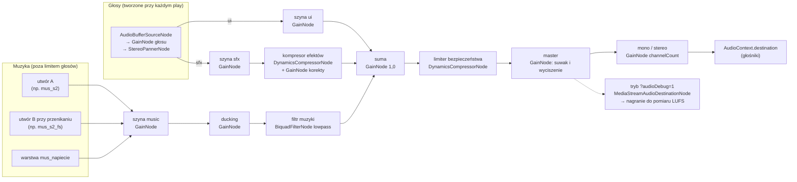
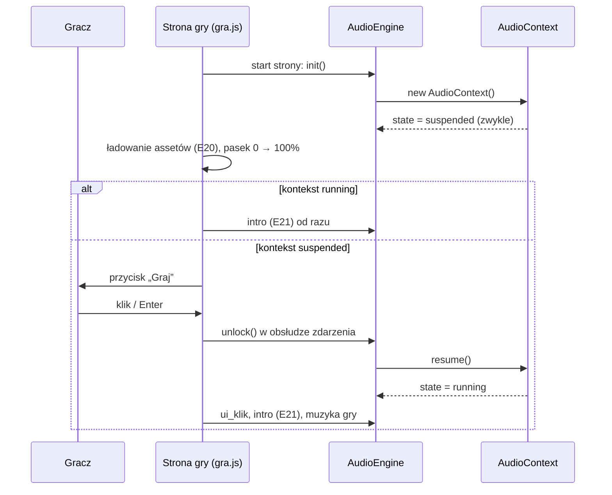

# 05 — Dźwięk i muzyka (biblia dźwięku)

> Ten dokument ustala, jak brzmi Cebulion Casino: każdy z 59 efektów i 8 pętli muzycznych, kiedy grają, jak głośno,
> jak powstają w kodzie (synteza w Pythonie) i jak silnik Web Audio odtwarza je w przeglądarce bez opóźnień.
> Sekcje 1–2 wyjaśniają zasady i architekturę, 3–6 to specyfikacja do wdrożenia (ID, przepisy syntezy, poziomy,
> mapowanie zdarzeń E01–E73), 7–8 opisują pliki i pipeline, a 9–12 ustawienia gracza, wibracje i opcjonalne źródła
> muzyki (Suno/Udio, biblioteki CC0).

| Metryka | |
|---|---|
| Projekt | Cebulion Casino, symulator kasyna z wirtualną walutą (przedmiot „Wprowadzenie do technologii backendowych”, Uniwersytet WSB Merito Wrocław) |
| Zespół | Konrad Paulus (112960, s428425@student.wroclaw.merito.pl) · Dominik Pacanowski (112961, s433776@student.wroclaw.merito.pl) · Dawid Majewski (113154, s156704@student.wroclaw.merito.pl) |
| Wersja dokumentu | 1.0 (2026-10-11) |
| Zakres | **67 plików audio**: 8 UI + 13 globalnych + 27 wspólnych dla gier + 2 (S1) + 2 (S2) + 7 (S3) = 59 efektów oraz 8 pętli muzycznych; każdy plik w dwóch formatach (WebM/Opus i M4A/AAC) |
| Kod | silnik: `src/main/resources/static/js/audio/audio-engine.js` (wersja 1 już jest w repozytorium); synteza: `tools/audio/*.py` (do napisania według § 8) |
| Hierarchia źródeł | brief projektu → ten dokument → kod. ID dźwięków i zdarzeń są wiążące; poziomy dB i czasy to wartości startowe, które stroimy na słuch (zmiana w jednym miejscu: metadane przepisu w `tools/audio/dzwieki.py`) |

**W skrócie (liczby do zapamiętania na obronę)**

* 3 szyny (`ui`, `sfx`, `music`) → kompresor efektów → limiter → master; ducking muzyki **−3 dB** przy wygranych,
  **−6 dB** w sekwencji big win.
* Limit **24 głosów** jednocześnie (16 na poziomie jakości Low), kradzież głosów według 5 priorytetów.
* Wszystkie tonalne efekty skomponowane w **pentatonice C** i transponowane do tonacji gry: S1 0, S2 +200, S3 +400 centów.
* Muzyka: 8 pętli o długości będącej całkowitą liczbą taktów (15–40 s), przejścia kwantyzowane do miary lub taktu.
* Pliki: WAV 48 kHz → **Opus w WebM** (64 kb/s mono, 96 kb/s stereo) + **AAC w M4A** (96/128 kb/s) dla Safari.
* Budżet sieci: lobby ≤ 0,8 MB, jedna gra ≤ 1,8 MB (Opus); pamięć po dekodowaniu ≤ 24 MB w lobby i ≤ 56 MB na stronie gry.
* Głośność sesji: **−18 LUFS ±2**, szczyty ≤ **−1 dBTP**.

## Spis treści

1. [Cel i styl dźwiękowy](#1-cel-i-styl-dźwiękowy)
2. [Architektura Web Audio](#2-architektura-web-audio)
3. [Pełna lista dźwięków](#3-pełna-lista-dźwięków)
4. [Muzyka](#4-muzyka)
5. [Miks](#5-miks)
6. [Mapowanie zdarzeń E01–E73 na dźwięki](#6-mapowanie-zdarzeń-e01e73-na-dźwięki)
7. [Formaty i eksport](#7-formaty-i-eksport)
8. [Pipeline syntezy](#8-pipeline-syntezy)
9. [Ustawienia gracza](#9-ustawienia-gracza)
10. [Haptyka (wibracje)](#10-haptyka-wibracje)
11. [Opcjonalnie: prompty do Suno / Udio](#11-opcjonalnie-prompty-do-suno--udio)
12. [Źródła alternatywne](#12-źródła-alternatywne)
- [Załącznik A: pytania na obronę](#załącznik-a-pytania-na-obronę)
- [Załącznik B: indeks ID dźwięków](#załącznik-b-indeks-id-dźwięków)
- [Powiązane dokumenty](#powiązane-dokumenty)

---

## 1. Cel i styl dźwiękowy

### 1.1. Po co ten dokument i jak go czytać

W topowych slotach mobilnych (Pragmatic Play, NetEnt, Play'n GO) dźwięk odpowiada za co najmniej połowę wrażenia
„premium”. Gracz rzadko patrzy na wszystkie bębny naraz — to dźwięk mówi mu, że bęben stanął, że wypadł drugi scatter
i że trzeci bęben „coś szykuje”. Ten sam obraz z tanim, powtarzalnym dźwiękiem wygląda amatorsko. Dlatego każdy dźwięk
ma tu ID, przepis, poziom głośności i dokładny moment startu.

Dźwięk w tym projekcie ma pięć zadań:

| Zadanie | Co to znaczy w praktyce | Przykład |
|---|---|---|
| **Informacja** | każdy dźwięk coś komunikuje; nic nie gra „dla ozdoby” w momencie, gdy gracz czeka na wynik | `sfx_beben_stop_3` — trzeci bęben stanął |
| **Emocja** | napięcie przed rozstrzygnięciem, nagroda proporcjonalna do wygranej | `sfx_antycypacja_narastanie` + `sfx_bicie_serca` |
| **Marka** | wspólny motyw, wspólne materiały dźwiękowe (złoto, szkło, moneta) we wszystkich trzech grach | motyw Cebuliona w `sfx_logowanie` i `sfx_bigwin_wejscie` |
| **Komfort** | godzina gry bez zmęczenia: warianty, mikro-zmiany wysokości, brak ostrych pasm, umiarkowana głośność | 5 wariantów monety, losowanie bez powtórzeń |
| **Uczciwość** | dźwięk nie oszukuje gracza; wygrana mniejsza niż zakład nie brzmi jak sukces (§ 1.4) | cichszy wariant small przy wygranej < 1× zakładu |

Jak czytać: student implementujący silnik czyta § 2 i § 5; osoba pisząca przepisy syntezy — § 3, § 4 i § 8; osoba
wpinająca dźwięki w animacje — § 6 (tabela zdarzeń) i § 2.7 (planowanie w czasie). Każda nieoczywista decyzja ma
dopisek **Dlaczego**.

### 1.2. DNA dźwiękowe marki

**Materiały dźwiękowe.** Marka to „ciemny luksus, królewskie złoto, neonowe akcenty” (brief § 1). Przekładamy to na
pięć materiałów, z których budujemy wszystkie dźwięki:

| Materiał | Brzmienie | Technika syntezy | Gdzie |
|---|---|---|---|
| **Złoto** | ciepły dzwon, harmoniczny, z długim wybrzmieniem | dzwon FM 1:2 (stosunek modulatora do nośnej), malejący indeks modulacji | wygrane, motyw marki, `sfx_licznik_koniec` |
| **Szkło / kryształ** | wysoki, czysty, lekko nieharmoniczny „ting” | dzwon FM 1:3,5 albo addytywne parcjały nieharmoniczne | S3, `sfx_blysk`, `sfx_scatter_*` |
| **Moneta** | krótki metaliczny dźwięk z nutą z pentatoniki | model modalny (5 tłumionych parcjałów) + warstwa tonalna | `sfx_moneta_1` … `sfx_moneta_5`, `sfx_monety_fontanna` |
| **Aksamit** | miękkie pady i dywan harmoniczny | odstrojone piły / sinusy przez filtr dolnoprzepustowy, wolny atak | muzyka, `sfx_logowanie`, przejścia |
| **Głębia** | sub-bas z harmonicznymi słyszalnymi na telefonie | sinus z opadającą wysokością + nasycenie tanh | `sfx_uderzenie_basu`, wejście big win, stopy bębnów |

**Motyw Cebuliona (logo dźwiękowe).** Cztery nuty **G4 – C5 – E5 – G5** (392,00 / 523,25 / 659,26 / 783,99 Hz),
rytm: trzy ósemki i ćwierćnuta z wybrzmieniem („Ce-bu-li-on”). Przy 120 BPM: 250 + 250 + 250 ms + 500 ms i ogon.
Motyw pojawia się w:

* `sfx_logowanie` — dzwony FM (pierwsze zetknięcie gracza z marką),
* `sfx_bigwin_wejscie` — „dęte” syntezatory (ta sama melodia w wersji triumfalnej),
* `mus_lobby` — dzwonek w taktach 1 i 9, `mus_bigwin` — dzwonki (glockenspiel) w taktach 1 i 5,
* `sfx_licznik_koniec` — dwie ostatnie nuty (E5 + G5) jako zamknięcie liczenia.

**Dlaczego motyw:** gracz zapamiętuje markę uchem tak samo jak okiem; powtarzalna, krótka fraza w różnych
aranżacjach to standard dużych marek i daje spójność trzem różnym stylistycznie grom.

**Centrum tonalne: C, pentatonika C–D–E–G–A.** Wszystkie tonalne efekty (stopy bębnów, monety, wygrane, scattery,
linie) komponujemy w C, z nut pentatoniki. Silnik transponuje je do tonacji muzyki aktualnej gry (§ 2.6):

| Kontekst | Tonacja muzyki | Transpozycja efektów | Dlaczego pasuje |
|---|---|---|---|
| Lobby | a-moll | 0 centów | a-moll i C-dur mają te same dźwięki |
| S1 „Cebulowy 777” | a-moll | 0 centów | jw. |
| S2 „Złoty Faraon” | D hidżaz (frygijska dominantowa: D E♭ F♯ G A B♭ C) | **+200** (C → D) | akord D-dur (D F♯ A) należy do skali hidżaz |
| S3 „Kryształowa Kaskada” | E lidyjska (E F♯ G♯ A♯ B C♯ D♯) | **+400** (C → E) | akord E-dur (E G♯ B) należy do skali lidyjskiej |
| Sekwencja big win (każda gra) | C-dur (`mus_bigwin`) | 0 centów | efekty big win grają razem z `mus_bigwin` |

**Dlaczego pentatonika:** w pentatonice nie ma półtonów, więc dowolna kombinacja nut brzmi konsonansowo.
Pięć losowych monet naraz, trzy stopy bębnów nachodzące na dźwięk wygranej — nic nie „fałszuje”, nawet gdy
kolejność i nakładanie się dźwięków są przypadkowe.

### 1.3. Styl każdej części

| Część | Charakter | Tempo i tonacja muzyki | Instrumentarium | Sygnatura (to, co ma zapamiętać gracz) |
|---|---|---|---|---|
| **Lobby** | luksusowy salon nocą, lounge / deep house | 96 BPM, a-moll | piano elektryczne FM, aksamitny pad, miękki sub-bas, szczotki, dzwonek z motywem | motyw Cebuliona w dzwonku, złote „tingi” monet |
| **S1** Cebulowy 777 | retro-synth / neon, synthwave lat 80. | 120 BPM, a-moll | piły i kwadraty, arpeggiator z echem 3/16, werbel z bramkowanym pogłosem, bzyczenie neonu | `sfx_s1_neon_bzyk` (migotanie świetlówki), 8-bitowy podbieg w `sfx_s1_jackpot` |
| **S2** Złoty Faraon | skarbiec grobowca, ciepłe pochodnie; free spins: noc nad piramidami | 100 BPM, D hidżaz | bęben ramowy / darbuka (rytm maqsum), niskie bębny taiko, gong, „ud” (szarpana struna), „ney” (oddechowy flet), smyczkowy bordun | `sfx_s2_gong`, skala hidżaz z charakterystyczną półtonową sekundą E♭–D |
| **S3** Kryształowa Kaskada | magiczna kryształowa jaskinia, bioluminescencja; free spins: komnata zorzy | 90 BPM, E lidyjska | kryształowe dzwonki FM, celesta, kalimba, ciepłe pady, krople wody, długi pogłos jaskini | pękanie kryształu `sfx_s3_pekniecie_*`, „magiczna” kwarta zwiększona (A♯) skali lidyjskiej |
| **Big win** (wspólne) | eksplozja radości, „deszcz złota” | 128 BPM, C-dur | „dęte” stopy akordów, stopa 4/4, klaśnięcia, dzwonki, nadchodzące tom-tomy | motyw Cebuliona w wersji fanfarowej, eskalacja o cały ton na każdy poziom |

#### 1.3.1. Lobby — „Złoty salon”

Spokojny, elegancki, nocny. Muzyka ma być tłem do rozmowy, nie do tańca: miękka stopa tylko na „raz” i „trzy”,
szczotki z lekkim swingiem (58%), akordy z septymą i noną (Am9, Fmaj7, Cmaj7). Efekty lobby są krótkie i ciche —
lobby to miejsce wyboru, nie emocji. Jedyny głośny moment to bonus powitalny (E07): skrzynia, błysk, uderzenie basu,
fontanna monet. Lobby jest najdłużej słuchane bez przerwy, dlatego unikamy wysokich, powtarzalnych dźwięków w tle.

#### 1.3.2. S1 — retro-synth / neon

Las Vegas lat 80. widziane przez synthwave: gorący róż, chrom, neon. Dźwięki **elektroniczne i lekko „analogowe”**:
piły z odstrojeniem ±15 centów, kwadraty z modulacją szerokości impulsu, delikatne redukowanie rozdzielczości do 12 bitów
w arpeggiatorze, falowanie taśmy ±3 centy. Bębny automatu to mechanika z elektroniką: szybkie kliknięcia symboli
(24 na sekundę) na tle buczenia silnika. Sygnatura: **bzyczenie neonu** — 100 Hz (świetlówka w sieci 50 Hz migocze
z częstotliwością 100 Hz) z harmonicznymi i trzaskami, zsynchronizowane z migotaniem napisu (E50, E21).

#### 1.3.3. S2 — egipskie skale, perkusja, gongi

Skarbiec oświetlony pochodniami: ciepło, kamień, złoto, tajemnica. Skala **hidżaz na D** (D E♭ F♯ G A B♭ C) daje
natychmiastowe skojarzenie z Bliskim Wschodem przez półtonowy krok D–E♭ i półtora tonu E♭–F♯. Rytm **maqsum**
(D-T-_-T-D-_-T-_, D = „dum” nisko, T = „tek” wysoko) na bębnie ramowym, niskie uderzenia taiko na pierwszy takt
frazy, szarpana struna w stylu udu (Karplus–Strong), oddechowy flet w stylu ney. **Gong** (`sfx_s2_gong`) to
podpis gry: wejście (E21), retrigger (E61), wzmocnienie startu free spins (E35). Free spins (`mus_s2_fs`) to
„noc nad piramidami”: ta sama tonacja i siatka akordów, ale epicko — ostinato smyczków szesnastkami, chór „aaa”,
zespół taiko ósemkami, rozgwieżdżone arpeggio dzwonków. Bębny automatu są cięższe niż w S1: kamienna zapadka
(20 kliknięć na sekundę), dudnienie, szelest piasku.

#### 1.3.4. S3 — kryształowe dzwonki, pady

Magiczna jaskinia: **szkło, woda, światło**. Skala **E lidyjska** (z podwyższoną kwartą A♯) brzmi „baśniowo” i
otwarcie — to skala muzyki filmowej o magii. Kryształowe dzwonki FM o stosunku 1:3,5 (nieharmoniczne, szklane),
celesta, kalimba, ciepłe pady z wolnym chorusem i **długi pogłos jaskini** (3,5 s, opóźnienie wstępne 40 ms).
Bez twardej perkusji: miękka stopa jak bicie serca jaskini, szklane „tiki” zamiast hi-hatu. Mechanika kaskad brzmi
jak kryształ: pękanie (`sfx_s3_pekniecie_1` … `_4`), opad klejnotów (`sfx_s3_opad`), kule mnożników
(`sfx_s3_mnoznik`, `sfx_s3_mnoznik_zbior`). Free spins (`mus_s3_fs`): zorza — dochodzi pulsujący bas, szesnastkowe
arpeggio dzwonków i chór, którego samogłoski powoli przechodzą z „a” w „o”.

#### 1.3.5. Big win — wspólna oprawa nagrody

Sekwencja big win jest wspólna dla trzech gier (te same banery `g_win_big`, `g_win_mega`, `g_win_epic`,
`g_win_ultra`), więc ma wspólny dźwięk w C-dur. Każdy kolejny poziom (MEGA, EPIC, ULTRA) podnosi efekt eskalacji
o cały ton (+200 centów), przyspiesza tykanie licznika i pogłaśnia fontannę monet — gracz **słyszy**, że wygrana rośnie,
zanim przeczyta napis.

### 1.4. Zasady, których pilnujemy we wszystkich dźwiękach

1. **Głośność proporcjonalna do znaczenia.** UI najciszej, informacja (stopy, linie) średnio, nagroda głośno i
   proporcjonalnie do progu wygranej (brief § 3):

   | Próg | Dźwiękowa „waga” |
   |---|---|
   | wygrana < 1× zakładu (część progu `small`) | jeden krótki dźwięk o 6 dB ciszej, bez liczenia i bez dźwięków linii |
   | `small` (≥ 1× i < 5×) | 1 warstwa, 0,6–0,9 s, ducking muzyki −3 dB |
   | `medium` (≥ 5×) | 3 warstwy (fanfara, akord, monety), 1,6 s, liczenie z tykaniem |
   | `big` (≥ 15×) | wejście 2,4 s + `mus_bigwin` + liczenie + fontanna monet, ducking −6 dB |
   | `mega` / `epic` / `ultra` (≥ 30× / 60× / 100×) | + `sfx_poziom_w_gore` transponowany o 0 / +200 / +400 centów, szybsze tykanie, głośniejsza fontanna |

2. **Nie świętujemy przegranej.** Wygrana mniejsza niż zakład to w praktyce strata. W prawdziwych automatach celowo
   gra się wtedy pełną fanfarę (zjawisko opisywane w badaniach jako *loss disguised as win*). My tego nie robimy:
   taka „wygrana” dostaje cichszy wariant. **Dlaczego:** to symulator „bez ryzyka”, który ma uczyć, a nie
   manipulować — i dobry argument na obronie.
3. **Żadnego dźwięku przed gestem gracza.** Przeglądarki i tak by go zablokowały; nie pokazujemy też nachalnych
   komunikatów „włącz dźwięk” (§ 2.3).
4. **Żadnych identycznych powtórzeń.** Często powtarzane dźwięki mają warianty plikowe albo losowe mikro-zmiany
   wysokości i głośności (§ 2.6). Ucho męczy się powtarzalnością szybciej niż głośnością.
5. **Oszczędzamy pasmo 2–5 kHz.** Tam ucho jest najczulsze i najszybciej się męczy. Muzyka ma w tym paśmie
   wycięcie −3 dB, a pasmo zostaje dla dźwięków niosących informację (wygrane, scattery).
6. **Bas słyszalny na telefonie.** Głośnik telefonu nie odtwarza niczego poniżej ~150 Hz. Każde uderzenie basu ma
   warstwę harmonicznych 120–400 Hz (nasycenie), inaczej na telefonie po prostu zniknie.
7. **Bez nagrań z prawdziwych kasyn, cudzej muzyki i lektora.** Wszystko jest syntezowane naszym kodem albo
   pochodzi ze źródeł o sprawdzonej licencji (§ 11, § 12). Teksty („BIG WIN”) są na ekranie — syntezowany głos brzmi tanio.
8. **Synchronizacja co do klatki.** Dźwięk zdarzenia startuje w tej samej klatce co obraz (tolerancja ±10 ms,
   § 2.7). Opóźniony o 50 ms stop bębna brzmi jak błąd.

---

## 2. Architektura Web Audio

### 2.1. Stan w kodzie i co dochodzi

Silnik w wersji 1 (`static/js/audio/audio-engine.js`) już działa w lobby i na stronie gry: ma trzy szyny, odblokowanie
gestem, manifest, wybór formatu przez `canPlayType`, pamięć zdekodowanych buforów, warianty, muzykę z przenikaniem,
ustawienia w `localStorage` i pauzę przy ukryciu karty. Brak pliku w manifeście daje ciszę bez błędów, więc dźwięki
dochodzą z pipeline'u bez zmian w kodzie. Ten dokument opisuje wersję docelową:

| Funkcja | Wersja 1 (jest) | Wersja docelowa (dochodzi) | Sekcja |
|---|---|---|---|
| Szyny `ui` / `sfx` / `music` → master | jest | + kompresor szyny `sfx`, limiter na sumie, węzeł duckingu i filtr muzyki, przełącznik mono | § 2.2, § 5 |
| Odblokowanie gestem | `unlock()` przy „Zaloguj”, „Wejdź do kasyna”, kaflu, przełączniku dźwięku | + przycisk „Graj” na ekranie ładowania gry, poprawne zdarzenia na ekranach dotykowych, stan `interrupted` (Safari) | § 2.3 |
| Manifest, format, dekodowanie | jest | + pakiety i priorytety ładowania, `gainDb`, `loopStart`/`loopEnd`, `syncPoint`, `keyTrack` | § 2.4, § 7.5 |
| Limit głosów | brak | 24 głosy (Low: 16), 5 priorytetów, kradzież głosów, `maxVoices` i `cooldownMs` na dźwięk | § 2.5 |
| Warianty | `playVariant` — losowo, z możliwym powtórzeniem | losowanie bez powtórzeń, mikro-zmiany wysokości i głośności z manifestu, transpozycja do tonacji gry | § 2.6 |
| Planowanie w czasie | start „teraz” (`delay` opcjonalnie) | harmonogram z wyprzedzeniem na zegarze `AudioContext` (wzorzec „dwóch zegarów”), kompensacja opóźnienia wyjścia | § 2.7 |
| Muzyka | jeden utwór, liniowe przenikanie | maszyna stanów, przenikanie o stałej mocy, kwantyzacja do miary / taktu, warstwa napięcia, wznowienie od zapamiętanego taktu | § 4.4 |
| Ukrycie karty | `suspend()` / `resume()` | + `pagehide` / `pageshow` (bfcache), wyciszanie muzyki po bezczynności | § 2.8 |
| Ustawienia | `cebulion.audio` w `localStorage` | + suwaki w oknie ustawień, mono, wibracje (`cebulion.haptyka`) | § 9, § 10 |

### 2.2. Graf audio



| Węzeł | Typ Web Audio | Ustawienia startowe | Po co |
|---|---|---|---|
| głos | `AudioBufferSourceNode` → `GainNode` → `StereoPannerNode` | `gain` = `gainDb` z manifestu × losowa korekta; `pan` z pozycji bębna | jeden dźwięk; tworzony przy każdym odtworzeniu (węzły źródła są jednorazowe — tak działa Web Audio) |
| szyna `ui` / `sfx` / `music` | `GainNode` | z ustawień gracza (§ 9): 0,6 / 0,85 / 0,45 | osobna głośność kategorii |
| kompresor efektów | `DynamicsCompressorNode` + `GainNode` | próg −14 dB, kolano 6 dB, stosunek 2,5:1, atak 5 ms, zwolnienie 150 ms; korekta za nim −5 dB (§ 5.4) | „skleja” nakładające się efekty (monety + liczenie + fanfara), żeby nie przekraczały poziomu |
| ducking | `GainNode` | 1,0 (0 dB); w chwili wygranej −3 / −6 dB (§ 5.3) | ścisza muzykę pod ważnymi efektami |
| filtr muzyki | `BiquadFilterNode` `lowpass` | 20 000 Hz, Q 0,707 (praktycznie przezroczysty); antycypacja: 1 200 Hz | „przytłumienie” muzyki przy napięciu i otwartym oknie |
| limiter | `DynamicsCompressorNode` + `GainNode` | próg −3 dB, kolano 0, stosunek 20:1, atak 1 ms, zwolnienie 100 ms; korekta za nim −1,7 dB (§ 5.4) | łapie rzadkie szczyty sumy; to bezpiecznik, nie narzędzie głośności |
| master | `GainNode` | suwak główny 0,9; wyciszenie = rampa do 0 w 120 ms | głośność całości; za limiterem, żeby limiter pracował tak samo przy każdej pozycji suwaka |
| mono | `GainNode` | stereo: `channelCount` 2; mono: `channelCount` 1, `channelCountMode` `explicit` | ustawienie dostępności: miks w mono (słuchanie jednym uchem, jedna słuchawka, § 9) |

**Dlaczego Web Audio, a nie `<audio>`:** element `<audio>` startuje z opóźnieniem rzędu dziesiątek–setek ms
(zależnie od przeglądarki), nie pozwala zaplanować startu co do próbki, źle znosi wiele dźwięków naraz (szczególnie
na iOS) i nie daje bezszwowych pętli. Web Audio planuje dźwięki na własnym zegarze (`AudioContext.currentTime`)
z dokładnością do próbki (1/48 000 s), miksuje dowolnie wiele głosów i pozwala zmieniać wysokość, panoramę i filtry
w czasie rzeczywistym.

**Dlaczego pogłos jest „wypalony” w plikach, a nie liczony w przeglądarce:** `ConvolverNode` z odpowiedzią
impulsową 2–3 s to jeden z najdroższych węzłów Web Audio; na słabym telefonie kilka takich węzłów powoduje
trzaski (niedobory bufora wątku audio). Pogłos dodajemy w Pythonie przy syntezie, a w przeglądarce zostają tylko
tanie węzły: wzmocnienie, panorama, filtr, kompresor.

### 2.3. Odblokowanie dźwięku gestem

Przeglądarki (polityka *autoplay*) pozwalają grać dźwięk dopiero po **geście użytkownika** na stronie. Wcześniej
`AudioContext` jest w stanie `suspended` i nic nie słychać. Zasady:

1. **Kontekst tworzymy i wznawiamy synchronicznie w obsłudze gestu** — `new AudioContext()` i `ctx.resume()` muszą
   paść, zanim kod obsługi zdarzenia odda sterowanie (przed pierwszym `await`). Wersja 1 robi to poprawnie w `unlock()`.
2. **Zdarzenia, które liczą się jako gest** (specyfikacja HTML, „activation triggering input event”): `keydown`
   (poza Esc), `mousedown`, `pointerdown` **tylko dla myszy**, `pointerup` dla dotyku i pióra, `touchend`, a w praktyce
   też `click`. **Uwaga do kodu:** w `gra.js` nasłuch `pointerdown` z `{ once: true }` na ekranie dotykowym nie
   odblokuje dźwięku (dotyk aktywuje stronę dopiero przy `pointerup`), a słuchacz zostanie usunięty po pierwszym
   wywołaniu. Poprawka: nasłuchiwać `pointerup`, `keydown` i `click`, a słuchacze usuwać dopiero, gdy
   `ctx.state === 'running'`.
3. **Po `resume()` sprawdzamy `ctx.state`.** Jeśli nadal `suspended`, nic nie gramy i czekamy na kolejny gest —
   bez błędów i bez komunikatów.

| Miejsce | Gest | Co się dzieje z dźwiękiem |
|---|---|---|
| Lobby: kliknięcie „Zaloguj” (prawy górny róg) | `click` | `unlock()` → `ui_otworz` (otwarcie okna, E04) |
| Lobby: „Wejdź do kasyna” w oknie logowania | `submit` z kliknięcia lub Enter | `unlock()` → `sfx_logowanie`, start `mus_lobby` |
| Lobby: kliknięcie kafla gry | `click` | `unlock()` → `ui_klik` |
| Lobby: przełącznik dźwięku w menu, bonus ratunkowy | `click` | `unlock()` |
| Lobby po powrocie z gry (zalogowany) | pierwszy dowolny gest | `unlock()` → `mus_lobby` z wejściem 1 500 ms |
| Strona gry: ekran ładowania (E20) | przycisk **„Graj”** (jeśli dźwięk nie odblokował się sam) | `unlock()` → `ui_klik` → intro gry z muzyką (E21) |
| Strona gry: przycisk dźwięku, SPIN, dowolny przycisk | `click` / `keydown` | `unlock()` (zapasowo, gdyby gracz ominął „Graj”) |

**Przycisk „Graj” na stronie gry.** Lobby i gra to **dwie osobne strony** (`index.html`, `gra.html`), więc każda ma
własny `AudioContext` i każda potrzebuje własnego gestu. Po załadowaniu gry tworzymy kontekst od razu: jeśli
przeglądarka pozwoli mu wystartować (bywa tak w Chrome po wcześniejszej interakcji z witryną — zależy to od
heurystyk przeglądarki, więc nie możemy na tym polegać), intro gra od razu. Jeśli kontekst zostaje `suspended`,
ekran ładowania po 100% pokazuje duży złoty przycisk „Graj” (`g_ui_przycisk_glowny`, fokus klawiatury na nim,
Enter działa). Tak robią topowe sloty mobilne („Tap to continue”). **Dlaczego:** intro automatu bez dźwięku
traci połowę efektu, a gest i tak jest potrzebny.



**Safari (macOS i iOS):**

* Kontekst może przejść w niestandardowy stan **`interrupted`** (połączenie telefoniczne, przełączenie aplikacji,
  Siri). Obsługa: na zdarzenie `statechange` z `interrupted` lub `suspended` (gdy karta jest widoczna) dodajemy
  jednorazowych słuchaczy gestu, które wołają `resume()`.
* Na iPhonie z włączonym **przełącznikiem wyciszenia** dźwięk Web Audio bywa niesłyszalny — to zachowanie systemu.
  Nie obchodzimy go sztuczkami: gracz wyciszył telefon świadomie. W oknie ustawień jest podpowiedź „Na iPhonie
  sprawdź przełącznik wyciszenia”.
* Plan B dla bardzo starych iOS (sprzed 14.5): w obsłudze gestu odtworzyć bufor jednej cichej próbki. Nie wdrażamy
  tego domyślnie — dodajemy tylko, jeśli test na takim urządzeniu pokaże problem.

### 2.4. Ładowanie i dekodowanie

**Przepływ:** `manifest.json` → wybór formatu → `fetch` → `arrayBuffer` → `ctx.decodeAudioData` → `AudioBuffer`
w pamięci podręcznej (mapa ID → bufor). Dekodowanie odbywa się poza wątkiem głównym (to asynchroniczne API
przeglądarki), więc nie blokuje animacji, ale zużywa CPU — dlatego planujemy je w odpowiednich momentach.

**Wybór formatu** (już w kodzie): `canPlayType('audio/webm; codecs="opus"')` → plik `.webm`; w przeciwnym razie
`.m4a` (AAC). Wynik sprawdzamy raz na stronę.

**Pakiety ładowania.** Każdy wpis manifestu ma pole `pack` (§ 7.5). Strona prosi tylko o swoje pakiety:

| Pakiet | Strona | Zawartość | Kiedy ładujemy |
|---|---|---|---|
| `ui` | lobby i gra | 8 dźwięków `ui_*` | od razu po odblokowaniu (łącznie ~10 KB) |
| `lobby` | lobby | `sfx_logowanie`, `sfx_skrzynia_otwarcie`, `sfx_monety_fontanna`, monety, licznik, `sfx_saldo_puls`, `sfx_bankrut`, `sfx_przejscie_whoosh`, `sfx_blysk`, `sfx_uderzenie_basu`, `mus_lobby` | po odblokowaniu; `sfx_logowanie` i bonus — **w trakcie** żądania logowania (zdążą, zanim przyjdzie odpowiedź) |
| `gry-krytyczne` | gra | `sfx_spin_start`, pętla bębnów danej gry, `sfx_beben_stop_1` … `_6`, wygrane small/medium, `sfx_linia`, licznik, `sfx_saldo_puls`, `sfx_wild`, `sfx_scatter_1` … `_3`, monety, muzyka bazowa gry | na ekranie ładowania (E20) — wliczone do paska postępu |
| `gry-dalsze` | gra | big win (`sfx_bigwin_*`, `sfx_poziom_w_gore`, `mus_bigwin`, fontanna), antycypacja (`sfx_antycypacja_narastanie`, `sfx_bicie_serca`, `mus_napiecie`), free spins, `sfx_bankrut`, skrzynia | po intro, w tle, kolejno po jednym pliku, **nigdy w trakcie spinu** |
| `s1` / `s2` / `s3` | gra | dźwięki specyficzne gry i jej muzyka free spins | `s1`, `s2`: krótkie efekty z pakietem krytycznym, `mus_s2_fs` / `mus_s3_fs` z dalszymi |

**Ładowanie sterowane wynikiem.** Serwer zwraca cały wynik rundy od razu (brief § 0: jedna runda = jeden zakład,
kaskady i darmowe spiny w tej samej odpowiedzi). Gdy odpowiedź zawiera np. darmowe spiny albo próg `big`, a potrzebne
pliki nie są jeszcze zdekodowane, silnik dostaje `audio.preload([...])` natychmiast po odpowiedzi. Od odpowiedzi do
prezentacji wygranej mija co najmniej czas obrotu bębnów (S1: 1 600 ms, S2: 2 200 ms, w turbo ×0,45), a dekodowanie
krótkiego pliku trwa kilkadziesiąt ms — zdąży.

**Pamięć.** Zdekodowany dźwięk to 32-bitowe próbki zmiennoprzecinkowe: 48 000 próbek/s × 4 B = **192 KB na sekundę
na kanał**. Minuta muzyki stereo to ~23 MB RAM — dużo więcej niż plik Opus (~0,7 MB). Budżet: **≤ 56 MB
zdekodowanego audio na stronie gry i ≤ 24 MB w lobby** (lobby: `mus_lobby` + efekty ≈ 19 MB). Szacunek dla najcięższej strony (S2):

| Zawartość | Czas | Kanały | Pamięć |
|---|---|---|---|
| `mus_s2` + `mus_s2_fs` (z zakładkami pętli, § 7.3) | 2 × 38,9 s | 2 | 29,9 MB |
| `mus_bigwin` + `mus_napiecie` | 15,5 s + 8,5 s | 2 | 9,2 MB |
| efekty strony S2 (≈ 21,6 s mono + 20,5 s stereo) | 42,1 s | 1–2 | 12,0 MB |
| **razem** | | | **≈ 51,1 MB** |

Na urządzeniach z `navigator.deviceMemory` ≤ 2 (API dostępne w Chrome; w innych przeglądarkach traktujemy brak jako
„dużo pamięci”) `mus_s2_fs` / `mus_s3_fs` dekodujemy dopiero wtedy, gdy odpowiedź serwera zawiera darmowe spiny,
a po ich zakończeniu zwalniamy bufor. Przejście między lobby a grą to zmiana strony, więc przeglądarka zwalnia całą
pamięć audio poprzedniej strony automatycznie.

**Odporność.** Brak manifestu, brak wpisu, błąd sieci, błąd dekodowania → cisza dla tego ID i jeden wpis
`console.warn` na ID (nie na każde odtworzenie). Brak Web Audio w ogóle (bardzo stare przeglądarki) → silnik działa
jako „pusty” — gra działa bez dźwięku.

### 2.5. Głosy: limit, priorytety, kradzież

**Głos** = jeden grający dźwięk (`AudioBufferSourceNode` z jego `GainNode` i `StereoPannerNode`). Limit:

| Poziom jakości (brief § 5) | Limit głosów efektów | Panorama | Uwagi |
|---|---|---|---|
| High | **24** | tak | |
| Medium | 24 | tak | |
| Low | **16** | nie (bez `StereoPannerNode`, mniej węzłów) | `maxVoices` monet zmniejszone z 6 do 3 |

Muzyka **nie wlicza się** do limitu: ma własne „gniazda” — utwór bieżący, utwór wchodzący przy przenikaniu i warstwę
`mus_napiecie` (maks. 3).

**Dlaczego 24:** wątek audio przeglądarki ma na przetworzenie każdego bloku 128 próbek ~2,7 ms. Każdy głos to kilka
węzłów; na słabym Androidzie kilkadziesiąt głosów jednocześnie z panoramą potrafi przekroczyć ten czas, co słychać
jako trzaski. 24 to zapas z naddatkiem nawet na najgęstszy moment (fontanna monet + liczenie + eskalacja + kaskada),
a ucho i tak nie rozróżni więcej niż kilkunastu jednoczesnych efektów.

**Priorytety (1–5):**

| Priorytet | Nazwa | Przykłady | Zasada |
|---|---|---|---|
| **5** | krytyczny | `sfx_bigwin_wejscie`, `sfx_poziom_w_gore`, `sfx_bigwin_koniec`, `sfx_free_spins_start`, `sfx_free_spins_koniec`, `sfx_s1_jackpot`, `sfx_s3_mnoznik_zbior`, `sfx_bankrut`, `sfx_scatter_3` | nigdy nie jest kradziony; zawsze dostaje głos |
| **4** | ważny | `sfx_beben_stop_*`, `sfx_spin_start`, `sfx_wild`, `sfx_scatter_1` / `_2`, wygrane small/medium, `sfx_antycypacja_narastanie`, `sfx_bicie_serca`, `sfx_uderzenie_basu`, `sfx_s2_wild_rozszerzenie`, `sfx_s2_gong`, `sfx_s3_mnoznik`, `ui_blad` | kradnie tylko niższe |
| **3** | normalny | `sfx_linia`, `sfx_blysk`, `sfx_s3_pekniecie_*`, `sfx_s3_opad`, `sfx_licznik_koniec`, `sfx_s1_neon_bzyk`, `sfx_logowanie`, `sfx_skrzynia_otwarcie`, `sfx_przejscie_whoosh`, `ui_klik`, `ui_otworz`, `ui_zamknij`, `ui_przelacznik`, `ui_zaklad_*` | |
| **2** | tło | pętle: `sfx_beben_petla_s1` / `_s2`, `sfx_monety_fontanna`, `sfx_licznik_tik`; `sfx_saldo_puls` | pętle są kradzione tylko przez priorytety ≥ 4 |
| **1** | ozdobny | `sfx_moneta_1` … `_5`, `ui_hover` | pierwsze do kradzieży; przy braku głosu po prostu nie grają |

**Algorytm kradzieży** (gdy wszystkie głosy są zajęte):

```js
/** Zwraca true, jeśli nowy dźwięk o priorytecie `prio` może dostać głos (ew. kosztem innego). */
#acquireVoice(prio) {
  if (this.#voices.size < this.#maxVoices) return true;
  let victim = null;
  for (const v of this.#voices) {
    if (v.priority === 5) continue;                       // krytycznych nie kradniemy nigdy
    if (v.loop && prio < 4) continue;                     // pętle tła oddajemy tylko ważnym dźwiękom
    if (!victim || v.priority < victim.priority ||
        (v.priority === victim.priority && v.startedAt < victim.startedAt)) victim = v; // najniższy, potem najstarszy
  }
  if (!victim || victim.priority > prio) return false;    // wszystko, co gra, jest ważniejsze → pomijamy nowy dźwięk
  victim.stop(0.012);                                     // 12 ms wyciszenia zamiast trzasku
  return true;
}
```

**Limity na dźwięk.** Oprócz limitu globalnego każdy dźwięk może mieć `maxVoices` (ile kopii naraz) i `cooldownMs`
(minimalny odstęp między startami). Przekroczenie `maxVoices` kradnie najstarszą kopię tego samego dźwięku;
start w czasie `cooldownMs` jest pomijany.

| Dźwięk | `maxVoices` | `cooldownMs` | Dlaczego |
|---|---|---|---|
| `ui_hover` | 1 | 60 | szybkie przesuwanie myszy po kaflach nie może „terkotać” |
| `sfx_moneta_1` … `_5` (łącznie, wspólna grupa) | 6 (Low: 3) | 25 | 36 monet w bonusie powitalnym przylatuje w ~1,5 s |
| `sfx_beben_stop_*` (grupa) | 3 | 0 | przy szybkim zatrzymaniu bębny stają co 40 ms |
| `sfx_s3_pekniecie_*` (grupa) | 3 | 25 | pęka nawet kilkanaście symboli naraz — 3 głosy brzmią pełniej niż 12 (§ 6.4) |
| `sfx_linia` | 3 | 80 | |
| `sfx_blysk` | 2 | 333 | zgodnie z limitem 3 błysków na sekundę (WCAG 2.3.1, brief § 4) |
| `sfx_wild`, `sfx_scatter_*` | 2 | 40 | |
| pętle (`sfx_*petla*`, fontanna, licznik, serce) | 1 | 0 | druga kopia pętli to zawsze błąd logiki |
| `sfx_saldo_puls` | 1 | 150 | |

### 2.6. Warianty, mikro-zmiany wysokości, tonacja gry

**Losowanie bez powtórzeń.** Wersja 1 losuje wariant niezależnie, więc ten sam plik może zagrać dwa razy z rzędu
(przy 5 wariantach w 20% przypadków). Wersja docelowa pamięta ostatni wariant i losuje spośród pozostałych:

```js
#lastVariant = new Map();
playVariant(prefix, count, options) {
  const last = this.#lastVariant.get(prefix) ?? 0;
  let n = 1 + Math.floor(Math.random() * (count - 1));   // 1 … count-1
  if (n >= last) n += 1;                                  // przeskok nad ostatnim → nigdy dwa razy to samo
  this.#lastVariant.set(prefix, n);
  return this.play(`${prefix}${n}`, options);
}
```

**Mikro-zmiany.** Każde odtworzenie dostaje losowe przesunięcie wysokości (`detune` w centach, 100 centów = półton)
i głośności z zakresów zapisanych w manifeście (`pitchCents`, `gainJitterDb`):

| Rodzaj dźwięku | Wysokość | Głośność | Dlaczego |
|---|---|---|---|
| szumowe / perkusyjne (kliknięcia, pęknięcia, whoosh) | ±80–150 centów | ±1,5 dB | brak wysokości dźwięku, więc duża zmiana jest niesłyszalna jako „fałsz”, a słyszalna jako różnorodność |
| tonalne (stopy bębnów, wygrane, monety, scattery) | **±5 centów** | ±1 dB | większa zmiana wyprowadziłaby nutę z pentatoniki i z tonacji muzyki |
| UI | ±30 centów | ±0,5 dB | subtelnie; UI ma być przewidywalne |
| pętle i muzyka | 0 | 0 | zmiana wysokości pętli zmienia też jej tempo |

**Uwaga do kodu:** w `reward.js` monety grają z `rate: 0.94 + Math.random() * 0.12` (±~100 centów). Po
wprowadzeniu tonalnych monet (§ 3.2) zakres trzeba zawęzić do ±5 centów (np. `detune` z manifestu zamiast `rate`).

**Transpozycja do tonacji gry (`keyTrack`).** Dźwięki oznaczone w manifeście `"keyTrack": true` dostają dodatkowy
`detune` = transpozycja kontekstu z § 1.2 (S1 0, S2 +200, S3 +400; w stanie BIG_WIN zawsze 0). Silnik ustawia ją
metodą `audio.setKeyCents(c)` wywoływaną przez maszynę stanów muzyki (§ 4.4).

**Ważne:** w `AudioBufferSourceNode` zmiana wysokości to zmiana prędkości odtwarzania
(prędkość = `playbackRate` × 2^(`detune`/1200)). +400 centów = prędkość ×1,26, więc plik trwa o 21% krócej, a
**punkty synchronizacji** w pliku (np. uderzenie w `sfx_free_spins_start` w 1 000 ms) przesuwają się. Silnik przelicza je:
`czas_rzeczywisty = syncPoint / prędkość` (1 000 ms przy +400 centach → 794 ms) i uwzględnia to przy planowaniu startu.
Transpozycję ograniczamy do ±400 centów — powyżej barwa zaczyna brzmieć nienaturalnie („efekt wiewiórki”).

### 2.7. Planowanie w czasie i synchronizacja z animacją

**Problem.** `setTimeout` i `requestAnimationFrame` mają rozrzut kilku–kilkunastu ms (a przy obciążeniu więcej).
Dźwięk wyzwalany „z klatki animacji” będzie się nierówno spóźniał — przy rytmicznych zdarzeniach (stopy bębnów co
180 ms, tykanie licznika) ucho to wyłapie.

**Rozwiązanie: wzorzec „dwóch zegarów”** (znany z artykułu *A Tale of Two Clocks*, Chris Wilson, HTML5 Rocks):

1. Wynik rundy jest znany z góry (serwer), więc po odpowiedzi budujemy **oś czasu dźwięków** rundy: lista
   `{ id, t_ms, opcje }` liczona od startu spinu z tych samych parametrów, z których animacja liczy swoją oś
   (brief § 4, oś czasu w [04-efekty-wizualne.md](04-efekty-wizualne.md)).
2. Planista (zwykły `setInterval` co 25 ms) w każdym wywołaniu planuje zdarzenia przypadające w najbliższym
   **oknie 120 ms**: `source.start(audioTime)`, gdzie
   `audioTime = ctx.currentTime + (t_ms − (performance.now() − t0)) / 1000 − kompensacja`.
3. Zdarzeń poza oknem jeszcze nie planujemy — dzięki temu **szybkie zatrzymanie** (przycisk STOP,
   `g_ui_spin_stop`) albo pominięcie sekwencji po prostu przelicza resztę osi, bez anulowania dziesiątek
   zaplanowanych źródeł.

**Kompensacja opóźnienia wyjścia.** Między `start()` a dźwiękiem w głośniku mija `ctx.baseLatency` +
`ctx.outputLatency` (to drugie nie jest dostępne we wszystkich przeglądarkach — wtedy przyjmujemy 0). Obraz pojawia się
na ekranie z opóźnieniem ~1 klatki (16,7 ms). Kompensacja = `min(baseLatency + outputLatency − 0,017; 0,15)` s, nie
mniej niż 0: o tyle wcześniej planujemy dźwięk. Górna granica 150 ms, bo słuchawki Bluetooth potrafią zgłaszać
200–300 ms i pełna kompensacja przesuwałaby dźwięk przed gest gracza.

**Szybkie zatrzymanie (slam stop).** Gdy gracz wciśnie STOP, pozostałe bębny stają co 40 ms (zamiast 180/200 ms).
Gramy wszystkie stopy (każdy −3 dB), pętla bębnów gaśnie w 80 ms. Antycypacji przy szybkim zatrzymaniu nie skracamy
do zera: narastanie gra od przesunięcia tak, by zakończyć się na stopie (§ 3.3, `sfx_antycypacja_narastanie`).

**Turbo (brief § 4: czas ×0,45).** Oś czasu dźwięków skaluje się razem z animacją. Dźwięki nie są przyspieszane
(zmieniłoby to wysokość), tylko: krótsze wyciszenie pętli bębnów (60 ms), narastanie antycypacji odtwarzane od
przesunięcia, dźwięki linii scalone w jeden `sfx_linia` na całą wygraną.

### 2.8. Ukrycie karty, bfcache, bezczynność

| Sytuacja | Zachowanie | Dlaczego |
|---|---|---|
| karta ukryta (`visibilitychange`, `document.hidden`) | `ctx.suspend()` (jest w wersji 1) | oszczędność baterii; nikt nie chce grającego kasyna w tle. Zegar kontekstu staje, więc zaplanowane dźwięki „czekają” razem z animacją (`requestAnimationFrame` też staje) |
| karta znów widoczna | `ctx.resume()`; jeśli przeglądarka wymaga gestu (Safari `interrupted`), wznowienie przy pierwszym geście | |
| `pagehide` (wyjście ze strony) | wyciszenie mastera w 80 ms, `suspend()` | brak „ucięcia” dźwięku przy przejściu do lobby |
| `pageshow` z `event.persisted` (powrót z bfcache — przycisk „Wstecz”) | jeśli kontekst był odblokowany: `resume()` i wznowienie muzyki stanu z wejściem 800 ms | strona wraca z pamięci podręcznej bez ponownego ładowania skryptów |
| bezczynność na automacie 60 s (E22) | szyna `music` −3 dB w 4 s | uspokojenie; wraca przy pierwszej interakcji w 300 ms |
| bezczynność 5 min | muzyka wycisza się do zera w 8 s i zatrzymuje | ktoś zostawił otwartą kartę — nie gramy w nieskończoność |
| okno modalne nad grą (info, historia, ustawienia) | muzyka −6 dB i filtr 900 Hz („przytłumienie”), 250 ms | gracz czyta; gra „w tle” |

### 2.9. Interfejs silnika (wersja docelowa)

| Metoda | Opis | Jest w v1? |
|---|---|---|
| `unlock()` | odblokowanie w obsłudze gestu | tak |
| `preload(ids)` / `preloadPack(name)` | pobranie i dekodowanie z wyprzedzeniem | `preload` tak |
| `play(id, { volume, rate, detune, loop, bus, delay, fadeIn, pan, offset, when })` → uchwyt `{ stop(fadeMs), setRate(r), setGain(db, ms), playing }` | odtworzenie; `when` = czas kontekstu (planista), `offset` = start od środka pliku | częściowo (bez `pan`, `offset`, `when`, `setGain`) |
| `playVariant(prefix, count, opts)` | wariant bez powtórzeń | tak (z powtórzeniami) |
| `schedule(timeline, t0)` / `cancelSchedule()` | oś czasu rundy dla planisty (§ 2.7) | nie |
| `setMusicState(state, opts)` | przejście maszyny stanów muzyki (§ 4.4) | nie (jest `playMusic`) |
| `duck(name, db, { attack, hold, release })` / `unduck(name)` | ducking nazwany (§ 5.3) | nie |
| `setMusicFilter(hz, ms)` | filtr muzyki (antycypacja, okna) | nie |
| `setKeyCents(c)` | transpozycja `keyTrack` | nie |
| `setQuality(poziom)` — `'high'`, `'medium'` albo `'low'` | limit głosów, panorama | nie |
| `stopAll(fadeMs)` | zatrzymanie wszystkich efektów (pominięcie sekwencji, błąd) | nie |
| `getVolume` / `setVolume` / `isMuted` / `setMuted` / `toggleMuted` / `onChange` | ustawienia gracza (§ 9) | tak |
| `setMono(bool)` | miks mono (§ 9) | nie |

---

## 3. Pełna lista dźwięków

### 3.0. Jak czytać tabele

| Kolumna | Znaczenie |
|---|---|
| **długość** | długość dźwięku w pliku (bez zakładek pętli z § 7.3) |
| **pętla?** | **tak** = plik grany w pętli (`loop: true` w manifeście), bezszwowy |
| **szyna** | `ui`, `sfx` albo `music` (§ 2.2) |
| **poziom dB** | `gainDb` w manifeście: wzmocnienie głosu względem szyny. Pliki są wcześniej znormalizowane (§ 7.4): jednorazowe do szczytu −1 dBTP, pętle efektów do −18 LUFS, muzyka do −14 LUFS. Najgłośniejsze efekty mają −3 dB, najcichsze −16 dB |
| **prio** | priorytet głosu 1–5 (§ 2.5) |
| **warianty** | liczba plików (grupa wariantów losowanych bez powtórzeń) i mikro-zmiany; **T** = `keyTrack` (transpozycja do tonacji gry, § 2.6); `syncPoint` = punkt synchronizacji w pliku (§ 2.6, § 2.7) |
| **jak powstaje** | przepis syntezy w skrócie; pełny kod — funkcja o nazwie ID w `tools/audio/dzwieki.py` (§ 8) |

**Słowniczek technik syntezy** (wszystkie są zaimplementowane w `tools/audio/dsp.py`, § 8.3):

| Skrót w przepisie | Technika | Jak brzmi |
|---|---|---|
| **dzwon FM r (I a → b), τ** | synteza FM: sinus nośny o częstotliwości f modulowany fazowo sinusem o częstotliwości f·r; indeks modulacji I maleje od a do b; obwiednia wykładnicza o stałej czasowej τ | r = 1 lub 2: ciepły, harmoniczny dzwon („złoto”); r = 3,5: szklany, nieharmoniczny („kryształ”). Malejący indeks = jasny atak, łagodniejące wybrzmienie, jak w prawdziwym dzwonie |
| **parcjały** (synteza modalna / addytywna) | suma sinusów o podanych stosunkach częstotliwości, każdy z własnym zanikiem | gong, moneta, szkło — przedmioty, które drgają wieloma niezależnymi „modami” |
| **Karplus–Strong (KS)** | krótki bufor szumu w pętli opóźnienia z uśredniającym filtrem | szarpana struna (ud, kalimba, „pluck”) |
| **szum → BP / LP / HP f (Q)** | szum biały, różowy (−3 dB/okt.) lub brązowy (−6 dB/okt.) przez filtr pasmowy / dolno- / górnoprzepustowy (filtr zmiennych stanu, SVF); „f1 → f2” = przestrajanie w czasie | świsty, „whoosh”, szelest, trzaski, narastania |
| **sinus f1 → f2** | sinus z wykładniczym glissandem | stopa basowa, uderzenie, „laser”, puls |
| **supersaw n (±c)** | n pił odstrojonych o ±c centów, rozłożonych w stereo | szeroki, jasny akord syntezatorowy (synthwave, fanfary) |
| **piła / kwadrat (PWM)** | fale z ograniczonym pasmem (bez aliasingu, § 8.3) | „analogowe” brzmienia, bas, „dęte” syntezatory po filtrze |
| **τ** | stała czasowa zaniku: po τ głośność spada do 37% (−8,7 dB), po 3τ do 5% | |
| **odwrócony pogłos** | pogłos dźwięku odwrócony w czasie i postawiony przed nim | „zasysające” narastanie przed uderzeniem |
| **pogłos t s, mix m%** | splot z syntetyczną odpowiedzią impulsową (szum z zanikiem do −60 dB w t s, dekorelacja L/P) | przestrzeń: sala, jaskinia, skarbiec |
| **echo t ms, sprzężenie s%** | linia opóźniająca ze sprzężeniem | echo synthwave'owe, „ping-pong” w stereo |
| **nasycenie tanh ×k** | miękkie obcinanie `tanh(k·x)/tanh(k)` | dodaje harmoniczne: bas słyszalny na telefonie, „brud” dętych |
| **redukcja bitów b, fs Hz** | kwantyzacja do b bitów i próbkowanie z fs | retro, 8-bit (S1) |

**Nuty używane w przepisach** (strój równomiernie temperowany, A4 = 440 Hz):

| Nuta | Hz | Nuta | Hz | Nuta | Hz | Nuta | Hz |
|---|---|---|---|---|---|---|---|
| C4 | 261,63 | C5 | 523,25 | C6 | 1 046,50 | C7 | 2 093,00 |
| D4 | 293,66 | D5 | 587,33 | D6 | 1 174,66 | D7 | 2 349,32 |
| E4 | 329,63 | E5 | 659,26 | E6 | 1 318,51 | E7 | 2 637,02 |
| G4 | 392,00 | G5 | 783,99 | G6 | 1 567,98 | G7 | 3 135,96 |
| A4 | 440,00 | A5 | 880,00 | A6 | 1 760,00 | A7 | 3 520,00 |

### 3.1. Interfejs (8 dźwięków, szyna `ui`)

| ID | Opis brzmienia | Długość | Pętla? | Szyna | Poziom dB | Prio | Warianty | Jak powstaje |
|---|---|---|---|---|---|---|---|---|
| `ui_hover` | delikatny, wysoki „tik” szkła — ledwie słyszalny | 40 ms | nie | ui | −16 | 1 | 1 plik; ±30 c, ±0,5 dB | sinus 2 600 Hz, atak 3 ms, τ 12 ms + szum HP 6 kHz −18 dB, 8 ms; bez pogłosu |
| `ui_klik` | miękki, „szklisty” klik przycisku z krótkim ciałem | 70 ms | nie | ui | −8 | 3 | 1 plik; ±30 c | (1) szum 2 ms → BP 3,5 kHz (Q 2); (2) sinus 1 200 → 1 050 Hz w 30 ms, τ 20 ms; (3) sinus 220 Hz, τ 15 ms, −10 dB; pogłos 0,3 s, mix 8% |
| `ui_otworz` | powietrzne „wznoszenie” szkła — otwarcie okna lub menu | 300 ms | nie | ui | −10 | 3 | 1 plik; ±30 c | szum różowy → BP 800 → 4 000 Hz (Q 1,2) w 220 ms + dwa dzwony FM 1:2 (I 1,2 → 0) E5 i B5 w odstępie 40 ms, τ 180 ms; pogłos 0,6 s, mix 20% |
| `ui_zamknij` | lustrzane, opadające „zamknięcie” | 240 ms | nie | ui | −12 | 3 | 1 plik; ±30 c | jak `ui_otworz`, odwrotnie: BP 4 000 → 900 Hz, nuty B5 → E5; pogłos 0,4 s |
| `ui_blad` | dwa tępe, łagodne tony w dół — „nie tak”, bez agresji | 260 ms | nie | ui | −8 | 4 | 1 plik | kwadrat C♯4 (277,18 Hz) 90 ms, przerwa 30 ms, C4 110 ms; LP 1 400 Hz; + „puknięcie” sinus 120 Hz, τ 25 ms; sucho, bez pogłosu (dźwięk „blisko ucha”) |
| `ui_przelacznik` | mechaniczno-szklane „tik-tak” przełącznika | 100 ms | nie | ui | −10 | 3 | 1 plik; włączenie +200 c, wyłączenie −200 c | dwa kliki w odstępie 45 ms (warstwy 1–2 z `ui_klik`), drugi o 3 półtony wyżej |
| `ui_zaklad_gora` | stuk żetonów + wznoszący dzwoneczek | 130 ms | nie | ui | −9 | 3 | 1 plik; +100 c × poziom zakładu (indeks przeskalowany do 0–6) | dwa szumy 8 ms → BP 2,2 kHz i 3,1 kHz (Q 6) w odstępie 18 ms („klak” żetonów) + dzwonek FM 1:2 (I 0,8) G5 z glissando +50 c, τ 80 ms |
| `ui_zaklad_dol` | stuk żetonów + opadający dzwoneczek | 130 ms | nie | ui | −10 | 3 | 1 plik; +100 c × poziom zakładu | jak wyżej, dzwonek E5 z glissando −50 c |

**Dlaczego wysokość zależy od zakładu:** gracz „słyszy” poziom stawki, nie patrząc na liczbę — wyżej = więcej.
To drobiazg, który odróżnia dopracowany produkt od szablonu.

### 3.2. Globalne (13 dźwięków, szyna `sfx`)

| ID | Opis brzmienia | Długość | Pętla? | Szyna | Poziom dB | Prio | Warianty | Jak powstaje |
|---|---|---|---|---|---|---|---|---|
| `sfx_logowanie` | „wejście do kasyna”: motyw Cebuliona w złotych dzwonach na aksamitnym padzie, z iskrami | 1 800 ms | nie | sfx | −6 | 3 | 1 plik, stereo | dzwony FM 1:2 (I 2,5 → 0,3 w 400 ms), τ 900 ms: G4–C5–E5–G5 w 0 / 110 / 220 / 330 ms; pad Cmaj9 (C3 G3 B3 D4 E4, po 2 piły ±8 c → LP 1 200 Hz), atak 400 ms, zanik od 900 ms; 14 iskier (sinusy 3–6 kHz, 30 ms) losowo w 200–900 ms, panorama ±0,7; pogłos sali 1,8 s, mix 25% |
| `sfx_skrzynia_otwarcie` | szczęk zatrzasku, skrzypnięcie drewna, „łup” wieka i magiczne rozbłyśnięcie złota | 1 300 ms | nie | sfx | −4 | 3 | 1 plik, stereo | 0 ms: 2 kliki zatrzasku (szum → BP 2,8 kHz Q 8, 4 ms, odstęp 35 ms); 40–340 ms: skrzypienie — szum przez filtr grzebieniowy z opóźnieniem 4 → 7 ms (sprzężenie 0,85); 250 ms: „łup” — szum LP 600 Hz, τ 60 ms + sinus 90 Hz; 250–1 300 ms: połysk — szum BP 1 → 8 kHz (Q 3) + akord C-dur (6 odstrojonych pił) przez LP otwierany 500 → 6 000 Hz; pogłos 1,5 s, mix 22% |
| `sfx_monety_fontanna` | ciągły deszcz monet: gęsty, błyszczący, szeroki w stereo | 2 000 ms | **tak** | sfx | −10 | 2 | 1 plik, stereo; w big win +2 dB na każdy poziom | ~45 uderzeń monet na sekundę (ziarna z modelu monety, jak `sfx_moneta_*`, f0 losowo 1,9–2,9 kHz, 60–180 ms), losowa panorama ±0,8 i głośność −12…0 dB; + szum HP 4 kHz −26 dB („szelest metalu”); bezszwowość: ziarna wystające poza koniec zawijamy na początek (§ 7.3) |
| `sfx_moneta_1` | pojedyncza moneta: krótki metaliczny „ting” na nucie C7 | 220 ms | nie | sfx | −14 | 1 | grupa 5 plików bez powtórzeń; ±5 c; T | uderzenie: szum 1 ms HP 3 kHz; ciało: 5 parcjałów f0 × {1; 1,47; 2,09; 2,56; 3,39}, τ {180; 120; 90; 60; 40} ms, f0 = 1 900 Hz; warstwa tonalna: dzwonek FM 1:2 na **C7**, τ 140 ms, −6 dB |
| `sfx_moneta_2` | jw., nuta D7 | 210 ms | nie | sfx | −14 | 1 | jw. | jw., f0 = 2 100 Hz, nuta **D7** |
| `sfx_moneta_3` | jw., nuta E7 | 200 ms | nie | sfx | −14 | 1 | jw. | jw., f0 = 2 300 Hz, nuta **E7** |
| `sfx_moneta_4` | jw., nuta G7 | 190 ms | nie | sfx | −14 | 1 | jw. | jw., f0 = 2 500 Hz, nuta **G7** |
| `sfx_moneta_5` | jw., nuta A7 | 180 ms | nie | sfx | −14 | 1 | jw. | jw., f0 = 2 700 Hz, nuta **A7** |
| `sfx_licznik_tik` | szybkie, równe „tik-tik-tik” liczenia, naprzemiennie na dwóch wysokościach | 500 ms | **tak** | sfx | −16 | 2 | 1 plik; prędkość 1,0 → 1,6 (`setRate`) w trakcie liczenia; T | 8 tików co 62,5 ms (16 na sekundę): dzwonek FM 1:3,5 (I 1,5), 15 ms, naprzemiennie A6 i E7; + klik szumu 1 ms; bez pogłosu |
| `sfx_licznik_koniec` | domknięcie liczenia: nuta E5 i jasny złoty akord | 800 ms | nie | sfx | −8 | 3 | 1 plik; ±5 c; T | E5 (110 ms) → akord C6 + E6 + G6, dzwony FM 1:2 (I 3 → 0 w 400 ms), τ 320 ms; miękkie uderzenie sinus 80 Hz, τ 60 ms; iskry 6 kHz; pogłos 1,2 s, mix 20% |
| `sfx_saldo_puls` | miękki, okrągły „blup” pulsu salda | 180 ms | nie | sfx | −16 | 2 | 1 plik; ±5 c; T | sinus E5 → A5 (glissando 40 ms), τ 110 ms, LP 3 kHz; + powietrze: szum HP 5 kHz −24 dB, 60 ms |
| `sfx_bankrut` | zabawny, ale z klasą „smutny” motyw: przytłumione dęte w dół, pusta kieszeń, wirująca moneta | 2 000 ms | nie | sfx | −6 | 5 | 1 plik | 0–900 ms: „dęte” (piła → LP 900 Hz, wibrato 5 Hz ±15 c): G4–F♯4–F4 po 200 ms i E4 trzymane 500 ms z wibratem narastającym do ±30 c; 300 ms: „klap” pustej kieszeni (szum LP 1,2 kHz, 50 ms); 900–2 000 ms: moneta wirująca na stole — uderzenia modelu monety coraz gęściej (odstęp 120 → 8 ms) i coraz ciszej, aż się położy |
| `sfx_przejscie_whoosh` | powietrzne „przelecenie” z lewej do prawej, z głębią | 650 ms | nie | sfx | −8 | 3 | 1 plik, stereo; ±100 c | szum różowy → BP 300 → 3 500 Hz (0–380 ms) → 1 000 Hz (do 650 ms), Q 1,5; panorama −0,7 → +0,7; sub: sinus 50 → 35 Hz, −8 dB; ogon pogłosu 0,8 s |

**Dlaczego monety są nutami pentatoniki:** fontanna 36 monet w bonusie powitalnym (`reward.js`) gra je losowo,
po kilka naraz. Gdyby każda moneta miała przypadkową wysokość, wyszedłby metaliczny szum; z pięciu nut pentatoniki
wychodzi **melodyjny deszcz**, który nigdy nie fałszuje, a z muzyką lobby (a-moll) tworzy harmonię.

### 3.3. Wspólne dla gier (27 dźwięków, szyna `sfx`)

| ID | Opis brzmienia | Długość | Pętla? | Szyna | Poziom dB | Prio | Warianty | Jak powstaje |
|---|---|---|---|---|---|---|---|---|
| `sfx_spin_start` | dotykowe „wciśnięcie i zwolnienie bębnów”: klik, mechaniczne „klunk”, krótki wznoszący świst | 380 ms | nie | sfx | −8 | 4 | 1 plik; ±5 c; T | klik jak `ui_klik`; 15 ms: „klunk” — szum LP 400 Hz, 40 ms + sinus 140 → 90 Hz; 40–260 ms: świst — szum BP 600 → 2 400 Hz (Q 2); tonalny „blip” kwadrat C5, 30 ms, −12 dB |
| `sfx_beben_petla_s1` | szybki „terkot” symboli retro-automatu na tle elektrycznego buczenia | 1 000 ms (2 miary przy 120 BPM) | **tak** | sfx | −16 | 2 | 1 plik | kliki 24/s (szum 4 ms → BP 2 kHz Q 3, co 8. głośniejszy o 3 dB — „obrót taśmy”); buczenie: piła 55 Hz → LP 250 Hz; neonowy „wir”: kwadrat 110 Hz z PWM 0,3 Hz → LP 800 Hz, tremolo 12 Hz; całość zredukowana do 12 bitów |
| `sfx_beben_petla_s2` | ciężka kamienno-złota zapadka, dudnienie i szelest piasku | 1 200 ms (2 miary przy 100 BPM) | **tak** | sfx | −16 | 2 | 1 plik | kliki 20/s (szum 6 ms → BP 1,2 kHz Q 3 + rezonans korpusu 320 Hz, τ 15 ms); dudnienie: szum brązowy → LP 180 Hz; piasek: szum HP 5 kHz −26 dB z wolną modulacją 0,5 Hz |
| `sfx_beben_stop_1` | stop bębna: głębokie, miękkie „tunk”, krótki klak i nuta C5 | 280 ms | nie | sfx | −7 | 4 | grupa stopów (`maxVoices` 3); ±5 c; T; panorama według bębna | (a) sinus 110 → 55 Hz w 60 ms, τ 70 ms, nasycenie tanh ×2; (b) klak: szum 12 ms → BP 1,8 kHz (Q 2); (c) nuta **C5**: dzwonek FM 1:2 (I 1,5 → 0 w 80 ms), τ 120 ms, −10 dB |
| `sfx_beben_stop_2` | jw., nuta D5 | 280 ms | nie | sfx | −7 | 4 | jw. | jw., (c) **D5** |
| `sfx_beben_stop_3` | jw., nuta E5 | 280 ms | nie | sfx | −7 | 4 | jw. | jw., (c) **E5** |
| `sfx_beben_stop_4` | jw., nuta G5 (tylko S2, S3) | 280 ms | nie | sfx | −7 | 4 | jw. | jw., (c) **G5** |
| `sfx_beben_stop_5` | jw., nuta A5 (tylko S2, S3) | 280 ms | nie | sfx | −7 | 4 | jw. | jw., (c) **A5** |
| `sfx_beben_stop_6` | jw., nuta C6 (tylko S3 — szósta kolumna) | 280 ms | nie | sfx | −7 | 4 | jw. | jw., (c) **C6** |
| `sfx_antycypacja_narastanie` | narastające napięcie: wznoszący szum, drżące smyczki, coraz szybsze tremolo aż do uderzenia | 1 200 ms | nie | sfx | −6 | 4 | 1 plik, stereo; start od przesunięcia, gdy antycypacja trwa krócej (S1, S3, turbo) | szum → BP 400 → 6 000 Hz (Q 4, krzywa wykładnicza); klaster „smyczków” (6 pił E3–B3–E4, ±20 c → BP 1–3 kHz) z tremolo 8 → 16 Hz; ton Sheparda w górę (§ 4.3.8); głośność +12 dB w czasie pliku; **ostre ucięcie w 1 200 ms** — bez ogona, bo w tej chwili gra stop bębna |
| `sfx_bicie_serca` | „lub-dub” serca, głębokie, słyszalne też na telefonie | 800 ms (75 uderzeń/min) | **tak** | sfx | −8 | 4 | 1 plik; prędkość 1,00 → 1,08 → 1,16 przy kolejnych bębnach antycypacji | „lub”: sinus 70 → 45 Hz w 80 ms, τ 90 ms; „dub” w 180 ms: sinus 60 → 42 Hz, −4 dB; LP 200 Hz; nasycenie tanh ×3 (harmoniczne 120–240 Hz) |
| `sfx_scatter_1` | pierwszy scatter: magiczny kryształowy „ting” z krótkim zasysającym narastaniem | 900 ms | nie | sfx | −6 | 4 | 1 plik; ±5 c; T; panorama według bębna; `syncPoint` 80 ms | 0–80 ms: odwrócony pogłos szumu (start 80 ms przed lądowaniem); 80 ms: dzwon FM 1:3,5 (I 4 → 0,5) **C6**, τ 500 ms + oktawa C7 −8 dB; pogłos 1,6 s, mix 30% |
| `sfx_scatter_2` | drugi scatter: wyżej, pełniej, z basem — „coś się zbliża” | 1 100 ms | nie | sfx | −5 | 4 | jw. | jak `sfx_scatter_1`, nuta **E6** + A5 pod spodem, + sub sinus 65 Hz, τ 300 ms; pogłos 2,0 s |
| `sfx_scatter_3` | trzeci (i każdy kolejny) scatter: akord-fanfara z chórem i uderzeniem — bonus! | 1 700 ms | nie | sfx | −3 | 5 | 1 plik; n-ty scatter (n ≥ 4): dodatkowo +100 c × (n − 3), maks. +300 c; T; `syncPoint` 80 ms | narastanie 80 ms; akord dzwonów FM C6–E6–G6–C7 rozłożony co 30 ms; chór: 6 odstrojonych pił przez dwa filtry formantowe (BP 700 Hz i 1 100 Hz — samogłoska „a”), atak 200 ms; sub 55 → 35 Hz; pogłos 2,4 s |
| `sfx_wild` | złote „łuuup” narastania, uderzenie i błyszczący akord | 1 000 ms | nie | sfx | −5 | 4 | 1 plik; ±5 c; T; `syncPoint` 150 ms | 0–150 ms: narastanie (odwrócony pogłos szumu i akordu) — start 150 ms przed lądowaniem; 150 ms: uderzenie (sinus 80 → 40 Hz + trzask szumu 5 ms); akord dzwonów FM 1:2 (I 2,5) C5–G5–C6–E6, τ 700 ms; 10 iskier 4–8 kHz; pogłos 1,8 s, mix 25% |
| `sfx_wygrana_small_1` | krótkie, przyjemne arpeggio dzwonka z szarpnięciem: C5–E5–G5 | 700 ms | nie | sfx | −9 | 4 | grupa 3 plików bez powtórzeń; ±5 c; T; wygrana < 1× zakładu: −6 dB | 3 nuty co 60 ms: dzwonek FM 1:1 (I 1,2 → 0 — ciepły, harmoniczny) + Karplus–Strong oktawę niżej −8 dB; τ 350 ms; pogłos 1,2 s, mix 18% |
| `sfx_wygrana_small_2` | jw.: E5–G5–C6 | 750 ms | nie | sfx | −9 | 4 | jw. | jw. |
| `sfx_wygrana_small_3` | jw.: G5–C6–E6 | 800 ms | nie | sfx | −9 | 4 | jw. | jw. |
| `sfx_wygrana_medium` | jaśniejsza fanfara: szybki bieg, akord supersaw, garść monet, uderzenie | 1 600 ms | nie | sfx | −6 | 4 | 1 plik; ±5 c; T | bieg C5–D5–E5–G5–C6 co 40 ms (dzwonki FM 1:2); 200 ms: akord C-dur (supersaw 7 ±12 c → LP 3 kHz, 300 ms) + sub 60 Hz; 250–700 ms: 6 monet (ziarna modelu monety); ogon dzwonów i pogłos 1,8 s |
| `sfx_linia` | „laserowe” przeciągnięcie linii — czyste, krótkie „ziiing” | 340 ms | nie | sfx | −12 | 3 | 1 plik; +100 c × numer pokazywanej linii (maks. +700 c) | sinus 800 → 1 600 Hz (wykładniczo, 120 ms), τ 150 ms + szum BP 4 kHz (Q 6) o tej samej obwiedni, −8 dB; echo 90 ms, sprzężenie 25%, echo w panoramie ±0,4. Celowo prawie bez wysokości dźwięku — kolejne linie wznoszą się chromatycznie i nie gryzą się z muzyką |
| `sfx_bigwin_wejscie` | wejście BIG WIN: zasysające narastanie, potężne uderzenie, akord „dętych” i motyw Cebuliona jako fanfara | 2 400 ms | nie | sfx | −3 | 5 | 1 plik, stereo; `syncPoint` 300 ms | 0–300 ms: odwrócony talerz (szum HP 3 kHz, obwiednia rosnąca wykładniczo); 300 ms: uderzenie — sinus 55 → 30 Hz (600 ms) + trzask + akord C3–G3–C4–E4–G4–C5 („dęte”: piła + kwadrat oktawę wyżej, LP 400 → 8 000 Hz w 80 ms); 500–1 300 ms: motyw G4–C5–E5–G5 po 120 ms (ostatnia nuta trzymana); do 2 400 ms: trzymany akord, migotanie (iskry 5–9 kHz), pogłos sali 2,5 s |
| `sfx_poziom_w_gore` | eskalacja poziomu: świst w górę i uderzenie z akordem kwintowym, za każdym razem o ton wyżej | 1 400 ms | nie | sfx | −4 | 5 | 1 plik; MEGA 0 c, EPIC +200 c, ULTRA +400 c; `syncPoint` 250 ms | 0–250 ms: świst w górę (szum BP 500 → 6 000 Hz + sinus 200 → 1 600 Hz); 250 ms: uderzenie (sub 60 → 32 Hz, trzask 4 ms) + akord kwintowy F (F2–C3–F3–C4: piły z nasyceniem tanh ×4 + „dęte” oktawę wyżej), LP 600 → 7 000 Hz w 60 ms, trzymany 600 ms z zanikiem; iskry; pogłos 2 s |
| `sfx_bigwin_koniec` | domknięcie sekwencji: kadencja G → C, kaskada monet, długi błyszczący ogon | 2 200 ms | nie | sfx | −4 | 5 | 1 plik, stereo | 0 ms: akord G-dur („dęte”, 150 ms) → 180 ms: Cadd9 („dęte” + dzwony FM + sub 55 Hz) trzymany 800 ms; 200–1 200 ms: kaskada 20 monet (panorama ±0,8); ogon: pogłos 2,5 s + migotanie |
| `sfx_blysk` | jasne, krótkie „szyng” błysku światła | 420 ms | nie | sfx | −12 | 3 | 1 plik; ±100 c | 30 ms odwróconego narastania; szum HP 5 kHz, atak 2 ms, τ 120 ms; sinusy 6,0 / 8,2 / 11,0 kHz, τ 200 ms, −10 dB; pogłos 1 s, mix 30% |
| `sfx_uderzenie_basu` | głębokie, kinowe uderzenie basu z „mięsem” słyszalnym na telefonie | 1 000 ms | nie | sfx | −5 | 4 | 1 plik; ±30 c | sinus 60 → 32 Hz (wykładniczo, 250 ms), τ 400 ms; nasycenie tanh ×3 (harmoniczne 120–240 Hz); klik 2 ms (szum LP 2 kHz) na początku; LP 4 kHz |
| `sfx_free_spins_start` | wielkie przejście do darmowych spinów: narastanie 1 s, uderzenie, epicki akord z chórem | 3 200 ms | nie | sfx | −3 | 5 | 1 plik, stereo; T; `syncPoint` 1 000 ms | 0–1 000 ms: narastanie (szum BP 300 → 8 000 Hz, ton Sheparda w górę, werbel szesnastkami z crescendo od −30 dB); 1 000 ms: uderzenie (sub 50 → 28 Hz, 800 ms, trzask, talerz: szum HP 4 kHz, τ 900 ms) + akord C-dur („dęte” + chór „a” + dzwony C6–E6–G6) narastający 600 ms; do 3 200 ms: wybrzmienie, pogłos 3 s |
| `sfx_free_spins_koniec` | zamknięcie bonusu: opadające rozwiązanie, „zamykający się portal” | 2 400 ms | nie | sfx | −5 | 5 | 1 plik, stereo; T | szum BP 6 000 → 400 Hz (whoosh w dół, 600 ms); akordy F-dur (300 ms) → C-dur (900 ms) — pad + dzwony; sub 55 Hz; pogłos 2 s |

**Dlaczego stopy bębnów rosną (C5 → D5 → E5 → G5 → A5 → C6):** kolejne stopy budują frazę wznoszącą — po
ostatnim bębnie ucho „czeka na rozwiązanie”, którym jest dźwięk wygranej albo cisza. To klasyczny zabieg slotów;
dzięki pentatonice każdy stop współbrzmi z muzyką gry (po transpozycji T).

**Dlaczego `sfx_poziom_w_gore` to akord kwintowy (bez tercji):** po transpozycji o +200 i +400 centów akord F
staje się G i A. Akordy kwintowe F5, G5, A5 (F+C, G+D, A+E) składają się wyłącznie z dźwięków C-dur, więc każda
eskalacja brzmi „wyżej i mocniej”, a nie gryzie się z `mus_bigwin` (C-dur). Z tercją (F-dur → G-dur → A-dur)
ostatni akord zawierałby C♯ i fałszowałby.

### 3.4. S1 „Cebulowy 777” (2 dźwięki)

| ID | Opis brzmienia | Długość | Pętla? | Szyna | Poziom dB | Prio | Warianty | Jak powstaje |
|---|---|---|---|---|---|---|---|---|
| `sfx_s1_neon_bzyk` | brzęczenie i trzaski zapalającej się świetlówki, zakończone 8-bitowym „zapem” mocy | 650 ms | nie | sfx | −9 | 3 | 1 plik; ±20 c | buczenie 100 Hz (piła → BP 1–3 kHz) z obwiednią migotania: wł. 0–60 ms, wył. 60–110, wł. 110–170, wył. 170–200, wł. od 200 ms; wzór migotania jest **wspólny z animacją** (jedna tablica czasów w kodzie gry, żeby obraz i dźwięk migały identycznie); 6 trzasków (impulsy 0,5 ms, losowo); 200–350 ms: „zap” — kwadrat 220 → 880 Hz, redukcja do 8 bitów i 11 025 Hz; ogon buczenia do 650 ms (τ 200 ms) |
| `sfx_s1_jackpot` | NEON JACKPOT: przepięcie neonu, 8-bitowy podbieg i synthwave'owa fanfara w arpeggiach | 4 000 ms | nie | sfx | −3 | 5 | 1 plik, stereo | 0 ms: przepięcie (szum z rezonansem 2 kHz + sub 45 Hz); 100–600 ms: 8-bitowy podbieg (kwadrat 25%, C–E–G–C w górę przez 2 oktawy, po 31 ms); 600–3 600 ms: fanfara 120 BPM — akordy C → F → G → C po 750 ms, arpeggia szesnastkami (125 ms) supersaw + werbel z bramkowanym pogłosem na 2 i 4; do 4 000 ms: trzymany C-dur, migotanie |

### 3.5. S2 „Złoty Faraon” (2 dźwięki)

Dźwięki S2 komponujemy od razu w tonacji gry (D hidżaz), więc nie mają transpozycji T.

| ID | Opis brzmienia | Długość | Pętla? | Szyna | Poziom dB | Prio | Warianty | Jak powstaje |
|---|---|---|---|---|---|---|---|---|
| `sfx_s2_wild_rozszerzenie` | kamień trze o kamień, słup światła rośnie, chór w skali hidżaz, uderzenie przy pełnej kolumnie | 1 600 ms | nie | sfx | −4 | 4 | 1 plik, stereo; `syncPoint` 600 ms | 0–600 ms: tarcie kamienia (szum brązowy → BP 200 → 900 Hz + trzaski ziarniste 40/s) i złoty połysk w górę (szum BP 2 → 9 kHz); 300–1 600 ms: chór (piły przez formanty „a”) — akord D–F♯–A z ozdobnikiem E♭ → D; 600 ms: uderzenie — sub 55 → 35 Hz + krótki gong (parcjały jak `sfx_s2_gong`, zaniki ×0,25); pogłos 2,2 s |
| `sfx_s2_gong` | wielki gong świątynny: uderzenie pałki, rozkwit wysokich parcjałów, długie, falujące wybrzmienie | 3 500 ms | nie | sfx | −5 | 4 | 1 plik, stereo | 12 parcjałów na podstawie D2 (73,42 Hz) × {1; 1,52; 2,03; 2,48; 2,97; 3,53; 4,11; 4,75; 5,42; 6,20; 7,10; 8,30}; zaniki 4,0 → 1,2 s (wyższe krócej); **rozkwit**: parcjały od 5. w górę narastają 100–400 ms po uderzeniu (cecha prawdziwego gongu); dryft wysokości −15 c w 2 s; dudnienia: każdy parcjał jako para sinusów odstrojonych o 0,3–1,5 Hz; pałka: szum LP 300 Hz, 30 ms; stereo: różne fazy parcjałów w L i P |

### 3.6. S3 „Kryształowa Kaskada” (7 dźwięków)

Dźwięki S3 komponujemy od razu w E lidyjskiej, bez transpozycji T.

| ID | Opis brzmienia | Długość | Pętla? | Szyna | Poziom dB | Prio | Warianty | Jak powstaje |
|---|---|---|---|---|---|---|---|---|
| `sfx_s3_pekniecie_1` | pęknięcie kryształu: trzask, szklany rezonans, opadające drobne odłamki | 600 ms | nie | sfx | −10 | 3 | grupa 4 plików bez powtórzeń (`maxVoices` 3); ±80 c | (a) trzask: szum 3 ms HP 3 kHz; (b) 10 parcjałów nieharmonicznych 2,5–9 kHz (losowanych z ziarnem = ID), τ 40–200 ms; (c) 16 odłamków — ziarna szkła 20–40 ms, 4–10 kHz, rozrzucone w 80–450 ms z malejącą gęstością; (d) „pyk” korpusu: sinus 180 Hz, τ 30 ms |
| `sfx_s3_pekniecie_2` | jw., inny układ rezonansów | 550 ms | nie | sfx | −10 | 3 | jw. | jw., 14 odłamków, inne ziarno losowania |
| `sfx_s3_pekniecie_3` | jw., ciemniejszy, „grubszy” kryształ | 500 ms | nie | sfx | −10 | 3 | jw. | jw., parcjały 2–6 kHz, 12 odłamków |
| `sfx_s3_pekniecie_4` | jw., najjaśniejszy, „cienkie szkło” | 650 ms | nie | sfx | −10 | 3 | jw. | jw., parcjały 4–10 kHz, 20 odłamków |
| `sfx_s3_opad` | lekki, powietrzny świst w dół i ciche „plink” układających się klejnotów | 750 ms | nie | sfx | −12 | 3 | 1 plik; ±5 c | szum BP 3 000 → 800 Hz (0–400 ms); 400–750 ms: 6 „plinków” (dzwonek FM 1:3,5, 25 ms) na nutach E6–F♯6–G♯6–B6–C♯7 (1 318,5 / 1 480,0 / 1 661,2 / 1 975,5 / 2 217,5 Hz) |
| `sfx_s3_mnoznik` | lądowanie kuli mnożnika: głęboki kryształowy dzwon z pulsującym „mmm” energii | 1 100 ms | nie | sfx | −7 | 4 | 1 plik; wysokość według wartości: ×2–×5 0 c, ×10–×20 +200 c, ×25 i więcej +400 c (×50 i ×100: dodatkowo `sfx_blysk`) | dzwon FM 1:3,5 (I 5 → 0,8) E4 + E5, τ 800 ms; „mmm”: sinus 82,4 Hz (E2) z tremolo 6 Hz, atak 60 ms, τ 600 ms; szklany klik na początku; pogłos jaskini 3 s, mix 30% |
| `sfx_s3_mnoznik_zbior` | kule lecą do licznika (świsty z wielu stron), łańcuch rozbłysków, potężne „zasilenie” mnożnika | 1 800 ms | nie | sfx | −4 | 5 | 1 plik, stereo; `syncPoint` 900 ms | 0–600 ms: 3 świsty (szum BP 1 → 5 kHz), panorama ±0,7 → 0; 600–900 ms: arpeggio E–G♯–B–D♯–F♯ (dzwony FM, po 60 ms); 900 ms: uderzenie (sub 41 → 30 Hz + trzask kryształu) + akord E–G♯–B–A♯ (dzwony + pad); pogłos 3 s |

### 3.7. Podsumowanie listy

| Grupa | Liczba plików | Łączny czas | Pliki stereo |
|---|---|---|---|
| UI (`ui_*`) | 8 | 1,27 s | — |
| globalne | 13 | 10,23 s | `sfx_logowanie`, `sfx_skrzynia_otwarcie`, `sfx_monety_fontanna`, `sfx_przejscie_whoosh` |
| wspólne dla gier | 27 | 28,17 s | `sfx_antycypacja_narastanie`, `sfx_bigwin_wejscie`, `sfx_bigwin_koniec`, `sfx_free_spins_start`, `sfx_free_spins_koniec` |
| S1 | 2 | 4,65 s | `sfx_s1_jackpot` |
| S2 | 2 | 5,10 s | oba |
| S3 | 7 | 5,95 s | `sfx_s3_mnoznik_zbior` |
| **efekty razem** | **59** | **≈ 55,4 s** | 13 |
| muzyka (§ 4) | 8 | 235,8 s (pętle) | wszystkie |

Wszystkie pozostałe efekty są **mono** — panoramę nadaje silnik (§ 5.5). Mono to połowa wagi pliku i pamięci,
a pozycja w stereo i tak zależy od miejsca zdarzenia na ekranie (bęben, kolumna), więc nie może być „wypalona” w pliku.

