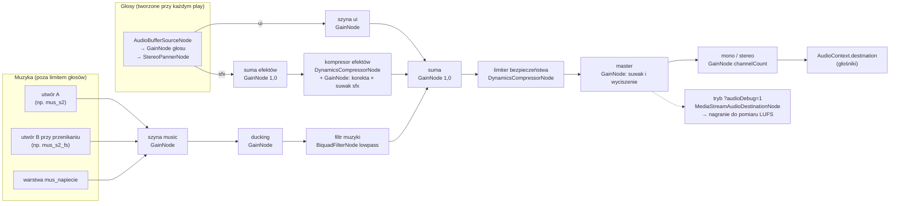
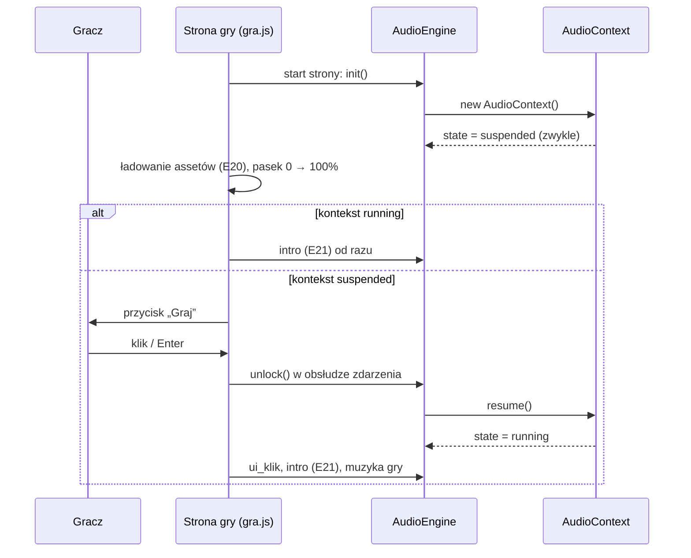
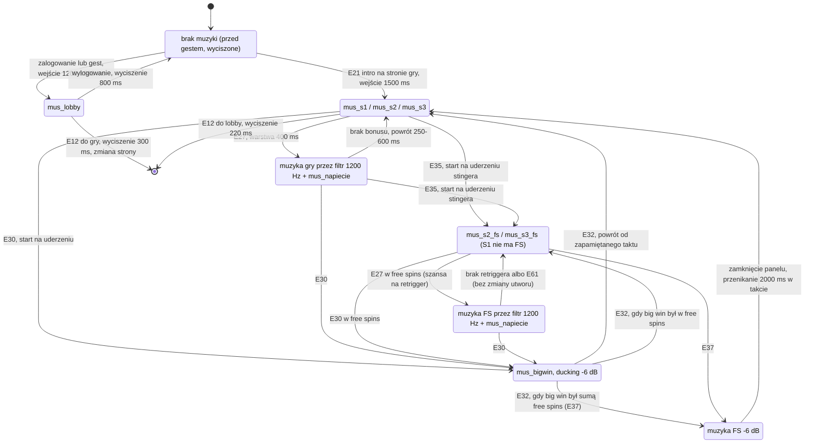
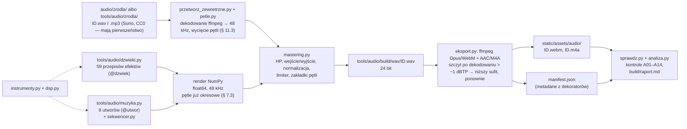

# 05 — Dźwięk i muzyka (biblia dźwięku)

> Ten dokument ustala, jak brzmi Cebulion Casino: każdy z 59 efektów i 8 pętli muzycznych, kiedy grają, jak głośno,
> jak powstają w kodzie (synteza w Pythonie) i jak silnik Web Audio odtwarza je w przeglądarce bez opóźnień.
> Sekcje 1–2 wyjaśniają zasady i architekturę, 3–6 to specyfikacja do wdrożenia (ID, przepisy syntezy, poziomy,
> mapowanie zdarzeń E01–E73), 7–8 opisują pliki i pipeline, a 9–12 ustawienia gracza, wibracje i opcjonalne źródła
> muzyki (Suno/Udio, biblioteki CC0).

| Metryka | |
|---|---|
| Projekt | Cebulion Casino, symulator kasyna z wirtualną walutą (przedmiot „Wprowadzenie do technologii backendowych”, Uniwersytet WSB Merito Wrocław) |
| Zespół | Konrad Paulus (112960, s428425@student.wroclaw.merito.pl) · Dominik Pacanowski (112961, s433776@student.wroclaw.merito.pl) · Dawid Majewski (113154, s156704@student.wroclaw.merito.pl) |
| Wersja dokumentu | 1.0 (2026-10-11) |
| Zakres | **67 plików audio**: 8 UI + 13 globalnych + 27 wspólnych dla gier + 2 (S1) + 2 (S2) + 7 (S3) = 59 efektów oraz 8 pętli muzycznych; każdy plik w dwóch formatach (WebM/Opus i M4A/AAC) |
| Kod | silnik: `src/main/resources/static/js/audio/audio-engine.js` + mapowanie zdarzeń gry `js/game/audio/game-audio.js` (stan: § 2.1); synteza: `tools/audio/*.py` — gotowa, 67 ID wygenerowanych do `static/assets/audio/` (§ 8.2, opis „do obrony”: `tools/audio/README.md`); odstępstwa wykonania od tej specyfikacji: § 8.10 |
| Hierarchia źródeł | brief projektu → ten dokument → kod. ID dźwięków i zdarzeń są wiążące; poziomy dB i czasy to wartości startowe, które stroimy na słuch (zmiana w jednym miejscu: metadane przepisu w `tools/audio/dzwieki.py`) |

**W skrócie (liczby do zapamiętania na obronę)**

* 3 szyny (`ui`, `sfx`, `music`) → kompresor efektów → limiter → master; ducking muzyki **−3 dB** przy wygranych,
  **−6 dB** w sekwencji big win.
* Limit **24 głosów** jednocześnie (16 na poziomie jakości Low), kradzież głosów według 5 priorytetów.
* Wszystkie tonalne efekty skomponowane w **pentatonice C** i transponowane do tonacji gry: S1 0, S2 +200, S3 +400 centów
  (w S2 nuty D i A przesuwamy tylko o +100 c — na E♭ i B♭ — bo E i B nie należą do skali hidżaz, § 1.2).
* Muzyka: 8 pętli o długości będącej całkowitą liczbą taktów (15–40 s), przejścia kwantyzowane do miary lub taktu.
* Pliki: WAV 48 kHz → **Opus w WebM** (64 kb/s mono, 96 kb/s stereo) + **AAC w M4A** (96/128 kb/s) dla Safari.
* Budżet sieci: lobby ≤ 0,8 MB, jedna gra ≤ 1,8 MB (Opus); pamięć po dekodowaniu ≤ 24 MB w lobby i ≤ 56 MB na stronie gry.
* Głośność sesji: **−18 LUFS ±2**, szczyty ≤ **−1 dBTP**.

## Spis treści

1. [Cel i styl dźwiękowy](#1-cel-i-styl-dźwiękowy)
2. [Architektura Web Audio](#2-architektura-web-audio)
3. [Pełna lista dźwięków](#3-pełna-lista-dźwięków)
4. [Muzyka](#4-muzyka)
5. [Miks](#5-miks)
6. [Mapowanie zdarzeń E01–E73 na dźwięki](#6-mapowanie-zdarzeń-e01e73-na-dźwięki)
7. [Formaty i eksport](#7-formaty-i-eksport)
8. [Pipeline syntezy](#8-pipeline-syntezy)
9. [Ustawienia gracza](#9-ustawienia-gracza)
10. [Haptyka (wibracje)](#10-haptyka-wibracje)
11. [Opcjonalnie: prompty do Suno / Udio](#11-opcjonalnie-prompty-do-suno--udio)
12. [Źródła alternatywne](#12-źródła-alternatywne)
- [Załącznik A: pytania na obronę](#załącznik-a-pytania-na-obronę)
- [Załącznik B: indeks ID dźwięków](#załącznik-b-indeks-id-dźwięków)
- [Powiązane dokumenty](#powiązane-dokumenty)

---

## 1. Cel i styl dźwiękowy

### 1.1. Po co ten dokument i jak go czytać

W topowych slotach mobilnych (Pragmatic Play, NetEnt, Play'n GO) dźwięk odpowiada za dużą część wrażenia
„premium” (łatwo to sprawdzić: ten sam automat z wyłączonym dźwiękiem wydaje się wolniejszy i tańszy). Gracz rzadko patrzy na wszystkie bębny naraz — to dźwięk mówi mu, że bęben stanął, że wypadł drugi scatter
i że trzeci bęben „coś szykuje”. Ten sam obraz z tanim, powtarzalnym dźwiękiem wygląda amatorsko. Dlatego każdy dźwięk
ma tu ID, przepis, poziom głośności i dokładny moment startu.

Dźwięk w tym projekcie ma pięć zadań:

| Zadanie | Co to znaczy w praktyce | Przykład |
|---|---|---|
| **Informacja** | każdy dźwięk coś komunikuje; nic nie gra „dla ozdoby” w momencie, gdy gracz czeka na wynik | `sfx_beben_stop_3` — trzeci bęben stanął |
| **Emocja** | napięcie przed rozstrzygnięciem, nagroda proporcjonalna do wygranej | `sfx_antycypacja_narastanie` + `sfx_bicie_serca` |
| **Marka** | wspólny motyw, wspólne materiały dźwiękowe (złoto, szkło, moneta) we wszystkich trzech grach | motyw Cebuliona w `sfx_logowanie` i `sfx_bigwin_wejscie` |
| **Komfort** | godzina gry bez zmęczenia: warianty, mikro-zmiany wysokości, brak ostrych pasm, umiarkowana głośność | 5 wariantów monety, losowanie bez powtórzeń |
| **Uczciwość** | dźwięk nie oszukuje gracza; wygrana mniejsza niż zakład nie brzmi jak sukces (§ 1.4) | cichszy wariant small przy wygranej < 1× zakładu |

Jak czytać: student implementujący silnik czyta § 2 i § 5; osoba pisząca przepisy syntezy — § 3, § 4 i § 8; osoba
wpinająca dźwięki w animacje — § 6 (tabela zdarzeń) i § 2.7 (planowanie w czasie). Każda nieoczywista decyzja ma
dopisek **Dlaczego**.

### 1.2. DNA dźwiękowe marki

**Materiały dźwiękowe.** Marka to „ciemny luksus, królewskie złoto, neonowe akcenty” (brief § 1). Przekładamy to na
pięć materiałów, z których budujemy wszystkie dźwięki:

| Materiał | Brzmienie | Technika syntezy | Gdzie |
|---|---|---|---|
| **Złoto** | ciepły dzwon, harmoniczny, z długim wybrzmieniem | dzwon FM 1:2 (stosunek modulatora do nośnej), malejący indeks modulacji | wygrane, motyw marki, `sfx_licznik_koniec` |
| **Szkło / kryształ** | wysoki, czysty, lekko nieharmoniczny „ting” | dzwon FM 1:3,5 albo addytywne parcjały nieharmoniczne | S3, `sfx_blysk`, `sfx_scatter_*` |
| **Moneta** | krótki metaliczny dźwięk z nutą z pentatoniki | model modalny (5 tłumionych parcjałów) + warstwa tonalna | `sfx_moneta_1` … `sfx_moneta_5`, `sfx_monety_fontanna` |
| **Aksamit** | miękkie pady i dywan harmoniczny | odstrojone piły / sinusy przez filtr dolnoprzepustowy, wolny atak | muzyka, `sfx_logowanie`, przejścia |
| **Głębia** | sub-bas z harmonicznymi słyszalnymi na telefonie | sinus z opadającą wysokością + nasycenie tanh (asymetryczne — także harmoniczne parzyste, § 3.0) | `sfx_uderzenie_basu`, wejście big win, stopy bębnów |

**Motyw Cebuliona (logo dźwiękowe).** Cztery nuty **G4 – C5 – E5 – G5** (392,00 / 523,25 / 659,26 / 783,99 Hz),
rytm: trzy ósemki i ćwierćnuta z wybrzmieniem („Ce-bu-li-on”). Przy 120 BPM: 250 + 250 + 250 ms + 500 ms i ogon.
Motyw pojawia się w:

* `sfx_logowanie` — dzwony FM (pierwsze zetknięcie gracza z marką),
* `sfx_bigwin_wejscie` — „dęte” syntezatory (ta sama melodia w wersji triumfalnej),
* `mus_lobby` — dzwonek w taktach 1 i 9, `mus_bigwin` — dzwonki (glockenspiel) w taktach 1 i 5,
* `sfx_licznik_koniec` — dwie ostatnie nuty (E5 + G5) jako zamknięcie liczenia.

**Dlaczego motyw:** gracz zapamiętuje markę uchem tak samo jak okiem; powtarzalna, krótka fraza w różnych
aranżacjach to standard dużych marek i daje spójność trzem różnym stylistycznie grom.

**Centrum tonalne: C, pentatonika C–D–E–G–A.** Wszystkie tonalne efekty (stopy bębnów, monety, wygrane, scattery,
linie) komponujemy w C, z nut pentatoniki. Silnik transponuje je do tonacji muzyki aktualnej gry (§ 2.6):

| Kontekst | Tonacja muzyki | Transpozycja efektów | Dlaczego pasuje |
|---|---|---|---|
| Lobby | a-moll | 0 centów | a-moll i C-dur mają te same dźwięki |
| S1 „Cebulowy 777” | a-moll | 0 centów | jw. |
| S2 „Złoty Faraon” | D hidżaz (frygijska dominantowa: D E♭ F♯ G A B♭ C) | **+200** (C → D), ale nuty **D i A tylko +100** (D → E♭, A → B♭) | akord D-dur (D F♯ A) należy do skali hidżaz; E i B (wynik +200 dla D i A) — nie |
| S3 „Kryształowa Kaskada” | E lidyjska (E F♯ G♯ A♯ B C♯ D♯) | **+400** (C → E) | cała pentatonika E (E F♯ G♯ B C♯) należy do skali lidyjskiej |
| Sekwencja big win (każda gra) | C-dur (`mus_bigwin`) | 0 centów | efekty big win grają razem z `mus_bigwin` |

**Dlaczego pentatonika:** w pentatonice nie ma półtonów, więc dowolna kombinacja nut brzmi konsonansowo.
Pięć losowych monet naraz, trzy stopy bębnów nachodzące na dźwięk wygranej — nic nie „fałszuje”, nawet gdy
kolejność i nakładanie się dźwięków są przypadkowe. (Z muzyką też zwykle współbrzmią, ale nie z każdym akordem —
np. moneta E7 nad akordem B♭maj7 w lobby daje na chwilę tarcie; to krótkie i ciche dźwięki, więc akceptujemy.)

**Wyjątek S2 — mapa nut zamiast jednej transpozycji.** Pentatonika C przesunięta o +200 c to D E F♯ A B, a skala
hidżaz ma E♭ i B♭ — dwa z pięciu dźwięków stopów i monet fałszowałyby z udem i akordami E♭ / Gm / Cm. Żadna
transpozycja pentatoniki nie mieści się w hidżazie (każda pięciodźwiękowa podskala hidżazu zawiera półton), więc
w S2 silnik przesuwa **każdy plik osobno** (`keyTrack` z wyjątkiem dla `s2`, § 7.5): pliki na nutach C, E, G o +200 c,
pliki na nutach D i A o +100 c. Stopy bębnów S2 grają wtedy D – E♭ – F♯ – A – B♭ (z charakterystycznymi krokami
hidżazu: półton D–E♭ i półtora tonu E♭–F♯ — brzmi „egipsko”), monety D7 E♭7 F♯7 A7 B♭7. Półtony D–E♭ i A–B♭
są tymi samymi, które słychać w melodii udu, więc nie brzmią jak błąd. Warunek: plik z `keyTrack` ma albo **jedną**
nutę, albo tylko nuty C, E, G (akord C-dur → D-dur); pliku mieszającego D/A z C/E/G nie da się przesunąć jedną
wartością — dlatego przepisy w § 3 takich plików unikają.

### 1.3. Styl każdej części

| Część | Charakter | Tempo i tonacja muzyki | Instrumentarium | Sygnatura (to, co ma zapamiętać gracz) |
|---|---|---|---|---|
| **Lobby** | luksusowy salon nocą, lounge / deep house | 96 BPM, a-moll | piano elektryczne FM, aksamitny pad, miękki sub-bas, szczotki, dzwonek z motywem | motyw Cebuliona w dzwonku, złote „tingi” monet |
| **S1** Cebulowy 777 | retro-synth / neon, synthwave lat 80. | 120 BPM, a-moll | piły i kwadraty, arpeggiator z echem 3/16, werbel z bramkowanym pogłosem, bzyczenie neonu | `sfx_s1_neon_bzyk` (migotanie świetlówki), 8-bitowy podbieg w `sfx_s1_jackpot` |
| **S2** Złoty Faraon | skarbiec grobowca, ciepłe pochodnie; free spins: noc nad piramidami | 100 BPM, D hidżaz | bęben ramowy / darbuka (rytm maqsum), niskie bębny taiko, gong, „ud” (szarpana struna), „ney” (oddechowy flet), smyczkowy bordun | `sfx_s2_gong`, skala hidżaz z charakterystyczną półtonową sekundą E♭–D |
| **S3** Kryształowa Kaskada | magiczna kryształowa jaskinia, bioluminescencja; free spins: komnata zorzy | 90 BPM, E lidyjska | kryształowe dzwonki FM, celesta, kalimba, ciepłe pady, krople wody, długi pogłos jaskini | pękanie kryształu `sfx_s3_pekniecie_*`, „magiczna” kwarta zwiększona (A♯) skali lidyjskiej |
| **Big win** (wspólne) | eksplozja radości, „deszcz złota” | 128 BPM, C-dur | „dęte” stopy akordów, stopa 4/4, klaśnięcia, dzwonki, nadchodzące tom-tomy | motyw Cebuliona w wersji fanfarowej, eskalacja o cały ton na każdy poziom |

#### 1.3.1. Lobby — „Złoty salon”

Spokojny, elegancki, nocny. Muzyka ma być tłem do rozmowy, nie do tańca: miękka stopa tylko na „raz” i „trzy”,
szczotki z lekkim swingiem (58%), akordy z septymą i noną (Am9, Fmaj7, Cmaj7). Efekty lobby są krótkie i ciche —
lobby to miejsce wyboru, nie emocji. Jedyny głośny moment to bonus powitalny (E07): skrzynia, błysk, uderzenie basu,
fontanna monet. Lobby jest najdłużej słuchane bez przerwy, dlatego unikamy wysokich, powtarzalnych dźwięków w tle.

#### 1.3.2. S1 — retro-synth / neon

Las Vegas lat 80. widziane przez synthwave: gorący róż, chrom, neon. Dźwięki **elektroniczne i lekko „analogowe”**:
piły z odstrojeniem ±15 centów, kwadraty z modulacją szerokości impulsu, delikatne redukowanie rozdzielczości do 12 bitów
w arpeggiatorze, falowanie taśmy ±3 centy. Bębny automatu to mechanika z elektroniką: szybkie kliknięcia symboli
(24 na sekundę) na tle buczenia silnika. Sygnatura: **bzyczenie neonu** — 100 Hz (świetlówka w sieci 50 Hz migocze
z częstotliwością 100 Hz) z harmonicznymi i trzaskami, zsynchronizowane z migotaniem napisu (E50, E21).

#### 1.3.3. S2 — egipskie skale, perkusja, gongi

Skarbiec oświetlony pochodniami: ciepło, kamień, złoto, tajemnica. Skala **hidżaz na D** (D E♭ F♯ G A B♭ C) daje
natychmiastowe skojarzenie z Bliskim Wschodem przez półtonowy krok D–E♭ i półtora tonu E♭–F♯. Rytm **maqsum**
(D-T-_-T-D-_-T-_, D = „dum” nisko, T = „tek” wysoko) na bębnie ramowym, niskie uderzenia taiko na pierwszy takt
frazy, szarpana struna w stylu udu (Karplus–Strong), oddechowy flet w stylu ney. **Gong** (`sfx_s2_gong`) to
podpis gry: wejście (E21), retrigger (E61), wzmocnienie startu free spins (E35). Free spins (`mus_s2_fs`) to
„noc nad piramidami”: ta sama tonacja i siatka akordów, ale epicko — ostinato smyczków szesnastkami, chór „aaa”,
zespół taiko ósemkami, rozgwieżdżone arpeggio dzwonków. Bębny automatu są cięższe niż w S1: kamienna zapadka
(20 kliknięć na sekundę), dudnienie, szelest piasku.

#### 1.3.4. S3 — kryształowe dzwonki, pady

Magiczna jaskinia: **szkło, woda, światło**. Skala **E lidyjska** (z podwyższoną kwartą A♯) brzmi „baśniowo” i
otwarcie — to skala muzyki filmowej o magii. Kryształowe dzwonki FM o stosunku 1:3,5 (nieharmoniczne, szklane),
celesta, kalimba, ciepłe pady z wolnym chorusem i **długi pogłos jaskini** (3,5 s, opóźnienie wstępne 40 ms).
Bez twardej perkusji: miękka stopa jak bicie serca jaskini, szklane „tiki” zamiast hi-hatu. Mechanika kaskad brzmi
jak kryształ: pękanie (`sfx_s3_pekniecie_1` … `_4`), opad klejnotów (`sfx_s3_opad`), kule mnożników
(`sfx_s3_mnoznik`, `sfx_s3_mnoznik_zbior`). Free spins (`mus_s3_fs`): zorza — dochodzi pulsujący bas, szesnastkowe
arpeggio dzwonków i chór, którego samogłoski powoli przechodzą z „a” w „o”.

#### 1.3.5. Big win — wspólna oprawa nagrody

Sekwencja big win jest wspólna dla trzech gier (te same banery `g_win_big`, `g_win_mega`, `g_win_epic`,
`g_win_ultra`), więc ma wspólny dźwięk w C-dur. Każdy kolejny poziom (MEGA, EPIC, ULTRA) podnosi efekt eskalacji
o cały ton (+200 centów), przyspiesza tykanie licznika i pogłaśnia fontannę monet — gracz **słyszy**, że wygrana rośnie,
zanim przeczyta napis.

### 1.4. Zasady, których pilnujemy we wszystkich dźwiękach

1. **Głośność proporcjonalna do znaczenia.** UI najciszej, informacja (stopy, linie) średnio, nagroda głośno i
   proporcjonalnie do poziomu wygranej. **Progi poziomów (`small` … `ultra`) nie są ustalane w tym dokumencie** —
   obowiązują wyłącznie progi z briefu § 3 i pola `tier` z kontraktu 09 § 2.4 (front wylicza poziom jednostki
   prezentacji według 04 § 2.19 z tych samych progów). Tu przypisujemy tylko oprawę dźwiękową do nazwy poziomu:

   | Poziom (progi: brief § 3) | Dźwiękowa „waga” |
   |---|---|
   | `small`, gdy wygrana jest mniejsza niż zakład (m < 1) | jeden krótki dźwięk o 6 dB ciszej, bez liczenia i bez dźwięków linii (§ 1.4 pkt 2) |
   | `small` (pozostałe) | 1 warstwa, 0,6–0,9 s, ducking muzyki −3 dB |
   | `medium` | 3 warstwy (fanfara, akord, monety), 1,6 s, liczenie z tykaniem |
   | `big` | wejście 2,4 s + `mus_bigwin` + liczenie + fontanna monet, ducking −6 dB |
   | `mega` / `epic` / `ultra` | + `sfx_poziom_w_gore` transponowany o 0 / +200 / +400 centów, szybsze tykanie, głośniejsza fontanna |

   Granice m = 1 i m = 2,5 wewnątrz `small` (wybór pliku `sfx_wygrana_small_1` / `_2` / `_3`, § 3.3) **nie są nowymi
   progami `tier`** — to tylko wybór wariantu dźwięku w obrębie jednego poziomu.

2. **Nie świętujemy przegranej.** Wygrana mniejsza niż zakład to w praktyce strata. W prawdziwych automatach celowo
   gra się wtedy pełną fanfarę (zjawisko opisywane w badaniach jako *loss disguised as win*). My tego nie robimy:
   taka „wygrana” dostaje cichszy wariant. **Dlaczego:** to symulator „bez ryzyka”, który ma uczyć, a nie
   manipulować — i dobry argument na obronie.
3. **Żadnego dźwięku przed gestem gracza.** Przeglądarki i tak by go zablokowały; nie pokazujemy też nachalnych
   komunikatów „włącz dźwięk” (§ 2.3).
4. **Żadnych identycznych powtórzeń.** Często powtarzane dźwięki mają warianty plikowe albo losowe mikro-zmiany
   wysokości i głośności (§ 2.6). Ucho męczy się powtarzalnością szybciej niż głośnością.
5. **Oszczędzamy pasmo 2–5 kHz.** Tam ucho jest najczulsze i najszybciej się męczy. Muzyka ma w tym paśmie
   wycięcie −3 dB, a pasmo zostaje dla dźwięków niosących informację (wygrane, scattery).
6. **Bas słyszalny na telefonie.** Głośnik telefonu praktycznie nie odtwarza niczego poniżej ok. 200–300 Hz
   (zależnie od modelu). Każde uderzenie basu ma warstwę harmonicznych w paśmie ok. 150–600 Hz (nasycenie), inaczej
   na telefonie po prostu zniknie. **Dlaczego to działa:** efekt „brakującej podstawy” — ucho, słysząc szereg
   harmonicznych 150, 200, 250 Hz…, „dopowiada” sobie bas 50 Hz, którego głośnik fizycznie nie zagrał.
7. **Bez nagrań z prawdziwych kasyn, cudzej muzyki i lektora.** Wszystko jest syntezowane naszym kodem albo
   pochodzi ze źródeł o sprawdzonej licencji (§ 11, § 12). Teksty („BIG WIN”) są na ekranie — syntezowany głos brzmi tanio.
8. **Synchronizacja co do klatki.** Dźwięk zdarzenia startuje w tej samej klatce co obraz (tolerancja ±10 ms,
   § 2.7). Opóźniony o 50 ms stop bębna brzmi jak błąd.

---

## 2. Architektura Web Audio

### 2.1. Stan w kodzie i co dochodzi

Silnik w wersji 1 (`static/js/audio/audio-engine.js`) już działa w lobby i na stronie gry: ma trzy szyny, odblokowanie
gestem, manifest, wybór formatu przez `canPlayType`, pamięć zdekodowanych buforów, warianty, muzykę z przenikaniem,
ustawienia w `localStorage` i pauzę przy ukryciu karty. Brak pliku w manifeście daje ciszę bez błędów, więc dźwięki
dochodzą z pipeline'u bez zmian w kodzie. Ten dokument opisuje wersję docelową:

| Funkcja | Wersja 1 (jest) | Wersja docelowa (dochodzi) | Sekcja |
|---|---|---|---|
| Szyny `ui` / `sfx` / `music` → master | jest | + kompresor efektów (suwak `sfx` za nim), limiter na sumie, węzeł duckingu i filtr muzyki, przełącznik mono | § 2.2, § 5 |
| Odblokowanie gestem | `unlock()` przy „Zaloguj”, „Wejdź do kasyna”, kaflu, przełączniku dźwięku | + przycisk „Graj” na ekranie ładowania gry, poprawne zdarzenia na ekranach dotykowych, stan `interrupted` (Safari) | § 2.3 |
| Manifest, format, dekodowanie | jest | + pakiety i priorytety ładowania, `gainDb`, `loopStart`/`loopEnd`, `syncPoint`, `keyTrack` | § 2.4, § 7.5 |
| Limit głosów | brak | 24 głosy (Low: 16), 5 priorytetów, kradzież głosów, `maxVoices` i `cooldownMs` na dźwięk | § 2.5 |
| Warianty | `playVariant` — losowo, z możliwym powtórzeniem | losowanie bez powtórzeń, mikro-zmiany wysokości i głośności z manifestu, transpozycja do tonacji gry | § 2.6 |
| Planowanie w czasie | start „teraz” (`delay` opcjonalnie) | harmonogram z wyprzedzeniem na zegarze `AudioContext` (wzorzec „dwóch zegarów”), kompensacja opóźnienia wyjścia | § 2.7 |
| Muzyka | jeden utwór, liniowe przenikanie | maszyna stanów, przenikanie o stałej mocy, kwantyzacja do miary / taktu, warstwa napięcia, wznowienie od zapamiętanego taktu | § 4.4 |
| Ukrycie karty | `suspend()` / `resume()` | + `pagehide` / `pageshow` (bfcache), wyciszanie muzyki po bezczynności | § 2.8 |
| Ustawienia | `cebulion.audio` w `localStorage` | + suwaki w oknie ustawień, mono, wibracje (`cebulion.haptyka`) | § 9, § 10 |

**Stan po scaleniu runtime gier i S1 (2026-10-11).** Silnik w repozytorium jest już dalej niż „wersja 1” z tabeli —
z kolumny „docelowa” działają: węzeł duckingu z nazwanymi głębokościami (kilka naraz = najgłębszy) i filtr muzyki
(1200 Hz w antycypacji), pola manifestu `gainDb`, `gainJitterDb`, `pitchCents`, `keyTrack` (tonacja kontekstu
`setKeyContext`), `syncPoint` (opcja `hitIn`), **`loopStart` / `loopEnd` ze startem pętli od `loopStart`**
(`audio-engine.js:416–438`), limit 24 głosów (Low: 16) z priorytetami i kradzieżą, `maxVoices` / `cooldownMs` /
`group`, warianty bez powtórzeń (`playVariant`), pakiety ładowania (`gameSounds`), wybór formatu raz na stronę
z przejściem na `.m4a`, gdy dekodowanie `.webm` zawiedzie (§ 7.1), wznowienie muzyki od taktu
(`bpm`, `beatsPerBar`) i warstwa napięcia `mus_napiecie`. Szczegóły i tabela pól: [10 § 8](10-runtime-gier.md).
Jeszcze **nie ma**: kompresora efektów i limitera na sumie (`DynamicsCompressorNode`), przełącznika mono, obsługi
`pagehide` / `pageshow` (bfcache) i wyciszania po bezczynności. Uwaga do `tools/audio/README.md` § 4: zdanie
„silnik v1 ignoruje `loopStart` / `loopEnd`” jest nieaktualne — dzisiejszy silnik je obsługuje.

### 2.2. Graf audio



| Węzeł | Typ Web Audio | Ustawienia startowe | Po co |
|---|---|---|---|
| głos | `AudioBufferSourceNode` → `GainNode` → `StereoPannerNode` | `gain` = `gainDb` z manifestu × losowa korekta; `pan` z pozycji bębna | jeden dźwięk; tworzony przy każdym odtworzeniu (węzły źródła są jednorazowe — tak działa Web Audio) |
| szyna `ui` / `sfx` / `music` | `GainNode` | z ustawień gracza (§ 9): 0,6 / 0,85 / 0,45 | osobna głośność kategorii; suwak `sfx` działa **za** kompresorem (w węźle korekty), `ui` i `music` — w swoich szynach |
| kompresor efektów | suma efektów (`GainNode` 1,0) → `DynamicsCompressorNode` → `GainNode` | próg −8 dB, kolano 6 dB, stosunek 2,5:1, atak 5 ms, zwolnienie 150 ms; za nim korekta −2,9 dB × suwak `sfx` (§ 5.4) | „skleja” nakładające się efekty (monety + liczenie + fanfara), żeby nie przekraczały poziomu. Suwak za kompresorem, żeby kompresja nie zależała od ustawienia głośności efektów |
| ducking | `GainNode` | 1,0 (0 dB); w chwili wygranej −3 / −6 dB (§ 5.3) | ścisza muzykę pod ważnymi efektami |
| filtr muzyki | `BiquadFilterNode` `lowpass` | 20 000 Hz, Q 0,707 (praktycznie przezroczysty); antycypacja: 1 200 Hz | „przytłumienie” muzyki przy napięciu i otwartym oknie |
| limiter | `DynamicsCompressorNode` + `GainNode` | próg −3 dB, kolano 0, stosunek 20:1, atak 1 ms, zwolnienie 100 ms; korekta za nim −1,7 dB (§ 5.4) | łapie rzadkie szczyty sumy; to bezpiecznik, nie narzędzie głośności |
| master | `GainNode` | suwak główny 0,9; wyciszenie = rampa do 0 w 120 ms | głośność całości; za limiterem, żeby limiter pracował tak samo przy każdej pozycji suwaka |
| mono | `GainNode` | stereo: `channelCount` 2; mono: `channelCount` 1, `channelCountMode` `explicit` | ustawienie dostępności: miks w mono (słuchanie jednym uchem, jedna słuchawka, § 9) |

**Dlaczego Web Audio, a nie `<audio>`:** element `<audio>` startuje z opóźnieniem rzędu dziesiątek–setek ms
(zależnie od przeglądarki), nie pozwala zaplanować startu co do próbki, źle znosi wiele dźwięków naraz (szczególnie
na iOS) i nie daje bezszwowych pętli. Web Audio planuje dźwięki na własnym zegarze (`AudioContext.currentTime`)
z dokładnością do próbki (1/48 000 s przy kontekście 48 kHz, 1/44 100 s przy 44,1 kHz), miksuje dowolnie wiele głosów i pozwala zmieniać wysokość, panoramę i filtry
w czasie rzeczywistym.

**Dlaczego pogłos jest „wypalony” w plikach, a nie liczony w przeglądarce:** `ConvolverNode` z odpowiedzią
impulsową 2–3 s to jeden z najdroższych węzłów Web Audio; na słabym telefonie kilka takich węzłów powoduje
trzaski (niedobory bufora wątku audio). Pogłos dodajemy w Pythonie przy syntezie, a w przeglądarce zostają tylko
tanie węzły: wzmocnienie, panorama, filtr, kompresor.

### 2.3. Odblokowanie dźwięku gestem

Przeglądarki (polityka *autoplay*) pozwalają grać dźwięk dopiero po **geście użytkownika** na stronie. Wcześniej
`AudioContext` jest w stanie `suspended` i nic nie słychać. Zasady:

1. **Kontekst tworzymy i wznawiamy synchronicznie w obsłudze gestu** — `new AudioContext()` i `ctx.resume()` muszą
   paść, zanim kod obsługi zdarzenia odda sterowanie (przed pierwszym `await`). Wersja 1 robi to poprawnie w `unlock()`.
2. **Zdarzenia, które liczą się jako gest** (specyfikacja HTML, „activation triggering input event”): `keydown`
   (poza Esc i skrótami przeglądarki), `mousedown`, `pointerdown` **tylko dla myszy**, `pointerup` dla dotyku i
   pióra, `touchend`. `click` sam nie jest na tej liście, ale przychodzi zaraz po `pointerup` / `mouseup`, gdy
   aktywacja jest już przyznana, więc w jego obsłudze `resume()` działa. **Uwaga do kodu:** w `gra.js` nasłuch `pointerdown` z `{ once: true }` na ekranie dotykowym nie
   odblokuje dźwięku (dotyk aktywuje stronę dopiero przy `pointerup`), a słuchacz zostanie usunięty po pierwszym
   wywołaniu. Poprawka: nasłuchiwać `pointerup`, `keydown` i `click`, a słuchacze usuwać dopiero, gdy
   `ctx.state === 'running'`.
3. **Po `resume()` sprawdzamy `ctx.state`.** Jeśli nadal `suspended`, nic nie gramy i czekamy na kolejny gest —
   bez błędów i bez komunikatów.

| Miejsce | Gest | Co się dzieje z dźwiękiem |
|---|---|---|
| Lobby: kliknięcie „Zaloguj” (prawy górny róg) | `click` | `unlock()` → `ui_otworz` (otwarcie okna, E04) |
| Lobby: „Wejdź do kasyna” w oknie logowania | `submit` z kliknięcia lub Enter | `unlock()` → `sfx_logowanie`, start `mus_lobby` |
| Lobby: kliknięcie kafla gry | `click` | `unlock()` → `ui_klik` |
| Lobby: przełącznik dźwięku w menu, bonus ratunkowy | `click` | `unlock()` |
| Lobby po powrocie z gry (zalogowany) | pierwszy dowolny gest | `unlock()` → `mus_lobby` z wejściem 1 500 ms |
| Strona gry: ekran ładowania (E20) | przycisk **„Graj”** (jeśli dźwięk nie odblokował się sam) | `unlock()` → `ui_klik` → intro gry z muzyką (E21) |
| Strona gry: przycisk dźwięku, SPIN, dowolny przycisk | `click` / `keydown` | `unlock()` (zapasowo, gdyby gracz ominął „Graj”) |

**Przycisk „Graj” na stronie gry.** Lobby i gra to **dwie osobne strony** (`index.html`, `gra.html`), więc każda ma
własny `AudioContext` i każda potrzebuje własnego gestu. Po załadowaniu gry tworzymy kontekst od razu: jeśli
przeglądarka pozwoli mu wystartować (bywa tak w Chrome po wcześniejszej interakcji z witryną — zależy to od
heurystyk przeglądarki, więc nie możemy na tym polegać), intro gra od razu. Jeśli kontekst zostaje `suspended`,
ekran ładowania po 100% pokazuje duży złoty przycisk „Graj” (`g_ui_przycisk_glowny`, fokus klawiatury na nim,
Enter działa). Tak robią topowe sloty mobilne („Tap to continue”). **Dlaczego:** intro automatu bez dźwięku
traci połowę efektu, a gest i tak jest potrzebny.



**Safari (macOS i iOS):**

* Kontekst może przejść w niestandardowy stan **`interrupted`** (połączenie telefoniczne, przełączenie aplikacji,
  Siri). Obsługa: na zdarzenie `statechange` z `interrupted` lub `suspended` (gdy karta jest widoczna) dodajemy
  jednorazowych słuchaczy gestu, które wołają `resume()`.
* Na iPhonie z włączonym **przełącznikiem wyciszenia** dźwięk Web Audio bywa niesłyszalny — to zachowanie systemu.
  Nie obchodzimy go sztuczkami: gracz wyciszył telefon świadomie. Nowsze Safari mają niestandardowe API
  `navigator.audioSession` (typ `playback` gra mimo przełącznika) — **świadomie go nie używamy**, bo symulator
  kasyna nie powinien przebijać się przez wyciszony telefon. W oknie ustawień jest podpowiedź „Na iPhonie
  sprawdź przełącznik wyciszenia”.
* Plan B dla bardzo starych iOS (sprzed 14.5, tylko `webkitAudioContext`): w obsłudze gestu odtworzyć bufor jednej
  cichej próbki, a `decodeAudioData` wołać w wersji z funkcjami zwrotnymi (stara wersja nie zwraca obietnicy —
  v1 zakłada obietnicę). Nie wdrażamy tego domyślnie — dodajemy tylko, jeśli test na takim urządzeniu pokaże problem.

### 2.4. Ładowanie i dekodowanie

**Przepływ:** `manifest.json` → wybór formatu → `fetch` → `arrayBuffer` → `ctx.decodeAudioData` → `AudioBuffer`
w pamięci podręcznej (mapa ID → bufor). Dekodowanie odbywa się poza wątkiem głównym (to asynchroniczne API
przeglądarki), więc nie blokuje animacji, ale zużywa CPU — dlatego planujemy je w odpowiednich momentach.

**Wybór formatu** (już w kodzie): `canPlayType('audio/webm; codecs="opus"')` → plik `.webm`; w przeciwnym razie
`.m4a` (AAC). v1 pyta przy każdym pliku; wersja docelowa sprawdza raz na stronę i — jeśli `decodeAudioData`
odrzuci `.webm` — przełącza się na `.m4a` do końca wizyty (§ 7.1). **Uwaga:** `decodeAudioData` przepróbkowuje
plik do częstotliwości kontekstu (często 44,1 kHz zamiast naszych 48 kHz) — dlatego punkty pętli i `syncPoint`
podajemy w sekundach, nie w próbkach.

**Pakiety ładowania.** Każdy wpis manifestu ma pole `packs` (§ 7.5) — **listę** pakietów (w przepisach: argument
`packs` dekoratora `@dzwiek`; dla zgodności manifest ma też `pack` = pierwszy element listy), bo część dźwięków gra na obu stronach (np. monety, licznik, `sfx_przejscie_whoosh`
mają `["lobby", "gry-krytyczne"]` albo `["lobby", "gry-dalsze"]`). Reguły dla strony gry N:

1. ładujemy wpisy, których lista zawiera `ui`, `gry-krytyczne`, `gry-dalsze` albo `sN` — i **nie** zawiera
   pakietu innej gry (`s1` / `s2` / `s3` ≠ N);
2. wpis z `gry-dalsze` na liście ładuje się w drugiej fazie (po intro), pozostałe — w pierwszej (ekran ładowania).

| Pakiet | Strona | Zawartość | Kiedy ładujemy |
|---|---|---|---|
| `ui` | lobby i gra | 8 dźwięków `ui_*` | od razu po odblokowaniu (łącznie ~10 KB) |
| `lobby` | lobby | `sfx_logowanie`, `sfx_skrzynia_otwarcie`, `sfx_monety_fontanna`, monety, licznik (`sfx_licznik_tik`, `sfx_licznik_koniec`), `sfx_saldo_puls`, `sfx_bankrut`, `sfx_przejscie_whoosh`, `sfx_blysk`, `sfx_uderzenie_basu`, `mus_lobby` | po odblokowaniu; `sfx_logowanie` i bonus — **w trakcie** żądania logowania (zdążą, zanim przyjdzie odpowiedź) |
| `gry-krytyczne` | gra | `sfx_spin_start`, `sfx_beben_stop_1` … `_6`, wygrane small/medium, `sfx_linia`, licznik, `sfx_saldo_puls`, `sfx_wild`, `sfx_scatter_1` … `_3`, monety | na ekranie ładowania (E20) — wliczone do paska postępu |
| `s1` / `s2` / `s3` | strona danej gry | pętla bębnów gry, efekty gry (`sfx_s1_*`, `sfx_s2_*`, `sfx_s3_*`), muzyka bazowa gry; muzyka FS z listą `["s2", "gry-dalsze"]` / `["s3", "gry-dalsze"]` | w pierwszej fazie razem z `gry-krytyczne`; wpisy z `gry-dalsze` — w drugiej |
| `gry-dalsze` | gra | big win (`sfx_bigwin_*`, `sfx_poziom_w_gore`, `mus_bigwin`, fontanna), antycypacja (`sfx_antycypacja_narastanie`, `sfx_bicie_serca`, `mus_napiecie`), free spins (`sfx_free_spins_*`), `sfx_blysk`, `sfx_uderzenie_basu`, `sfx_przejscie_whoosh`, `sfx_bankrut`, skrzynia | po intro, w tle, kolejno po jednym pliku, **nigdy w trakcie spinu** |

Wpis bez `packs` (i bez `pack`) trafia do `gry-dalsze` (wartość domyślna z § 7.5).

**Ładowanie sterowane wynikiem.** Serwer zwraca cały wynik rundy od razu (brief § 0: jedna runda = jeden zakład,
kaskady i darmowe spiny w tej samej odpowiedzi). Gdy odpowiedź zawiera np. darmowe spiny albo próg `big`, a potrzebne
pliki nie są jeszcze zdekodowane, silnik dostaje `audio.preload([...])` natychmiast po odpowiedzi. Od odpowiedzi do
prezentacji wygranej mija co najmniej czas obrotu bębnów (S1: 1 600 ms, S2: 2 200 ms, w turbo ×0,45), a dekodowanie
krótkiego pliku trwa kilkadziesiąt ms — zdąży.

**Pamięć.** Zdekodowany dźwięk to 32-bitowe próbki zmiennoprzecinkowe: 48 000 próbek/s × 4 B = **192 KB na sekundę
na kanał**. Minuta muzyki stereo to ~23 MB RAM — dużo więcej niż plik Opus (~0,7 MB). Budżet: **≤ 56 MB
zdekodowanego audio na stronie gry i ≤ 24 MB w lobby** (lobby: `mus_lobby` + efekty ≈ 19 MB). Szacunek dla najcięższej strony (S2):

| Zawartość | Czas | Kanały | Pamięć |
|---|---|---|---|
| `mus_s2` + `mus_s2_fs` (z zakładkami pętli, § 7.3) | 2 × 38,9 s | 2 | 29,9 MB |
| `mus_bigwin` + `mus_napiecie` | 15,5 s + 8,5 s | 2 | 9,2 MB |
| efekty strony S2 (≈ 21,6 s mono + 20,5 s stereo) | 42,1 s | 1–2 | 12,0 MB |
| **razem** | | | **≈ 51,1 MB** |

Na urządzeniach z `navigator.deviceMemory` ≤ 2 (API dostępne w Chrome; w innych przeglądarkach traktujemy brak jako
„dużo pamięci”) `mus_s2_fs` / `mus_s3_fs` dekodujemy dopiero wtedy, gdy odpowiedź serwera zawiera darmowe spiny,
a po ich zakończeniu zwalniamy bufor. Przejście między lobby a grą to zmiana strony, więc przeglądarka zwalnia całą
pamięć audio poprzedniej strony automatycznie.

**Odporność.** Brak manifestu, brak wpisu, błąd sieci, błąd dekodowania → cisza dla tego ID i jeden wpis
`console.warn` na ID (nie na każde odtworzenie). Brak Web Audio w ogóle (bardzo stare przeglądarki) → silnik działa
jako „pusty” — gra działa bez dźwięku.

### 2.5. Głosy: limit, priorytety, kradzież

**Głos** = jeden grający dźwięk (`AudioBufferSourceNode` z jego `GainNode` i `StereoPannerNode`). Limit:

| Poziom jakości (brief § 5) | Limit głosów efektów | Panorama | Uwagi |
|---|---|---|---|
| High | **24** | tak | |
| Medium | 24 | tak | |
| Low | **16** | nie (bez `StereoPannerNode`, mniej węzłów) | `maxVoices` monet zmniejszone z 6 do 3 |

Muzyka **nie wlicza się** do limitu: ma własne „gniazda” — utwór bieżący, utwór wchodzący przy przenikaniu i warstwę
`mus_napiecie` (maks. 3).

**Dlaczego 24:** wątek audio przeglądarki ma na przetworzenie każdego bloku 128 próbek ~2,7 ms. Każdy głos to kilka
węzłów; na słabym Androidzie kilkadziesiąt głosów jednocześnie z panoramą potrafi przekroczyć ten czas, co słychać
jako trzaski. 24 to zapas z naddatkiem nawet na najgęstszy moment (fontanna monet + liczenie + eskalacja + kaskada),
a ucho i tak nie rozróżni więcej niż kilkunastu jednoczesnych efektów.

**Priorytety (1–5):**

| Priorytet | Nazwa | Przykłady | Zasada |
|---|---|---|---|
| **5** | krytyczny | `sfx_bigwin_wejscie`, `sfx_poziom_w_gore`, `sfx_bigwin_koniec`, `sfx_free_spins_start`, `sfx_free_spins_koniec`, `sfx_s1_jackpot`, `sfx_s3_mnoznik_zbior`, `sfx_bankrut`, `sfx_scatter_3` | nigdy nie jest kradziony; zawsze dostaje głos |
| **4** | ważny | `sfx_beben_stop_*`, `sfx_spin_start`, `sfx_wild`, `sfx_scatter_1` / `_2`, wygrane small/medium, `sfx_antycypacja_narastanie`, `sfx_bicie_serca`, `sfx_uderzenie_basu`, `sfx_s2_wild_rozszerzenie`, `sfx_s2_gong`, `sfx_s3_mnoznik`, `ui_blad` | kradnie tylko niższe |
| **3** | normalny | `sfx_linia`, `sfx_blysk`, `sfx_s3_pekniecie_*`, `sfx_s3_opad`, `sfx_licznik_koniec`, `sfx_s1_neon_bzyk`, `sfx_logowanie`, `sfx_skrzynia_otwarcie`, `sfx_przejscie_whoosh`, `ui_klik`, `ui_otworz`, `ui_zamknij`, `ui_przelacznik`, `ui_zaklad_*` | |
| **2** | tło | pętle: `sfx_beben_petla_s1` / `_s2`, `sfx_monety_fontanna`, `sfx_licznik_tik`; `sfx_saldo_puls` | pętle są kradzione tylko przez priorytety ≥ 4 |
| **1** | ozdobny | `sfx_moneta_1` … `_5`, `ui_hover` | pierwsze do kradzieży; przy braku głosu po prostu nie grają |

**Algorytm kradzieży** (gdy wszystkie głosy są zajęte):

```js
/** Zwraca true, jeśli nowy dźwięk o priorytecie `prio` może dostać głos (ew. kosztem innego). */
#acquireVoice(prio) {
  if (this.#voices.size < this.#maxVoices) return true;
  let victim = null;
  for (const v of this.#voices) {
    if (v.priority === 5) continue;                       // krytycznych nie kradniemy nigdy
    if (v.loop && prio < 4) continue;                     // pętle tła oddajemy tylko ważnym dźwiękom
    if (!victim || v.priority < victim.priority ||
        (v.priority === victim.priority && v.startedAt < victim.startedAt)) victim = v; // najniższy, potem najstarszy
  }
  if (!victim) return prio === 5;                         // grają same „nietykalne”: krytyczny i tak gra (limit +1)
  if (victim.priority > prio) return false;               // wszystko, co gra, jest ważniejsze → pomijamy nowy dźwięk
  victim.stop(12);                                        // 12 ms wyciszenia zamiast trzasku (stop przyjmuje ms)
  return true;
}
```

Krytyczny dźwięk (priorytet 5) może więc wyjątkowo przekroczyć limit o kilka głosów — to tańsze niż cisza w chwili
wygranej. Gniazdo zwalnia się po zakończeniu dźwięku (`onended`).

**Limity na dźwięk.** Oprócz limitu globalnego każdy dźwięk może mieć `maxVoices` (ile kopii naraz) i `cooldownMs`
(minimalny odstęp między startami). Przekroczenie `maxVoices` kradnie najstarszą kopię tego samego dźwięku;
start w czasie `cooldownMs` jest pomijany.

| Dźwięk | `maxVoices` | `cooldownMs` | Dlaczego |
|---|---|---|---|
| `ui_hover` | 1 | 80 | szybkie przesuwanie myszy po kaflach nie może „terkotać” (80 ms jak w 04) |
| `sfx_moneta_1` … `_5` (łącznie, wspólna grupa) | 6 (Low: 3) | 25 | 36 monet w bonusie powitalnym przylatuje w ~1,5 s |
| `sfx_beben_stop_*` (grupa) | 3 | 0 | przy szybkim zatrzymaniu bębny stają co 40 ms |
| `sfx_s3_pekniecie_*` (grupa) | 3 | 25 | pęka nawet kilkanaście symboli naraz — 3 głosy brzmią pełniej niż 12 (§ 6.4) |
| `sfx_linia` | 3 | 80 | |
| `sfx_blysk` | 2 | 333 | zgodnie z limitem 3 błysków na sekundę (WCAG 2.3.1, brief § 4) |
| `sfx_wild`, `sfx_scatter_*` | 2 | 40 | |
| pętle (`sfx_*petla*`, fontanna, licznik, serce) | 1 | 0 | druga kopia pętli to zawsze błąd logiki |
| `sfx_saldo_puls` | 1 | 150 | |
| `sfx_poziom_w_gore` | 1 | 0 | w TURBO eskalacje dzieli tylko 620 ms (04 § 4.3) — nowa ucina poprzednią (wyciszenie 80 ms), § 6.5 |
| `sfx_uderzenie_basu` | 2 | 0 | ogony subbasu przy szybkich eskalacjach; trzeci głos ucina najstarszy |

### 2.6. Warianty, mikro-zmiany wysokości, tonacja gry

**Losowanie bez powtórzeń.** Wersja 1 losuje wariant niezależnie, więc ten sam plik może zagrać dwa razy z rzędu
(przy 5 wariantach w 20% przypadków). Wersja docelowa pamięta ostatni wariant i losuje spośród pozostałych:

```js
#lastVariant = new Map();
playVariant(prefix, count, options) {
  const last = this.#lastVariant.get(prefix);            // undefined przy pierwszym wywołaniu
  let n;
  if (last === undefined || count < 2) {
    n = 1 + Math.floor(Math.random() * count);           // 1 … count — pierwszy raz każdy wariant równie możliwy
  } else {
    n = 1 + Math.floor(Math.random() * (count - 1));     // 1 … count-1
    if (n >= last) n += 1;                               // przeskok nad ostatnim → nigdy dwa razy to samo
  }
  this.#lastVariant.set(prefix, n);
  return this.play(`${prefix}${n}`, options);
}
```

(Pułapka, której unikamy: gdyby „brak ostatniego” zapisać jako 0, warunek `n >= 0` przesunąłby każdy pierwszy wybór
o 1 i wariant 1 nigdy nie zagrałby jako pierwszy.)

**Mikro-zmiany.** Każde odtworzenie dostaje losowe przesunięcie wysokości (`detune` w centach, 100 centów = półton)
i głośności z zakresów zapisanych w manifeście (`pitchCents`, `gainJitterDb`):

| Rodzaj dźwięku | Wysokość | Głośność | Dlaczego |
|---|---|---|---|
| szumowe / perkusyjne (kliknięcia, pęknięcia, whoosh) | ±80–150 centów | ±1,5 dB | brak wysokości dźwięku, więc duża zmiana jest niesłyszalna jako „fałsz”, a słyszalna jako różnorodność |
| tonalne (stopy bębnów, wygrane, monety, scattery) | **±5 centów** | ±1 dB | większa zmiana wyprowadziłaby nutę z pentatoniki i z tonacji muzyki |
| UI | ±30 centów | ±0,5 dB | subtelnie; UI ma być przewidywalne |
| pętle i muzyka | 0 | 0 | zmiana wysokości pętli zmienia też jej tempo |

**Uwaga do kodu:** w `reward.js` monety grają z `rate: 0.94 + Math.random() * 0.12` (±~100 centów). Po
wprowadzeniu tonalnych monet (§ 3.2) zakres trzeba zawęzić do ±5 centów (np. `detune` z manifestu zamiast `rate`).

**Transpozycja do tonacji gry (`keyTrack`).** Dźwięki oznaczone w manifeście `"keyTrack": true` dostają dodatkowy
`detune` = transpozycja kontekstu z § 1.2 (lobby 0, S1 0, S2 +200, S3 +400; w stanie BIG_WIN zawsze 0). Plik może
nadpisać wartość dla konkretnego kontekstu: `"keyTrack": { "s2": 100 }` (pliki na nutach D i A — wyjątek S2 z § 1.2).
Kontekst ustawia maszyna stanów muzyki (§ 4.4) metodą `audio.setKeyContext('s2')`:

```js
const TONACJE = { lobby: 0, s1: 0, s2: 200, s3: 400, bigwin: 0 };
#keyDetune(entry) {
  if (!entry.keyTrack) return 0;
  const wyjatek = typeof entry.keyTrack === 'object' ? entry.keyTrack[this.#keyContext] : undefined;
  return wyjatek ?? TONACJE[this.#keyContext] ?? 0;                 // w centach, dodawane do detune głosu
}
```

**Ważne:** w `AudioBufferSourceNode` zmiana wysokości to zmiana prędkości odtwarzania
(prędkość = `playbackRate` × 2^(`detune`/1200)). +400 centów = prędkość ×1,26, więc plik trwa o 21% krócej, a
**punkty synchronizacji** w pliku (np. uderzenie w `sfx_free_spins_start` w 1 000 ms) przesuwają się. Silnik przelicza je:
`czas_rzeczywisty = syncPoint / prędkość` (1 000 ms przy +400 centach → 794 ms) i uwzględnia to przy planowaniu startu.
Tak samo liczy się długość pliku: dźwięk, który ma się skończyć w danej chwili (`sfx_antycypacja_narastanie`
kończy się na stopie bębna), startuje `długość / prędkość` przed nią.

**Limit przesunięcia.** Łączny `detune` (transpozycja T + mikro-zmiana + wariant zdarzenia) ograniczamy do
**±400 centów** — powyżej barwa dźwięków tonalnych z pogłosem i „ciałem” zaczyna brzmieć nienaturalnie („efekt
wiewiórki”), a plik skraca się o ponad 20%. Gdy wariant zdarzenia i T razem przekroczyłyby limit, wariant oddajemy
głośnością (np. kolejne scattery w S3, § 6.1). Świadome wyjątki, bo nie mają wyraźnej wysokości ani barwy, którą
dałoby się „zepsuć”:

| Dźwięk | Maks. przesunięcie | Dlaczego wolno |
|---|---|---|
| `sfx_linia` (kolejne linie, kaskady S3) | +700 c (prędkość ×1,5, plik 340 → 227 ms) | przemiatanie sinusa i szumu bez stałej nuty; krótszy plik pasuje do szybszego rytmu kolejnych linii |
| `sfx_licznik_tik` (przyspieszanie liczenia) | prędkość do 1,6 (≈ +814 c; w S3 razem z T ok. ×2,0, ale tik najszybciej gra w BIG_WIN, gdzie T = 0) | to zamierzone „narastanie”: 15-milisekundowe szklane impulsy słychać jako przyspieszające i jaśniejące tykanie (klasyczny zabieg slotów), nie jako fałszywą nutę; startuje zawsze w tonacji (T) |

### 2.7. Planowanie w czasie i synchronizacja z animacją

**Problem.** `setTimeout` i `requestAnimationFrame` mają rozrzut kilku–kilkunastu ms (a przy obciążeniu więcej).
Dźwięk wyzwalany „z klatki animacji” będzie się nierówno spóźniał — przy rytmicznych zdarzeniach (stopy bębnów co
180 ms, tykanie licznika) ucho to wyłapie.

**Rozwiązanie: wzorzec „dwóch zegarów”** (znany z artykułu *A Tale of Two Clocks*, Chris Wilson, HTML5 Rocks):

1. Wynik rundy jest znany z góry (serwer), więc po odpowiedzi budujemy **oś czasu dźwięków** rundy: lista
   `{ id, t_ms, opcje }` liczona od startu spinu z tych samych parametrów, z których animacja liczy swoją oś
   (brief § 4, oś czasu w [04-efekty-wizualne.md](04-efekty-wizualne.md)).
2. Planista (zwykły `setInterval` co 25 ms) w każdym wywołaniu planuje zdarzenia przypadające w najbliższym
   **oknie 120 ms**: `source.start(audioTime)`, gdzie
   `audioTime = ctx.currentTime + (t_ms − (performance.now() − t0)) / 1000 − kompensacja`.
3. Zdarzeń poza oknem jeszcze nie planujemy — dzięki temu **szybkie zatrzymanie** (przycisk STOP,
   `g_ui_spin_stop`) albo pominięcie sekwencji po prostu przelicza resztę osi, bez anulowania dziesiątek
   zaplanowanych źródeł.

**Kompensacja opóźnienia wyjścia.** Między `start()` a dźwiękiem w głośniku mija `ctx.baseLatency` +
`ctx.outputLatency` (to drugie nie jest dostępne we wszystkich przeglądarkach — wtedy przyjmujemy 0). Obraz pojawia się
na ekranie z opóźnieniem ~1 klatki (16,7 ms). Kompensacja = `min(baseLatency + outputLatency − 0,017; 0,15)` s, nie
mniej niż 0: o tyle wcześniej planujemy dźwięk. Górna granica 150 ms, bo słuchawki Bluetooth potrafią zgłaszać
200–300 ms i pełna kompensacja przesuwałaby dźwięk przed gest gracza.

**Szybkie zatrzymanie (slam stop).** Gdy gracz wciśnie STOP, pozostałe bębny stają co 40 ms (zamiast 180/200 ms).
Gramy wszystkie stopy (każdy −3 dB), pętla bębnów gaśnie w 80 ms. Antycypacja jest przy szybkim zatrzymaniu pomijana
(04 § 2.14): jeśli narastanie już gra, gaśnie w 80 ms, a serce i warstwa napięcia wychodzą w 250 ms.

**Turbo (brief § 4: czas ×0,45).** Oś czasu dźwięków skaluje się razem z animacją. Dźwięki nie są przyspieszane
(zmieniłoby to wysokość), tylko: krótsze wyciszenie pętli bębnów (60 ms), narastanie antycypacji odtwarzane od
przesunięcia, dźwięki linii scalone w jeden `sfx_linia` na całą wygraną.

### 2.8. Ukrycie karty, bfcache, bezczynność

| Sytuacja | Zachowanie | Dlaczego |
|---|---|---|
| karta ukryta (`visibilitychange`, `document.hidden`) | `ctx.suspend()` (jest w wersji 1) | oszczędność baterii; nikt nie chce grającego kasyna w tle. Zegar kontekstu staje, więc zaplanowane dźwięki „czekają” razem z animacją (`requestAnimationFrame` też staje) |
| karta znów widoczna | `ctx.resume()`; jeśli przeglądarka wymaga gestu (Safari `interrupted`), wznowienie przy pierwszym geście | |
| `pagehide` (wyjście ze strony) | wyciszenie mastera w 80 ms, `suspend()` | brak „ucięcia” dźwięku przy przejściu do lobby |
| `pageshow` z `event.persisted` (powrót z bfcache — przycisk „Wstecz”) | jeśli kontekst był odblokowany: `resume()` i wznowienie muzyki stanu z wejściem 800 ms | strona wraca z pamięci podręcznej bez ponownego ładowania skryptów |
| bezczynność na automacie 60 s (E22) | szyna `music` −3 dB w 4 s | uspokojenie; wraca przy pierwszej interakcji w 300 ms |
| bezczynność 5 min | muzyka wycisza się do zera w 8 s i zatrzymuje | ktoś zostawił otwartą kartę — nie gramy w nieskończoność |
| okno modalne nad grą (info, historia, ustawienia) | muzyka −6 dB i filtr 900 Hz („przytłumienie”), 250 ms | gracz czyta; gra „w tle” |

### 2.9. Interfejs silnika (wersja docelowa)

| Metoda | Opis | Jest w v1? |
|---|---|---|
| `unlock()` | odblokowanie w obsłudze gestu | tak |
| `preload(ids)` / `preloadPack(name)` | pobranie i dekodowanie z wyprzedzeniem | `preload` tak |
| `play(id, { volume, rate, detune, loop, bus, delay, fadeIn, pan, offset, when })` → uchwyt `{ stop(fadeMs), setRate(r), setGain(db, ms), playing }` | odtworzenie; `when` = czas kontekstu (planista), `offset` = start od środka pliku (w sekundach pliku); `fadeMs` w milisekundach | częściowo (bez `pan`, `offset`, `when`, `setGain`) |
| `playVariant(prefix, count, opts)` | wariant bez powtórzeń | tak (z powtórzeniami) |
| `schedule(timeline, t0)` / `cancelSchedule()` | oś czasu rundy dla planisty (§ 2.7) | nie |
| `setMusicState(state, opts)` | przejście maszyny stanów muzyki (§ 4.4) | nie (jest `playMusic`) |
| `duck(name, db, { attack, hold, release })` / `unduck(name)` | ducking nazwany (§ 5.3) | nie |
| `setMusicFilter(hz, ms)` | filtr muzyki (antycypacja, okna) | nie |
| `setKeyContext(kontekst)` — `'lobby'`, `'s1'`, `'s2'`, `'s3'` albo `'bigwin'` | transpozycja `keyTrack` z wyjątkami per plik (§ 2.6) | nie |
| `postepLicznika(u)` | postęp liczenia wygranej 0…1, przekazywany co klatkę przez licznik (04 § 2.17) → prędkość pętli `sfx_licznik_tik` (§ 3.2) | nie |
| `wibruj(id)` (moduł `ui/haptyka.js`) | wzorzec wibracji `H_*` (§ 10) | nie |
| `setQuality(poziom)` — `'high'`, `'medium'` albo `'low'` | limit głosów, panorama | nie |
| `stopAll(fadeMs)` | zatrzymanie wszystkich efektów (pominięcie sekwencji, błąd) | nie |
| `getVolume` / `setVolume` / `isMuted` / `setMuted` / `toggleMuted` / `onChange` | ustawienia gracza (§ 9) | tak |
| `setMono(bool)` | miks mono (§ 9) | nie |

---

## 3. Pełna lista dźwięków

### 3.0. Jak czytać tabele

| Kolumna | Znaczenie |
|---|---|
| **długość** | długość dźwięku w pliku (bez zakładek pętli z § 7.3) |
| **pętla?** | **tak** = plik grany w pętli (`loop: true` w manifeście), bezszwowy |
| **szyna** | `ui`, `sfx` albo `music` (§ 2.2) |
| **poziom dB** | `gainDb` w manifeście: wzmocnienie głosu względem szyny. Pliki są wcześniej znormalizowane (§ 7.4): jednorazowe do szczytu −1 dBTP, pętle efektów do −18 LUFS, muzyka do −14 LUFS. Najgłośniejsze efekty mają −3 dB, najcichsze −16 dB |
| **prio** | priorytet głosu 1–5 (§ 2.5) |
| **warianty** | liczba plików (grupa wariantów losowanych bez powtórzeń) i mikro-zmiany; **T** = `keyTrack` (transpozycja do tonacji gry, § 2.6); `syncPoint` = punkt synchronizacji w pliku (§ 2.6, § 2.7) |
| **jak powstaje** | przepis syntezy w skrócie; pełny kod — funkcja zarejestrowana pod tym ID dekoratorem `@dzwiek` w `tools/audio/dzwieki.py` (§ 8.4) |

**Słowniczek technik syntezy** (wszystkie są zaimplementowane w `tools/audio/dsp.py` i `tools/audio/instrumenty.py`, § 8.3):

| Skrót w przepisie | Technika | Jak brzmi |
|---|---|---|
| **dzwon FM r (I a → b), τ** | synteza FM: sinus nośny o częstotliwości f modulowany fazowo sinusem o częstotliwości f·r; indeks modulacji I maleje od a do b; obwiednia wykładnicza o stałej czasowej τ | r = 1 lub 2: ciepły, harmoniczny dzwon („złoto”); r = 3,5: szklany, nieharmoniczny („kryształ”). Malejący indeks = jasny atak, łagodniejące wybrzmienie, jak w prawdziwym dzwonie |
| **parcjały** (synteza modalna / addytywna) | suma sinusów o podanych stosunkach częstotliwości, każdy z własnym zanikiem | gong, moneta, szkło — przedmioty, które drgają wieloma niezależnymi „modami” |
| **Karplus–Strong (KS)** | krótki bufor szumu w pętli opóźnienia z uśredniającym filtrem; okres ma całkowitą liczbę próbek, więc dokładny strój daje przepróbkowanie wyniku (bez tego błąd sięga 10–15 c przy C6) | szarpana struna (ud, kalimba, „pluck”) |
| **szum → BP / LP / HP f (Q)** | szum biały, różowy (−3 dB/okt.) lub brązowy (−6 dB/okt.) przez filtr pasmowy / dolno- / górnoprzepustowy: o stałej częstotliwości — biquad (RBJ) liczony przez FFT; „f1 → f2” = przestrajanie w czasie — filtr w STFT (`przemiataj`), dla krótkich dźwięków także SVF | świsty, „whoosh”, szelest, trzaski, narastania |
| **sinus f1 → f2** | sinus z wykładniczym glissandem | stopa basowa, uderzenie, „laser”, puls |
| **supersaw n (±c)** | n pił odstrojonych o ±c centów, rozłożonych w stereo | szeroki, jasny akord syntezatorowy (synthwave, fanfary) |
| **piła / kwadrat (PWM)** | fale z ograniczonym pasmem (bez aliasingu, § 8.3) | „analogowe” brzmienia, bas, „dęte” syntezatory po filtrze |
| **τ** | stała czasowa zaniku: po τ głośność spada do 37% (−8,7 dB), po 3τ do 5% | |
| **odwrócony pogłos** | pogłos dźwięku odwrócony w czasie i postawiony przed nim | „zasysające” narastanie przed uderzeniem |
| **pogłos t s, mix m%** | splot z syntetyczną odpowiedzią impulsową: szum niezależny w L i P, podzielony na 8 pasm, każde gaśnie do −60 dB we własnym czasie (t dla średnicy, góra szybciej — jak prawdziwa sala), opcjonalnie wczesne odbicia i opóźnienie wstępne; ścieżka mokra przez HP 150 Hz | przestrzeń: sala, jaskinia, skarbiec |
| **echo t ms, sprzężenie s%** | linia opóźniająca ze sprzężeniem, każde powtórzenie przyciemnione LP 5 kHz (jak echo taśmowe) | echo synthwave'owe, „ping-pong” w stereo |
| **nasycenie tanh ×k** | miękkie obcinanie `tanh(k·x)/tanh(k)` (`dsp.nasycenie`) | dodaje harmoniczne: bas słyszalny na telefonie, „brud” dętych. **Uwaga:** symetryczne tanh daje tylko harmoniczne **nieparzyste** (dla 60 Hz: 180, 300, 420 Hz…); wersja **asymetryczna** `tanh(k·(x+a)) − tanh(k·a)` (parametr `asymetria`) dodaje też parzyste (120, 240 Hz…) — w przepisach „nasycenie asym.” |
| **redukcja bitów b, fs Hz** | kwantyzacja do b bitów i próbkowanie z fs | retro, 8-bit (S1) |

**Nuty używane w przepisach** (strój równomiernie temperowany, A4 = 440 Hz):

| Nuta | Hz | Nuta | Hz | Nuta | Hz | Nuta | Hz |
|---|---|---|---|---|---|---|---|
| C4 | 261,63 | C5 | 523,25 | C6 | 1 046,50 | C7 | 2 093,00 |
| D4 | 293,66 | D5 | 587,33 | D6 | 1 174,66 | D7 | 2 349,32 |
| E4 | 329,63 | E5 | 659,26 | E6 | 1 318,51 | E7 | 2 637,02 |
| G4 | 392,00 | G5 | 783,99 | G6 | 1 567,98 | G7 | 3 135,96 |
| A4 | 440,00 | A5 | 880,00 | A6 | 1 760,00 | A7 | 3 520,00 |

### 3.1. Interfejs (8 dźwięków, szyna `ui`)

| ID | Opis brzmienia | Długość | Pętla? | Szyna | Poziom dB | Prio | Warianty | Jak powstaje |
|---|---|---|---|---|---|---|---|---|
| `ui_hover` | delikatny, wysoki „tik” szkła — ledwie słyszalny | 40 ms | nie | ui | −16 | 1 | 1 plik; ±30 c, ±0,5 dB | sinus 2 600 Hz, atak 3 ms, τ 12 ms + szum HP 6 kHz −18 dB, 8 ms; bez pogłosu |
| `ui_klik` | miękki, „szklisty” klik przycisku z krótkim ciałem | 70 ms | nie | ui | −8 | 3 | 1 plik; ±30 c | (1) szum 2 ms → BP 3,5 kHz (Q 2); (2) sinus 1 200 → 1 050 Hz w 30 ms, τ 20 ms; (3) sinus 220 Hz, τ 15 ms, −10 dB; pogłos 0,3 s, mix 8% |
| `ui_otworz` | powietrzne „wznoszenie” szkła — otwarcie okna lub menu | 300 ms | nie | ui | −10 | 3 | 1 plik; ±30 c | szum różowy → BP 800 → 4 000 Hz (Q 1,2) w 220 ms + dwa dzwony FM 1:2 (I 1,2 → 0) E5 i B5 w odstępie 40 ms, τ 180 ms; pogłos 0,6 s, mix 20% |
| `ui_zamknij` | lustrzane, opadające „zamknięcie” | 240 ms | nie | ui | −12 | 3 | 1 plik; ±30 c | jak `ui_otworz`, odwrotnie: BP 4 000 → 900 Hz, nuty B5 → E5; pogłos 0,4 s |
| `ui_blad` | dwa tępe, łagodne tony w dół — „nie tak”, bez agresji | 260 ms | nie | ui | −8 | 4 | 1 plik | kwadrat C♯4 (277,18 Hz) 90 ms, przerwa 30 ms, C4 110 ms; LP 1 400 Hz; + „puknięcie” sinus 120 Hz, τ 25 ms; sucho, bez pogłosu (dźwięk „blisko ucha”) |
| `ui_przelacznik` | mechaniczno-szklane „tik-tak” przełącznika | 100 ms | nie | ui | −10 | 3 | 1 plik; włączenie +200 c, wyłączenie −200 c | dwa kliki w odstępie 45 ms (warstwy 1–2 z `ui_klik`), drugi o 3 półtony wyżej |
| `ui_zaklad_gora` | stuk żetonów + wznoszący dzwoneczek | 130 ms | nie | ui | −9 | 3 | 1 plik; (k − 3) × 100 c, gdzie k = indeks poziomu zakładu przeskalowany do 0–6 (−300 … +300 c, w limicie ±400 c z § 2.6) | dwa szumy 8 ms → BP 2,2 kHz i 3,1 kHz (Q 6) w odstępie 18 ms („klak” żetonów) + dzwonek FM 1:2 (I 0,8) G5 z glissando +50 c, τ 80 ms |
| `ui_zaklad_dol` | stuk żetonów + opadający dzwoneczek | 130 ms | nie | ui | −10 | 3 | 1 plik; (k − 3) × 100 c jak wyżej | jak wyżej, dzwonek E5 z glissando −50 c |

**Dlaczego wysokość zależy od zakładu:** gracz „słyszy” poziom stawki, nie patrząc na liczbę — wyżej = więcej.
To drobiazg, który odróżnia dopracowany produkt od szablonu.

### 3.2. Globalne (13 dźwięków, szyna `sfx`)

| ID | Opis brzmienia | Długość | Pętla? | Szyna | Poziom dB | Prio | Warianty | Jak powstaje |
|---|---|---|---|---|---|---|---|---|
| `sfx_logowanie` | „wejście do kasyna”: motyw Cebuliona w złotych dzwonach na aksamitnym padzie, z iskrami | 1 800 ms | nie | sfx | −6 | 3 | 1 plik, stereo | dzwony FM 1:2 (I 2,5 → 0,3 w 400 ms), τ 900 ms: G4–C5–E5–G5 w 0 / 110 / 220 / 330 ms; pad Cmaj9 (C3 G3 B3 D4 E4, po 2 piły ±8 c → LP 1 200 Hz), atak 400 ms, zanik od 900 ms; 14 iskier (sinusy 3–6 kHz, 30 ms) losowo w 200–900 ms, panorama ±0,7; pogłos sali 1,8 s, mix 25% |
| `sfx_skrzynia_otwarcie` | szczęk zatrzasku, skrzypnięcie drewna, „łup” wieka i magiczne rozbłyśnięcie złota | 1 300 ms | nie | sfx | −4 | 3 | 1 plik, stereo | 0 ms: 2 kliki zatrzasku (szum → BP 2,8 kHz Q 8, 4 ms, odstęp 35 ms); 40–340 ms: skrzypienie — szum przez filtr grzebieniowy z opóźnieniem 4 → 7 ms (sprzężenie 0,85); 250 ms: „łup” — szum LP 600 Hz, τ 60 ms + sinus 90 Hz; 250–1 300 ms: połysk — szum BP 1 → 8 kHz (Q 3) + akord C-dur (6 odstrojonych pił) przez LP otwierany 500 → 6 000 Hz; pogłos 1,5 s, mix 22% |
| `sfx_monety_fontanna` | ciągły deszcz monet: gęsty, błyszczący, szeroki w stereo | 2 000 ms | **tak** | sfx | −10 | 2 | 1 plik, stereo; w big win +2 dB na każdy poziom | ~45 uderzeń monet na sekundę (ziarna z modelu monety, jak `sfx_moneta_*`, f0 losowo 1,9–2,9 kHz, 60–180 ms), losowa panorama ±0,8 i głośność −12…0 dB; + szum HP 4 kHz −26 dB („szelest metalu”); bezszwowość: ziarna wystające poza koniec zawijamy na początek (§ 7.3) |
| `sfx_moneta_1` | pojedyncza moneta: krótki metaliczny „ting” na nucie C7 | 220 ms | nie | sfx | −14 | 1 | grupa 5 plików bez powtórzeń; ±5 c; T | uderzenie: szum 1 ms HP 3 kHz; ciało: 5 parcjałów f0 × {1; 1,47; 2,09; 2,56; 3,39}, τ {180; 120; 90; 60; 40} ms, f0 = 1 900 Hz; warstwa tonalna: dzwonek FM 1:2 na **C7**, τ 140 ms, −6 dB |
| `sfx_moneta_2` | jw., nuta D7 | 210 ms | nie | sfx | −14 | 1 | jw.; w S2 T = +100 c (D7 → E♭7, § 1.2) | jw., f0 = 2 100 Hz, nuta **D7** |
| `sfx_moneta_3` | jw., nuta E7 | 200 ms | nie | sfx | −14 | 1 | jw. | jw., f0 = 2 300 Hz, nuta **E7** |
| `sfx_moneta_4` | jw., nuta G7 | 190 ms | nie | sfx | −14 | 1 | jw. | jw., f0 = 2 500 Hz, nuta **G7** |
| `sfx_moneta_5` | jw., nuta A7 | 180 ms | nie | sfx | −14 | 1 | jw.; w S2 T = +100 c (A7 → B♭7) | jw., f0 = 2 700 Hz, nuta **A7** |
| `sfx_licznik_tik` | szybkie, równe „tik-tik-tik” liczenia, naprzemiennie na dwóch wysokościach | 500 ms | **tak** | sfx | −16 | 2 | 1 plik; prędkość według postępu liczenia `u` = 0…1: 1,0 + 0,3·u, +0,15 na każdy poziom eskalacji, maks. 1,6 (`audio.postepLicznika(u)`, § 2.9) — razem z tempem rośnie wysokość (zamierzony wyjątek od limitu ±400 c, § 2.6); T | 8 tików co 62,5 ms (16 na sekundę): dzwonek FM 1:3,5 (I 1,5), 15 ms, naprzemiennie G6 i C7 (tylko nuty C/E/G — jedna transpozycja pasuje też do S2, § 1.2); + klik szumu 1 ms; bez pogłosu |
| `sfx_licznik_koniec` | domknięcie liczenia: nuta E5 i jasny złoty akord | 800 ms | nie | sfx | −8 | 3 | 1 plik; ±5 c; T | E5 (110 ms) → akord C6 + E6 + G6, dzwony FM 1:2 (I 3 → 0 w 400 ms), τ 320 ms; miękkie uderzenie sinus 80 Hz, τ 60 ms; iskry 6 kHz; pogłos 1,2 s, mix 20% |
| `sfx_saldo_puls` | miękki, okrągły „blup” pulsu salda | 180 ms | nie | sfx | −16 | 2 | 1 plik; ±5 c; T | sinus E5 → G5 (glissando 40 ms; nuty C/E/G — § 1.2), τ 110 ms, LP 3 kHz; + powietrze: szum HP 5 kHz −24 dB, 60 ms |
| `sfx_bankrut` | zabawny, ale z klasą „smutny” motyw: przytłumione dęte w dół, pusta kieszeń, wirująca moneta | 2 000 ms | nie | sfx | −6 | 5 | 1 plik | 0–900 ms: „dęte” (piła → LP 900 Hz, wibrato 5 Hz ±15 c): G4–F♯4–F4 po 200 ms i E4 trzymane 500 ms z wibratem narastającym do ±30 c; 300 ms: „klap” pustej kieszeni (szum LP 1,2 kHz, 50 ms); 900–2 000 ms: moneta wirująca na stole — uderzenia modelu monety coraz gęściej (odstęp 120 → 8 ms) i coraz ciszej, aż się położy |
| `sfx_przejscie_whoosh` | powietrzne „przelecenie” z lewej do prawej, z głębią | 650 ms | nie | sfx | −8 | 3 | 1 plik, stereo; ±100 c | szum różowy → BP 300 → 3 500 Hz (0–380 ms) → 1 000 Hz (do 650 ms), Q 1,5; panorama −0,7 → +0,7; sub: sinus 50 → 35 Hz, −8 dB; ogon pogłosu 0,8 s |

**Dlaczego monety są nutami pentatoniki:** fontanna 36 monet w bonusie powitalnym (`reward.js`) gra je losowo,
po kilka naraz. Gdyby każda moneta miała przypadkową wysokość, wyszedłby metaliczny szum; z pięciu nut pentatoniki
wychodzi **melodyjny deszcz**, który nigdy nie fałszuje, a z muzyką lobby (a-moll) tworzy harmonię.

### 3.3. Wspólne dla gier (27 dźwięków, szyna `sfx`)

| ID | Opis brzmienia | Długość | Pętla? | Szyna | Poziom dB | Prio | Warianty | Jak powstaje |
|---|---|---|---|---|---|---|---|---|
| `sfx_spin_start` | dotykowe „wciśnięcie i zwolnienie bębnów”: klik, mechaniczne „klunk”, krótki wznoszący świst | 380 ms | nie | sfx | −8 | 4 | 1 plik; ±5 c; T | klik jak `ui_klik`; 15 ms: „klunk” — szum LP 400 Hz, 40 ms + sinus 140 → 90 Hz; 40–260 ms: świst — szum BP 600 → 2 400 Hz (Q 2); tonalny „blip” kwadrat C5, 30 ms, −12 dB |
| `sfx_beben_petla_s1` | szybki „terkot” symboli retro-automatu na tle elektrycznego buczenia | 1 000 ms (2 miary przy 120 BPM) | **tak** | sfx | −16 | 2 | 1 plik | kliki 24/s (szum 4 ms → BP 2 kHz Q 3, co 8. głośniejszy o 3 dB — „obrót taśmy”); buczenie: piła 55 Hz → LP 250 Hz; neonowy „wir”: kwadrat 110 Hz z PWM 1 Hz → LP 800 Hz, tremolo 12 Hz (wszystkie modulacje: całkowita liczba cykli na 1 s pętli, § 7.3); całość zredukowana do 12 bitów |
| `sfx_beben_petla_s2` | ciężka kamienno-złota zapadka, dudnienie i szelest piasku | 1 200 ms (2 miary przy 100 BPM) | **tak** | sfx | −16 | 2 | 1 plik | kliki 20/s (szum 6 ms → BP 1,2 kHz Q 3 + rezonans korpusu 320 Hz, τ 15 ms); dudnienie: szum brązowy → LP 180 Hz; piasek: szum HP 5 kHz −26 dB z wolną modulacją 0,833 Hz (1 cykl na 1,2 s pętli — przy 0,5 Hz szew byłby słyszalny jako skok, § 7.3) |
| `sfx_beben_stop_1` | stop bębna: głębokie, miękkie „tunk”, krótki klak i nuta C5 | 280 ms | nie | sfx | −7 | 4 | grupa stopów (`maxVoices` 3); ±5 c; T; panorama według bębna | (a) sinus 110 → 55 Hz w 60 ms, τ 70 ms, nasycenie tanh ×2; (b) klak: szum 12 ms → BP 1,8 kHz (Q 2); (c) nuta **C5**: dzwonek FM 1:2 (I 1,5 → 0 w 80 ms), τ 120 ms, −10 dB |
| `sfx_beben_stop_2` | jw., nuta D5 | 280 ms | nie | sfx | −7 | 4 | jw.; w S2 T = +100 c (D5 → E♭5, § 1.2) | jw., (c) **D5** |
| `sfx_beben_stop_3` | jw., nuta E5 | 280 ms | nie | sfx | −7 | 4 | jw. | jw., (c) **E5** |
| `sfx_beben_stop_4` | jw., nuta G5 (tylko S2, S3) | 280 ms | nie | sfx | −7 | 4 | jw. | jw., (c) **G5** |
| `sfx_beben_stop_5` | jw., nuta A5 (tylko S2, S3) | 280 ms | nie | sfx | −7 | 4 | jw.; w S2 T = +100 c (A5 → B♭5) | jw., (c) **A5** |
| `sfx_beben_stop_6` | jw., nuta C6 (tylko S3 — szósta kolumna) | 280 ms | nie | sfx | −7 | 4 | jw. | jw., (c) **C6** |
| `sfx_antycypacja_narastanie` | narastające napięcie: wznoszący szum, drżące smyczki, coraz szybsze tremolo aż do uderzenia | 1 200 ms (po T: S2 1 069 ms, S3 952 ms) | nie | sfx | −6 | 4 | 1 plik, stereo; T; `syncPoint` 1 200 ms = koniec pliku (kończy się na stopie bębna); start od przesunięcia, gdy antycypacja trwa krócej (S1, S3, turbo) | szum → BP 400 → 6 000 Hz (Q 4, krzywa wykładnicza); klaster „smyczków” (6 pił C3–G3–C4, po 2 na nutę ±20 c → BP 1–3 kHz) z tremolo 8 → 16 Hz — pusta kwinta po T daje C–G w S1 (a-moll), D–A w S2 (bordun hidżazu), E–B w S3; ton Sheparda w górę (§ 4.3.8); głośność +12 dB w czasie pliku; **ostre ucięcie na końcu pliku** — bez ogona, bo w tej chwili gra stop bębna |
| `sfx_bicie_serca` | „lub-dub” serca, głębokie, słyszalne też na telefonie | 600 ms (100 uderzeń/min — ten sam puls co bicie serca scatterów w 04) | **tak** | sfx | −8 | 4 | 1 plik; bez zmiany prędkości (zgodność z obrazem); każdy kolejny antycypowany bęben +2 dB | „lub”: sinus 70 → 45 Hz w 80 ms, τ 90 ms; „dub” w 150 ms: sinus 60 → 42 Hz, −4 dB; LP 200 Hz, **potem** nasycenie asym. ×3 (harmoniczne 2.–6., ok. 90–420 Hz — LP przed nasyceniem, inaczej usunąłby harmoniczne słyszalne na telefonie) |
| `sfx_scatter_1` | pierwszy scatter (S3: pierwszy i drugi): magiczny kryształowy „ting” z krótkim zasysającym narastaniem | 900 ms | nie | sfx | −6 | 4 | 1 plik; ±5 c; T; panorama według bębna; `syncPoint` 80 ms | 0–80 ms: odwrócony pogłos szumu (start 80 ms przed lądowaniem); 80 ms: dzwon FM 1:3,5 (I 4 → 0,5) **C6**, τ 500 ms + oktawa C7 −8 dB; pogłos 1,6 s, mix 30% |
| `sfx_scatter_2` | scatter o jeden przed bonusem (S2: drugi, S3: trzeci — próg antycypacji): wyżej, pełniej, z basem — „coś się zbliża” | 1 100 ms | nie | sfx | −5 | 4 | jw. | jak `sfx_scatter_1`, nuta **E6** + G5 pod spodem (nuty C/E/G — § 1.2), + sub sinus 65 Hz, τ 300 ms; pogłos 2,0 s |
| `sfx_scatter_3` | scatter, który daje bonus (S2: trzeci, S3: czwarty) i każdy kolejny: akord-fanfara z chórem i uderzeniem — bonus! | 1 700 ms | nie | sfx | −3 | 5 | 1 plik; T; `syncPoint` 80 ms; każdy scatter ponad próg: S2 +100 c (maks. +200 c — razem z T +200 to limit ±400 c), S3 +1 dB (maks. +3 dB — T już wynosi +400 c) | narastanie 80 ms; akord dzwonów FM C6–E6–G6–C7 rozłożony co 30 ms; chór: 6 odstrojonych pił przez dwa filtry formantowe (BP 700 Hz i 1 100 Hz — samogłoska „a”), atak 200 ms; sub 55 → 35 Hz; pogłos 2,4 s |
| `sfx_wild` | złote „łuuup” narastania, uderzenie i błyszczący akord | 1 000 ms | nie | sfx | −5 | 4 | 1 plik; ±5 c; T; `syncPoint` 150 ms | 0–150 ms: narastanie (odwrócony pogłos szumu i akordu) — start 150 ms przed lądowaniem; 150 ms: uderzenie (sinus 80 → 40 Hz + trzask szumu 5 ms); akord dzwonów FM 1:2 (I 2,5) C5–G5–C6–E6, τ 700 ms; 10 iskier 4–8 kHz; pogłos 1,8 s, mix 25% |
| `sfx_wygrana_small_1` | skromne arpeggio dzwonka z szarpnięciem: C5–E5–G5 (najniżej) | 700 ms | nie | sfx | −9 | 4 | wariant według mnożnika m jednostki prezentacji (04 § 2.19): `_1` dla m < 1 — gra o 6 dB ciszej, bez linii i bez tiku (§ 1.4); ±5 c, ±1 dB; T | 3 nuty co 60 ms: dzwonek FM 1:1 (I 1,2 → 0 — ciepły, harmoniczny) + Karplus–Strong oktawę niżej −8 dB; τ 350 ms; pogłos 1,2 s, mix 18% |
| `sfx_wygrana_small_2` | jw., wyżej: E5–G5–C6 | 750 ms | nie | sfx | −9 | 4 | `_2` dla 1 ≤ m < 2,5; ±5 c, ±1 dB; T | jw. |
| `sfx_wygrana_small_3` | jw., najwyżej i najjaśniej: G5–C6–E6 | 800 ms | nie | sfx | −9 | 4 | `_3` dla m ≥ 2,5 (do górnej granicy poziomu `small` z briefu § 3); ±5 c, ±1 dB; T | jw., dzwonek z indeksem I 1,6 (jaśniejszy) |
| `sfx_wygrana_medium` | jaśniejsza fanfara: szybki bieg, akord supersaw, garść monet, uderzenie | 1 600 ms | nie | sfx | −6 | 4 | 1 plik; ±5 c; T | bieg C5–E5–G5–C6–E6 co 40 ms (dzwonki FM 1:2; same nuty akordu, bez D i A — jedna transpozycja pasuje też do S2, § 1.2); 200 ms: akord C-dur (supersaw 7 ±12 c → LP 3 kHz, 300 ms) + sub 60 Hz; 250–700 ms: 6 monet (ziarna modelu monety z warstwą tonalną na C7 / E7 / G7); ogon dzwonów i pogłos 1,8 s |
| `sfx_linia` | „laserowe” przeciągnięcie linii — czyste, krótkie „ziiing” | 340 ms | nie | sfx | −12 | 3 | 1 plik; +100 c × numer pokazywanej linii (maks. +700 c) | sinus 800 → 1 600 Hz (wykładniczo, 120 ms), τ 150 ms + szum BP 4 kHz (Q 6) o tej samej obwiedni, −8 dB; echo 90 ms, sprzężenie 25%, echo w panoramie ±0,4. Celowo prawie bez wysokości dźwięku — kolejne linie wznoszą się chromatycznie i nie gryzą się z muzyką |
| `sfx_bigwin_wejscie` | wejście BIG WIN: zasysające narastanie, potężne uderzenie, akord „dętych” i motyw Cebuliona jako fanfara | 2 400 ms | nie | sfx | −3 | 5 | 1 plik, stereo; `syncPoint` 300 ms | 0–300 ms: odwrócony talerz (szum HP 3 kHz, obwiednia rosnąca wykładniczo); 300 ms: uderzenie — sinus 55 → 30 Hz (600 ms) + trzask + akord C3–G3–C4–E4–G4–C5 („dęte”: piła + kwadrat oktawę wyżej, LP 400 → 8 000 Hz w 80 ms); 500–1 300 ms: motyw G4–C5–E5–G5 po 120 ms (ostatnia nuta trzymana); do 2 400 ms: trzymany akord, migotanie (iskry 5–9 kHz), pogłos sali 2,5 s |
| `sfx_poziom_w_gore` | eskalacja poziomu: świst w górę i uderzenie z akordem kwintowym, za każdym razem o ton wyżej | 1 400 ms | nie | sfx | −4 | 5 | 1 plik; MEGA 0 c, EPIC +200 c, ULTRA +400 c; `syncPoint` 250 ms | 0–250 ms: świst w górę (szum BP 500 → 6 000 Hz + sinus 200 → 1 600 Hz); 250 ms: uderzenie (sub 60 → 32 Hz, trzask 4 ms) + akord kwintowy F (F2–C3–F3–C4: piły z nasyceniem tanh ×4 + „dęte” oktawę wyżej), LP 600 → 7 000 Hz w 60 ms, trzymany 600 ms z zanikiem; iskry; pogłos 2 s |
| `sfx_bigwin_koniec` | domknięcie sekwencji: kadencja G → C, kaskada monet, długi błyszczący ogon | 2 200 ms | nie | sfx | −4 | 5 | 1 plik, stereo | 0 ms: akord G-dur („dęte”, 150 ms) → 180 ms: Cadd9 („dęte” + dzwony FM + sub **C2 65,4 Hz** — wykonanie, zamiast 55 Hz = A1 spoza akordu, § 8.10) trzymany 800 ms; 200–1 200 ms: kaskada 20 monet (panorama ±0,8); ogon: pogłos 2,5 s + migotanie |
| `sfx_blysk` | jasne, krótkie „szyng” błysku światła | 420 ms | nie | sfx | −12 | 3 | 1 plik; ±100 c, ±1,5 dB; `syncPoint` 30 ms (transjent po 30 ms narastania — trafia w szczyt błysku ekranu) | 30 ms odwróconego narastania; szum HP 5 kHz, atak 2 ms, τ 120 ms; sinusy 6,0 / 8,2 / 11,0 kHz, τ 200 ms, −10 dB; pogłos 1 s, mix 30% |
| `sfx_uderzenie_basu` | głębokie, kinowe uderzenie basu z „mięsem” słyszalnym na telefonie | 1 000 ms | nie | sfx | −5 | 4 | 1 plik; ±30 c | sinus 60 → 32 Hz (wykładniczo, 250 ms), τ 400 ms; nasycenie asym. ×3 (harmoniczne 2.–8.: 120–480 Hz na starcie, potem niżej razem z glissandem — to je słychać na telefonie, § 1.4); klik 2 ms (szum LP 2 kHz) na początku; LP 4 kHz |
| `sfx_free_spins_start` | wielkie przejście do darmowych spinów: narastanie 1 s, uderzenie, epicki akord z chórem | 3 200 ms | nie | sfx | −3 | 5 | 1 plik, stereo; T; `syncPoint` 1 000 ms | 0–1 000 ms: narastanie (szum BP 300 → 8 000 Hz, ton Sheparda w górę, werbel szesnastkami z crescendo od −30 dB); 1 000 ms: uderzenie (sub 50 → 28 Hz, 800 ms, trzask, talerz: szum HP 4 kHz, τ 900 ms) + akord C-dur („dęte” + chór „a” + dzwony C6–E6–G6) narastający 600 ms; do 3 200 ms: wybrzmienie, pogłos 3 s |
| `sfx_free_spins_koniec` | zamknięcie bonusu: opadające rozwiązanie, „zamykający się portal” | 2 400 ms | nie | sfx | −5 | 5 | 1 plik, stereo; T | szum BP 6 000 → 400 Hz (whoosh w dół, 600 ms); dzwony opadają po dźwiękach C-dur G6–E6–C6–G5 (co 120 ms) i lądują na trzymanym akordzie C-dur (pad + dzwony, 900 ms); sub **C2 65,4 Hz** (wykonanie, zamiast 55 Hz = A1, § 8.10); pogłos 2 s. **Bez kadencji F → C:** po T akord F staje się G-dur w S2 (B nie należy do hidżazu) i A-dur w S3 (A nie należy do E lidyjskiej) — „rozwiązanie” daje ruch w dół na jednym akordzie |

**Dlaczego stopy bębnów rosną (C5 → D5 → E5 → G5 → A5 → C6):** kolejne stopy budują frazę wznoszącą — po
ostatnim bębnie ucho „czeka na rozwiązanie”, którym jest dźwięk wygranej albo cisza. To klasyczny zabieg slotów;
dzięki pentatonice każdy stop współbrzmi z muzyką gry (po transpozycji T; w S2 stopy grają D–E♭–F♯–A–B♭ według
mapy z § 1.2).

**Dlaczego `sfx_poziom_w_gore` to akord kwintowy (bez tercji):** po transpozycji o +200 i +400 centów akord F
staje się G i A. Akordy kwintowe F5, G5, A5 (F+C, G+D, A+E) składają się wyłącznie z dźwięków C-dur, więc każda
eskalacja brzmi „wyżej i mocniej”, a nie gryzie się z `mus_bigwin` (C-dur). Z tercją (F-dur → G-dur → A-dur)
ostatni akord zawierałby C♯ i fałszowałby.

### 3.4. S1 „Cebulowy 777” (2 dźwięki)

| ID | Opis brzmienia | Długość | Pętla? | Szyna | Poziom dB | Prio | Warianty | Jak powstaje |
|---|---|---|---|---|---|---|---|---|
| `sfx_s1_neon_bzyk` | brzęczenie i trzaski zapalającej się świetlówki, z 8-bitowym „zapem” mocy na starcie | 650 ms | nie | sfx | −9 | 3 | 1 plik; ±20 c | buczenie 100 Hz (piła → BP 1–3 kHz) z obwiednią migotania **zgodną z animacją neonu w 04 (E50)**: zapalenie 0–40 ms, przygaszenie do 60% w 200–260 ms, drugie przygaszenie w 450–500 ms, potem stałe świecenie (jedna tablica czasów w kodzie gry dla obrazu i dźwięku); 0–150 ms: „zap” — kwadrat 220 → 880 Hz, redukcja do 8 bitów i 11 025 Hz; 6 trzasków (impulsy 0,5 ms) w chwilach przygaszeń; ogon buczenia do 650 ms (τ 200 ms) |
| `sfx_s1_jackpot` | NEON JACKPOT: narastające przepięcie neonu, uderzenie, 8-bitowy podbieg i synthwave'owa fanfara w arpeggiach | 4 000 ms | nie | sfx | −3 | 5 | 1 plik, stereo; `syncPoint` 300 ms | 0–300 ms: narastające przepięcie (szum z rezonansem 2 kHz przestrajanym w górę + buczenie 100 Hz); 300 ms: uderzenie (sub 45 Hz + trzask) — w tej chwili `blysk_fs` w 04; 350–850 ms: 8-bitowy podbieg (kwadrat 25%, po 31 ms: arpeggio C–E–G od C4 do C6 — 7 nut — i to samo oktawę wyżej, C5–C7; razem 14 nut = 434 ms, ostatnie C7 trzymane do 850 ms); 850–3 850 ms: fanfara 120 BPM — akordy C → F → G → C po 750 ms, arpeggia szesnastkami (125 ms) supersaw + werbel z bramkowanym pogłosem na 2 i 4; do 4 000 ms: trzymany C-dur, migotanie |

### 3.5. S2 „Złoty Faraon” (2 dźwięki)

Dźwięki S2 komponujemy od razu w tonacji gry (D hidżaz), więc nie mają transpozycji T.

| ID | Opis brzmienia | Długość | Pętla? | Szyna | Poziom dB | Prio | Warianty | Jak powstaje |
|---|---|---|---|---|---|---|---|---|
| `sfx_s2_wild_rozszerzenie` | kamień trze o kamień, słup światła rośnie, chór w skali hidżaz, uderzenie przy pełnej kolumnie | 1 600 ms | nie | sfx | −4 | 4 | 1 plik, stereo; `syncPoint` 600 ms | 0–600 ms: tarcie kamienia (szum brązowy → BP 200 → 900 Hz + trzaski ziarniste 40/s) i złoty połysk w górę (szum BP 2 → 9 kHz); 300–1 600 ms: chór (piły przez formanty „a”) — akord D–F♯–A z ozdobnikiem E♭ → D; 600 ms: uderzenie — sub 55 → 35 Hz + krótki gong (parcjały jak `sfx_s2_gong`, zaniki ×0,25); pogłos 2,2 s |
| `sfx_s2_gong` | wielki gong świątynny: uderzenie pałki, rozkwit wysokich parcjałów, długie, falujące wybrzmienie | 3 500 ms | nie | sfx | −5 | 4 | 1 plik, stereo | 12 parcjałów na podstawie D2 (73,42 Hz) × {1; 1,52; 2,03; 2,48; 2,97; 3,53; 4,11; 4,75; 5,42; 6,20; 7,10; 8,30}; zaniki 4,0 → 1,2 s (wyższe krócej); **rozkwit**: parcjały od 5. w górę narastają 100–400 ms po uderzeniu (cecha prawdziwego gongu); dryft wysokości −15 c w 2 s; dudnienia: każdy parcjał jako para sinusów odstrojonych o 0,3–1,5 Hz; pałka: szum LP 300 Hz, 30 ms; stereo: różne fazy parcjałów w L i P; **wykonanie (§ 8.10):** dodatkowa warstwa „blasku” — 28 gęstych, nieharmonicznych parcjałów 0,7–5,5 kHz, które też rozkwitają po uderzeniu, i szum blachy (BP 2,6 kHz); bez niej 12 parcjałów kończy się na ~600 Hz i gong brzmi głucho |

### 3.6. S3 „Kryształowa Kaskada” (7 dźwięków)

Dźwięki S3 komponujemy od razu w E lidyjskiej, bez transpozycji T.

| ID | Opis brzmienia | Długość | Pętla? | Szyna | Poziom dB | Prio | Warianty | Jak powstaje |
|---|---|---|---|---|---|---|---|---|
| `sfx_s3_pekniecie_1` | pęknięcie kryształu: trzask, szklany rezonans, opadające drobne odłamki | 600 ms | nie | sfx | −10 | 3 | grupa 4 plików bez powtórzeń (`maxVoices` 3); ±80 c | (a) trzask: szum 3 ms HP 3 kHz; (b) 10 parcjałów nieharmonicznych 2,5–9 kHz (losowanych z ziarnem = ID), τ 40–200 ms; (c) 16 odłamków — ziarna szkła 20–40 ms, 4–10 kHz, rozrzucone w 80–450 ms z malejącą gęstością; (d) „pyk” korpusu: sinus 180 Hz, τ 30 ms |
| `sfx_s3_pekniecie_2` | jw., inny układ rezonansów | 550 ms | nie | sfx | −10 | 3 | jw. | jw., 14 odłamków, inne ziarno losowania |
| `sfx_s3_pekniecie_3` | jw., ciemniejszy, „grubszy” kryształ | 500 ms | nie | sfx | −10 | 3 | jw. | jw., parcjały 2–6 kHz, 12 odłamków |
| `sfx_s3_pekniecie_4` | jw., najjaśniejszy, „cienkie szkło” | 650 ms | nie | sfx | −10 | 3 | jw. | jw., parcjały 4–10 kHz, 20 odłamków |
| `sfx_s3_opad` | lekki, powietrzny świst w dół i ciche „plink” układających się klejnotów | 750 ms | nie | sfx | −12 | 3 | 1 plik; ±5 c | szum BP 3 000 → 800 Hz (0–400 ms); 400–750 ms: 6 „plinków” (dzwonek FM 1:3,5, 25 ms) na nutach E6–F♯6–G♯6–B6–C♯7–E7 (1 318,5 / 1 480,0 / 1 661,2 / 1 975,5 / 2 217,5 / 2 637,0 Hz) |
| `sfx_s3_mnoznik` | lądowanie kuli mnożnika: głęboki kryształowy dzwon z pulsującym „mmm” energii | 1 100 ms | nie | sfx | −7 | 4 | 1 plik; `maxVoices` 2; wysokość według pasma wartości (ciągłe, te same co kolory kuli w 04 karta E72 i 01): ×2–×9 0 c, ×10–×49 +200 c, ×50–×100 +400 c i dodatkowo `sfx_blysk` | dzwon FM 1:3,5 (I 5 → 0,8) E4 + E5, τ 800 ms; „mmm”: sinus 82,4 Hz (E2) z tremolo 6 Hz, atak 60 ms, τ 600 ms; szklany klik na początku; pogłos jaskini 3 s, mix 30% |
| `sfx_s3_mnoznik_zbior` | kule lecą do licznika (świsty z wielu stron), łańcuch rozbłysków, potężne „zasilenie” mnożnika | 1 800 ms | nie | sfx | −4 | 5 | 1 plik, stereo; `syncPoint` 900 ms | 0–600 ms: 3 świsty (szum BP 1 → 5 kHz), panorama ±0,7 → 0; 600–900 ms: arpeggio E–G♯–B–D♯–F♯ (dzwony FM, po 60 ms); 900 ms: uderzenie (sub 41 → 30 Hz + trzask kryształu) + akord E–G♯–B–A♯ (dzwony + pad); pogłos 3 s |

### 3.7. Podsumowanie listy

| Grupa | Liczba plików | Łączny czas | Pliki stereo |
|---|---|---|---|
| UI (`ui_*`) | 8 | 1,27 s | — |
| globalne | 13 | 10,23 s | `sfx_logowanie`, `sfx_skrzynia_otwarcie`, `sfx_monety_fontanna`, `sfx_przejscie_whoosh` |
| wspólne dla gier | 27 | 27,97 s | `sfx_antycypacja_narastanie`, `sfx_bigwin_wejscie`, `sfx_bigwin_koniec`, `sfx_free_spins_start`, `sfx_free_spins_koniec` |
| S1 | 2 | 4,65 s | `sfx_s1_jackpot` |
| S2 | 2 | 5,10 s | oba |
| S3 | 7 | 5,95 s | `sfx_s3_mnoznik_zbior` |
| **efekty razem** | **59** | **≈ 55,2 s** | 13 |
| muzyka (§ 4) | 8 | 235,8 s (pętle) | wszystkie |

Wszystkie pozostałe efekty są **mono** — panoramę nadaje silnik (§ 5.5). Mono to połowa wagi pliku i pamięci,
a pozycja w stereo i tak zależy od miejsca zdarzenia na ekranie (bęben, kolumna), więc nie może być „wypalona” w pliku.

---

## 4. Muzyka

### 4.1. Zasady wspólne dla wszystkich pętli

1. **Długość pętli = całkowita liczba taktów przy stałym tempie.** Dzięki temu siatka miar i taktów jest ciągła
   przez kolejne powtórzenia, a kwantyzacja przejść (§ 4.6) działa bez liczenia reszty z dzielenia.
2. **Ostatni takt prowadzi do pierwszego** (zwykle dominanta → tonika). Pętla nie ma „końca” — słuchacz nie
   zauważa szwu, bo harmonia go nie akcentuje.
3. **Bez wyciszeń i bez ogona na końcu pliku.** Pogłos z końcówki pętli jest „zawijany” na jej początek (nuty
   wystające poza koniec dodajemy na początek, a pogłos i filtry liczymy splotem kołowym — § 7.3), więc pierwszy
   takt brzmi tak samo za pierwszym i za setnym razem. Wyjątek: przy pierwszym starcie utworu nie ma „poprzedniego
   przebiegu”, więc na początku słychać ogon pogłosu ostatniego taktu — przy wejściu 1 200–1 500 ms jest niesłyszalny.
4. **Pary gra / free spins mają to samo tempo, tonację i siatkę akordów** (S2: 100 BPM, D hidżaz, 16 taktów;
   S3: 90 BPM, E lidyjska, 12 taktów). Różnią się aranżacją. Dlatego przejście FS → gra może nastąpić w takcie,
   z utworem gry wchodzącym w tym samym miejscu siatki (to tzw. pionowy remiks — technika z gier konsolowych).
5. **Głośność:** każdy utwór znormalizowany do **−14 LUFS** (zintegrowana), szczyt prawdziwy ≤ −1 dBTP. W miksie
   szyna `music` ma domyślnie 0,45 (≈ −7 dB), więc muzyka siedzi pod efektami (§ 5). Wyjątki w manifeście:
   `mus_bigwin` `gainDb` **+4** (gra zawsze pod duckingiem −6 dB, § 4.3.7) i `mus_napiecie` −6 (§ 4.3.8).
6. **Miejsce dla efektów:** w każdym utworze korektor wycina −3 dB w paśmie 2,5–4 kHz (filtr szczytowy, Q 1),
   filtr górnoprzepustowy 30 Hz; bez talerzy crash co takt (najwyżej co 8 taktów, cicho) — głośne akcenty muzyki
   myliłyby się z efektami gry.
7. **Mono-kompatybilność:** bas i stopa w środku (poniżej 150 Hz mono), szerokość tylko w padach, arpeggiach i
   pogłosie; korelacja L/P ≥ 0,3 (sprawdza `sprawdz.py`, § 8.6).

### 4.2. Zestawienie utworów

| ID | Rola | Tempo | Metrum | Takty | Długość pętli | Próbki pętli (48 kHz) | Tonacja | Nastrój |
|---|---|---|---|---|---|---|---|---|
| `mus_lobby` | lobby | 96 BPM | 4/4 | 16 | 40,0 s | 1 920 000 | a-moll | elegancki, nocny, spokojny („wieczór w hotelu w Monako”) |
| `mus_s1` | S1, gra bazowa | 120 BPM | 4/4 | 16 | 32,0 s | 1 536 000 | a-moll | nocna jazda neonową autostradą; energiczny, ale nie męczący |
| `mus_s2` | S2, gra bazowa | 100 BPM | 4/4 | 16 | 38,4 s | 1 843 200 | D hidżaz | tajemniczy, ciepły, miarowy puls skarbca |
| `mus_s2_fs` | S2, free spins | 100 BPM | 4/4 | 16 | 38,4 s | 1 843 200 | D hidżaz | epicki, triumfalny, nocny |
| `mus_s3` | S3, gra bazowa | 90 BPM | 4/4 | 12 | 32,0 s | 1 536 000 | E lidyjska | magiczny, spokojny, połyskujący |
| `mus_s3_fs` | S3, free spins | 90 BPM | 4/4 | 12 | 32,0 s | 1 536 000 | E lidyjska | euforyczny, unoszący się |
| `mus_bigwin` | sekwencja big win (wszystkie gry) | 128 BPM | 4/4 | 8 | 15,0 s | 720 000 | C-dur | świętowanie, „deszcz złota” |
| `mus_napiecie` | warstwa napięcia nakładana na muzykę gry | bez pulsu | — | — | 8,0 s | 384 000 | brak (ton Sheparda–Risseta) | suspens, „zaraz się stanie” |

**Punkty pętli** (dla wszystkich utworów tak samo): plik = 0,25 s zakładki (koniec pętli) + pętla + 0,25 s zakładki
(początek pętli). W manifeście: `loopStart` = 0,25 s (12 000 próbek), `loopEnd` = 0,25 s + długość pętli
(np. `mus_s2`: 12 000 + 1 843 200 = 1 855 200 próbek = 38,65 s). Start utworu zawsze od `loopStart`
(`source.start(when, loopStart)`). Uzasadnienie zakładek: § 7.3.

| ID | `loopStart` (s) | `loopEnd` (s) | Długość pliku (s) |
|---|---|---|---|
| `mus_lobby` | 0,25 | 40,25 | 40,5 |
| `mus_s1` | 0,25 | 32,25 | 32,5 |
| `mus_s2`, `mus_s2_fs` | 0,25 | 38,65 | 38,9 |
| `mus_s3`, `mus_s3_fs` | 0,25 | 32,25 | 32,5 |
| `mus_bigwin` | 0,25 | 15,25 | 15,5 |
| `mus_napiecie` | 0,25 | 8,25 | 8,5 |

### 4.3. Utwory

Zapis akordów: jeden takt = jedna komórka; „E7sus4 E7” = dwa akordy po pół taktu. Instrumenty są syntezowane przez
`tools/audio/instrumenty.py` (§ 8.3), utwory składa `tools/audio/muzyka.py` na sekwencerze `tools/audio/sekwencer.py` (§ 8.4).

#### 4.3.1. `mus_lobby` — „Złoty salon”

96 BPM · 4/4 · a-moll · 16 taktów (40,0 s) · lounge / deep house w wersji „do rozmowy”.

| Takty | 1 | 2 | 3 | 4 | 5 | 6 | 7 | 8 |
|---|---|---|---|---|---|---|---|---|
| A (1–8) | Am9 | Fmaj7 | Cmaj7 | G6 | Am9 | Fmaj7 | Cmaj7 | G6 |
| B (9–16) | Dm9 | Am9 | Fmaj7 | E7sus4 E7 | Dm9 | Am9 | B♭maj7 | E7(♭9) |

Szew pętli: E7(♭9) → Am9 (dominanta → tonika). B♭maj7 w takcie 15 to „neapolitański” kolor — luksusowa,
lekko filmowa barwa tuż przed powrotem.

| Instrument | Technika | Rola | Poziom względny |
|---|---|---|---|
| piano elektryczne | FM: nośna 1:1 (I 1,8 → 0,4, τ 1,2 s) + „młoteczek” 14:1 (I 0,6, τ 15 ms) | akordy na „i” 2 i „i” 4 (synkopowany akompaniament), dynamika ±10% | 0 dB |
| pad aksamitny | 2 piły ±7 c na nutę → LP 1 100 Hz, atak 600 ms, chorus 0,4 Hz | całe takty, dywan harmoniczny | −10 dB |
| bas | sinus + 2. harmoniczna −9 dB, lekkie nasycenie | „raz” i „i” 3, pryma (czasem kwinta) | −4 dB |
| stopa | sinus 58 → 42 Hz, τ 180 ms | 1 i 3 (miękka, „do rozmowy”) | −6 dB |
| rimshot | szum BP 1,8 kHz + sinus 400 Hz, 20 ms | 2 i 4, bardzo cicho | −18 dB |
| szczotki | szum HP 6 kHz z obwiednią „przeciągnięcia” 120 ms | ósemki ze swingiem 58% | −20 dB |
| dzwonek motywu | dzwon FM 1:2 (I 2), echo 3/16 (469 ms) | motyw Cebuliona G4–C5–E5–G5 w taktach 1 i 9 | −12 dB |
| hi-hat | szum HP 8 kHz, 20 ms | szesnastki tylko w taktach 13–16 (podniesienie przed powrotem) | −24 dB |

Pogłos: sala 2,2 s, mix 18%.

#### 4.3.2. `mus_s1` — „Neon Highway”

120 BPM · 4/4 · a-moll · 16 taktów (32,0 s) · synthwave.

| Takty | 1 | 2 | 3 | 4 | 5 | 6 | 7 | 8 |
|---|---|---|---|---|---|---|---|---|
| A (1–8) | Am | F | C | G | Am | F | C | G |
| B (9–16) | F | G | Em | Am | F | G | Esus4 | E |

| Instrument | Technika | Rola | Poziom względny |
|---|---|---|---|
| bas synthwave | piła → LP 700 Hz z obwiednią filtra (+1,2 kHz, τ 120 ms), „pompowanie” −4 dB przy stopie (obwiednia wpisana w syntezę) | pulsujące ósemki na prymie | −3 dB |
| arpeggiator | kwadrat 25% z PWM, szesnastki akordu w górę i w dół (oktawy 4–5), echo 3/16 (375 ms), sprzężenie 35%, echo w panoramie ±0,5, redukcja do 12 bitów | sygnatura gatunku | −8 dB |
| pad | supersaw 7 ±15 c → LP 2 500 Hz, chorus | całe takty | −9 dB |
| lead (takty 9–16) | piła, wibrato 5,5 Hz ±12 c, portamento 40 ms | melodia z pentatoniki a-moll (A C D E G); w takcie 9 motyw Cebuliona | −5 dB |
| stopa | sinus 120 → 45 Hz, τ 120 ms + klik | każda ćwierćnuta | 0 dB |
| werbel | szum BP 1,8 kHz + sinus 180 Hz, τ 80 ms, pogłos 1,2 s ucięty bramką po 250 ms („gated reverb” lat 80.) | 2 i 4 | −4 dB |
| hi-hat | zamknięty: szum HP 8 kHz, 25 ms; otwarty: τ 150 ms | ósemki; otwarty na „i” 4 co 2 takty | −16 dB |
| tom-tomy | sinusy 180 / 140 / 110 Hz, τ 150 ms | przejście w takcie 16 | −8 dB |

Cały miks: falowanie „taśmy” ±3 c przy 0,5 Hz (16 cykli na pętlę — całkowita liczba, więc szew jest niewidoczny).
Pogłos: „sala lat 80.” 1,6 s, mix 15%.

#### 4.3.3. `mus_s2` — „Skarbiec Faraona”

100 BPM · 4/4 · D hidżaz (D E♭ F♯ G A B♭ C) · 16 taktów (38,4 s) · bordun D + A przez cały utwór.

| Takty | 1 | 2 | 3 | 4 | 5 | 6 | 7 | 8 |
|---|---|---|---|---|---|---|---|---|
| A (1–8) | D | D | E♭ | D | Gm | Cm | E♭ | D |
| B (9–16) | Gm | Gm | D | D | E♭ | Cm | E♭ | D |

Szew: D → D na bordunie, z ozdobnikiem E♭ → D w „udzie” na ostatniej mierze (charakterystyczny półton hidżazu).

| Instrument | Technika | Rola | Poziom względny |
|---|---|---|---|
| bordun smyczków | 4 piły D2 A2 D3 A3, ±10 c → LP 1 500 Hz, tremolo 4,17 Hz = 2,5 cyklu na miarę (głębokość 10%; 160 cykli na pętlę — przy okrągłych 4 Hz byłoby 153,6, czyli skok fazy na szwie); piły jako tony okresowe (całkowita liczba okresów na pętlę, § 7.3) | tło przez cały utwór | −12 dB |
| bęben ramowy / darbuka | „dum”: sinus 95 → 60 Hz, τ 150 ms + szum LP 300 Hz; „tek”: szum BP 3 kHz (Q 3), τ 30 ms + sinus 900 Hz, τ 10 ms; „ka”: tek −6 dB, ciemniejszy | rytm **maqsum** na ósemkach: D T _ T D _ T _ | −3 dB |
| taiko | sinus 70 → 38 Hz, τ 300 ms + szum LP 500 Hz | „raz” taktów 1, 5, 9, 13 | −2 dB |
| „ud” | Karplus–Strong z jasnym atakiem; na początku nuty wysokość −30 c → 0 w 40 ms (szarpnięcie) | frazy 2-taktowe w taktach 1–8, odpowiedzi w 9–16 | −6 dB |
| „ney” | sinus + szum oddechu (BP wokół nuty, Q 8, −14 dB), atak 150 ms, wibrato 5 Hz ±20 c od 200 ms | długie nuty w taktach 9–16 | −8 dB |
| czynele palcowe | dzwon FM 1:2,76 (I 3), τ 250 ms | „raz” co 2 takty | −16 dB |
| shaker piasku | szum HP 6 kHz | szesnastki, akcent na „i” | −22 dB |

Pogłos: „skarbiec” 2,8 s, wczesne odbicia 25 / 41 / 67 ms (kamienne ściany), mix 22%.

#### 4.3.4. `mus_s2_fs` — „Noc nad piramidami”

100 BPM · 4/4 · D hidżaz · 16 taktów (38,4 s) · **ta sama siatka akordów co `mus_s2`**, aranżacja epicka.

| Instrument | Technika | Rola | Poziom względny |
|---|---|---|---|
| zespół taiko | jak w `mus_s2`, dwa bębny (nisko 38 Hz, średnio 60 Hz) | ósemki naprzemiennie, akcent na 1 i 3 | 0 dB |
| darbuka | jak w `mus_s2` | maqsum + szesnastkowe przejścia co 4 takty | −5 dB |
| ostinato smyczków | piła → LP 2 500 Hz, staccato 80 ms | szesnastki D–E♭–F♯–G (oktawa 3–4) | −6 dB |
| chór „aaa” | 6 odstrojonych pił przez formanty (BP 700 Hz i 1 100 Hz) | akordy całych taktów | −8 dB |
| „dęte” | piły + kwadrat oktawę wyżej, LP z obwiednią | narastania (crescendo 1 takt) co 4 takty | −7 dB |
| gwiazdy | dzwony FM 1:3,5, oktawa 6 | szesnastkowe arpeggio akordu | −14 dB |
| gong | parcjały jak `sfx_s2_gong`, zaniki ×0,5 | „raz” taktów 1 i 9 | −10 dB |
| bordun | jak w `mus_s2` | tło | −12 dB |

Pogłos: „noc na pustyni” 3,5 s, mix 25%.

#### 4.3.5. `mus_s3` — „Echo jaskini”

90 BPM · 4/4 · E lidyjska (E F♯ G♯ A♯ B C♯ D♯) · 12 taktów (32,0 s) · ambient z pulsem.

| Takty | 1 | 2 | 3 | 4 | 5 | 6 |
|---|---|---|---|---|---|---|
| 1–6 | Emaj9 | F♯/E | Emaj9 | F♯/E | G♯m7 | C♯m9 |
| 7–12 | Bsus4 B | F♯/A♯ | Emaj9 | F♯/E | C♯m9 | Bsus4 B |

Szew: B → Emaj9 (dominanta → tonika). Akord F♯ nad basem E to „podpis” skali lidyjskiej (zawiera A♯).

| Instrument | Technika | Rola | Poziom względny |
|---|---|---|---|
| kryształowe dzwonki | dzwon FM 1:3,5 (I 3 → 0,6), τ 900 ms, panorama naprzemienna ±0,4 | ósemkowe arpeggio akordu (oktawy 5–6) | −10 dB |
| celesta | dzwon FM 1:1 (I 2 → 0), τ 600 ms + parcjał ×4 −18 dB | melodia w taktach 5–12 (z A♯ jako „magiczną” nutą) | −6 dB |
| kalimba | Karplus–Strong z krótkim buforem + sinus korpusu, τ 400 ms | 2-taktowe ostinato | −9 dB |
| pad | 6 sinusów + 2 piły (−18 dB), ±6 c → LP 1 800 Hz, atak 1,2 s, chorus 0,1875 Hz (okres = 2 takty, 6 cykli na pętlę) | całe takty | −11 dB |
| sub bas | sinus | całe nuty prymy | −9 dB |
| stopa | sinus 55 → 40 Hz, τ 220 ms | „raz” każdego taktu („bicie serca jaskini”) | −8 dB |
| szklane tiki | dzwon FM 1:3,5, 10 ms, 7–9 kHz | ósemki | −24 dB |
| krople wody | sinus 1 200 → 500 Hz w 30 ms | losowo ~0,3 na sekundę, losowa panorama (ziarno stałe → ta sama pętla przy każdym renderze) | −18 dB |

Pogłos: jaskinia 3,5 s, opóźnienie wstępne 40 ms, mix 30%.

#### 4.3.6. `mus_s3_fs` — „Komnata zorzy”

90 BPM · 4/4 · E lidyjska · 12 taktów (32,0 s) · **ta sama siatka co `mus_s3`**.

| Instrument | Technika | Rola | Poziom względny |
|---|---|---|---|
| bas pulsujący | piła → LP 600 Hz z obwiednią filtra | ósemki na prymie | −4 dB |
| dzwonki | jak w `mus_s3` | szesnastkowe arpeggio przez 2 oktawy | −9 dB |
| chór zorzy | piły przez formanty przechodzące z „a” (700 / 1 100 Hz) w „o” (450 / 800 Hz) w ciągu 3 taktów i z powrotem (cykl 6 taktów = dokładnie 2 na pętlę; przy 4 + 4 taktach pętla kończyłaby się na „o”, a zaczynała na „a”) | całe takty | −8 dB |
| stopa | jak w `mus_s3`, miękka | każda ćwierćnuta | −5 dB |
| narastania | szum + ton Sheparda, 1 miara | ostatnia miara taktów 4, 8 i 12 | −12 dB |
| migotanie | iskry 6–10 kHz | losowo ~4 na sekundę | −22 dB |
| pad, celesta | jak w `mus_s3` | | −11 / −7 dB |

Pogłos: 4,0 s, mix 32%.

#### 4.3.7. `mus_bigwin` — „Złoty deszcz”

128 BPM · 4/4 · C-dur · 8 taktów (15,0 s) · świąteczna fanfara elektroniczno-„orkiestrowa”.

| Takty | 1 | 2 | 3 | 4 | 5 | 6 | 7 | 8 |
|---|---|---|---|---|---|---|---|---|
| 1–8 | C | G/B | Am | F | C/G | F | Dm7 | G7 |

Szew: G7 → C. Muzyka gra w sekwencji z duckingiem −6 dB (§ 5.3) — dlatego miks jest „zwarty” i jasny w średnicy,
żeby przebijał się spod efektów, a w manifeście ma `gainDb` **+4 dB**. **Dlaczego +4:** bez tego utwór świętowania
grałby o 6 dB ciszej niż zwykła muzyka gry (≈ −27,8 LUFS) i brzmiałby „chudo” akurat w najważniejszym momencie;
z +4 dB jest tylko 2 dB pod muzyką gry, a uderzenia, liczenie i fontanna i tak wychodzą na wierzch (§ 5.1).

| Instrument | Technika | Rola | Poziom względny |
|---|---|---|---|
| „dęte” syntezatorowe | 3 piły ±8 c + kwadrat oktawę wyżej → LP z obwiednią 800 → 5 000 Hz, τ 150 ms | uderzenia akordów na „raz” i „i” 2 (synkopa) | 0 dB |
| supersaw | 7 głosów ±12 c → LP 6 kHz, „pompowanie” −6 dB przy stopie | ósemki akordów | −8 dB |
| stopa | sinus 110 → 45 Hz, τ 140 ms + klik | 4/4 | 0 dB |
| klaśnięcia | 3 szumy BP 1,2 kHz co 8 ms + pogłos 0,6 s | 2 i 4 | −6 dB |
| hi-hat otwarty | szum HP 7 kHz, τ 120 ms | na „i” | −16 dB |
| dzwonki | dzwon FM 1:3,5 (I 2), τ 700 ms | motyw Cebuliona w taktach 1 i 5, poza tym szesnastkowe arpeggio | −10 dB |
| kotły / tom-tomy | sinusy 100 / 80 / 65 Hz, τ 250 ms | przejścia w taktach 4 i 8 | −6 dB |
| bas | piła → LP 500 Hz | ósemki oktawowe | −4 dB |

Pogłos: 1,8 s, mix 15%.

#### 4.3.8. `mus_napiecie` — warstwa napięcia

Bez tempa · bez tonacji · 8,0 s · nakładana na muzykę gry podczas antycypacji (E27).

**Dlaczego bez tempa i tonacji:** warstwa nakłada się na trzy różne utwory (120, 100 i 90 BPM; a-moll, D hidżaz,
E lidyjska). Każdy rytm albo akord gryzłby się z którymś z nich. Ton Sheparda–Risseta i szumy nie mają ani pulsu,
ani określonej tonacji, a dają wrażenie **nieustannego wznoszenia** — idealne na „zaraz się stanie”.

| Warstwa | Technika | Poziom względny |
|---|---|---|
| ton Sheparda–Risseta | 9 sinusów w odstępach oktawy; każdy wznosi się o oktawę w 8 s: f_i(t) = 27,5 Hz × 2^(i + t/8), i = 0…8; amplituda — okno Gaussa w skali logarytmicznej (środek 440 Hz, σ = 1,2 oktawy), więc na starcie najniższy i najwyższy sinus mają poziom ≈ −48 dB i są niesłyszalne. Po 8 s każdy sinus i stoi tam, gdzie na starcie stał sinus i+1 (różnią się tylko składowe na skrajach, ≤ −48 dB) → **pętla praktycznie idealna z definicji** (fazy dobrane jak w § 8.4; `instrumenty.ton_sheparda(..., petla=True)`) | 0 dB |
| tremolo smyczków | szum różowy → BP 1–3 kHz (Q 2), amplituda modulowana 12 Hz (96 cykli na pętlę), głębokość 60% | −10 dB |
| dudnienie | szum brązowy → LP 80 Hz, pulsowanie 0,25 Hz (2 cykle na pętlę) | −6 dB |

W silniku: `gainDb` −6 względem szyny `music`; wejście 400 ms, wyjście 250 ms; muzyka gry jednocześnie przechodzi
przez filtr 1 200 Hz i ducking −4 dB, więc warstwa napięcia „wychodzi na pierwszy plan”, a melodia gry staje się
odległa i stłumiona.

### 4.4. Maszyna stanów muzyki

Muzyką steruje jedna maszyna stanów w silniku (`audio.setMusicState(...)`). Gra zgłasza zdarzenia (E21, E27, E30…),
a maszyna decyduje, co zrobić z muzyką. **Dlaczego maszyna stanów:** kombinacje są liczne (big win w free spinach,
antycypacja zakończona big winem bez bonusu, wyciszenie w trakcie przenikania…); rozproszone `playMusic()` w kodzie
gry szybko prowadzą do dwóch utworów naraz albo ciszy. Jedno miejsce z jawnymi przejściami łatwo przetestować i
obronić. Przy każdej zmianie stanu maszyna ustawia też kontekst tonacji efektów (§ 2.6): LOBBY → `lobby`,
GRA / NAPIECIE / FS / NAPIECIE_FS / PODSUMOWANIE → `s1` / `s2` / `s3`, BIG_WIN → `bigwin`.



### 4.5. Tabela przejść

| # | Z → do | Wyzwalacz | Co się dzieje z muzyką | Czas | Kwantyzacja | Efekt pomostowy |
|---|---|---|---|---|---|---|
| 1 | CISZA → LOBBY | zalogowanie (E06 / E07) albo pierwszy gest zalogowanego gracza po powrocie z gry | `mus_lobby` od `loopStart`, wejście | 1 200 ms (po logowaniu, jak w kodzie), 1 500 ms (powrót z gry) | brak — start utworu jest „na raz” | `sfx_logowanie` (przy logowaniu) |
| 2 | LOBBY → wyjście | E12 przejście do gry | wyciszenie | 300 ms | brak | `sfx_przejscie_whoosh` |
| 3 | LOBBY → CISZA | wylogowanie | wyciszenie | 800 ms | brak | — |
| 4 | CISZA → GRA | E21 intro gry (po odblokowaniu lub „Graj”) | utwór gry od `loopStart`, wejście; S2: start 300 ms po uderzeniu gongu | 1 500 ms | brak | S1: `sfx_s1_neon_bzyk`; S2: `sfx_s2_gong`; S3: `sfx_s3_opad` |
| 5 | GRA → NAPIECIE | E27 antycypacja | `mus_napiecie` od `loopStart`, wejście; filtr muzyki 20 000 → 1 200 Hz (rampa wykładnicza); ducking „napięcie” −4 dB | 400 ms | **brak** — napięcie musi ruszyć razem z bębnem | `sfx_antycypacja_narastanie`, `sfx_bicie_serca` |
| 6 | NAPIECIE → GRA | ostatni antycypowany bęben stanął bez bonusu | warstwa wyciszona; filtr 1 200 → 20 000 Hz; ducking zdjęty | 250 ms (warstwa), 600 ms (filtr) | brak | — |
| 6a | FS ⇄ NAPIECIE_FS | E27 w darmowych spinach (S2: 2 scattery — szansa na retrigger) | jak przejścia 5 i 6, tylko na utworze FS; retrigger (E61) wraca do FS bez zmiany utworu (gong i `sfx_scatter_3` niosą moment) | jak 5 / 6 | brak | jak 5; przy E61 — § 6.1 |
| 7 | GRA / NAPIECIE → FS | E35 start free spins | muzyka gry wyciszana od chwili 0 przez 800 ms; `mus_napiecie` ucięta w 100 ms w chwili uderzenia; utwór FS startuje od `loopStart` **dokładnie w chwili uderzenia stingera** (`syncPoint` 1 000 ms, po transpozycji 891 ms w S2 i 794 ms w S3 — § 2.6) | 800 ms | uderzenie stingera = „raz” nowego utworu | `sfx_free_spins_start` (+ na uderzeniu: `sfx_blysk`, S2: `sfx_s2_gong`, S3: `sfx_uderzenie_basu`) |
| 8 | GRA / NAPIECIE / FS → BIG_WIN | E30 (poziom `big` lub wyższy — progi: brief § 3) | zapamiętanie pozycji bieżącego utworu; utwór wyciszany 400 ms; `mus_bigwin` od `loopStart` w chwili uderzenia (`syncPoint` 300 ms); ducking „big win” −6 dB | 400 ms | **brak** — nagroda ma być natychmiast | `sfx_bigwin_wejscie`; S1 jackpot (E51): `sfx_s1_jackpot`, `mus_bigwin` startuje w 1 820 ms (uderzenie banera BIG) |
| 9 | BIG_WIN → GRA lub FS | E32 koniec lub pominięcie sekwencji | `mus_bigwin` wyciszana od najbliższej miary; utwór gry / FS wznawiany **od początku taktu, w którym go przerwano**, wejście startuje 800 ms po E32 | 600 ms (wyjście), 1 200 ms (wejście) | miara `mus_bigwin` (≤ 469 ms) | `sfx_bigwin_koniec` |
| 10 | FS → PODSUMOWANIE | E37 | ducking „podsumowanie” −6 dB na muzyce FS | 300 ms | brak | `sfx_free_spins_koniec` |
| 11 | PODSUMOWANIE → GRA | zamknięcie panelu podsumowania | przenikanie o stałej mocy FS → gra; utwór gry startuje **w tej samej pozycji siatki** co FS (to samo tempo i siatka akordów) | 2 000 ms | najbliższa kreska taktowa FS (≤ 2,4 s w S2, ≤ 2,67 s w S3) | — |
| 12 | GRA → wyjście | E12 powrót do lobby | wyciszenie | 220 ms (tyle `gra.js` czeka ze zmianą strony) | brak | `sfx_przejscie_whoosh` |
| 13 | dowolny → CISZA | wyciszenie przez gracza / ukrycie karty | master → 0 w 120 ms / `suspend()`; stan maszyny zostaje zapamiętany i po włączeniu dźwięku muzyka wraca do stanu | 120 ms | — | — |

**Wznowienie od zapamiętanego taktu** (przejście 9): pozycja w pętli = `(t_przerwania − startedAt) mod długość_pętli`;
numer taktu = `floor(pozycja / długość_taktu)`; wznawiamy `source.start(when, loopStart + takt × długość_taktu)`.
Gracz po big winie słyszy „swoją” muzykę od początku frazy, w której ją zostawił — nie od początku utworu i nie
w połowie taktu.

### 4.6. Kwantyzacja i przenikanie — kod

```js
/** Najbliższa granica miary ('beat') albo taktu ('bar') bieżącego utworu, w czasie AudioContext. */
nextBoundary(track, unit, minLead = 0.05) {
  const beat = 60 / track.bpm;                                   // 100 BPM → 0,6 s
  const len = unit === 'bar' ? beat * track.beatsPerBar : beat;  // takt 4/4 → 2,4 s
  const elapsed = this.#ctx.currentTime + minLead - track.startedAt; // ile utworu już zagrało (s)
  return track.startedAt + Math.ceil(elapsed / len) * len;       // pętla = całe takty → siatka ciągła
}
```

`track.startedAt` to czas kontekstu, w którym zagrał `loopStart` (przy wznowieniu od taktu k:
`startedAt = when − k × długość_taktu`). `minLead` (50 ms) chroni przed zaplanowaniem zmiany „w przeszłości”.

Przenikanie o stałej mocy:

```js
const N = 64;
const fadeIn = new Float32Array(N), fadeOut = new Float32Array(N);
for (let i = 0; i < N; i++) {
  const x = i / (N - 1);
  fadeIn[i] = Math.sin(x * Math.PI / 2);   // 0 → 1
  fadeOut[i] = Math.cos(x * Math.PI / 2);  // 1 → 0
}
// t = nextBoundary(...), dur = 2.0 (s)
gainOut.gain.cancelScheduledValues(t);     // setValueCurveAtTime rzuca wyjątek, gdy nachodzi na inne zdarzenia
gainIn.gain.cancelScheduledValues(t);
gainOut.gain.setValueCurveAtTime(fadeOut, t, dur);
gainIn.gain.setValueCurveAtTime(fadeIn, t, dur);
```

**Dlaczego stała moc, a nie liniowo:** przy liniowym przenikaniu dwóch niezależnych sygnałów w połowie przejścia
łączna moc spada o 3 dB — słychać „dziurę”. Krzywe sin/cos utrzymują stałą sumę mocy (sin² + cos² = 1).

**Pułapka:** krzywa zaczyna się od swojej pierwszej wartości (`fadeOut[0]` = 1). Jeśli utwór wychodzący grał w tej
chwili ciszej (np. był w trakcie wejścia), wzmocnienie skoczy do 1 i słychać trzask. Dlatego krzywą wyjścia
mnożymy przez bieżące wzmocnienie (`gainOut.gain.value` odczytane tuż przed planowaniem), a planowanie robimy
z wyprzedzeniem `minLead`, żeby `t` nie wypadło w przeszłości.

---

## 5. Miks

### 5.1. Struktura poziomów (od pliku do głośnika)

Poziom każdego dźwięku w głośniku to suma (w dB) kolejnych stopni. Ustalamy je raz, a stroimy na słuch tylko `gainDb`.

| Stopień | Co ustala | Wartość |
|---|---|---|
| 1. normalizacja pliku | pipeline (§ 7.4) | jednorazowe: szczyt −1 dBTP; pętle efektów: −18 LUFS; muzyka: −14 LUFS |
| 2. `gainDb` | manifest (tabele § 3) | −3 … −16 dB (muzyka 0 dB, `mus_bigwin` +4 dB, `mus_napiecie` −6 dB) |
| 3. kontekst | kod gry: `volume` w wywołaniu | np. autoplay −6 dB dla `sfx_spin_start` |
| 4. kompresor efektów (tylko `sfx`) | § 5.4 | pojedyncze efekty ≈ 0 dB, najgłośniejsze i nałożenia 1–4 dB |
| 5. szyna | suwak gracza (§ 9); dla `sfx` za kompresorem | `ui` 0,6 (−4,4 dB), `sfx` 0,85 (−1,4 dB), `music` 0,45 (−6,9 dB) |
| 6. ducking i filtr (tylko muzyka) | maszyna stanów, zdarzenia | 0 … −10 dB |
| 7. limiter | § 5.4 | zwykle 0 dB (bezpiecznik) |
| 8. master | suwak główny | 0,9 (−0,9 dB) |

Przykłady przy ustawieniach domyślnych:

| Dźwięk | Rachunek | Wynik |
|---|---|---|
| `sfx_beben_stop_3` | −1 dBTP − 7 − 1,4 − 0,9 | szczyt ≈ −10,3 dBFS |
| `sfx_bigwin_wejscie` | −1 dBTP − 3 − 1,4 − 0,9 | szczyt ≈ −6,3 dBFS |
| `ui_klik` | −1 dBTP − 8 − 4,4 − 0,9 | szczyt ≈ −14,3 dBFS |
| `mus_s2` (sama muzyka) | −14 LUFS + 0 − 6,9 − 0,9 | ≈ −21,8 LUFS |
| `mus_bigwin` w sekwencji | −14 LUFS + 4 (`gainDb`) − 6,9 − 6 (ducking) − 0,9 | ≈ −23,8 LUFS — 2 dB pod muzyką gry, pod uderzeniami i liczeniem |

**Wniosek:** muzyka jest „dywanem” (−22 LUFS), a efekty wybijają się 8–15 dB ponad nią — tak jak w topowych slotach,
gdzie informacja (stop, wygrana) jest zawsze czytelna. (Szczyt w dBFS i głośność w LUFS to różne miary — porównanie
jest orientacyjne; właściwy pomiar to nagranie sesji, § 5.7.)

### 5.2. Szyny

| Szyna | Domyślnie (kod v1) | W dB | Zawartość | Uwagi |
|---|---|---|---|---|
| master | 0,9 | −0,9 | wszystko, za limiterem | wyciszenie = rampa do 0 w 120 ms (jest w v1) |
| `ui` | 0,6 | −4,4 | 8 dźwięków `ui_*` | w oknie ustawień sterowana suwakiem „Efekty” (`ui` = 0,7 × `sfx`, § 9) |
| `sfx` | 0,85 | −1,4 | 51 efektów `sfx_*` | suma efektów → kompresor → suwak (węzeł korekty, § 2.2) |
| `music` | 0,45 | −6,9 | 8 pętli `mus_*` | przez ducking i filtr muzyki |

### 5.3. Ducking (ściszanie muzyki pod efektami)

| Nazwa | Wyzwalacz | Głębokość | Atak | Trzymanie | Zwolnienie |
|---|---|---|---|---|---|
| `wygrana` | E28, E29 | **−3 dB** | 40 ms | czas dźwięku wygranej + liczenie | 500 ms |
| `bigwin` | E30 → E32, także bonus E07 / E10 | **−6 dB** (`mus_bigwin` ma za to `gainDb` +4, § 4.3.7) | 120 ms | cała sekwencja | 800 ms |
| `napiecie` | E27 | −4 dB (+ filtr 1 200 Hz) | 400 ms | do rozstrzygnięcia | 600 ms |
| `stinger` | E35, E51, E61 | −6 dB | 80 ms | do uderzenia stingera (dalej przejście stanu) | 400 ms |
| `podsumowanie` | E37 | −6 dB | 300 ms | panel otwarty | 600 ms |
| `bankrut` | E09 | −10 dB | 200 ms | panel bankructwa otwarty | 800 ms |
| `okno` | okno modalne nad grą lub lobby, E40 | −6 dB (+ filtr 900 Hz) | 250 ms | okno otwarte | 400 ms |
| `bezczynnosc` | E22 po 60 s | −3 dB | 4 000 ms | do interakcji | 300 ms |

**Kilka naraz → bierzemy najgłębszy, nie sumę.** Gdyby się sumowały, big win z dźwiękiem wygranej dawałby −9 dB,
a antycypacja z oknem −10 dB. Implementacja:

```js
#ducks = new Map();                                    // nazwa → głębokość w dB
duck(name, db, { attack = 0.05 } = {}) {
  this.#ducks.set(name, db);
  this.#applyDuck(attack);
}
unduck(name, { release = 0.4 } = {}) {
  this.#ducks.delete(name);
  this.#applyDuck(release);
}
#applyDuck(seconds) {
  const db = Math.min(0, ...this.#ducks.values());     // najgłębszy aktywny (0, gdy brak)
  const g = this.#duckNode.gain, t = this.#ctx.currentTime;
  g.cancelScheduledValues(t);
  g.setValueAtTime(g.value, t);
  g.setTargetAtTime(10 ** (db / 20), t, seconds / 3);  // ~95% celu po 3 stałych czasowych
}
```

**Dlaczego ducking „programowy”, a nie kompresor z kluczowaniem (sidechain):** `DynamicsCompressorNode` w Web Audio
nie ma wejścia kluczującego. Zresztą zdarzenia znamy z wyprzedzeniem (wynik z serwera), więc automatyka wzmocnienia
jest dokładniejsza (zaczyna się razem z efektem, a nie po wykryciu jego głośności) i tańsza obliczeniowo.

### 5.4. Kompresor efektów i limiter

| Parametr | Kompresor efektów (szyna `sfx`) | Limiter (suma) |
|---|---|---|
| `threshold` | −8 dB | −3 dB |
| `knee` | 6 dB | 0 dB |
| `ratio` | 2,5 | 20 (maksimum w Web Audio) |
| `attack` | 0,005 s | 0,001 s |
| `release` | 0,15 s | 0,1 s |
| korekta za węzłem | −2,9 dB (× suwak `sfx`) | −1,7 dB |

**Dlaczego próg −8 dB:** na wejściu kompresora (przed suwakiem) szczyt pojedynczego efektu to −1 dBTP + `gainDb`,
czyli od −4 dBFS (`gainDb` −3) do −17 dBFS. Przy progu −8 dB i miękkim kolanie (−11 … −5 dB) typowe efekty (stopy,
linie, UI gry) przechodzą praktycznie bez kompresji, najgłośniejsze stingery dostają 1–2 dB, a nałożenia (fontanna +
liczenie + eskalacja + monety) 2–4 dB — tak jak zakłada § 5.1. Przy progu −14 dB kompresor ściskałby niemal każdy
efekt i spłaszczał różnice poziomów z tabel § 3. Suwak `sfx` stoi **za** kompresorem, więc zachowanie kompresora
nie zależy od tego, jak głośno gracz ustawił efekty.

**Uwaga: `DynamicsCompressorNode` sam dodaje wzmocnienie wyrównawcze (makeup gain).** Algorytm ze specyfikacji
Web Audio liczy, o ile krzywa ścisza sygnał o poziomie 0 dBFS, i podnosi wyjście o 0,6 tej wartości (w dB).
Kompresor efektów ścisza 0 dBFS do ≈ −4,8 dB (−8 + 8/2,5), więc dodaje ≈ +2,9 dB; limiter ścisza 0 dBFS do −2,85 dB,
więc dodaje ≈ +1,7 dB. Bez korekty kompresor **pogłaśniałby** ciche efekty o prawie 3 dB. Dlatego za każdym węzłem
stoi `GainNode` z korektą. Wartości weryfikujemy pomiarem w trybie `?audioDebug=1`: sinus 1 kHz o poziomie −30 dBFS
(poniżej progu) musi wyjść z kompresora z korektą na tym samym poziomie ±0,5 dB. Jeśli przeglądarka liczy inaczej,
korektę ustawiamy według pomiaru.

**Ograniczenia, które znamy:** `DynamicsCompressorNode` nie jest limiterem typu brickwall z gwarancją szczytu
prawdziwego (true peak) i wnosi kilka ms opóźnienia (tak samo dla wszystkich dźwięków, więc nie psuje synchronizacji).
Dlatego głośność trzymamy przede wszystkim poziomami (§ 5.1) — limiter tylko łapie rzadkie nałożenia.

### 5.5. Mono, stereo, panorama

| Dźwięki | Panorama (`StereoPannerNode.pan`, −1 lewo … +1 prawo) |
|---|---|
| stopy bębnów S1 (3 bębny) | −0,3 / 0 / +0,3 |
| stopy bębnów S2 (5 bębnów) | −0,4 / −0,2 / 0 / +0,2 / +0,4 |
| stopy kolumn S3 (6 kolumn) | −0,5 / −0,3 / −0,1 / +0,1 / +0,3 / +0,5 |
| `sfx_wild`, `sfx_scatter_*`, `sfx_s3_mnoznik` | według kolumny symbolu (jak stopy) |
| `sfx_s3_pekniecie_*` | środek ciężkości klastra (kolumna średnia) |
| monety (`sfx_moneta_*`) | losowo ±0,6 |
| UI, wygrane, big win, muzyka | środek (stereo z pliku) |

* **Na wąskim ekranie (telefon pionowo, szerokość < 600 px) wszystkie wartości panoramy × 0,5.** Głośniki telefonu
  są blisko siebie albo jest tylko jeden — szeroka panorama nic nie daje, a na słuchawkach rozjeżdża się z obrazem,
  który jest wąski.
* **Pan law:** `StereoPannerNode` stosuje prawo stałej mocy, więc dźwięk przesuwany w bok nie zmienia głośności.
* **Mono-kompatybilność plików stereo:** bez sztuczek fazowych (efekt Haasa > 15 ms, odwracanie fazy jednego kanału);
  `sprawdz.py` wymaga korelacji L/P ≥ 0,3 i spadku głośności po zsumowaniu do mono ≤ 3 dB.
* **Przełącznik „Mono” w ustawieniach** (dostępność: słuch jednym uchem, jedna słuchawka): węzeł mono z
  `channelCount = 1` i `channelCountMode = 'explicit'` miesza sygnał do jednego kanału, a `destination` rozdziela go
  na oba głośniki.

### 5.6. Plan pasm (kto zajmuje jakie częstotliwości)

| Pasmo | Kto | Zasada |
|---|---|---|
| 30–80 Hz (sub) | `sfx_uderzenie_basu`, uderzenia big win i free spins, `sfx_bicie_serca`, stopa muzyki | zawsze z warstwą harmonicznych ok. 150–600 Hz (nasycenie asymetryczne, § 1.4 pkt 6), inaczej znika na telefonie |
| 80–400 Hz | „tunk” stopów bębnów, bas muzyki, gong | bas muzyki ma „pompowanie” przy stopie, żeby nie zamulał |
| 400 Hz – 2 kHz | ciało muzyki (pady, piano, ud), UI, chór | pady muzyki pod filtrem LP |
| 2–5 kHz | **zarezerwowane dla informacji**: wygrane, scattery, WILD, `sfx_linia` | muzyka ma tu wycięcie −3 dB (§ 4.1) |
| 5–12 kHz | iskry, monety, kryształ, szum „powietrza” | krótkie dźwięki, szybkie zaniki — długie wysokie tony męczą |

### 5.7. Cele głośności i pomiar

| Co | Cel | Jak mierzymy |
|---|---|---|
| plik efektu jednorazowego | szczyt ≤ −1,0 dBTP (WAV; tolerancja pomiaru 0,1 dB) | `analiza.py` (`dbtp`, nadpróbkowanie ×4 przez FFT) i niezależnie `ffmpeg … ebur128=peak=true` w `sprawdz.py` |
| pętla efektu | −18 LUFS ±0,5 | `analiza.lufs(..., okresowy=True)` — pętlę mierzymy po powieleniu do ≥ 4 s (pętla 0,5 s to za mało na bloki 400 ms z bramkowaniem) |
| utwór muzyczny | −14 LUFS ±0,5, szczyt ≤ −1,0 dBTP | jw. |
| plik po zakodowaniu (Opus / AAC, zdekodowany) | szczyt ≤ −1,0 dBTP (WebM — błąd, M4A — ostrzeżenie, A04) | koder stratny przy 64–128 kb/s potrafi podnieść szczyty o 0,2–1 dB, więc `generuj_wszystko.py` obniża sufit limitera i koduje ponownie, aż szczyt po dekodowaniu się zmieści |
| **sesja gry** (5 min typowego grania, ustawienia domyślne) | **−18 LUFS ±2** (zintegrowana), szczyt ≤ −1 dBTP | nagranie z trybu `?audioDebug=1` |
| najgłośniejszy moment (ULTRA WIN) | ≤ −10 LUFS krótkoterminowo (okno 3 s) | jw. |
| lobby (sama muzyka) | ≈ −22 LUFS | jw. |

**Dlaczego −18 LUFS, a nie −14 jak w serwisach muzycznych:** gra działa obok innych kart i aplikacji; głośna
strona, która „krzyczy” po kliknięciu, jest odbierana jako tania. −18 LUFS z dynamiką ±6 dB pozwala wygranym
naprawdę „wybuchać” ponad tło. Gracz zawsze może pogłośnić suwakiem.

**Dlaczego M4A tylko z ostrzeżeniem:** `decodeAudioData` zwraca próbki float32, a Web Audio liczy cały graf we
float — przekroczenie 0 dBFS w zdekodowanym pliku nie oznacza obcięcia. Obciąć może dopiero wyjście
(`destination`), a przed nim są `gainDb` ≤ −3 dB, szyny, kompresor i limiter. Przekroczenie o ułamek dB w AAC (gdy
6 prób obniżania sufitu nie wystarczy) jest więc niegroźne; WAV i WebM trzymamy twardo przy −1 dBTP.

**Tryb pomiarowy `?audioDebug=1`.** Silnik podpina pod master `MediaStreamAudioDestinationNode`, a `MediaRecorder`
zapisuje strumień do pliku WebM (przycisk „Nagraj 5 min” w małym panelu debugowania). Plik mierzymy:

```bash
ffmpeg -hide_banner -i nagranie-sesji.webm -af ebur128=peak=true -f null - 2>&1 | tail -n 12
```

**Odsłuch kontrolny (przed każdym wydaniem):** głośnik telefonu (pionowo), głośniki laptopa, słuchawki douszne,
słuchawki Bluetooth. Pytania: czy stop bębna jest słyszalny na telefonie? czy bas big win nie zniknął? czy po 10 min
gry nic nie męczy? czy muzyka nie zagłusza wygranej?

---

## 6. Mapowanie zdarzeń E01–E73 na dźwięki

Katalog zdarzeń pochodzi z briefu (§ 9) i jest wspólny dla [04-efekty-wizualne.md](04-efekty-wizualne.md) (obraz),
tego dokumentu (dźwięk) i [06-interfejs-ux.md](06-interfejs-ux.md) (zachowanie UI). „Start” to moment względem
początku zdarzenia; gdy podajemy `syncPoint`, dźwięk startuje wcześniej, tak by jego punkt synchronizacji trafił
dokładnie w moment zdarzenia. Czasy animacji (lądowanie bębna, przekroczenie progu) bierzemy z osi czasu w 04 —
tutaj podajemy tylko, **który dźwięk** i **względem czego**.

### 6.1. Tabela zdarzeń

| Zdarzenie | Dźwięki (ID) | Start | Szczegóły (warianty, muzyka, ducking) |
|---|---|---|---|
| **E01** `lobby_intro` | — (cisza) | — | dźwięk jest zablokowany do pierwszego gestu (§ 2.3); celowo nie gramy i nie pokazujemy komunikatu „włącz dźwięk” |
| **E02** `lobby_idle` | `mus_lobby` (pętla) | po zalogowaniu / pierwszym geście | bez dodatkowych dźwięków tła — lobby słucha się najdłużej, więc jest najoszczędniejsze |
| **E03** `kafel_hover` | `ui_hover` | 0 ms (wejście kursora) | tylko mysz (`pointerType === 'mouse'`), `cooldownMs` 80; filmik w kaflu jest wyciszony (`muted`); dotyk: bez dźwięku (to zwykle przewijanie) |
| **E04** `login_open` | `ui_otworz` | 0 ms | najpierw `unlock()` w tym samym kliknięciu |
| **E05** `login_blad` | `ui_blad` | 0 ms (pokazanie błędu) | + wibracja (§ 10) |
| **E06** `login_sukces` | `sfx_logowanie`, `mus_lobby`, `sfx_saldo_puls` | 0 ms; 0 ms (wejście 1 200 ms); +300 ms (puls salda) | stan muzyki CISZA → LOBBY |
| **E07** `bonus_powitalny` | `sfx_skrzynia_otwarcie`, `sfx_blysk`, `sfx_uderzenie_basu`, `sfx_monety_fontanna`, `sfx_moneta_1` … `sfx_moneta_5`, `sfx_licznik_tik`, `sfx_licznik_koniec`; `mus_lobby` (ściszona) | oś czasu § 6.7 | ducking `bigwin` −6 dB na `mus_lobby` przez całą sekwencję |
| **E08** `saldo_zmiana` | `sfx_saldo_puls` | początek pulsu salda | tylko zalogowanie powracającego gracza (E06) i zaksięgowanie wygranej small (E28); przy medium, big+, E07, E10 i E37 saldo rośnie bez osobnego dźwięku (kwotę zamknął już `sfx_licznik_koniec`); spadek (zakład) — cisza, bo gra już `sfx_spin_start`; `cooldownMs` 150 |
| **E09** `bankrut` | `sfx_bankrut` | 0 ms (pojawienie się `g_maskotka_bankrut`) | ducking `bankrut` −10 dB do odebrania bonusu lub zamknięcia panelu |
| **E10** `bonus_ratunkowy` | jak E07 | jak E07 | ta sama oś czasu (wspólna funkcja `playReward` w `reward.js`) |
| **E11** `ui_mikro` | `ui_hover`, `ui_klik`, `ui_przelacznik`, `ui_otworz`, `ui_zamknij` | 0 ms | hover tylko myszą; fokus klawiatury bez dźwięku (dźwięk przy każdym Tab męczy, a czytniki ekranu mają własne sygnały); przełącznik ±200 c |
| **E12** `przejscie_do_gry` | `sfx_przejscie_whoosh` | 0 ms | muzyka: wyciszenie 300 ms (lobby → gra) lub 220 ms (gra → lobby), potem zmiana strony |
| **E20** `gra_ladowanie` | — / `ui_klik` | — / kliknięcie „Graj” | w trakcie ładowania cisza; dekodujemy pakiet `gry-krytyczne` (§ 2.4) |
| **E21** `gra_intro` | muzyka gry; S1: `sfx_s1_neon_bzyk`; S2: `sfx_s2_gong`; S3: `sfx_s3_opad` + `sfx_beben_stop_1` … `sfx_beben_stop_6` | muzyka 0 ms (S2: +300 ms); S1: w chwili zapalenia neonu logo; S2: gong 0 ms; S3: opad 0 ms, stopy kolumn według osi zrzutu planszy | stan CISZA → GRA |
| **E22** `gra_idle` | S1: `sfx_s1_neon_bzyk` (−12 dB) | S1: co 8 s, razem z przelotem połysku po logo (04) | po 60 s ducking `bezczynnosc` −3 dB; po 5 min muzyka wycisza się do zera (§ 2.8) |
| **E23** `zaklad_zmiana` | `ui_zaklad_gora` / `ui_zaklad_dol` | 0 ms | `detune` +100 c × poziom zakładu; na granicy (przycisk wyłączony) brak dźwięku |
| **E24** `spin_start` | `sfx_spin_start` | 0 ms — wciśnięcie, **przed** odpowiedzią serwera | natychmiastowa reakcja na dotyk; autoplay −6 dB; w darmowych spinach nie gramy (gracz nic nie wcisnął) |
| **E25** `bebny_obrot` | S1: `sfx_beben_petla_s1`; S2: `sfx_beben_petla_s2`; S3: `sfx_s3_opad` | S1, S2: +40 ms, wejście 60 ms; S3: 120 ms (start opadu nowej planszy, 04 § 2.15) | pętla gra do ostatniego stopu; głośność pętli maleje z każdym stopem (S1: 100 → 66 → 33%; S2: −20 punktów procentowych na bęben) |
| **E26** `beben_stop` | `sfx_beben_stop_1` … `sfx_beben_stop_6` (numer = bęben / kolumna) | dokładnie w chwili lądowania bębna (planista, § 2.7) | panorama według pozycji (§ 5.5); po ostatnim stopie pętla gaśnie w 120 ms (turbo 60 ms); szybkie zatrzymanie: stopy co 40 ms, każdy −3 dB |
| **E27** `antycypacja` | `sfx_antycypacja_narastanie`, `sfx_bicie_serca`, `mus_napiecie` | narastanie kończy się na stopie antycypowanego bębna (`syncPoint` = koniec pliku); plik ma T, więc trwa 1 200 ms / prędkość (S2: 1 069 ms — gra w całości, startuje 131 ms po poprzednim stopie); gdy antycypacja trwa krócej, start od przesunięcia `offset = 1,2 s − czas_antycypacji × prędkość`: S1 900 ms (od 300 ms pliku), S3 700 ms na kolumnę (od 318 ms pliku, prędkość ×1,26), turbo ×0,45 (np. S2 540 ms → od 594 ms); serce i warstwa: 0 ms od początku antycypacji | stan GRA → NAPIECIE; każdy kolejny antycypowany bęben: nowe narastanie, serce +2 dB; S1 (2 WILD na linii) — 3. bęben; S2 (2 scattery) — kolejne bębny; S3 (3 scattery) — pozostałe kolumny zrzutu; sukces: narastanie i serce gasną na rozładowaniu (E34 / E50), porażka: wyciszenie 250–600 ms |
| **E28** `wygrana_small` | `sfx_wygrana_small_1` … `sfx_wygrana_small_3`, `sfx_linia`, `sfx_licznik_tik`, `sfx_saldo_puls` | 0 ms (początek prezentacji); linie kolejno co 350 ms; tik, gdy liczenie trwa > 400 ms; puls przy zaksięgowaniu | wariant według mnożnika m: `_1` m < 1 (−6 dB, bez linii i tiku), `_2` 1 ≤ m < 2,5, `_3` m ≥ 2,5 (w obrębie `small` — progi poziomów: brief § 3); ducking `wygrana` −3 dB; w późniejszym cyklu po liniach (co 900 ms) `sfx_linia` −8 dB |
| **E29** `wygrana_medium` | `sfx_wygrana_medium`, `sfx_linia`, `sfx_moneta_1` … `sfx_moneta_5`, `sfx_licznik_tik`, `sfx_licznik_koniec` | 0 ms; linie co 350 ms; 6 monet w 50–400 ms (razem z cząsteczkami); tik przez czas liczenia; koniec na kwocie końcowej | ducking `wygrana` −3 dB |
| **E30** `wygrana_big` | `sfx_bigwin_wejscie`, `mus_bigwin`, `sfx_blysk`, `sfx_licznik_tik`, `sfx_monety_fontanna` | oś czasu § 6.5 | stan → BIG_WIN; ducking `bigwin` −6 dB |
| **E31** `eskalacja_poziomu` | `sfx_poziom_w_gore` (MEGA 0 c, EPIC +200 c, ULTRA +400 c), `sfx_uderzenie_basu`, `sfx_blysk` | `sfx_poziom_w_gore` 250 ms **przed** przekroczeniem progu (jego uderzenie = zmiana banera); bas i błysk na uderzeniu | tik +0,15 prędkości na poziom; fontanna +2 dB na poziom |
| **E32** `wygrana_koniec` | `sfx_licznik_koniec`; `sfx_bigwin_koniec` (tylko big i wyżej); `sfx_przejscie_whoosh` | 0 ms (kwota końcowa albo pominięcie); whoosh przy odlocie banera po przytrzymaniu (BIG 1 500, MEGA 1 800, EPIC 2 100, ULTRA 2 600 ms — 04) | tik wyciszany 60 ms, fontanna 800 ms; przy pominięciu pozostałe efekty sekwencji gasną w 80 ms i gra ten sam koniec, a nieodegrane eskalacje zastępuje jedno łączne `sfx_poziom_w_gore` (§ 6.5, 04 § 4.5); stan → GRA / FS |
| **E33** `wild_ladowanie` | `sfx_wild` | `syncPoint` 150 ms → start 150 ms przed lądowaniem | kilka WILD w jednym spinie: maks. 2 głosy, drugi +60 ms i −3 dB, bez zmiany wysokości (+200 c zrobiłoby z akordu C-dur akord D-dur z F♯, obcym dla a-moll S1, a w S2 — E-dur z G♯, obcym dla hidżazu) |
| **E34** `scatter_ladowanie` | `sfx_scatter_1` / `sfx_scatter_2` / `sfx_scatter_3` | `syncPoint` 80 ms → start 80 ms przed lądowaniem | wariant według liczby n scatterów na planszy do tej pory i progu bonusu gry (S2: 3, S3: 4): `sfx_scatter_3` dla n ≥ progu, `sfx_scatter_2` dla n = próg − 1, `sfx_scatter_1` dla mniejszych (S3: 1. i 2.). **Dlaczego:** fanfara „bonus!” przy trzecim scatterze S3 obiecywałaby nagrodę, której nie ma (§ 1.4). Ponad próg: S2 +100 c na scatter (maks. +200 c), S3 +1 dB (maks. +3 dB) — limit ±400 c z § 2.6; panorama według bębna / kolumny |
| **E35** `free_spins_start` | `sfx_free_spins_start`, muzyka FS, `sfx_blysk`; S2: `sfx_s2_gong`; S3: `sfx_uderzenie_basu`; `sfx_przejscie_whoosh` | oś czasu § 6.6 | stan → FS; banner `g_win_free_spins` ma szczyt skali dokładnie w chwili uderzenia stingera (`U` w 04) |
| **E36** `free_spins_spin` | `sfx_saldo_puls` (−4 dB), dalej jak E25–E26 | 0 ms (zmiana licznika spinów) | bez `sfx_spin_start`; bez dodatkowego przesunięcia wysokości (T już daje +200 / +400 c — dodatkowe +400 c przekroczyłoby limit z § 2.6); wygrane darmowych spinów trafiają do salda dopiero po podsumowaniu (E37), więc puls licznika spinów nie myli się z E08 |
| **E37** `free_spins_podsumowanie` | `sfx_free_spins_koniec`, `sfx_licznik_tik`, `sfx_licznik_koniec`, `ui_klik`, `sfx_przejscie_whoosh`, po zamknięciu panelu `mus_s2` / `mus_s3`; gdy suma darmowych spinów ma poziom `big` lub wyższy (progi: brief § 3) — najpierw sekwencja big win (E30–E32) | 0 ms; liczenie 600 → 1 800 ms (tik, potem koniec); klik „Dalej”; whoosh przy wyjściu | stan → PODSUMOWANIE → GRA (przenikanie 2 000 ms w takcie) |
| **E38** `autoplay` | `ui_przelacznik` (wł. +200 c, wył. −200 c); zatrzymanie przez warunek: `ui_zamknij` | 0 ms | w autoplay `sfx_spin_start` −6 dB i wygrane small −3 dB (mniej męczące w długiej serii) |
| **E39** `turbo` | `ui_przelacznik` (±200 c) | 0 ms | oś czasu dźwięków ×0,45 (§ 2.7) |
| **E40** `blad_sieci` | pętla bębnów (`sfx_beben_petla_s1` / `sfx_beben_petla_s2`) — „zjazd taśmy”; `ui_blad`; `ui_klik` | pętla: 0 ms; `ui_blad`: 300 ms (pojawienie się okna); `ui_klik`: „Spróbuj ponownie” | pętla: prędkość 1,0 → 0,5 w 300 ms (`setRate`) i wyciszenie 300 ms; ducking `okno` −6 dB do ponowienia |
| **E50** `s1_neon_mnoznik` | `sfx_s1_neon_bzyk`, `sfx_licznik_koniec` | bzyk: 0 ms (początek prezentacji linii z WILD — zapalenie „×2”); koniec: 400 ms (kwota linii podwaja się) | potem dźwięk progu wygranej całej rundy |
| **E51** `s1_neon_jackpot` | `sfx_s1_jackpot`, `sfx_s1_neon_bzyk`, `mus_bigwin` → sekwencja big win | jackpot: 0 ms (uderzenie w pliku w 300 ms); bzyk: 1 500 ms; 1 820 ms (uderzenie banera BIG w 04): start `mus_bigwin` i dalej jak § 6.5 | `sfx_s1_jackpot` zastępuje `sfx_bigwin_wejscie`; ducking `stinger` do 1 820 ms |
| **E60** `s2_wild_rozszerzenie` | `sfx_s2_wild_rozszerzenie`, `sfx_uderzenie_basu` (−6 dB) | start 0 ms (wszystkie bębny stoją); `syncPoint` 600 ms = kolumna pełna; bas w 600 ms | kilka WILD: kolejne co 250 ms, maks. 2 naraz; bez błysku ekranu (budżet błysków w 04) |
| **E61** `s2_retrigger` | `sfx_s2_gong`, `sfx_scatter_3`, `sfx_poziom_w_gore` (+200 c), `sfx_licznik_koniec` | 0 ms; 0 ms; 400 ms (baner „+10”); 900 ms (licznik FS 3 → 13) | ducking `stinger` −6 dB przez 1,5 s; +200 c daje akord kwintowy G (G+D), który należy do D hidżaz |
| **E70** `s3_kaskada_pekniecie` | `sfx_linia`, `sfx_licznik_tik` (krótko), `sfx_s3_pekniecie_1` … `sfx_s3_pekniecie_4` | linia 0 ms (obrys klastra); tik 120–420 ms (kwota klastra); pęknięcia 280 ms, +30 i +60 ms (maks. 3 głosy, warianty bez powtórzeń) | panorama = środek klastra; linia +100 c × numer kaskady (maks. +700 c) — rosnąca „drabina” emocji; klaster ≥ 10 symboli: pierwszy głos zawsze `sfx_s3_pekniecie_4` (najjaśniejszy) |
| **E71** `s3_kaskada_opad` | `sfx_s3_opad` | 0 ms (początek opadu) | przy antycypacji S3 przed opadem gra narastanie |
| **E72** `s3_mnoznik_ladowanie` | `sfx_s3_mnoznik` (+ `sfx_blysk` dla ×50–×100) | chwila lądowania kuli | wysokość według pasma wartości (§ 3.6): ×2–×9 (0 c), ×10–×49 (+200 c), ×50–×100 (+400 c) — pasma ciągłe, te same co kolory kuli w 04 (karta E72) |
| **E73** `s3_mnoznik_zbior` | `sfx_s3_mnoznik_zbior`, `sfx_s3_mnoznik` (−8 dB), `sfx_licznik_koniec` (−6 dB), `sfx_uderzenie_basu` | zbiór: 0 ms (`syncPoint` 900 ms = licznik mnożnika uderza w kwotę); `sfx_s3_mnoznik`: wylot każdej kuli (maks. 2 głosy); 1 500 ms (slam kwoty): koniec + bas | potem dźwięk progu wygranej całej sekwencji (04: 1 900 ms) |

### 6.2. Oś czasu: spin S1 bez wygranej specjalnej

| t (ms) | t turbo (ms) | Dźwięk | Uwagi |
|---|---|---|---|
| 0 | 0 | `sfx_spin_start` | E24, przed odpowiedzią serwera |
| 40 | 18 | `sfx_beben_petla_s1` — start, wejście 60 ms | E25 |
| 1 240 | 558 | `sfx_beben_stop_1` (pan −0,3); pętla → 66% | E26, brief: ostatni stop 1 600 ms, odstęp 180 ms |
| 1 420 | 639 | `sfx_beben_stop_2` (pan 0); pętla → 33% | |
| 1 600 | 720 | `sfx_beben_stop_3` (pan +0,3); pętla gaśnie w 120 ms (turbo 60 ms) | |
| ok. 1 700 | ok. 765 | dźwięk progu wygranej (E28 / E29 / E30) | moment prezentacji według 04 |

### 6.3. Oś czasu: spin S2 z antycypacją (scattery na bębnach 1 i 3, trzeci na bębnie 5)

| t (ms) | Zdarzenie | Dźwięk |
|---|---|---|
| 0 | E24 | `sfx_spin_start` |
| 40 | E25 | `sfx_beben_petla_s2` (wejście 60 ms) |
| 1 320 | E34 (zapowiedź) | `sfx_scatter_1` — start 80 ms przed lądowaniem |
| 1 400 | bęben 1 + scatter | `sfx_beben_stop_1` (pan −0,4); pętla 80% |
| 1 600 | bęben 2 | `sfx_beben_stop_2` (pan −0,2); pętla 60% |
| 1 720 | E34 | `sfx_scatter_2` |
| 1 800 | bęben 3 + 2. scatter → E27 | `sfx_beben_stop_3` (pan 0); start `sfx_bicie_serca`, `mus_napiecie` (wejście 400 ms), filtr muzyki → 1 200 Hz; pętla 40% |
| 2 131 | narastanie dla bębna 4 | `sfx_antycypacja_narastanie` (T +200 c → 1 069 ms, do 3 200) |
| 3 200 | bęben 4 bez scattera | `sfx_beben_stop_4` (pan +0,2); serce +2 dB |
| 3 531 | narastanie dla bębna 5 | `sfx_antycypacja_narastanie` (do 4 600) |
| 4 520 | E34 | `sfx_scatter_3` |
| 4 600 | bęben 5 + 3. scatter | `sfx_beben_stop_5` (pan +0,4); pętla gaśnie; serce i warstwa napięcia czekają na uderzenie stingera |
| ok. 4 700 | E35 | `sfx_free_spins_start` → § 6.6 |

Czasy bębnów 4 i 5 wynikają z briefu (§ 4): każdy kolejny bęben w antycypacji +1 200 ms (2 000 + 1 200 = 3 200;
2 200 + 2 × 1 200 = 4 600). Plik narastania ma 1 200 ms, ale z transpozycją S2 (+200 c, prędkość ×1,1225) trwa
1 069 ms — gra w całości i startuje tak, by skończyć się dokładnie na stopie (planista liczy start z `syncPoint`
= koniec pliku, § 2.6). W tej rundzie stop bębna 2 gra D5 → E♭5, a bębna 5 A5 → B♭5 (mapa S2, § 1.2).

### 6.4. Oś czasu: spin S3 z dwiema kaskadami

Czasy zrzutu i kaskad pochodzą z 04 § 2.15 (fizyka planszy): kolumna c (0–5) startuje w 120 + 50·c ms i spada
360 ms, kaskada trwa ~1 100 ms, a po niej jest 120 ms pauzy na ocenę.

| t (ms) | Zdarzenie | Dźwięk |
|---|---|---|
| 0 | E24 (stara plansza wypada 0–220 ms) | `sfx_spin_start` |
| 120 | E25 — start opadu nowej planszy | `sfx_s3_opad` |
| 480 / 530 / 580 / 630 / 680 / 730 | E26 — lądowanie dolnego symbolu kolumny 1…6 | `sfx_beben_stop_1` … `sfx_beben_stop_6` (pan −0,5 … +0,5) |
| ≈ 900 | koniec zrzutu | — |
| T₁ (≈ 1 020) | E70 kaskada 1: obrys klastra | `sfx_linia` (0 c) |
| T₁ + 120 | kwota klastra | `sfx_licznik_tik` (krótko, ~300 ms) |
| T₁ + 280 | pęknięcie | do 3 × `sfx_s3_pekniecie_*` (+0 / +30 / +60 ms) |
| T₁ + 450 | E71 opad | `sfx_s3_opad` |
| T₂ = T₁ + 1 200 | E70 kaskada 2 | `sfx_linia` (+100 c), tik, pęknięcia, opad — jak wyżej |
| T₂ + 1 200 | brak nowych klastrów → wygrana całej sekwencji | E28 / E29 / E30 |

W free spins kule mnożników lądują razem z opadem (E72 — `sfx_s3_mnoznik`), a przed prezentacją wygranej gra E73
(`sfx_s3_mnoznik_zbior`, pomnożenie kwoty w 900 ms).

**Dlaczego maks. 3 głosy pęknięć:** w klastrze pęka 5–15 symboli naraz. 15 jednoczesnych pęknięć to głośna
„ściana” szumu, która zagłusza wszystko i zjada limit głosów. 3 warianty przesunięte o 30 ms brzmią jak bogate,
wielowarstwowe pęknięcie, a ucho nie odróżni, czy pękło 6, czy 12 kryształów.

### 6.5. Oś czasu: sekwencja big win z eskalacją

Przykład z 04 § 4.2 (zakład 100, wygrana 7 500 = 75×, poziom końcowy EPIC). Krzywa liczenia jest deterministyczna,
więc chwile przekroczenia progów znamy z wyprzedzeniem i dźwięk eskalacji startuje 250 ms przed progiem.

| t (ms) | Dźwięk i muzyka | Obraz (dla orientacji) |
|---|---|---|
| 0 | `sfx_bigwin_wejscie`; muzyka gry wyciszana 400 ms; ducking `bigwin` −6 dB | zasłona, narastanie |
| 300 | uderzenie stingera: start `mus_bigwin` (od `loopStart`), `sfx_blysk` | szczyt skali `g_win_big`, błysk |
| 600 | start liczenia: `sfx_licznik_tik` (prędkość wg `audio.postepLicznika(u)`), `sfx_monety_fontanna` (−10 dB) | licznik, deszcz monet |
| 2 950 | `sfx_poziom_w_gore` (0 c) | |
| 3 200 | uderzenie: `sfx_uderzenie_basu`, `sfx_blysk`; tik milknie na 80 ms *hit-stopu*, potem +0,15 prędkości; fontanna +2 dB | E31 → `g_win_mega` |
| 5 430 | `sfx_poziom_w_gore` (+200 c) | |
| 5 680 | uderzenie: bas, błysk; tik +0,15; fontanna +4 dB | E31 → `g_win_epic` |
| 6 960 | E32: tik gaśnie w 60 ms; `sfx_licznik_koniec`, `sfx_bigwin_koniec`; fontanna gaśnie w 800 ms; `mus_bigwin` wyciszana 600 ms od najbliższej miary | slam „7 500” |
| ≈ 7 760 | utwór gry wraca od zapamiętanego taktu (wejście 1 200 ms); ducking zdjęty (800 ms) | przytrzymanie EPIC (2 100 ms) |
| 9 060 | `sfx_przejscie_whoosh` | wyjście: baner odlatuje, kwota leci do panelu |

Błyski (`sfx_blysk`) mają `cooldownMs` 333 — tak samo jak limit 3 błysków ekranu na sekundę. Kolejne uderzenia
sekwencji (E30, E31, E32) dzieli według 04 § 4.3 co najmniej **1 280 ms w tempie bazowym i 620 ms w TURBO**
(ostatni segment liczenia 1 200 × 0,45 = 540 ms + 80 ms *hit-stopu*, którego TURBO nie skraca), więc `cooldownMs`
333 nigdy nie zjada błysku eskalacji. Przy `prefers-reduced-motion` błyski ekranu są wyłączone, ale dźwięk
`sfx_blysk` zostaje (to nie ruch) — gracz nadal słyszy eskalację.

**TURBO — co musi się zmieścić w 620 ms między eskalacjami:**

| Element | Zachowanie w TURBO | Dlaczego mieści się w 620 ms |
|---|---|---|
| `sfx_poziom_w_gore` (1 400 ms, uderzenie w 250 ms) | start nadal 250 ms przed progiem (`syncPoint` nie jest skalowany — to czas pliku); `maxVoices` 1: następna eskalacja ucina poprzednią z wyciszeniem 80 ms | 250 ms wyprzedzenia < 620 ms; ogon poprzedniego (trzymany akord) jest ucinany, zanim zabrzmi nowe uderzenie, więc akordy F5 / G5 / A5 się nie mieszają |
| `sfx_uderzenie_basu` (1 000 ms) | na każdym uderzeniu; `maxVoices` 2 | dwa nakładające się ogony subbasu są jeszcze czytelne; trzeci (ULTRA po 2 × 620 ms) ucina najstarszy |
| `sfx_blysk` | jak w tempie bazowym | `cooldownMs` 333 < 620 |
| ducking `bigwin` | trzymany przez całą sekwencję (bez zwalniania między eskalacjami) | nie ma czego mieścić — jeden ducking od E30 do E32 |
| `sfx_licznik_tik` | milknie na 80 ms *hit-stopu*, potem +0,15 prędkości | *hit-stop* jest w 620 ms wliczony |

**Przewinięcie w trakcie liczenia** (zgodnie z 04 § 4.5): `sfx_licznik_tik` milknie od razu; jeśli zostały
nieodegrane eskalacje, gra **jedno** `sfx_poziom_w_gore` z transpozycją poziomu końcowego, startowane od
przesunięcia 0,25 s (`offset` = `syncPoint`), żeby uderzenie zabrzmiało w chwili dotknięcia; potem slam E32
z `sfx_licznik_koniec` + `sfx_bigwin_koniec`. Pozostałe efekty sekwencji gasną w 80 ms.

### 6.6. Oś czasu: free spins (S2)

| t | Dźwięk i muzyka |
|---|---|
| 0 (E35, koniec rundy bazowej) | `sfx_free_spins_start` z transpozycją +200 c (plik trwa 2 851 ms, uderzenie `U` w 891 ms); muzyka gry i warstwa napięcia: wyciszanie 800 ms; ducking `stinger` |
| `U` = 891 ms | uderzenie: start `mus_s2_fs` od `loopStart`, `sfx_blysk`, `sfx_s2_gong`; `mus_napiecie` i `sfx_bicie_serca` ucięte w 100 ms; szczyt skali banera `g_win_free_spins` |
| wyjście banera (dotknięcie albo auto po 3 800 ms) | `sfx_przejscie_whoosh` |
| każdy spin (E36) | `sfx_saldo_puls` (−4 dB) przy zmianie licznika, potem pętla bębnów i stopy (bez `sfx_spin_start`) |
| retrigger (E61) | `sfx_s2_gong` + `sfx_scatter_3`; 400 ms: `sfx_poziom_w_gore` (+200 c); 900 ms: `sfx_licznik_koniec` |
| E37 | `sfx_free_spins_koniec`; ducking `podsumowanie` −6 dB; liczenie 600 → 1 800 ms (tik → koniec) albo najpierw big win |
| „Dalej” | `ui_klik`, `sfx_przejscie_whoosh`; przenikanie `mus_s2_fs` → `mus_s2` 2 000 ms od najbliższej kreski taktowej, w tej samej pozycji siatki |

S3: `U` = 794 ms (transpozycja +400 c), na uderzeniu `sfx_blysk` i `sfx_uderzenie_basu` zamiast gongu; muzyka
`mus_s3_fs`. S1 nie ma free spinów.

### 6.7. Oś czasu: bonus powitalny E07 (zgodnie z `reward.js`)

| t (od startu `playReward`) | Dźwięk | Stan w kodzie |
|---|---|---|
| 0 ms | `sfx_skrzynia_otwarcie`; ducking `bigwin` na `mus_lobby` | jest (bez duckingu) |
| 256 ms (start 226 ms, `syncPoint` 30 ms) | `sfx_blysk` (volume 0,7 ≈ −3 dB) — transjent w szczycie rozbłysku `reward__flash` (start 120 ms + 22% z 620 ms, 04 karta E07) | **dochodzi** — kod gra go dziś w 0 ms, razem ze skrzynią (o 256 ms za wcześnie) |
| 250–1 750 ms | `sfx_licznik_tik` (prędkość 1,0 → 1,3) pod liczeniem kwoty na środku ekranu | **dochodzi** |
| 650 ms | `sfx_uderzenie_basu`; start pętli `sfx_monety_fontanna` (volume 0,8 ≈ −2 dB) | jest |
| 650 ms + przyloty | `sfx_moneta_1` … `sfx_moneta_5` przy każdym przylocie monety do salda (36 monet, `maxVoices` 6) | jest (`playVariant`) |
| koniec (`finish`) | fontanna gaśnie 250 ms | jest |
| koniec + 320 ms | `sfx_licznik_koniec` (licznik salda doliczył) | jest |
| koniec + 420 ms | zdjęcie duckingu (800 ms) | **dochodzi** |

**Uwaga do kodu (`lobby.js`):** przy pierwszym logowaniu `sfx_logowanie` i `sfx_skrzynia_otwarcie` startują niemal
równocześnie i motyw Cebuliona ginie pod skrzynią. Poprawka: dla nowego gracza wywołać `playReward` 450 ms po
`sfx_logowanie` (motyw kończy się w 330 ms + wybrzmienie).

### 6.8. Kroki odpowiedzi spinu (kontrakt 09 § 2.4) → zdarzenia i dźwięki

Oś czasu dźwięków rundy budujemy wprost z listy `steps` z
[09 § 2.4](09-kontrakt-api-i-assetow.md#24-odpowiedź-spinu-kroki-animacji--wspólna-dla-wszystkich-gier).
Front niczego nie losuje i nie liczy wyniku — z kroków odczytuje tylko, **co** i **kiedy** zagrać:

| Krok (`type`) / pole | Zdarzenia | Dźwięki i decyzje |
|---|---|---|
| (wciśnięcie SPIN, przed odpowiedzią) | E24 | `sfx_spin_start` — tylko gra bazowa |
| `spin`, `phase: "base"`, `grid` | E25, E26, E33, E34 | pętla bębnów (S1, S2) / `sfx_s3_opad` (S3); stopy w kolejności lądowania; `wild` i `scatter` w kolumnie `grid[bęben]` → `sfx_wild` / `sfx_scatter_*` w chwili stopu tego bębna (n = scattery z dotychczas stojących bębnów) |
| `spin.anticipation` (niepusta lista bębnów) | E27 | narastanie przed stopem każdego bębna z listy, serce, `mus_napiecie`; stan NAPIECIE (albo NAPIECIE_FS) |
| `spin`, `phase: "free"` (`freeSpinIndex`, `freeSpinsLeft`) | E36, dalej E25–E26 | `sfx_saldo_puls` (−4 dB) przy zmianie licznika, bez `sfx_spin_start` |
| `spin.orbs`, `cascade.orbs` (S3) | E72 | `sfx_s3_mnoznik` na każdą kulę; wysokość według `value` (§ 3.6) |
| `expandWild` (`reels`) | E60 | `sfx_s2_wild_rozszerzenie` na każdy bęben z `reels` (co 250 ms, maks. 2 naraz) |
| `feature`, `name: "neonJackpot"` | E51 | `sfx_s1_jackpot` zamiast `sfx_bigwin_wejscie`, potem sekwencja big win |
| `win` (S1, S2) | E28–E30 | linie z `wins[]` (`sfx_linia` co 350 ms); poziom i wariant według mnożnika **jednostki prezentacji** z 04 § 2.19 (m = przyrost `totalWin` w jednostce / `bet`; progi wyłącznie z briefu § 3 — w rundzie bez darmowych spinów wynik musi być równy polu `tier`) |
| `wins[].wildMultiplier: 2` (S1) | E50 | `sfx_s1_neon_bzyk` + `sfx_licznik_koniec` przy podwojeniu kwoty linii |
| `win` + `cascade` (S3) | E70, E71 | `sfx_linia` (+100 c × numer kaskady), tik, pęknięcia według `removed` (środek ciężkości → panorama; ≥ 10 pozycji → pierwszy głos `sfx_s3_pekniecie_4`), `sfx_s3_opad` przy `newSymbols`; po ostatniej kaskadzie (w darmowych spinach — po E73) dźwięk poziomu jednostki prezentacji (04 § 2.19) |
| `applyMultiplier` (`orbsSum`) | E73 | `sfx_s3_mnoznik_zbior`, `sfx_s3_mnoznik` (−8 dB) przy wylocie kul |
| `freeSpinsStart` (`count`, `trigger`) | E35 | `sfx_free_spins_start` i przejście muzyki do FS (scattery z `trigger` zagrały już jako E34) |
| `freeSpinsRetrigger` (`added`) | E61 | `sfx_s2_gong`, `sfx_scatter_3`, `sfx_poziom_w_gore` (+200 c), `sfx_licznik_koniec` |
| `freeSpinsEnd` (`freeSpinsWin`) | E37 | m = `freeSpinsWin` / `bet`; przy poziomie `big` lub wyższym (brief § 3) najpierw E30–E32, potem podsumowanie |

**Ładowanie sterowane wynikiem (§ 2.4) też czyta kroki:** `freeSpinsStart` → `preload` muzyki FS i
`sfx_free_spins_*`; `tier` ≥ `big` albo `feature` → pakiet big win; niepuste `anticipation` → narastanie, serce i
`mus_napiecie`; `expandWild` / `applyMultiplier` → efekty funkcji gry.

---

## 7. Formaty i eksport

### 7.1. Formaty plików

| Etap | Format | Parametry | Dlaczego |
|---|---|---|---|
| synteza (w pamięci) | NumPy `float64` | 48 000 Hz | pełna precyzja obliczeń, brak przesterowań w trakcie miksu warstw |
| plik pośredni | WAV PCM 24 bit | 48 000 Hz, mono lub stereo, `tools/audio/build/wav/<ID>.wav` (katalog w `.gitignore`) | bezstratny, do odsłuchu i pomiarów; 24 bity = zapas dynamiki bez ditheringu |
| aplikacja (1) | **Opus w WebM** — `<ID>.webm` | mono **64 kb/s**, stereo **96 kb/s**, **VBR „constrained”** (`-vbr constrained`, ramka 20 ms) | najmniejsze pliki przy bardzo dobrej jakości; Opus pełnopasmowy działa przy 48 kHz (sygnał o innej częstotliwości koder przepróbkowuje, a dekoder i tak oddaje 48 kHz) — stąd 48 kHz w całym pipeline (bez przepróbkowania). Zwykłe VBR dawało na gęstej muzyce do ~130 kb/s zamiast 96 i przekraczało budżet S2/S3 (§ 8.10) |
| aplikacja (2) | **AAC-LC w MP4** — `<ID>.m4a` | mono **96 kb/s**, stereo **128 kb/s**, **koder `fast`** (`-aac_coder fast`) | zapas dla przeglądarek bez Opus w WebM (Safari / iOS w części wersji). Domyślny koder `twoloop` potrafił podbić szczyt o 3,4 dB i miał średnio większy błąd względem WAV (§ 8.10) |

**Wybór formatu w przeglądarce** (jest w v1): `canPlayType('audio/webm; codecs="opus"')` zwraca `"probably"`,
`"maybe"` albo `""`. Niepusty wynik → `.webm`, w przeciwnym razie `.m4a`. Uzupełnienie w wersji docelowej: jeśli
`decodeAudioData` odrzuci plik `.webm` (obsługa w `<audio>` i w Web Audio bywa różna), silnik jeden raz ponawia
z `.m4a` i zapamiętuje wybór do końca wizyty.

**Dlaczego WebM, a nie OGG:** kontrakt [09](09-kontrakt-api-i-assetow.md#3-assety-w-aplikacji) ustala pola `webm` i
`m4a`, a obsługa Opus w Safari zmieniała się między wersjami (różne kontenery). Nie zgadujemy po nazwie
przeglądarki — pytamy `canPlayType`, a AAC jest zawsze w zapasie. **Dlaczego nie MP3:** gorsza jakość przy tej samej
wielkości i doklejana przez koder cisza na początku i końcu (opóźnienie kodera), która psuje bezszwowe pętle.

### 7.2. Nazwy plików i ścieżki

Zgodnie z kontraktem 09 pliki leżą **płasko** w jednym katalogu, nazwa = ID:

```text
src/main/resources/static/assets/audio/          ← WYŁĄCZNIE wynik tools/audio/generuj_wszystko.py (09 § 4)
├── manifest.json
├── ui_hover.webm         ui_hover.m4a
├── ui_klik.webm          ui_klik.m4a
├── …
├── sfx_beben_stop_1.webm sfx_beben_stop_1.m4a
├── …
├── sfx_s3_mnoznik_zbior.webm  sfx_s3_mnoznik_zbior.m4a
├── mus_lobby.webm        mus_lobby.m4a
├── …
└── mus_napiecie.webm     mus_napiecie.m4a       (razem 67 ID × 2 formaty = 134 pliki + manifest)
```

* Nazwy: małe litery ASCII, cyfry i `_`, dokładnie jak ID w briefie (§ 10). Bez polskich znaków i spacji.
* Nikt nie edytuje plików w `assets/audio/` ręcznie — każda zmiana to zmiana przepisu (albo pliku w
  `audio/zrodla/`) i ponowne uruchomienie skryptu.
* **Odświeżanie pamięci podręcznej (wersja docelowa; v1 tego nie robi):** silnik dokleja do adresu pliku
  `?v=<version>` z manifestu. Nowa wersja dźwięków = nowy `version` = przeglądarka pobiera pliki na nowo, mimo że
  nazwy się nie zmieniły. Sam manifest v1 pobiera z `cache: 'no-cache'`, więc zawsze jest świeży.

### 7.3. Bezszwowe pętle

**Problem.** Kodery Opus i AAC dodają na początku pliku próbki „rozbiegowe” (Opus: 312 próbek = 6,5 ms; AAC: zwykle
1 024–2 112 próbek), a dekoder powinien je odciąć na podstawie metadanych; do tego ostatnia ramka jest dopełniana
ciszą. Nie każda przeglądarka robi to w `decodeAudioData` identycznie (sprawdzone na ffmpeg 6.1.1: plik 0,8 s
po AAC dekoduje się jako 38 912 zamiast 38 400 próbek — 10,7 ms ciszy na końcu; Opus w WebM — dokładnie 38 400). Jeśli zapętlimy cały zdekodowany bufor, na szwie może powstać trzask albo przerwa
kilkudziesięciu ms.

**Rozwiązanie w trzech krokach:**

1. **Sygnał dokładnie okresowy.** Każdy etap renderu pętli o długości L zachowuje okresowość:
   * **zdarzenia** (nuty, uderzenia, ziarna monet w fontannie, krople w `mus_s3`) wstawiamy do bufora długości L
     z zawijaniem — to, co wystaje poza koniec, dodajemy na początek (`dsp.wstaw(..., zawijaj=True)`);
   * **filtry i pogłos** liczymy splotem kołowym przez FFT (`dsp.filtruj(..., okresowy=True)`,
     `dsp.poglos(..., okresowy=True)`) — ogon pogłosu ostatniego taktu „wraca” na początek pętli;
   * **przetwarzanie ze stanem** (kompresor, limiter) dostaje dwie kopie pętli, a wynikiem jest druga — stan
     detektora na szwie jest już „rozpędzony” (`dsp.kompresor` / `dsp.limiter` z `okresowy=True`);
   * **modulacje** (tremolo, PWM, chorus, falowanie „taśmy”) mają całkowitą liczbę cykli na L — w przepisach
     podajemy takie wartości, a `dsp.lfo_okresowe` dodatkowo zaokrągla częstotliwość do najbliższej poprawnej
     (zabezpieczenie przed pomyłką w przepisie);
   * **ciągłe oscylatory** trwające przez szew (bordun S2, buczenie pętli S1) też muszą mieć całkowitą liczbę
     okresów na L: częstotliwość zaokrąglamy do k / L (dla L = 38,4 s zmiana ≤ 0,013 Hz, przy D2 = 73,4 Hz to
     < 0,3 c — niesłyszalne).

   Wynik jest okresowy z okresem L co do próbki.
2. **Zakładki z obu stron.** Przed pętlą doklejamy końcówkę pętli, a za nią jej początek: 0,1 s dla pętli efektów,
   0,25 s dla muzyki (`petle.dodaj_zakladki`; w `generuj_wszystko.py` dziś za flagą `--zakladki`, którą wersja do
   repozytorium musi mieć włączoną — § 8.5).

   ```text
   | zakładka A |=============== pętla (L) ===============| zakładka B |
   0         loopStart                                 loopEnd     koniec pliku
     (= ostatnie 0,25 s pętli)                         (= pierwsze 0,25 s pętli)
   ```

3. **Pętla w Web Audio przez `loopStart` / `loopEnd`** (pola manifestu): `source.loop = true`,
   `source.loopStart`, `source.loopEnd`, start `source.start(when, loopStart)`.

**Dlaczego to działa nawet przy niedokładnym dekoderze:** jeśli dekoder zostawi albo utnie kilka ms rozbiegu,
cały plik przesunie się o ε. Ponieważ sygnał wokół obu punktów pętli jest okresowy (dzięki zakładkom), pętla
przesunięta o ε (|ε| < długość zakładki) nadal łączy się bez szwu. `loopStart` / `loopEnd` są w sekundach, więc
działają także, gdy kontekst pracuje z częstotliwością 44,1 kHz i przeglądarka przepróbkowała bufor.

| Pętle efektów | L | Zakładki | `loopStart` / `loopEnd` (s) |
|---|---|---|---|
| `sfx_monety_fontanna` | 2,000 s | 0,1 s | 0,1 / 2,1 |
| `sfx_licznik_tik` | 0,500 s | 0,1 s | 0,1 / 0,6 |
| `sfx_beben_petla_s1` | 1,000 s | 0,1 s | 0,1 / 1,1 |
| `sfx_beben_petla_s2` | 1,200 s | 0,1 s | 0,1 / 1,3 |
| `sfx_bicie_serca` | 0,600 s | 0,1 s | 0,1 / 0,7 |

Pętle muzyczne: tabela w § 4.2. Wszystkie modulacje w pętlach (tremolo, PWM, falowanie „taśmy”) mają całkowitą
liczbę cykli na długość pętli — inaczej szew byłby słyszalny jako skok fazy modulacji. Przykłady z tego dokumentu:
PWM w `sfx_beben_petla_s1` 1 Hz (1 cykl / 1 s), piasek w `sfx_beben_petla_s2` 0,833 Hz (1 / 1,2 s), tremolo
borduna `mus_s2` 4,17 Hz (160 / 38,4 s), chorus padu `mus_s3` 0,1875 Hz (6 / 32 s), chór `mus_s3_fs` 2 cykle samogłosek
na 12 taktów.

### 7.4. Normalizacja i mastering w pipeline

| Krok | Jednorazowe efekty | Pętle efektów | Muzyka |
|---|---|---|---|
| 1. usunięcie składowej stałej | filtr HP 20 Hz | jw. | HP 30 Hz |
| 2. wejście / wyjście | wejście 2 ms, wyjście 5 ms (brak trzasków) | brak (pętla) | brak (pętla) |
| 3. korekcja | — | — | szczytowy −3 dB przy 3 kHz (Q 1), bas < 150 Hz w mono, łagodna kompresja szyny (próg −14 dB, 2:1, po wstępnym ustawieniu −16 LUFS); `mus_napiecie` bez wycięcia 3 kHz i bez kompresji |
| 4. normalizacja | szczyt prawdziwy **−1 dBTP** (nadpróbkowanie ×4; sufit obniżany, gdy po kodowaniu szczyt rośnie) | **−18 LUFS** (pomiar na pętli powielonej do ≥ 4 s) | **−14 LUFS** |
| 5. ograniczenie szczytów | — | limiter z wyprzedzeniem 4 ms na szczyt prawdziwy do −1 dBTP (`dsp.limiter`, `okresowy=True`) | jw. |
| 6. zapis | WAV 24 bit (`tools/audio/build/wav/`) | jw. + zakładki (`--zakladki`) | jw. + zakładki (`--zakladki`) |

**Dlaczego efekty jednorazowe normalizujemy szczytem, a nie LUFS:** pomiar głośności zintegrowanej (EBU R128)
wymaga bloków 400 ms i bramkowania — dla dźwięku 280 ms `ffmpeg` zwraca `-inf` (`loudnorm`) albo −70 LUFS
(`ebur128`), a `analiza.lufs` też `-inf` (sprawdzone). Krótki dźwięk i tak „waży” tyle, ile jego szczyt, a względny
poziom ustala `gainDb`.

Pomiar LUFS (BS.1770-4: ważenie K, bloki 400 ms co 100 ms, bramki −70 LUFS i −10 LU) i szczytu prawdziwego liczy
`tools/audio/analiza.py` w NumPy; `sprawdz.py` porównuje go niezależnie z `ffmpeg` (filtr `ebur128`) — dwa
niezależne pomiary, które muszą się zgadzać (na sinusie 1 kHz −20 dBFS: −19,99 vs −20,0 LUFS). Wzmocnienie
stosujemy liniowo w NumPy — **nie** używamy dynamicznej normalizacji `loudnorm`, bo spłaszczyłaby dynamikę.
Polecenie `ffmpeg` poniżej to ręczny pomiar kontrolny.

```bash
# pomiar (wynik JSON na końcu stderr: input_i = LUFS, input_tp = szczyt prawdziwy)
ffmpeg -hide_banner -nostats -i tools/audio/build/wav/mus_s2.wav \
       -af loudnorm=I=-14:TP=-1:LRA=11:print_format=json -f null -

# Opus w WebM (mono 64k / stereo 96k) — tak jak tools/audio/eksport.py
ffmpeg -y -hide_banner -i tools/audio/build/wav/sfx_wild.wav \
       -c:a libopus -b:a 64k -vbr constrained -compression_level 10 -application audio -frame_duration 20 \
       -map_metadata -1 -fflags +bitexact -flags:a +bitexact \
       src/main/resources/static/assets/audio/sfx_wild.webm

# AAC w M4A (mono 96k / stereo 128k), koder "fast"
ffmpeg -y -hide_banner -i tools/audio/build/wav/sfx_wild.wav \
       -c:a aac -aac_coder fast -b:a 96k -movflags +faststart \
       -map_metadata -1 -fflags +bitexact -flags:a +bitexact \
       src/main/resources/static/assets/audio/sfx_wild.m4a
```

Flagi `-map_metadata -1 -fflags +bitexact -flags:a +bitexact` usuwają z plików metadane i numer wersji kodera:
ten sam WAV daje te same bajty (sprawdzone na ffmpeg 6.1.1 — dwa przebiegi, identyczne sumy MD5 `.webm` i `.m4a`),
więc `git diff` pokazuje tylko dźwięki, które naprawdę się zmieniły. **Zastrzeżenie:** gwarancja dotyczy tej samej
wersji ffmpeg / libopus na tym samym typie procesora — inna wersja kodera albo inne optymalizacje SIMD mogą dać
inne bajty przy identycznym WAV. Dlatego pliki w repozytorium buduje jedna osoba (albo jedna maszyna), a test
determinizmu (§ 8.9) porównuje zawsze próbki WAV, bajty plików skompresowanych — tylko lokalnie.

### 7.5. `manifest.json`

Pola wymagane przez kontrakt 09: `webm`, `m4a`, `loop`, `duration`, `bus`. Pozostałe są rozszerzeniem z tego
dokumentu — silnik v1 je ignoruje, wersja docelowa używa ich z wartościami domyślnymi, gdy brak.

```json
{
  "version": "3f9a1c07b2e4",
  "sounds": {
    "sfx_beben_stop_3": {
      "webm": "sfx_beben_stop_3.webm", "m4a": "sfx_beben_stop_3.m4a",
      "loop": false, "duration": 0.28, "bus": "sfx", "channels": 1,
      "gainDb": -7, "priority": 4, "group": "beben_stop", "maxVoices": 3,
      "pitchCents": 5, "gainJitterDb": 1, "keyTrack": true,
      "pack": "gry-krytyczne", "packs": ["gry-krytyczne"], "source": "synteza"
    },
    "sfx_moneta_2": {
      "webm": "sfx_moneta_2.webm", "m4a": "sfx_moneta_2.m4a",
      "loop": false, "duration": 0.21, "bus": "sfx", "channels": 1,
      "gainDb": -14, "priority": 1, "group": "moneta", "maxVoices": 6, "cooldownMs": 25,
      "pitchCents": 5, "gainJitterDb": 1, "keyTrack": { "s2": 100 },
      "pack": "lobby", "packs": ["lobby", "gry-krytyczne"], "source": "synteza"
    },
    "sfx_bigwin_wejscie": {
      "webm": "sfx_bigwin_wejscie.webm", "m4a": "sfx_bigwin_wejscie.m4a",
      "loop": false, "duration": 2.4, "bus": "sfx", "channels": 2,
      "gainDb": -3, "priority": 5, "syncPoint": 0.3, "pack": "gry-dalsze", "packs": ["gry-dalsze"], "source": "synteza"
    },
    "mus_s2": {
      "webm": "mus_s2.webm", "m4a": "mus_s2.m4a",
      "loop": true, "duration": 38.9, "bus": "music", "channels": 2,
      "loopStart": 0.25, "loopEnd": 38.65, "bpm": 100, "beatsPerBar": 4,
      "gainDb": 0, "pack": "s2", "packs": ["s2"], "source": "synteza"
    }
  }
}
```

| Pole | Typ | Domyślnie | Znaczenie |
|---|---|---|---|
| `webm`, `m4a` | ścieżka względna wobec `assets/audio/` | — | pliki (09) |
| `loop` | bool | `false` | pętla (09) |
| `duration` | s | — | długość całego pliku z zakładkami (09) |
| `bus` | `ui` / `sfx` / `music` | `sfx` | szyna (09) |
| `channels` | 1 / 2 | 1 | informacyjnie (budżet pamięci) |
| `gainDb` | dB | 0 | poziom względem szyny (§ 3, § 5.1) |
| `priority` | 1–5 | 3 | priorytet głosu (§ 2.5) |
| `group` | tekst | ID | wspólny limit `maxVoices` dla wariantów |
| `maxVoices`, `cooldownMs` | liczba | 4, 0 | limity na dźwięk (§ 2.5) |
| `pitchCents`, `gainJitterDb` | liczba | 0, 0 | zakres losowych mikro-zmian ± (§ 2.6) |
| `keyTrack` | bool albo obiekt `{ kontekst: centy }` | `false` | transpozycja do tonacji gry (§ 2.6); obiekt = `true` z wyjątkami, np. `{ "s2": 100 }` dla plików na nutach D i A (§ 1.2) |
| `syncPoint` | s | 0 | punkt synchronizacji w pliku (§ 2.6, § 2.7) |
| `loopStart`, `loopEnd` | s | 0, `duration` | punkty pętli (§ 7.3) |
| `bpm`, `beatsPerBar` | liczba | — | tylko muzyka, do kwantyzacji (§ 4.6) |
| `packs` | lista tekstów | `["gry-dalsze"]` | pakiety ładowania (§ 2.4): `ui`, `lobby`, `gry-krytyczne`, `gry-dalsze`, `s1`, `s2`, `s3`; dźwięk z obu stron ma dwa, np. `["lobby", "gry-krytyczne"]` |
| `pack` | tekst | pierwszy element `packs` | zgodność wstecz (jeden pakiet); silnik czyta `packs`, a `pack` tylko, gdy `packs` brak |
| `source` | `synteza` / `zrodla` | `synteza` | skąd plik (jak w manifeście obrazów) |
| `version` (poziom główny) | tekst | — | skrót SHA-256 (12 znaków) zawartości wszystkich plików — zmienia się tylko, gdy zmienił się któryś dźwięk; silnik dokleja go jako `?v=` (§ 7.2) |

### 7.6. Budżet wagi

Szacunek z czasów w § 3 i § 4 (Opus: 8 KB/s mono, 12 KB/s stereo; AAC: 12 / 16 KB/s; + ok. 2% narzutu kontenera):

| Strona | Muzyka | Efekty | **Opus razem** | AAC razem | Pamięć po dekodowaniu (48 kHz) |
|---|---|---|---|---|---|
| lobby | `mus_lobby` 40,5 s | ui + globalne ≈ 11,5 s | **≈ 0,62 MB** | ≈ 0,84 MB | ≈ 19 MB |
| S1 | `mus_s1`, `mus_bigwin`, `mus_napiecie` — 56,5 s | ≈ 35 s (bez free spinów i stopów 4–6) | **≈ 1,0 MB** | ≈ 1,4 MB | ≈ 31 MB |
| S2 | `mus_s2`, `mus_s2_fs`, `mus_bigwin`, `mus_napiecie` — 101,8 s | ≈ 42 s | **≈ 1,64 MB** | ≈ 2,2 MB | ≈ 51 MB |
| S3 | `mus_s3`, `mus_s3_fs`, `mus_bigwin`, `mus_napiecie` — 89 s | ≈ 42 s | **≈ 1,47 MB** | ≈ 2,0 MB | ≈ 46 MB |

| Budżet | Wartość | Kontrola |
|---|---|---|
| lobby, sieć | ≤ 0,8 MB (Opus), ≤ 1,1 MB (AAC) | `sprawdz.py` (A10) |
| jedna gra, sieć | ≤ 1,8 MB (Opus), ≤ 2,4 MB (AAC) | A10 |
| pamięć po dekodowaniu | ≤ 24 MB lobby, ≤ 56 MB gra | A11 (z długości i liczby kanałów) |
| pojedynczy efekt | ≤ 40 KB (Opus); stingery stereo ≤ 60 KB | A12 |
| pojedynczy utwór | ≤ 600 KB (Opus) | A12 |
| całe audio w repozytorium (oba formaty) | ≈ 8 MB | informacyjnie |
| próg ostrzeżenia | 85% każdego budżetu | A13 |

Audio ma **osobny** budżet od obrazów (brief § 5: ≤ 6 MB obrazów WebP na grę) — razem jedna gra to ≤ ~8 MB
przy pierwszej wizycie, a przy kolejnych wszystko jest w pamięci podręcznej przeglądarki.

---

## 8. Pipeline syntezy

### 8.1. Przegląd



### 8.2. Pliki i katalogi

Stan na 2026-10-11 (pipeline gotowy, wszystkie 67 ID wygenerowane; porównane z `tools/audio/README.md`):

```text
tools/audio/
├── generuj_wszystko.py    punkt wejścia: render → mastering → WAV → ffmpeg → kontrola szczytu po dekodowaniu →
│                          manifest.json → sprawdz.py (równolegle w kilku procesach, opcja -j)
├── katalog.py             wiążąca lista 67 ID z briefu § 10 (kolejność briefu) i ścieżki katalogów
├── dsp.py                 prymitywy: czas i nuty, obwiednie, oscylatory z tablic falowych (bez aliasingu), FM,
│                          parcjały, Karplus–Strong, szumy, filtry (biquad przez FFT, SVF, STFT, formanty),
│                          nasycenie, redukcja bitów, panorama, M/S, chorus, echo, pogłos splotowy, kompresor,
│                          limiter na szczyt prawdziwy, zapis/odczyt WAV 24 bit
├── instrumenty.py         instrumenty z prymitywów: stopa, werbel, hi-hat, taiko, darbuka, gong, piano FM, pad, bas,
│                          arpeggiator, „dęte”, chór (formanty), celesta, kalimba, ud, ney, ton Sheparda…
├── sekwencer.py           siatka taktów, skale (m.in. hidżaz, lidyjska), rytmy zapisane tekstem, LFO okresowe,
│                          „pompowanie”, zawijanie ścieżek do pętli
├── dzwieki.py             59 przepisów efektów — jedna funkcja na ID, metadane w dekoratorze @dzwiek
├── muzyka.py              8 utworów — dekorator @utwor, aranżacje zapisane danymi dla sekwencera
├── mastering.py           HP 20/30 Hz, wejście/wyjście, normalizacja (dBTP / LUFS), limiter, kompresja szyny muzyki
├── petle.py               kontrola okresowości i szwu, zakładki (opcja --zakladki), wycinanie pętli z pliku
├── przetworz_zewnetrzne.py  podmiana na plik zewnętrzny (Suno, CC0): dekodowanie, pętla, wpis w LICENCJE.md
├── eksport.py             ffmpeg (Opus/WebM, AAC/M4A), dekodowanie do kontroli, ebur128, manifest.json
├── analiza.py             pomiary bez słuchania: LUFS (BS.1770-4), dBTP, RMS, składowa stała, szew pętli,
│                          korelacja stereo, spektrogram i przebieg PNG (Pillow)
├── sprawdz.py             kontrole A01–A14 (§ 8.6), raport tools/audio/build/raport.md i raport.json
├── zrodla/                pliki zewnętrzne (nazwa = ID) + LICENCJE.md — drugi dopuszczalny katalog źródeł
└── build/                 pliki pośrednie: wav/<ID>.wav (24 bit), raport — w .gitignore, odtwarzalne skryptem
audio/
└── zrodla/                pliki od właściciela (Suno) i z bibliotek CC0; nazwa = ID; mają pierwszeństwo nad syntezą
    └── LICENCJE.md        źródło, autor, licencja i data sprawdzenia każdego pliku (§ 12)
```

Są też `README.md` (opis technik syntezy „do obrony”, pętle, głośność, podmiana na Suno) i `wymagania.txt`
(NumPy, opcjonalnie Pillow). Brakuje jeszcze testów `pytest` z § 8.9 — te same własności sprawdza `sprawdz.py`
na wyniku pipeline'u.

Wymagania: Python ≥ 3.11 (sprawdzone na 3.13), NumPy ≥ 2.0 (sprawdzone na 2.5; **bez SciPy** — wszystkie filtry,
splot i pomiary są w `dsp.py` / `analiza.py`), Pillow tylko do obrazków PNG w `analiza.py` (opcjonalnie),
ffmpeg ≥ 6 z `libopus` (sprawdzone: ffmpeg 6.1.1 ma `libopus`, `aac`, `loudnorm`, `ebur128`). Moduł `wave`
z biblioteki standardowej zapisuje WAV. `art/` i `audio/` leżą poza `src/main/resources`, więc nie trafiają do
pliku JAR — do aplikacji trafiają tylko pliki z `assets/audio/`.

### 8.3. `dsp.py` — prymitywy

**Jak bez SciPy:** wszystko, co w SciPy byłoby `lfilter` albo `fftconvolve`, liczymy w dziedzinie częstotliwości
(`np.fft`) — to wektorowe, więc szybkie. Pętle po próbkach w czystym Pythonie zostały tylko tam, gdzie rekurencji
nie da się zwektoryzować (SVF przestrajany w czasie, detektor obwiedni kompresora i limitera — liczone na
zdecymowanym sygnale albo na listach Pythona, nie na skalarach NumPy).

| Grupa | Funkcje | Uwagi „do obrony” |
|---|---|---|
| czas, nuty | `n_probek`, `czas`, `db`, `midi`, `hz`, `centy` | `hz("E♭5")`, `hz("F#4")` — nazwy nut prosto z tabel § 3 |
| bufor | `wstaw(..., zawijaj=True)`, `miks`, `dopasuj`, `przesun`, `odwroc` | zawijanie = pętle bez szwu (§ 7.3) |
| obwiednie | `zanik`, `atak_zanik`, `adsr`, `obwiednia`, `przemiatanie`, `wycisz` | wycisz: rampy sin² 2 ms / 5 ms na końcach pliku |
| oscylatory | `faza`, `sinus`, `pila`, `trojkat`, `kwadrat` (PWM), `supersaw`, `fm`, `dzwon_fm`, `parcjaly`, `karplus_strong` | piła i kwadrat z tablic falowych co pół oktawy — tylko harmoniczne < 20 kHz, więc **bez aliasingu**; faza = całka częstotliwości (glissanda bez trzasków) |
| szumy | `szum(kolor="bialy" / "rozowy" / "brazowy")` | kształtowane w FFT, RMS = 1 |
| filtry stałe | `biquad` (RBJ „Audio EQ Cookbook”), `filtruj`, `lp`, `hp`, `bp`, `eq` | IIR przez FFT: ten sam filtr przyczynowy co rekurencja, setki razy szybciej; `okresowy=True` = splot kołowy dla pętli |
| filtry zmienne w czasie | `svf` (krótkie dźwięki), `filtr_stft` + `modul_biquad` / `przemiataj`, `formanty` | świsty, narastania, samogłoski chóru „a” → „o” |
| efekty | `nasycenie(k, asymetria)`, `redukcja_bitow`, `panorama`, `szerokosc`, `bas_mono`, `opoznienie_ulamkowe`, `lfo_okresowe`, `chorus`, `echo`, `ir_poglosu`, `splot`, `poglos` | pogłos: IR z 8 pasm o różnym RT60, wczesne odbicia, predelay, HP 150 Hz na ścieżce mokrej |
| dynamika | `kompresor`, `szczyt_prawdziwy`, `limiter` | limiter z wyprzedzeniem 4 ms na szczyt prawdziwy (×4); `okresowy=True` dla pętli |
| WAV | `zapisz_wav`, `wczytaj_wav` | 24 bit PCM, moduł `wave` |

Trzy fragmenty, które najczęściej padają w pytaniach (skopiowane z `tools/audio/dsp.py`, docstringi skrócone):

```python
def filtruj(x: np.ndarray, sekcje, okresowy: bool = False, ogon: float = 0.6) -> np.ndarray:
    """Filtr IIR o stałych współczynnikach zastosowany przez FFT: widmo sygnału × odpowiedź filtru."""
    x = np.asarray(x, dtype=float)
    if isinstance(sekcje, tuple) and len(sekcje) == 2 and np.ndim(sekcje[0]) == 1:
        sekcje = [sekcje]
    n = x.shape[-1]
    N = n if okresowy else _rozmiar_fft(n + n_probek(ogon))
    X = np.fft.rfft(x, N, axis=-1)
    H = odpowiedz(sekcje, np.fft.rfftfreq(N, 1.0 / SR))
    return np.fft.irfft(X * H, N, axis=-1)[..., :n]


def karplus_strong(f, dlugosc, jasnosc=0.5, wybrzmienie=0.996, rng=None, pobudzenie=None) -> np.ndarray:
    """Szarpana struna Karplusa–Stronga. Okres ma całkowitą liczbę próbek,
    więc dokładny strój uzyskujemy przepróbkowaniem wyniku."""
    rng = rng or np.random.default_rng(0)
    okres = max(4, int(SR / f))
    a = float(np.clip(jasnosc, 0.0, 1.0))
    f_rzecz = SR / (okres + (1.0 - a))            # uśrednianie dokłada (1 − a) próbki opóźnienia
    stosunek = f / f_rzecz
    n_cel = n_probek(dlugosc)
    n_gen = int(n_cel * stosunek) + okres + 2
    obiegi = int(np.ceil(n_gen / okres))
    y = np.empty((obiegi, okres))
    y[0] = rng.uniform(-1, 1, okres) if pobudzenie is None else dopasuj(pobudzenie, okres)
    y[0] -= y[0].mean()
    for k in range(1, obiegi):
        p = y[k - 1]
        y[k] = wybrzmienie * (a * p + (1.0 - a) * np.roll(p, 1))   # y[n] = a·y[n−N] + (1−a)·y[n−N−1]
    surowy = y.ravel()
    # przepróbkowanie: odczyt z prędkością `stosunek` → dokładna częstotliwość f
    pozycje = np.arange(n_cel) * stosunek
    return np.interp(pozycje, np.arange(len(surowy)), surowy)


def lfo_okresowe(hz_cel: float, okres_s: float | None) -> float:
    """Częstotliwość modulacji zaokrąglona do całkowitej liczby cykli na długość pętli (szew bez skoku fazy)."""
    if not okres_s:
        return hz_cel
    cykle = max(1, round(hz_cel * okres_s))
    return cykle / okres_s
```

**Sprawdzone na próbę (NumPy 2.5, Python 3.13, jeden rdzeń):**

| Operacja | Czas | Wynik |
|---|---|---|
| `svf` przestrajany 300 → 3 000 Hz, 1 s mono | 0,02 s | wzmocnienie BP w częstotliwości środkowej 1,000 |
| `lp` (biquad przez FFT, 24 dB/okt.), 40 s stereo | 0,5 s | — |
| `przemiataj` (filtr STFT), 40 s stereo | 1,8 s | — |
| `poglos` RT60 3,5 s, 40 s stereo, `okresowy=True` | 0,6 s | — |
| `limiter` do −1 dBTP, 40 s stereo, `okresowy=True` | 2,7 s | szczyt po limiterze −0,94 dBTP (tolerancja interpolacji ×4 → próg kontroli A04 z zapasem 0,1 dB) |
| `analiza.lufs`, 40 s stereo | 0,3 s | sinus 1 kHz −20 dBFS: −19,99 LUFS (ffmpeg `ebur128`: −20,0) |
| `karplus_strong` C6 (1 046,5 Hz) | — | 1 046,37 Hz, błąd −0,2 c (bez przepróbkowania: +13,7 c) |
| `instrumenty.ton_sheparda(8, petla=True)` | — | szew: współczynnik predykcji 0,48 (≤ 1,5 = bez trzasku, § 8.6), różnica widm 0,6 dB |

Pełny render (szacunek z powyższych czasów): efekty ok. 1 min, muzyka kilka minut — do przyjęcia, bo
`generuj_wszystko.py` liczy ID równolegle w kilku procesach, a `--tylko` przebudowuje tylko wybrane (§ 8.5). Gdyby było za wolno: dłuższe dźwięki filtrujemy w STFT zamiast `svf`, a wspólne
warstwy (np. IR pogłosu) są już zapamiętywane (`functools.lru_cache`).

### 8.4. Przepisy i sekwencer

**Rejestr przepisów** (`tools/audio/dzwieki.py`) — każdy ID to jedna funkcja; metadane z dekoratora trafiają prosto
do manifestu (§ 7.5). Fragment skopiowany z kodu:

```python
PRZEPISY: dict[str, dict] = {}


def dzwiek(id_: str, *, bus: str = "sfx", gain_db: float = 0.0, priority: int = 3, loop: bool = False,
           stereo: bool = False, dlugosc: float, packs=("gry-dalsze",), **meta):
    """Dekorator: rejestruje przepis efektu pod danym ID z metadanymi manifestu."""
    def rejestruj(funkcja):
        PRZEPISY[id_] = dict(funkcja=funkcja, rodzaj="sfx", bus=bus, gainDb=gain_db, priority=priority, loop=loop,
                             stereo=stereo, dlugosc=dlugosc, packs=list(packs), meta=meta)
        return funkcja
    return rejestruj


_NUTY_STOPOW = {1: "C5", 2: "D5", 3: "E5", 4: "G5", 5: "A5", 6: "C6"}


def _stop_przepis(nuta):
    def przepis(rng):
        d = 0.28
        t = czas(d)
        n = len(t)
        tunk = dsp.sinus(dsp.przemiatanie(110, 55, d, 0.06), n) * dsp.atak_zanik(d, 0.0008, 0.07)
        tunk = dsp.nasycenie(tunk, 2.0)
        klak = dsp.bp(dsp.szum(n, rng) * (t < 0.012) * np.exp(-t / 0.004), 1800, 2.0) * 1.6
        zatrzask = dsp.hp(dsp.szum(n, rng) * (t < 0.002), 3000) * 0.5
        ping = db(-10) * dsp.dzwon_fm(hz(nuta), d, r=2.0, i0=1.5, i1=0.0, tau=0.12, tau_i=0.08 / 2.3) * 1.6
        korpus = 0.25 * dsp.sinus(250, n) * dsp.atak_zanik(d, 0.001, 0.025)
        return tunk + 0.5 * klak + zatrzask + ping + korpus
    return przepis


for _k, _nuta in _NUTY_STOPOW.items():
    dzwiek(f"sfx_beben_stop_{_k}", gain_db=-7, priority=4, dlugosc=0.28, packs=["gry-krytyczne"], keyTrack=True,
           pitchCents=5, gainJitterDb=1, group="beben_stop", maxVoices=3)(_stop_przepis(_nuta))
```

* Pętle (`loop=True`) dostają argument `okres` i zwracają sygnał **dokładnie okresowy** — zawijanie robią same
  przepisy (`wstaw(..., zawijaj=True)`, filtry `okresowy=True`), § 7.3.
* Generator `rng` ma ziarno wyliczone z ID (`generuj_wszystko.py`: `np.random.default_rng(zlib.crc32(id.encode()))`), więc render jest **deterministyczny**: ten sam
  kod → te same próbki WAV (bajty plików skompresowanych — patrz zastrzeżenie w § 7.4).
* **Naniesione w kodzie po recenzji** (sprawdzone 2026-10-11 w `dzwieki.py` i `assets/audio/manifest.json`; kod
  powstał według wcześniejszej wersji § 3): wyjątek S2 w `keyTrack`
  (`{"s2": 100}`) dla `sfx_beben_stop_2`, `sfx_beben_stop_5`, `sfx_moneta_2`, `sfx_moneta_5` (§ 1.2); nuty
  `sfx_licznik_tik` (G6 / C7), `sfx_saldo_puls` (E5 → G5), `sfx_scatter_2` (G5 pod E6), bieg `sfx_wygrana_medium`
  (C–E–G–C–E, monety na C7 / E7 / G7); `sfx_antycypacja_narastanie` z T, `syncPoint` 1,2 s i klastrem C3–G3–C4;
  `sfx_free_spins_koniec` bez kadencji F → C; nasycenie asymetryczne w `sfx_uderzenie_basu` i `sfx_bicie_serca`
  (LP przed nasyceniem); `maxVoices` 1 dla `sfx_poziom_w_gore` i 2 dla `sfx_uderzenie_basu`; `gainDb` +4 dla
  `mus_bigwin`; pakiety muzyki FS `["s2", "gry-dalsze"]` / `["s3", "gry-dalsze"]` (i w `sprawdz.strony` reguła
  z § 2.4: wpis z pakietem innej gry nie liczy się do budżetu strony); zakładki pętli domyślnie włączone (§ 8.5).

**Sekwencer muzyki** (`sekwencer.py` + `muzyka.py`) — utwór to obiekt `Utwor` z siatką taktów; nuty wstawiamy
metodą `u.dodaj(ścieżka, sygnał, takt, miara)`, rytmy zapisujemy tekstem (`rytm("DT.TD.T.", 0.5)` = maqsum na
ósemkach), a akordy i melodie są tablicami danych na górze pliku (np. `AKORDY_S2`, `VOICING_S2`, `UD_S2`), więc
siatki z § 4.3 widać w kodzie jeden do jednego. Fragment `mus_s2` (skrócony):

```python
@utwor("mus_s2", bpm=100, takty=16, packs=["s2"])
def mus_s2(rng):
    u = Utwor("mus_s2", 100, 16, ziarno=103)
    m = u.miara
    for takt, ak in enumerate(AKORDY_S2, start=1):
        ...
        _maqsum(u, "darbuka", takt)
        if takt in (1, 5, 9, 13):
            u.dodaj("taiko", ins.taiko(1.2, 70, 38, 0.3, u.rng), takt, 0)
    ...
    s = {n: u.zawin(n) for n in u.sciezki}                 # każda ścieżka zawinięta do pętli L
    s["bordun"] = _s2_wspolne(u, rng)                      # ciągły bordun: tony okresowe + LFO okresowe
    ...
    s = wyrownaj({k: (v, poziomy[k]) for k, v in s.items()})   # poziomy względne z § 4.3 — pomiarem LUFS
    mokry = poglos_szyna(s, {...}, 2.8, 0.5, jasnosc=0.4, odbicia_ms=(25, 41, 67))
    return u.miks(s) + mokry
```

Render: nuty → funkcje instrumentów → wstawienie w siatce (`(takt − 1) · metrum + miara` miar od początku) do bufora
dłuższego o ogon → zawinięcie do okresu L → obróbka ścieżek kołowo (`okresowy=True`) → pogłos szyny kołowo →
mastering (§ 7.4). „Poziom względny” ścieżek z tabel § 4.3 kod realizuje **pomiarem**: każdą ścieżkę normalizuje do
zadanej głośności LUFS względem ścieżki odniesienia (`wyrownaj`), więc miks jest powtarzalny i liczbowo uzasadniony.
Wartości poziomów w kodzie mogą się różnić o 1–3 dB od tabel § 4.3 po strojeniu na słuch — to dopuszczalne
(wartości startowe, nagłówek dokumentu).

**Ton Sheparda bez szwu** (`mus_napiecie`, narastania; `instrumenty.ton_sheparda(..., petla=True)`): sinus i ma
częstotliwość f_i(t) = f_b · 2^(i + t/T). Po czasie T jego faza wynosi φ_i(0) + 2π · f_b · 2^i · T / ln 2. Ustawiamy
fazy początkowe rekurencyjnie: φ_0(0) = 0, φ_(i+1)(0) = φ_i(T) mod 2π — wtedy sinus i na końcu pętli przechodzi
w sinus i+1 na jej początku z ciągłą fazą. **Fazę liczymy wzorem analitycznym, nie sumą skumulowaną** (`cumsum`):
przy 14 kHz i 8 s błąd sumowania sięga ułamków radiana i psułby szew. Sprawdzone numerycznie: współczynnik
predykcji na szwie 0,48 (próg A08: ≤ 1,5), różnica widm 0,6 dB.

### 8.5. Uruchamianie

```bash
python3 -m pip install numpy pillow                                  # NumPy ≥ 2.0; Pillow tylko do PNG
python3 tools/audio/generuj_wszystko.py --zakladki                   # wszystko: 67 ID → WAV → Opus + AAC → manifest → raport
python3 tools/audio/generuj_wszystko.py --zakladki --tylko sfx_wild mus_s2   # wybrane ID (reszta manifestu zostaje)
python3 tools/audio/generuj_wszystko.py --tylko sfx_moneta           # prefiks: wszystkie warianty monet
python3 tools/audio/generuj_wszystko.py --tylko mus_s2 --bez-kodowania   # tylko WAV do odsłuchu (tools/audio/build/wav/)
python3 tools/audio/sprawdz.py                                       # same kontrole i raport budżetów
python3 tools/audio/sprawdz.py --spektrogramy /tmp/spektro --ids sfx_wild,mus_s1   # spektrogramy PNG do obejrzenia
python3 tools/audio/przetworz_zewnetrzne.py mus_s2 ~/Pobrane/skarbiec.mp3 --serwis "Suno (Pro)" --licencja "…" --autor "…"
python3 tools/audio/przetworz_zewnetrzne.py --usun mus_s2            # powrót do syntezy
```

* **`--zakladki`:** dokleja do pętli zakładki z § 7.3 (`loopStart` / `loopEnd` ≠ 0 / `duration`). Dziś jest to
  opcja, a bez niej pętla to cały plik (`loopStart` = 0, `loopEnd` = `duration`). **Wersję do repozytorium
  budujemy z `--zakladki`:** sprawdziliśmy, że AAC po dekodowaniu ma na końcu 10,7 ms ciszy (§ 7.3), a bez zakładek
  pętla w Safari (który dostaje `.m4a`) zależy od tego, czy dekoder ją odetnie. Zalecenie dla pipeline'u: uczynić
  zakładki domyślnymi.
* **Równolegle:** `-j` (domyślnie min(4, liczba rdzeni)) procesów; najdłuższe utwory startują pierwsze. Pełny
  przebieg (szacunek): efekty ok. 1 min, muzyka kilka minut. Przyrostowego pomijania niezmienionych ID nie ma —
  do szybkich poprawek służy `--tylko`.
* **Kod wyjścia:** 0 — w porządku, 1 — ostrzeżenia kontroli, 2 — błędy (np. brak przepisu dla ID z briefu).
* **Odsłuch:** pliki WAV z `tools/audio/build/wav/` i spektrogramy z `sprawdz.py --spektrogramy`; poziomy stroimy
  w grze, na tle muzyki (§ 8.7).

### 8.6. `sprawdz.py` — kontrole jakości

| Kod | Kontrola | Próg |
|---|---|---|
| A01 | komplet: w manifeście są **wszystkie 67 ID z briefu § 10** (`katalog.WYMAGANE_ID`) i żadne inne | błąd |
| A02 | oba pliki (`.webm`, `.m4a`) istnieją; nazwy = ID | błąd |
| A03 | długość: manifest ↔ WAV ↔ pliki zdekodowane, oraz WAV ↔ przepis ±5 ms (pętle: z zakładkami) | błąd |
| A04 | szczyt prawdziwy ≤ −1,0 dBTP: WAV i zdekodowany WebM — błąd; zdekodowany M4A — ostrzeżenie. `generuj_wszystko.py` sam obniża sufit limitera i koduje ponownie (do 6 prób), gdy po dekodowaniu szczyt jest za wysoki | błąd / ostrzeżenie |
| A05 | LUFS (`analiza.lufs`, pętle po powieleniu do ≥ 4 s): pętle efektów −18 ±0,5, muzyka −14 ±0,5 — błąd; drugi pomiar `ffmpeg ebur128` różny o > 0,6 LU (pliki > 3 s) — ostrzeżenie | błąd / ostrzeżenie |
| A06 | składowa stała < −60 dBFS | ostrzeżenie |
| A07 | jednorazowe: cisza na początku (próg −40 dB względem szczytu) ≤ 5 ms, chyba że plik ma `syncPoint` (zamierzone narastanie) | ostrzeżenie |
| A08 | szew pętli (`analiza.szew_petli`) na WAV **i na plikach zdekodowanych** (fragment `loopStart` … `loopEnd` — tak gra przeglądarka): współczynnik predykcji liniowej na szwie ≤ 2 (szew nie odstaje od zwykłego przebiegu fali; trzask daje kilka–kilkadziesiąt); WAV i WebM — błąd, M4A — ostrzeżenie. Raport podaje też różnicę widm 20 ms przed / po szwie. Sam skok próbki **nie** jest kryterium: sygnał z wysokimi częstotliwościami ma naturalne skoki między próbkami (idealnie zszyty ton Sheparda: −21 dB względem RMS, współczynnik 0,48) | błąd / ostrzeżenie |
| A09 | stereo: korelacja L/P ≥ 0,3, spadek po sumie do mono ≤ 3 dB | ostrzeżenie |
| A10 | budżety sieci (§ 7.6) — liczone na stronę według pakietów (`packs`, § 2.4) | błąd |
| A11 | budżety pamięci po dekodowaniu | błąd |
| A12 | limity pojedynczych plików (efekt 40 KB, stinger 60 KB, utwór 600 KB Opus) | ostrzeżenie |
| A13 | 85% budżetu | ostrzeżenie |
| A14 | każdy plik zewnętrzny (`audio/zrodla/` albo `tools/audio/zrodla/`) ma wpis w `LICENCJE.md` swojego katalogu | błąd |

Raport (`tools/audio/build/raport.md` i `raport.json`) zawiera tabelę wszystkich ID z LUFS, szczytem, długością, wagą
obu formatów i wynikami kontroli. **Na obronie:** „skąd wiecie, że pętle są bezszwowe?” → pokazujemy A08 (liczone
na plikach zdekodowanych, czyli na tym, co naprawdę gra przeglądarka) i raport.

### 8.7. Jak dodać nowy dźwięk (lista kroków)

1. **Uzgodnij ID.** ID dźwięków są wiążące (brief § 10). Nowy ID wymaga dopisania w briefie i w tym dokumencie
   (§ 3 i § 6) — inaczej A01 zgłosi „ID spoza listy”.
2. **Napisz przepis** w `tools/audio/dzwieki.py`: funkcja z dekoratorem `@dzwiek("nowe_id", ...)` zwracająca
   tablicę NumPy (mono: 1 wymiar, stereo: `(2, n)`).
3. **Ustaw metadane:** `bus`, `gain_db`, `priority`, ewentualnie `loop`, `keyTrack`, `syncPoint`, `group`,
   `maxVoices`, `packs` (lista pakietów, § 2.4); dla pętli `loop=True` i `okres`.
4. **Wyrenderuj i posłuchaj:** `python3 tools/audio/generuj_wszystko.py --zakladki --tylko nowe_id`, odsłuch WAV z
   `tools/audio/build/wav/` (nowe ID dopisz też do `katalog.WYMAGANE_ID`, jeśli brief je przyjął).
5. **Dostrój poziom** (`gain_db`) na tle muzyki gry — w grze, nie w izolacji.
6. **Wepnij w kod gry** przez ID (`audio.play('nowe_id')`) w miejscu zdarzenia z § 6; nigdy przez ścieżkę pliku.
7. **Uruchom kontrole:** `python3 tools/audio/sprawdz.py` — wszystkie błędy muszą zniknąć.
8. **Zatwierdź** zmiany w `tools/audio/`, `assets/audio/` (oba pliki + `manifest.json`) i w dokumentacji.

### 8.8. Pliki zewnętrzne (Suno, biblioteki CC0)

* Plik kładziemy jako `audio/zrodla/<ID>.<rozszerzenie>` albo `tools/audio/zrodla/<ID>.<rozszerzenie>` (WAV, FLAC,
  MP3, M4A, OGG, Opus, WebM, AIFF) — najwygodniej skryptem `przetworz_zewnetrzne.py` (§ 8.5). **Ma pierwszeństwo** nad przepisem
  o tym samym ID (tak jak `art/zrodla/` nad grafiką zastępczą w pipeline obrazów).
* Pipeline: dekodowanie ffmpeg do 48 kHz float → przycięcie → dla muzyki: znalezienie pętli (§ 11.3) → mastering
  (§ 7.4) → ten sam eksport i te same kontrole.
* Wpis w `LICENCJE.md` katalogu źródeł jest obowiązkowy (A14) — `przetworz_zewnetrzne.py` dopisuje go z opcji
  `--serwis`, `--licencja`, `--autor`; bez niego plik nie przejdzie kontroli.
* Usunięcie pliku z `audio/zrodla/` = powrót do wersji syntezowanej przy następnym przebiegu.

### 8.9. Testy pipeline'u (`pytest`, `tools/audio/testy/` — planowane)

Dziś te same własności sprawdza `sprawdz.py` na wyniku całego pipeline'u; testy jednostkowe poniżej to plan.

| Test | Wejście | Oczekiwany wynik |
|---|---|---|
| determinizm | dwa rendery tego samego ID | identyczne próbki WAV; na tej samej maszynie także identyczne bajty `.webm` / `.m4a` (§ 7.4) |
| strój | `sfx_beben_stop_1` … `_6` | wysokość składowej tonalnej = nuta z § 3.3 ±5 c (analiza widma) |
| pętla | sygnał okresowy z ogonem pogłosu | po zawinięciu: współczynnik predykcji na szwie ≤ 1,5 (A08) |
| zakładki | pętla przesunięta o ±10 ms | nadal bez szwu (A08) |
| normalizacja | szum o znanym poziomie | szczyt −1,0 dBTP ±0,1; LUFS ±0,3 |
| SVF | sinus w częstotliwości środkowej | wzmocnienie 1,0 ±0,01 (pasmowoprzepustowy) |
| Karplus–Strong | `karplus_strong` dla A3 … C6 | wysokość ±2 c (przepróbkowanie, § 8.3) |
| tonacja S2 | wszystkie pliki z `keyTrack` po przesunięciu dla `s2` | składowe tonalne wyłącznie z dźwięków skali hidżaz (§ 1.2) |
| manifest | lista ID z briefu | 67 wpisów, wszystkie pola wymagane |

### 8.10. Odstępstwa wykonania od specyfikacji (z raportu wykonawcy pipeline'u)

Przy pisaniu przepisów w `tools/audio/` kilka decyzji z tego dokumentu zmieniliśmy — każdą z powodu technicznego
albo muzycznego. Tabela jest źródłem prawdy o tym, **co jest w plikach**; wiersze specyfikacji w § 3–7 mają przy tych
miejscach dopisek „wykonanie”.

| Element | Specyfikacja (ten dokument) | Wykonanie (kod) | Dlaczego | Gdzie w kodzie |
|---|---|---|---|---|
| sub w `sfx_free_spins_koniec` i `sfx_bigwin_koniec` | sub 55 Hz | sub **C2 (65,41 Hz)** | 55 Hz to A1 — dźwięk spoza akordu C-dur, na którym oba dźwięki lądują; sub na A pod akordem C daje mętny Am7 i dudnienia w basie. Prymą akordu jest C | `tools/audio/dzwieki.py` — `sfx_bigwin_koniec` (`:746`), `sfx_free_spins_koniec` (`:829`), `hz("C2")` |
| gong (`sfx_s2_gong`, gong w `mus_s2`, krótki gong w `sfx_s2_wild_rozszerzenie`) | 12 parcjałów na D2 (do ×8,30, czyli ~600 Hz) | 12 parcjałów **+ warstwa „blasku”**: 28 gęstych nieharmonicznych parcjałów 0,7–5,5 kHz z rozkwitem po uderzeniu + szum blachy (BP 2,6 kHz) | sam przepis z 12 parcjałów kończy się na ~600 Hz — gong brzmiał głucho, „jak garnek”; prawdziwy gong świątynny ma gęste, jasne widmo | `tools/audio/instrumenty.py` — `gong(…, blask=True)` (`:167`, warstwa od `:193`) |
| chór w `mus_s3_fs` | samogłoski „a” → „o” → „a” | cykl **3 + 3 takty** (okres 6 taktów, dokładnie 2 cykle na 12-taktową pętlę) | pierwsza wersja zakładała 4 + 4 takty, ale 8 nie dzieli 12 — pętla kończyłaby się na „o”, a zaczynała na „a” (słyszalny szew barwy). **Naniesione** w § 4.3.6 i § 7.3 | `tools/audio/muzyka.py` — `mus_s3_fs` (`:492`), `okres_samoglosek = 6 * u.takt_s` |
| kodowanie Opus | VBR | **VBR „constrained”** (`-vbr constrained`, ramka 20 ms) | zwykłe VBR na gęstej muzyce dawało do ~130 kb/s zamiast 96 i przekraczało budżet sieci stron S2/S3 (§ 7.6); constrained nadal zmienia przepływność ramka po ramce, ale trzyma średnią | `tools/audio/eksport.py` — `koduj` (`:33`) |
| kodowanie AAC | AAC-LC 96/128 kb/s (koder domyślny) | koder **`fast`** (`-aac_coder fast`) | domyślny `twoloop` potrafił podbić szczyt o 3,4 dB (glitch na nagłym starcie basu) i miał średnio większy błąd względem WAV (−21,6 vs −25,4 dB); sprawdzone na wszystkich 67 plikach | `tools/audio/eksport.py` (`:43–46`) |
| głośność muzyki | −14 LUFS | **−14 LUFS** pliku; szyna `music` 0,45 (−6,9 dB) → muzyka w sesji ok. **−22 LUFS** | zgodne z § 4.1 pkt 5, § 5.1 i § 5.7 — wiersz dla porządku, bo wykonawca potwierdził cel pomiarem (`analiza.lufs` + `ffmpeg ebur128`) | `tools/audio/mastering.py` — `CEL_LUFS_MUZYKA = -14.0` (`:23`) |
| pętle w przeglądarce | `source.loopStart` / `loopEnd` z manifestu, start od `loopStart` (§ 7.3) | **zrobione** w silniku: `audio-engine.js:416–438` (pętla między punktami i start od `loopStart`; przy `syncPoint` — wejście w środek pętli) | pliki mają zakładki 0,1 s (efekty) / 0,25 s (muzyka); zapętlenie całego bufora dawałoby „czkawkę” co obieg. `tools/audio/README.md` § 4 opisuje jeszcze stan sprzed tej zmiany | `static/js/audio/audio-engine.js` |

Zgodność z `tools/audio/README.md` (sprawdzone 2026-10-11): lista plików i ról (§ 8.2), formaty i przepływności
(§ 7.1), normalizacja (efekty −1 dBTP, pętle efektów −18 LUFS, muzyka −14 LUFS — § 7.4), zakładki pętli (§ 7.3),
determinizm (ziarno = CRC32 z ID — § 8.4, flagi `-bitexact` — § 7.4), podmiana na Suno (§ 8.8) i znane ograniczenia
(AAC do ok. −0,5 dBTP — ostrzeżenie A04, § 8.6) są zgodne. Jedyna rozbieżność: wspomniane zdanie README o `loopStart` / `loopEnd`.

---

## 9. Ustawienia gracza

### 9.1. Kontrolki

Szybkie wyciszenie jest w dwóch miejscach (już w kodzie v1): przełącznik „Dźwięk” w menu lobby i ikona dźwięku w
panelu gry (`dzwiek_wl` / `dzwiek_wyl` z arkusza `g_ui_ikony`). Pełne ustawienia są w oknie „Ustawienia” (ikona
`ustawienia`), dostępnym z lobby i z gry:

| Kontrolka | Typ | Zakres | Domyślnie | Działanie |
|---|---|---|---|---|
| Dźwięk | przełącznik (`role="switch"`) | wł. / wył. | wł. | `setMuted()` — master do 0 w 120 ms, muzyka zatrzymana; stan maszyny muzyki zapamiętany |
| Głośność główna | suwak `<input type="range">` | 0–100%, krok 5% | 90% | szyna master |
| Muzyka | suwak | 0–100% | 45% | szyna `music` |
| Efekty | suwak | 0–100% | 85% | szyna `sfx`; szyna `ui` = 0,7 × `sfx` (UI zawsze trochę ciszej niż efekty gry) |
| Mono | przełącznik | wł. / wył. | wył. | `setMono()` (§ 5.5) |
| Wibracje | przełącznik — widoczny tylko, gdy przeglądarka ma `navigator.vibrate` | wł. / wył. | wł. | § 10 |
| (podpowiedź) | tekst | — | — | „Na iPhonie dźwięk wyłącza też przełącznik wyciszenia z boku telefonu.” |

**Zachowanie:**

* Zmiana suwaka działa od razu (zdarzenie `input`, rampa 120 ms — bez trzasków „zipper noise”).
* Po puszczeniu suwaka (zdarzenie `change`) gra próbka: „Efekty” → `sfx_moneta_3`, „Główna” → `ui_klik`;
  „Muzyka” — słychać od razu utwór w tle. Próbki nie częściej niż co 150 ms.
* Przesunięcie suwaka przy włączonym wyciszeniu **wyłącza wyciszenie** — gracz, który rusza suwakiem, chce coś słyszeć.
* Ikona w panelu gry, przełącznik w menu lobby i przełącznik w oknie ustawień są zawsze zgodne (`audio.onChange`,
  jest w v1). Zmiana w drugiej karcie przeglądarki dociera przez zdarzenie `storage` i jest stosowana od razu.
* Dostępność: każdy suwak ma etykietę (`<label>`) i `aria-valuetext` („45%”), strzałki zmieniają o 5%.
* Skrót klawiszowy „M” (wyciszenie) — propozycja; ostateczną listę skrótów ustala
  [06-interfejs-ux.md](06-interfejs-ux.md).

### 9.2. Zapis ustawień

Ustawienia dźwięku są zapisywane w `localStorage` pod kluczem **`cebulion.audio`** (jest w v1) jako JSON:

```json
{ "muted": false, "master": 0.9, "ui": 0.6, "sfx": 0.85, "music": 0.45, "mono": false }
```

* Pole `mono` dochodzi w wersji docelowej; brak pola = wartość domyślna (v1 już łączy zapis z `DEFAULTS`).
* Odczyt i zapis w `try/catch` (jest w v1): w trybie prywatnym lub przy zablokowanych danych witryny ustawienia
  działają do końca wizyty, bez błędów.
* Wartości są przycinane do 0–1 (`clamp01`, jest w v1) — ręcznie zepsuty wpis nie zepsuje gry.
* Wibracje: osobny klucz **`cebulion.haptyka`** (`"1"` / `"0"`), w konwencji kluczy `cebulion.turbo` i
  `cebulion.zaklad.<kod>` już używanych w `gra.js`.

**Dlaczego `localStorage`, a nie konto na serwerze:** to preferencja urządzenia (na telefonie w autobusie gracz chce
ciszej niż na laptopie z głośnikami), nie wymaga backendu i nie jest daną osobową.

### 9.3. Krzywa suwaka (propozycja)

Ucho odbiera głośność logarytmicznie, więc suwak liniowy (v1: wzmocnienie = pozycja) większość zmian „robi” w dolnej
ćwiartce zakresu. Propozycja: wzmocnienie = pozycja² (przybliżenie krzywej logarytmicznej). Przy wdrożeniu domyślne
pozycje zmieniamy na pierwiastki obecnych wzmocnień (master 95%, muzyka 67%, efekty 92%), żeby domyślna głośność się
nie zmieniła, a w zapisie dodajemy `"v": 2` i przeliczamy stare ustawienia raz przy odczycie.

---

## 10. Haptyka (wibracje)

Wibracje to trzeci kanał informacji obok obrazu i dźwięku. **Wzorce i ich przypisanie do zdarzeń są wspólne
z [04-efekty-wizualne.md § 1.6](04-efekty-wizualne.md#16-haptyka-wibracje)** (karty zdarzeń mają kolumnę „Haptyka”);
tutaj zbieramy je w jednym miejscu od strony dźwięku: kiedy impuls ma trafić razem z transjentem dźwięku i jak to
jest zaprogramowane.

### 10.1. Zasady

* **API:** `navigator.vibrate(wzorzec)` (Vibration API), wzorzec = tablica `[wibracja, przerwa, wibracja, …]` w ms.
* **Gdzie działa:** przeglądarki na Androidzie oparte na Chromium (Chrome, Edge, Samsung Internet, Opera);
  w Firefoksie na Androidzie obsługa bywała różna między wersjami — dlatego wykrywamy funkcję, a nie przeglądarkę.
  **Safari na iPhonie nie obsługuje** tego API (`navigator.vibrate` nie istnieje) — wtedy nic nie robimy i nie
  stosujemy obejść (nieudokumentowane sztuczki mogą przestać działać z dnia na dzień). Na komputerach zwykle nie ma
  silnika wibracji — wywołanie nie ma efektu.
* **Krótkie impulsy to „best effort”:** tańsze telefony mają silnik z mimośrodem (ERM), który potrzebuje
  ok. 15–30 ms na rozpędzenie — `H_tik` (8 ms) i `H_lekki` (14 ms) mogą być na nich ledwie wyczuwalne albo
  niewyczuwalne. Nie wydłużamy ich: na telefonach z silnikiem liniowym (LRA) dłuższe impulsy byłyby za mocne, a brak
  tiku nic nie psuje — informację niesie też dźwięk i obraz.
* **Wykrycie:** `'vibrate' in navigator && matchMedia('(pointer: coarse)').matches` (ekran dotykowy).
* **Gest:** przeglądarki ignorują `vibrate()` przed pierwszą interakcją na stronie (zwraca `false`) — tak jak
  z dźwiękiem; po kliknięciu „Graj” / „Zaloguj” wibracje działają.
* **Wyłączalne:** przełącznik „Wibracje” w ustawieniach (§ 9.1), domyślnie włączony tam, gdzie są obsługiwane;
  niezależny od wyciszenia dźwięku (część graczy gra bez dźwięku, ale z wibracjami).
* **Umiar (zgodnie z 04):** najwyżej jeden wzorzec na 120 ms; nowy wzorzec w trakcie trwania poprzedniego jest
  **odrzucany** (bez kolejki — spóźniona wibracja jest gorsza niż żadna); tylko przy widocznej karcie;
  `navigator.vibrate(0)` przy pominięciu sekwencji, ukryciu karty i wyjściu ze strony.
* **Synchronizacja z dźwiękiem:** impuls startuje w tej samej chwili co transjent dźwięku (uderzenie, `syncPoint`),
  a nie w chwili startu pliku — np. przy `sfx_wild` 150 ms po starcie dźwięku, przy `sfx_bigwin_wejscie` w 300 ms.

### 10.2. Wzorce (z 04 § 1.6)

| ID | Wzorzec (ms) | Charakter |
|---|---|---|
| `H_tik` | `[8]` | ledwie wyczuwalny |
| `H_lekki` | `[14]` | krótki stuk |
| `H_sredni` | `[24]` | wyraźne puknięcie |
| `H_mocny` | `[40]` | uderzenie |
| `H_podwojny` | `[20, 60, 30]` | „ta-dam” |
| `H_serce` | `[28, 110, 16]` | bicie serca |
| `H_fanfara` | `[30, 40, 30, 40, 70]` | seria |
| `H_eskalacja` | `[50, 30, 90]` | narastające uderzenie |
| `H_blad` | `[25, 50, 25]` | dwa krótkie |

### 10.3. Zdarzenia → wibracja → dźwięk, z którym trafia

`R` = start sceny nagrody (`playReward`, § 6.7) — ta sama notacja co w osi czasu E07 w 04.

| Zdarzenie | Wzorzec | Moment | Dźwięk w tej samej chwili |
|---|---|---|---|
| E04, E06, E10, E12 | `H_lekki` | 0 ms | `ui_otworz` / `sfx_logowanie` / `ui_klik` / `sfx_przejscie_whoosh` |
| E05, E40 | `H_blad` | z komunikatem (E40: 300 ms) | `ui_blad` |
| E07 bonus | `H_lekki` → `H_mocny` → `H_tik` co 3. moneta → `H_sredni` | 0 ms → R + 650 ms → przyloty → ostatnia moneta | skrzynia → `sfx_uderzenie_basu` → `sfx_moneta_*` → `sfx_licznik_koniec` |
| E11, E23, E38, E39 | `H_tik` | 0 ms | `ui_klik`, `ui_przelacznik`, `ui_zaklad_*` |
| E24 | `H_lekki` | 0 ms | `sfx_spin_start` |
| E26 | `H_lekki`; ostatni bęben rundy z wygraną: `H_sredni` | stop | `sfx_beben_stop_1` … `sfx_beben_stop_6` |
| E27 | `H_serce` co drugie uderzenie (co 1 200 ms) | | `sfx_bicie_serca` (100 uderzeń/min) |
| E28 (tylko m ≥ 1) | `H_lekki` | 0 ms | `sfx_wygrana_small_2` / `_3` |
| E29 | `H_sredni` | 0 ms | `sfx_wygrana_medium` |
| E30, E35 | `H_fanfara` | 0 ms | `sfx_bigwin_wejscie` / `sfx_free_spins_start` |
| E31 | `H_eskalacja` | próg (uderzenie) | uderzenie `sfx_poziom_w_gore` + `sfx_uderzenie_basu` |
| E32 | `H_mocny`, potem `H_lekki` przy przylocie kwoty do panelu | slam / wyjście + 500 ms | `sfx_licznik_koniec` + `sfx_bigwin_koniec` |
| E33 | `H_sredni` | lądowanie | uderzenie `sfx_wild` |
| E34 | 1.: `H_lekki`; 2.: `H_sredni`; 3.+: `H_mocny` | lądowanie | uderzenie `sfx_scatter_1` / `sfx_scatter_2` / `sfx_scatter_3` |
| E37 | `H_sredni` | 1 800 ms (slam sumy) | `sfx_licznik_koniec` |
| E50 | `H_podwojny` | 400 ms | `sfx_licznik_koniec` |
| E51, E61 | `H_eskalacja` | 0 ms | `sfx_s1_jackpot` / `sfx_s2_gong` |
| E60 | `H_mocny` | 600 ms (kolumna pełna) | `syncPoint` `sfx_s2_wild_rozszerzenie` |
| E70 | `H_sredni` (klaster ≥ 10: `H_podwojny`) | 280 ms (pęknięcie) | `sfx_s3_pekniecie_*` |
| E71 | `H_lekki` | lądowanie opadu (~630 ms od początku kaskady) | plinki `sfx_s3_opad` |
| E72 | `H_sredni` | lądowanie kuli | `sfx_s3_mnoznik` |
| E73 | `H_tik` przy przylocie kuli, `H_mocny` w 900 ms | | `syncPoint` `sfx_s3_mnoznik_zbior` |

### 10.4. Kod

```js
// ui/haptyka.js — wibracje (tylko Android); wszystkie wywołania przez tę funkcję
const WZORCE = {
  H_tik: [8], H_lekki: [14], H_sredni: [24], H_mocny: [40], H_podwojny: [20, 60, 30],
  H_serce: [28, 110, 16], H_fanfara: [30, 40, 30, 40, 70], H_eskalacja: [50, 30, 90], H_blad: [25, 50, 25],
};
const obslugiwana = 'vibrate' in navigator && matchMedia('(pointer: coarse)').matches;
let wlaczona = (() => { try { return localStorage.getItem('cebulion.haptyka') !== '0'; } catch { return true; } })();
let zajetaDo = 0;                                         // koniec bieżącego wzorca (performance.now)

export function wibruj(id) {
  const wzorzec = WZORCE[id];
  if (!wzorzec || !obslugiwana || !wlaczona || document.hidden) return;
  const teraz = performance.now();
  if (teraz < zajetaDo) return;                           // trwa poprzedni wzorzec (lub < 120 ms) → odrzucamy
  zajetaDo = teraz + Math.max(120, wzorzec.reduce((a, b) => a + b, 0));
  navigator.vibrate(wzorzec);                             // false = przeglądarka odmówiła (np. brak gestu) — ignorujemy
}

export function ustawHaptyke(wl) {
  wlaczona = Boolean(wl);
  try { localStorage.setItem('cebulion.haptyka', wlaczona ? '1' : '0'); } catch { /* tryb prywatny */ }
  if (!wlaczona && obslugiwana) navigator.vibrate(0);
}

document.addEventListener('visibilitychange', () => { if (document.hidden && obslugiwana) navigator.vibrate(0); });
```

Wywołania planuje ten sam planista co dźwięki (§ 2.7): w osi czasu rundy wpis `{ haptyka: 'H_mocny', t_ms }` obok
wpisu dźwięku, więc impuls i transjent trafiają w tę samą klatkę.

---

## 11. Opcjonalnie: prompty do Suno / Udio

### 11.1. Kiedy i jak

Domyślnie **cała muzyka jest syntezowana** naszym kodem (§ 4, § 8) — to działa zawsze i nie wymaga niczyjej zgody.
Synteza dobrze oddaje synthwave (S1) i elektronikę (lobby, big win), ale „orkiestrowe” brzmienia S2 i S3 będą
skromniejsze niż w komercyjnych slotach. Jeśli właściciel chce bogatszej muzyki, może ją wygenerować w Suno (albo
Udio) według promptów poniżej i przekazać pliki **tak samo jak obrazy z ChatGPT**.

Procedura dla właściciela:

1. Sprawdź aktualny regulamin serwisu (§ 11.4) i zapisz datę oraz plan konta.
2. Włącz tryb **Instrumental** (bez wokalu).
3. Suno, tryb własny (Custom): wklej **STYLE** w pole stylu. Najważniejsze informacje (instrumental, seamless
   loop, tempo, tonacja, gatunek) stoją na początku, bo limit znaków tego pola zależy od modelu i planu i bywał
   krótki (ok. 120–200 znaków w starszych modelach) — gdy pole przytnie tekst, odpada tylko ozdobna końcówka.
   Jeśli pole przyjmuje dłuższy tekst, dopisz po przecinku zdania z **FULL DESCRIPTION**. Jeśli jest pole
   wykluczeń stylu, wpisz w nie: `vocals, singing, lyrics, spoken word, fade out`. Serwis z jednym polem opisu
   (tryb prosty, Udio): wklej **FULL DESCRIPTION**; jeśli ma limit, skracaj od końca (ostatnie zdania są
   najmniej ważne). Limitów nie podajemy liczbowo, bo zmieniają się z wersjami serwisu.
4. Wygeneruj 2–4 wersje, wybierz tę, w której tempo jest stałe przez cały utwór, nie ma wyciszenia na końcu ani
   wokalnych „aaah” w roli melodii (chór w S2 FS i S3 FS jest dozwolony). Długości utworu nie da się ustawić
   (zdanie „at least 90 seconds” to tylko sugestia) — każda wersja z co najmniej 16 taktami stałej energii po
   wstępie się nada (lobby: ≥ 40 s, big win: ≥ 15 s).
5. Pobierz plik w najlepszej dostępnej jakości (WAV, jeśli jest; w przeciwnym razie MP3).
6. Nazwij plik **dokładnie jak ID**, np. `mus_s2.wav`, `mus_bigwin.mp3`.
7. Przekaż: commit do `audio/zrodla/` (sposób A) albo załącznik w czacie (sposób B) — dokładnie jak obrazy
   ([02-lista-obrazow.md § 4](02-lista-obrazow.md#4-jak-dostarczyć-obrazy)). Dopisz w wiadomości: serwis, plan
   konta, datę wygenerowania.
8. My wycinamy pętlę, normalizujemy i eksportujemy (§ 11.3) — w aplikacji nic więcej nie trzeba zmieniać.

**Czego nie wpisujemy do promptów:** nazw artystów, zespołów i tytułów utworów (ryzyko naśladowania cudzej
twórczości; serwisy i tak to blokują). Opisujemy gatunek, instrumenty, tempo, tonację i nastrój.

`mus_napiecie` **nie generujemy** w Suno: warstwa musi być bez tempa i tonacji (§ 4.3.8), a generatory muzyki zawsze
tworzą utwór z rytmem i harmonią. Zostaje synteza.

### 11.2. Prompty

#### `mus_lobby`

```text
STYLE:
instrumental, seamless loop, 96 BPM, A minor, lounge, soft deep house, luxury casino lobby at night,
Rhodes-style electric piano, velvet pads, round sub bass, brushed hi-hats, small golden bell motif, elegant, calm

FULL DESCRIPTION:
Instrumental only, no vocals. Elegant late-night lounge / soft deep house for the lobby of a luxury casino.
Tempo exactly 96 BPM, 4/4, key of A minor, chord feel Am9 - Fmaj7 - Cmaj7 - G6. Warm Rhodes-style electric piano
playing syncopated chords, velvet analog pads, round sub bass, soft kick on beats 1 and 3, brushed hi-hats with
light swing, a quiet rimshot, and a small golden bell playing a short rising four-note motif (G-C-E-G).
Mood: sophisticated, nocturnal, expensive, relaxed but not sleepy. Constant energy from start to end: no intro,
no build-ups, no drops, no breaks, no tempo changes, no fade-out. Leave space in the upper mids for sound effects.
Designed to be cut into a seamless 16-bar loop. At least 90 seconds long.
```

#### `mus_s1`

```text
STYLE:
instrumental, seamless loop, 120 BPM, A minor, synthwave, retrowave, 1980s Las Vegas neon at night,
pulsing saw bass, arpeggiated square synth with dotted-eighth delay, gated reverb snare, four-on-the-floor kick, wide pads

FULL DESCRIPTION:
Instrumental only, no vocals. Retro synthwave for a neon slot machine game, 1980s Las Vegas strip at night, chrome
and hot pink neon. Tempo exactly 120 BPM, 4/4, key of A minor, chord progression Am - F - C - G, later F - G - Em - Am.
Pulsing eighth-note saw bass, sixteenth-note square-wave arpeggiator with dotted-eighth echo, wide detuned supersaw
pads, a simple lead melody in the second half, four-on-the-floor kick, big 80s gated-reverb snare on 2 and 4,
crisp hi-hats, a light tape-wobble vintage feel. Mood: night drive, energetic but not tiring, confident, glossy.
Steady energy, no breakdown, no tempo changes, no fade-out. Designed to be cut into a seamless 16-bar loop.
At least 90 seconds long.
```

#### `mus_s2`

```text
STYLE:
instrumental, seamless loop, 100 BPM, D Phrygian dominant (Hijaz), cinematic Middle Eastern, ancient Egyptian
tomb treasury, frame drum and darbuka maqsum rhythm, deep taiko hits, oud, ney flute, string drone, finger cymbals, mysterious

FULL DESCRIPTION:
Instrumental only, no vocals. Mysterious cinematic music for a slot game set in the golden treasury of an ancient
Egyptian tomb, lit by warm torches. Tempo exactly 100 BPM, 4/4, key D Phrygian dominant (Hijaz scale:
D Eb F# G A Bb C), constant drone on D and A. Frame drum and darbuka playing a steady maqsum groove, deep
taiko-style hits at the start of each 4-bar phrase, oud plucking short melodic phrases, breathy ney flute with
long notes in the second half, low string drone, soft finger cymbals, light sand shaker. Mood: mysterious, warm,
ancient, adventurous, steady and hypnotic. Same energy throughout, no big climax, no tempo changes, no fade-out.
Designed to be cut into a seamless 16-bar loop. At least 90 seconds long.
```

#### `mus_s2_fs`

```text
STYLE:
instrumental, seamless loop, 100 BPM, D Phrygian dominant (Hijaz), epic cinematic Middle Eastern, night over
the pyramids, taiko ensemble, darbuka, sixteenth-note string ostinato, wordless choir, brass swells, bell arpeggios, triumphant

FULL DESCRIPTION:
Instrumental, no lyrics (wordless choir "aah" allowed). Epic, triumphant music for the free spins bonus of an
Egyptian slot game: starry night over the pyramids, a beam of light rising from the top of the pyramid.
Tempo exactly 100 BPM, 4/4, key D Phrygian dominant (Hijaz), same harmonic world as a mysterious tomb theme:
D - D - Eb - D - Gm - Cm - Eb - D. Driving taiko ensemble in eighth notes, darbuka fills, fast sixteenth-note
string ostinato, wordless choir sustaining chords, brass swells every four bars, sparkling high bell arpeggios like
stars, a deep gong at the start of each 8-bar section. Mood: majestic, victorious, exciting, magical night.
High constant energy, no breakdown, no tempo changes, no fade-out. Designed to be cut into a seamless 16-bar loop.
At least 90 seconds long.
```

#### `mus_s3`

```text
STYLE:
instrumental, seamless loop, 90 BPM, E Lydian, magical ambient, glowing crystal cave, crystal bells, celesta,
kalimba, warm evolving pads, soft sub bass, gentle heartbeat kick, water drops, long cave reverb, wonder

FULL DESCRIPTION:
Instrumental only, no vocals. Magical, sparkling music for a slot game set in a glowing crystal cave full of
bioluminescent gems: amethyst, sapphire, emerald. Tempo exactly 90 BPM, 4/4, key E Lydian (bright, dreamy,
with the raised fourth A#), chords Emaj9 - F#/E - G#m7 - C#m9 - B. Crystal glass bells playing gentle eighth-note
arpeggios, celesta melody, kalimba ostinato, warm slowly evolving pads, soft sub bass, a very soft kick on beat 1
like a heartbeat of the cave, tiny glassy ticks instead of hi-hats, occasional water drops, long spacious cave
reverb. Mood: wonder, calm, magical, shimmering, not sleepy. Constant energy, no drops, no tempo changes,
no fade-out. Designed to be cut into a seamless 12-bar loop. At least 90 seconds long.
```

#### `mus_s3_fs`

```text
STYLE:
instrumental, seamless loop, 90 BPM, E Lydian, euphoric magical electronica, aurora chamber in a crystal cave,
pulsing synth bass, fast crystal bell arpeggios, ethereal wordless choir, soft four-on-the-floor kick, shimmering risers, uplifting

FULL DESCRIPTION:
Instrumental, no lyrics (wordless ethereal choir allowed). Euphoric, floating music for the free spins bonus of
a crystal cave slot game: a deeper chamber lit by an aurora, levitating crystals. Tempo exactly 90 BPM, 4/4,
key E Lydian, same chords as a calm crystal cave theme: Emaj9 - F#/E - G#m7 - C#m9 - B. Pulsing eighth-note synth
bass, fast sixteenth-note crystal bell arpeggios over two octaves, ethereal choir pads slowly morphing vowels,
soft four-on-the-floor kick, gentle shimmering risers every four bars, sparkles. Mood: euphoric, uplifting,
weightless, magical. High steady energy, no breakdown, no tempo changes, no fade-out. Designed to be cut into
a seamless 12-bar loop. At least 90 seconds long.
```

#### `mus_bigwin`

```text
STYLE:
instrumental, seamless loop, 128 BPM, C major, celebratory electronic orchestral fanfare, casino big win,
punchy synth brass stabs, four-on-the-floor kick, claps, bright supersaw chords, glockenspiel melody, timpani rolls, euphoric

FULL DESCRIPTION:
Instrumental only, no vocals. Short, euphoric celebration loop for a "BIG WIN" moment in a casino slot game,
golden coins raining down. Tempo exactly 128 BPM, 4/4, key of C major, progression C - G/B - Am - F - C/G - F -
Dm7 - G7. Punchy synth-brass chord stabs with syncopation, four-on-the-floor kick, claps on 2 and 4, open hi-hats
on the offbeats, bright supersaw chords, a glockenspiel playing a short rising motif (G-C-E-G), timpani and tom
rolls leading back to the start every four bars. Mood: triumphant, joyful, sparkling, rich. Keep the mix tight and
bright in the mids (it will play under loud sound effects). Constant high energy, no intro, no breakdown, no tempo
changes, no fade-out. Designed to be cut into a seamless 8-bar loop. At least 60 seconds long.
```

### 11.3. Jak robimy pętlę z pliku od generatora

Generatory nie gwarantują ani dokładnego tempa, ani tonacji, ani pętli — dlatego pętlę wycinamy sami (`tools/audio/przetworz_zewnetrzne.py mus_s2 plik.mp3`, opcjonalnie `--start <s>` — ręczny początek pętli na kresce
taktowej; wycinanie robi `petle.py`, tempo i liczbę taktów bierze z przepisu utworu):

1. **Tempo:** sprawdzamy rzeczywiste tempo (autokorelacja obwiedni uderzeń). Jeśli różni się od zamówionego, do
   manifestu trafia tempo zmierzone (`bpm`), a długość pętli liczymy z niego (N taktów). Jeśli tempo „pływa”
   (utwór bez stałego pulsu) — plik odrzucamy i prosimy o nową wersję.
2. **Tonacja:** sprawdzamy odsłuchem (automatyczny chromagram — średnia energia 12 klas dźwięków z FFT — warto
   dopisać do `petle.py`; dziś skrypt tego nie robi). Tonacja musi się
   zgadzać z § 4.2, bo transpozycja efektów (§ 1.2) zakłada a-moll / D hidżaz / E lidyjską — inaczej stopy bębnów
   i monety będą fałszować z muzyką. Gdy jest inna: prosimy o nową wersję albo transponujemy plik w pipeline o
   najwyżej ±2 półtony (ffmpeg: filtr `rubberband=pitch=…` — w ffmpeg 6.1.1 z Ubuntu jest, sprawdzone; plan B
   bez niego: `asetrate` + `aresample` + `atempo`, czyli zmiana wysokości z kompensacją tempa).
3. **Fragment:** wybieramy N taktów (16 / 12 / 8 jak w § 4.2) od kreski taktowej po wstępie, w części o stałej
   energii (pomiar głośności krótkoterminowej).
4. **Szew:** w okolicy końca (±20 ms) szukamy miejsca najbardziej podobnego do początku (korelacja okien 100 ms),
   a szew łagodzimy przenikaniem o stałej mocy 50 ms „wypalonym” w pliku (50 ms materiału za końcem pętli
   przenikamy z pierwszymi 50 ms pętli — wynik jest okresowy jak przy syntezie).
5. **Zakładki i normalizacja** jak przy syntezie (§ 7.3, § 7.4); kontrole A01–A14 (A08 sprawdzi szew).

Jeśli pary S2 / S2 FS albo S3 / S3 FS wyjdą w różnym tempie, przejście 11 z § 4.5 staje się zwykłym przenikaniem
2 000 ms bez dopasowania siatki — nadal poprawne, tylko mniej „filmowe”.

### 11.4. Licencja i prawa — przeczytaj przed generowaniem

* **Stan znany nam w 2025 r.:** w darmowym planie Suno prawa do wygenerowanych utworów zostają przy Suno, a
  użytkownik może ich używać wyłącznie **niekomercyjnie**; prawa do użytku komercyjnego daje plan płatny.
  W drugiej połowie 2025 r. Suno i Udio zawarły ugody z dużymi wytwórniami płytowymi i zapowiedziały zmiany zasad,
  m.in. ograniczenia w pobieraniu plików (Udio czasowo wyłączyło pobieranie; Suno zapowiedziało pobieranie tylko dla
  kont płatnych). **Regulaminy zmieniają się szybko — nie zakładamy, że powyższe jest nadal aktualne.**
* Nasz projekt jest niekomercyjny (zajęcia na uczelni), ale **repozytorium jest publiczne** i pliki trafiają do niego.
  Przed generowaniem właściciel sprawdza aktualny regulamin i zapisuje w `audio/zrodla/LICENCJE.md`: serwis, plan
  konta, datę, link do regulaminu i ID plików.
* Jeśli regulamin nie pozwala pobrać plików albo opublikować ich w publicznym repozytorium — **zostajemy przy muzyce
  syntezowanej**. Aplikacja działa identycznie, różni się tylko brzmienie.
* **Kto ma prawa do utworu z AI?** W prawie polskim utworem jest przejaw działalności twórczej *człowieka*, a urząd
  praw autorskich USA odmawia ochrony materiałom wygenerowanym w całości przez AI — muzyka z samego promptu może więc
  w ogóle nie być chroniona prawem autorskim. Dla nas nie zmienia to procedury: wiąże nas przede wszystkim
  **regulamin serwisu** (umowa), dlatego to on decyduje, czy plik trafi do repozytorium. Nie jesteśmy prawnikami —
  przy wątpliwościach wybieramy syntezę.

---

## 12. Źródła alternatywne

Gdy jakiś efekt syntezowany nie brzmi dobrze (najczęściej: realistyczne materiały — drewno skrzyni, kamień), można
użyć gotowego nagrania. **Zasada: tylko CC0 (domena publiczna) bez dalszej dyskusji; każda inna licencja wymaga
przeczytania jej treści i decyzji zespołu.** Nazwy paczek i licencje sprawdzamy na stronie w dniu pobrania — poniższa
lista to punkt startowy, nie gwarancja.

| Źródło | Licencja | Uwagi |
|---|---|---|
| Kenney (kenney.nl) — paczki audio, np. interfejs, uderzenia, kasyno | CC0 (sprawdzić plik licencji w paczce) | dobra jakość, styl dość ogólny — dobre na UI i materiały; i tak przepuszczamy przez nasz mastering |
| Freesound (freesound.org) | każdy plik osobno: CC0, CC BY, CC BY-NC | filtr wyszukiwania „Creative Commons 0”; CC BY możliwe, ale wymaga podania autora (wpis w `LICENCJE.md` i w informacjach o grze); CC BY-NC odrzucamy dla prostoty |
| OpenGameArt.org | każdy plik osobno: CC0, CC BY, CC BY-SA, GPL | tylko CC0; BY-SA i GPL narzucają licencję na całość |
| Sonniss „GameAudioGDC” | własna licencja bez opłat (nie CC0) | zwykle pozwala używać w projektach, ale nie redystrybuować surowych plików — w publicznym repozytorium to problem; tylko po przeczytaniu licencji |
| Pixabay (dźwięki, muzyka) | Pixabay Content License (nie CC0) | ograniczenia dotyczące rozpowszechniania samych plików — publiczne repozytorium może być sporne; unikać |
| BBC Sound Effects (RemArc) | licencja niekomercyjna z ograniczeniami | unikać |

**Lista kontrolna przed dodaniem pliku:**

1. Licencja odczytana **na stronie pliku** (nie z opisu w wyszukiwarce) i zrzut ekranu / zapis w `LICENCJE.md`.
2. Plik nie zawiera rozpoznawalnego głosu, melodii ani znaku towarowego (np. dżingla znanego kasyna).
3. Nazwa pliku = ID z briefu, plik w `audio/zrodla/`.
4. Wpis w `audio/zrodla/LICENCJE.md`:

```markdown
| ID | Plik źródłowy | Autor | Źródło (URL) | Licencja | Sprawdzono | Zmiany |
|---|---|---|---|---|---|---|
| sfx_skrzynia_otwarcie | wooden_chest_open_02.wav | (autor) | (adres strony pliku) | CC0 1.0 | 2026-10-11, KP | przycięcie, normalizacja, pogłos z pipeline'u |
```

---

## Załącznik A: pytania na obronę

| Pytanie | Odpowiedź w skrócie | Gdzie pokazać |
|---|---|---|
| Dlaczego Web Audio, a nie zwykłe `<audio>`? | planowanie startu co do próbki, wiele głosów naraz, zmiana wysokości, szyny i filtry, bezszwowe pętle; `<audio>` ma opóźnienia i problemy na iOS | § 2.2, `audio-engine.js` |
| Skąd gra wie, kiedy zagrać stop bębna? | serwer zwraca cały wynik; z niego liczymy oś czasu, a planista co 25 ms planuje dźwięki z oknem 120 ms na zegarze `AudioContext` | § 2.7 |
| Dlaczego nic nie gra przed kliknięciem? | polityka autoplay przeglądarek; `AudioContext` tworzymy i wznawiamy w obsłudze gestu („Zaloguj”, „Graj”) | § 2.3 |
| Co się dzieje, gdy naraz gra za dużo dźwięków? | limit 24 głosów (Low: 16) i kradzież według priorytetów — najpierw ozdobne, nigdy krytyczne | § 2.5 |
| Co to ducking? | automatyczne ściszanie muzyki pod ważnymi efektami (−3 dB wygrane, −6 dB big win); programowo, bo znamy zdarzenia z góry, a Web Audio nie ma kompresora z kluczowaniem | § 5.3 |
| Po co dwa formaty plików? | Opus (WebM) jest mniejszy, ale nie każda przeglądarka go odtworzy; AAC (M4A) to zapas dla Safari; wybór przez `canPlayType` | § 7.1 |
| Jak zrobiliście bezszwowe pętle? | sygnał okresowy (zawinięty ogon) + zakładki z obu stron + `loopStart` / `loopEnd`; odporne na rozbieg kodera | § 7.3, kontrola A08 |
| Skąd macie dźwięki? Prawa autorskie? | wszystko syntezowane naszym kodem w Pythonie; zewnętrzne pliki tylko CC0 lub po sprawdzeniu licencji, z wpisem w `LICENCJE.md` | § 8, § 11.4, § 12 |
| Dlaczego efekty są w pentatonice C? | dowolne nakładanie się dźwięków brzmi czysto; transpozycja do tonacji gry (S3 +400 centów; S2 +200, ale nuty D i A tylko +100, bo E i B nie należą do hidżazu — mapa per plik w manifeście) | § 1.2, § 2.6 |
| Skąd wiecie, że muzyka i efekty mają właściwą głośność? | dwa niezależne pomiary LUFS (własny BS.1770-4 w NumPy i ffmpeg `ebur128`) w każdym przebiegu pipeline'u, szczyt sprawdzany także po zakodowaniu | § 7.4, § 8.6 |
| Dlaczego mała wygrana poniżej zakładu brzmi cicho? | to w praktyce strata — nie udajemy sukcesu (świadoma decyzja przeciw „loss disguised as win”) | § 1.4 |
| Jak mierzycie głośność? | pliki: `ffmpeg` (EBU R128, szczyt prawdziwy) w pipeline; sesja: nagranie z trybu `?audioDebug=1`, cel −18 LUFS ±2 | § 5.7 |
| Co, jeśli przeglądarka nie ma Web Audio albo pliku brak? | silnik działa jako „pusty” — gra działa bez dźwięku, bez błędów | § 2.4 |
| Czy dźwięk spowalnia grę? | dekodowanie poza wątkiem głównym i nie w trakcie spinu, pogłos „wypalony” w plikach, limit głosów — wątek audio ma zapas | § 2.4, § 2.5 |


## Załącznik B: indeks ID dźwięków

Wszystkie 67 ID z briefu (§ 10) w kolejności briefu: gdzie jest przepis i w których zdarzeniach dźwięk gra
(z tabeli § 6.1). Kontrola A01 w `sprawdz.py` porównuje manifest z tą listą.

| ID | Przepis | Zdarzenia |
|---|---|---|
| `ui_hover` | § 3.1 | E03, E11 |
| `ui_klik` | § 3.1 | E11, E20, E37, E40 |
| `ui_otworz` | § 3.1 | E04, E11 |
| `ui_zamknij` | § 3.1 | E11, E38 |
| `ui_blad` | § 3.1 | E05, E40 |
| `ui_przelacznik` | § 3.1 | E11, E38, E39 |
| `ui_zaklad_gora` | § 3.1 | E23 |
| `ui_zaklad_dol` | § 3.1 | E23 |
| `sfx_logowanie` | § 3.2 | E06 |
| `sfx_skrzynia_otwarcie` | § 3.2 | E07, E10 |
| `sfx_monety_fontanna` | § 3.2 | E07, E10, E30 |
| `sfx_moneta_1` | § 3.2 | E07, E10, E29 |
| `sfx_moneta_2` | § 3.2 | E07, E10, E29 |
| `sfx_moneta_3` | § 3.2 | E07, E10, E29 |
| `sfx_moneta_4` | § 3.2 | E07, E10, E29 |
| `sfx_moneta_5` | § 3.2 | E07, E10, E29 |
| `sfx_licznik_tik` | § 3.2 | E07, E10, E28, E29, E30, E37, E70 |
| `sfx_licznik_koniec` | § 3.2 | E07, E10, E29, E32, E37, E50, E61, E73 |
| `sfx_saldo_puls` | § 3.2 | E06, E08, E28, E36 |
| `sfx_bankrut` | § 3.2 | E09 |
| `sfx_przejscie_whoosh` | § 3.2 | E12, E32, E35, E37 |
| `sfx_spin_start` | § 3.3 | E24 |
| `sfx_beben_petla_s1` | § 3.3 | E25, E36, E40 |
| `sfx_beben_petla_s2` | § 3.3 | E25, E36, E40 |
| `sfx_beben_stop_1` | § 3.3 | E21, E26, E36 |
| `sfx_beben_stop_2` | § 3.3 | E21, E26, E36 |
| `sfx_beben_stop_3` | § 3.3 | E21, E26, E36 |
| `sfx_beben_stop_4` | § 3.3 | E21, E26, E36 |
| `sfx_beben_stop_5` | § 3.3 | E21, E26, E36 |
| `sfx_beben_stop_6` | § 3.3 | E21, E26, E36 |
| `sfx_antycypacja_narastanie` | § 3.3 | E27 |
| `sfx_bicie_serca` | § 3.3 | E27 |
| `sfx_scatter_1` | § 3.3 | E34 |
| `sfx_scatter_2` | § 3.3 | E34 |
| `sfx_scatter_3` | § 3.3 | E34, E61 |
| `sfx_wild` | § 3.3 | E33 |
| `sfx_wygrana_small_1` | § 3.3 | E28 |
| `sfx_wygrana_small_2` | § 3.3 | E28 |
| `sfx_wygrana_small_3` | § 3.3 | E28 |
| `sfx_wygrana_medium` | § 3.3 | E29 |
| `sfx_linia` | § 3.3 | E28, E29, E70 |
| `sfx_bigwin_wejscie` | § 3.3 | E30 |
| `sfx_poziom_w_gore` | § 3.3 | E31, E61 |
| `sfx_bigwin_koniec` | § 3.3 | E32 |
| `sfx_blysk` | § 3.3 | E07, E10, E30, E31, E35, E72 |
| `sfx_uderzenie_basu` | § 3.3 | E07, E10, E31, E35, E60, E73 |
| `sfx_free_spins_start` | § 3.3 | E35 |
| `sfx_free_spins_koniec` | § 3.3 | E37 |
| `sfx_s1_neon_bzyk` | § 3.4 | E21, E22, E50, E51 |
| `sfx_s1_jackpot` | § 3.4 | E51 |
| `sfx_s2_wild_rozszerzenie` | § 3.5 | E60 |
| `sfx_s2_gong` | § 3.5 | E21, E35, E61 |
| `sfx_s3_pekniecie_1` | § 3.6 | E70 |
| `sfx_s3_pekniecie_2` | § 3.6 | E70 |
| `sfx_s3_pekniecie_3` | § 3.6 | E70 |
| `sfx_s3_pekniecie_4` | § 3.6 | E70 |
| `sfx_s3_opad` | § 3.6 | E21, E25, E36, E71 |
| `sfx_s3_mnoznik` | § 3.6 | E72, E73 |
| `sfx_s3_mnoznik_zbior` | § 3.6 | E73 |
| `mus_lobby` | § 4.3 | E02, E06, E07, E10 |
| `mus_s1` | § 4.3 | E21 |
| `mus_s2` | § 4.3 | E21, E37 |
| `mus_s2_fs` | § 4.3 | E35 |
| `mus_s3` | § 4.3 | E21, E37 |
| `mus_s3_fs` | § 4.3 | E35 |
| `mus_bigwin` | § 4.3 | E30, E51 |
| `mus_napiecie` | § 4.3 | E27 |

---

## Powiązane dokumenty

* [README.md](README.md) — spis dokumentacji projektu i wspólny język identyfikatorów.
* [01-kierunek-artystyczny.md](01-kierunek-artystyczny.md) — styl marki i każdej gry; dźwięk ma tę samą „paletę”
  (złoto, szkło, neon, kamień).
* [02-lista-obrazow.md](02-lista-obrazow.md) — jak właściciel dostarcza pliki (ta sama procedura dla muzyki z Suno)
  i pipeline obrazów, na którym wzorowany jest pipeline dźwięku.
* [03-prompty-chatgpt.md](03-prompty-chatgpt.md) — prompty do obrazów (odpowiednik § 11 dla grafiki).
* [04-efekty-wizualne.md](04-efekty-wizualne.md) — osie czasu zdarzeń E01–E73 (ms), z którymi synchronizujemy dźwięk.
* [06-interfejs-ux.md](06-interfejs-ux.md) — okno ustawień, przełączniki dźwięku i wibracji, skróty klawiszowe.
* [07-gry-i-matematyka.md](07-gry-i-matematyka.md) — format kroków spinu z API, z którego budujemy oś czasu dźwięków.
* [08-wydajnosc-i-jakosc.md](08-wydajnosc-i-jakosc.md) — poziomy jakości (limit głosów 24 / 16), budżety i pomiary.
* [09-kontrakt-api-i-assetow.md](09-kontrakt-api-i-assetow.md) — kontrakt `assets/audio/manifest.json` i podział katalogów.
* [../plan-projektu.md](../plan-projektu.md) — plan całego projektu i etapy.
