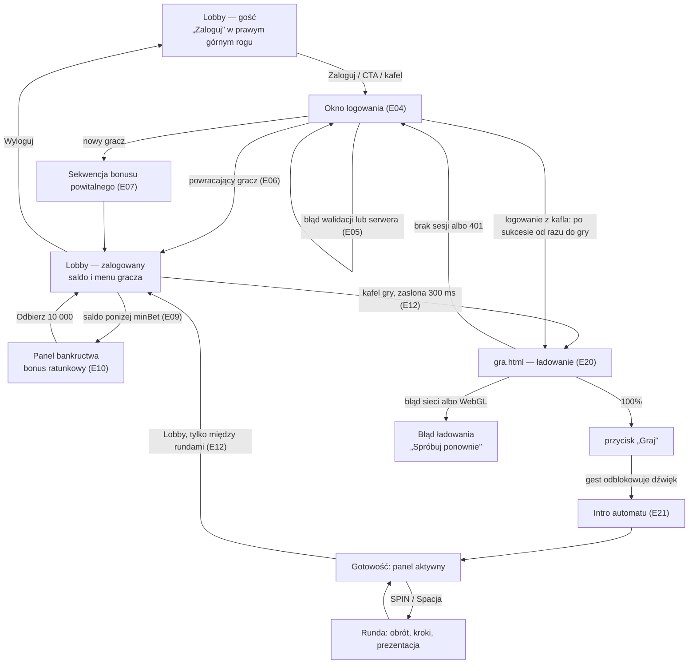
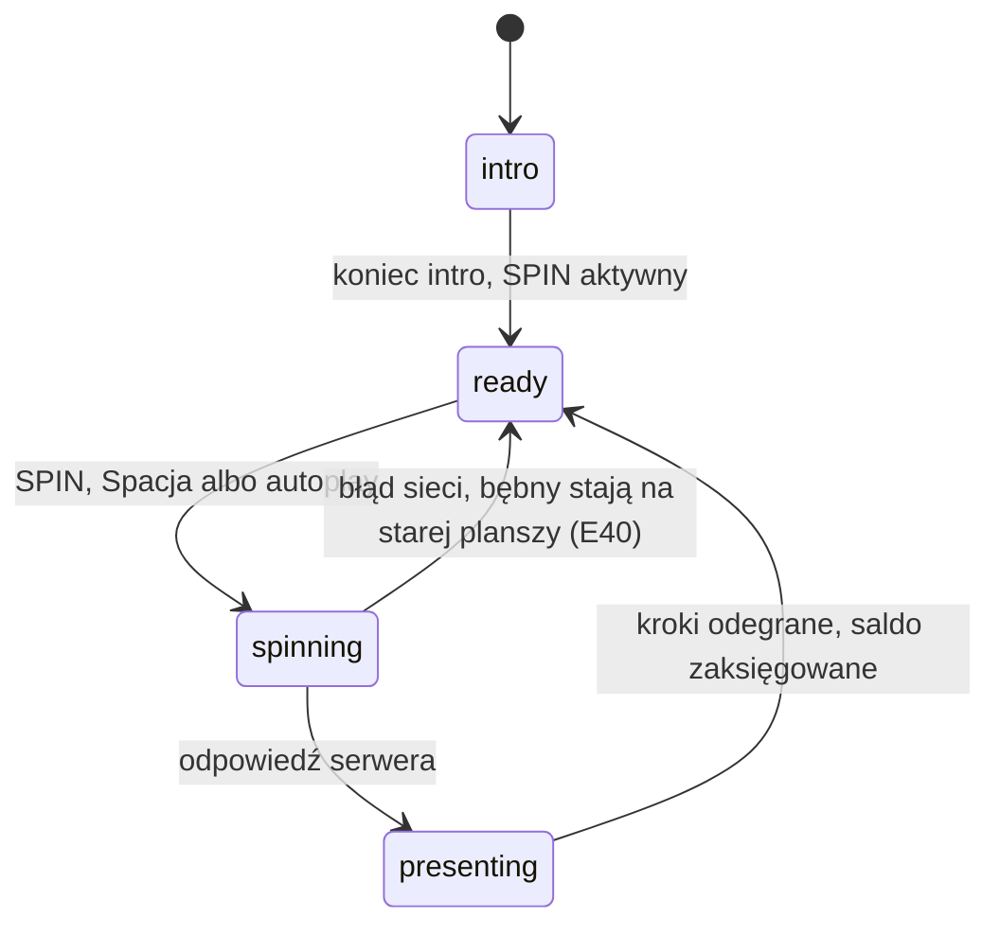
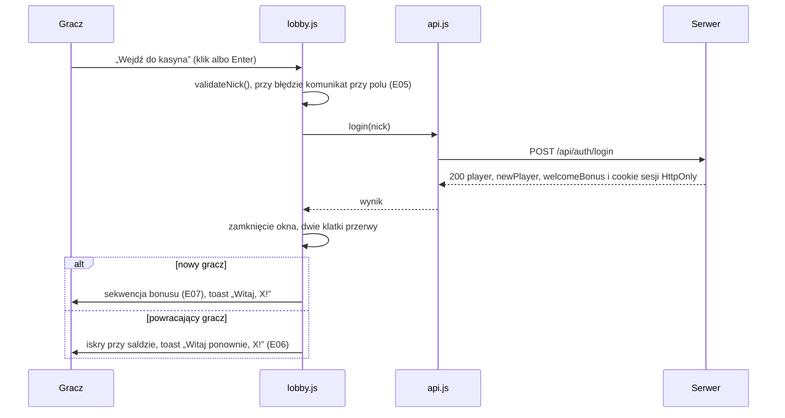
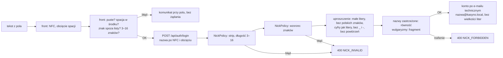

# 06 — Interfejs i UX (stan zrealizowany)

> Ten dokument opisuje **rzeczywisty interfejs** Cebulion Casino: ekrany i przejścia między nimi, komponenty i ich
> stany, układy na telefonie i komputerze, dostępność, wszystkie teksty dla gracza i walidację nazwy gracza — tak,
> jak są zaprogramowane dziś (stan z 2026-10-11, gra S1 na wspólnym runtime). Czytaj go razem z
> [04-efekty-wizualne.md](04-efekty-wizualne.md) (co dzieje się na ekranie przy zdarzeniach E01–E73),
> [05-dzwiek-i-muzyka.md](05-dzwiek-i-muzyka.md) (dźwięk) i [10-runtime-gier.md](10-runtime-gier.md) (silnik gier).
> Wydajność, poziomy jakości i pomiary są w [08-wydajnosc-i-jakosc.md](08-wydajnosc-i-jakosc.md).

**Jak czytać odnośniki.** `js/lobby.js:348` = `src/main/resources/static/js/lobby.js`, linia 348 (to samo dla
`css/…`, `index.html`, `gra.html`). `account/application/NickPolicy.java:49` =
`src/main/java/pl/wsb/kasyno/account/application/NickPolicy.java`. Numery linii według stanu gałęzi z 2026-10-11 —
po zmianach mogą przesunąć się o kilka wierszy, nazwy funkcji zostają.

**S2 i S3.** Strony gier „Złoty Faraon” i „Kryształowa Kaskada” działają dziś na grze zastępczej
(`js/game/games/zastepcza.js`) z tym samym panelem i oknami co S1. Ich własne sceny powstają równolegle — sekcje
o S2/S3 są krótkie; **uzupełnimy je po scaleniu S2/S3**.

## Spis treści

1. [Mapa ekranów i przepływ](#1-mapa-ekranów-i-przepływ)
2. [Lobby (`index.html`)](#2-lobby-indexhtml)
3. [Ekran gry (`gra.html`)](#3-ekran-gry-grahtml)
4. [Komponenty i ich stany](#4-komponenty-i-ich-stany)
5. [Responsywność](#5-responsywność)
6. [Dostępność](#6-dostępność)
7. [Mikrocopy: teksty i komunikaty](#7-mikrocopy-teksty-i-komunikaty)
8. [Walidacja nazwy gracza (front i backend)](#8-walidacja-nazwy-gracza-front-i-backend)
9. [Elementy → ID obrazów → zdarzenia E → dźwięki](#9-elementy--id-obrazów--zdarzenia-e--dźwięki)
10. [Pamięć przeglądarki (`localStorage`)](#10-pamięć-przeglądarki-localstorage)
11. [Znane ograniczenia i odstępstwa](#11-znane-ograniczenia-i-odstępstwa)

---

## 1. Mapa ekranów i przepływ

Aplikacja ma **dwie strony HTML** i kilka okien (modali) nad nimi. Lobby nie ładuje PixiJS — tylko HTML, CSS
i lekki silnik cząsteczek Canvas 2D; strona gry ładuje PixiJS dynamicznie (szczegóły: 08 § 3).



Stany rundy na stronie gry (`js/game/controller.js:4`):



### 1.1. Adresy i przekierowania

| Adres / sytuacja | Co się dzieje | Kod |
|---|---|---|
| `/` | lobby; sesję przywraca `GET /api/me`, ale tylko gdy w `localStorage` jest wskazówka `cebulion.sesja` (nowy gość nie dostaje czerwonego 401 w konsoli) | `js/session.js:38` |
| `/?gra=<kod>` | gracz chciał zagrać: zalogowany → od razu przejście do gry; gość → okno logowania z nazwą gry, po sukcesie gra | `js/lobby.js:196` |
| `gra.html?gra=<kod>` | strona gry; kod musi pasować do `^[a-z0-9-]{2,40}$`, inaczej powrót do lobby | `js/gra.js:24`, `:74` |
| gra bez wskazówki sesji | od razu `./?gra=<kod>` (lobby otworzy logowanie) | `js/gra.js:76` |
| gra, `GET /api/me` → 401 | wskazówka sesji kasowana, `./?gra=<kod>` | `js/gra.js:88` |
| gra, `GET /api/slots/{code}` → `GAME_NOT_FOUND` | powrót do lobby | `js/gra.js:100` |
| spin → 401 w trakcie gry | `./?gra=<kod>` (logowanie i powrót do tej samej gry) | `js/game/controller.js:204` |
| przycisk „Wstecz” z gry | lobby z pamięci przeglądarki (bfcache); `pageshow` zdejmuje zasłonę przejścia | `js/lobby.js:801` |

Przekierowania używają `location.replace`, więc „Wstecz” nie wraca na stronę, która i tak by przekierowała.

---

## 2. Lobby (`index.html`)

### 2.1. Struktura strony

Kolejność sekcji = kolejność w pliku: pasek górny `#topbar` → sekcja powitalna `#start` → automaty `#automaty` →
wygrane i ranking `#wygrane` / `#ranking` → wizytówka `#o-projekcie` → stopka. Okna (logowanie, historia) leżą
**poza** `#app`, bo na czas otwarcia `#app` dostaje atrybut `inert` (`index.html:315`, `js/ui/modal.js:31`).
Płótno cząsteczek `#fx` jest na całym ekranie i nie przechwytuje kliknięć.

```text
Komputer (≥ 901 px), gość
┌──────────────────────────────────────────────────────────────────────────────┐
│ (E) CEBULION CASINO   AUTOMATY  WYGRANE  RANKING  O PROJEKCIE   [Zaloguj]    │  ← pasek (sticky)
├──────────────────────────────────────────────────────────────────────────────┤
│  [chip: Symulator kasyna · waluta bez wartości]         ╭───────────────╮    │
│  CEBULION  (połysk E01)                                 │  medalion z   │    │
│  CASINO                                                 │  emblematem / │    │
│  Graj bez ryzyka. Wygrywaj z klasą.                     │  maskotką,    │    │
│  Trzy automaty, 10 000 cebulionów na start…             │  4 monety     │    │
│  [Odbierz 10 000 na start]  [Zobacz automaty]           ╰───────────────╯    │
│  10 000 cebulionów na start · 3 automaty · 95–96% docelowy RTP               │
├──────────────────────────────────────────────────────────────────────────────┤
│  Automaty: [ kafel S1 ] [ kafel S2 ] [ kafel S3 ]   (siatka 3 kolumn)        │
├──────────────────────────────────────────────────────────────────────────────┤
│  Ostatnie duże wygrane (≥ 15×)       │  Ranking [Największa wygrana | saldo] │
├──────────────────────────────────────────────────────────────────────────────┤
│  O projekcie: Autorzy · Dla kogo · Funkcje / Zmiany · Dane i moduły (H2)     │
├──────────────────────────────────────────────────────────────────────────────┤
│  stopka: hasło, „symulator — cebuliony nie mają wartości”, zespół            │
└──────────────────────────────────────────────────────────────────────────────┘
```

### 2.2. Pasek górny: gość i zalogowany

| Stan | Co widać po prawej | Kod |
|---|---|---|
| gość | złoty przycisk **„Zaloguj”** z ikoną użytkownika — zawsze w prawym górnym rogu (test `smoke.mjs` sprawdza położenie przy 320–1920 px) | `index.html:48` |
| zalogowany | pigułka salda (moneta + liczba) i przycisk menu: awatar + nazwa gracza (nazwa od 641 px) + strzałka | `index.html:52`, `js/lobby.js:273` |
| zalogowany bankrut | pigułka szarzeje i dostaje czerwoną kropkę; czytnik ekranu słyszy dodatkowo „— za mało na najmniejszy zakład” | `js/lobby.js:297`, `css/components.css:220` |
| po przewinięciu > 8 px | klasa `is-scrolled` (mocniejsze tło paska) | `js/lobby.js:208` |
| w trakcie sekwencji nagrody | klasa `is-reward` — pasek bez rozmycia tła (pod nim obracają się promienie) | `js/lobby.js:1054` |

**Menu gracza** (wzorzec WAI-ARIA „menu button”, `index.html:61`): nagłówek z awatarem, nazwą i saldem
(„Saldo: 10 000 cebulionów”), pozycje **Historia gry**, **Dźwięk** (przełącznik `menuitemcheckbox`,
`aria-checked`, ikona `dzwiek_wl` / `dzwiek_wyl`) i **Wyloguj**. Otwarcie przenosi fokus na pierwszą pozycję;
strzałki, Home/End, Esc (wraca na przycisk), Tab (zamyka menu) — `js/lobby.js:221`. Kliknięcie obok zamyka menu.
Wylogowanie: `POST /api/auth/logout` (nawet przy błędzie sieci lokalnie wylogowuje), cisza muzyki, fokus na
„Zaloguj”, toast „Do zobaczenia! · Wylogowano gracza X.” (`js/lobby.js:239`).

**Nawigacja po sekcjach** (Automaty, Wygrane, Ranking, O projekcie) pojawia się od 1100 px dla gościa i od 1320 px
po zalogowaniu (pasek mieści wtedy jeszcze saldo i menu) — `css/lobby.css:130`, `:163`.

### 2.3. Sekcja powitalna (hero)

Elementy wjeżdżają kaskadowo po załadowaniu (E01: klasa `body.is-ready`, opóźnienie 70 ms × indeks, 600 ms,
`css/lobby.css:519`); napis „CEBULION” dostaje jeden przelot połysku (2,6 s od 500 ms). Zabezpieczenie: gdyby
moduł JS nie ruszył, `index.html:23` dodaje `is-ready` po 2,5 s. Pył i bokeh (E02) rysuje `FxLite` na płótnie
`#hero-fx` (64 cząsteczki, DPR ≤ 1,5), tylko gdy sekcja jest widoczna i nie gra sekwencja nagrody
(`js/lobby.js:1040`).

| Stan | Przycisk główny | Przycisk drugi |
|---|---|---|
| gość | „Odbierz 10 000 na start” (ikona prezentu) → okno logowania | „Zobacz automaty” → kotwica `#automaty` |
| zalogowany | „Graj teraz” (ikona graj) → płynne przewinięcie do automatów | „Historia gry” → okno historii |
| zalogowany bankrut | oba przyciski schowane, w ich miejscu **panel bankructwa** (§ 2.6) | — |

Kod: `js/lobby.js:311` (`setHeroCta`), `css/lobby.css:447`. Pod przyciskami: trzy liczby („10 000 cebulionów na
start”, „3 automaty”, „95–96% docelowy RTP”).

### 2.4. Okno logowania (E04–E06)

Otwierają je: „Zaloguj”, główny przycisk sekcji powitalnej (gość), kliknięcie kafla bez sesji, adres `/?gra=<kod>`.

| Element | Zachowanie | Kod |
|---|---|---|
| nagłówek, opis | „Witaj w Cebulion Casino”; opis zależy od źródła — z kafla: „Zaloguj się, aby zagrać w **Złoty Faraon**. Pierwsze wejście to 10 000 cebulionów na start.” | `js/lobby.js:348` |
| pole „Nazwa gracza” | `maxlength="16"`, `autocomplete="nickname"`, bez autokorekty i wielkich liter, `enterkeyhint="go"`, podpowiedź pod polem, licznik `0/16` (liczy znaki Unicode) | `index.html:329` |
| walidacja na żywo | dopiero **po pierwszej próbie** wysłania (nie krzyczymy przy pierwszej literze) | `js/lobby.js:334` |
| błąd (E05) | tekst pod polem (`aria-live="assertive"`), czerwona ramka, `aria-invalid="true"`, potrząśnięcie 420 ms (bez ruchu przy `prefers-reduced-motion`), dźwięk `ui_blad`, fokus wraca do pola | `js/lobby.js:371`, `:410` |
| wysyłanie | przycisk „Wejdź do kasyna” z kręciołkiem (`is-loading`, `aria-busy`), okno **zablokowane** (Esc i tło nie zamykają) do odpowiedzi | `js/lobby.js:416` |
| sukces | okno zamyka się, `sfx_logowanie` i muzyka lobby; dwie klatki przerwy (zdjęcie `inert` z całej strony to przeliczenie stylów), potem bonus (E07) albo powitanie (E06) | `js/lobby.js:419–455` |
| powracający gracz (E06) | 18 iskier przy pigułce salda, puls salda, toast „Witaj ponownie, X! · Twoje saldo: …” | `js/lobby.js:447` |
| po sukcesie z kafla | przejście do gry po 700 ms (z bonusem) albo 900 ms (bez) | `js/lobby.js:455` |
| błąd serwera | ten sam obszar komunikatu co walidacja; teksty z § 7.3 | `js/lobby.js:456` |



Pod formularzem stała uwaga: „Bez hasła — to symulator z walutą bez wartości. Każdy, kto zna Twoją nazwę gracza,
może wejść na to konto.” (świadome uproszczenie z planu projektu; pytanie na obronę 44).

### 2.5. Sekwencja bonusu powitalnego (E07) i ratunkowego (E10)

Ten sam komponent `playReward` (`js/ui/reward.js:40`) gra przy pierwszym logowaniu i przy odebraniu bonusu
ratunkowego. Zasłona leży **pod** paskiem górnym (`--z-overlay: 45` < `--z-topbar: 50`), a płótno monet **nad**
nim (`--z-fx: 60`), żeby monety wleciały do widocznej pigułki salda (`css/tokens.css:95`).

| Czas | Co się dzieje |
|---|---|
| 0 ms | zasłona + obracające się promienie, jeden rozbłysk (`sfx_skrzynia_otwarcie`, `sfx_blysk`) |
| 100 ms | skrzynia (`g_skrzynia`; przy ratunku `g_maskotka_wygrana`, gdy jest) wskakuje ze sprężyną; kwota liczy się od „+0” przez 1,5 s |
| 650 ms | pierścień + 44 iskry, `sfx_uderzenie_basu`, fontanna 24 monet (`sfx_monety_fontanna`) |
| ok. 1,3 s | monety po łukach lecą do pigułki salda; każda doliczona podnosi licznik (`sfx_moneta_1…5` bez powtórzeń), co trzecia pulsuje pigułką |
| ok. 2,6 s | ostatnia moneta: saldo = wartość końcowa, „+10 000” pod pigułką, `sfx_licznik_koniec`, zasłona znika (420 ms) |
| 7 s | bezpiecznik: sekwencja kończy się sama, nawet gdyby monety „utknęły” |

* **Przewinięcie:** kliknięcie w dowolne miejsce, Esc, Enter, Spacja albo przycisk **„Pomiń”** — saldo zawsze
  kończy się poprawną wartością z serwera.
* **Fokus:** na „Pomiń” (Tab zablokowany — to jedyny element), `role="dialog"` + `aria-modal="true"`. Świadomie
  **bez** `inert` na całej stronie: przeliczenie stylów dokumentu kosztowało na słabym telefonie ~100 ms
  (zacięcie na starcie animacji) — `js/ui/reward.js:86`.
* **Po sekwencji:** toast „Witaj, X! · Na dobry początek: 10 000 cebulionów.” (ratunek: „Proszę bardzo! ·
  10 000 cebulionów na koszt firmy.”), fokus na menu gracza (ratunek: na „Graj teraz”) — `js/lobby.js:387`.
* **Ograniczony ruch:** bez zasłony i monet — saldo ustawia się od razu, puls i „+10 000”, zostaje toast.
* Na czas sekwencji pył w sekcji powitalnej stoi (zdarzenia `reward:start` / `reward:end`).

### 2.6. Bankructwo i bonus ratunkowy (E09, E10)

Bankrut = `balance < minBet` (`js/store.js:56`; `minBet` to najmniejszy zakład ze wszystkich gier, podaje go
serwer). Panel `#ratunek` stoi w kodzie **przed** przyciskami sekcji powitalnej i na czas bankructwa je zastępuje;
na telefonie (≤ 480 px) chowamy też akapit reklamowy i medalion — przycisk bonusu ma być widoczny bez przewijania
nawet na 320 × 640 (`css/lobby.css:444`).

| Stan | Treść | Kod |
|---|---|---|
| bonus dostępny (`canRescue`) | maskotka `g_maskotka_bankrut`, „Kieszenie puste? Bywa.”, „Pan Cebulion stawia: 10 000 cebulionów na koszt firmy.”, przycisk „Odbierz 10 000 cebulionów” z pulsującą poświatą (`is-ready`) | `js/lobby.js:489` |
| odliczanie | przycisk nieaktywny: „Dostępny za 09:41” (co sekundę), tekst „Bonus ratunkowy przysługuje raz na 10 minut. Pan Cebulion już szuka drobnych.”; po zejściu do zera — `GET /api/me` i odświeżenie stanu | `js/lobby.js:498` |
| odbieranie | kręciołek na przycisku, potem sekwencja nagrody (§ 2.5) | `js/lobby.js:518` |
| błąd `RESCUE_NOT_AVAILABLE` z `retryAfterSeconds` | odliczanie od wartości z serwera, toast „Jeszcze chwila” | `js/lobby.js:542` |
| błąd `NOT_LOGGED_IN` | utrata sesji, okno logowania | `js/lobby.js:539` |

### 2.7. Kafle gier (E03)

Kafle budujemy z `GET /api/slots` (gdy serwer nie odpowie — z katalogu zapasowego `FALLBACK_SLOTS`, a status
w stopce wizytówki zmienia się na „Brak połączenia z serwerem gry”) — `js/lobby.js:36`, `:156`. Do czasu
odpowiedzi widać trzy szkielety (`tile--skeleton`, `aria-busy="true"`).

```text
┌────────────────────────────┐
│ [Klasyk retro]  [RTP 95%]  │  ← odznaka gry + RTP
│                            │
│   okładka s1_okladka       │  ← albo grafika zastępcza z CSS (ART_HTML),
│   (wideo po najechaniu)    │     gdy brak ID w manifeście lub plik się nie wczyta
│                            │
│ Cebulowy 777               │  ← font gry (Bungee / Cinzel Decorative / Marcellus)
│ 3×3 · 5 linii · od 10      │  ← „zakład od 10”
│ [#--] Zmienność     [Graj] │  ← paski zmienności + ukryty tekst „: niska–średnia”
└────────────────────────────┘
```

* Kafel to link `gra.html?gra=<kod>` (Ctrl/Cmd/Shift + klik = nowa karta, zostawiamy przeglądarce). Zwykłe
  kliknięcie: `ui_klik`, bez sesji — okno logowania z nazwą gry, z sesją — przejście E12 (`js/lobby.js:657`).
* **Pochylenie 3D** za kursorem (do ±3,5° w pionie i ±4,5° w poziomie, aktualizacja raz na klatkę przez
  `requestAnimationFrame`) i poświata podążająca za kursorem —
  tylko mysz (`(hover: hover) and (pointer: fine)`) i bez `prefers-reduced-motion`; najechanie gra `ui_hover`.
* **Wideo z rozgrywki:** tylko gdy jest wpisane w `assets/video/manifest.json` (dziś lista jest pusta, więc żadnych
  żądań i 404), `muted` + `playsinline` + `preload="none"`, bez wideo przy `saveData`, sieci 2G i ograniczonym
  ruchu. Komputer: start po najechaniu albo fokusie. Ekran dotykowy: gra najwyżej **jeden** film — z kafla widocznego
  w ≥ 60% (IntersectionObserver). Ukryta karta pauzuje filmy (`js/lobby.js:706`, `:751`).
* **Karuzela na telefonie i tablecie** (< 901 px): przewijanie poziome ze „snapem”, kropki pod spodem (wskaźnik
  i skrót dla myszy; `aria-hidden`, bo klawiatura i czytnik ekranu i tak przechodzą po kaflach).

### 2.8. Wygrane i ranking

| Lista | Dane | Zachowanie | Stan pusty |
|---|---|---|---|
| „Ostatnie duże wygrane” (chip „od 15× zakładu”) | `GET /api/feed/big-wins?limit=8` | awatar, nazwa, „Złoty Faraon · 5 min temu”, kwota z monetą, odznaka poziomu („Big win ×20”) | „Jeszcze nikt nie rozbił banku” · „Duża wygrana to co najmniej 15× zakładu. Może to Ty będziesz pierwszy?” |
| „Ranking” — zakładki „Największa wygrana” / „Najwyższe saldo” (na ≤ 480 px: „Wygrana” / „Saldo”) | `GET /api/leaderboard?type=biggest-win\|balance&limit=10` | pozycja, awatar, nazwa, gra i czas (albo „saldo”), wartość; wiersz zalogowanego gracza z dopiskiem „· Ty” | „Ranking czeka na pierwszych graczy” · „Zagraj, a Twoje wygrane pojawią się tutaj.” |

* Odświeżanie co 45 s, **tylko gdy karta jest widoczna**, po cichu (błąd odświeżenia nie podmienia listy) —
  `js/lobby.js:171`.
* Błąd pierwszego wczytania: „Nie udało się wczytać danych” + tekst błędu + „Spróbuj ponownie” (`js/lobby.js:819`).
* Zakładki to wzorzec WAI-ARIA „tabs” (strzałki, Home/End, `aria-selected`, `tabindex` tylko na wybranej) —
  `js/lobby.js:880`.
* Nazwy graczy (dane z zewnątrz) zawsze przez `textContent`, nigdy `innerHTML` (ochrona przed XSS).

### 2.9. Historia gry (okno)

Z menu gracza albo przycisku „Historia gry”. `GET /api/me/history?page&size=20`; na start 4 szkielety, potem
wiersze: gra, data („11.10.2026, 14:05”), „zakład 100”, wynik („+2 000”, „brak wygranej” albo **„runda
anulowana”** dla statusu `FAILED`), odznaka tylko dla wygranych ≥ 5× (bez `none` i `small`). Kolejne strony —
„Pokaż starsze”. Pusta historia: „Nie masz jeszcze żadnych rund” · „Wybierz automat i zakręć — każda runda pojawi
się tutaj.” Lista ma `aria-live="polite"`. Kod: `js/lobby.js:957–1016`.

### 2.10. „O projekcie” — wizytówka kursu (R1.04)

Sekcja `#o-projekcie` (`index.html:206`) to **wizytówka projektu wymagana regułą LAB 01 R1.04** — na jej podstawie
zespół przedstawia projekt na początku LAB 02. Pilnuje jej test `Lab01ProjectRulesTest.startPageDescribesProject`
(`src/test/java/pl/wsb/rules/lab01/Lab01ProjectRulesTest.java:68`): w `index.html` nie może zostać żaden znacznik
`[uzupełnij`. Zawartość:

| Karta | Treść |
|---|---|
| nagłówek | „Wizytówka zespołu” / „O projekcie” + opis pomysłu (symulator bez ryzyka, waluta cebulion, wynik liczy serwer w Javie) |
| Autorzy | Konrad Paulus (112960), Dominik Pacanowski (112961), Dawid Majewski (113154) z inicjałami w gradientach |
| Dla kogo | persona „Kamil, student, gra na telefonie między zajęciami” + cytat i 3 potrzeby |
| Najważniejsze funkcje | 3 punkty (logowanie nazwą + 10 000, trzy automaty z wynikiem z serwera, portfel/historia/ranking) |
| Zmiany w projekcie | oś czasu „LAB 01” i „Przed LAB 02” (dopisujemy kolejne laboratoria) |
| Dane i moduły | tabela modułów `account`, `wallet`, `slots`, `report`; dane H2 (JDBC URL identyczny z `application.properties`, użytkownik `sa`, puste hasło), link „Otwórz konsolę H2”, przykładowe zapytanie |
| stopka sekcji | logo uczelni, „Wprowadzenie do technologii backendowych 2026”, wskaźnik `role="status"`: „Sprawdzam serwer…” → „Serwer gry działa” / „Brak połączenia z serwerem gry” |

### 2.11. Stopka

Emblemat i napis marki, hasło, zastrzeżenie z ikoną tarczy: „Cebulion Casino to symulator — cebuliony nie mają
wartości i nie można ich kupić ani wypłacić.”, nazwa przedmiotu, uczelni i zespołu (`index.html:301`).

---

## 3. Ekran gry (`gra.html`)

### 3.1. Układ

Strona zajmuje dokładnie wysokość okna (`100dvh`, bez przewijania — jak aplikacja), siatka trzech rzędów: pasek
górny, scena, panel (`css/gra.css:29`). Płótno PixiJS ma rozmiar elementu `#scena` (`js/game/core/app.js:53`).

| Strefa | Zawartość | Kod |
|---|---|---|
| pasek górny `.game-bar` | „← Lobby” (sam napis znika poniżej 641 px; `aria-label="Wróć do lobby"`), emblemat i nazwa gry w foncie gry, pigułka salda (poza telefonem pionowo), przyciski: dźwięk, ustawienia, zasady | `gra.html:30` |
| scena `#scena` | płótno Pixi, ekran ładowania, nakładka utraty kontekstu WebGL, chip darmowych spinów, podpowiedź „Dotknij, aby przewinąć” | `gra.html:58` |
| panel `#panel` | Saldo (tylko telefon pionowo), Zakład − / wartość / +, AUTO, SPIN/STOP, TURBO, Wygrana | `gra.html:85` |
| ukryte ogłoszenia `#ogloszenia` | `aria-live="polite"` — „Wygrana: 2 000 cebulionów” | `gra.html:154` |

Układy dla telefonu pionowo / poziomo i komputera: § 5.3.

### 3.2. Ładowanie (E20)

Pasek postępu nigdy się nie cofa (`js/gra.js:59`) i ma `role="progressbar"` z `aria-valuenow`; krok opisany jest
tekstem w regionie `role="status"`.

| Postęp | Tekst | Co się dzieje |
|---|---|---|
| 4% | „Łączenie z kasynem…” | manifest obrazów w tle, `GET /api/me` |
| 8% | „Wczytywanie automatu…” | `GET /api/slots/{code}` (zakłady, symbole, tabela wypłat, `paylines`) |
| 12% | „Przygotowanie automatu…” | tytuł karty `<nazwa> · Cebulion Casino`, tło strony z manifestu, dynamiczny import runtime |
| 20–68% | „Wczytywanie grafiki…” | PixiJS i obrazy gry (60% wagi paska) |
| 68–92% | „Przygotowanie efektów…” | fonty, atlasy cząsteczek, banery, symbole z kodu |
| 92–100% | „Rozgrzewanie efektów…” | wgranie tekstur na GPU, kompilacja shaderów, czekanie na bajty dźwięków (najwyżej 4 s) |
| 100% | „Gotowe!” | pokazuje się przycisk **„Graj”** z fokusem klawiatury |

**„Graj”** (`js/gra.js:126`) jest pokazywany zawsze: dźwięk w przeglądarce wymaga gestu na **tej** stronie (lobby
i gra to osobne strony, każda ma własny `AudioContext`). Kliknięcie: `audio.unlock()` w obsłudze gestu, `ui_klik`,
ekran ładowania gaśnie (500 ms), dekodowanie dźwięków krytycznych, pomiar jakości wstrzymany na 1,2 s, intro (E21).
Po intro panel wjeżdża (`controls.is-in`), SPIN dostaje fokus, a dalsze dźwięki dochodzą w tle.

**Błąd ładowania** (`js/gra.js:66`): pasek i hasło znikają, tekst błędu na czerwono, przyciski „Spróbuj ponownie”
(przeładowanie) i „Wróć do lobby”. Gdy Pixi nie wystartuje: „Przeglądarka nie uruchomiła grafiki automatu (WebGL).
Odśwież stronę albo spróbuj w innej przeglądarce.” Inne błędy — tekst z § 7.3.

### 3.3. Intro (E21) i gotowość

`game.intro()` zwraca obietnicę po 1000 ms (S1: automat wjeżdża, neony się zapalają; reszta osi gra dalej) —
wtedy `controller.ready()` odblokowuje SPIN (`js/game/controller.js:110`). W trybie ograniczonego ruchu intro to
przenikanie 500 ms. Do tego czasu panel jest ukryty (przezroczysty i nieklikalny, wjeżdża klasą `is-in` —
`css/game.css:68`), a Spacja nic nie robi (stan `intro`).

### 3.4. Panel sterowania

| Element | Stany i zachowanie | Kod |
|---|---|---|
| **Zakład** − / + | poziomy z `betLevels` gry; ostatni wybór zapamiętany per gra; nieaktywne w trakcie rundy i autoplay oraz na krańcach; wartość „przewija się” w górę/w dół (140 ms), na maksimum znacznik; **czerwona**, gdy zakład > saldo (podpowiedź „Za mało cebulionów na ten zakład”); dźwięk `ui_zaklad_gora` / `_dol` o +100 c wyżej na każdy poziom (E23) | `js/game/controller.js:279`, `:293` |
| **SPIN** | jeden przycisk, trzy role — tabela niżej | `js/game/controller.js:229`, `:308` |
| **AUTO** | otwiera menu (liczba spinów 10/25/50/100, „Zatrzymaj przy wygranej”: nie / ≥10× / ≥50× / ≥100×, uwaga „Autoplay zatrzyma się też, gdy zabraknie cebulionów na zakład.”, „Start”); w trakcie autoplay ten sam przycisk zatrzymuje; `aria-pressed` | `gra.html:111`, `js/game/controller.js:242` |
| **TURBO** | przełącznik `aria-pressed`, tempo × 0,45, zapamiętany; błysk przycisku przy włączeniu; `ui_przelacznik` +200 / −200 c (E39) | `js/game/controller.js:401` |
| **Wygrana** | pole liczone synchronicznie z animacją (zeruje się przy starcie spinu) | `js/game/controller.js:86` |
| **Saldo** | przy starcie spinu od razu **minus zakład** (300 ms); wartość z serwera (`balanceAfter`) księgowana dokładnie raz — na końcu liczenia wygranej (E28/E29), przy przylocie licznika Big Win do panelu (E32) albo po zatrzymaniu bębnów bez wygranej; puls przy dodatnim wyniku | `js/game/controller.js:131`, `:162` |

| Stan rundy | Wygląd SPIN | `aria-label` | Co robi klik / Spacja |
|---|---|---|---|
| `intro` | panel jeszcze ukryty (wjeżdża po intro) | „Zakręć (spacja)” | nic (stan `intro`) |
| `ready` | strzałki okrężne | „Zakręć (spacja)” | spin (jeśli saldo < zakład — okno „Za mało cebulionów”) |
| `ready` + autoplay | strzałki + licznik pozostałych spinów, wirujący pierścień | „Zatrzymaj autoplay” | zatrzymuje autoplay |
| `spinning` | kwadrat STOP (`is-stop`) | „Zatrzymaj bębny (spacja)” | szybki stop (wszystkie bębny hamują od razu) |
| `presenting` z Big Win | strzałki | „Przewiń (spacja)” | przewinięcie sekwencji (04 § 4.5) |
| `presenting` bez Big Win | strzałki | „Zakręć (spacja)” | przewinięcie prezentacji |

**Autoplay** (E38): start od razu, kolejny spin 260 ms × tempo po poprzednim (nie, gdy otwarte jest okno). Koniec:
limit spinów, wygrana ≥ próg × zakład (toast „Autoplay zatrzymany · Osiągnięto ustawioną wygraną.”), brak środków
(„Za mało cebulionów na kolejny spin.”), błąd spinu, gracz (SPIN, AUTO albo Esc). Dźwięki: `ui_przelacznik` +200 c
przy starcie, −200 c przy zatrzymaniu przez gracza, `ui_zamknij` przy zatrzymaniu warunkiem.

**W trakcie Big Win** panel przygasa do 35% (`is-dimmed`; SPIN zostaje jasny), a nad panelem pojawia się
„Dotknij, aby przewinąć” (`js/game/controller.js:88`, `css/game.css:70`). Dotknięcie sceny w trakcie obrotu albo
prezentacji = szybki stop / przewinięcie (`js/game/controller.js:433`).

**Darmowe spiny** (S2, S3): chip na scenie „DARMOWE SPINY: N”, przy ostatnim „OSTATNI DARMOWY SPIN”
(`js/game/controller.js:100`).

### 3.5. Zasady i tabela wypłat (okno `#modal-info`)

Budowane z `GET /api/slots/{code}` w chwili otwarcia (`js/gra.js:248`): opis „Cebulowy 777: 3×3, 5 linii,
RTP 95%.”, sekcja **Funkcje** (z pola `features`), **Tabela wypłat** od najwyższego symbolu (nazwy po polsku, np.
„Siódemka”, „Złota Cebula”, chip „WILD” / „SCATTER” / „MNOŻNIK”, wpisy „3× → ×100”) z uwagą o jednostce: w grach
liniowych „mnożnik stawki na linię (zakład ÷ 5); scatter — mnożnik całego zakładu”, w klastrowych „mnożnik całego
zakładu”; **Linie (5)** — mini-plansze z podświetlonymi polami. Stopka okna: „Symulator: cebuliony nie mają
wartości. Wynik każdego spinu liczy serwer.”

### 3.6. Ustawienia (okno `#modal-ustawienia`)

| Grupa | Opcje | Działanie | Kod |
|---|---|---|---|
| Jakość grafiki | Auto / Wysoka / Średnia / Niska | wybór ręczny wyłącza automat; opis pod spodem: „Teraz: średnia (automat dobiera poziom po pomiarze płynności, p90 klatki 14.2 ms).” albo „Wybrano ręcznie: wysoka.” | `js/game/controller.js:361`, `:371` |
| Ruch i błyski | Jak w systemie / Ogranicz / Pełny | „Ogranicz” wyłącza błyski ekranu, drżenie i migotanie neonów (pełna lista: 08 § 5.6) | `js/game/core/quality.js:175` |
| Wibracje (telefon) | przełącznik | wzorce z 04 § 1.6, tylko na ekranie dotykowym | `js/game/controller.js:379` |

Każda zmiana gra `ui_przelacznik` i zapisuje się w `localStorage` (§ 10). Głośności szyn nie mają suwaków w UI —
jest tylko wyciszenie (pasek gry i menu gracza w lobby).

### 3.7. „Za mało cebulionów” i bonus ratunkowy w grze

Okno `#modal-srodki` (`js/game/controller.js:323`) otwiera się, gdy saldo < zakład przy próbie spinu albo serwer
odpowie `409 INSUFFICIENT_FUNDS`. Treść: „Saldo 8 nie wystarcza na zakład 10.”; przyciski **„Odbierz 10 000
cebulionów”** (tylko gdy `GET /api/me` zwróci `canRescue`) i **„Zmniejsz zakład”** (tylko gdy jakiś niższy poziom
mieści się w saldzie — ustawia najwyższy taki); uwaga „Bonus ratunkowy będzie dostępny za N min.” przy trwającym
odliczaniu. Odebranie: saldo z pulsem i „+10 000”, `sfx_saldo_puls`, toast „+10 000 cebulionów · Bonus ratunkowy
odebrany. Powodzenia!”; błąd — toast „Bonus niedostępny”.

### 3.8. Błędy w trakcie gry

| Sytuacja | Reakcja | Kod |
|---|---|---|
| błąd sieci / serwera przy spinie (E40) | bębny łagodnie hamują na planszy **sprzed** spinu (front nie wymyśla wyniku), pętla bębnów zwalnia i gaśnie, `ui_blad`, wibracja `H_blad`, toast „Spin nie został rozegrany” + tekst z § 7.3; saldo odświeżane z `GET /api/me` (runda mogła się rozliczyć mimo zerwanego połączenia); autoplay staje | `js/game/controller.js:197` |
| `BET_INVALID` | zakład wraca na najniższy poziom, toast „Niedozwolony zakład” | `js/game/controller.js:213` |
| `INSUFFICIENT_FUNDS` | okno z § 3.7 | `js/game/controller.js:209` |
| `NOT_LOGGED_IN` | lobby z oknem logowania i powrotem do gry | `js/game/controller.js:204` |
| błąd odgrywania kroków (wyjątek JS) | wpis w konsoli, saldo i tak księgowane, gra wraca do gotowości | `js/game/controller.js:152` |
| nieoczekiwany błąd strony | toast „Błąd strony gry” + błąd na ekranie ładowania | `js/gra.js:310` |

**Utrata kontekstu WebGL** (sterownik, przełączenie karty graficznej): pauza pętli, nakładka `role="alert"`
„Odświeżamy grafikę automatu…”; po 3 s bez odzyskania przycisk „Załaduj ponownie” (`js/gra.js:202`).

### 3.9. Powrót do lobby (E12)

„← Lobby” działa tylko w stanie `ready` (w trakcie rundy jest przygaszony, `aria-disabled="true"`): `sfx_przejscie_whoosh`,
muzyka gaśnie w 220 ms, czarna zasłona (220 ms), zmiana strony (`js/game/controller.js:482`). Wejście na stronę
gry „wyłania się z czerni” (420 ms) — `css/gra.css:375`. Ctrl/Cmd + klik otwiera lobby w nowej karcie.

### 3.10. S2 i S3

Dziś `js/gra.js:154` wybiera `S1Game` dla `cebulowy-777`, a dla pozostałych kodów `PlaceholderGame` — prostą scenę
na tym samym runtime, z symbolami rysowanymi w kodzie (albo `s2_sym_*` / `s3_sym_*` z manifestu), działającym
panelem, oknami i domyślnymi handlerami darmowych spinów, rozszerzonego WILD, kaskad i mnożników. Ekrany i układy
własnych scen S2/S3 — **uzupełnimy po scaleniu S2/S3**.

---

## 4. Komponenty i ich stany

Style w `css/components.css` (wspólne), `css/lobby.css`, `css/gra.css` i `css/game.css`. Animacje UI dotykają
wyłącznie `transform` i `opacity` (pilnuje tego `smoke.mjs`), a efekty najechania są tylko w `@media (hover: hover)`
(na telefonie nie „przyklejają się” po dotknięciu).

| Komponent | Warianty | Stany | Kod |
|---|---|---|---|
| przycisk `.btn` | `--primary` (złota pigułka, przebłysk przy najechaniu), `--secondary` (ciemne szkło ze złotym brzegiem), `--ghost`; rozmiary `--sm`, `--lg`, `--block` | hover (tylko `hover: hover`), `:active`, `:focus-visible` (cyjanowy obrys 3 px), `:disabled`, `is-loading` (kręciołek w środku, treść ukryta, `aria-busy`, brak kliknięć) | `css/components.css:56–170`, `js/lobby.js:393` |
| przycisk ikony `.btn-icon` | pasek, zamknięcie okien, zakład | jak wyżej + `aria-label` zawsze | `css/components.css` |
| pole `.field` | etykieta, pole, licznik, podpowiedź, błąd | `is-invalid` (czerwona ramka, podpowiedź znika, `aria-invalid`), `shake` 420 ms | `css/components.css:414` |
| pigułka salda `.balance-pill` | pasek lobby, pasek gry, panel gry | odliczanie (0,5–1,8 s, `easeOutCubic`, cyfry tabelaryczne), `is-pulse` (420 ms), `is-bankrupt` (czerwona kropka + tekst dla czytnika), dymek „+10 000” | `js/ui/balance.js:42`, `css/components.css:218` |
| okno `.modal` | zwykłe 460 px, szerokie 760 px | `is-open` (wejście 420 ms sprężyną), `is-closing` (180 ms), `data-locked="true"` (Esc i tło nie zamykają), stos okien (niższe dostaje `inert`) | `js/ui/modal.js:50`, `css/components.css:427` |
| toast | `info`, `success`, `error` (`role="alert"`), `bonus` | do 3 naraz (najstarszy znika), 4,2 s z paskiem czasu, najechanie wstrzymuje, „×” zamyka | `js/ui/toast.js:31` |
| menu gracza | — | otwarte / zamknięte (`aria-expanded`), pozycja z fokusem | `index.html:68` |
| zakładki `.tab` | pełna / krótka etykieta (≤ 480 px) | `aria-selected`, `tabindex` | `js/lobby.js:896` |
| przełącznik `.switch` | menu (Dźwięk), ustawienia (Wibracje) | wł./wył., `:focus-visible` na torze | `css/components.css:634` |
| segment `.seg` | menu AUTO, ustawienia | wybrany (złote tło), fokus | `css/game.css:159` |
| kafel `.tile` | `tile--s1/s2/s3`, szkielet | hover/fokus (pochylenie, rama, poświata), `is-playing` (wideo), `is-visible` (wejście przy przewijaniu) | `js/lobby.js:588` |
| szkielet `.skeleton` | kafel, wiersz listy (56 px) | przelot refleksu 1,3 s | `css/components.css:710` |
| stan pusty / błędu | emblemat + tytuł + tekst (+ „Spróbuj ponownie”) | — | `js/lobby.js:807`, `:819` |
| pasek postępu `.progress` | ekran ładowania | `--value` 0…1, refleks w ruchu | `css/components.css:664` |
| SPIN `.spin` | złoty pierścień, szklany środek | `is-pressed` (obrót ikony 700 ms), `is-stop`, `is-auto` (licznik + wirujący pierścień); styl `:disabled` jest w CSS, ale w praktyce przed końcem intro cały panel jest ukryty | `css/gra.css:249`, `css/game.css:80` |
| przełącznik panelu `.ctrl-toggle` | AUTO, TURBO | `aria-pressed="true"` (cyjan z poświatą), `is-flash` | `css/gra.css:220` |
| panel `.controls` | — | ukryty do końca intro, `is-in`, `is-dimmed` | `css/game.css:68` |

**Formatowanie kwot** (`js/format.js`): grupy co 3 cyfry od 1000 ze **spacją niełamliwą** U+00A0 („10 000”) —
własna funkcja zamiast `Intl.NumberFormat('pl-PL')`, bo polskie reguły CLDR nie grupują liczb czterocyfrowych
(„1000”, ale „10 000”) i saldo „skakało” przy 9999 → 10 000; typograficzny minus „−”; zysk zawsze ze znakiem
„+”; odmiana „1 cebulion / 2–4 cebuliony (poza 12–14) / 5+ cebulionów”; mnożnik „×1,5” z przecinkiem; odliczanie
„09:41”; czas względny „przed chwilą / 5 min temu / 2 godz. temu / wczoraj / 3 dni temu / data”.

---

## 5. Responsywność

### 5.1. Breakpointy

Baza to telefon pionowo (≤ 480 px), większe ekrany dokładają reguły `@media (min-width: …)`.

| Szerokość | Co się zmienia | Kod |
|---|---|---|
| ≤ 360 / ≤ 400 px | najwęższe telefony: po zalogowaniu znika napis marki (zostaje emblemat), mniejsza pigułka salda | `css/lobby.css:108` |
| ≤ 480 px | telefon: krótkie etykiety zakładek, bez awatarów w feedzie i rankingu, bankrut chowa akapit i medalion | `css/lobby.css:279`, `:945` |
| ≥ 481 px | margines boczny 24 px, napis marki w jednym wierszu | `css/tokens.css:106`, `css/lobby.css:113` |
| ≥ 641 px | kafle 3:4 (~2,3 na ekranie), nazwa gracza w pasku; w grze pasek 64 px, napis „Lobby” | `css/lobby.css:564`, `:118`; `css/gra.css:101` |
| 481–739 px (zalogowany) | marka w dwóch wierszach, żeby saldo i długa nazwa się zmieściły | `css/lobby.css:123` |
| ≥ 901 px | margines 32 px, pasek 68 px, sekcja powitalna w dwóch kolumnach, kafle w siatce 3 kolumn (bez kropek), toasty w prawym dolnym rogu | `css/tokens.css:109`, `css/lobby.css:458`, `:574` |
| ≥ 1100 px | nawigacja po sekcjach (gość), feed i ranking obok siebie | `css/lobby.css:130`, `:846` |
| ≥ 1320 px | nawigacja także po zalogowaniu | `css/lobby.css:163` |
| ≥ 1441 px | margines 48 px, treść do 1360 px | `css/tokens.css:112` |
| ≥ 1921 / ≥ 2561 px | bazowy rozmiar fontu 112,5% / 131,25% (4K bez „mrówczych” napisów) | `css/base.css:23` |

Strona gry ma własne progi zależne też od **wysokości** (§ 5.3).

### 5.2. Lobby na telefonie, tablecie i komputerze

```text
Telefon pionowo (390 × 844)            Tablet (820 × 1180)                 Komputer: patrz § 2.1
┌─────────────────────────┐            ┌──────────────────────────────┐
│(E) CEBULION   [Zaloguj] │            │(E) CEBULION CASINO  [Zaloguj]│
├─────────────────────────┤            ├──────────────────────────────┤
│   medalion / maskotka   │            │      medalion / maskotka     │
│   CEBULION              │            │   CEBULION CASINO            │
│   CASINO                │            │   hasło, opis                │
│   hasło, opis           │            │ [Odbierz 10 000] [Automaty]  │
│ [ Odbierz 10 000 ]      │            │   10 000 · 3 · 95–96%        │
│ [ Zobacz automaty ]     │            ├──────────────────────────────┤
│  10 000 · 3 · 95–96%    │            │ [kafel S1][kafel S2][kaf…    │ ← karuzela 3:4
├─────────────────────────┤            │          * o o               │
│ [ kafel S1 ][ kaf…      │ ← karuzela ├──────────────────────────────┤
│        * o o            │   2:3      │ wygrane (2 kolumny)          │
├─────────────────────────┤            │ ranking                      │
│ wygrane (1 kolumna)     │            └──────────────────────────────┘
│ ranking                 │
└─────────────────────────┘
```

### 5.3. Strona gry: trzy układy (sam CSS, bez JS)

```text
Telefon pionowo (≤ 640 px, portrait)     Telefon poziomo (wysokość ≤ 500 px)
┌───────────────────────────┐            ┌─────────────────────────────────────────┐
│ < CEBULOWY 777   [d][u][i]│ 56 px      │ < Lobby (E) CEBULOWY 777 saldo [d][u][i]│ 46 px
├───────────────────────────┤            ├──────────────────────────────┬──────────┤
│                           │            │                              │ WYGRANA  │
│        logo S1            │            │   logo    ┌──────────┐       │    0     │
│     ┌───────────┐         │            │   S1      │ bębny 3×3│       │  [AUTO]  │
│     │ bębny 3×3 │         │            │  z boku   └──────────┘       │  (SPIN)  │
│     └───────────┘         │            │                              │ [TURBO]  │
│                           │            │                              │ −  10  + │
├───────────────────────────┤            └──────────────────────────────┴──────────┘
│ SALDO 10 000    WYGRANA 0 │                                              150 px
│  [AUTO]   (SPIN)  [TURBO] │
│     ZAKŁAD  −  10  +      │
└───────────────────────────┘

Tablet i komputer (≥ 901 px i wysokość > 500 px)
┌───────────────────────────────────────────────────────────────┐
│ < Lobby        (E) CEBULOWY 777             saldo [d] [u] [i] │ 64 px
├───────────────────────────────────────────────────────────────┤
│        logo S1      ┌──────────────┐                          │
│        (z boku)     │  bębny 3×3   │                          │
│                     └──────────────┘                          │
│     ╭─────────────────────(SPIN)──────────────────────╮       │  ← SPIN 104 px wystaje
│     │ ZAKŁAD − 10 +    [AUTO]     [TURBO]   WYGRANA 0 │       │    z panelu ku górze
│     ╰─────────────────────────────────────────────────╯       │    (≥ 1441 × 801: 118 px)
└───────────────────────────────────────────────────────────────┘

Legenda: (E) emblemat, [d] dźwięk, [u] ustawienia, [i] zasady i tabela wypłat, < powrót do lobby.
```

| Układ | Warunek CSS | Szczegóły | Kod |
|---|---|---|---|
| domyślny (np. 641–900 px pionowo) | — | panel w dwóch rzędach: „zakład · wygrana” / „AUTO · SPIN · TURBO”, saldo w pasku | `css/gra.css:171` |
| telefon pionowo | `(max-width: 640px) and (orientation: portrait)` | saldo przenosi się do panelu (jak w mobilnych slotach), rzędy „saldo · wygrana” / główny / „zakład” | `css/gra.css:293` |
| telefon poziomo | `(orientation: landscape) and (max-height: 500px)` | scena po lewej, panel pionowo po prawej (kciuk prawej ręki), 150 px; SPIN 74 px; menu AUTO otwiera się w lewo | `css/gra.css:301`, `css/game.css:204` |
| tablet / komputer | `(min-width: 901px) and (min-height: 501px)` | panel jako pływający pasek do 1080 px ze złotą ramką, SPIN 104 px wystaje w górę | `css/gra.css:326` |
| duży ekran | `(min-width: 1441px) and (min-height: 801px)` | SPIN 118 px | `css/gra.css:346` |
| wąskie telefony | `max-width: 420px` / `380px` | długa nazwa gry w dwóch wierszach; przy 380 px bez emblematu | `css/gra.css:85`, `:89` |

Rozmiar SPIN w układzie domyślnym: `clamp(78px, 22vw, 96px)`.

### 5.4. Skala sceny Pixi i układ S1

* **Orientacja sceny:** `portrait = h > w × 1,08` (wymiary elementu `#scena`, nie okna) — `js/game/core/app.js:164`.
* **Skala `k`** względem widoku referencyjnego 1920 × 1080 (w pionie 1080 × 1920): `k = min(w/1920, h/1080)`,
  dolne ograniczenie 0,2. Wartości „px” z kart efektów (04 § 1.7) mnożymy przez `k`.
* **Układ S1** (`js/game/games/s1.js:364`): liczymy dwa warianty — **logo z boku** (szerokość logo 2,3 pola) i
  **logo nad automatem** (2,7 pola, nachodzi 0,28 pola na grzebień ramki) — i wybieramy ten z większym polem
  symbolu; logo z boku tylko poza pionem i gdy daje ≥ 4% większe pole. Margines 3% krótszego boku (min. 8 px).
* **Tło** skalowane „cover” z zapasem 4% (drżenie kamery nie odsłania krawędzi).
* **Zmiana rozmiaru** (obrót telefonu, okno, panel zmieniający wysokość): `ResizeObserver` na `#scena` + kontrola
  rozmiaru co klatkę → przeliczenie układu; po rundzie gasimy prezentację linii (policzoną dla starej geometrii) —
  szczegóły 08 § 7.3.

### 5.5. Bezpieczne obszary (wycięcia, zaokrąglone rogi)

Obie strony mają `viewport-fit=cover`, więc treść rysuje się pod wycięciem — a marginesy daje `env(safe-area-inset-*)`:

| Miejsce | Reguła | Kod |
|---|---|---|
| pasek lobby | `padding-top: env(safe-area-inset-top)` | `css/lobby.css:27` |
| kontener treści i karuzela | `padding-inline: max(var(--gutter), env(safe-area-inset-left/right))` | `css/base.css:129`, `css/lobby.css:532` |
| okna modalne | `padding: max(16px, env(safe-area-inset-*))` ze wszystkich stron | `css/components.css:432` |
| toasty | `bottom: calc(env(safe-area-inset-bottom) + 16px)`; w grze `top: … + 64px` | `css/components.css:505`, `:518` |
| strona gry | siatka `.game` z paddingiem góra/prawo/lewo | `css/gra.css:34` |
| panel gry | dół `calc(12px + env(safe-area-inset-bottom))`, boki `max(14px, …)`; poziomo prawa krawędź | `css/gra.css:181`, `:311` |
| stopka, zasłona nagrody | dół / góra z `env()` | `css/lobby.css:1133`, `:1198` |

### 5.6. Wysokość ekranu: `dvh`

`100vh` na telefonach liczy wysokość **bez** paska adresu, więc dół strony chowałby się pod nim. Używamy `dvh`
(dynamiczna wysokość widoku) z `vh` jako zapasem dla starszych przeglądarek: `body { min-height: 100vh; min-height:
100dvh }` (`css/base.css:28`), strona gry `height: 100vh; height: 100dvh` (`css/gra.css:32`), okno modalne
`max-height: calc(100dvh - 32px)` (`css/components.css:451`), sekcja powitalna na komputerze
`min-height: clamp(460px, calc(78dvh - var(--topbar-h)), 760px)`.

### 5.7. Grafika zależna od orientacji i gęstości

* **Tła:** lobby `g_tlo_lobby_mobile` w pionie / `g_tlo_lobby_desktop` w poziomie, gra `s1_tlo_mobile` /
  `s1_tlo_desktop`; przełączane na żywo przez `matchMedia('(orientation: portrait)')` (`js/lobby.js:182`,
  `js/gra.js:168`). W tle CSS przez `image-set(… 1x, … 2x)`.
* **Okładki kafli:** `srcset` @1x/@2x i `sizes="(max-width: 900px) 78vw, 33vw"`, `loading="lazy"`,
  `decoding="async"` (`js/assets.js:109`).
* **Tekstury gry:** @2x przy DPR > 1,2 (poza poziomem Low), tła sceny według pola `widths` z manifestu (08 § 3.5).

---

## 6. Dostępność

### 6.1. Klawiatura

| Klawisz | Gdzie | Działanie | Kod |
|---|---|---|---|
| Tab / Shift+Tab | wszędzie | kolejność naturalna; w oknie modalnym pułapka fokusu (nie wychodzi za okno) | `js/ui/modal.js:63` |
| Enter | okno logowania | wysłanie formularza („Wejdź do kasyna”) | `index.html:325` |
| Esc | okna | zamknięcie (poza oknem logowania w trakcie żądania) | `js/ui/modal.js:56` |
| Esc / Enter / Spacja | sekwencja nagrody | przewinięcie do końca | `js/ui/reward.js:152` |
| ↑ ↓ Home End Esc Tab | menu gracza | ruch po pozycjach, powrót na przycisk, zamknięcie | `js/lobby.js:221` |
| ← → Home End | zakładki rankingu | zmiana zakładki | `js/lobby.js:884` |
| **Spacja** (i Enter) | strona gry | SPIN → STOP (szybki stop) → przewinięcie; działa też, gdy fokus jest na przycisku klikniętym **myszą** (np. TURBO) — wtedy spacja dalej znaczy SPIN, a nie „kliknij TURBO”; gdy fokus przyszedł **z klawiatury** (Tab) na inny przycisk, spacja klika ten przycisk | `js/game/controller.js:452`, `:476` |
| **+** / **=** / Num+ | strona gry | zakład w górę | `js/game/controller.js:463` |
| **−** / Num− | strona gry | zakład w dół | `js/game/controller.js:466` |
| Esc | strona gry | zamknięcie menu AUTO albo zatrzymanie autoplay | `js/game/controller.js:469` |

Skróty gry milczą, gdy otwarte jest okno, gdy klawisz jest przytrzymany (`ev.repeat`) i gdy fokus jest w polu
tekstowym. Przyciski deklarują skróty w `aria-keyshortcuts` („Space”, „Plus”, „Minus”).

**Dlaczego tak skomplikowanie ze Spacją:** w automatach Spacja = SPIN (konwencja), ale przycisk z fokusem
aktywuje się spacją przy **puszczeniu** klawisza. Kontroler pamięta, czy fokus przyszedł z myszy/dotyku
(`pointerdown`), i dla takiego przycisku blokuje aktywację na `keyup`. `:focus-visible` się tu nie nadaje —
Chrome włącza go już przy tym samym naciśnięciu klawisza (komentarz w `js/game/controller.js:456`).

### 6.2. Fokus

* Obrys tylko przy nawigacji klawiaturą (`:focus-visible`, 3 px, kolor `--focus`) — `css/base.css:70`.
* „Przejdź do treści” jako pierwszy element strony lobby, widoczny po fokusie (`index.html:28`).
* Okno: fokus wchodzi na wskazany element (logowanie: pole nazwy) albo pierwszy fokusowalny, po zamknięciu
  wraca na element, który okno otworzył (`js/ui/modal.js:93`, `:127`).
* Gdy element z fokusem znika (np. „Zaloguj” po zalogowaniu, przycisk ratunku po odebraniu), `ensureFocus`
  przenosi fokus na sensowny następny element zamiast `<body>` (`js/lobby.js:387`): po zalogowaniu → menu gracza,
  po ratunku → „Graj teraz”, po wylogowaniu → „Zaloguj”.
* Strona gry: po załadowaniu fokus na „Graj”, po intro na SPIN, w menu AUTO na zaznaczonej opcji.

### 6.3. Czytniki ekranu

| Element | Rozwiązanie |
|---|---|
| pigułka salda | ukryte „Saldo:” i jednostka w poprawnej odmianie („cebulionów”), stan „— za mało na najmniejszy zakład” słowami (kropka to tylko kolor — WCAG 1.4.1) |
| komunikat błędu logowania | `aria-live="assertive"` + `aria-describedby` pola + `aria-invalid` |
| toasty | region `aria-live="polite"`, błędy `role="alert"` |
| ekran ładowania gry | `role="status"` + `aria-live="polite"`, pasek `role="progressbar"` z `aria-valuenow` |
| wygrana w grze | `#ogloszenia` (`aria-live="polite"`): „Wygrana: 2 000 cebulionów” po każdej prezentacji |
| zakład | `<output aria-live="polite">` |
| płótno Pixi, płótna cząsteczek, dekoracje | `aria-hidden="true"` — cała informacja jest w HTML |
| przyciski ikon | `aria-label` („Wycisz dźwięk” / „Włącz dźwięk” zależnie od stanu, `aria-pressed`) |
| AUTO, TURBO | `aria-pressed`; AUTO też `aria-haspopup="dialog"` + `aria-expanded` |
| kafle | link z tytułem gry; zmienność słowami w ukrytym tekście; kropki karuzeli ukryte |
| okna | `role="dialog"`, `aria-modal`, `aria-labelledby` / `aria-describedby`; reszta strony `inert` |

### 6.4. Ruch i błyski

* **Lobby (CSS):** przy `prefers-reduced-motion: reduce` wszystkie animacje i przejścia trwają 1 ms, przewijanie
  bez wygładzania (`css/base.css:171`), bez połysku logo.
* **Lobby (JS):** bez wejść przy przewijaniu, bez pyłu w sekcji powitalnej, bez pochylenia kafli i wideo, bez
  sekwencji nagrody (saldo od razu), bez potrząsania polem, zasłona przejścia do gry pominięta.
* **Gra:** ustawienie „Ruch i błyski” (Jak w systemie / Ogranicz / Pełny) — `Motion` (`js/game/core/quality.js:175`)
  dodaje klasę `ruch-ograniczony` na `<html>` (CSS wyłącza wirujący pierścień autoplay i pulsowanie „Graj”), a
  runtime wyłącza błyski, drżenie, pioruny, flary, migotanie neonów i „ciemny takt” (lista: 08 § 5.6).
* **Błyski zawsze ≤ 3 na sekundę** (WCAG 2.3.1) — pilnuje strażnik błysków w kodzie, niezależnie od ustawień
  (08 § 6).

### 6.5. Kolor i czytelność

Zysk zawsze ze znakiem „+” (nie tylko kolorem), stan bankructwa także słowami, cyfry tabelaryczne
(`font-variant-numeric: tabular-nums`) — liczby nie „tańczą” przy odliczaniu, teksty UI w HTML (ostre i
dostępne), przyciski i panele bez tekstu na obrazach (brief § 6).

### 6.6. Haptyka (telefon)

`navigator.vibrate` tylko na ekranie dotykowym (`pointer: coarse`), po pierwszej interakcji z grą, przy widocznej
karcie, gdy przełącznik „Wibracje” jest włączony; najwyżej jeden wzorzec na 120 ms, bez kolejki. Wzorce (ms):
`H_tik` [8] (zakład, AUTO, TURBO), `H_lekki` [14] (SPIN, wygrana ≥ 1×, przylot licznika Big Win), `H_sredni` [24]
(medium), `H_blad` [25, 50, 25] (błąd spinu) oraz pozostałe z 04 § 1.6 — `js/game/controller.js:33`, `:379`.

---

## 7. Mikrocopy: teksty i komunikaty

Ton marki: krótko, życzliwie, z humorem Pana Cebuliona, zawsze z informacją, co zrobić dalej (01 § 2.8).

### 7.1. Teksty stałe

| Miejsce | Tekst |
|---|---|
| hasło (sekcja powitalna, stopka, ekran ładowania) | „Graj bez ryzyka. Wygrywaj z klasą.” |
| chip w sekcji powitalnej | „Symulator kasyna · waluta bez wartości” |
| przyciski sekcji powitalnej | gość: „Odbierz 10 000 na start”, „Zobacz automaty”; zalogowany: „Graj teraz”, „Historia gry” |
| okno logowania | „Witaj w Cebulion Casino” · „Nazwa gracza” · „np. Kamil_77” · „3–16 znaków: litery (także polskie), cyfry, „_” i „-”.” · „Wejdź do kasyna” |
| sekwencja nagrody | „Na dobry początek” / „cebulionów na start od Pana Cebuliona. Graj bez ryzyka!”; ratunek: „Na koszt firmy” / „cebulionów od Pana Cebuliona. Kieszenie znów pełne!”; „Pomiń” |
| panel bankructwa | „Kieszenie puste? Bywa.” · „Odbierz 10 000 cebulionów” · „Dostępny za 09:41” |
| kafle | odznaki „Klasyk retro”, „Darmowe spiny”, „Kaskady”; „RTP 95%”; „3×3 · 5 linii · zakład od 10”; „Zmienność”; „Graj” |
| poziomy wygranych (feed, historia) | „Wygrana”, „Dobra”, „Big win”, „Mega win”, „Epic win”, „Ultra win” + mnożnik „×20” |
| status serwera | „Sprawdzam serwer…”, „Serwer gry działa”, „Brak połączenia z serwerem gry” |
| ekran ładowania gry | „Łączenie z kasynem…”, „Wczytywanie automatu…”, „Przygotowanie automatu…”, „Wczytywanie grafiki…”, „Przygotowanie efektów…”, „Rozgrzewanie efektów…”, „Gotowe!”, „Graj” |
| panel gry | „Saldo”, „Zakład”, „Wygrana”, „Auto”, „Turbo”; menu AUTO: „Automatyczna gra”, „Liczba spinów”, „Zatrzymaj przy wygranej”, „nie”, „≥10×”…, „Start” |
| scena | „Dotknij, aby przewinąć”, „DARMOWE SPINY: 7”, „OSTATNI DARMOWY SPIN”, „Odświeżamy grafikę automatu…”, „Załaduj ponownie” |
| okno środków | „Za mało cebulionów” · „Saldo 8 nie wystarcza na zakład 10.” · „Odbierz 10 000 cebulionów” · „Zmniejsz zakład” · „Bonus ratunkowy będzie dostępny za 7 min.” |
| ustawienia | „Jakość grafiki”: Auto / Wysoka / Średnia / Niska; „Ruch i błyski”: Jak w systemie / Ogranicz / Pełny; „„Ogranicz” wyłącza błyski ekranu, drżenie i migotanie neonów.”; „Wibracje (telefon)” |
| stopka i okna gry | „Cebulion Casino to symulator — cebuliony nie mają wartości i nie można ich kupić ani wypłacić.”; „Symulator: cebuliony nie mają wartości. Wynik każdego spinu liczy serwer.” |

### 7.2. Walidacja nazwy w przeglądarce (`js/validation.js:20`)

| Warunek (w tej kolejności) | Komunikat |
|---|---|
| puste po obcięciu spacji | „Wpisz nazwę gracza.” |
| biały znak w środku | „Nazwa gracza nie może zawierać spacji. Użyj „_” albo „-”.” |
| niedozwolony znak (pierwszy znaleziony) | „Znak „#” jest niedozwolony. Użyj liter, cyfr, „_” lub „-”.” |
| mniej niż 3 znaki | „Nazwa gracza musi mieć co najmniej 3 znaki.” |
| więcej niż 16 znaków | „Nazwa gracza może mieć najwyżej 16 znaków.” |

### 7.3. Komunikaty błędów API (`js/api.js:110`)

Front rozpoznaje błąd po stałym polu `code` z odpowiedzi `application/problem+json`, nie po treści. Dla znanego
kodu gracz widzi **tekst frontu**; dla nieznanego — `detail` albo `title` z serwera; w ostateczności tekst
`INTERNAL_ERROR`. Brak pola `code` (np. błąd serwera pośredniczącego) → kod ze statusu: 401 → `NOT_LOGGED_IN`,
404 → `NOT_FOUND`, 503 → `SERVICE_UNAVAILABLE`, inne ≥ 500 → `INTERNAL_ERROR`, reszta → `HTTP_<status>`
(`js/api.js:29`).

| Kod | Status | Tekst dla gracza | Gdzie się pokazuje |
|---|---|---|---|
| `NICK_INVALID` | 400 | Nazwa gracza musi mieć 3–16 znaków: litery (także polskie), cyfry, „_” lub „-”. | pod polem nazwy |
| `NICK_FORBIDDEN` | 400 | Ta nazwa gracza jest niedozwolona. Wybierz inną. | pod polem nazwy |
| `VALIDATION_FAILED` | 400 | Sprawdź wpisane dane i spróbuj ponownie. | pod polem / toast |
| `NOT_LOGGED_IN` | 401 | Sesja wygasła. Zaloguj się ponownie. | zwykle zamiast tekstu: okno logowania / przekierowanie |
| `GAME_NOT_FOUND` | 404 | Nie znaleźliśmy takiej gry. | strona gry wraca do lobby |
| `BET_INVALID` | 400 | Taki zakład nie jest dostępny w tej grze. | toast „Niedozwolony zakład” |
| `INSUFFICIENT_FUNDS` | 409 | Za mało cebulionów na ten zakład. | okno „Za mało cebulionów” |
| `RESCUE_NOT_AVAILABLE` | 409 | Bonus ratunkowy jest jeszcze niedostępny. | toast „Jeszcze chwila” / „Bonus niedostępny” |
| `IDEMPOTENCY_CONFLICT` | 409 | To żądanie zostało już wysłane. Odśwież stronę. | toast |
| `INTERNAL_ERROR` | 500 | Coś poszło nie tak po stronie serwera. Spróbuj ponownie. | toast / ekran ładowania |
| `GAME_NOT_READY` | 503 | Ten automat jest jeszcze w przygotowaniu. Wybierz inny albo zajrzyj później. | ekran ładowania gry |
| `CONCURRENT_REQUEST` | 409 | Poprzednie żądanie jeszcze trwa. Spróbuj ponownie za chwilę. | toast |
| `SERVICE_UNAVAILABLE` | 503 | Serwer jest chwilowo niedostępny. Spróbuj ponownie za chwilę. | toast / ekran ładowania |
| `NOT_FOUND` | 404 | Nie znaleziono zasobu na serwerze. | toast |
| `METHOD_NOT_ALLOWED` | 405 | Serwer nie obsługuje tego żądania. | toast |
| `NETWORK_ERROR` | — (brak odpowiedzi) | Brak połączenia z serwerem gry. Sprawdź, czy aplikacja działa, i spróbuj ponownie. | toast „Brak połączenia” / „Spin nie został rozegrany” |
| `TIMEOUT` | — (12 s bez odpowiedzi) | Serwer nie odpowiada. Spróbuj ponownie za chwilę. | j.w. |

Pierwsze dziesięć kodów to tabela z kontraktu ([09 § 1](09-kontrakt-api-i-assetow.md)), kolejne dodał backend
(`shared/error/ErrorCode.java:30`), a `NETWORK_ERROR` i `TIMEOUT` tworzy sam front (`js/api.js:66`).
**Uwaga:** opisy `detail` z backendu (np. „Nazwa gracza musi mieć od 3 do 16 znaków.”) widać w Swaggerze, ale nie
w UI — dla znanych kodów front zawsze pokazuje własny, jednolity tekst.

### 7.4. Powiadomienia (toasty)

| Sytuacja | Typ | Tytuł · treść |
|---|---|---|
| nowy gracz | bonus | „Witaj, X!” · „Na dobry początek: 10 000 cebulionów.” |
| powracający gracz | success | „Witaj ponownie, X!” · „Twoje saldo: 12 345 cebulionów.” |
| wylogowanie | info | „Do zobaczenia!” · „Wylogowano gracza X.” |
| ratunek (lobby) | bonus | „Proszę bardzo!” · „10 000 cebulionów na koszt firmy.” |
| ratunek za wcześnie | info | „Jeszcze chwila” · tekst z § 7.3 |
| ratunek — inny błąd | error | „Nie udało się odebrać bonusu” · tekst z § 7.3 |
| brak sieci przy wejściu do lobby | error | „Brak połączenia” · tekst z § 7.3 |
| nieoczekiwany błąd lobby / gry | error | „Coś poszło nie tak” / „Błąd strony gry” · tekst z § 7.3 |
| błąd spinu | error | „Spin nie został rozegrany” albo „Niedozwolony zakład” · tekst z § 7.3 |
| autoplay zatrzymany warunkiem | info (2,6 s) | „Autoplay zatrzymany” · „Osiągnięto ustawioną wygraną.” / „Za mało cebulionów na kolejny spin.” |
| ratunek w grze | bonus / error | „+10 000 cebulionów” · „Bonus ratunkowy odebrany. Powodzenia!” / „Bonus niedostępny” |

Na stronie gry toasty są zawsze **u góry** pod paskiem (dół zajmuje panel), w lobby na telefonie na dole, na
komputerze w prawym dolnym rogu (prawy górny zajmuje menu gracza) — `css/components.css:503–518`.

---

## 8. Walidacja nazwy gracza (front i backend)

Walidacja w przeglądarce to **wygoda** (komunikat od razu, bez czekania na serwer). Prawdziwą walidację, łącznie z
listą zakazanych słów, robi zawsze backend — żądanie da się wysłać z pominięciem przeglądarki.



| Reguła | Front (`js/validation.js`) | Backend (`account/application/NickPolicy.java`) |
|---|---|---|
| normalizacja | `normalize('NFC')` — „a” + znak łączący (np. z klawiatury macOS) składamy w „ą” (`:22`); do serwera idzie już znormalizowana nazwa | brak NFC — dostaje to, co wysłał front |
| obcięcie | `trim()` (`:22`) | `strip()` (`:50`) |
| długość | 3–16 **znaków Unicode** (`[...nick].length`), sprawdzana **po** znakach (`:31`); pole ma też `maxlength="16"` | 3–16 (`kasyno.nick.min-length` / `max-length`, `application.properties:53`), sprawdzana **przed** znakami (`:51`); bezpiecznik `@Size(max = 200)` w `LoginRequest.java:15` → `VALIDATION_FAILED` |
| dozwolone znaki | `[A-Za-z0-9ĄĆĘŁŃÓŚŹŻąćęłńóśźż_-]` — sprawdzany każdy znak, komunikat wskazuje pierwszy zły (`:13`, `:26`) | ten sam zbiór: `[A-Za-z0-9_\-ĄĆĘŁŃÓŚŹŻąćęłńóśźż]+` (`:30`). Jawna lista zamiast „dowolna litera Unicode” — nie da się podszyć cyrylickim „а” pod łacińskie „a” |
| spacje w środku | osobny komunikat „nie może zawierać spacji” | odrzucone wzorcem (`NICK_INVALID`) |
| nazwy zastrzeżone | brak (świadomie — lista żyje tylko na serwerze) | 21 nazw z `kasyno.nick.reserved-names` (`application.properties:56`): admin, administrator, moderator, mod, root, system, support, pomoc, obsluga, krupier, kasyno, cebulion, cebulioncasino, pancebulion, bank, null, undefined, anonim, anonymous, gosc, guest — porównanie **całej** uproszczonej nazwy |
| wulgaryzmy | brak | 27 fragmentów z `kasyno.nick.forbidden-words` (`application.properties:59`) — wyszukiwane jako **fragment** uproszczonej nazwy |
| uproszczenie przed porównaniem | — | `simplify` (`:69`): małe litery (`Locale.ROOT`), `ł → l`, NFD bez znaków diakrytycznych, cyfry i symbole jak litery (`0→o`, `1→i`, `3→e`, `4→a`, `5→s`, `7→t`, `8→b`, `@→a`, `$→s`), bez `_`, `-` i białych znaków, bez powtórzeń liter. Listy z konfiguracji upraszczane tak samo |
| wielkość liter | bez znaczenia dla logowania | konto szukane po `<nazwa małymi literami>@kasyno.local` (`LoginService.java:73`) — „Kamil” = „kamil”; nazwa wyświetlana jest taka, jak przy pierwszym logowaniu |

Przykłady:

| Wpisane | Front | Backend |
|---|---|---|
| `Kamil_77` | OK | OK |
| `  Żaneta-3  ` | OK (`Żaneta-3`) | OK |
| `ab` | „…co najmniej 3 znaki.” | `NICK_INVALID` |
| `Kamil 77` | „…nie może zawierać spacji…” | `NICK_INVALID` |
| `Kamil#7` | „Znak „#” jest niedozwolony…” | `NICK_INVALID` |
| `Adm1n`, `A_d_m_i_n`, `Krupier` | OK | `NICK_FORBIDDEN` (po uproszczeniu `admin`, `krupier`) |
| `Kaassyno` | OK | `NICK_FORBIDDEN` (powtórzenia znikają → `kasyno`) |
| nazwa z wulgaryzmem w środku | OK | `NICK_FORBIDDEN` (fragment) |

Testy: `NickPolicyTest` (parametryzowane), `smoke.mjs` (walidacja w przeglądarce i błąd `NICK_FORBIDDEN` z serwera
pokazany przy polu).

---

## 9. Elementy → ID obrazów → zdarzenia E → dźwięki

Front prosi o obrazy **wyłącznie przez ID** z `static/assets/img/manifest.json` (`js/assets.js`, w grze
`js/game/core/resources.js`). Gdy ID nie ma albo plik się nie wczyta, zostaje grafika zastępcza (SVG, CSS albo
rysunek Canvas 2D) — bez błędów. Dźwięki wyłącznie przez ID z `static/assets/audio/manifest.json`.

### 9.1. Lobby

| Element | ID obrazu | Zastępstwo | Zdarzenie | Dźwięki |
|---|---|---|---|---|
| emblemat (pasek, stopka, okno logowania, ekran ładowania gry, stan pusty) | `g_emblemat` (`data-asset`) | `icons/emblemat.svg` | — | — |
| moneta (pigułka salda, kwoty w feedzie i rankingu, kwota nagrody, cząsteczki) | `g_moneta_przod` | `icons/moneta.svg` | E08 | `sfx_licznik_tik` (pętla w trakcie odliczania salda) |
| logo w sekcji powitalnej | `g_logo` (`data-asset-show` — pokazywane tylko, gdy jest) | napis HTML „CEBULION CASINO” z połyskiem | E01 | — |
| maskotka w medalionie | `g_maskotka_powitanie` | sam emblemat | E01, E02 | — |
| tło strony | `g_tlo_lobby_desktop` / `g_tlo_lobby_mobile` | gradienty CSS + ziarno | E02 | `mus_lobby` (po pierwszym geście, gdy zalogowany) |
| pył i bokeh | — (`FxLite`, Canvas 2D) | — | E02 | — |
| kafle gier | `s1_okladka`, `s2_okladka`, `s3_okladka` | grafika z CSS (`ART_HTML`) | E03 | `ui_hover`, `ui_klik` |
| wideo kafla | wpis w `assets/video/manifest.json` (dziś pusty) | okładka | E03 | — |
| awatary | `g_awatary__<komórka>` (arkusz) | inicjały w jednym z 8 gradientów (`avatarIndex`) | — | — |
| okno logowania | — | — | E04, E05, E06 | `ui_otworz`, `ui_zamknij`, `ui_blad`, `sfx_logowanie` |
| sekwencja nagrody | `g_skrzynia`; przy ratunku `g_maskotka_wygrana` (gdy jest) | emblemat | E07, E10 | `sfx_skrzynia_otwarcie`, `sfx_blysk`, `sfx_uderzenie_basu`, `sfx_monety_fontanna`, `sfx_moneta_1…5`, `sfx_licznik_koniec` |
| panel bankructwa | `g_maskotka_bankrut` | emblemat | E09 | — (`sfx_bankrut` jest w manifeście, ale lobby go nie gra) |
| menu, zakładki, przełączniki | ikony z `icons/ikony.svg` | — | E11 | `ui_otworz`, `ui_klik`, `ui_przelacznik` |
| przejście do gry | — | — | E12 | `sfx_przejscie_whoosh` |

### 9.2. Strona gry (S1 i wspólne)

| Element | ID obrazu | Zastępstwo | Zdarzenia | Dźwięki |
|---|---|---|---|---|
| tło strony za płótnem (CSS) | `s1_tlo_desktop` / `s1_tlo_mobile` | gradient motywu gry | E20 | — |
| tło sceny | `s1_tlo_desktop` / `_mobile` (szerokość wg `widths`) | synthwave z kodu (`s1-art.js`) | E21, E22 | `mus_s1` |
| ramka automatu | `s1_ramka` + okno z `frames.s1_ramka.window` | chromowo-neonowa ramka z żarówkami z kodu | E21, E22 | `sfx_s1_neon_bzyk` |
| logo gry | `s1_logo` (+ wariant `glow`) | neonowy napis z kodu | E21 | — |
| symbole | `s1_sym_<kod>` + warianty `ruch1`, `ruch2`, `syl`, `glow`, `cien` | symbole z kodu w stylu 01 § 9 | E25, E26, E28, E29, E33 | `sfx_spin_start`, `sfx_beben_petla_s1`, `sfx_beben_stop_1…3`, `sfx_wild` |
| linie wygranych | tekstury z kodu (rdzeń i poświata) | — | E28, E29 | `sfx_linia` (+100 c na kolejną linię) |
| kwota na scenie i licznik Big Win | glify `g_font_cyfry__<znak>` (`fonts.CebulionCyfry`) | złote cyfry z kodu | E28–E32 | `sfx_licznik_tik`, `sfx_licznik_koniec`, `sfx_saldo_puls`, `sfx_wygrana_small_1…3`, `sfx_wygrana_medium` |
| iskry | `g_fx_iskry__0…7` → atlas `fx` | kształty z kodu | E29–E33, E50 | — |
| monety | `g_moneta_przod/skos/bok` (wariant `male`) → atlas `normal` | moneta z kodu | E29–E32 | `sfx_moneta_1…5`, `sfx_monety_fontanna` |
| konfetti | `g_fx_konfetti__0…11` | z kodu | E31 (od MEGA) | — |
| dym | `g_fx_dym` | z kodu | E30, E31 | — |
| promienie | `g_fx_promienie` | z kodu | E29–E32 | — |
| flara | `g_fx_flara` | z kodu | E30, E31, E33 | `sfx_blysk` |
| pioruny | `g_fx_blyskawice__0…2` | z kodu | E31 (od EPIC), E50 | `sfx_uderzenie_basu` |
| banery | `g_win_big`, `g_win_mega`, `g_win_epic`, `g_win_ultra` (+ `glow`) | złote litery 3D z kodu | E30, E31 | `sfx_bigwin_wejscie`, `sfx_poziom_w_gore`, `sfx_bigwin_koniec`, `mus_bigwin` |
| baner darmowych spinów | `g_win_free_spins` | złoty napis z kodu | E35 | `sfx_free_spins_start`, `sfx_free_spins_koniec` |
| antycypacja | (winieta, reflektor z kodu) | — | E27 | `sfx_antycypacja_narastanie`, `sfx_bicie_serca`, `mus_napiecie` |
| E50 / E51 | — | — | E50, E51 | `sfx_s1_neon_bzyk`, `sfx_s1_jackpot` |
| panel HTML (SPIN, AUTO, TURBO, zakład) | ikony `icons/ikony.svg`, przyciski w CSS | — | E11, E23, E24, E38, E39 | `ui_klik`, `ui_zaklad_gora/dol`, `ui_przelacznik`, `ui_zamknij` |
| błąd sieci | — | — | E40 | `ui_blad` |

Obrazy UI kitu z ChatGPT (`g_ui_spin`, `g_ui_przycisk_glowny`, `g_ui_panel`, `g_ui_ikony`…) są w manifeście, ale
interfejs używa ich **wariantów HTML/CSS/SVG** (komentarze w `css/components.css:62`, `css/gra.css:248`) — są ostre
w każdej rozdzielczości, mają tekst w HTML i nic nie ważą. Pełna tabela zdarzeń i dźwięków: 05 § 6.1.

---

## 10. Pamięć przeglądarki (`localStorage`)

Każdy zapis i odczyt jest w `try/catch` — w trybie prywatnym `localStorage` bywa zablokowany, wtedy ustawienia
działają do końca wizyty.

| Klucz | Wartość | Po co | Kod |
|---|---|---|---|
| `cebulion.sesja` | `"1"` | **wskazówka** „logowałem się tu” — żeby nie pytać serwera przy każdym nowym gościu; o sesji decyduje zawsze cookie `HttpOnly` i `GET /api/me` | `js/session.js:13` |
| `cebulion.audio` | JSON `{muted, master, ui, sfx, music}` | wyciszenie i głośności szyn | `js/audio/audio-engine.js:33` |
| `cebulion.jakosc` | `auto` / `high` / `medium` / `low` | jakość grafiki | `js/game/core/quality.js:12` |
| `cebulion.ruch` | `auto` / `reduced` / `full` | ruch i błyski | `js/game/core/quality.js:13` |
| `cebulion.zaklad.<kod gry>` | liczba | ostatni zakład w danej grze | `js/game/controller.js:63` |
| `cebulion.turbo` | `"1"` / `"0"` | tryb TURBO | `js/game/controller.js:65` |
| `cebulion.haptyka` | `"1"` / `"0"` | wibracje | `js/game/controller.js:66` |

---

## 11. Znane ograniczenia i odstępstwa

| Temat | Stan | Plan / uwaga |
|---|---|---|
| przycisk „Graj” | pokazywany zawsze (05 § 2.3 przewidywał go tylko, gdy kontekst audio nie wystartuje sam) | prostsze i przewidywalne; gest i tak jest potrzebny na nowej stronie |
| suwaki głośności | brak w UI (silnik je obsługuje: `setVolume`) | jest tylko wyciszenie |
| podpowiedź o przełączniku wyciszenia iPhone'a | brak w oknie ustawień (05 § 2.3) | do dopisania |
| `sfx_bankrut` | w manifeście, nieużywany przy E09 | do decyzji: dźwięk przy pojawieniu się panelu bankructwa |
| opis jakości w ustawieniach | p90 z kropką dziesiętną („14.2 ms”) zamiast przecinka | drobna poprawka formatowania |
| `lqip` w manifeście | pipeline je zapisuje, front ich nie używa | rezerwa na szybsze pierwsze wyrenderowanie okładek |
| wideo w kaflach | mechanizm gotowy, lista filmów pusta | nagrania po scaleniu S2/S3 |
| S2, S3 | gra zastępcza na wspólnym runtime | uzupełnimy po scaleniu S2/S3 |

---

## Powiązane dokumenty

[00-brief.md](00-brief.md) (ID zdarzeń, obrazów i dźwięków) · [01-kierunek-artystyczny.md](01-kierunek-artystyczny.md)
(paleta, typografia, ton) · [02-lista-obrazow.md](02-lista-obrazow.md) (manifest obrazów) ·
[04-efekty-wizualne.md](04-efekty-wizualne.md) (karty zdarzeń E01–E73) · [05-dzwiek-i-muzyka.md](05-dzwiek-i-muzyka.md)
(dźwięk i odblokowanie gestem) · [08-wydajnosc-i-jakosc.md](08-wydajnosc-i-jakosc.md) (wydajność, jakość, pomiary) ·
[09-kontrakt-api-i-assetow.md](09-kontrakt-api-i-assetow.md) (endpointy i kody błędów) ·
[10-runtime-gier.md](10-runtime-gier.md) (runtime gier) · [../obrona/04-front-efekty-dzwiek.md](../obrona/04-front-efekty-dzwiek.md)
(front na obronę) · [README.md](README.md)
