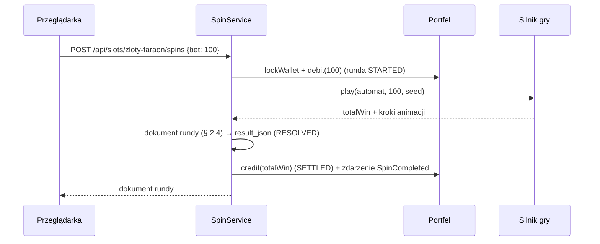

# 07. Gry i matematyka

Ten dokument opisuje **trzy automaty Cebulion Casino tak, jak są zaimplementowane**: zasady, siatki, linie, tabele
wypłat, taśmy bębnów i wagi, funkcje specjalne, limity wygranej, zmierzone RTP oraz format odpowiedzi spinu
z przykładami. Czytaj go razem z kontraktem API ([`09-kontrakt-api-i-assetow.md`](09-kontrakt-api-i-assetow.md), § 2.4).
Każda liczba poniżej pochodzi z `data.sql`, z `SlotEnginesConfig` albo z testów Java (z podaną liczbą rund i ziarnem).

---

## 1. Wspólne zasady

### 1.1. Jedna runda = jeden zakład, wynik liczy serwer

Gracz wysyła `POST /api/slots/{code}/spins` z zakładem. Serwer w **jednej transakcji** pobiera zakład, liczy całą
rundę (obrót, wygrane, kaskady, wszystkie darmowe spiny), wypłaca wygraną i zapisuje rundę. Przeglądarka dostaje
gotową listę kroków i tylko je animuje — niczego nie losuje i niczego nie liczy, więc nie da się „podmienić” wyniku
w konsoli przeglądarki. Darmowe spiny nie są osobnymi żądaniami: są kolejnymi krokami tej samej odpowiedzi.



### 1.2. Losowanie i odtwarzalność

| Etap | Jak | Klasa |
|---|---|---|
| Ziarno rundy | 64 bity z `java.security.SecureRandom` (kryptograficzny, nieprzewidywalny) | `SecureSeedGenerator` |
| Liczby w rundzie | `java.util.SplittableRandom(seed)` (SplitMix64), `nextInt(bound)` bez obciążenia | `SplittableRandomSource` |
| Dostęp silnika do losowości | wyłącznie przez interfejs `RandomSource` | `LinesEngine`, `ClusterEngine` |
| Zapis | `spin_round.seed` (liczba) i `seed` w odpowiedzi (16 cyfr szesnastkowych) | `SpinRound`, `SpinDocument` |

Silnik jest **deterministyczny**: ten sam seed, gra i zakład dają co do kroku ten sam przebieg. Rundę można więc
odtworzyć po fakcie (`engine.playRound(math, bet, RandomSource.fromSeed(seed))`), co sprawdza test
`SlotEnginesIntegrationTest` dla każdej rundy zagranej przez API. W testach konkretnych układów `RandomSource`
podaje „ustawione” liczby (np. pozycje zatrzymania bębnów), więc test wybiera dokładną planszę.

Seed w odpowiedzi jest tekstem (`"5f3a9c0e7b21d4a8"`), bo liczba 64-bitowa nie mieści się dokładnie w typie
`number` JavaScriptu (bezpiecznie tylko do 2⁵³).

### 1.3. Skąd silnik bierze dane

| Co | Gdzie | Uwagi |
|---|---|---|
| symbole, rodzaj, wagi, wypłaty | `slot_symbol` w `data.sql` | `pays` = `"liczba:mnożnik"`, np. `3:12,4:50,5:200` |
| taśmy bębnów (S1, S2) | `slot_machine.reel_strips`, `free_reel_strips` | bębny rozdzielone `\|`, symbole przecinkami (`ReelStrips`) |
| linie (S1, S2) | `slot_machine.paylines` | indeksy rzędów od 0 = górny (`Paylines`), zwracane w `GET /api/slots/{code}` |
| reguły funkcji, limity, kule mnożników | stałe w `SlotEnginesConfig` | `LinesRules`, `ClusterRules`, `FreeSpinsRules` |
| algorytm | `LinesEngine` (S1, S2), `ClusterEngine` (S3) | wspólna klasa bazowa `ConfiguredSlotEngine` |

Przy pierwszym spinie gry `GameMathProvider` czyta konfigurację z bazy, zamienia ją na tablice liczb
(`GameMath`) i trzyma w pamięci podręcznej (`ConcurrentHashMap`). Przy okazji sprawdza spójność danych: nieznany kod
symbolu na taśmie, zła liczba linii albo wypłata z ułamkiem groszy zatrzymują spin czytelnym błędem konfiguracji.

`slot_symbol.weight` znaczy w grach liniowych „ile razy symbol jest na taśmach gry podstawowej” (informacyjnie,
test pilnuje zgodności z taśmami), a w grze klastrowej — wagę losowania pola.

### 1.4. Jak liczymy kwoty

| Wygrana | Kwota |
|---|---|
| linia | mnożnik z tabeli × (zakład / liczba linii) × `wildMultiplier` × `freeSpinMultiplier` |
| scatter | mnożnik z tabeli × zakład całkowity |
| klaster | mnożnik z tabeli za rozmiar klastra × zakład całkowity |

Kwoty są liczbami całkowitymi, ułamki obcinamy w dół. Wypłaty dobraliśmy jednak tak, że przy **najmniejszym**
zakładzie każdej gry (a wszystkie poziomy są jego wielokrotnościami) zaokrąglenie nigdy nie jest potrzebne — RTP nie
zależy od wysokości zakładu (test `SlotMathDataTest.paysAreWholeAtMinimumBet`). W silniku wypłaty są w setnych
częściach mnożnika (`1.5 → 150`) i liczone na `long`, bez błędów typowych dla `double`.

Wypłaty liniowe: kombinacja liczona od **lewego** bębna, kolejne pola muszą mieć ten sam symbol albo WILD. WILD
zastępuje każdy zwykły symbol, ale nie scatter. Gdy linię da się odczytać na kilka sposobów (np. `WILD WILD 7`:
trzy siódemki albo dwa WILD), płaci **najwyższa** kombinacja; na jednej linii płaci jedna kombinacja.

### 1.5. Limit maksymalnej wygranej

| Gra | Limit rundy |
|---|---|
| Cebulowy 777 | 1 000 × zakład |
| Złoty Faraon | 5 000 × zakład |
| Kryształowa Kaskada | 10 000 × zakład |

Wszystkie miejsca, które dodają wygraną, przechodzą przez `RoundBuilder.addWin`. Gdy suma dobije do limitu, kwota
ponad limit jest ucinana (pole `win` kroku jest wtedy mniejsze od sumy `wins[].amount`), runda dostaje krok
`{"type":"feature","name":"maxWin","multiplier":5000}` i kończy się: bez dalszych kaskad i darmowych spinów
(w trakcie darmowych spinów po `maxWin` przychodzi jeszcze `freeSpinsEnd`). W S1 limit pokrywa się z teoretycznym
maksimum (pełny ekran siódemek z WILD: 5 linii × 50 × 2 / 5 × 10 = 1 000×), w S2 i S3 jest osiągalny tylko
w skrajnych przypadkach — w żadnej z ponad 26 mln rund testowych nie wystąpił.

### 1.6. Poziomy wygranej (`tier`)

`none` (0), `small` (< 5×), `medium` (≥ 5×), `big` (≥ 15×), `mega` (≥ 30×), `epic` (≥ 60×), `ultra` (≥ 100×) —
liczone z całej rundy (`WinTier`), także w powtórce. `multiplier` = `totalWin / bet` z dwoma miejscami po przecinku.

### 1.7. Antycypacja (zdarzenie E27)

Pole `anticipation` w kroku `spin` to lista bębnów, które front ma zwolnić, bo „prawie” jest bonus:

| Gra | Reguła |
|---|---|
| S1 | na jakiejś linii WILD stoi na bębnach 1 i 2 → zwalnia bęben 3 (`[2]`) |
| S2 | bębny zatrzymują się od lewej; gdy na dotychczasowych są już 2 scattery, zwalniają wszystkie kolejne (np. `[3,4]`) |
| S3 | jak S2, ale próg to 3 scattery w grze podstawowej i 2 w darmowych spinach (o jeden mniej niż wyzwalacz) |

---

## 2. S1 „Cebulowy 777” (`cebulowy-777`)

Klasyk retro: **3 bębny × 3 rzędy, 5 linii**, zakład 10–1000 (10, 20, 50, 100, 200, 500, 1000), RTP docelowy 95%,
zmienność niska-średnia. Brak scattera i darmowych spinów.

### 2.1. Linie

```
L1      L2      L3      L4      L5
· · ·   ■ ■ ■   · · ·   ■ · ·   · · ■
■ ■ ■   · · ·   · · ·   · ■ ·   · ■ ·
· · ·   · · ·   ■ ■ ■   · · ■   ■ · ·
```

`paylines = [[1,1,1],[0,0,0],[2,2,2],[0,1,2],[2,1,0]]` (dokładnie jak w kontrakcie § 2.2).

### 2.2. Tabela wypłat (za 3 symbole na linii)

| Symbol | Mnożnik stawki na linię | = × zakład całkowity | Przy zakładzie 10 | Z WILD na linii (×2) |
|---|---|---|---|---|
| `wisnie` | 1,5 | 0,3× | 3 | 6 |
| `cytryna` | 2,5 | 0,5× | 5 | 10 |
| `sliwka` | 4 | 0,8× | 8 | 16 |
| `arbuz` | 5 | 1× | 10 | 20 |
| `dzwonek` | 10 | 2× | 20 | 40 |
| `bar` | 14 | 2,8× | 28 | 56 |
| `siodemka` | 50 | 10× | 100 | 200 |
| `wild` (3× WILD) | 100 | 20× | 200 | — (bez ×2) |

### 2.3. Funkcje

* **WILD (Złota Cebula)** zastępuje każdy symbol i stoi na wszystkich trzech bębnach.
* **Neonowy mnożnik**: wygrana linii, na której WILD zastąpił symbol, × 2 (`wildMultiplier: 2`). Linia z samych WILD
  płaci jak WILD, bez ×2.
* **NEON JACKPOT**: wszystkie 9 pól to jeden symbol (WILD liczy się jako ten symbol, także cała plansza WILD) →
  wygrana linii × 10. Krok `win` pokazuje linie, a po nim krok `feature` `neonJackpot` dodaje 9 × wygrana linii.

### 2.4. Taśmy bębnów

Każdy bęben ma 32 pozycje o tym samym składzie (różna kolejność); ułożenie zawiera bloki trzech `wisnie` i trzech
`cytryna`, dzięki którym pełny ekran jest możliwy:

| Symbol | Na bęben | Udział |
|---|---|---|
| `wisnie` | 7 | 21,9% |
| `cytryna` | 6 | 18,8% |
| `sliwka`, `arbuz` | po 4 | po 12,5% |
| `dzwonek`, `bar` | po 3 | po 9,4% |
| `siodemka` | 2 | 6,3% |
| `wild` | 3 | 9,4% |

Dokładna kolejność: `data.sql`, kolumna `reel_strips`.

### 2.5. Zmierzona matematyka

| Miara | Wartość | Źródło |
|---|---|---|
| RTP dokładne | **94,892%** | wszystkie 32³ = 32 768 układów bębnów (`SlotMathMonteCarloTest.cebulowyExactRtp`) |
| RTP Monte Carlo | 94,853% (błąd std. 0,223 p.p.) | 2 000 000 rund, seed 20261011 |
| Częstość trafień | 33,25% | j.w. |
| NEON JACKPOT | dokładnie 1 na 8 192 rundy (4 układy na 32 768) | dokładne wyliczenie |
| Odchylenie std. wygranej (σ) | 3,15 × zakład | j.w. |
| Największa wygrana w próbie | 45,6× | 2 mln rund |

RTP 94,89% zamiast równych 95,00%: wypłaty zmieniają się skokowo, co 0,5 (żeby przy zakładzie 10 kwoty były
całkowite), i woleliśmy „okrągłe” wartości (np. `dzwonek` = 10 jak w przykładzie z kontraktu) od dopasowywania
ostatniej setnej procenta. Różnica 0,11 p.p. jest znacznie mniejsza od tolerancji ±0,8 p.p.

### 2.6. Przykład odpowiedzi (WILD na linii 1, ×2)

```json
{
  "roundId": 1024, "gameCode": "cebulowy-777", "bet": 50, "totalWin": 50, "multiplier": 1, "tier": "small",
  "balanceBefore": 10000, "balanceAfter": 10000, "seed": "e70cd6df5d49ce30",
  "steps": [
    { "type": "spin", "phase": "base", "anticipation": [],
      "grid": [["bar","cytryna","bar"], ["wisnie","wild","dzwonek"], ["cytryna","wild","sliwka"]] },
    { "type": "win", "win": 50, "totalWin": 50, "wins": [
      { "kind": "line", "line": 1, "symbol": "cytryna", "count": 3, "positions": [[0,1],[1,1],[2,1]],
        "amount": 50, "wildMultiplier": 2, "freeSpinMultiplier": 1 } ] }
  ]
}
```

NEON JACKPOT (zakład 10, cały ekran `cytryna`, seed `c70b1608a12fafb8`): po kroku `spin` przychodzi `win` z pięcioma
liniami po 5 (razem 25), a potem:

```json
{ "type": "feature", "name": "neonJackpot", "multiplier": 10, "win": 225, "totalWin": 250 }
```

---

## 3. S2 „Złoty Faraon” (`zloty-faraon`)

Wideo-slot: **5 bębnów × 3 rzędy, 20 linii**, zakład 20–2000 (20, 40, 100, 200, 400, 1000, 2000), RTP docelowy 96%,
zmienność średnia-wysoka.

### 3.1. Linie

```
L1          L2          L3          L4          L5
· · · · ·   ■ ■ ■ ■ ■   · · · · ·   ■ · · · ■   · · ■ · ·
■ ■ ■ ■ ■   · · · · ·   · · · · ·   · ■ · ■ ·   · ■ · ■ ·
· · · · ·   · · · · ·   ■ ■ ■ ■ ■   · · ■ · ·   ■ · · · ■

L6          L7          L8          L9          L10
■ ■ · · ·   · · · ■ ■   · ■ ■ ■ ·   · · · · ·   · ■ · · ·
· · ■ · ·   · · ■ · ·   ■ · · · ■   ■ · · · ■   ■ · ■ · ■
· · · ■ ■   ■ ■ · · ·   · · · · ·   · ■ ■ ■ ·   · · · ■ ·

L11         L12         L13         L14         L15
· · · ■ ·   ■ · ■ · ■   · · · · ·   ■ · · · ■   · · · · ·
■ · ■ · ■   · ■ · ■ ·   · ■ · ■ ·   · ■ ■ ■ ·   · ■ ■ ■ ·
· ■ · · ·   · · · · ·   ■ · ■ · ■   · · · · ·   ■ · · · ■

L16         L17         L18         L19         L20
· · ■ · ·   · · · · ·   ■ · ■ · ■   · ■ · ■ ·   · · ■ · ·
■ ■ · ■ ■   ■ ■ · ■ ■   · · · · ·   · · · · ·   · · · · ·
· · · · ·   · · ■ · ·   · ■ · ■ ·   ■ · ■ · ■   ■ ■ · ■ ■
```

### 3.2. Tabela wypłat

Linie: mnożnik stawki na linię (zakład / 20); przy najmniejszym zakładzie 20 stawka na linię to 1, więc kwota =
mnożnik. Scatter: mnożnik zakładu całkowitego za liczbę w dowolnym miejscu.

| Symbol | 3 | 4 | 5 |
|---|---|---|---|
| `10`, `j` | 12 | 50 | 200 |
| `q` | 12 | 50 | 250 |
| `k` | 20 | 80 | 300 |
| `a` | 25 | 100 | 400 |
| `ankh` | 30 | 125 | 500 |
| `oko` | 40 | 150 | 600 |
| `skarabeusz` | 50 | 200 | 750 |
| `anubis` | 75 | 300 | 1 000 |
| `faraon` | 100 | 500 | 2 500 |
| `scatter` (× zakład całkowity) | 1 | 10 | 100 |
| `wild` | zastępuje; bez własnej wypłaty | | |

### 3.3. Funkcje

* **WILD (Złota Relikwia Cebuli)** zastępuje symbole poza scatterem; leży tylko na bębnach 2–4, więc linia zawsze
  zaczyna się zwykłym symbolem z bębna 1 (dlatego WILD nie potrzebuje własnej wypłaty).
* **3+ scattery** w grze podstawowej → **10 darmowych spinów** (`freeSpinsStart`), scatter płaci też swoją wygraną.
* W darmowych spinach: osobne taśmy (po 2 WILD na bębnach 2–4), **WILD rozszerza się na cały bęben** przed oceną
  wygranych (krok `expandWild` z listą bębnów i siatką po rozszerzeniu), **wygrane liniowe ×2** (`freeSpinMultiplier: 2`).
  Wygrana scattera w darmowych spinach nie ma ×2 (kontrakt: scatter = mnożnik × zakład całkowity).
* **3 scattery w darmowym spinie: +10 spinów** (`freeSpinsRetrigger`), łącznie najwyżej **50** darmowych spinów w rundzie.

### 3.4. Taśmy bębnów

Gra podstawowa: 5 taśm po 35 pozycji. Darmowe spiny: 35 / 40 / 40 / 40 / 35. Na każdej taśmie scattery stoją
co najmniej 3 pozycje od siebie, więc w oknie bębna widać najwyżej jeden scatter (test `faraonStripLayout`).

| Symbol | Gra podstawowa: bębny 1 / 2 / 3 / 4 / 5 | Darmowe spiny: bębny 1 / 2 / 3 / 4 / 5 |
|---|---|---|
| `10` | 5 / 4 / 4 / 4 / 5 | 5 / 6 / 6 / 6 / 5 |
| `j` | 4 / 4 / 4 / 4 / 4 | 4 / 6 / 6 / 6 / 4 |
| `q`, `k` | po 4 na każdym | 4 / 5 / 5 / 5 / 4 |
| `a` | 4 na każdym | 4 na każdym |
| `ankh`, `oko` | po 3 na każdym | po 3 na każdym |
| `skarabeusz` | 3 na każdym | 3 / 2 / 2 / 2 / 3 |
| `anubis` | 2 na każdym | 2 na każdym |
| `faraon` | 2 na każdym | 2 / 1 / 1 / 1 / 2 |
| `wild` | 0 / 1 / 1 / 1 / 0 | 0 / 2 / 2 / 2 / 0 |
| `scatter` | 1 na każdym | 1 na każdym |

### 3.5. Zmierzona matematyka

| Miara | Wartość | Źródło |
|---|---|---|
| RTP Monte Carlo | **96,178%** (błąd std. 0,262 p.p.) | 10 000 000 rund, seed 20261011 (`faraonMonteCarlo`) |
| RTP dokładne (model) | 95,99% | wartość oczekiwana policzona w kalibracji wprost z taśm (patrz § 6.4) |
| — w tym linie gry podstawowej | 62,05 p.p. | model |
| — w tym scatter w grze podstawowej | 0,82 p.p. | model |
| — w tym darmowe spiny | 33,1 p.p. (test: 33,2 p.p.) | model / test |
| Częstość trafień | 26,76% | test |
| Darmowe spiny | 1 na 180,7 rundy (model: 1 na 181,3) | test / model |
| Średnio darmowych spinów w bonusie | 10,46 (dodatkowe +10 w 0,44% spinów) | test |
| Średnia wygrana bonusu | 60,0 × zakład | test |
| σ wygranej z rundy | 8,27 × zakład | test |
| Największa wygrana w próbie | 2 247,6× | 10 mln rund |

### 3.6. Przykład odpowiedzi (darmowe spiny z rozszerzającym się WILD, skrót)

Zakład 20, seed `154606077657d092`. Pominięte (`…`) są darmowe spiny 2–6, 9 i 10, które wyglądają tak samo jak 1.

```jsonc
{
  "roundId": 1265, "gameCode": "zloty-faraon", "bet": 20, "totalWin": 514, "multiplier": 25.7, "tier": "big",
  "balanceBefore": 10000, "balanceAfter": 10494, "seed": "154606077657d092",
  "steps": [
    { "type": "spin", "phase": "base", "anticipation": [3,4],
      "grid": [["oko","skarabeusz","scatter"],["anubis","k","skarabeusz"],["scatter","j","skarabeusz"],
               ["faraon","scatter","j"],["ankh","k","anubis"]] },
    { "type": "win", "win": 70, "totalWin": 70, "wins": [
      { "kind": "line", "line": 9, "symbol": "skarabeusz", "count": 3, "positions": [[0,1],[1,2],[2,2]],
        "amount": 50, "wildMultiplier": 1, "freeSpinMultiplier": 1 },
      { "kind": "scatter", "symbol": "scatter", "count": 3, "positions": [[0,2],[2,0],[3,1]], "amount": 20 } ] },
    { "type": "freeSpinsStart", "count": 10, "trigger": [[0,2],[2,0],[3,1]] },
    { "type": "spin", "phase": "free", "freeSpinIndex": 1, "freeSpinsLeft": 9, "anticipation": [],
      "grid": [["skarabeusz","k","oko"],["ankh","skarabeusz","10"],["j","k","q"],["skarabeusz","a","ankh"],["oko","10","q"]] },
    // … darmowe spiny 2–6 bez wygranych …
    { "type": "spin", "phase": "free", "freeSpinIndex": 7, "freeSpinsLeft": 3, "anticipation": [],
      "grid": [["skarabeusz","a","k"],["wild","skarabeusz","k"],["skarabeusz","j","faraon"],["ankh","q","ankh"],["a","10","ankh"]] },
    { "type": "expandWild", "reels": [1],
      "grid": [["skarabeusz","a","k"],["wild","wild","wild"],["skarabeusz","j","faraon"],["ankh","q","ankh"],["a","10","ankh"]] },
    { "type": "win", "win": 300, "totalWin": 370, "wins": [
      { "kind": "line", "line": 2, "symbol": "skarabeusz", "count": 3, "positions": [[0,0],[1,0],[2,0]],
        "amount": 100, "wildMultiplier": 1, "freeSpinMultiplier": 2 },
      { "kind": "line", "line": 12, "symbol": "skarabeusz", "count": 3, "positions": [[0,0],[1,1],[2,0]],
        "amount": 100, "wildMultiplier": 1, "freeSpinMultiplier": 2 },
      { "kind": "line", "line": 18, "symbol": "skarabeusz", "count": 3, "positions": [[0,0],[1,2],[2,0]],
        "amount": 100, "wildMultiplier": 1, "freeSpinMultiplier": 2 } ] },
    // … darmowy spin 8 (expandWild na bębnie 3, 5 linii po 24 = 120) i 9 (24) …
    { "type": "spin", "phase": "free", "freeSpinIndex": 10, "freeSpinsLeft": 0, "anticipation": [],
      "grid": [["q","ankh","j"],["ankh","faraon","10"],["j","k","q"],["k","10","oko"],["skarabeusz","k","j"]] },
    { "type": "freeSpinsEnd", "freeSpinsWin": 444 }
  ]
}
```

---

## 4. S3 „Kryształowa Kaskada” (`krysztalowa-kaskada`)

**6 bębnów × 5 rzędów, wygrane klastrowe, kaskady**, zakład 20–2000, RTP docelowy 96%, zmienność wysoka.

### 4.1. Zasady

1. **Zrzut planszy**: każde z 30 pól losowane niezależnie z wag symboli (kolumnami, od góry).
2. **Klaster**: co najmniej 5 takich samych zwykłych symboli połączonych bokami (góra/dół/lewo/prawo; po skosie się
   nie liczy). Płaci mnożnik z tabeli za swój rozmiar × zakład całkowity; rozmiar większy niż próg w tabeli płaci jak
   najbliższy niższy próg (np. klaster 11 płaci jak 10).
3. **Kaskada**: symbole z wygranych klastrów pękają, pozostałe opadają w dół (w swojej kolumnie, z zachowaniem
   kolejności), puste miejsca u góry wypełniają nowe losowe symbole; ocena powtarza się, dopóki powstają klastry.
   Całość od zrzutu do planszy bez klastrów to **sekwencja kaskad**.
4. **Scatter (Serce Jaskini)** nigdy nie pęka; liczymy go na końcu sekwencji (także te, które dospadły w kaskadach):
   4 / 5 / 6+ płaci 5 / 10 / 100 × zakład, a **4+ uruchamia 10 darmowych spinów**.
5. **Darmowe spiny**: na planszę mogą spadać **kule mnożników** (`mnoznik`, wartość ×2…×100 w polu `orbs`). Kule nie
   tworzą klastrów i nie pękają (opadają razem z resztą). Na końcu sekwencji kaskad, jeśli była wygrana, **suma
   wartości wszystkich kul na planszy mnoży wygraną tej sekwencji** (krok `applyMultiplier`; dodaje
   `baseWin × (orbsSum − 1)`). Kule nie przechodzą na następny darmowy spin.
6. **3 scattery w darmowym spinie: +5 spinów**, łącznie najwyżej 50.

### 4.2. Symbole, wagi i wypłaty (× zakład całkowity)

| Symbol | Waga | Szansa na pole (podstawowa / darmowe) | 5 | 6 | 7 | 8 | 9 | 10 | 12 | 15 | 20 | 25+ |
|---|---|---|---|---|---|---|---|---|---|---|---|---|
| `szafir` | 300 | 24,1% / 21,9% | 0,7 | 0,9 | 1,1 | 1,4 | 1,75 | 2,25 | 4,5 | 9 | 30 | 70 |
| `szmaragd` | 270 | 21,7% / 19,7% | 0,9 | 1,1 | 1,4 | 1,75 | 2,25 | 3 | 6 | 12 | 35 | 90 |
| `ametyst` | 240 | 19,3% / 17,5% | 1,1 | 1,4 | 1,75 | 2,25 | 3 | 3,5 | 7 | 14 | 45 | 120 |
| `topaz` | 200 | 16,1% / 14,6% | 1,4 | 1,75 | 2,25 | 3 | 3,5 | 4,5 | 9 | 18 | 60 | 150 |
| `rubin` | 90 | 7,2% / 6,6% | 2,25 | 3 | 3,5 | 4,5 | 6 | 7 | 14 | 30 | 90 | 250 |
| `diament` | 70 | 5,6% / 5,1% | 3 | 3,5 | 4,5 | 6 | 7 | 9 | 18 | 35 | 120 | 350 |
| `cebula` | 50 | 4,0% / 3,6% | 4,5 | 6 | 7 | 9 | 12 | 14 | 30 | 60 | 180 | 600 |
| `scatter` | 24 | 1,9% / 1,7% | 4: 5 · 5: 10 · 6+: 100 | | | | | | | | | |
| `mnoznik` | 128 | 0% / 9,3% | mnoży wygraną sekwencji | | | | | | | | | |

Suma wag: 1 244 w grze podstawowej, 1 372 w darmowych spinach (kula tylko tam). Przy zakładzie 20 każda wypłata
jest całkowita (np. 0,7 × 20 = 14).

### 4.3. Wartości kul mnożników (`SlotEnginesConfig.KRYSZTALOWA_KASKADA_RULES`)

| Wartość | ×2 | ×3 | ×4 | ×5 | ×8 | ×10 | ×15 | ×25 | ×50 | ×100 |
|---|---|---|---|---|---|---|---|---|---|---|
| Waga | 150 | 150 | 120 | 120 | 100 | 80 | 60 | 40 | 25 | 12 |
| Szansa | 17,5% | 17,5% | 14,0% | 14,0% | 11,7% | 9,3% | 7,0% | 4,7% | 2,9% | 1,4% |

Średnia wartość kuli ≈ 9,1. Rozkład jest malejący: małe kule są częste, ×100 to rzadkie wydarzenie.

### 4.4. Zmierzona matematyka

| Miara | Wartość | Źródło |
|---|---|---|
| RTP Monte Carlo | **96,282%** (błąd std. 0,251 p.p.) | 14 000 000 rund, seed 20261011 (`kaskadaMonteCarlo`) |
| RTP w długiej próbie | 95,97% (błąd std. 0,12 p.p.) | 60 000 000 rund przy kalibracji (ten sam silnik, inne ziarno) |
| — w tym darmowe spiny | 37,8 p.p. | test |
| Częstość trafień | 34,29% | test |
| Darmowe spiny | 1 na 286,4 rundy | test |
| Średnio darmowych spinów w bonusie | 10,97 | test |
| Średnia wygrana bonusu | 108,4 × zakład | test |
| σ wygranej z rundy | 9,38 × zakład | test |
| Największa wygrana | 1 401,8× (14 mln rund), 1 900,7× (60 mln rund) | test / kalibracja |

### 4.5. Przykład odpowiedzi (klaster → kaskada → klaster → kaskada)

Zakład 20, seed `69c3a27688795369`, pełna odpowiedź:

```json
{
  "roundId": 1009, "gameCode": "krysztalowa-kaskada", "bet": 20, "totalWin": 44, "multiplier": 2.2, "tier": "small",
  "balanceBefore": 10000, "balanceAfter": 10024, "seed": "69c3a27688795369",
  "steps": [
    { "type": "spin", "phase": "base", "anticipation": [], "orbs": [],
      "grid": [["szafir","szafir","szafir","ametyst","cebula"],["ametyst","szmaragd","szafir","szmaragd","topaz"],
               ["topaz","scatter","topaz","szmaragd","ametyst"],["szmaragd","topaz","szafir","szmaragd","ametyst"],
               ["ametyst","szmaragd","szmaragd","szmaragd","ametyst"],["szafir","ametyst","szafir","cebula","ametyst"]] },
    { "type": "win", "win": 22, "totalWin": 22, "wins": [
      { "kind": "cluster", "symbol": "szmaragd", "size": 6,
        "positions": [[1,3],[2,3],[3,3],[4,1],[4,2],[4,3]], "amount": 22 } ] },
    { "type": "cascade", "removed": [[1,3],[2,3],[3,3],[4,1],[4,2],[4,3]],
      "newSymbols": [[],["ametyst"],["topaz"],["ametyst"],["szafir","szmaragd","topaz"],[]],
      "grid": [["szafir","szafir","szafir","ametyst","cebula"],["ametyst","ametyst","szmaragd","szafir","topaz"],
               ["topaz","topaz","scatter","topaz","ametyst"],["ametyst","szmaragd","topaz","szafir","ametyst"],
               ["szafir","szmaragd","topaz","ametyst","ametyst"],["szafir","ametyst","szafir","cebula","ametyst"]],
      "orbs": [] },
    { "type": "win", "win": 22, "totalWin": 44, "wins": [
      { "kind": "cluster", "symbol": "ametyst", "size": 5,
        "positions": [[2,4],[3,4],[4,3],[4,4],[5,4]], "amount": 22 } ] },
    { "type": "cascade", "removed": [[2,4],[3,4],[4,3],[4,4],[5,4]],
      "newSymbols": [[],[],["szmaragd"],["szmaragd"],["szmaragd","topaz"],["topaz"]],
      "grid": [["szafir","szafir","szafir","ametyst","cebula"],["ametyst","ametyst","szmaragd","szafir","topaz"],
               ["szmaragd","topaz","topaz","scatter","topaz"],["szmaragd","ametyst","szmaragd","topaz","szafir"],
               ["szmaragd","topaz","szafir","szmaragd","topaz"],["topaz","szafir","ametyst","szafir","cebula"]],
      "orbs": [] }
  ]
}
```

Darmowy spin z kulami (fragment rundy o seedzie `5cc3c11d526cda05`, zakład 20): cztery kule 2 + 5 + 15 + 2 = 24,
klaster `ametyst` za 22, po kaskadzie brak dalszych klastrów, więc sekwencja jest warta 22 × 24 = 528:

```jsonc
{ "type": "spin", "phase": "free", "freeSpinIndex": 2, "freeSpinsLeft": 8, "anticipation": [],
  "grid": [["szafir","diament","ametyst","szmaragd","mnoznik"], "…"],
  "orbs": [{ "pos": [0,4], "value": 2 }, { "pos": [3,0], "value": 5 }, { "pos": [5,3], "value": 15 }, { "pos": [5,4], "value": 2 }] },
{ "type": "win", "win": 22, "totalWin": 122, "wins": [
  { "kind": "cluster", "symbol": "ametyst", "size": 5, "positions": [[3,1],[4,1],[5,0],[5,1],[5,2]], "amount": 22 } ] },
{ "type": "cascade", "removed": [[3,1],[4,1],[5,0],[5,1],[5,2]],
  "newSymbols": [[],[],[],["szmaragd"],["szafir"],["szmaragd","szafir","szafir"]], "grid": ["…"], "orbs": [] },
{ "type": "applyMultiplier", "orbsSum": 24, "baseWin": 22, "win": 506, "totalWin": 628 }
```

Kula z pozycji `[3,0]` po kaskadzie opadła na `[3,1]` (pękł symbol pod nią). Pole `orbs` w kroku `cascade` zawiera
tylko **nowe** kule; istniejące front przesuwa razem z symbolami według tej samej reguły opadania.

---

## 5. Format odpowiedzi spinu (podsumowanie § 2.4)

Odpowiedź to dokładnie `{ roundId, gameCode, bet, totalWin, multiplier, tier, balanceBefore, balanceAfter, seed, steps }`
(kontrakt § 2.4). Kolejność kroków w każdej grze:

| Gra | Kolejność kroków |
|---|---|
| S1 | `spin` → `win`? → `feature neonJackpot`? |
| S2 | `spin` → `win`? → [`freeSpinsStart` → (`spin` free → `expandWild`? → `win`? → `freeSpinsRetrigger`?)×n → `freeSpinsEnd`] |
| S3 | `spin` → (`win` → `cascade`)* → `win` (scatter)? → [`freeSpinsStart` → (`spin` free → (`win` → `cascade`)* → `applyMultiplier`? → `win` (scatter)? → `freeSpinsRetrigger`?)×n → `freeSpinsEnd`] |

`?` = krok tylko wtedy, gdy zaszło zdarzenie; po kroku `feature maxWin` runda się kończy (z `freeSpinsEnd`, jeśli
trwały darmowe spiny). Uzupełnienia kontraktu przyjęte w implementacji:

| Temat | Ustalenie |
|---|---|
| `feature neonJackpot` | ma `win` = 9 × wygrana linii i `totalWin` (każdy krok dodający wygraną ma te pola) |
| `feature maxWin` | nowa nazwa kroku `feature`: osiągnięty limit rundy, `multiplier` = limit, bez `win` |
| `applyMultiplier.win` | dodana część: `baseWin × (orbsSum − 1)`; front pokazuje `baseWin × orbsSum` |
| `spin.orbs` / `cascade.orbs` | w `spin` wszystkie kule na planszy, w `cascade` tylko nowe (pozycje po opadzie) |
| `spin.orbs` w S1/S2 | pole pomijane (tylko S3; w grze podstawowej S3 zawsze `[]`) |
| `paylines` w `GET /api/slots/{code}` | tylko gry liniowe; w S3 pole pominięte |
| powtórka (ten sam `Idempotency-Key`) | treść identyczna co do bajtu (z zapisu `spin_round.result_json`), nagłówek `Idempotent-Replayed: true` |
| wypłaty `pays` | linie: dokładna liczba symboli, mnożnik stawki na linię; klastry i scatter: „co najmniej”, mnożnik zakładu całkowitego |

Uwaga dla front-endu: WILD w S2 i kula `mnoznik` w S3 mają puste `pays` (`{}`); ekran informacyjny nie powinien
pisać przy WILD „mnoży wygraną”.

---

## 6. Jak testujemy

### 6.1. Testy

| Klasa | Co sprawdza |
|---|---|
| `LinesEngineTest` | WILD zastępuje symbol i daje ×2 (S1), linia samych WILD, wybór najwyższej kombinacji, liczenie od lewej, scatter × zakład, WILD nie zastępuje scattera, NEON JACKPOT, 3 scattery → 10 FS z `expandWild` i ×2, retrigger do limitu 50, limit wygranej (`maxWin`), antycypacja S1 i S2, dokładny JSON kroków, odtwarzalność z seeda |
| `ClusterEngineTest` | klaster 5 płaci, 4 nie; brak połączeń po skosie; scatter i kula nie tworzą klastra; próg „co najmniej”; kaskada (pęknięcie, opad, nowe symbole od góry); 4 scattery → FS; kule mnożników i `applyMultiplier`; retrigger +5; limit wygranej; odtwarzalność |
| `GameMathTest` | wypłaty w setnych, wykrywanie błędnej konfiguracji (nieznany symbol, ułamek groszy), kula tylko w FS |
| `SlotMathDataTest` | dane z `data.sql`: kody symboli jak w briefie, linie S1 jak w kontrakcie, wagi = taśmy, wypłaty całkowite przy minimalnym zakładzie, WILD S2 tylko na bębnach 2–4, scattery ≥ 3 pozycje od siebie |
| `SlotMathMonteCarloTest` | RTP, trafienia, częstość FS na prawdziwych danych (tabela niżej) |
| `SlotEnginesIntegrationTest` | po 25 spinów każdej gry przez HTTP: kształt § 2.4, `balanceAfter = balanceBefore − bet + totalWin`, suma kroków = `totalWin`, `result_json` = odpowiedź, status `SETTLED`, statystyki gracza, **odtworzenie każdej rundy z seeda**, idempotencja, `GET /api/slots/{code}` |
| `SpinServiceTest`, `SlotControllerTest`, `KasynoFlowIntegrationTest` | przepływ spinu z fałszywym silnikiem (dokument rundy, nagłówek powtórki) |

### 6.2. Ile rund i dlaczego

Błąd standardowy zmierzonego RTP to **σ / √n** (σ — odchylenie wygranej z jednej rundy, w zakładach). Tolerancję
±0,8 p.p. chcemy mieć ≥ 3 błędów standardowych, więc **n ≥ (3σ / 0,008)²**:

| Gra | σ | Potrzeba rund | W teście | Błąd std. | Wynik testu |
|---|---|---|---|---|---|
| S1 | 3,15 | ≥ 140 tys. | 2 mln + wszystkie 32 768 układów | 0,22 p.p. | 94,853% (dokładnie 94,892%) |
| S2 | 8,27 | ≥ 9,6 mln | 10 mln | 0,26 p.p. | 96,178% |
| S3 | 9,38 | ≥ 12,4 mln | 14 mln | 0,25 p.p. | 96,282% |

300 tysięcy rund S3 dałoby błąd ±1,7 p.p. — test nie odróżniłby RTP 96% od 94%, dlatego próby są większe niż
w pierwotnym szkicu. Test sam sprawdza, że 3 × błąd std. ≤ 0,8 p.p. Rundy liczymy równolegle w 16 porcjach; każda
porcja ma generator wydzielony (`SplittableRandom.split()`) z ziarna 20261011 w stałej kolejności, a każda runda
dostaje własne 64-bitowe ziarno (jak w aplikacji), więc wynik nie zależy od liczby rdzeni. Klasa
`SlotMathMonteCarloTest` trwa ok. 20 s na wolnym 4-rdzeniowym komputerze (54 s zmierzone na mocno obciążonej
maszynie), pozostałe testy silników poniżej 2 s.

### 6.3. Uruchomienie

```
mvn -B verify -Dlab=1                                  # wszystko: reguły kursu + testy
mvn -B test -Dtest='SlotMath*'                         # tylko matematyka (linie [MATEMATYKA] w wyjściu)
mvn -B test -Dtest='LinesEngineTest,ClusterEngineTest' # układy i kroki
```

### 6.4. Jak skalibrowaliśmy wypłaty (i jak zmienić matematykę)

1. **S1** — RTP liczone dokładnie: 32³ układów bębnów, każdy z prawdopodobieństwem 1/32 768.
2. **S2** — dokładnie z liniowości wartości oczekiwanej: wartość oczekiwana linii zależy tylko od rozkładu symbolu
   w jednym polu każdego bębna (taki sam dla każdego rzędu), więc RTP linii = 20 × E[linia] × stawka; scattery —
   splot rozkładów liczby scatterów w oknach 5 bębnów; darmowe spiny — E[liczba spinów] (łańcuch Markowa
   z retriggerem i limitem 50) × E[wygrana spinu z rozszerzaniem WILD i ×2]. Wynik 95,99% i FS 1/181,3 zgadzają się
   z symulacją Javy.
3. **S3** — kaskad nie da się policzyć wzorem, więc wagi, wypłaty i rozkład kul dobraliśmy symulacjami prawdziwego
   silnika (do 60 mln rund).

Zmiana matematyki: edytuj `data.sql` (symbole, wypłaty, taśmy) lub stałe w `SlotEnginesConfig`, uruchom
`mvn test -Dtest='SlotMath*'` i przepisz zmierzone wartości do tego dokumentu. Test S1 porównuje też RTP z dokładną
wartością 94,892% — po zmianie danych S1 trzeba ją zaktualizować.

---

## 7. Zmienność — porównanie gier

| Gra | Deklarowana | σ (× zakład) | Trafienia | Udział bonusu w RTP | Największa wygrana w próbach | Limit |
|---|---|---|---|---|---|---|
| Cebulowy 777 | niska-średnia | 3,15 | 33,3% | 0 (bez bonusu) | 45,6× | 1 000× |
| Złoty Faraon | średnia-wysoka | 8,27 | 26,8% | 33 p.p. (1 / 181) | 2 248× | 5 000× |
| Kryształowa Kaskada | wysoka | 9,38 | 34,3% | 38 p.p. (1 / 286) | 1 901× | 10 000× |

S3 trafia często (małe klastry), ale jego bonus jest rzadszy i ponad 1,8 razy cenniejszy niż w S2 (108× vs 60×),
a ogon rozkładu tworzą kule mnożników (do ×100) i wyższy limit; stąd największe σ.

---

## 8. Dlaczego tak (na obronę)

**Dlaczego wynik liczy serwer, a nie przeglądarka?** Saldo jest na serwerze; gdyby wynik liczyła przeglądarka, każdy
mógłby go zmienić w konsoli. Serwer zwraca gotowe kroki, front tylko animuje.

**Dlaczego seed z `SecureRandom`, a w rundzie `SplittableRandom`?** Seed musi być nieprzewidywalny (nikt nie zgadnie
następnej rundy), a liczby w rundzie — szybkie i odtwarzalne. 64-bitowy seed w bazie pozwala odtworzyć każdą rundę
(audyt, reklamacja, test), a test Monte Carlo liczy miliony rund w sekundy.

**Dlaczego cała runda (z darmowymi spinami) w jednej odpowiedzi?** Jedna transakcja = zakład, wynik i wypłata razem.
Nie ma stanu „w połowie bonusu”, który trzeba by przechowywać, zabezpieczać i dokańczać po zerwaniu połączenia.

**Dlaczego taśmy w grach liniowych, a wagi w klastrowej?** Taśma decyduje też o sąsiedztwie symboli w oknie (bloki
`wisnie wisnie wisnie` umożliwiają NEON JACKPOT, scattery co ≥ 3 pozycje dają najwyżej jeden w oknie) — tak działają
prawdziwe automaty bębnowe. W S3 pola są niezależne (zrzut planszy i dolosowanie w kaskadach), więc wystarczą wagi.

**Dlaczego dane w `data.sql`, a reguły w kodzie?** Tabele wypłat i taśmy to dane: zmienia się je bez kompilacji
i widać w jednym miejscu. Reguły (×2, ×10, 10 darmowych spinów, limit) to logika gry, opisana tutaj i używana
wprost przez testy.

**Dlaczego taśmy i linie w kolumnach tekstowych `slot_machine`, a nie w osobnej tabeli?** Czytamy je zawsze w całości
razem z automatem; kolejność jest częścią danych; osobna tabela to ~550 wierszy, sortowanie po pozycji i siódma tabela
bez własnej logiki (ta sama decyzja co dla `bet_levels`, uzasadnienie w Javadoc `ReelStrips`).

**Dlaczego jeden silnik liniowy dla dwóch gier?** S1 i S2 różnią się danymi i kilkoma regułami (`LinesRules`), a nie
algorytmem. Jeden przetestowany algorytm to mniej kodu i błędów; nowa gra liniowa = nowe dane + jeden `@Bean`.

**Dlaczego wypłaty jako `long` w setnych, a kwoty w bazie `BigDecimal`?** Silnik liczy miliony rund, więc używa
szybkich liczb całkowitych bez błędów zaokrągleń; na granicy z resztą systemu wynik zamieniamy na `BigDecimal`
(wymóg kursu dla kwot).

**Dlaczego limit maksymalnej wygranej?** Zamyka „ogon” rozkładu: najgorszy przypadek dla kasyna jest znany z góry
i ogranicza najdłuższą odpowiedź (np. łańcuch darmowych spinów).

**Dlaczego WILD w S2 tylko na bębnach 2–4?** Linia zawsze zaczyna się zwykłym symbolem z bębna 1, więc WILD nie
potrzebuje własnej wypłaty, a rozszerzony WILD w darmowych spinach tworzy efektowną „kolumnę” w środku planszy.

**Dlaczego RTP S1 to 94,89%, a nie równe 95%?** Wypłaty zmieniają się skokowo (co 0,5, żeby kwoty przy zakładzie 10
były całkowite) i mają „okrągłe” wartości; różnica 0,11 p.p. jest daleko w tolerancji ±0,8 p.p.

**Dlaczego testy RTP mają aż 10–14 mln rund?** Bo błąd pomiaru maleje jak 1/√n: przy σ ≈ 9 dopiero ~12 mln rund daje
pewność ±0,8 p.p. Mniejsza próba „przechodziłaby” także przy źle skalibrowanej grze.

**Dlaczego odpowiedź zapisujemy w `result_json`?** Powtórzone żądanie (ten sam `Idempotency-Key`) dostaje bajt
w bajt tę samą odpowiedź, a w bazie zostaje pełny zapis tego, co zobaczył gracz — razem z seedem można to
zweryfikować w każdej chwili.

---

## Powiązane dokumenty

[`09-kontrakt-api-i-assetow.md`](09-kontrakt-api-i-assetow.md) · [`04-efekty-wizualne.md`](04-efekty-wizualne.md) ·
[`05-dzwiek-i-muzyka.md`](05-dzwiek-i-muzyka.md) · [`06-interfejs-ux.md`](06-interfejs-ux.md) ·
[`08-wydajnosc-i-jakosc.md`](08-wydajnosc-i-jakosc.md) · [`README.md`](README.md) · [`../plan-projektu.md`](../plan-projektu.md)
