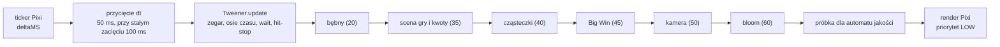
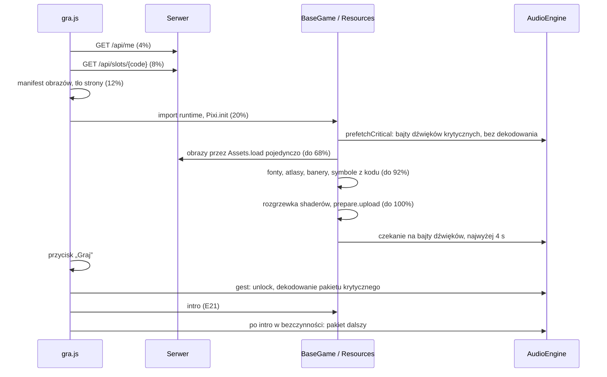

# 08 — Wydajność i jakość (stan zrealizowany)

> Ten dokument mówi, **jak Cebulion Casino dba o płynność i lekkość**: jakie są cele z briefu, ile naprawdę ważą
> obrazy, dźwięk i kod, jak zbudowany jest render (lobby bez PixiJS, gra na PixiJS 8), jak działają poziomy jakości
> i strażnik błysków — dokładnie według kodu — oraz jak mierzyć i co wyszło z pomiarów. Stan z 2026-10-11 (gra S1 na
> wspólnym runtime). Uzupełnia [10-runtime-gier.md](10-runtime-gier.md) (budowa runtime) i
> [04-efekty-wizualne.md](04-efekty-wizualne.md) § 2.2 (specyfikacja poziomów jakości).

**Jak czytać odnośniki.** `js/game/core/quality.js:99` = `src/main/resources/static/js/game/core/quality.js`, linia 99;
`shared/config/WebConfig.java:39` = `src/main/java/pl/wsb/kasyno/shared/config/WebConfig.java`; narzędzia
(`tools/…`) i raporty (`art/raport/…`) — ścieżki od katalogu głównego repozytorium.

**Najważniejsze zastrzeżenie.** Wszystkie pomiary czasu klatki w tym dokumencie zrobiliśmy w kontenerze **bez karty
graficznej** — WebGL działał programowo (SwiftShader). Takie środowisko pokazuje, ile kosztuje **nasz kod**, ale nie
mówi, ile fps będzie na telefonie czy komputerze. **60 fps trzeba potwierdzić na prawdziwym urządzeniu** — do tego
służy panel `?fx=debug` (§ 10.5).

## Spis treści

1. [Cele i budżety](#1-cele-i-budżety)
2. [Faktyczne wagi: obrazy, dźwięk, kod](#2-faktyczne-wagi-obrazy-dźwięk-kod)
3. [Architektura renderu](#3-architektura-renderu)
4. [Ładowanie zasobów i pakiety audio](#4-ładowanie-zasobów-i-pakiety-audio)
5. [Poziomy jakości i automat](#5-poziomy-jakości-i-automat)
6. [Strażnik błysków](#6-strażnik-błysków)
7. [Cykl życia strony](#7-cykl-życia-strony)
8. [Cache HTTP i kompresja](#8-cache-http-i-kompresja)
9. [Pułapki przeglądarek](#9-pułapki-przeglądarek)
10. [Pomiary: jak uruchomić i co mierzą](#10-pomiary-jak-uruchomić-i-co-mierzą)
11. [Wyniki i zastrzeżenia](#11-wyniki-i-zastrzeżenia)
12. [Checklista przed oddaniem](#12-checklista-przed-oddaniem)

---

## 1. Cele i budżety

Wiążące wartości z [briefu § 5](00-brief.md) (i § 4 dla błysków) oraz gdzie ich pilnujemy:

| Cel | Wartość | Jak pilnujemy | Stan |
|---|---|---|---|
| płynność | 60 fps, p95 klatki ≤ 16,7 ms (desktop) | pętla bez alokacji, cząsteczki w `ParticleContainer`, poświaty „upieczone”, 3 poziomy jakości z automatem (§ 3, § 5) | kod gry mieści się w kilku ms na klatkę (§ 11); **fps do potwierdzenia na urządzeniu** |
| long tasks | brak > 50 ms w trakcie spinu | dekodowanie, wgrywanie tekstur na GPU i kompilacja shaderów tylko na ekranie ładowania; dźwięki „dalsze” w bezczynności po intro (§ 4) | w SwiftShader każda klatka to long task (rasteryzacja programowa) — **do sprawdzenia na urządzeniu** |
| poziomy jakości | High (DPR ≤ 2, ≤ 600 cząsteczek, bloom), Medium (DPR ≤ 1,5, ≤ 300, glow pre-baked), Low (DPR 1, ≤ 120, bez drżenia i filtrów) | `LEVELS` w `js/game/core/quality.js:16` | zrealizowane (§ 5) |
| obniżenie jakości | p90 klatki > 20 ms przez 2 s | `Quality.sample` (`quality.js:99`) | zrealizowane, zadziałało w teście (§ 11) |
| błyski | ≤ 3 na sekundę (WCAG 2.3.1), RM wyłącza błyski i drżenie | `FlashGovernor` (`js/game/fx/flash.js:41`) | test: maks. 2 / s, 0 pominiętych bohaterów |
| waga jednej gry | ≤ 6 MB (WebP) | raport pipeline'u grafiki (Q23) | S1 3,55 MB, S2 4,64 MB, S3 4,67 MB (§ 2.1) |
| waga lobby | ≤ 3 MB bez wideo | j.w. | 2,58 MB = 86% (ostrzeżenie Q23 od 85%) |
| LCP lobby | < 2,5 s (mobile 4G) | fonty z `preload`, lobby bez PixiJS | **nie mierzone** — ryzyka i plan w § 11.3 |
| lobby bez Pixi | HTML/CSS + wideo | `index.html` ładuje tylko `js/lobby.js`; Pixi importuje dynamicznie `js/game/core/app.js:49` | zrealizowane |
| dźwięk (budżety z 05 § 7.6) | strona gry ≤ 1,8 MB Opus, ≤ 56 MB po dekodowaniu; lobby ≤ 0,8 MB / 24 MB | raport `tools/audio/sprawdz.py` | S2: 92% budżetu Opus (ostrzeżenie A13), reszta w normie (§ 2.2) |

---

## 2. Faktyczne wagi: obrazy, dźwięk, kod

### 2.1. Obrazy (raport pipeline'u grafiki)

Źródło: `art/raport/raport.json` (pipeline 1.0.0, przebieg 2026-10-11T15:39:52Z; 84 obrazy z ChatGPT + 1 zastępczy
`g_win_epic`, 0 błędów, 1 ostrzeżenie). Waga = to, co pobiera przeglądarka w danej konfiguracji, łącznie
z częścią wspólną i plikami doładowywanymi później (zasady liczenia: [02 § 7.1](02-lista-obrazow.md)). MB = 10⁶ B.

| Strona | Desktop (@2x, tło 2560 px) | Telefon (@1x, tło pionowe) | Limit | Desktop / limit |
|---|---|---|---|---|
| lobby | **2,58 MB** (2 580 292 B) | 1,14 MB | 3 MB | **86%** (ostrzeżenie Q23 ≥ 85%) |
| S1 Cebulowy 777 | 3,55 MB | 2,32 MB | 6 MB | 59% |
| S2 Złoty Faraon | 4,64 MB | 2,89 MB | 6 MB | 77% |
| S3 Kryształowa Kaskada | 4,67 MB | 2,93 MB | 6 MB | 78% |

Cały katalog `static/assets/img` ma 25,4 MB, ale to suma **wszystkich** wariantów (trzy szerokości teł, banery,
@1x i @2x, rozmycia) — przeglądarka pobiera tylko podzbiór z tabeli. Rezerwa dla lobby: AVIF w `<picture>` dla tła
i okładek (02 § 7.4, plan).

### 2.2. Dźwięk (raport pipeline'u dźwięku)

Źródło: `tools/audio/build/raport.md` (manifest `cb2ae752051e`, 67 ID × 2 formaty, 0 błędów). **Uwaga:** raport
podaje „MB” w jednostkach binarnych (MiB = 2²⁰ B) — przeliczone z plików: wszystkie `.webm` = 3 614 645 B
(3,45 MiB), wszystkie `.m4a` = 4 743 020 B (4,52 MiB).

| Strona | ID | Opus (WebM) | AAC (M4A, Safari) | Pamięć po dekodowaniu | Budżet Opus / AAC / pamięć |
|---|---|---|---|---|---|
| lobby | 24 | 0,63 MiB | 0,82 MiB | 18,4 MB | 0,8 / 1,1 / 24 |
| S1 | 51 | 1,12 MiB | 1,46 MiB | 31,9 MB | 1,8 / 2,4 / 56 |
| S2 | 52 | 1,66 MiB | 2,18 MiB | 48,9 MB | 1,8 / 2,4 / 56 (ostrzeżenia A13: 92% / 91% / 87%) |
| S3 | 56 | 1,50 MiB | 1,96 MiB | 43,5 MB | 1,8 / 2,4 / 56 |

**Dlaczego pamięć jest ważniejsza od pliku:** zdekodowany dźwięk to próbki 32-bitowe — 192 KB na sekundę na kanał.
Muzyka stereo 38,9 s (`mus_s2`) waży w pamięci ~15 MB, choć plik Opus ma 0,47 MiB (05 § 2.4). Przeglądarka
pobiera tylko pakiety danej strony (§ 4.3), a zmiana strony zwalnia całą pamięć audio poprzedniej.

### 2.3. Kod, style, fonty (przeliczone z plików)

Serwer kompresuje odpowiedzi tekstowe gzipem (§ 8), więc liczy się kolumna „gzip” (poziom 6 — taki, jakiego używa
Tomcat).

| Część | Pliki | Bez kompresji | gzip |
|---|---|---|---|
| lobby: JS (moduły ES, bez bundlera) | 15 | 139,1 KiB | 52,4 KiB |
| lobby: CSS | 5 | 105,7 KiB | 28,2 KiB |
| `index.html` | 1 | 22,9 KiB | 6,3 KiB |
| gra: JS bez Pixi (runtime + S1 + wspólne moduły) | 34 | 411,5 KiB | 147,4 KiB |
| gra: CSS | 6 | 79,3 KiB | 23,1 KiB |
| `gra.html` | 1 | 12,3 KiB | 3,4 KiB |
| **PixiJS 8.22.0** (`vendor/pixi/pixi.min.mjs`, tylko strona gry) | 1 | 821,6 KiB | 231,7 KiB |
| ikony SVG (sprite, emblemat, moneta) | 3 | 10,7 KiB | 3,6 KiB |
| fonty WOFF2 (Cinzel, Manrope, Bungee, Cinzel Decorative, Marcellus; latin + latin-ext) | 25 | 246,9 KiB (już skompresowane) | — |

Z wyprzedzeniem (`<link rel="preload">`) pobieramy tylko fonty widoczne od pierwszej klatki: lobby — Manrope 400
(latin 13,8 KiB + latin-ext 8,1 KiB) i Cinzel 900 (14,5 KiB); gra — Manrope 400 i Bungee (14,0 KiB). Resztę
przeglądarka pobiera, gdy font jest potrzebny (`@font-face` w `css/fonts.css`). Strona gry ma też
`<link rel="modulepreload">` dla Pixi (`gra.html:13`), więc pobieranie biblioteki rusza równolegle z HTML.

**Suma pierwszego wejścia (desktop, szacunek):** lobby ≈ 2,58 MB obrazów + ~90 KiB kodu i stylów (gzip) + ~36 KiB
fontów + 0,63 MiB dźwięku (dopiero po pierwszym geście); gra S1 ≈ 3,55 MB obrazów + ~400 KiB kodu z Pixi (gzip) +
1,12 MiB dźwięku (część krytyczna na ekranie ładowania, reszta po intro). Kolejne wejścia biorą obrazy i dźwięki
z pamięci podręcznej (§ 8).

---

## 3. Architektura renderu

### 3.1. Lobby: HTML i CSS, bez PixiJS

Lobby to zwykły dokument HTML z CSS — teksty ostre i dostępne, zero kosztu WebGL. Efekty:

* **Animacje UI wyłącznie `transform` i `opacity`** (kompozytor GPU, bez przeliczania układu) — test `smoke.mjs`
  sprawdza to przy każdej szerokości („animacje tylko transform/opacity”).
* **Tło strony** to osobna warstwa `position: fixed` z `transform: translateZ(0)` — przewijanie nie przerysowuje
  gradientów (`css/base.css:90`). Ziarno filmowe z SVG usuwa „pasy” w gradientach.
* **Cząsteczki** (monety, iskry, pył) rysuje `FxLite` na Canvas 2D (`js/fx-lite.js`): pula obiektów tworzona raz,
  martwa cząsteczka zamieniana z ostatnią żywą (O(1)), sprite'y (moneta, poświaty) rysowane raz do pozaekranowego
  płótna i potem tylko kopiowane (`drawImage`), mieszanie `lighter` dla iskier. Limit 360 cząsteczek (180 na
  ekranach ≤ 900 px), DPR ≤ 2 (≤ 1,75 na małych ekranach); pył w sekcji powitalnej — 64 cząsteczki, DPR ≤ 1,5.
  `requestAnimationFrame` działa **tylko wtedy, gdy jest co animować** i stoi przy ukrytej karcie, poza ekranem
  (IntersectionObserver) i pod zasłoną sekwencji nagrody (`js/lobby.js:1040`).
* **Sekwencja nagrody bez `inert`** na całej stronie i z **dwiema klatkami przerwy** po zamknięciu okna logowania:
  przeliczenie stylów całego dokumentu kosztowało na słabym telefonie ~100 ms i zbiegało się ze startem animacji
  (`js/ui/reward.js:86`, `js/lobby.js:429`).
* **Pochylenie kafla** aktualizowane najwyżej raz na klatkę (zmienne CSS ustawiane w `requestAnimationFrame`),
  wideo `preload="none"` i najwyżej jedno grające na telefonie.

### 3.2. Gra: aplikacja PixiJS (`GameApp`)

`js/game/core/app.js:48` — Pixi ładowany **dynamicznie** (`import()`), więc lobby go nie pobiera. Ustawienia
`Application.init`:

| Ustawienie | Wartość | Dlaczego |
|---|---|---|
| `resizeTo` | element `#scena` | płótno ma rozmiar sceny między paskiem a panelem |
| `preference` | `'webgl'` | WebGPU niewymagany (brief § 5) |
| `resolution` | `min(devicePixelRatio, limit poziomu)` (2 / 1,5 / 1) + `autoDensity` | ostro na Retinie, ale bez renderowania 3× więcej pikseli, niż trzeba |
| `antialias` | `false` | bez MSAA — krawędzie wygładzają miękkie tekstury, GPU ma mniej pracy |
| `background` | `#07060F`, alfa 1 | nieprzezroczyste płótno: przeglądarka nie miesza go ze stroną pod spodem |
| `powerPreference` | `'high-performance'` | laptop z dwiema kartami wybierze mocniejszą |

**Warstwy** (04 § 7.2): kontener `world` z 12 warstwami (`bg`, `bgParticles`, `under`, `reels`, `dim`, `wins`,
`lines`, `frame`, `logo`, `fxNormal`, `fxAdd`, `amounts`) drży razem z kamerą; nad nim `bigwin` (35% drżenia),
`bigwinFixed` (licznik Big Win, 0% — „wynik jest święty”), `flash` i `overlay`. Warstwy addytywne (`fxAdd`, `lines`,
podwarstwa Big Win) są pogrupowane, żeby nie przerywać paczek rysowania (*batch*).

**Jedna klatka** (stała kolejność, `app.js:122`):



* Najpierw cała logika, potem Pixi rysuje gotowy stan — logika nigdy nie dzieje się w trakcie rysowania.
* `deltaMS` pojedynczego zacięcia przycinamy do 50 ms (animacja nie „przeskakuje”). Gdy urządzenie **stale** nie
  wyrabia (ponad 8 klatek > 45 ms z rzędu), limit rośnie do 100 ms — inaczej przy 10 fps runda trwałaby dwa razy
  dłużej, niż przewiduje brief § 4 (`app.js:128`).
* Dwa znaczniki czasu wokół renderu i pomiar logiki zapisują do buforów 600 klatek (`perf`) — z nich korzysta test
  e2e i konsola (`window.__gra.perf()`).
* Zegar gry płynie tylko, gdy ticker działa — po powrocie do karty nic nie przeskakuje.

### 3.3. Zero alokacji w trakcie gry

Sprzątanie pamięci (*garbage collection*) w trakcie Big Win to zacięcie klatki, więc w pętli gry nic nie tworzymy:

| Mechanizm | Gdzie |
|---|---|
| tweeny z puli, obietnica tworzona tylko na żądanie (`.promise`), kompaktowanie tablicy aktywnych bez nowej tablicy | `js/game/core/tween.js:67`, `:174` |
| pula obiektów dla flar, pierścieni, piorunów, poświat wygranej | `js/game/core/pool.js`, `js/game/fx/effects.js:253` |
| cząsteczki w tablicach typowanych (`Float32Array` x, y, vx, vy, wiek…), zamiana z ostatnią żywą, obiekty `Particle` tworzone raz (640 na warstwę) | `js/game/fx/particles.js:23`, `:62`, `:85` |
| licznik wygranej ze sprite'ów glifów — zmiana liczby to podmiana tekstur, bez przerysowania `Text` i wgrywania tekstury | `js/game/fx/digits.js` |
| rozmycie ruchu bębnów = podmiana tekstur (`ruch2` > 60% v_max, `ruch1` 20–60%, ostry < 20%) | `js/game/reels/reelset.js:423` |
| błysk ekranu: dwa sprite'y tworzone raz, w spoczynku `visible = false` | `js/game/fx/flash.js:135` |

### 3.4. Cząsteczki: `ParticleContainer`

Sześć warstw cząsteczek, każda to jeden `ParticleContainer` z Pixi 8 = **jedno wywołanie rysowania**: `bg` (pył tła,
`add`), `fxNormal` (monety, konfetti), `fxAdd` (iskry), `bwBack`, `bwAdd`, `bwFront` (Big Win, monety z tyłu i z
przodu) — `js/game/base-game.js:164`, `:213`. Warunki Pixi 8, które spełniamy:

* **jedna tekstura źródłowa na kontener** — dlatego przy starcie składamy atlasy: `fx` (iskry, gwiazdki, smuga, dym;
  komórki 64 px, mieszanie `add`) i `normal` (3 ujęcia monety + 12 konfetti, 256 px) z obrazów z manifestu albo
  kształtów z kodu (`js/game/core/canvas-art.js:257`, `:281`);
* `dynamicProperties` tylko tam, gdzie trzeba (`uvs` dynamiczne wyłącznie w warstwach z obracającą się monetą);
* kontener nie liczy granic — podajemy stały `boundsArea`, żeby nic nie było odcinane.

Limit łączny z poziomu jakości (600 / 300 / 120) i priorytety: P1 główne (monety, iskry wygranej), P2 wzbogacające
(konfetti, dym), P3 tło (pył). Zajętość ≥ 85% → P3 się nie rodzi; ≥ 95% → P2 rodzi się z prawdopodobieństwem 50%
(`particles.js:248`). Liczby w kartach zdarzeń to **prośby** — silnik przycina je do limitu i mnoży przez 0,3
w trybie ograniczonego ruchu.

### 3.5. Tekstury i atlasy

* **Zawsze przez ID** z manifestu (`js/game/core/resources.js`): brak obrazu = grafika rysowana raz w Canvas 2D na
  ekranie ładowania (`canvas-art.js`, `s1-art.js`), potem zwykła tekstura bez kosztu w klatce.
* **@1x / @2x:** @2x, gdy `devicePixelRatio > 1,2` i poziom ≠ Low; tła sceny według pola `widths` (najmniejsza
  szerokość ≥ potrzebnej, `resources.js:65`).
* **Rozmiar logiczny:** warianty `glow` i `cien` bywają zapisane w skali 0,5, a @2x ma podwójną gęstość — `Resources`
  ustawia rozdzielczość źródła tak, żeby `texture.width` zawsze znaczyło rozmiar logiczny z manifestu
  (`resources.js:119`).
* **Ramki z przezroczystym oknem** rysujemy jako „pierścień” z czterech pasków bez środka — GPU miesza każdy piksel
  sprite'a, także przezroczysty, więc pusty środek dużej ramki to czysta strata przepustowości (`canvas-art.js:34`).
* **Cienie symboli** tylko na High/Medium (na Low 15 sprite'ów mniej do przerysowania) — `reelset.js:454`.
* **Wgranie na GPU** na ekranie ładowania: `renderer.prepare.upload(stage)` (`app.js:231`) — pierwsze użycie tekstury
  w trakcie spinu dałoby zacięcie 50–200 ms.

### 3.6. Filtry i shadery

| Filtr | Poziomy | Szczegóły | Kod |
|---|---|---|---|
| **bloom** (własny, jednoprzebiegowy: 24 próbki na dwóch okręgach) | **tylko High** | na warstwach `fxAdd` i Big Win; włączany tylko, gdy warstwa ma widoczną treść, z histerezą 300 ms (w spoczynku nic nie kosztuje); stały `filterArea` = ekran (bez liczenia granic co klatkę); wynik nakładany **addytywnie** (`filter.blendMode = 'add'` — przy domyślnym `normal` tekstury `add` na czarnym tle, np. dym, dawały szary prostokąt) | `js/game/fx/effects.js:58`, `:93`, `:401` |
| **połysk** (shader: jasny ukośny pas maskowany alfą obiektu) | High i **Medium** | z puli, najwyżej 6 naraz; na Low i przy przekroczeniu limitu zastępuje go puls białej sylwetki (`syl`) | `effects.js:36`, `:337` |
| poświata Medium | — | warianty `glow` „upieczone” w teksturach przez pipeline grafiki (bez filtra) | `base-game.js:553` |

**Rozgrzewka shaderów:** na ekranie ładowania renderujemy mały kontener z każdym filtrem do pozaekranowej
`RenderTexture` 64 × 64 (`effects.js:453`). Obiekt z `visible = false` nie wystarczy — Pixi by go nie narysował
i shader skompilowałby się przy pierwszym Big Win (zacięcie 50–200 ms).

**Odstępstwo od 04 § 2.2.** Specyfikacja zakładała filtry wyłącznie na High (`AdvancedBloomFilter`,
`ShockwaveFilter`, `ColorMatrixFilter` z pakietu `pixi-filters`). W kodzie: `pixi-filters` nie jest wendorowany,
więc bloom to własny tani shader (plan B z 04 § 2.6), fali uderzeniowej i desaturacji przyciemnienia nie ma
(pierścień fali to sprite), a **połysk jest shaderem także na Medium** — działa tylko w czasie przelotu (450–700 ms)
na kilku obiektach. Jeśli pomiar na słabym telefonie pokaże problem, wystarczy zmienić `shine: 'shader'` na `'syl'`
w `LEVELS.medium` (`quality.js:23`).

---

## 4. Ładowanie zasobów i pakiety audio

### 4.1. Lobby

Kolejność w `init()` (`js/lobby.js:116`), wszystko równolegle:

1. `FxLite`, licznik salda, nasłuch pierwszego gestu (dźwięk);
2. manifest obrazów (`assets.load`, `cache: 'no-cache'`) → podmiana `data-asset` na obrazy z manifestu (@1x/@2x
   przez `srcset`), tło zależne od orientacji;
3. manifest wideo (`assets/video/manifest.json` — dziś pusty, więc zero żądań o filmy);
4. przywrócenie sesji (`GET /api/me` tylko, gdy jest wskazówka w `localStorage`);
5. katalog gier `GET /api/slots` (przy błędzie — katalog zapasowy).

Po manifeście: pył w tle i klasa `is-ready` (wejście elementów); po katalogu — kafle, feed i ranking (odświeżane co
45 s tylko przy widocznej karcie). Obrazy tworzone w JS mają `loading="lazy"` i `decoding="async"`, okładki —
`srcset` i `sizes`.

### 4.2. Strona gry



* **Wagi paska:** obrazy 60%, grafika z kodu i przygotowanie 25%, GPU i shadery 15%; pasek nigdy się nie cofa
  (`js/gra.js:59`, `js/game/base-game.js:104`).
* **Obrazy pojedynczo** (`Assets.load` na każdy plik, `resources.js:87`): błąd jednego pliku nie blokuje reszty —
  brakujący obraz zastępuje grafika z kodu.
* **Długie kroki dzielone na klatki** (`await` jednej klatki między banerami i symbolami z kodu), żeby pasek
  i animacja ekranu ładowania się nie zacinały.
* Pomiar jakości wstrzymany na 1,5 s po załadowaniu i na 1,2 s po „Graj” (pierwsze klatki są długie).

### 4.3. Pakiety audio

Każdy wpis manifestu dźwięków ma listę `packs` (05 § 2.4). Silnik (`js/audio/audio-engine.js:280`, `gameSounds`)
wybiera dla strony gry `sN` wpisy z `ui`, `gry-krytyczne`, `gry-dalsze` albo `sN` i **bez** pakietu innej gry:

| Faza | Co | Kiedy | Kod |
|---|---|---|---|
| lobby | pakiety `ui` + `lobby` (24 ID) | po pierwszym dowolnym geście (`unlockOnGesture`) — dźwięki okna logowania i bonusu są gotowe, zanim będą potrzebne | `js/lobby.js:128` |
| gra: krytyczna (bez `gry-dalsze`) | `ui`, `gry-krytyczne`, `s1` | **bajty** pobierane na ekranie ładowania (`prefetch` — pobieranie nie wymaga kontekstu audio), **dekodowanie** po geście „Graj” (trwa ms) | `js/game/audio/game-audio.js:38`, `:47` |
| gra: dalsza (`gry-dalsze`) | big win, antycypacja, darmowe spiny, przejścia | po intro, w `requestIdleCallback` (limit 2,5 s; bez API — po 500 ms), nigdy w trakcie spinu | `js/gra.js:136`, `game-audio.js:53` |

Format wybierany **raz na stronę** przez `canPlayType('audio/webm; codecs="opus"')`; gdy dekodowanie `.webm` mimo to
zawiedzie, silnik przechodzi na `.m4a` do końca wizyty (`audio-engine.js:201`, `:227`). Dekodowanie
(`decodeAudioData`) działa poza wątkiem głównym. Brak manifestu, pliku albo błąd dekodowania = cisza dla tego ID
i jedno `console.warn` — gra działa dalej.

---

## 5. Poziomy jakości i automat

### 5.1. Parametry poziomów (`js/game/core/quality.js:16`)

| Parametr | High | Medium | Low | Kto czyta |
|---|---|---|---|---|
| `dpr` (limit rozdzielczości) | 2 | 1,5 | 1 | `app.js:105` |
| `particles` (limit łączny) | 600 | 300 | 120 | `particles.js:243` |
| `bloom` | `filter` | `baked` (`glow` z tekstury) | `none` | `effects.js:436`, `base-game.js:553` |
| `shake` (drżenie kamery) | tak | tak | nie | `camera.js:39` |
| `shine` (połysk) | `shader` | `shader` | `syl` (puls sylwetki) | `effects.js:371` |
| promienie: warstwy / skala / alfa warstwy B | 2 / 1,6 / 0,5 | 2 / 1,3 / 0,3 | 1 / 1,1 / — | `effects.js:147`, `bigwin.js:409` |
| `smoke` (kłęby dymu naraz) | 12 | 6 | 2 | `particles.js:414` |
| `confetti` (salwa) | 220 | 110 | 40 | `bigwin.js:461` |
| `lightning` (pioruny naraz) | 3 | 2 | 1 | `bigwin.js:465` |
| `bgFx` (oddech słońca i impuls siatki S1) | 1 | 0,5 | 0 | `games/s1.js:496` |
| pył tła S1 (`quality.pick([60, 30, 0])`) | 60 | 30 | 0 | `games/s1.js:244` |
| tekstury @2x | wg gęstości | wg gęstości | zawsze @1x | `resources.js:68` |
| cienie symboli | tak | tak | nie | `reelset.js:454` |
| dźwięk: limit głosów | 24 | 24 | 16, bez panoramy, grupy z limitem ≥ 6 (monety) o połowę | `audio-engine.js:356`, `:401`, `:454` |

Trójki wartości z kart zdarzeń (`[High, Medium, Low]`) wybiera `quality.pick(triple)`.

### 5.2. Poziom startowy

`initialLevel()` (`quality.js:38`): `navigator.deviceMemory ≤ 2` albo `navigator.connection.saveData` → **Low**;
ekran dotykowy (`pointer: coarse`) → **Medium**; w pozostałych przypadkach (komputer) → **High**. Gdy gracz wybrał
poziom ręcznie, zapisany w `localStorage` (`cebulion.jakosc`) wybór ma pierwszeństwo.

### 5.3. Algorytm automatycznego przełączania (dokładnie jak w kodzie)

Próbką jest `ticker.deltaMS` każdej klatki (surowy czas, przed przycięciem do 50 ms; sam Pixi ogranicza go do 100 ms
przez domyślne `minFPS = 10`).

```text
sample(frameMs):                                   // quality.js:99, co klatkę
  zegar += frameMs
  jeśli trwa pauza pomiaru: pauza -= frameMs; koniec
  bufor_kołowy[120] ← frameMs;  liczba = min(liczba + 1, 120)
  od_kontroli += frameMs;  jeśli od_kontroli < 500 ms: koniec
  od_kontroli = 0
  p90 = percentyl 90 z bufora;  fps = round(1000 / percentyl 50)
  jeśli tryb ≠ auto albo liczba < 30: koniec
  jeśli p90 > 20 ms:
      dobre_ms = 0
      złe_kontrole += 1
      jeśli złe_kontrole ≥ 4:                      // 4 × 500 ms = 2 s
          złe_kontrole = 0
          spadki[poziom] += 1
          poziom ← o jeden niżej (jeśli jest)      // zdarzenie 'change', wpis w logu
  w przeciwnym razie:
      złe_kontrole = 0
      dobre_ms = (p90 < 12 ms) ? dobre_ms + 500 : 0

maybeUpgrade():                                    // quality.js:132, kontroler po KAŻDEJ rundzie
  jeśli tryb ≠ auto albo dobre_ms < 20 000: koniec          // p90 < 12 ms przez 20 s
  jeśli zegar − ostatnia_zmiana < 120 000: koniec           // najwyżej raz na 2 min
  cel = poziom o jeden wyżej;  jeśli brak celu albo spadki[cel] ≥ 2: koniec   // bez powrotu na „pechowy” poziom
  dobre_ms = 0;  poziom ← cel

każda zmiana poziomu: liczba = 0, złe_kontrole = 0, ostatnia_zmiana = zegar
```

Konsekwencje warte powiedzenia na obronie:

* po obniżeniu bufor startuje od zera, więc kolejne obniżenie wymaga znowu ≥ 30 próbek i 4 złych kontroli;
* podwyższenie odbywa się **wyłącznie między rundami** (woła je kontroler w `#afterRound`,
  `js/game/controller.js:183`), nigdy w trakcie spinu;
* „zegar” to suma czasów klatek — przy ukrytej karcie ticker stoi, więc czas nie biegnie.

### 5.4. Kiedy zmiana działa

| Co | Kiedy | Dlaczego |
|---|---|---|
| limit cząsteczek, drżenie, filtry, połysk, cienie (restyle bębnów), limit głosów dźwięku | **od razu** (`BaseGame.onQualityChange`, `base-game.js:260`) | zmiana niewidoczna albo tylko zmniejsza obciążenie |
| rozdzielczość renderowania (DPR) | **między rundami**: gdy gra czeka na SPIN — od razu, w trakcie rundy — po jej końcu (`controller.js:179`, `:491`); `renderer.resize` + pauza pomiaru 800 ms (`app.js:219`) | zmiana ostrości w trakcie spinu byłaby widocznym „skokiem” obrazu |
| tekstury @1x/@2x | przy następnym ładowaniu strony | wymiana tekstur w locie kosztuje pobranie i wgranie na GPU |

### 5.5. Pauzy pomiaru (`suspend`)

Pierwsze klatki po niektórych zdarzeniach są długie z przyczyn, które nie świadczą o słabym sprzęcie — wtedy pomiar
stoi (i zeruje bufor): koniec ładowania 1500 ms (`base-game.js:149`), gest „Graj” 1200 ms (`gra.js:132`), powrót do
karty 1000 ms (`app.js:191`), odzyskanie kontekstu WebGL 1500 ms (`app.js:208`), zmiana rozdzielczości 800 ms
(`app.js:223`).

### 5.6. Wybór ręczny i ograniczony ruch

* **Ustawienia → Jakość grafiki:** Auto / Wysoka / Średnia / Niska (`setMode`, `quality.js:84`). Wybór ręczny
  wyłącza automat i zawsze emituje zdarzenie zmiany (nawet przy tym samym poziomie).
* **Ograniczony ruch** (`Motion`, `quality.js:175`): systemowe `prefers-reduced-motion` albo przełącznik „Ruch
  i błyski” (Jak w systemie / Ogranicz / Pełny). Skutki w runtime: brak błysków (strażnik odrzuca każdy), brak
  drżenia i kopnięć kamery, brak piorunów, flar, pierścieni, migotania neonów i „ciemnego taktu”, promienie bez
  obrotu (oddech alfy 4 s), cząsteczki × 0,3 i prędkość × 0,6, bez konfetti i dymu, „uderzenia” zastąpione
  przenikaniem, liczenie Big Win × 0,6, bez zamachu i odbicia bębnów, bez squash & stretch symboli.

---

## 6. Strażnik błysków

Błyski mogą wywołać napad u osób z padaczką fotogenną (WCAG 2.1, kryterium 2.3.1: najwyżej 3 błyski w dowolnej
sekundzie). Limit pilnuje **kod**, nie dobra wola animatora: każdy efekt, który może być błyskiem, pyta strażnika
`FlashGovernor.request()` przed startem (`js/game/fx/flash.js:68`).

**Amplituda jak w WCAG:** liczymy zmianę jasności względnej `ΔL = lin(c + a) − lin(c)`, gdzie `c` to jasność
**podłoża** (tło S1 ≈ 0,08 z `bgLuma`, złoty symbol ≈ 0,55), a `a` szczytowa alfa białego sprite'a `add` — ta sama
alfa na ciemnym i jasnym tle to inny błysk (`flash.js:29`).

```text
request(rodzaj, {pole, alfa, podłoże, bohater}):
  zapomnij błyski starsze niż 1 s i rezerwacje starsze niż 400 ms
  ograniczony ruch            → POMIŃ (alfa 0)
  pole ≤ 1/36 ekranu albo ΔL < 0,10 → WOLNY (nie zużywa limitu)
  bohater → zużyj najbliższą rezerwację (± 700 ms)
  poprzedni błysk < 120 ms temu → WCHŁONIĘTY (jedna para zmian jasności)
  zajęte = błyski z ostatniej sekundy + (bohater ? 0 : rezerwacje w najbliższej sekundzie)
  zajęte < 3                  → PEŁNY (zarejestruj)
  pole ≥ 0,5 ekranu           → POMIŃ
  inaczej                     → ŁAGODNY: alfa obcięta tak, by ΔL < 0,08; atak ≥ 150 ms
```

* **Rezerwacja** (`flash.js:54`): „reżyser” zna całą rundę z góry, więc rezerwuje miejsca na błyski-bohaterów —
  uderzenie banera BIG WIN (`base-game.js:386`: chwila ostatniego stopu + 300 ms, gdy jednostka skończy się big
  winem), każdą eskalację i slam (`bigwin.js:257`). Błysk lokalny (WILD, flara, piorun), który zabrałby
  zarezerwowane miejsce, od razu dostaje wariant łagodny — inaczej trzy błyski WILD „zjadłyby” limit przed
  uderzeniem BIG WIN. Rezerwacje kasuje start kolejnego spinu.
* **Wchłanianie, a nie przesuwanie:** niczego nie przesuwamy w czasie, więc dźwięki zaplanowane na zegarze audio dalej
  trafiają w szczyty. TURBO nie skraca błysków (wpisy osi czasu z `raw: true`), bo zagęściłoby je ponad limit.
* **Rodzaje** (`FLASH`, `flash.js:124`): `big` 0,40, `mega` 0,45, `epic` 0,50, `ultra` 0,55, `koniec` 0,35, `fs` i
  `jackpot` 0,45 alfy; atak 30–60 ms, wygaszanie 300–500 ms; odcień ≤ 20% nasycenia (nigdy nasycona czerwień na
  pełnym ekranie).
* **Log decyzji** (do 800 wpisów) czyta test e2e: `maxPerSecond()` (musi być ≤ 3) i `heroSkips()` (musi być 0).

---

## 7. Cykl życia strony

### 7.1. Ukrycie karty (`visibilitychange`)

| Kto | Karta ukryta | Karta wraca | Kod |
|---|---|---|---|
| pętla gry | `ticker.stop()` — zegar gry, tweeny i `wait()` stoją | pauza pomiaru 1 s, `ticker.start()` (chyba że kontekst WebGL utracony) | `js/game/core/app.js:186` |
| dźwięk | `AudioContext.suspend()` | `resume()` | `js/audio/audio-engine.js:104` |
| cząsteczki lobby | `cancelAnimationFrame` | start, jeśli jest co animować | `js/fx-lite.js:145` |
| wideo kafli | pauza wszystkich | telefon: film najbardziej widocznego kafla | `js/lobby.js:775` |
| feed i ranking | odświeżanie co 45 s pomijane | — | `js/lobby.js:172` |
| licznik salda | zmiana bez animacji | — | `js/ui/balance.js:48` |
| wibracje | wyłączone | — | `js/game/controller.js:380` |

### 7.2. Utrata kontekstu WebGL

Sterownik może odebrać stronie kontekst (reset GPU, przełączenie karty graficznej, za dużo kart z WebGL).
`webglcontextlost` → `preventDefault()` (bez tego przeglądarka nie spróbuje go odzyskać), stop pętli, nakładka
„Odświeżamy grafikę automatu…”; po 3 s bez odzyskania przycisk „Załaduj ponownie”. `webglcontextrestored` → Pixi
wgrywa tekstury ponownie, pauza pomiaru 1,5 s, wznowienie (`app.js:198`, `js/gra.js:202`).

### 7.3. Zmiana rozmiaru i orientacji

* `ResizePlugin` Pixi słucha `window.resize`, ale scena zmienia rozmiar także bez niego (np. panel zmienia wysokość
  po obrocie telefonu) — dlatego dodatkowo `ResizeObserver` na `#scena` → `app.queueResize()` (`app.js:174`).
* W każdej klatce porównujemy rozmiar ekranu z poprzednim → `#relayout()`: orientacja, skala `k`, środek drżenia
  kontenera `world`, zdarzenie `resize` (`app.js:158`).
* Gra przelicza układ (`BaseGame.#relayout`, `base-game.js:237`): scena (S1 wybiera logo z boku albo nad automatem),
  okno bębnów, przyciemnienie, winieta, Big Win, obszar bloomu, rozmiar cyfr. Symbole przeniesione na warstwę wygranych
  idą za nowym układem; po rundzie gasimy prezentację linii policzoną dla starej geometrii.
* Tła CSS (lobby i strona gry) przełącza `matchMedia('(orientation: portrait)')`.

### 7.4. Powrót przyciskiem „Wstecz” (bfcache)

Przeglądarka może przywrócić stronę z pamięci razem z czarną zasłoną przejścia — `pageshow` z `persisted` zdejmuje
klasę `is-leaving` (`js/lobby.js:801`, `js/gra.js:216`). Silnik dźwięku nie obsługuje jeszcze `pagehide` /
`pageshow` (05 § 2.1) — przy powrocie z bfcache kontekst wznawia `visibilitychange`.

---

## 8. Cache HTTP i kompresja

| Zasób | Nagłówki | Skąd | Uwagi |
|---|---|---|---|
| `/assets/**` (obrazy WebP, dźwięki WebM/M4A, wideo) | `Cache-Control: max-age=86400, public` + `Last-Modified` | `shared/config/WebConfig.java:44` | doba bez pytania serwera, potem tanie zapytanie warunkowe (304) |
| `/assets/*/manifest.json` | `Cache-Control: no-cache` | `WebConfig.java:41` (bardziej szczegółowy wzorzec wygrywa) | zawsze sprawdzamy świeżość; front pobiera manifesty z `cache: 'no-cache'` |
| obrazy z manifestu | adres z `?v=<version manifestu>` | `js/assets.js:21` | po podmianie grafiki zmienia się `version` → nowy adres, stara kopia nie przeszkadza |
| dźwięki z manifestu | adres **bez** wersji | `js/audio/audio-engine.js:204` | po podmianie dźwięku przeglądarka może grać starą wersję do doby — w razie potrzeby wersja w nazwie pliku albo parametr |
| HTML, JS, CSS, fonty, `vendor/` | bez `Cache-Control`, z `Last-Modified` (`spring.web.resources.cache.use-last-modified=true`) | `application.properties:105` | przeglądarka może zastosować buforowanie heurystyczne — po wdrożeniu nowej wersji warto twardo odświeżyć (Ctrl+F5) |
| żądania API | `fetch(…, { cache: 'no-store' })` | `js/api.js:57` | dane gracza zawsze świeże |

**Kompresja** (`application.properties:94`): `server.compression.enabled=true` dla `text/html`, `text/css`,
`text/javascript`, `application/javascript`, `application/json`, `application/problem+json`, `image/svg+xml`, od 1 KB.
Spring Boot 3.5 przypisuje plikom `.mjs` typ `text/javascript` (`mime-mappings.properties` w `spring-boot-3.5.14.jar`),
więc PixiJS też jest kompresowany (821,6 → ~231,7 KiB). Obrazów WebP, dźwięków i fontów WOFF2 nie kompresujemy —
są już skompresowane.

---

## 9. Pułapki przeglądarek

| Pułapka | Objaw | Co robimy | Kod |
|---|---|---|---|
| **odblokowanie dźwięku (Safari iOS, Chrome)** | bez gestu `AudioContext` jest `suspended`, nic nie słychać | `new AudioContext()` i `resume()` **synchronicznie w obsłudze gestu** (przed pierwszym `await`); po `resume()` sprawdzamy `state` i przy porażce czekamy na kolejny gest; nasłuch `pointerup` / `keydown` / `click` (na ekranie dotykowym aktywacja przychodzi przy `pointerup`, samo `pointerdown` nie wystarcza), bez Esc i skrótów z modyfikatorami; na stronie gry osobny przycisk „Graj” | `audio-engine.js:120`, `:161`; `js/gra.js:127`, `:197` |
| Safari: stan `interrupted`, przełącznik wyciszenia iPhone'a | po telefonie / Siri kontekst może stanąć; przy wyciszonym telefonie Web Audio bywa niesłyszalne | `interrupted` nieobsłużony (05 § 2.3 — do dopisania: `statechange` + słuchacze gestu); wyciszenia świadomie nie obchodzimy | — |
| Safari nie gra WebM/Opus (starsze wersje) | brak dźwięku | `canPlayType` raz na stronę → `.m4a` (AAC); przy błędzie dekodowania `.webm` przejście na `.m4a` | `audio-engine.js:201` |
| pętle AAC/Opus „czkają” | przerwa co obieg pętli | pliki z „zakładkami”, silnik gra między `loopStart` a `loopEnd` i **startuje od `loopStart`** | `audio-engine.js:416` |
| **`100vh` na telefonie** | dół strony gry chowa się pod paskiem adresu | `100dvh` z `100vh` jako zapasem | `css/gra.css:32`, `css/base.css:29` |
| wycięcie ekranu | treść pod wycięciem / paskiem gestów | `viewport-fit=cover` + `env(safe-area-inset-*)` | 06 § 5.5 |
| `:hover` na dotyku | efekt „przykleja się” po dotknięciu | style najechania tylko w `@media (hover: hover)` | `css/components.css:93` |
| Spacja na przycisku z fokusem | Spacja = SPIN przełączała przy okazji TURBO | blokada aktywacji na `keyup` dla przycisków z fokusem z myszy; `:focus-visible` się nie nadaje (Chrome włącza go przy tym samym naciśnięciu) | `js/game/controller.js:441`, `:476` |
| `Intl.NumberFormat('pl-PL')` | „1000”, ale „10 000” — saldo „skacze” przy 9999 → 10 000 | własne grupowanie ze spacją niełamliwą | `js/format.js:13` |
| `ParticleContainer` (Pixi 8) | jedna tekstura na kontener, brak liczenia granic | atlasy i stały `boundsArea` | § 3.4 |
| filtr na warstwie `add` | szary prostokąt zamiast poświaty | `filter.blendMode = 'add'` | `effects.js:108` |
| pierwsza kompilacja shadera | zacięcie przy pierwszym Big Win | rozgrzewka do pozaekranowej `RenderTexture` | `effects.js:453` |
| `localStorage` w trybie prywatnym | wyjątek przy zapisie | każdy dostęp w `try/catch` | 06 § 10 |
| autoodtwarzanie wideo na telefonie | film nie startuje | `muted` + `playsinline` (atrybuty i właściwości) | `js/lobby.js:713` |
| 401 w konsoli nowego gościa | czerwony wpis przy każdym wejściu | `GET /api/me` tylko przy wskazówce sesji | `js/session.js:16` |
| `backdrop-filter` w Safari | brak rozmycia | prefiks `-webkit-backdrop-filter` | `css/gra.css:49` |
| bfcache | po „Wstecz” strona zostaje pod czarną zasłoną | `pageshow` + `persisted` | § 7.4 |

---

## 10. Pomiary: jak uruchomić i co mierzą

Testy przeglądarkowe są w `tools/e2e/` (Node ≥ 20, `playwright-core` bez `playwright install` — korzystają
z Chromium zainstalowanego w systemie: `/opt/pw-browsers/…` albo zmienna `PW_CHROMIUM`). Aplikacja w produkcji
**nie** potrzebuje Node.js.

```bash
cd tools && npm install                          # raz: playwright-core, pixi.js, fonty (wendorowanie)
node dev/mock-api.mjs                            # atrapa API na http://localhost:8090 (pliki z static/)
node dev/mock-api.mjs --pusty                    # puste feed i ranking (stany puste)
node dev/mock-api.mjs --opoznienie=600           # każde /api/* po 600 ms (stany ładowania)
node e2e/smoke.mjs [adres] [katalog-zrzutów]     # lobby + wejście do gry   (npm run e2e)
node e2e/gra-s1.mjs [adres] [katalog-zrzutów]    # gra S1 + wydajność       (npm run e2e:gra)
node e2e/backend-flow.mjs http://localhost:8088  # na PRAWDZIWYM backendzie (java -jar target/*.jar --server.port=8088)
```

Kody wyjścia: 0 — wszystko OK, 1 — co najmniej jedno sprawdzenie nie przeszło, 2 — błąd skryptu. Wyniki i zrzuty
domyślnie w `tools/e2e/zrzuty/…` (drugi argument zmienia katalog).

### 10.1. `smoke.mjs` — lobby i wejście do gry

Szerokości 320, 390, 820, 1366, 1920 px: brak poziomego przewijania, „Zaloguj” w prawym górnym rogu, animacje tylko
`transform`/`opacity`, karuzela kafli vs siatka 3 kolumn, wizytówka „O projekcie” (bez `[uzupełnij`, link do konsoli
H2, stopka), okno logowania (fokus w polu, Esc zamyka, fokus wraca na „Zaloguj”), walidacja w przeglądarce, błąd
`NICK_FORBIDDEN` przy polu, bonus 10 000 i toast, fokus na menu gracza, pasek bez nachodzenia przy dużym saldzie
i długiej nazwie, przywrócenie sesji, strona gry (ładowanie, płótno, saldo, układy), bankructwo i ratunek (przez
`POST /api/dev/gracz` — tylko atrapa), historia, stany puste, `prefers-reduced-motion`, wylogowanie, zero błędów
w konsoli. **Nie mierzy czasu klatek.**

### 10.2. `backend-flow.mjs` — scenariusz na prawdziwym backendzie

Pieniądze i kontrakt, nie wydajność: logowanie przez okno w lobby (10 000, transakcja `WELCOME_BONUS`), po 30 spinów
w każdej grze (kształt odpowiedzi, łańcuch sald, `balanceAfter = balanceBefore − bet + totalWin`), idempotencja
(`Idempotent-Replayed`, `409 IDEMPOTENCY_CONFLICT`), `BET_INVALID`, gra do dużej wygranej, suma transakcji = saldo,
historia i statystyki, bankructwo i ratunek z odliczaniem, ranking, feed (unieważnianie pamięci podręcznej), 5 raportów
„inwestora”, wylogowanie → 401.

### 10.3. `gra-s1.mjs` — gra S1 i wydajność

* **Poprawność:** logowanie → kafel S1 → ekran ładowania → „Graj” → intro → gotowość; 20 spinów z wymuszeniami
  atrapy (`X-Mock-Force`: small, medium, WILD ×2, antycypacja, BIG, MEGA z przewinięciem, NEON JACKPOT, EPIC, ULTRA,
  szybki stop, TURBO, autoplay); saldo na ekranie = `balanceAfter` po każdej rundzie i = `GET /api/me` na końcu;
  poziom prezentacji = pole `tier` (0 rozjazdów); strażnik błysków ≤ 3 / s i 0 pominiętych bohaterów; dźwięk
  odblokowany gestem, pakiet krytyczny zdekodowany, muzyka gry wraca po Big Win od taktu, ducking zwolniony; okno
  zasad (8 wierszy tabeli, 5 linii); brak poziomego przewijania i SPIN w całości przy 390×844, 844×390, 1920×1080,
  1366×768; tryb ograniczonego ruchu (zero błysków, zero próśb o migotanie neonu, trauma 0); zero błędów w konsoli.
* **Wydajność:**
  * **czasy klatek** — sonda `requestAnimationFrame` w stronie (odstępy między kolejnymi klatkami, p50 / p95 / maks.)
    w trakcie spinu i w trakcie Big Win;
  * **long tasks** — `PerformanceObserver({ type: 'longtask' })`: liczba zadań > 50 ms i najdłuższe;
  * **czas logiki i renderu** z pętli gry (`window.__gra.perf()`: p50 / p95 / maks. z ostatnich 600 klatek);
  * to samo z **dławieniem CPU × 4** (CDP `Emulation.setCPUThrottlingRate`) — przybliżenie słabego telefonu;
  * **log automatu jakości** (`window.__gra.qualityLog()`).
* Wynik: `wyniki.json` (sprawdzenia, `perf`, ostrzeżenia) + 24 zrzuty ekranu.

### 10.4. Panel `?fx=debug` (na prawdziwym urządzeniu)

Istnieje: `gra.html?gra=cebulowy-777&fx=debug` dokłada w rogu ekranu panel odświeżany co 500 ms
(`js/gra.js:163`, `:221`, styl `css/game.css:181`) — przykładowe wartości:

```text
fps 60  p90 16.9 ms  jakość high
cząsteczki 212  trauma 0.31
błyski/s maks. 2  pominięte-bohater 0
```

`fps` = 1000 / mediana czasu klatki, `p90` — z bufora automatu jakości (120 klatek), aktualizowane, gdy pomiar nie
jest wstrzymany. Czasy logiki i renderu daje konsola: `__gra.perf()` (po `__gra.perfReset()`), historię zmian
poziomu — `__gra.qualityLog()`, decyzje strażnika — `__gra.flashLog()`, stan dźwięku — `__gra.audio()`
(`js/game/controller.js:498`; punkt kontrolny tylko do odczytu).

---

## 11. Wyniki i zastrzeżenia

### 11.1. Przebieg z 2026-10-11 (ten przegląd)

Atrapa API (`mock-api.mjs`), prawdziwe pliki z `static/assets/img` i `static/assets/audio`, Chromium 1194 z WebGL
**programowym (SwiftShader)**, kontener z 4 rdzeniami współdzielonymi z innymi zadaniami (średnie obciążenie 8–9),
widok 1366 × 768, DPR 1.

**`gra-s1.mjs`: 35/35 sprawdzeń OK.** Ładowanie od kliknięcia kafla do przycisku „Graj”: 2,3 s. Po intro: 67 dźwięków
w manifeście, 36 zdekodowanych (pakiet krytyczny), format WebM, muzyka `mus_s1`, tonacja `s1`. Strażnik: maks.
**2 błyski / s**, 0 pominiętych bohaterów; E50 odegrany 18 razy; po seriach Big Win muzyka gry wróciła od taktu
(pozycja 0,25 s = `loopStart`), bez zawieszonego duckingu.

Automat jakości zachował się zgodnie z projektem: **High → Medium po 11,3 s → Low po 16,2 s** zegara gry, za każdym
razem „p90 100.0 ms > 20 ms przez 2 s” (100 ms to sufit `deltaMS` w Pixi przy `minFPS = 10`).

| Pomiar (poziom Low po automacie) | bez dławienia | CPU × 4 (CDP) |
|---|---|---|
| klatka (rAF) w trakcie spinu, p50 / p95 | 183 / 300 ms | 333 / 700 ms |
| klatka w trakcie Big Win, p50 / p95 | 267 / 417 ms | 400 / 700 ms |
| long tasks w trakcie spinu / Big Win (najdłuższy) | 21 / 41 (535 ms) | 29 / 42 (978 ms) |
| **logika gry** (JS całej klatki) p95 — Big Win / spin | **0,4 / 2,9 ms** | **2,9 / 7,7 ms** |
| wywołanie renderu Pixi (JS) p95 — Big Win / spin | 8,2 / 4,0 ms | 9,2 / 10,4 ms |

**`smoke.mjs`: 43 sprawdzenia OK, potem wyjątek** w części „strona gry” (`smoke.mjs:331`): test szuka elementu
`#scena-opis` (napis sceny zastępczej sprzed runtime gier), którego `gra.html` już nie ma. Wszystko przed tym miejscem
— lobby przy 5 szerokościach, logowanie, bonus, sesja, wejście do gry, brak przewijania przy 390 × 844 — przeszło.
Test wymaga aktualizacji (bez tego reszta scenariusza: S2/S3, bankructwo, historia, stany puste, RM, wylogowanie — nie
wykonuje się). `backend-flow.mjs` w tym przeglądzie nie był uruchamiany (wymaga zbudowanej aplikacji Spring Boot).

### 11.2. Wcześniejsze przebiegi (z [10 § 11](10-runtime-gier.md))

Trzy przebiegi przy obciążeniu 4–12: klatka w trakcie spinu p50 / p95 117–233 / 133–383 ms, logika gry p95
0,5–0,7 ms (CPU × 4: 2,2–3,3 ms), render (JS) p95 1,0–5,8 ms; High → Medium po 9,6 s → Low po 14 s. Ten sam kod
**bez manifestów** (grafika z kodu, dźwięk — cisza) przechodził tę samą serię 30/30. Dzisiejsze liczby są w tych samych
granicach — różnice wynikają z obciążenia maszyny.

### 11.3. Jak to czytać (uczciwie)

* **Czasy klatek 117–700 ms to nie są czasy naszej gry na telefonie.** W kontenerze nie ma GPU: SwiftShader
  rasteryzuje każdą klatkę na CPU w procesie GPU, a wątek główny czeka na wynik — dlatego liczba long tasks ≈ liczba
  klatek, a ~95% czasu klatki to rasteryzacja programowa, której na urządzeniu z kartą graficzną nie ma.
* **Czas naszego kodu** (logika + przygotowanie renderu) mieści się w kilku ms na klatkę także przy dławieniu × 4 —
  w budżecie 16,7 ms jest zapas. To jedyny wniosek o wydajności, który da się uczciwie wyciągnąć z tego środowiska.
* **60 fps, p95 ≤ 16,7 ms i brak long tasks > 50 ms trzeba potwierdzić na prawdziwym sprzęcie**: telefon z Androidem
  (Chrome), iPhone (Safari) i komputer — z panelem `?fx=debug` i zakładką *Performance* w DevTools (zdalne
  debugowanie telefonu).
* **LCP lobby nie był mierzony.** Ryzyka: logo `g_logo` (140 KB) i tło pojawiają się dopiero po wczytaniu modułu JS
  i manifestu, a elementy sekcji powitalnej startują z `opacity: 0` do klasy `is-ready`; manifest ma gotowe `lqip`,
  których front nie używa. Plan: Lighthouse (tryb mobilny, 4G, CPU × 4) na wdrożonej wersji; przy wyniku > 2,5 s —
  `fetchpriority="high"` i `src` logo bezpośrednio w HTML, LQIP jako tło, krótsze wejście.

---

## 12. Checklista przed oddaniem

**Wagi i jakość zasobów**

- [ ] `python3 tools/art/przetworz.py --strict` — 0 błędów; budżety Q23: lobby ≤ 100% (dziś 86%), gry ≤ 100%.
- [ ] `python3 tools/audio/sprawdz.py` — 0 błędów; strony gier w budżecie Opus / pamięci (S2 dziś 92% / 87%).
- [ ] Po podmianie dźwięku — twarde odświeżenie albo nowa nazwa pliku (adresy dźwięków są bez `?v=`, § 8).

**Testy automatyczne**

- [ ] `mvn test` (w tym `Lab01ProjectRulesTest` — wizytówka bez `[uzupełnij`).
- [ ] `node e2e/gra-s1.mjs` na atrapie — 35/35.
- [ ] `node e2e/smoke.mjs` na atrapie — po aktualizacji selektora `#scena-opis` (§ 11.1) wszystkie sprawdzenia.
- [ ] `node e2e/backend-flow.mjs` na prawdziwej aplikacji (Spring Boot + H2).

**Prawdziwe urządzenia** (z `?fx=debug`)

- [ ] Komputer: w spoczynku i w trakcie Big Win `fps` ~60, `p90` < 17 ms, poziom zostaje **High** przez całą sesję
      (brak wpisów w `__gra.qualityLog()`).
- [ ] Telefon z Androidem (Chrome): start na Medium, `p90` < 20 ms w trakcie spinu; automat nie spada niżej przy
      normalnej grze.
- [ ] iPhone (Safari): dźwięk po „Graj”, przełącznik wyciszenia, obrót telefonu w trakcie prezentacji, bezpieczne
      obszary (wycięcie, pasek gestów), brak ukrytego panelu pod paskiem adresu (`dvh`).
- [ ] DevTools → *Performance* w trakcie spinu: brak long tasks > 50 ms.
- [ ] Lighthouse lobby (mobile, 4G): LCP < 2,5 s.

**Dostępność i bezpieczeństwo efektów**

- [ ] Systemowe „ogranicz ruch” i przełącznik „Ogranicz”: bez błysków, drżenia i migotania; `__gra.flashLog()` bez
      decyzji `full` / `soft`.
- [ ] Gra samą klawiaturą: Spacja, +/−, Esc, Tab po panelu i oknach.

**Serwer**

- [ ] Nagłówki w DevTools → *Network*: `Content-Encoding: gzip` dla HTML/CSS/JS/`.mjs`; `Cache-Control:
      max-age=86400, public` dla `/assets/**`; `no-cache` dla `manifest.json`.
- [ ] Zero błędów w konsoli przeglądarki (lobby i gra).

---

## Powiązane dokumenty

[00-brief.md](00-brief.md) § 4–5 (cele wiążące) · [02-lista-obrazow.md](02-lista-obrazow.md) § 7 (budżety obrazów) ·
[04-efekty-wizualne.md](04-efekty-wizualne.md) § 1.4, § 2.2 (błyski, poziomy jakości) ·
[05-dzwiek-i-muzyka.md](05-dzwiek-i-muzyka.md) § 2.4–2.5, § 7.6 (ładowanie, głosy, budżety dźwięku) ·
[06-interfejs-ux.md](06-interfejs-ux.md) (ekrany, responsywność, dostępność) ·
[09-kontrakt-api-i-assetow.md](09-kontrakt-api-i-assetow.md) § 3 (manifesty) ·
[10-runtime-gier.md](10-runtime-gier.md) (runtime gier) ·
[../obrona/04-front-efekty-dzwiek.md](../obrona/04-front-efekty-dzwiek.md) (front na obronę) · [README.md](README.md)
