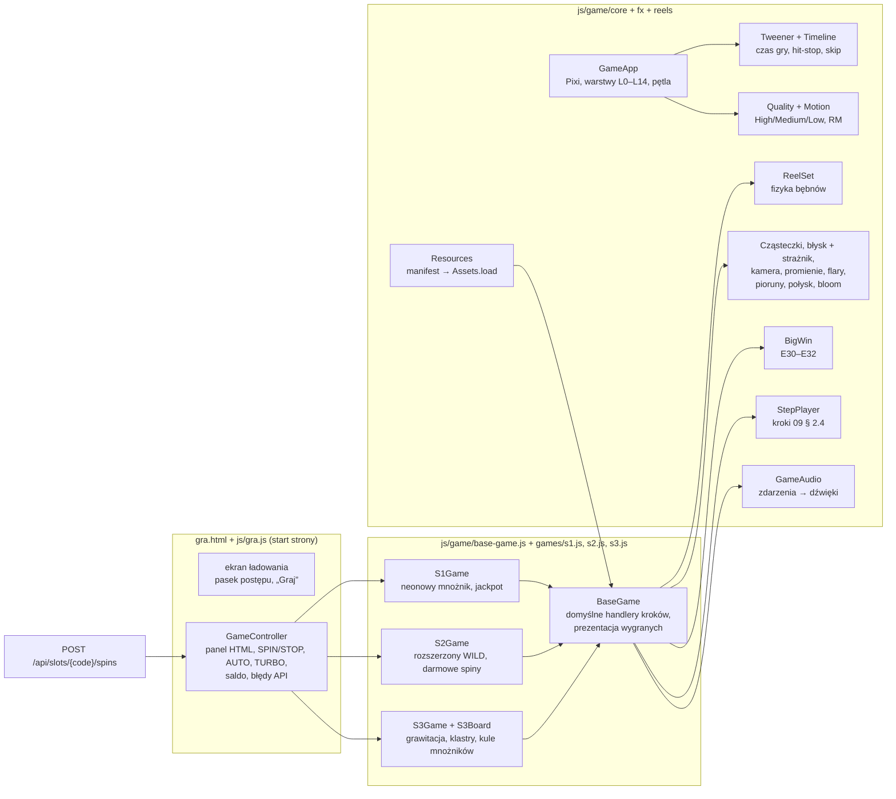

# 10 — Runtime gier w przeglądarce (stan zrealizowany)

> Ten dokument opisuje, **jak naprawdę zbudowany jest silnik gier** po stronie przeglądarki (`static/js/game/**`)
> i trzy gry: S1 „Cebulowy 777”, S2 „Złoty Faraon” oraz S3 „Kryształowa Kaskada”. Czytaj go razem z [04-efekty-wizualne.md](04-efekty-wizualne.md)
> (co i kiedy ma się dziać na ekranie), [05-dzwiek-i-muzyka.md](05-dzwiek-i-muzyka.md) (dźwięk) i kontraktem
> [09-kontrakt-api-i-assetow.md](09-kontrakt-api-i-assetow.md) (format odpowiedzi spinu i manifestu). Tu jest „gdzie
> to jest w kodzie i dlaczego tak”, a na końcu instrukcja, jak dodać kolejną grę.

## 1. Architektura w jednym obrazku



| Plik | Odpowiedzialność |
|---|---|
| `js/gra.js` | start strony: sesja, `GET /api/me`, `GET /api/slots/{code}` (z `paylines`), ekran ładowania (E20), przycisk „Graj” (gest odblokowuje dźwięk — 05 § 2.3), okno zasad z tabelą wypłat i diagramami linii, nakładka utraty kontekstu WebGL, panel `?fx=debug` |
| `js/game/controller.js` | panel sterowania nad płótnem, stany rundy, saldo, autoplay, turbo, skróty, błędy API, bonus ratunkowy, haptyka, punkt testowy `window.__gra` |
| `js/game/core/app.js` | aplikacja Pixi: `resizeTo` = scena, `autoDensity`, rozdzielczość = min(DPR, limit poziomu), warstwy, pętla, pauza przy ukryciu karty, utrata kontekstu, pomiar logiki i renderu |
| `js/game/core/tween.js` | zegar gry, tweeny z puli, `wait()`, `SkipToken`, oś czasu `Timeline` (04 § 2.1) |
| `js/game/core/easing.js` | easingi z 04 § 2.12 + `punch`, `hermite` (krzywa liczenia big win), `spring` |
| `js/game/core/quality.js` | poziomy jakości i automat (p90 > 20 ms przez 2 s → w dół), tryb ograniczonego ruchu |
| `js/game/core/resources.js` | tekstury po ID z manifestu (z wariantami `ruch1`, `ruch2`, `syl`, `glow`, `cien`, `male`), @1x/@2x, tła według `widths` |
| `js/game/core/canvas-art.js` | grafika efektów rysowana w kodzie (Canvas 2D), atlasy cząsteczek, banery BIG/MEGA/EPIC/ULTRA, złote cyfry, napisy neonowe |
| `js/game/core/random.js`, `pool.js` | deterministyczny generator efektów (ziarno z `roundId`, R10), pula obiektów |
| `js/game/fx/*.js` | cząsteczki, błysk + strażnik błysków, kamera, promienie / flary / pierścienie / pioruny, połysk (shader), bloom (High), złote cyfry, Big Win |
| `js/game/reels/reelset.js`, `paylines.js` | silnik bębnów, linie wygranych (`MeshRope`) |
| `js/game/step-player.js` | odtwarzacz kroków odpowiedzi spinu |
| `js/game/audio/game-audio.js` | mapowanie zdarzeń E20–E51 na ID dźwięków (05 § 6.1), ducking, warstwa napięcia |
| `js/game/base-game.js` | wspólna podstawa automatu: ładowanie, systemy, domyślne handlery wszystkich kroków, prezentacja wygranych |
| `js/game/games/s1.js`, `s1-art.js` | S1 „Cebulowy 777” i jego grafika zastępcza z kodu |
| `js/game/games/s2.js` | S2: egipska scena, antycypacja scatterów, pełnokolumnowy WILD, FS, retrigger i zmiana muzyki |
| `js/game/games/s3.js`, `s3-board.js` | S3: plansza 6×5 z grawitacją, obrysy klastrów, odłamki, opad istniejących kul i zbieranie mnożników |
| `js/game/games/zastepcza.js` | starsza scena pomocnicza; żaden z trzech automatów nie jest już do niej kierowany |
| `css/game.css` | elementy strony gry dodane z runtime (SPIN/STOP, menu AUTO, ustawienia, okna) |
| `tools/dev/mock-spins.mjs` | generator odpowiedzi spinu w atrapie API (z wymuszaniem wyniku) |
| `tools/e2e/gra-s1.mjs`, `gra-s2.mjs`, `gra-s3.mjs` | testy każdego automatu, umowy kroków, responsywności i ograniczonego ruchu |
| `tools/e2e/backend-flow.mjs`, `runtime-contract.mjs`, `audio-lifecycle.mjs` | przepływy rzeczywistego API, księgowanie na końcu rundy oraz cykl życia dźwięku |

## 2. Pętla gry i warstwy

**Jedna klatka** (ticker Pixi, kolejność stała — 04 § 7.3): `Tweener.update` (zegar, osie czasu, `wait`) →
systemy według `order`: bębny (20), otoczenie gry i licznik (35), cząsteczki (40), Big Win (45), kamera (50),
bloom (60) → próbka dla automatu jakości → **render Pixi**. Logika nigdy nie dzieje się w trakcie rysowania.

* `deltaMS` pojedynczego zacięcia przycinamy do 50 ms (bez przeskoku animacji o pół sekundy). Gdy urządzenie
  **stale** nie wyrabia (8+ długich klatek z rzędu), limit rośnie do 100 ms — inaczej przy 10 fps cała runda
  trwałaby dwa razy dłużej niż w briefie § 4.
* Dwa czasy: zwykły i **efektów** (staje w *hit-stop* 80 ms przy eskalacji big win). Tweeny z `freeze: true`
  (licznik, cząsteczki) stoją, kamera i muzyka nie.
* Karta ukryta → `ticker.stop()` (zegar gry też stoi, więc `wait()` czeka), audio `suspend()`.
* Utrata kontekstu WebGL → `preventDefault()`, pauza, komunikat; po `webglcontextrestored` wznowienie; po 3 s bez
  odzyskania — przycisk „Załaduj ponownie”.

Warstwy zgodne z 04 § 7.2: `world` (L0 tło … L11 kwoty, winieta) drży, `bigwin` (L12) dostaje 35% drżenia,
`bigwinFixed` (licznik big win) — 0%, `flash` (L13). Warstwy `add` (L6 linie, L10 iskry, podwarstwa big win) są
pogrupowane, żeby nie przerywać paczek rysowania.

**Skala sceny:** płótno ma rozmiar elementu `#scena` (między paskiem górnym a panelem; marginesy bezpiecznych
obszarów telefonu daje CSS `env(safe-area-inset-*)`). S1 liczy dwa układy — **logo z boku** (szeroki ekran:
komputer, telefon poziomo) i **logo nad automatem** (pion) — i wybiera ten, w którym pole symbolu jest większe.
Tło skalujemy „cover” z zapasem 4%, żeby drżenie nie odsłaniało krawędzi.

## 3. Zasoby: manifest i grafika z kodu

`Resources.load()` pobiera obrazy przez `PIXI.Assets.load` **pojedynczo** (błąd jednego pliku nie blokuje reszty)
i raportuje postęp do paska ładowania. Wagi paska (04 E20): obrazy 60%, grafika z kodu i przygotowanie 25%, wgranie
tekstur na GPU (`renderer.prepare`) i rozgrzewka shaderów 15%. Pasek nigdy się nie cofa.

**Zawsze przez ID** (`s1_sym_wild`, wariant `glow`) — nigdy ścieżką. Gdy obrazu nie ma, gra rysuje własną wersję
w Canvas 2D (`s1-art.js`, `canvas-art.js`): symbole S1 w stylu z 01 § 9 (emalia, chrom, neonowe obrysy), ich
warianty rozmycia ruchu / sylwetki / poświaty / cienia, tło synthwave, chromowano-neonową ramkę z żarówkami, logo,
banery BIG/MEGA/EPIC/ULTRA WIN złotymi literami 3D i złote cyfry. Rozdzielczość tej grafiki zależy od rozmiaru pola
w pikselach urządzenia (160–384 px).

**Rozmiar logiczny.** Warianty `glow` i `cien` bywają zapisane w skali 0,5 (`"scale": 0.5` — plik 166 px dla poświaty
332 px), a pliki @2x mają podwójną gęstość. `Resources` ustawia rozdzielczość źródła tak, żeby `texture.width` zawsze
znaczyło rozmiar logiczny `w` z manifestu — kod skaluje sprite'y według niego i nie zależy od tego, jak plik zapisano.
Okno ramki bierzemy z `frames.s1_ramka.window` (ułamki), a ramkę i rurki neonu rysujemy jako „pierścień” z czterech
pasków bez środka (mniej przerysowania pikseli na telefonie).

Cząsteczki rysuje `ParticleContainer` (Pixi 8), który wymaga jednej tekstury źródłowej na kontener — dlatego obrazy
z manifestu (`g_fx_iskry__0…7`, `g_moneta_*.male`, `g_fx_konfetti__0…11`, `g_fx_dym`) albo kształty z kodu
składamy przy starcie w dwa atlasy: `fx` (mieszanie `add`) i `normal` (monety, konfetti).

## 4. Silnik bębnów (`ReelSet`)

Bęben to nieskończona taśma: przesunięcie `p` (w polach), rząd `j` pokazuje indeks `j − p`, symbol pod indeksem
pochodzi z mapy wyniku albo ze stałego skrótu indeksu (wizualna taśma z wagami — nic nie migocze). Na bęben
przypada `wiersze + 2` sprite'ów.

| Faza | Jak (04 § 2.14) |
|---|---|
| zamach | 0,18 pola w górę w 120 ms, `easeOutQuad` (RM: brak) |
| rozpędzanie | do 22 pól/s w 200 ms, prędkość `easeInQuad` |
| dopasowanie | gdy przyjdzie odpowiedź: cel `N` (całkowity) i współczynnik prędkości `f` (zwykle ±3–4%) tak, żeby koniec hamowania wypadł dokładnie w zaplanowanej milisekundzie stopu |
| hamowanie | `p = pb + d·(1 − (1 − t/D)³)`, `D` = 260 ms; `d` liczone z rzeczywistej pozycji, więc wyrównanie jest dokładne; koniec **za** celem o 0,12 pola = moment stopu (E26) |
| osiadanie | powrót o overshoot w 160 ms, `easeOutBack(1,2)` (RM: bez overshootu) |
| antycypacja | bęben z pola `anticipation` staje +900 ms później, po 400 ms zwalnia do 0,55 v_max |
| szybki stop | wszystkie kręcące się bębny hamują od razu (0,6 D, co 40 ms) |
| spóźniona odpowiedź | pierwszy stop = max(plan, teraz + 450 ms), kolejne przesunięte o tyle samo |
| błąd sieci (E40) | łagodne hamowanie (1,5 D) na planszy SPRZED spinu — nie wymyślamy wyniku |

Parametry powyżej dotyczą S1. Stopy S1: 1240 / 1420 / 1600 ms (TURBO × 0,45).
S2 używa tego samego `ReelSet`, ale ma pięć stopów 1400 / 1600 / 1800 / 2000 / 2200 ms,
prędkość 26 pól/s i wydłużenie antycypacji o 1200 ms. S3 zastępuje `ReelSet` klasą `S3Board`: symbole
spadają pod wpływem grawitacji, a po kaskadzie ocalały symbol przesuwa się dokładnie o liczbę luk pod nim. Rozmycie ruchu to podmiana tekstur (`ruch2` > 60% v_max,
`ruch1` 20–60%, ostry < 20%). Bęben ~170 ms przed stopem wysyła zdarzenie `approach` z dokładnym czasem — dźwięk
stopu jest planowany na zegarze audio co do milisekundy (R6), a `sfx_wild` startuje tak, by jego `syncPoint`
z manifestu (150 ms) trafił w lądowanie.

## 5. Odtwarzacz kroków (`StepPlayer`)

Serwer zwraca całą rundę jako listę kroków; front **niczego nie losuje i nie liczy wyniku**. `StepPlayer.play()`
odgrywa kroki po kolei: każdy handler to funkcja `async`, następny krok startuje po `await` poprzedniego.

```js
const player = new StepPlayer({ hooks: { afterStep: (step, ctx) => … } });
player.register('spin', async (step, ctx) => { await reels.land(step.grid, { anticipation: step.anticipation }); });
player.register('win', async (step, ctx) => { await presentWins(step, ctx); });
await player.play(response, { tempo: turbo ? 0.45 : 1, autoplay, token });
```

Kontekst `ctx`: `response`, `steps`, `index`, `bet`, `tempo`, `autoplay`, `skip` (SkipToken — przewinięcie),
`state` (dane gry między krokami), `shownWin`, `next(type)` (podgląd kolejnych kroków).

| Krok | Handler w `BaseGame` (domyślny) | S1 |
|---|---|---|
| `spin` | `reels.land(grid, anticipation)`; `phase: "free"` — licznik darmowych spinów, start bez `sfx_spin_start`; rezerwacja błysku-bohatera, gdy jednostka skończy się big winem | ten sam + E26/E27/E33 z hooków bębnów |
| `win` | prezentacja jednostki: E28 / E29 albo Big Win E30–E32 | + E50 dla linii z `wildMultiplier: 2`, idiomy symboli |
| `feature` | komunikat z nazwą i mnożnikiem | **E51 NEON JACKPOT** (`neonJackpot`), potem liczenie big win bez wstępu E30 |
| `expandWild` | słup światła + podmiana planszy | — (S2) |
| `cascade` | pęknięcie usuwanych symboli, nowa plansza z opadem | — (S3) |
| `applyMultiplier` | „×N”, doliczenie w polu wygranej | — (S3) |
| `freeSpinsStart` / `Retrigger` / `End` | komunikaty, licznik w HUD; `freeSpinsEnd` ≥ 15× → Big Win z sumą FS | — |

**Jednostki prezentacji (04 § 2.19).** Spin bazowy, każdy darmowy spin i podsumowanie FS to osobne jednostki;
`m = (totalWin po − totalWin przed) / bet` wybiera oprawę według progów z briefu § 3. W rundzie bez darmowych spinów
wynik musi równać się polu `tier` — rozjazd jest liczony w `stats.tierMismatch` (test e2e wymaga 0).

**Saldo:** przy starcie spinu panel od razu odejmuje zakład; `balanceAfter` z odpowiedzi księgujemy w chwili
końca liczenia ostatniej jednostki albo przylotu jej licznika Big Win do panelu (E32), a dla rundy bez wygranej — po
zatrzymaniu bębnów. Gdy po bieżącym kroku są jeszcze kroki rundy, `BaseGame.book()` odkłada zapis salda: bonus
nie pokazuje przyszłych wygranych przed ich prezentacją. Kontroler ostatecznie uzgadnia `balanceAfter` po całej
rundzie. Księgowanie odbywa się dokładnie raz na rundę; regresję sprawdza `runtime-contract.mjs`.

## 6. Systemy efektów

| System | Plik | Najważniejsze |
|---|---|---|
| Cząsteczki | `fx/particles.js` | struktura tablic (`Float32Array`), zamiana z ostatnią żywą (O(1)), `ParticleContainer` z `dynamicProperties`; limit 600 / 300 / 120 z priorytetami P1–P3; presety: `iskry_wybuch`, `iskry_migot`, monety (obrót z 3 ujęć), deszcz i fontanna monet, konfetti (udawany obrót 3D), dym, `neon_iskry` z jednym odbiciem, pył tła |
| Błysk i strażnik | `fx/flash.js` | ≤ 3 błyski / s (WCAG 2.3.1); amplituda jako ΔL zależne od jasności podłoża; scalanie (< 120 ms) przez wchłanianie; **rezerwacja** miejsc dla błysków-bohaterów (uderzenie BIG WIN, eskalacje, slam, NEON JACKPOT); wariant łagodny ΔL < 0,08; RM — brak błysków; log dla e2e |
| Kamera | `fx/camera.js` | trauma (w = T², szum gładki 22 Hz), drżenia < 0,4 px pomijane, kopnięcie kierunkowe 3 px przy stopie ostatniego bębna z WILD, zoom w stronę bębna w antycypacji |
| Promienie, flary, pierścienie, pioruny | `fx/effects.js` | z puli obiektów; promienie przeciwbieżne ≤ 8°/s z oddechem alfy, „ciemny takt” przed uderzeniem |
| Połysk | `fx/effects.js` (`Shine`) | własny filtr (shader) — pas świeci tylko w obrębie alfy obiektu; Low: puls białej sylwetki |
| Bloom | `fx/effects.js` (`Bloom`) | High: jednoprzebiegowy filtr na warstwach `add`, włączany tylko, gdy warstwa ma treść (histereza 300 ms), stały `filterArea` = ekran; wynik filtra nakładany **addytywnie** (`filter.blendMode = 'add'` — przy domyślnym `normal` tekstury `add` na czarnym tle, np. dym, dawały szary prostokąt); Medium: poświata „upieczona” w teksturach `glow` |
| Licznik | `fx/digits.js` | glify `g_font_cyfry` z manifestu albo złote cyfry z kodu; cyfry tabelaryczne; zmiana liczby = podmiana tekstur, bez przerysowania płótna |
| Big Win | `fx/bigwin.js` | E30 (zasłona, dym, baner z uderzeniem, „ciemny takt”), liczenie segmentami (liniowo / Hermite), E31 (hit-stop, błysk poziomu, nowy baner, trauma +0,50 / +0,60 / +0,75, konfetti od MEGA, pioruny od EPIC, tęcza ULTRA), E32 (slam, przytrzymanie, licznik leci do panelu), przewinięcie wg 04 § 4.5 |

Shadery (bloom, połysk) kompilujemy na ekranie ładowania renderem do pozaekranowej `RenderTexture` 64×64 — inaczej
kompilacja trafiłaby w pierwszy Big Win (zacięcie 50–200 ms).

## 7. Poziomy jakości i ograniczony ruch

| | High | Medium | Low |
|---|---|---|---|
| DPR | ≤ 2 | ≤ 1,5 | 1 |
| cząsteczki | 600 | 300 | 120 |
| bloom | filtr | `glow` z tekstury | brak |
| drżenie | tak | tak | nie |
| promienie | 2 warstwy, 1,6× | 2 warstwy (B × 0,3), 1,3× | 1 warstwa, 1,1× |
| połysk | shader | shader | puls sylwetki |
| cienie symboli | tak | tak | nie |
| pył tła, impuls siatki S1 | pełne | połowa | brak |

* Start: komputer High, ekran dotykowy Medium, `deviceMemory ≤ 2` / `saveData` Low.
* Automat: bufor 120 czasów klatek, p90 co 500 ms; 4 pomiary z rzędu > 20 ms → poziom niżej. Podwyższenie tylko
  między rundami (p90 < 12 ms przez 20 s, najwyżej raz na 2 min, bez powrotu na poziom, z którego dwa razy spadliśmy).
* Limit cząsteczek, drżenie i filtry działają od razu; rozdzielczość zmienia się dopiero między rundami.
* Ręcznie: ustawienia (ikona koła zębatego) → Auto / Wysoka / Średnia / Niska (wybór ręczny wyłącza automat).
* **Ograniczony ruch** (system albo przełącznik w ustawieniach): brak błysków, drżenia, piorunów, flar, migotania
  neonów i ciemnego taktu; promienie bez obrotu; cząsteczki × 0,3, bez konfetti; „uderzenia” zastąpione przenikaniem;
  liczenie big win × 0,6.

## 8. Dźwięk

`GameAudio` (`game/audio/game-audio.js`) to tabela zdarzeń z 05 § 6.1 w kodzie. Poziomy, pętle, warianty wysokości
i tonację ustala **manifest** `static/assets/audio/manifest.json` (05 § 7.5); w kodzie są tylko warianty zdarzeń
z 05 (autoplay −6 dB, drabina linii +100 c, eskalacje MEGA/EPIC/ULTRA 0 / +200 / +400 c). Silnik
`js/audio/audio-engine.js` obsługuje pola manifestu:

| Pole | Co robi silnik |
|---|---|
| `webm` / `m4a` | wybór formatu przez `canPlayType('audio/webm; codecs="opus"')` raz na stronę; gdy dekodowanie .webm mimo to zawiedzie — .m4a do końca wizyty |
| `loop`, `loopStart`, `loopEnd` | `source.loop`, punkty pętli **i start od `loopStart`** (`source.start(t, loopStart)`) — AAC/Opus mają ciszę kodera na początku i końcu pliku; pętla po całym buforze „czkałaby” co obieg (0,2 s efekty, 0,5 s muzyka) |
| `gainDb`, `gainJitterDb` | poziom pliku względem szyny (np. `mus_bigwin` +4 dB) ± losowa mikro-zmiana |
| `pitchCents` | losowa mikro-zmiana wysokości ± (UI ±30 c, tonalne ±5 c, szumowe ±80–100 c) |
| `keyTrack` | transpozycja do tonacji kontekstu (`setKeyContext`: lobby 0, s1 0, s2 +200, s3 +400, bigwin 0) z wyjątkami per plik (`{"s2": 100}`); łącznie z wariantem zdarzenia ≤ ±400 c (wyjątek: `sfx_linia` do +700 c) |
| `syncPoint` | opcja `hitIn` w `play()`: plik startuje `syncPoint / prędkość` przed zdarzeniem (poprawka na transpozycję); spóźnieni — wejście w środek pliku tak, by uderzenie i tak trafiło. Używane: `sfx_wild`, `sfx_antycypacja_narastanie` (szczyt = stop bębna), `sfx_bigwin_wejscie` (start `mus_bigwin` w chwili uderzenia — na zegarze audio), `sfx_poziom_w_gore`, `sfx_blysk` |
| `maxVoices`, `cooldownMs`, `group` | limity na dźwięk/grupę: nadmiar wycisza najstarszą kopię (`sfx_poziom_w_gore` — 80 ms), start w czasie `cooldownMs` jest pomijany; Low: grupy z limitem ≥ 6 (monety) dostają połowę |
| `priority` | limit 24 głosy (Low 16, bez panoramy), kradzież najniższego / najstarszego; 5 nigdy nie jest kradziony |
| `packs` | `gameSounds(sN, faza)` wg reguł 05 § 2.4: faza krytyczna (`ui`, `gry-krytyczne`, `sN` bez `gry-dalsze`) — bajty pobierane już na ekranie ładowania, dekodowane po geście „Graj”; faza dalsza (`gry-dalsze`) — w tle po intro; pliki innych gier pomijane |
| `bpm`, `beatsPerBar` | pozycja muzyki do wznowienia po big winie — początek taktu, z uwzględnieniem pętli |

Poza tym: szyna muzyki przez **ducking** (nazwane: `wygrana` −3 dB, `bigwin` −6 dB, `napiecie` −4 dB, `stinger`
−6 dB — kilka naraz = najgłębszy) i **filtr dolnoprzepustowy** (1200 Hz w antycypacji), warstwa napięcia
`mus_napiecie` w osobnym gnieździe, warianty bez powtórzeń, `stopAll`, `stats()` dla testu e2e. Brak manifestu albo
pliku = cisza bez błędów (jedno `console.warn` na ID przy błędzie dekodowania).

## 9. Atrapa API i testy

* `node tools/dev/mock-api.mjs` — `POST /api/slots/{code}/spins` z generatora `tools/dev/mock-spins.mjs`
  (walidacja zakładu, saldo, `Idempotency-Key`, historia). Wynik można wymusić nagłówkiem `X-Mock-Force` albo
  `?force=`: S1 `lose | small | medium | big | mega | epic | ultra | jackpot | wild | anticipation`, S2 `fs | lose`,
  S3 `fs | cascade | lose`. `GET /api/slots/{code}` zwraca `paylines` dla gier liniowych.
* `cd tools && node e2e/gra-s1.mjs [adres] [katalog]` — logowanie, 20+ spinów z wymuszeniami, saldo po każdej
  rundzie, strażnik błysków, responsywność, zrzuty, pomiar klatek i long tasks (także z dławieniem CPU × 4), tryb
  ograniczonego ruchu. Wyniki: `tools/e2e/zrzuty/gra-s1/wyniki.json`.
* `?fx=debug` w adresie gry — panel: FPS, p90, poziom jakości, cząsteczki, trauma, błyski / s.

## 10. Dedykowane gry S2 i S3

`js/gra.js` wybiera `S1Game`, `S2Game` albo `S3Game` według kodu automatu. Wszystkie używają odpowiedzi
serwera jako źródła wyników. Poniższe animacje odtwarzają kroki; nie losują wygranych i nie odtwarzają matematyki serwera.

### S2 — Złoty Faraon

* `s2.js` ładuje 12 symboli z wariantami, logo, cztery tła i ramkę. Okno bębnów pasuje dokładnie do
  `manifest.frames.s2_ramka.window`; scena ma osobne tła pionowe i poziome.
* `onExpandWild()` pokazuje obraz `s2_wild_rozszerzony` na pełne trzy rzędy, ujawniany maską od pola WILD.
  Kolejne kolumny startują od lewej; zakryte symbole są ukrywane, a końcowa siatka pochodzi z `step.grid`.
  Złote poświaty, hieroglify, piasek i dźwięk rozszerzenia towarzyszą prezentacji. Następny spin przywraca zwykłe symbole.
* `freeSpinsStart` używa `count` z odpowiedzi, włącza nocną scenę i `mus_s2_fs`, a oznaczenie informuje o ×2
  dla wygranych liniowych. `freeSpinsRetrigger` używa `added` i `freeSpinsLeft`; `freeSpinsEnd` pokazuje sumę
  z serwera, przywraca skarbiec i `mus_s2`.
* Antycypację wybiera pole `anticipation`; istniejące scattery pulsują, aktywna kolumna dostaje wiązkę światła,
  a muzyka przechodzi w napięcie. Tryb ograniczonego ruchu zachowuje wynik i czytelność bez drżenia i błysków.

### S3 — Kryształowa Kaskada

* `s3.js` odpowiada za scenę, symbole, obrysy i kwoty klastrów, odłamki, darmowe spiny oraz kule mnożników.
  `s3-board.js` obsługuje planszę 6×5, wyjście poprzedniej planszy, opad, kaskady i szybkie zatrzymanie.
* Przy kaskadzie klient przesuwa istniejące kule o liczbę usuniętych pól pod nimi, zachowując ich wartość.
  `cascade.orbs` dodaje tylko nowe kule; `spin.orbs` zastępuje cały zestaw na początku następnego spinu.
* `applyMultiplier` zbiera etykiety kul do licznika. Kwota końcowa korzysta z `baseWin + win`, co respektuje
  również limit maksymalnej wygranej zastosowany przez serwer. Kule bez wygranej nie są zbierane.
* `S3Board` stosuje końcowe `grid` po zakończeniu albo przewinięciu każdego opadu. Utrzymuje osobne animacje
  istniejących i nowych symboli, a w ograniczonym ruchu wyłącza odbicia.
* Bonus przełącza tło i muzykę na `mus_s3_fs`; koniec przywraca `mus_s3` i usuwa pozostałe etykiety kul.

### Rozszerzanie runtime o kolejny automat

Nowa klasa dziedziczy po `BaseGame`, definiuje `config`, `imageRequests`, `buildViews`, `buildScene` oraz
`layoutScene`. Własne zdarzenia implementuje przez nadpisanie handlerów kroków. Następnie trzeba dodać wybór
klasy w `gra.js` i test umowy odtwarzania oparty na jawnej odpowiedzi API, włącznie z przewinięciem oraz
zmianą wielkości ekranu. Istniejące `gra-s2.mjs` i `gra-s3.mjs` są przykładami testów z kontrolowanymi danymi.

## 11. Wyniki weryfikacji

Stan lokalnej integracji z 11 października 2026. Wyniki opisują wykonane sprawdzenia, nie oznaczają
publicznego wdrożenia ani pomiaru wszystkich urządzeń.

| Zakres | Wynik | Co sprawdzono |
|---|---|---|
| Java / Maven | 258/258 | backend, reguły automatów, konfiguracja i kontrakty |
| Lobby na rzeczywistym backendzie | 68/68 | logowanie, portfel, ekrany, nawigacja i działanie API |
| `backend-flow.mjs` | 46/46 | 126 rund, saldo, historia i błędy rzeczywistego backendu |
| `gra-s1.mjs` | 35/35 | S1: wygrane, jackpot, turbo, autoplay, szybki stop, dźwięk i układy |
| `gra-s2.mjs` | 29/29 | dedykowana scena, FS i retrigger, pojedynczy/potrójny WILD, saldo, muzyka, ograniczony ruch, licznik bonusu i komunikat po przewinięciu |
| `gra-s3.mjs` | 39/39 | kontrolowane odpowiedzi: opad, kaskady, zachowanie i zbieranie kul, FS, retrigger, przewinięcie oraz układy |
| `audio-lifecycle.mjs` | 13/13 | muzyka, wyciszenie, zmiana strony i zwalnianie zasobów |
| `runtime-contract.mjs` | 2/2 | odroczenie księgowania przyszłych wygranych i pojedynczy zapis salda |
| Pipeline obrazów | 0 błędów, 0 ostrzeżeń | manifest i przetworzone zasoby, w tym poprawiony baner EPIC WIN |
| Podglądy wideo | 3/3 | odtwarzanie kompletu S1/S2/S3; 480×720, 12 s, H.264 + VP9, każdy plik poniżej 2 MiB |

S2 sprawdzono przy 320×640, 390×844, 844×390 i 1366×768: cała ramka i okno symboli mieszczą się w scenie,
SPIN mieści się w oknie, pozostaje widoczny (łącznie z alfą rodziców) i odbiera kliknięcia. Test zawiera jawny
bonus z jedną i trzema rozszerzonymi kolumnami, retriggerem oraz podsumowaniem; końcowe saldo jest zgodne
z odpowiedzią. Zrzuty przejrzano wizualnie. Odpowiedzi testowe używają różnych liczb spinów, żeby wykryć wartości
wpisane na sztywno w prezentacji. Licznik FS mieści się przy 320 px i pokazuje tylko wygrane bonusowe
(180 z FS przy osobnych 40 z gry bazowej w odpowiedzi testowej). Komunikat z już przewiniętym tokenem
zwalnia animacje przed zniszczeniem; późniejsza zmiana rozmiaru okna nie wywołuje błędu.

Polecenia (z katalogu repozytorium; działająca atrapa domyślnie na porcie 8090):

```sh
node tools/e2e/gra-s1.mjs http://localhost:8090 <katalog-wynikow>
node tools/e2e/gra-s2.mjs http://localhost:8090 <katalog-wynikow>
node tools/e2e/gra-s3.mjs http://localhost:8090 <katalog-wynikow>
node tools/e2e/runtime-contract.mjs
```

`PW_CHROMIUM` wskazuje zainstalowaną przeglądarkę Chromium/Chrome. W bieżącej instalacji pliki projektu,
narzędzia dodatkowe, dane, katalogi tymczasowe i raporty znajdują się pod `E:\CebulionCasino`.
Testy z kontrolowanymi odpowiedziami sprawdzają prezentację; osobne testy Javy i prawdziwego API sprawdzają matematykę i portfel.

S3: 39 sprawdzeń dotyczy prezentacji z kontrolowanymi odpowiedziami na serwerze atrapy.
Osobna kontrola sceny S3 na prawdziwym backendzie (profil demo, seed 9) przeszła **8/8**: kaskady,
każda siatka, saldo i brak błędów JavaScript. Końcowy JAR został zbudowany i uruchomiony lokalnie na porcie 8080. Podglądy wideo pochodzą z lokalnego profilu demo i służą kaflom lobby.

### Wcześniejsze pomiary wydajności S1

Poniższe liczby pochodzą z wcześniejszego środowiska kontenerowego i nie są nowym pomiarem instalacji Windows.
Wcześniej sprawdzono również S1 bez manifestów: 30/30 (pięć prób dźwięku pominiętych przy braku audio).

Wydajność zmierzona w kontenerze **bez GPU** (WebGL programowy SwiftShader, 4 rdzenie współdzielone z innymi
zadaniami — obciążenie 4–12), widok 1366×768:

| Pomiar | bez dławienia | CPU × 4 (CDP) |
|---|---|---|
| klatka (rAF) w trakcie spinu, p50 / p95 | 117–233 / 133–383 ms | 150–333 / 200–633 ms |
| klatka w trakcie big win, p50 / p95 | 133–300 / 183–417 ms | 183–400 / 233–650 ms |
| long tasks (> 50 ms) na spin / big win | 21–30 / 45–61 | 21 / 39–46 |
| **logika gry** (JS, cała klatka) p95 | **0,5–0,7 ms** | **2,2–3,3 ms** |
| wywołanie renderu Pixi (JS) p95 | 1,0–5,8 ms | 3,6–6,8 ms |

(Zakresy z trzech przebiegów przy różnym obciążeniu maszyny; long tasks ≈ liczba klatek — główny wątek czeka na
programowy rasteryzator przy każdej klatce.)

Wniosek: kod gry (logika + przygotowanie renderu) mieści się w kilku ms na klatkę także przy dławieniu × 4 — ~95%
czasu klatki to rasteryzacja programowa SwiftShader w procesie GPU, której na urządzeniu z kartą graficzną nie ma.
Automat jakości zadziałał zgodnie z projektem (High → Medium po 9,6 s → Low po 14 s, „p90 100 ms > 20 ms przez 2 s”).
Liczby 60 fps trzeba potwierdzić na prawdziwym telefonie i komputerze (`?fx=debug` pokazuje FPS i p90 na żywo).

## Powiązane dokumenty

[04-efekty-wizualne.md](04-efekty-wizualne.md) · [05-dzwiek-i-muzyka.md](05-dzwiek-i-muzyka.md) ·
[09-kontrakt-api-i-assetow.md](09-kontrakt-api-i-assetow.md) · [01-kierunek-artystyczny.md](01-kierunek-artystyczny.md) ·
[README.md](README.md)

## Korekta po testach użytkownika — synchronizacja wygranych i okno środków

Serwer rozlicza całą rundę transakcyjnie przed odpowiedzią HTTP. Ujawnione opóźnienie dotyczyło
prezentacji: drugi licznik salda animował się jeszcze 500–1800 ms po powrocie SPIN do gotowości.
Kontroler ustawia teraz końcowe saldo bez dodatkowego odliczania, gdy prezentacja wygranej się kończy.
Pole WYGRANA rośnie w obrębie jednej rundy i nie przekracza `response.totalWin`; zaczyna od zera
przy kolejnym spinie. Powtórna animacja sumy kaskad lub bonusu nie cofa tego pola.

Każde opóźnione wygaszenie kwoty na planszy jest przypisane do konkretnej prezentacji.
Rozpoczęcie kolejnej usuwa poprzednie animacje jej wspólnego kontenera.

Okno `modal-srodki` ma osobne miejsce na zamknięcie oraz przyciski z zawijaniem tekstu.
Test `funds-modal.mjs`: 26/26, wymiary 320×640, 390×844, 844×390 i 1366×768;
sprawdzone dostępność bonusu, oczekiwanie na bonus, obniżenie zakładu i klawiatura.
Test `audit-win-timing.mjs`: 6/6 kryteriów, 16 rund (kaskady, bonus, pomijanie, zera i autoplay).
Raporty sprzed i po poprawce zapisano w `E:\CebulionCasino\testy\audit-win-timing-before` oraz `audit-win-timing-after`.

Dodatkowa regresja wykryła ponowne użycie obiektu Tween przed usunięciem starej referencji z aktywnej listy.
Recykling następuje teraz wyłącznie przy kompaktowaniu tej listy. `audit-tweener.mjs` potwierdza poprawne
czasy po skip, kill i utworzeniu tweena z onComplete (6/6). `audit-amount-presentation.mjs` potwierdza,
że dwie prezentacje rozdzielone o 200 ms zachowują własne czasy wygaszenia (1/1).
Końcowy pomiar po poprawce zegara: 12 rund / 6 kryteriów, bez błędów JavaScript.
